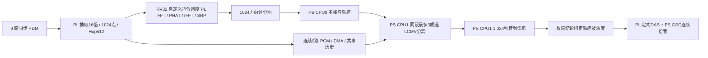
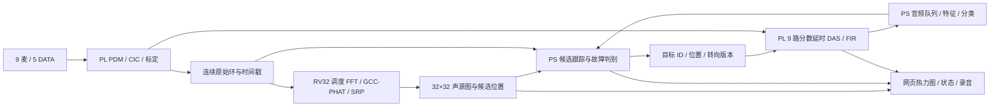
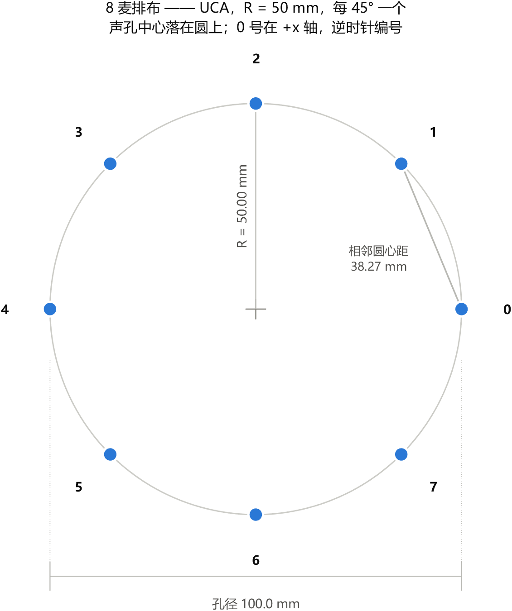
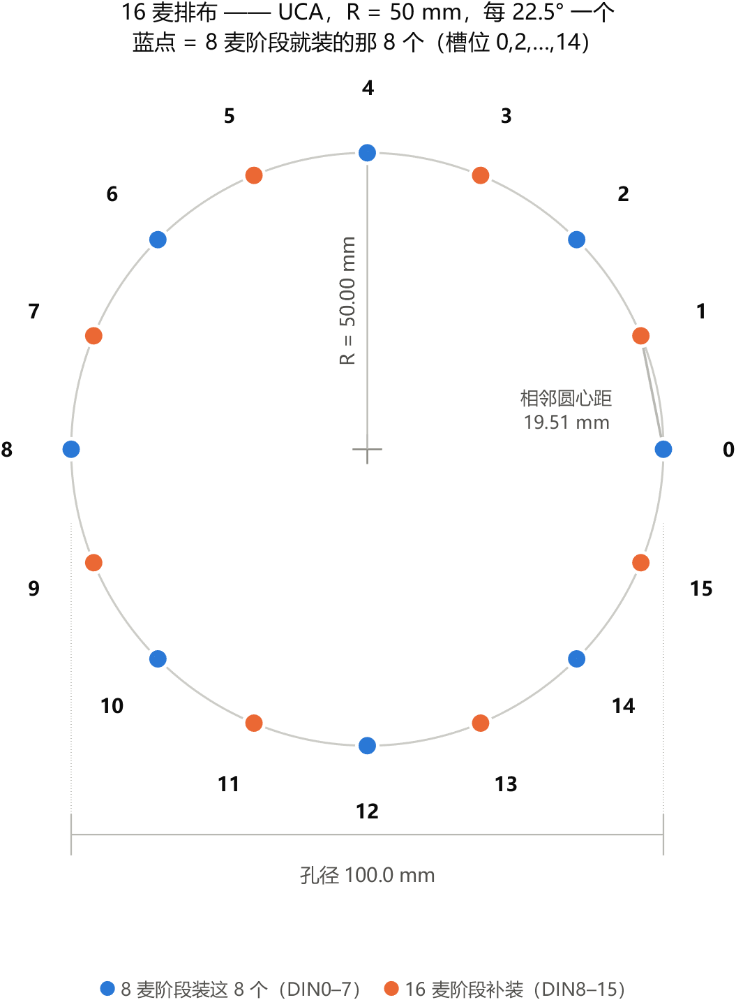
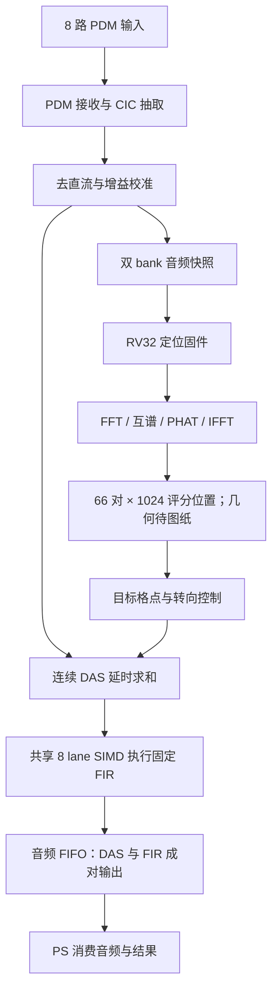

# 工程设计与接口

本手册集中说明采集接口、阵列配置、软核与声学单元、数据传输及PS处理结构。正式提交的系统描述和性能结论以技术报告为准；各专题保留其原始适用条件。

## 专题目录
- [板级 IO：J3 扩展口引脚分配（8 麦阵列 + 转速 + 备用）](#doc-0b9ebc083fe5)
- [9 麦阵列的纯方向扫描](#doc-8ff9571ea39c)
- [9 麦方向定位、候选分离和 PS 诊断实现](#doc-60cd04405fe2)
- [9 麦圆阵故障声源定位与定向拾音实施方案](#doc-240e9cca772c)
- [C9S3：实际输入多频带搜索与受保护协方差分离](#doc-3f7cd267d1a3)
- [8 路 DAS 到 PS 的音频块接口 v1](#doc-4d681ff638af)
- [FSTF 1800 rpm：九麦C9F2离线训练交付](#doc-e221312f7d35)
- [PS九麦GSC精确算术与目标保护](#doc-565bc412ebee)
- [GSC 用 SIMD-MAC 阵列算 —— 设计档](#doc-4e8518844077)
- [定位稳定性改进与实板测试方法](#doc-e0f67fce8dfc)
- [M7：严格几何/标定配置、离线拟合与固件加载](#doc-36ee4a19e848)
- [M9 开发记录与源码漂移阻碍](#doc-020981d6d621)
- [麦克风阵列载板排布（8 麦 / 16 麦）](#doc-0318679fbb5e)
- [八麦阵列载板规格](#doc-91f91fc0596c)
- [8maic.pdf 原理图核对（2026-10-22，更正）](#doc-e112d5991758)
- [PDM 麦阵列规格（默认12通道、6根DATA）](#doc-3fcf83a76066)
- [U1 与改线后 U2 的双麦共线检测](#doc-e1854126452f)
- [双麦 DATA 总线弱偏置受控对照](#doc-a78fa1350db1)
- [12麦PDM低资源诊断方案（提案，未改生产数据路径）](#doc-e2ef4caf9750)
- [当前接收器与截图对应 PDM 工程的边沿对照（2026-10-22）](#doc-9b4f229e9bbf)
- [PDM外部窗口的条件Setup/Hold分析](#doc-2cd098810e2b)
- [双麦共线 ILA 板上诊断（2026-10-21）](#doc-bf0bb891f07a)
- [IM73D122 双麦共线续查（2026-10-22）](#doc-a71dfb467fa9)
- [参考采集方案实测对照（2026-10-22）](#doc-cf157dd02c51)
- [12路双麦共线时序模型](#doc-c3b4262cf945)
- [U1 / U2 / 双麦同构建对照（2026-10-22）](#doc-66042340ae78)
- [U2 候选 L/R、NC 引出后的相位验证](#doc-f66dee48e29f)
- [Application bottlenecks — Phase 2 and Phase 3](#doc-1c81f267545d)
- [PL 端全部内容详解：从麦克风引脚到声源定位与增强音频](#doc-04a573eff9c4)
- [PS 对齐现有 PL FIFO](#doc-12d3572777af)
- [未来PS-GSC同步数据契约 v1](#doc-88190214067a)
- [九麦双层GUI + 固定方向GSC（未做双模式）](#doc-49b036519dde)
- [VFFT —— 核内的 512 点复数 FFT 执行单元（设计档）](#doc-d61fce6c320a)
- [声源定位/DAS集成验证复现](#doc-468ae1e0a38c)

---

<a id="doc-0b9ebc083fe5"></a>

## 板级 IO：J3 扩展口引脚分配（8 麦阵列 + 转速 + 备用）

> **2026-10-21 production update:** use the [confirmed planar8 board configuration](../README.md). Four shared DINs: T14/Y17/W16/T15; CLK V16; active-low reset N16. The 12-mic three-face board is retired. Circular-array and 12/16-channel specifications below are historical and do not override `configs/production_array.json`.


> 当前默认12通道/6根DATA，目标映射以第8节为准；前文8麦排线/旧板测仅供历史参考。12麦载板仍UNVERIFIED_HARDWARE。

> **这份是唯一权威口径。** 画载板的、写固件的、改约束的，都看这里。
> 改动必须同时更新本文件与 `constrs/ps_pl_wrapper.xdc`，不许留两套（CLAUDE.md §1）。

底板：正点原子领航者 V3.4。J3 是 2×20（40 针）的 PL 扩展口。

> **2026-10-01：核心板从 XC7Z010 换成 XC7Z020。** 对本文档的影响：
>
> - **J3 的封装脚一个都没变。** `scripts/check_pins.tcl` 用 Vivado 器件数据逐脚
>   对比了两个器件的 CLG400，19/19 同脚 —— 所以下面 §2/§3 的表和
>   `constrs/*.xdc` **原样有效**。
> - **J4 从「不可用」变成「可用」**：J4 是 `BANK13 (ZYNQ7020 Only)`，
>   7010 没有 Bank13。**但 J4 的逐针线序还没抽过**，别按它排线（详见
>   `mic_array_spec.md` R-20）。
> - ✅ **DDR 这条风险已应验并已修好**（2026-10-04，见 [issues/067](../README.md)）：
>   `scripts/ps7_config.tcl` 原来是从 **7010 的**厂商例程导出的，配的是
>   **MT41K128M16（2Gb/512MB）**；而这块板上的颗粒是
>   **NT5CC256M16（4Gb，两颗 = 1GB）**（从本目录的原理图第 8 页抽出）。
>   行地址少一根 + 整套时序不对 ⇒ **写 DDR 约 9% 丢掉** ⇒ A9 取到坏指令 →
>   执行到野生地址 → **PS 互连同 DAP 一起锁死，只能断电重上电**。
>
>   **修法**：按 7020 的厂商例程（`ZYNQ_Vitis_7020/20_pl_rw_ddr`）改了
>   `PCW_DDR_RAM_HIGHADDR` → `0x3FFFFFFF` 和 `PCW_UIPARAM_DDR_PARTNO`
>   → `MT41K256M16 RE-125`，重跑 BD、换掉 `ps7_init.tcl`。
>   实测 **DDR 写 11/128 错 → 0/128**，DDR 版 app 端到端 `PASS (0 failures)`。
>
>   另有一条**仍然可用、但不再必需**的绕过：app 从 OCM 跑
>   （`scripts/build_a9_ocm.sh`；`run_board.tcl` 现在以 Vitis 的 DDR 版为准，
>   只有它缺失时才回退到 OCM 版 —— 要强制指定用 `-elf <path>`）。
>   `run_board.tcl -elf <path>` 可以强制指定用哪一份（验 DDR 时就是靠它）。
> - **"J3 是板上唯一的 PL 扩展口"这句不再成立** —— 现在 J4 也是了。

---

### 1. 为什么需要这份文档

J3 的针脚和板上 RGB LCD、触摸、UART2、CAN **是共用的**。本设计**不使用板上 RGB LCD**
（人机界面跑在 PS 侧），因此这些信号脚可以释放给麦克风阵列 —— 但这个前提以前只写在
临时文件里，没进版本库，随时会丢。代价写清楚：**要了这些脚，板上屏就永远不能用了。**

另一个约束是硬的：**J3 全板只有 37/39 两个 GND、38 一个 3.3V。** 阵列那个 16 针块会把
它们全部吃掉，所以**之后往 J3 上接任何东西，都只能共用同一根排线** —— J3 的其余信号脚是
FPGA IO，不能当地用。

---

### 2. J3 完整 40 针表（已核实）

核实方法：从底板原理图 `02_IO` 页按**文本坐标**重建表格（`build/pdfsheet.py`（临时脚本，未入库）），
与工程里已记的锚点 `J3.11 = B34_L13_P = N18` 吻合。

| 针 | 网络 | 板上功能 | 针 | 网络 | 板上功能 |
|---|---|---|---|---|---|
| 1 | `UART2_RX` | UART2 | 2 | `UART2_TX` | UART2 |
| 3 | `CAN_TX` | CAN | 4 | `CAN_RX` | CAN |
| 5 | `B34_L12_N` | T_PEN | 6 | `B34_L14_P` | T_MISO |
| 7 | `B35_L7_P` | T_CS | 8 | `B35_L7_N` | LCD_BL |
| 9 | `B34_L15_N` | LCD_DE | 10 | `B34_L15_P` | LCD_VSYNC |
| 11 | `B34_L13_P` | LCD_HSYNC | 12 | `B34_L13_N` | LCD_CLK |
| 13 | `B34_L23_P` | LCD_B7 | 14 | `B34_L23_N` | LCD_B6 |
| 15 | `B34_L16_P` | LCD_B5 | 16 | `B34_L16_N` | LCD_B4 |
| 17 | `B34_L19_N` | LCD_B3 | 18 | `B34_L19_P` | LCD_B2 |
| 19 | `B34_L22_N` | LCD_B1 | 20 | `B34_L22_P` | LCD_B0 |
| 21 | `B34_L24_N` | LCD_G7 | 22 | `B34_L24_P` | LCD_G6 |
| 23 | `B34_L17_N` | LCD_G5 | 24 | `B34_L17_P` | LCD_G4 |
| 25 | `B34_L20_N` | LCD_G3 | 26 | `B34_L20_P` | LCD_G2 |
| 27 | `B34_L21_N` | LCD_G1 | 28 | `B34_L21_P` | LCD_G0 |
| 29 | `B34_L9_N` | LCD_R7 | 30 | `B34_L9_P` | LCD_R6 |
| 31 | `B34_L7_P` | LCD_R5 | 32 | `B34_L7_N` | LCD_R4 |
| 33 | `B34_L5_N` | LCD_R3 | 34 | `B34_L5_P` | LCD_R2 |
| 35 | `B34_L18_N` | LCD_R1 | 36 | `B34_L18_P` | LCD_R0 |
| 37 | **GND** | — | 38 | **+3.3V** | 电源 |
| 39 | **GND** | — | 40 | **+5V** | 电源 |

**两个容易记错的事实：**

- **第 7、8 针属于 Bank 35**（`B35_L7_P/N` → `U1G.M19`/`U1G.M20`），其余信号脚属 Bank 34。
  两个 Bank，**VCCO 可能不同**，别混在一个 IOSTANDARD 假设里。本设计没用到 7/8。
- **`+5V` 在第 40 针。** 见 §5 的安全条款。

---

### 3. 最终分配：一个 2×8 IDC，占 J3 的 25–40

| J3 针 | 网络 | 封装管脚 | IO 站点 | 分配给 | 方向 |
|---|---|---|---|---|:--|
| 25 | `B34_L20_N` | **R18** | `IO_L20N_T3_34` | **TACHO 转速** | in |
| 26 | `B34_L20_P` | **T17** | `IO_L20P_T3_34` | 备用 1 / DIN5 | in |
| 27 | `B34_L21_N` | **V18** | `IO_L21N_T3_DQS_34` | 备用 2 ★DQS | — |
| 28 | `B34_L21_P` | **V17** | `IO_L21P_T3_DQS_34` | 备用 3 ★DQS | — |
| 29 | `B34_L9_N` | **U17** | `IO_L9N_T1_DQS_34` | 备用 4 ★DQS | — |
| 30 | `B34_L9_P` | **T16** | `IO_L9P_T1_DQS_34` | 备用 5 ★DQS | — |
| 31 | `B34_L7_P` | **Y16** | `IO_L7P_T1_34` | SD0 / DIN0 | in |
| 32 | `B34_L7_N` | **Y17** | `IO_L7N_T1_34` | SD1 / DIN1 | in |
| 33 | `B34_L5_N` | **T15** | `IO_L5N_T0_34` | SD2 / DIN2 | in |
| 34 | `B34_L5_P` | **T14** | `IO_L5P_T0_34` | SD3 / DIN3 | in |
| 35 | `B34_L18_N` | **W16** | `IO_L18N_T2_34` | WS / DIN4 | in |
| 36 | `B34_L18_P` | **V16** | `IO_L18P_T2_34` | **BCLK / PDM_CLK** | out |
| 37 | GND | — | — | GND | — |
| 38 | +3.3V | — | — | 3V3 | — |
| 39 | GND | — | — | GND | — |
| 40 | +5V | — | — | **不接**（见 §5） | — |

† 26 早先建议在载板端用 0Ω 拉到地平面，**当 tacho 的专属回流**。**但现在 26 是 PDM 阵列的 DIN5**（见 §8），这个 0Ω 就不装了 —— 当初那句「要当信号用就把 0Ω 摘掉，可逆」说的正是现在这种情况。

#### 三个决定的理由

- **时钟放 36**：排线线序是 25→40，所以**整个连接器里只有 36 紧邻 37 的 GND**。
  它扇出到 8 个麦、是这条通路上频率最高的那根，最需要就近回流。这不是可选项之一
  —— 是唯一能做到的。**现在这根是 PDM_CLK（2.5 MHz），理由与当初放 BCLK 时完全一样。**
- **35 紧挨 36**：35/36 是**同一对差分对**（`L18_N`/`L18_P`）。当初这条是用来控
  BCLK→WS 的 skew；**换 PDM 之后 35 是普通数据线 DIN4，不再有这条约束**——
  但位置照旧不动，理由见 §8。
- **TACHO 放 25**：排线最远端，离时钟最远。它是开漏慢信号，最可能从机器那边带噪声进来。

#### 端口命名

`rv32_soc.v` 上已经定死了，照这个写：`pdm_clk_o`（1 根）+ `pdm_din_i[7:0]`（8 根）。
转速沿用 `tacho_i`。

---

### 4. 验证状态

#### 已验证 ✅

**封装管脚 → IO 站点**用 Xilinx 自己的器件数据复核过
（`scripts/check_pins.tcl`，**13 根**：J3 上的阵列 + 转速）。

**2026-10-01 换 7020 之后加跑了一次「两个器件逐脚对比」**，因为换器件最容易出的错
就是「脚位变了但 xdc 照常编译通过，只是全接错」：

> ⚠ 下面这段是**当时的**输出粘贴。那时 `check_pins.tcl` 的脚表里还有 19 个脚
> （含之后删掉的 I2S 阵列那几根）。脚本现在的表是 **13 个脚**，输出行数会跟着变；
> 「两边逐脚同脚」这个结论本身没有变 —— 器件换封装没换。

> ⚠ 下面这段是**当时的**输出粘贴。那时 `check_pins.tcl` 的脚表里还有 19 个脚
> （含之后删掉的 I2S 阵列那几根）。脚本现在的表是 **13 个脚**，输出行数会跟着变；
> 「两边逐脚同脚」这个结论本身没有变 —— 器件换封装没换。

```
$ vivado -mode batch -source scripts/check_pins.tcl
PART  xc7z010clg400-1  : 19 个脚里 0 个查不到
PART  xc7z020clg400-1  : 19 个脚里 0 个查不到
N18 → IO_L13P_T2_MRCC_34   两边相同   ← 已知锚点，用来验证抽取方法本身
V16 → IO_L18P_T2_34        两边相同   ← PDM_CLK
Y16 → IO_L7P_T1_34         两边相同   ← PDM DIN0
... 19/19 同脚
PASS: 两个器件在 CLG400 下这 19 个脚位完全相同
```

> ⚠ **第一版这个脚本报了个假 PASS**：19 个脚全"查不到"（`get_package_pins`
> 要先 `link_design`；站点在 `PIN_FUNC` 不在 `SITE`；异常被 catch 吞成空值），
> 而**空对空比较当然相等**，于是打印"完全相同"。现在脚本里有一条
> **有效性判据排在最前面**：只要有一格查不到就报 `INVALID` 并 exit 1。
> 见 [docs/issues/050](../README.md)。

这一步是必需的：封装管脚原先是从**核心板原理图的 PDF 书签树**抽出来的
（`B34_L13_P → U1F.IO_L13P_T2_MRCC_34 → U1F.N18`），不是 Vivado 报的。抽取用的批量正则
**有错配风险** —— 实测 `B35_IO0` 就被误配到 `U1F` 上过一次（`B34_*` 的子项是 `U1F.`，
`B35_*` 是 `U1G.`，正则没锁单元前缀时就会跨单元配错）。

**四条独立来源互相印证，19/19 全部吻合：**

| # | 来源 | 给出什么 |
|---|---|---|
| 1 | 底板原理图 `02_IO` 页（按坐标抽取） | J3 针号 ↔ 网络名 |
| 2 | 核心板原理图 PDF 书签树 | 网络名 ↔ IO 站点 ↔ 封装管脚 |
| 3 | **厂商 `领航者ZYNQ IO引脚分配总表.xlsx`** 的「RGB TFT-LCD接口」节 | `lcd_rgb[16..23]`（红）、`lcd_rgb[8..11]`（绿）、`lcd_hs` ↔ 管脚 |
| 4 | Vivado 器件数据（`scripts/check_pins.tcl`） | 封装管脚 ↔ IO 站点 |

第 3 条是**厂商自己发的表**，与我们的抽取完全一致：

```
J3.25 ← lcd_rgb[11] 绿 = R18     J3.31 ← lcd_rgb[21] 红 = Y16
J3.26 ← lcd_rgb[10] 绿 = T17     J3.32 ← lcd_rgb[20] 红 = Y17
J3.27 ← lcd_rgb[ 9] 绿 = V18     J3.33 ← lcd_rgb[19] 红 = T15
J3.28 ← lcd_rgb[ 8] 绿 = V17     J3.34 ← lcd_rgb[18] 红 = T14
J3.29 ← lcd_rgb[23] 红 = U17     J3.35 ← lcd_rgb[17] 红 = W16
J3.30 ← lcd_rgb[22] 红 = T16     J3.36 ← lcd_rgb[16] 红 = V16
J3.11 ← lcd_hs             = N18
```

> ⚠ **位序是反的**：J3.29 是 R7、J3.36 是 R0。这是这类抽取最典型的静默错误 ——
> 索引方向搞反会得到「12 根全错但看着像对」的结果。两边都一致，说明没有镜像错。

顺带也对上了其余几根：J3.5 = U19（`touch_int`）、J3.7 = M19（`touch_rst_n`）、
J3.8 = M20（`lcd_bl`）、J3.9 = U20（`lcd_de`）、J3.10 = T20（`lcd_vs`）、J3.12 = P19（`lcd_clk`）。

> 更正一句早先的说法：我先前讲「那份 xlsx 答不了这个问题」是**错的**。它确实没有「扩展排针」
> 这一节，但它的 **RGB TFT-LCD 节给出的正是 J3 共用的那批网络**，所以它答得了 —— 而且
> 它是全部四条来源里唯一的**厂商原件**。

`NAVIGATOR_ZYNQ_IO.xdc`（厂商的 Xilinx 约束文件，被仓库 4 处引用但不在仓库里）**不再阻塞** ——
上面第 3 条已经提供了等价甚至更直接的复核。有条件补上它仍是好事，尤其它会给全总线的
`set_property`，便于整条对照。

⚠ **封装管脚物理上量不到** —— 核心板是模块，BGA 焊在里面。所以任何"量一下 R18 是不是
J3.25"的想法都不成立。能实测的是**排针那一端**（见 §6 的走马灯测试）。

#### 从核心板原理图读出来的（2026-10-04，**不是实测**）

排针量不到的时候，去读了桌面上那份 `ZYNQ7010_7020核心板原理图_2V5.pdf`
（`pdftotext -layout` + `pypdf` 取词坐标）。**第 7 页是电源去耦页**，
每个 bank 一个电容组，轨名标在电容组上方：

| 电容组（按 x 列） | 上面的轨名 | 该 bank 的电源 |
|---|---|---|
| x≈105 `C8/C9/C14` | `VCCO_B13` | **+3.3V**（R223 **0R** 装、R220 VCCIO **NC**）|
| x≈201 `C27/C28/C29` | `VCCO_B35` | **+3.3V**（R216 **0R** 装、R218 VCCIO **NC**）|
| x≈256 `C44…C52` | **`VCCIO`** | **← VCCO_34 接的就是这一路** |
| x≈312 `C63…C68` | `+1.35V` | VCCO_DDR_502（DDR3L）✓ |
| x≈372 `C75…C79` | `+3.3V` | VCCO_MIO0/1 |

**判据怎么来的**：轨名标签与 bank 电容组的横向偏移在三条上都一致
（+7 / +8 / +7），其中 **`VCCO_DDR_502 ← +1.35V`** 是**已知正确**的
（DDR3L 就是 1.35V）⇒ 这个对齐方法本身被验证过。

⚠ **由此推出的、还没实测的一条**：VCCO_13/35 的选压电阻给的是
「**+3.3V 或 VCCIO**」二选一。**如果 VCCIO 也是 3.3V，这个二选一就没有意义**
⇒ `VCCIO` 很可能**不是 3.3V**（多半 1.8V，但**没读到标注，连线是图形**）。
而 **`VCCO_34` 是直连 `VCCIO` 的、没有选压电阻**。

**⇒ 对 PDM 阵列的直接后果**：9 根 PDM 脚全按 `LVCMOS33` 约束，
**若 VCCO_34 实为 1.8V，这些约束全错** —— 而且这会**同时解释板上
`FROZEN = 0xFF`**（不接麦时下拉到 0，与 VCCO 是多少无关；但只要 VCCO 不是 3.3V，
`pdm_clk_o` 的输出幅度、输入阈值就都不对）。

**所以 J3.38 那一量现在有了明确的预测**：

| 读数 | 含义 |
|---|---|
| ≈ **3.3V** | 约束正确 ✓，`FROZEN=0xFF` 就只是"没接麦" |
| ≈ **1.8V / 2.5V** | ⚠ **9 根脚的 IOSTANDARD 要改** |
| **0V** | 供电没起来，先查这路 |

#### 待实测 ❌

> **2026-10-02 已确认的**：JTAG 链上跑 `xsct scripts/detect_board.tcl` 读出器件是
> **`xc7z020`**，PS 双核在跑、能读 PS 地址空间 —— 与工程里
> `set part "xc7z020clg400-1"` **一致**。所以「板子是不是 7020」这条**已排除**。
> 下面这些都还在。

| 项 | 为什么重要 | 怎么做 |
|---|---|---|
| **VCCO_34 电平** | 阵列 6 根 + tacho 全按 LVCMOS33 约束。若实际不是 3.3V，两者一起失效。工程走 plain part（无 board file），**Vivado 不校验 VCCO 与 IOSTANDARD 是否匹配** ——「综合过了」不等于「板上对」 | 上电用万用表量 J3.38 对 GND；再驱动一个 Bank34 备用脚为高、量其实际幅度。**不通过不许插载板** |
| **VCCO_35 电平** | J3 第 7、8 针在 Bank 35。本设计没用到，但别假设它等于 VCCO_34 | 同上，量 7/8 脚 |
| **VCCO_13 电平**（新） | **想用 J4 的 Bank13 就必须先量这个。** 核心板电源页有 `VCCO_B13` 这个网络名，可选轨是 +1.8V / +3.3V / VCCIO，但**实际装的是哪个，原理图文本层抽不出来**（连线是图形）。若是 1.8V，Bank13 上的 3.3V 麦根本驱动不了 | 量 J4 任一 Bank13 脚的静态高电平（先下个把它驱动为高的位流），或直接量核心板 VCCO_13 的四个脚 T8/U11/W7/Y10。**8 通道 PDM 走的是 J3（§8 的「现状」表），根本不碰 J4，所以不受这条影响。**
J4 那套是 §8 末尾的**备选推荐**，未进 xdc |
| **外部上拉是否装了** | tacho 是开漏，靠上拉拉高。`ps_pl_wrapper.xdc` 自认「board has zero bring-up records」 | 量 J3.25 的 DC 电平 |
| **J3 的机械形式** | 2×8 母座插在 2×20 排针上**可以在 13 个位置里任意挪位，且错插不报任何错** | 问画板方：是开放排针还是带牛角 shroud。见 §5 |

---

### 5. 安全条款（写进画载板的规格）

1. **J3.40 = +5V，载板上禁止接任何网络。** 排线第 16 根导体物理上就在那儿，会插进载板的
   IDC 座。**若误把 5V 当 3.3V 用，8 个麦瞬间全毁。** 最保险是载板的 IDC footprint 上
   第 16 脚直接不画焊盘，或剪掉排线第 16 根。
2. **tacho 的外部上拉必须接 3.3V。** 风机/电机上常见的 12V 上拉会超出 HR bank 的绝对最大值，
   **打死 Bank 34**。载板上若自带上拉，用 4.7kΩ 到 3V3（不要用内部那个 ~50k —— 它和滤波
   电容凑成的时间常数会限制最高脉冲率）。
3. **每根信号串 33–100 Ω 限流。** 万一 VCCO 判错或错插，把「烧器件」降级成「不工作」。
4. **排线长度 ≤ 30 cm，越短越好。** 30 cm 是上限不是目标 —— 限制不在延时（往返约 3 ns 对
   5 ns 边沿，20 m 才用光采样余量），而在振铃与串扰。12 根信号只有 2 根地，缩短排线是
   最有效的改善。
5. **连接器建议带键 / 用整排 2×20。** 2×8 母座在 2×20 排针上可挪位也可反插；反插
   （180°）会把 +5V 上到信号位。

> ⚠ **`build/mic_array_spec.md` 早先那版连接器表是错的，已废弃。** 那张表写
> 「IDC 针 16 = 3V3」，而真实线序下第 16 位就是 J3.40 = **+5V**。它是在定下 J3 25–40
> 之前写的，照它做会烧麦。以本文件的 §3 为准。

---

### 6. 上板验证方案（顺序不能颠倒）

1. **VCCO 实测**（§4 表格）。**不通过不插载板。**
2. **引脚身份走马灯**：做一个**裸 PL 位流**（不需要 PS / BD / Vitis，绕开
   `docs/issues/018` 的 BD 环境问题），把 J3 25–36 这 12 根做成 one-hot 轮转 ——
   每根轮流拉高 1 秒，或用不同分频。拿万用表/示波器沿排针走一遍，**一次认全 12 根**。
   这同时验证了：引脚号、排线线序、载板的 IDC 定义。这是把「从 PDF 抽的」变成
   「量出来的」的唯一途径。
   - ⚠ **别用 `rv32_synth_top` 的综合流程做这个** —— 它的 xdc 故意把 UCIO-1 降级成
     Warning（`constrs/rv32_synth_top.xdc` 末行），会放过悬空端口。用 `rv32_board_top`。
3. **PDM_CLK 波形**：示波器看幅度、边沿、振铃（串阻装与不装对比）。
   8 根 DIN 也要各看一遍静态电平。
4. **tacho**：`scripts/test_tacho.tcl`。**注意它第 2 行的脚号只是注释，真正生效的是位流里
   固化的约束** —— 改了 xdc 必须重出位流。另需标定「每转几个脉冲」：RPM 换算
   （PS 侧的 RPM 换算那一处）假设 1 脉冲/转，而这个假设的出处文档
   （`README_FAN_DEMO.md`）**不在仓库里**，错了就是整数倍偏差。
5. **阵列端到端**：先只看 8 根 DIN 的静态电平，再接麦。

---

### 7. 已知的资源占用与后果

- **J3.11 / N18 被让出来了**，它是 `IO_L13P_T2_MRCC_34` —— **Bank 34 的 MRCC
  （时钟-capable）脚**。它**不在** 25–40 这个连接器里，要用得单独接线。
  **留着别分配给别人**：25–40 里没有任何 MRCC/SRCC，所以将来要往 FPGA 引外部时钟，
  只能靠 J3.5（U19）或 J3.11（N18）。
- **25–30 里 4 根是 DQS 脚**（★）：Bank 34 上能力最强的 IO（IDELAY/ISERDES）。
  当普通备用脚用没问题。注意 IDELAYE2 抽头范围只有约 2.4 ns（78 ps × 31），
  救不了 30 cm 排线的延时，所以对本接口没有价值 —— 保留它们是**保留选项**，
  不是浪费。
- **J3 剩余的 5–24 共 20 个信号脚未分配**（原 LCD 控制/数据线）。凡是要用，都得走同一根
  排线共用那两个地，或者接受单独飞线。

---

### 8. PDM 阵列引脚

默认目标为12只IM73D122V01、6根DATA和1根CLK。源码/约束映射可核对，12麦载板的DATA并接、相反L/R、CLK扇出与供电均为 **UNVERIFIED_HARDWARE**。

| 配置 | DATA | CLK | 状态 |
|---|---:|---:|---|
| 默认12通道、每线2麦 | 6 | 1 | 源码目标，实体待验收 |
| 8通道、每线1麦 | 8 | 1 | 合法参数化诊断配置 |
| 16通道、每线2麦 | 8 | 1 | 合法参数化配置，非默认 |

#### 12通道引脚表（默认目标，Bank34）

| 信号 | J3针 | 封装脚 | RTL通道 |
|---|---|---|---|
| **PDM_CLK** | **36** | V16 | 全部12麦共用，实体待确认 |
| DIN0 | 31 | Y16 | 0/1 |
| DIN1 | 32 | Y17 | 2/3 |
| DIN2 | 33 | T15 | 4/5 |
| DIN3 | 34 | T14 | 6/7 |
| DIN4 | 35 | W16 | 8/9 |
| DIN5 | 26 | T17 | 10/11 |

每线偶数通道要求LR=GND、奇数通道要求LR=VDD。Bank34采用LVCMOS33；核心板装配选项和VCCO实测尚未确认，不能把配置当作供电证据。`frozen`仅表示PCM长期不变，不能可靠检测共线缺麦或电气争用。

#### 8 通道引脚表（合法8线超集，非默认）

此表供8麦独立DATA/16麦双麦共线profile及旧引脚检查器核对，不代表默认12通道实际使用八根DATA。

| 信号 | J3 针 | 封装脚 | 原用途 |
|---|---|---|---|
| **PDM_CLK** | **36** | V16 | 原 BCLK |
| DIN0–DIN7 | 31,32,33,34,35,26,27,28 | Y16,Y17,T15,T14,W16,T17,V18,V17 | 合法8线超集 |

时序/启动策略见 `pdm_shared_timing.md`，整改记录见 `PDM双麦共线整改报告_2026-10-16.md`。

#### J4 完整线序（**2026-10-01 换 7020 后新抽**）

J4 是 2×20，标注 `BANK13（ZYNQ7020 Only）`。**7010 上没有 Bank13，所以这张表以前不存在**；
换成 7020 之后才有意义。

**抽法**：`scripts/golden/extract_j4.py`，从底板原理图 `02_IO` 页按文本坐标重建。
原理图里针号和网络名分两处画、网络名标签还画在针号**上方 2.8 个点**，
所以脚本先拿 **J3 上六行已知线序标定这个偏移**（6/6 对上），再用同一个偏移去配 J4。
没有这一步，整张表会**整体错一行而看起来完全正常**。

| 针 | 网络名 | 针 | 网络名 | 针 | 网络名 | 针 | 网络名 |
|:--:|---|---|:--|---|---|:--|---|---|
| 1 | `B13_L6_N` | 2 | `B34_L1_P` | 21 | `B13_L21_P` | 22 | `B13_L21_N` |
| 3 | `B13_L19_N` | 4 | `B13_L19_P` | 23 | `B13_L20_N` | 24 | `B13_L20_P` |
| 5 | `B13_L11_N` | 6 | `B13_L11_P` | 25 | `B13_L18_N` | 26 | `B13_L18_P` |
| 7 | `B13_L15_N` | 8 | `B13_L15_P` | 27 | `B34_L3_N` | 28 | `B34_L3_P` |
| 9 | `B13_L17_P` | 10 | `B13_L17_N` | 29 | `B34_L11_P` | 30 | `B34_L11_N` |
| 11 | `B13_L12_N` | 12 | `B13_L12_P` | 31 | `B34_L4_P` | 32 | `B34_L4_N` |
| 13 | `B13_L22_N` | 14 | `B13_L22_P` | 33 | `B34_L8_P` | 34 | `B34_L8_N` |
| 15 | `B13_L13_P` | 16 | `B13_L13_N` | 35 | `B34_L10_P` | 36 | `B34_L10_N` |
| 17 | `B13_L14_P` | 18 | `B13_L14_N` | 37 | `GND` | 38 | **`+3.3V`** |
| 19 | `B13_L16_P` | 20 | `B13_L16_N` | 39 | `GND` | 40 | **`+5V`** |

**一句话读法**：**1–26 针几乎全是 Bank13**（除第 2 针），**27–36 是 Bank34**，
**37/38/39/40 = GND / +3.3V / GND / +5V**（与 J3 同规矩）。

所以 J4 提供 **25 根 Bank13 + 11 根 Bank34 = 36 根 I/O**，外加 3.3V 和两个地。

> ⚠ **Bank13 的 VCCO 是多少伏，从原理图文本层查不出来**（连线是图形，
> 核心板电源页只给了 `VCCO_B13` 这个网络名和可选的轨：+1.8V / +3.3V / VCCIO）。
> 这是**必须上电量**的一项，和 VCCO_34/35 同级 —— 见 §4「待实测」。
> 若是 3.3V，J4 可以直连 3.3V 逻辑；若是 1.8V，**Bank13 那一半就不能直接接麦**，
> 只能走 J4 上的 11 根 Bank34（与 J3 同一个 VCCO_34）。
>
> **对 8 通道 PDM 来说这不是问题**：8 麦只要 9 根信号，
> **J4 的 11 根 Bank34 就够了**，根本不用碰 Bank13。

#### J4 完整接线表（含封装脚）

由 `scripts/golden/j4_table.py` 生成：针号→网络名取自 `extract_j4.py`（标定过），
网络名→封装脚取自底板原理图上 **J1 连接器旁印的**那一列，
**与 Vivado 器件数据是两条独立来源**。脚本自带 10 条已知值自检，全过才输出。

| 针 | 网络名 | 封装脚 | 针 | 网络名 | 封装脚 |
|:--:|---|---|:--:|---|---|
| 1 | `B13_L6_N` | **V5** | 21 | `B13_L21_P` | **V11** |
| 2 | `B34_L1_P` | **T11** | 22 | `B13_L21_N` | **V10** |
| 3 | `B13_L19_N` | **U5** | 23 | `B13_L20_N` | **Y13** |
| 4 | `B13_L19_P` | **T5** | 24 | `B13_L20_P` | **Y12** |
| 5 | `B13_L11_N` | **V7** | 25 | `B13_L18_N` | **Y11** |
| 6 | `B13_L11_P` | **U7** | 26 | `B13_L18_P` | **W11** |
| 7 | `B13_L15_N` | **W8** | 27 | `B34_L3_N` | **V13** |
| 8 | `B13_L15_P` | **V8** | 28 | `B34_L3_P` | **U13** |
| 9 | `B13_L17_P` | **U9** | 29 | `B34_L11_P` | **U14** |
| 10 | `B13_L17_N` | **U8** | 30 | `B34_L11_N` | **U15** |
| 11 | `B13_L12_N` | **U10** | 31 | `B34_L4_P` | **V12** |
| 12 | `B13_L12_P` | **T9** | 32 | `B34_L4_N` | **W13** |
| 13 | `B13_L22_N` | **W6** | 33 | `B34_L8_P` | **W14** |
| 14 | `B13_L22_P` | **V6** | 34 | `B34_L8_N` | **Y14** |
| 15 | `B13_L13_P` | **Y7** | 35 | `B34_L10_P` | **V15** |
| 16 | `B13_L13_N` | **Y6** | 36 | `B34_L10_N` | **W15** |
| 17 | `B13_L14_P` | **Y9** | 37 | `GND` | — |
| 18 | `B13_L14_N` | **Y8** | 38 | **`+3.3V`** | — |
| 19 | `B13_L16_P` | **W10** | 39 | `GND` | — |
| 20 | `B13_L16_N` | **W9** | 40 | **`+5V`** | — |

> ⚠ **J4 的 Bank34 那几根网络在板上与摄像头接口共用**
> （J1 侧邻域里就是 `CMOS_D1..D4` / `CMOS_SDA/SCL`）。
> 用它们接阵列就**不能同时插 OV5640/OV7725 摄像头** ——
> 与「要 J3 就不能用板载 RGB LCD」是同一类取舍。

#### 8 通道 PDM 直接接 J4 的推荐分配

**只用 Bank34 那 11 根**（不碰 Bank13，从而绕开它 VCCO 未知的问题）。
9 根信号 + 电源地，全部落在 **J4 的 27–39 这一小段**，接线最短：

| 信号 | J4 针 | 封装脚 | 说明 |
|---|:--:|---|---|
| **PDM_CLK** | **36** | **W15** | 与 J4.37(GND) 相邻，理由同 J3 的 BCLK |
| DIN0 | 35 | V15 | |
| DIN1 | 34 | Y14 | |
| DIN2 | 33 | W14 | |
| DIN3 | 32 | W13 | |
| DIN4 | 31 | V12 | |
| DIN5 | 30 | U15 | |
| DIN6 | 29 | U14 | |
| DIN7 | 28 | U13 | |
| 3V3 | 38 | — | |
| GND | 37 / 39 | — | |
| 余量 | 27, 2 | V13, T11 | 16 通道时再用 |

**换成 J4 要改的就是 `constrs/ps_pl_wrapper.xdc` 末尾那 9 行**：

```tcl
set_property -dict {PACKAGE_PIN W15 IOSTANDARD LVCMOS33} [get_ports pdm_clk_o]
set_property -dict {PACKAGE_PIN V15 IOSTANDARD LVCMOS33 PULLDOWN true} [get_ports {pdm_din_i[0]}]
set_property -dict {PACKAGE_PIN Y14 IOSTANDARD LVCMOS33 PULLDOWN true} [get_ports {pdm_din_i[1]}]
set_property -dict {PACKAGE_PIN W14 IOSTANDARD LVCMOS33 PULLDOWN true} [get_ports {pdm_din_i[2]}]
set_property -dict {PACKAGE_PIN W13 IOSTANDARD LVCMOS33 PULLDOWN true} [get_ports {pdm_din_i[3]}]
set_property -dict {PACKAGE_PIN V12 IOSTANDARD LVCMOS33 PULLDOWN true} [get_ports {pdm_din_i[4]}]
set_property -dict {PACKAGE_PIN U15 IOSTANDARD LVCMOS33 PULLDOWN true} [get_ports {pdm_din_i[5]}]
set_property -dict {PACKAGE_PIN U14 IOSTANDARD LVCMOS33 PULLDOWN true} [get_ports {pdm_din_i[6]}]
set_property -dict {PACKAGE_PIN U13 IOSTANDARD LVCMOS33 PULLDOWN true} [get_ports {pdm_din_i[7]}]
```

**RTL 一行都不用改** —— 换的只是这 9 个 `PACKAGE_PIN`。

> 机械上的代价见 [docs/pdm_array_spec.md](工程设计与接口.md#doc-3fcf83a76066) **P-13**：
> 省掉载板可以，但**麦仍然要固定在一块刚性件上**，否则 ±5 mm 的位置误差
> 会让 TDOA 系统性偏掉 —— 载板不只是转接，它是**几何基准**。

#### 16 通道方案（**备用，未例化**）

| 信号 | J3 针 | 封装脚 | 原用途 |
|---|---|---|---|
| PDM_CLK | 36 | V16 | 同 8 通道 |
| DIN8–DIN9 | 29,30 | U17,T16 | 原备用 4–5 |
| DIN10–DIN13 | 5,6,9,10 | U19,M19,M20,U20 | 原触摸 / LCD_DE / LCD_VSYNC |
| DIN14–DIN15 | 13,14 | 见 §2 | 原 LCD_B7 / B6 |

要切过去，改三处：`rv32_soc.v` 里把 `rv32_pdm_array_rx_8ch` 换成 `_16ch`、
`pdm_din_i` 加宽到 16 位、xdc 补上这 8 根。RTL 本身不用动（参数化）。

**刻意避开**：

- **J3.7 / J3.8 是 Bank 35**（`B35_L7_P/N`），VCCO 可能与 Bank 34 不同，
  别和 Bank 34 混在一个 IOSTANDARD 假设里（§2 的老提醒）。
- **J3.11 = N18 是 `IO_L13P_T2_MRCC_34`**，Bank 34 唯一的 MRCC 脚，**留着**（§7）。

**引脚占用**：PDM 阵列用的是 5–6、9–10、26–30、31–36 这几根。其余信号脚空着，
留给 16 通道扩容（见上「16 通道方案」）或以后别的东西。

**两个麦共用一根数据线（2026-10-10 起就是当前方案）**：PDM 允许两个麦共用一根
数据线，靠 **L/R（SELECT）脚**分时驱动 —— 一个在下降沿驱动、一个在上升沿驱动
（IM73D122V01 datasheet §3.5 Table 8）。**16 麦压到 8 根数据线 + 1 根时钟 = 9 根**，
与上表**同一个引脚表，一个字符都不用改**。

> ⚠ 这一节原来写的是「本设计**不用** —— 它把每通道的采样窗口砍一半，对追求 TDOA
> 精度的阵列不划算」。**那个理由不成立**：麦在它不占用的半周期是**高阻**的
> ⇒ 单麦配置下窗口本来就只有半个周期，共线一分余量都不损失。
> 见 [issues/090](../README.md)
> 与 `pdm_array_spec.md` P-06。
>
> **上表那 9 行仍然逐位有效**，只是含义从「8 根线 = 8 个麦」变成
> **「8 根线 = 16 个麦，每线一对（一个 LR=GND、一个 LR=VDD）」**。
> 端子号、封装脚、IOSTANDARD、下拉全部不变 —— `check_pdm_pins.py` 的 9 条断言
> 原样通过，这正是选这条路的原因。

---

### 9. 相关文件

| 文件 | 作用 |
|---|---|
| `constrs/ps_pl_wrapper.xdc` | tacho 引脚约束（R18）、VCCO 与开漏上拉的注意事项 |
| `scripts/check_pins.tcl` | 用 Vivado 器件数据复核封装管脚 ↔ IO 站点 |
| `build/pdfsheet.py`（临时脚本，未入库） | 按图纸名 + 坐标重建原理图表格（生成 §2 那张表） |
| `docs/mic_array_spec.md` | 给画板方的**机械/几何**规格（声孔位置、频率范围、半径；R-xx 编号） |
| `docs/pdm_array_spec.md` | 同上，**PDM 版**（P-xx 编号；时钟、抽取、引脚、待确认项） |
| `scripts/test_tacho.tcl` | 转速上板实测 |

---

<a id="doc-8ff9571ea39c"></a>

> 当前实现状态以 [2026-10-25 优化完成说明](测试验证与问题记录.md#doc-73520ff0027d) 和最新源码哈希验收为准。本文件保留前阶段架构、C9S2 或旧几何的历史说明；当前分离契约为 C9S3，PL/PS 已实现共享细化延时、实际协方差、多频带辅助搜索和硬件测速。下文历史数值不自动作为新版本证据。

## 9 麦阵列的纯方向扫描

本次按用户 2026-10-25 的要求，把圆形 9 麦工程改为只估计声源方向，不扫描距离。后续每个候选方向的分离音频交给 PS 做诊断；只有诊断接受的候选才可以标记为故障声源，定位主峰本身不代表故障。

### 方向和扫描范围

用户已确认阵列竖放，音箱位于阵列前方、不超过 180° 的范围。保留原有坐标约定：从阵列正面观察，`+x` 向右、`+y` 向上、`+z` 指向观察者。方向向量由阵列中心指向声源。

| 输出 | 定义 | 含义 |
|---|---|---|
| 水平角 `azimuth` | `atan2(x,z)`，单位度 | 0° 为阵列正前方；正值向右，负值向左 |
| 俯仰角 `elevation` | `asin(y)`，单位度 | 正值向上，负值向下 |
| 网格号 | `row * 32 + column` | 列对应水平角，行对应俯仰角 |

前半球分成 32×32 个方向格，两轴均以 5.625° 等间隔取格子中心，实际角度中心从 −87.1875° 到 +87.1875°。格子中心不放在极点或阵列板平面上，避免重复方向。1024 格全部用于方向，没有距离维度；程序不再假设声源位于 30 cm 的平面上。

生成的整数角度以毫度保存，例如 `2812` 表示约 +2.812°，显示时再换成度。离散方向网格的最大球面量化误差约 3.977°。这只是网格离散误差，不是实物测角精度保证；噪声、混响、通道相位、几何误差和有限孔径还会增加误差。

**平面阵列的前后镜像方向具有相同的到达时间差。** 当前通过安装约束仅搜索 `z > 0` 的前半球，不能仅凭这 9 个共面麦克风的时差判断声源在板前还是板后。测试时三个扬声器都应放在规定的阵列正面。如果将来要求同时区分板前和板后，需要增加非共面麦克风或提供其他可验证的信息。

### 平面波延时与现有加速器

配置中 `scan_model` 为 `far_field_direction`。对水平角 `a`、俯仰角 `e`，单位方向向量是：

```text
u = (cos(e) sin(a), sin(e), cos(e) cos(a))
d[m] = -dot(mic_position[m], u) * Fs / c
SRP_delay[a,b] = floor((d[a] - d[b]) * 16)
steer_delay[m] = floor((d[0] - d[m]) * 16)
```

`d[m]` 是相对于阵列中心的物理到达延时；`steer_delay[m]` 是相对第 0 麦的对齐延时，二者符号不能混用。相对第 0 麦的频域导向向量应使用 `exp(+j * omega * steer_delay[m] / 16)`。

保留 9 路、36 麦克风对、1024 方向、64 个相关延时、Q4 插值和现有 RV32 自定义指令／PL FFT、互谱、PHAT、IFFT、SRP、DAS 模块的接口。改变的是 PS 加载的 SRP／转向 LUT 数值及角度解释，不增加距离搜索或 PL 计算次数。

按用户 2026-10-25 补充的实际几何，声孔圆半径为 30 mm，直径孔径为 60 mm；生产配置和方向 LUT 已据此重新生成，原 25 mm 是历史假设。平面波模型省去距离参数，但近场声源仍会有球面波曲率误差；不扫描距离不等于任意距离都具有相同测角精度。实测应记录扬声器距离，比较几个距离下的方向误差，保持最终安装条件和标定条件一致。

### 生成文件与证据

- `configs/circular9_array.json`：方向范围、坐标约定和名义麦克风坐标；已移除 `plane_z_m`、`grid_half_m`。
- `scripts/build_circular9.py`：生成方向 LUT 和 `sw/circular9_direction.h`；`--geometry-only` 也会更新方向头文件。
- `sw/circular9_direction.h`：1024 个 Q30 单位方向、两轴角度、网格到毫度的转换及球面夹角余弦比较。候选峰去重应比较球面夹角，不能只比较网格行列距离，尤其是在接近上下极点时。
- `scripts/check_circular9_direction.py`：独立检查 46,080 个 SRP／转向延时、1024 个独立方向、无距离扫描的配置约束、角度符号、前后镜像相同延时、网格量化上界，以及导出 C 表的 Q30／64 位乘积。
- `scripts/check_circular9.py` 和 `scripts/check_circular9_e2e.py`：合成输入已改为给定水平角和俯仰角的平面波。

本次独立方向检查通过；5 组解析宽带 GCC／SRP 测试的主峰均落在注入的方向格上。数字单元测试也通过。证据在 `build/circular9_direction_checks/results.json`。

本次方向 LUT 与 `D3` 固件重新运行 32 个连续重叠窗，并通过静音、削顶、几何未确认、原始快照恢复及选择命令的测试。首个对齐 PCM 采样到 RV32 偶数序号稳定发布结果的仿真延时为 **9.153775～9.155650 ms**，最后一个采样到发布最大 **2.608450 ms**，更新步长 **3.2768 ms**，无采集／音频丢失。结果在 `build/circular9_checks/results.json`。计时不包含麦克风 ADC／声传播、真实 PS 收取结果、多候选分离或诊断决策；不能视为新增分离／诊断工作负载的端到端延时，也不能替代三声源实物测试、分离质量评估或 Cortex-A9 负载测量。

PDM 引脚输入的 8 帧仿真也通过，首个对齐 PCM 到 RV32 为 **9.159225～9.162625 ms**。已确认几何的专用仿真输入再交给本机 C 版 PS GSC，11,157 个音频包中有 8,344 个有效自适应输出采样、4 个诊断块、0 个对齐错误。当前方向格 800 的仿真从第一次可信方向到首次有效 GSC 输出为 **5.5744 ms**，包含转向过渡及自适应预热，不是固定的全方向上界。这是本机 C 执行验证，没有测量 Cortex-A9 的实际运行时间。证据在 `build/circular9_e2e/results.json`。

RV32 还提供 `D3` 选择命令，表示 PS 尚无诊断接受的故障目标，此时撤销方向可信状态，PS 不得将原有定向输出作为有效故障目标音频。PS 接受某个候选后，通过现有 `D1 + grid` 命令指向该候选；目标失效时再次发送 `D3` 撤销目标的可信状态。硬件可以保留上一次的转向系数，因此不能把内部 `beam_locked` 缓存标志当成故障目标有效的依据。`D2` 仍保留原有跟随最强峰的模式，不能在自动故障选择模式中代替 `D3`。数字测试包含“先保持→选择候选→再次保持”的状态切换。

### 三声源验证的边界

正常机声、故障机声和干扰音应先分别录制单独播放的阵列输入及参考音频，再同时播放，并交换方向和音量进行盲测。不能把最响、主峰或任意分离通道直接命名为故障；故障标签必须来自 PS 对该候选音频的有效诊断。

同一方向的声源、相距过近的方向、强相关播放内容、强混响，以及在小孔径阵列中空间可分性不足的低频成分，都可能无法可靠分离。分离模块必须拒绝几何或数值条件不满足的输出，并把诊断状态保持为未知。9 麦接线、通道顺序、实际声孔坐标和幅相标定未验收前，不能用仿真已确认几何标志绕过实物保护。

---

<a id="doc-60cd04405fe2"></a>

> 当前实现状态以 [2026-10-25 优化完成说明](测试验证与问题记录.md#doc-73520ff0027d) 和最新源码哈希验收为准。本文件保留前阶段架构、C9S2 或旧几何的历史说明；当前分离契约为 C9S3，PL/PS 已实现共享细化延时、实际协方差、多频带辅助搜索和硬件测速。下文历史数值不自动作为新版本证据。

## 9 麦方向定位、候选分离和 PS 诊断实现

2026-10-25 按用户确认的安装方式实现：阵列竖放，正常机器声、故障机器声、干扰音三个音箱均放在阵列正面的 180° 内。只输出方向角，不搜索距离。本文补充原实施方案，不改写原文件。

### 运行链路



候选分离在 PS CPU1 执行，先分离音频，再执行诊断。PL/RV32 保留定位硬件加速及最终所选方向的连续 DAS；PS 原有 GSC 自适应闭环保留。不能将本实现描述成“PL 已并行完成三路完整频域源分离”。当前 FPGA 的 RTL 未变化，61 个 RTL 文件与已完成布线的 bit 对应源码一致，新的方向 LUT 和 RV32 程序由 PS 在启动时加载。

方向坐标为正前方 0°、向右水平角为正、向上俯仰角为正。32×32 个角度格覆盖前半球，两轴步长 5.625°，无距离维度。离散网格的最坏球面量化误差约 3.977°；这不是实物测角精度保证。方向定义、时差符号、前后镜像和近场边界见 [方向扫描说明](工程设计与接口.md#doc-8ff9571ea39c)。

### 多声源与分离

`circular9_candidates.c` 从方向图提取最多三个局部峰，按球面夹角去重；当前 25° 去重门限不是物理可分辨角的保证。PS 每约 20 ms 读取一个完整方向图，跨帧指数积累证据，但候选必须仍有本帧的局部峰支持，历史峰不能单独保活。对曲率有效的峰做二维局部拟合，保留粗网格编号及角度不确定度；边界、平坦和鞍点拒绝细化。细化角度用于 PS 分离，PL 连续 DAS 仍选择原网格。

`circular9_tracking.h` 按角度关联而非能量排序保持轨迹 ID。漏检最多保留约 150 ms，期间不授权故障定向；恢复需连续三次有效观测。提交诊断还要求同一锚点的完整采样窗口至少有 90% 方向支持。短时丢峰不必重新积累整个一秒，长期丢失、明显移动或采集换代则重新确认。详细变化见 [本轮优化](测试验证与问题记录.md#doc-7aad92b3720f)。

CPU0 保存 3.3554432 秒的九路历史，约 14.68 MB，位于单独 16 MiB 非缓存段。每个槽写入前失效，PCM 与版本原子访问并带 ARM 屏障。CPU1 复制 160256 个原始帧到自身缓存内存，前 256 帧供滤波预热；三个候选使用同一份独立拥有的快照，不从不同时间的三段声音拼凑比较。

每路先用 127 tap 抗混叠滤波并 4:1 抽取到 39062.5 Hz，再做 1024 点、512 点步长的 STFT。C9S2 改为扇区保护的正则化约束波束形成：对目标中心保持单位增益，约束附近角度的增益变化，对其他候选的方向扇区做软抑制，并限制权重范数。噪声模型由单位阵和导向扇区构造，尚未估计实际声场的噪声协方差；不能称为已完成盲源分离或实测自适应 MVDR。第一版 C9S1 的单点最小范数 LCMV 作为历史对照。多约束波束形成的公式参考 [Habets 等 ICASSP 教程第 2 部分](https://www.audiolabs-erlangen.de/content/05_fau/professor/00_habets/06_activities/ICASSP-2013/2013_LPMAP_Part_2.pdf)。

输出为每候选 40000 个采样、1.024 秒，约 305–7973 Hz。约束病态、白噪声增益过大或零陷不满足要求的频点不进入诊断音频；报告保留频点掩码、目标约束误差、扇区增益、泄漏功率比、权重范数和可用位。死通道、削顶、空间条件不足或保留能量不足时不提交有效故障判定。C9F2 的载频工程配置为 2200–4600 Hz，分离还要求此带至少 95% 频点可用、连续缺失不超过三个频点；该频带未经真实 6004 声学验证。训练和推理核对 C9F2/C9S2 契约及滤波掩码，旧特征或未知滤波状态拒识。

多个声源同方向、方向太近、低频空间可分性不足、混响或导向误差会造成串扰。当前只是受约束的空间分离，不能承诺三个任意声源完全独立。尤其不能把“某候选比其他候选响”作为故障标签。

### 调度和结果有效性

CPU0 负责 DMA、连续 GSC、约 100 µs 的定位结果轮询、网络和低速多候选调度。约 20 ms 的候选图读取不改变 RV32 的快速发布步长。方向图按完整发布序号读取，32 格分块，500 µs 协作预算内多次让出给音频/定位服务。序号改变、重复序号、PL 时间戳过期都会拒绝该图；200 ms 无新有效图后清除轨迹。网页和 JSON 格式化也分段让出。`map_copies`、`map_retries`、`map_copy_max_us`、`candidate_service_max_us` 暴露复制饥饿和 CPU0 候选计算耗时。

CPU1 独占分离工作区和特征提取器；共享作业及结果双缓冲使用 acquire/release 所有权。CPU0 持有结果时 CPU1 不重写，HTTP 每次最多复制 512 个音频样本，并要求快照序号一致。计算不能停住采集；CPU1 忙时不排队积压过期诊断。512 ms 只是调度 hop，不等于 2 Hz 诊断更新；不宣称该更新节奏已达成。

每份诊断保存轨迹 ID、角度格、方位角/俯仰角、epoch、历史 session、快照起点和 RPM 配置代次。RPM 必须人工确认，范围 600–1800；确认后要积累新的完整窗口，改速再改回来也不能复活旧结论。采集 session/epoch 改变后转速需重新确认。主峰和诊断的采样时间不能混用。

启动默认“跟踪已诊断故障方向”。未确认目标时 `D3` 保持定位评分计算，但撤销定向音频的目标可信状态。仅有一个当前有效且模型接受的故障候选时，用 `D1+grid` 选择目标；目标过期或多个故障候选冲突时撤销。人工点选和“跟踪最强峰”是独立的测试模式，均不代表已找到故障。

### 诊断窗口及模型

1.024 秒内，600 rpm 对应约 10.24 转，1800 rpm 对应约 30.72 转，保留此观察长度以支持周期冲击和包络特征分析。C9F2 先选带取解析包络、抗混叠降采样为 2500 个包络点，再用一次 4096 点 FFT 分析整个观察段，替代原来的 24 次 8192 点 FFT。补零后的 0.596 Hz 频点间隔不是实际分辨率；Hann 等效噪声带宽约 1.465 Hz，第一零点偏移约 1.954 Hz。首次诊断还包括方向稳定、完整快照、分离与诊断计算；毫秒级定位和秒级故障确认分别验收。以后只有在真实 PS 算力及独立录音准确度通过后，才考虑重叠诊断窗提高更新频率。

当前没有用户目标机器的已验证真实模型，默认 `unknown/no_model`，不会自动把任何音箱标为故障。代码支持正常基线、正常/故障/干扰三类模型、未知拒识及验证状态；正常基线的异常不等于机械故障。模型需要同一分离链路产生的真实正常、故障与干扰录音训练，并用独立录制验收。流程和音频导出命令见 [诊断数据工作流](构建部署与操作.md#doc-7bc82840e2db)。

主要接口：

| 接口 | 用途 |
|---|---|
| `/api/heatmap` | 无距离参数的方向图 |
| `/api/candidates` | 候选轨迹、角度、分离状态、诊断、特征及版本 |
| `/api/rpm?value=1500` | 人工确认实际 RPM，重新开始有效采样区间 |
| `/api/target/fault` | 等待/跟踪诊断接受的故障方向 |
| `/api/target?grid=528` | 人工指定角度格进行拾音测试 |
| `/api/target/auto` | 跟踪定位主峰，不表示跟踪故障 |
| `/api/candidate/audio?sequence=N&index=I&offset=S&count=C` | 同一快照的候选分离 PCM，`C<=512` |

网页采用方向热图，故障红框必须通过模型、轨迹、分离和新鲜度检查；其余热图颜色只表示定位评分。可以导出三个候选的同段音频供对照试听和训练。

### 验证及上板边界

- 方向/LUT 独立检查、32 个连续重叠窗及 D3→D1→D3 仿真通过。首个对齐 PCM 到 RV32 发布为 9.153775–9.155650 ms；PDM 引脚输入仿真为 9.159225–9.162625 ms。Hop 为 3.2768 ms。
- 三个同频带无混响合成源，弱目标比最大干扰低约 18 dB：C9S2 精确导向 SIR 30.69 dB，3° 导向误差时 10.18 dB；历史 C9S1 分别为 43.65/8.37 dB，体现鲁棒性与理想零陷深度的取舍。独立离格夹具中细化前后 SIR 为 12.23/27.23 dB。28° 间隔的边界夹具被拒绝诊断；这些数值不能当成实物指标。
- 共享历史并发覆盖、epoch/session/回绕、死通道/削顶/重复方向，以及诊断未知保护、模型/频带契约、独立录制数据划分均有数字测试。
- PS 程序使用匹配 XSA 的 Cortex-A9 BSP 实际编译链接，定位自定义指令和硬件模块保留。新增 PS 工作负载的最坏运行时间、同时跑网络时的 10 ms 首次收取截止期，以及三音箱实物准确度尚未测量。

新的方向版本包输出到 `build/circular9_direction_release`，旧 `build/circular9_release` 作为原配套构建证据保留。包包含 bit、XSA、PS ELF、PS 初始化脚本、RV32、LUT、测试报告和本文；打包器核对源文件、实际 ELF、固件和测试哈希。接线完成后先用显式路径和 `-check` 核对：

```powershell
& D:/Vivado/Vitis/2020.2/bin/xsct.bat scripts/run_board.tcl -app ui_app -bit build/circular9_direction_release/pl.bit -elf build/circular9_direction_release/ps_ui.elf -init build/circular9_direction_release/ps7_init.tcl -check
```

本次没有连接、复位或烧写实板。实物通道、声孔几何和标定仍未确认，生产程序保持保护状态；尤其要先按 [上板说明](构建部署与操作.md#doc-ada9c67564e0) 核对原理图 H1 重复 DATA_4、第九麦 DATA_5 未引出的问题。完成电气/通道核对后，再按单声源、双声源、三声源逐步测试，保存每次角度真值和分离音频。最终故障方向能力须等真实模型及上述实物验证通过后才能验收。

---

<a id="doc-240e9cca772c"></a>

## 9 麦圆阵故障声源定位与定向拾音实施方案

日期：2026-10-22。本文是结合当前源码制定的实施方案，新增能力及指标均为待实现、待验收项。

### 1. 最终目标与方案范围

用户已确认：圆形 PCB 外半径 30 mm，外圈 8 个麦克风，中心 1 个麦克风；最终需要区分故障声源、显示定位热力图，并对故障位置定向拾音。

最终系统以 Zynq-7020 为平台，沿用 PL 内 RV32 自定义指令调度、声学加速器及 ARM 双核应用：

1. 连续采集 9 路真实声音，显示各麦状态并保留可追溯录音。
2. 在已知距离的设备表面扫描平面上显示声源分布，默认 32×32 网格。
3. 结合正常工况基线、候选位置的定向音频和故障特征，标记疑似故障声源。
4. 自动选择可信故障候选，也支持用户点选；持续输出该位置的增强音频。
5. 显示故障类别或“未知异常”、位置、定位可信度、分类得分、频谱和运行状态。

首个完整验收场景定为“一个目标故障声源＋一个空间可分的正常干扰声源”。多个候选可以轮询诊断；同位置、同频段重叠的多个源不承诺分离。阵列定位的是声辐射位置，设备壳体传播可能使其偏离内部实际损伤位置。

设备类型、轴承型号、转速范围尚未给定。硬件与采集架构可以先实施；现有 6205 轴承模型只能作为该设备族的开发起点，不能直接宣称覆盖风机、电机、齿轮、泄漏等所有故障。

### 2. 与当前工程的衔接

| 当前资产 | 源码或记录 | 在新方案中的处理 |
|---|---|---|
| 8 麦矩形生产配置 | `configs/production_array.json`、`docs/planar8_configuration.md` | 改造为外圈 8＋中心 1 的独立配置，重新生成全部几何表 |
| PDM 双相接收、CIC | `rtl/array/rv32_pdm_array_rx.v`、`rv32_pdm_cic.v` | 复用，扩成 5 DATA、10 采集槽，屏蔽空槽 |
| 通道去直流、增益 | `rtl/array/rv32_chan_align.v` | 复用，增加新板的幅度/相位标定配置 |
| 连续定位与搬运 | `rtl/array/rv32_overlap_localizer.v` | 保留重叠窗口和故障恢复；分开存储槽数与有效麦数 |
| FFT/GCC-PHAT/SRP | 当前 PL 声学加速器、`rtl/srp/` | 9 路 FFT、36 对相关、1024 格扫描 |
| 转向、DAS、SIMD FIR | `rtl/beamformer/rv32_das_stream.v`、`rtl/srp/rv32_steer.v` | 支持 9 路平均及新几何，保留分数延时、平滑转向 |
| RV32 生产调度 | `sw/fw/fw_planar8.c` | 建立 9 麦版本，更新通道循环、统计、36 对评分与 ABI |
| 包络谱与分类器 | `sw/ps_features.h`、`ps_classifier.h`、`clf_model.h` | 复用特征/推理框架，用新板真实数据验证或重训 |
| 双核网页与音频队列 | `sw/ps_ui.c`、`ps_ui_page.h`、`ps_pl_live.h` | 作为最终应用入口，接入匹配的 9 麦实时镜像 |
| Live 调试程序 | `sw/ps_live.c` | 保留为链路验收入口，不与网页程序同时运行、争用硬件 |

证据边界：

- [最新双麦改线记录](工程设计与接口.md#doc-e1854126452f)已观察到两相更新恢复，但完整独立声学响应与模拟接口裕量尚未全部验收。
- [当前 8 麦生产优化报告](测试验证与问题记录.md#doc-2fa2950280ba)给出约 4.91 ms 计算、13.1072 ms 发布间隔，来自 32 窗 RTL 仿真；不能继承为 9 麦真机性能。
- 现有生产报告中自然合成场景仍被质量门限拒绝。必须查清输入、评分和门限口径，不能简单放宽门限制造“定位成功”。
- `ps_ui.c` 默认 `UI_DAS_LIVE=0`，有实时入口，但默认回放不是新阵列实测。
- `ps_diag.h` 等旧注释包含历史接口描述；最终以调用路径和验证结果为准。旧 16×16 网格、旧结果地址也需审计。

### 3. PCB 几何与通道编号

外圈按 45° 等角间隔，中心麦编号 M8。面向声孔正面观察：+x 向右，+y 向上，+z 朝观察者。

```text
                 M2
          M3            M1

      M4         M8         M0       +x →

          M5            M7
                 M6
```

**PCB 外半径 30 mm 为用户约束；声孔圆半径建议 25 mm，尚不是已确认机械尺寸。** 这给封装与板边留下名义 5 mm 空间，最终还要检查声孔相对封装的偏移、连接器、固定孔和加工边界。若用户所说的 30 mm 实际指声孔圆半径，应重新确定板外形，不能把声孔直接放在板边。

| 麦/有效通道 | x / mm | y / mm | z / mm | 接收槽 |
|---|---:|---:|---:|---:|
| M0 / CH0 | 25.000 | 0 | 0 | 0 |
| M1 / CH1 | 17.678 | 17.678 | 0 | 1 |
| M2 / CH2 | 0 | 25.000 | 0 | 2 |
| M3 / CH3 | −17.678 | 17.678 | 0 | 3 |
| M4 / CH4 | −25.000 | 0 | 0 | 4 |
| M5 / CH5 | −17.678 | −17.678 | 0 | 5 |
| M6 / CH6 | 0 | −25.000 | 0 | 6 |
| M7 / CH7 | 17.678 | −17.678 | 0 | 7 |
| M8 / CH8 | 0 | 0 | 0 | 8 |
| 未安装 | — | — | — | 9，无效 |

坐标指声孔中心，算法用米，建议几何实测误差控制到 ±0.5 mm 内。中心麦参加定位、拾音和健康监测；它增加了 8 条中心到外圈的基线，但不增加最大孔径，也不能消除平面阵列前后镜像。

按上述建议布局、声速 343 m/s 计算：相邻外圈间距约 19.134 mm；最大孔径 50 mm；最大几何时差约 145.773 μs，即 39.0625 kHz 下 5.694 个样点。现有 32 点相关环在几何范围上够用，还须给标定修正及插值留余量。

原 8 麦矩形名义最大孔径约 87.09 mm，新板更紧凑；麦数增多不意味着定位分辨率提高。相邻基线半波长尺度约 8.96 kHz，直径基线对应约 3.43 kHz；这些是单基线尺度，不能据前者承诺整个阵列到 8.96 kHz 都没有伪峰。

### 4. 麦克风与电气接口

建议采用同型号、同批次 PDM MEMS，优先直接贴片，避免把尚未确认针序的旧模块接口直接复制到新 PCB。

若采用仓库既定候选 IM73D122V01，其供电范围包含 3.3 V，2.5 MHz 属于支持的时钟区间；LR 接 GND/VDD 分别选择相反输出相位。器件封装、声孔及焊盘必须按原厂图设计。[Infineon 数据手册](https://www.infineon.com/assets/row/public/documents/24/49/infineon-im73d122-datasheet-en.pdf?fileId=8ac78c8c83cd3081018409cafdfb46db)

采用四组双麦共线＋一颗中心麦独占第五条线：

| 工程端口 | 麦克风 | LR 配置 | FPGA 封装脚 | 载板针脚 |
|---|---|---|---|---|
| `pdm_din_i[0]` | M0 / M1 | GND / VDD | T14，沿用现配置 | J3.34 |
| `pdm_din_i[1]` | M2 / M3 | GND / VDD | Y17，沿用现配置 | J3.32 |
| `pdm_din_i[2]` | M4 / M5 | GND / VDD | W16，沿用现配置 | J3.35 |
| `pdm_din_i[3]` | M6 / M7 | GND / VDD | T15，沿用现配置 | J3.33 |
| `pdm_din_i[4]` | M8 / 空槽 | GND / 不安装 | 建议 Y16，新增 | 候选 J3.31 |
| `pdm_clk_o` | 全部 9 麦 | 共用 | V16，沿用 | J3.36 |

前四条线的封装脚以当前 `ps_pl_wrapper.xdc` 为依据；J3 针脚与新增 Y16 参考 `docs/board_io.md` 的载板映射。该文档混有旧 12 麦逻辑编号，不能照搬旧通道顺序。出图前需要与实际载板版本原理图、引脚占用及 VCCO 对照；本表不是新板已实测接线。

PCB 要求：

- 9 个声孔朝同一面，背面布连接器和较高器件；外壳、固定柱不能遮挡声孔。
- 每颗独立去耦，建议预留 1 μF 和 100 nF；最终装配依据所选器件手册。电源入口预留滤波及储能，地回流连续。
- CLK 驱动端、各麦 DATA 输出端预留串联阻尼电阻；初始可用 33 Ω，最终按实际负载、边沿及采样窗口调整。CLK 扇出缓冲是否需要由负载和实测决定。
- LR 固定电平，保留可重配电阻和测试点；每颗 DATA 支路可通过电阻拆开，便于单麦对照。
- 5 根 DATA 预留弱下拉，初始 100 kΩ 可选装；不把该电阻或 `frozen` 当作缺麦可靠判据。
- 提供 CLK、5 DATA、LR、VDD/GND 测试点；排线有明确方向和回流地，尽量短，建议控制在 15 cm 内。
- 先在 FPGA 接收端同屏测 CLK/DATA，依据手册和新板实测稳定区确定采点。现有 125 ns 默认与 175 ns 诊断值均不能不经验证直接定为最终值。

### 5. 最重要的软件/RTL约定：10 槽存储，9 麦计算

建议统一配置字段，避免一个 `channels` 同时表示物理麦数、存储宽度与算法规模：

```text
physical_mics       = 9
pdm_lines           = 5
capture_slots       = 10
active_mask         = 0x01FF
algorithm_channels  = 9
pair_count          = 36
packed_words/frame  = 5
```

接收器使用 `N_CH=10, MICS_PER_LINE=2`，第五线相位 A 对应 M8；相位 B 即槽 9，在接收适配层显式标无效并清零，再进入存储与应用接口。它可能读取到 M8 的电容保持副本，不能按一个正常麦参与算法。

每个 32 位字放两个 16 位样点：第 0～3 字为 CH0～CH7；第 4 字低 16 位为 CH8，高 16 位固定 0。512 帧每 bank 为 10240 字节，双 bank 为 20480 字节；按此格式连续原始数据为 781250 字节/秒，不含协议开销。

必须同时完成：

1. 接收和原始存储按 10 槽/5 字寻址；定位只对 0～8 做 9 次 FFT、36 对相关。
2. 统计、削顶、冻结、音频有效性只检查有效掩码；空槽不能触发静音拒绝，也不能获得增益或几何坐标。
3. SRP 表为 `36×1024=36864` 项；9 麦转向表为 `9×1024=9216` 项，统一通道对顺序与时差符号。
4. DAS 明确对 9 路求和并按 9 归一化，保留对称舍入和饱和；不能沿用当前默认除以 8 的分支。
5. 不仅改数组长度，还要审计 5 字步长、bank 深度、地址宽度、奇数通道尾字、结果字段和 PS 解包。

当前 `rv32_overlap_localizer.v` 的 `CHANNELS/2` 同时用于原始缓存寻址，而 `CHANNELS` 又控制 FFT 与配对。因此要引入独立的存储槽数/有效通道参数或适配接口，不能直接把 `CHANNELS` 设成 9 或让 10 槽生成 45 对。

### 6. 端到端分工与数据流



PL 负责确定节拍的采集、滤波、定位算术、缓存和单束实时拾音。RV32 继续发自定义指令，保留输入质量检查、结果可信度、搬运恢复和转向控制。

PS CPU0 负责数据接收、结果快照、目标选择及网络；CPU1 负责长窗特征、分类、候选音频分析。双核复用当前队列/共享内存思路，明确所有权及缓存维护。PC 用于正常/故障数据采集、离线验证和模型训练；最终运行不依赖 PC 做核心推理。

诊断任务不能阻塞采集、网页或 PL 音频。算力不足时降低候选诊断轮询率并显示结果时间，不静默丢样或把过期结论贴到新目标。

### 7. 定位热力图

基线保留 1024 点 Hann 窗、512 点 Hop、GCC-PHAT＋SRP，启用分数时差表和相关值插值。39.0625 kHz 下窗长 26.2144 ms、Hop 13.1072 ms。

默认扫描前方 `z=0.30 m`、`x/y=±0.20 m` 的 32×32 平面，便于复用现工程。实际使用时安装阵列并测量到设备表面的距离，生成匹配的扫描配置。改变距离、阵列姿态或声孔坐标必须更新几何表。平面阵列的 z 正负镜像通过“设备位于正面”这一安装约束排除；不输出未经测量的三维距离。

网格步距约 12.9 mm 只是显示/搜索间距，不是厘米级精度保证。若叠加设备照片，还需相机标定和声学/图像坐标配准；第一版采用带坐标的平面图即可。

当前定位缓存保存 FFT bin 6～213，约为 229～8125 Hz。先复现这条基线，再增加可配置频带权重：按正常工况谱与异常增量选择有用频段，抑制低信噪比频点，检查不同频段的峰是否一致。不能只保留单个纯音峰，也不能把包络中的低频故障阶次直接当成具备同等定位分辨力的声载频。

输出完整评分图、候选列表、非局部峰对比、有效频点/通道信息与时间戳。UI 建议 10～20 Hz；内部可以保持每 Hop 计算。每帧归一化热图只用于显示；跨时间异常比较应基于固定口径的功率/特征，不能用自动拉满的颜色判故障。

### 8. 故障源判别：从候选位置到设备异常

仅对全图最高峰做分类会追随更响的正常声源。最终必须包含以下关联过程：

1. 在目标设备正常运行的不同转速/负载下采集基线，保存频谱、包络特征、空间区域及配置版本。
2. 从声源图提取局部峰，同时保留用户指定的设备区域；候选按实测主瓣宽度合并，不能把一个主瓣的相邻网格当作多个源。
3. 对可分的 2～3 个候选，在同一段 9 路原始 PCM 上形成候选定向音频，计算异常程度与故障特征。首版可在 PS 顺序处理，基准测试后确定候选上限和更新周期。
4. 用正常基线异常分数、类别得分、定位可信度及连续时间确认选择目标；保留“正常 / 疑似故障 / 未知异常 / 无法判定”状态。
5. 锁定目标后由 PL 持续定向拾音；其他候选低速复核。用户点选可覆盖自动选择，并清楚显示当前模式。

现有分类框架是 100 棵树、18 维特征，类别为 normal / outer / inner / ball。`ps_features.h` 使用 40000 点即 1.024 s 音频，8192 点 FFT、50% 重叠共 8 窗，1400～4600 Hz 包络载频带，特征阶次为 6205 轴承的既定模型参数。它提供可复用实现，不是新设备的准确率证据。

实施要求：

- 如果目标就是对应轴承设备，先用新阵列、真实转速和真实声音评估，再决定重训；如果设备或轴承参数不同，更新特征定义和模型，不能只换类别名。
- 转速从实测传感器或用户明确输入取得并标注来源。当前 `tacho_i` 未形成已验收转速链，25 Hz 默认值不等于实际转速。
- 训练、验证、测试按设备/录音批次拆分，同一段录音的相邻窗口不得跨集合泄漏。正常转速变化、正常负载变化、人声及风噪应作为负样本。
- 分类投票率不直接称为故障概率；使用验证集确定阈值，并允许模型拒绝未知情况。
- 诊断窗必须绑定 `target_id`、方向版本、采样起止序号、标定/模型版本。跨转向、丢样或未锁定的音频窗应拒绝分类或重新收窗。

为了不漏掉比正常源更弱的故障源，应做“正常源更响”的混合声源测试。若两者在当前孔径/频段下无法空间区分，输出无法可靠归属，并允许靠近设备或缩小检查区域。

### 9. 定向拾音、连续录音与传输

优先复用现有分数延时 DAS 和 SIMD FIR，先把稳定单束闭环做完整。新板需要按实际声孔坐标标定增益、相对时延和输出幅频；按故障载频范围检查 CIC/FIR 衰减，不盲目提高高频补偿增益。

9 路相干目标＋互不相关等功率噪声条件下，理想平均增益为 `10log10(9)≈9.54 dB`；真实机械背景往往相关，不能把它写成必达抑噪值。与中心单麦比较时需保持同一频带和目标增益。

保留方向版本、渐变状态、音频样本序号；切换期间的过渡音频可播放，但不作为稳定目标诊断输入。诊断与监听支路分开，监听用的重采样或响度调整不能偷偷改变分类输入口径。

现有生产原始录音协议会暂停定位，不能直接承担最终候选分析所需的连续原始流。需要新增独立连续记录/DDR 路径，或改造现有 DMA 路径并验证与定位并行；保留原快照接口用于调试。

推荐 PS DDR 原始环至少覆盖 4 秒，按 10 槽格式约需 3.125 MB，不含元数据；由 CPU0 持续收取、CPU1复制稳定快照后处理。队列溢出必须显式记录，并使受影响的诊断窗失效。

`pc/pdm_stream_receive.py` 的 MAGIC 文本虽然是 PDM9，但解码器实际硬编码 12 路和旧 GSC 帧格式，不能当成现成 9 麦协议。新协议至少包含有效通道数、存储槽数、采样率有理数、序号、时间戳、目标/方向/几何/标定版本及丢样计数；同步更新发送、接收和录音解析。

39.0625 kHz 原始文件保留精确采样率元数据；浏览器播放或常规 WAV 导出时明确重采样到 48 kHz，不能直接把原样点标成 48 kHz。

### 10. 具体代码改造清单

以下新文件名是实施建议，本轮仅新增方案文档。

| 范围 | 当前入口 | 要做的修改 |
|---|---|---|
| 配置与构建 | `production_array.json`、`scripts/build_planar8.py` | 建议新增 `circular9_array.json`、`build_circular9.py`；统一生成几何、通道、槽数、掩码、麦对、固件头和清单；通过后再切生产入口 |
| 引脚及顶层 | `ps_pl_wrapper.xdc`、`scripts/apply_pdm_constraints.tcl`、Zynq 构建 Tcl | 新增第五线；目前脚本只支持 4/6/8 DATA，需明确支持 5；顶层端口宽度和外部时序检查同步更新 |
| SoC 参数 | `rtl/soc/rv32_soc.v` | 分开 10 槽 PDM、9 麦算法；更新仅对 8/12 开启的加速器、lane 及发布参数分支 |
| 采集打包 | `rv32_pdm_array_rx.v`、`rv32_pdm_capture.v`、通道适配层 | 10 槽接收、slot9 屏蔽、5 字打包、正确 bank 大小及有效掩码 |
| 定位搬运 | `rv32_overlap_localizer.v` | 存储按 10 槽，FFT/统计按 9 麦，配对按 36；检查地址、越界、窗口连续性 |
| SRP/转向 | `rtl/srp/` | 36 对 LUT 与 9 路转向表；检查时差符号、中心麦和表容量 |
| DAS | `rv32_das_stream.v` | 9 路增益归一化、舍入饱和及调度周期；空槽不参与 |
| RV32 固件 | `sw/fw/fw_planar8.c` | 建议新 9 麦入口；45 字统计、36 对评分口径、新标识、目标选择/转向协议 |
| PS 集成 | `ps_pl_live.h`、`ps_live.c`、`ps_ui.c`、电平/定位接口 | 明确 9 麦分支，禁止落入旧默认镜像；统一 32×32 网格、结果 ABI、时间和版本 |
| 诊断关联 | `ps_diag.h`、`ps_features.h`、`ps_classifier.h` | 接真实候选音频；新增长期基线、未知拒绝、目标绑定；校验训练特征契约 |
| 网络与录音 | `pdm_stream.*`、`pc/pdm_stream_receive.py`、UI 相关代码 | 新版 9 麦协议、完整热图、连续原始流、增强音频和显式错误状态 |
| 验证与打包 | 当前 planar8、PDM、PS/UI 检查脚本 | 增加 9 麦配置；配套 bit/XSA/ELF/LUT/模型/标定哈希，拒绝混装 |

新构建配置需记录 `geometry_status=proposed`、`physical_mapping_confirmed=false`、`board_tested=false`，分别在机械确认、实物映射及验收后更新，不能随代码编译成功一并置真。

### 11. 分阶段交付与验收

下表数值为开发目标，尚未由新板证明；失败时应报告条件与实测结果，不能直接降低指标宣称完成。

| 阶段 | 交付物 | 必须满足的退出条件 |
|---|---|---|
| A：设计冻结 | 坐标、原理图、引脚/物料表 | 明确外径与声孔半径，核对实际器件 LR、载板版本、供电及封装；所有声孔位置可制造 |
| B：9 麦数字链 | 9 麦配置、RTL、固件、独立参考 | 独立 PDM 激励逐通道核对；slot9 污染不能影响有效结果；5 字打包无错；36 对/LUT顺序正确；第 9 路 DAS 归一化正确 |
| C：新板采集 | 匹配 bit/XSA/ELF、9 路录音与标定 | 每颗逐一声学激励并核对映射；两相电气窗口合格；增益/相对时延记录；连续 30 分钟无未报告丢样 |
| D：定位与拾音 | 完整热图、人工点选、连续增强音频 | 受控单声源网格测试、分频伪峰检查；定位质量通过后才自动转向；连续音频不间断 |
| E：异常判别 | 正常基线、真实数据集、可拒绝分类器 | 独立测试集混淆矩阵、未知负例、变转速/负载；合成回放与实物数据明确区分 |
| F：完整闭环 | 自动故障目标、热图标记、监听/录音 | 同时存在故障源与更响正常源时，在可分条件下关联正确；换目标后重新收诊断窗；断麦、断网及队列故障不输出虚假成功 |

建议验收口径：

- **实时性**：基线单图每 Hop 计算完成，截止期 <13.1072 ms，内部目标 <10 ms；网页完整热图 ≥10 Hz。候选多频图若超预算，应独立低速调度，不挤占连续音频。给出 P95/P99 和最大值，不能只报平均值。
- **实现资源与时序**：9 麦完整 SoC 重新综合、布局布线，报告 LUT/FF/BRAM/DSP 使用量；40 MHz 内部建立/保持时序满足要求，DRC 无未解决错误。外部 PDM 输入窗口另按器件和板级延迟验收，内部 WNS 为正不能代替外部接口证明。新增原始流路径与诊断负载必须参与最终吞吐测试。
- **定位**：初始标准场景 z=0.30 m、中心 x/y 各 ±0.15 m，目标宽带声在 2～8 kHz 有足够能量，阵列处目标/背景功率比 ≥10 dB；建议至少 25 个实测位置、每点 3 次，目标二维误差 P90≤5 cm，并报告拒识率，目标≤10%。另报外围、纯音、低频及混响下的结果，不将该指标外推到所有机器。
- **定向拾音**：可分的目标与干扰声，用已知干净信号评估；相对中心单麦目标增益归一后，开发目标为目标/干扰比改善 ≥3 dB。测试位置、频段和是否混响必须记录。
- **诊断**：先保留 1.024 s 特征窗，初始发布目标每 2 s 一次稳定目标结果；首次有效结论至少需要完整稳定音频窗及计算时间，不采用定位的毫秒级延时口径。测候选轮询时延并显示结果年龄。
- **分类**：限定设备族与测试工况后，以独立录音批次为测试单元，开发目标为已知类 macro-F1≥0.85、正常窗误报率≤5%；同时报告各类召回率、未知异常表现及每小时误报警事件数。类别样本不足时只交付异常检出，不宣称具体故障分类达标。
- **可靠性**：原始流、定位窗和音频流序号分别验收；临时冻结、缺麦、饱和、方向过期、处理超时均有明确状态。冷启动、连续运行、原始录音和网页同时开启都要覆盖。

### 12. 推荐执行顺序

先完成 A/B，并使用现有双麦平台完善相位与独立响应对照；新板到货后执行 C。C 通过后先做人工点选定位/拾音的 D，再把真实定向录音接到已有特征分类链完成 E，最后实现多候选关联和自动选故障目标的 F。

最先修改的代码应是配置生成、5 DATA 顶层、10 槽/9 麦分离以及 DAS 除以 9；最先补齐的产品数据应是目标设备的正常录音、故障录音和转速/负载标签。最终交付需同时包含可复现构建包、PCB/映射资料、标定参数、模型版本、实际测试报告和操作说明。

---

<a id="doc-3f7cd267d1a3"></a>

## C9S3：实际输入多频带搜索与受保护协方差分离

本轮实现位于 `sw/circular9_candidates.c/.h`。PL/RV32 快速定位仍使用现有自定义指令与硬件加速，新增工作在 PS CPU1 慢路径执行，不改为距离扫描，不新增 GUI。

声学配置按用户新确认的外圈 30 mm 声孔圆半径、8 圈麦加中心麦。当前数字测试不代替实物通道/幅相/几何标定。

### 历史与精确采样区间

`C9_HISTORY_FRAMES=1048576`，在156250 Hz下保存6.7108864秒，带每槽写保护的结构占29360148字节，需32 MiB非缓存共享段。扩大历史不清空全部 PCM；依靠计数、session、epoch 和每槽 guard 防止读取未初始化/被覆盖数据。

新增两个入口：

```c
int c9_history_copy(const c9_history *history, int16_t (*pcm)[9],
    uint32_t frames, uint32_t requested_end,
    uint32_t *first, uint32_t *epoch, uint32_t *session);
int c9_history_snapshot_at(const c9_history *history, int16_t (*pcm)[9],
    uint32_t requested_end, uint32_t *first,
    uint32_t *epoch, uint32_t *session);
```

`requested_end` 为不包含在数据中的末尾采样序号；长度和末尾均须4点对齐。`snapshot_at` 固定取160256个原始帧。未来区间、已经覆盖的区间、并发改写、序号不连续或采样时代变化都会失败。原 `c9_history_snapshot` 保留为“取当前对齐末尾”的兼容入口；固定 hop 的生产调度应使用精确末尾入口，防止 CPU1 启动时采样区间漂移。

### 无需已有轨迹的多频带辅助搜索

```c
int c9_candidates_search(const int16_t (*raw)[9], uint32_t raw_frames,
    const uint32_t *steer_lut, c9_separation_workspace *workspace,
    const c9_search_context *context, c9_search_feedback *feedback);
```

输入为自己持有的同段九路 PCM，支持8448～16640点、4点对齐，推荐16640点：前256点预热不计入支持区间，之后有104.8576 ms实际输入。无需已有轨迹，也无需先认定这是故障声音。上下文必须严格绑定 `session/epoch/first_sample/end_sample/geometry_version/calibration_version/geometry_confirmed`。

处理流程如下：

1. 共用127抽头抗混叠滤波和4:1降采样；使用1024点 STFT、512点 hop。在推荐短窗中获得7个真实 STFT 帧。
2. 从实际复数频谱累积九路互谱协方差。三个带分别为600～2200、2200～4600、4600～8000 Hz；具体使用正频率 bin16～57、58～120、121～209。
3. 每个频带对全部36麦对计算相干度加权 GCC-PHAT：`Cij / sqrt(Cii*Cjj)` 等于 PHAT 相位乘互谱相干度。对每对做 IFFT，按同一校准延迟 LUT 扫描32×32方向网格，采用三次相关插值减少向整数抽取后延迟偏移的偏差。
4. 三带按有效频点数归一化，不能按音量把窄带弱源排在强源之后。各带先提出本带最强的真实峰，再填剩余候选，跨带合并相近方向，最多三个。
5. 峰须具有正的角向突出度；还要在原始 STFT 帧中重新验证导向相干度和频带能量。至少3个连续帧实际支持才输出候选，不能仅把平均谱中的一个峰当作整个输入窗持续存在。输出保留每候选的支持帧位图及实际 `support_first_sample/support_end_sample`，而不是统一赋整个短窗。

返回 `c9_search_feedback` 的 ABI 为 C9B1。重要字段有上下文绑定、`valid_until_sample=end_sample+31250`、`analysis_frames`、频带掩码、每候选分频评分/质量及支持区间。`count=0, invalid_input=0` 是有实际观测但无可靠峰，不能用前次候选替代；输入无效则 `invalid_input!=0`。

CPU0 集成要求：

- 先调用 `c9_search_feedback_current`，匹配当前 session、epoch、几何和标定版本、采样年龄、支持位图/区间。有效期最多为输入末尾之后200 ms；每个候选的实际支持末尾也要在该时限内。
- 另外记录上次消费的末尾，拒绝重复/退序反馈。验证函数不持有状态，不能替调用者完成这一项。
- 轨迹积累必须使用每候选支持区间；不能用反馈读取时间刷新旧峰，也不能把预热256点计作方向支持。
- 辅助搜索只提供方向发现证据。未确认几何/标定时可以观察候选，但不能因此认定可信故障方向。窄带声源也不天然代表故障。
- 可以用8192个原始采样点 hop 调度，但必须测量 ARM 实际处理时间。来不及的任务要受限跳过/过期，不能排长队后把旧反馈标为当前方向。

### 真实输入协方差与目标保护

诊断分离从同一1.024秒九路原始快照取8个分布 STFT 观察帧，估计真实频率协方差 `C=mean(X*Xᴴ)`。只增加这些受限分析帧，输出音频仍沿原 STFT 路径生成，所有候选共用同段输入。

对每个目标构造中心及四个不确定角度偏移的导向向量，用两遍正交化建立最多5维受保护子空间。投影 `P` 将这些目标向量从实际统计中去除，残差协方差为 `P*C*Pᴴ`，因此不能直接把强目标当作应抑制的噪声。残差功率低于总功率0.001时不归一化放大这点残差，保留确定性扇区解，防止将校准/量化误差放大成“噪声”。

实际残差使用25%单位阵收缩及加载，再与原有扇区约束组合。受限重试的统计混合系数为8、2、0。每个解仍须满足：

- 白噪声系数平方范数不超过8。
- 目标中心单位响应，四个扇区样点幅度保持在0.85～1.15。
- 其他候选中心泄漏功率不超过0.01，扇区样点不超过0.03。
- 诊断载频2200～4600 Hz至少95%可用、连续缺失不超过3个 bin；保留能量不足85%时也拒绝就绪。

退回较弱加载仍需通过相同门限；不能为维持“就绪”跳过这些检查。一个候选时保留普通 DAS，不需要针对未知竞争方向构造零陷。报告增加 `covariance_frames/bins/used_bins`、目标保护秩和收缩比例，便于区分是否实际用了输入统计。

这些检查是导向模型和输入质量的边界，不能证明任意混响条件下的真实隔离度。真实转速、模型、实际录音验收仍是独立条件。

### 连续细角导向接口

```c
int c9_candidate_delays_q16(const c9_candidate *candidate,
    const uint32_t *steer_lut, uint32_t delays[9]);
```

从同一校准 LUT 对连续角度做整数有理数双线性插值，逐路精确向下取 signed Q4，再按最小值归一、转 Q16；范围必须小于61个原始采样点。整数算法修复了 binary64 在恰好整数边界出现的少1个 Q4 问题。未知 flags、无效细角或越界必须返回失败，不能静默改用粗格。单个函数返回成功不等于已经对 PL/PS 原子提交，提交/回读/失效保护由控制模块负责。

### C9S3 与数字证据

前端数值已从 C9S2 升为 **C9S3**，固定包络特征结构仍为 C9F2。旧 S2 模型和旧掩码合同必须拒绝；不能改标签或改常数冒充重新训练。

运行 `python scripts/check_circular9_candidates.py`，证据保存于 `build/circular9_candidates_checks/results.json`。本轮仅为合成数据/原生软件测试：

| 场景 | 结果 |
|---|---|
| 同一混合快照学习实际协方差，再冻结权重测各源贡献 | 弱目标比最响源低18.06 dB，输出 SIR32.21 dB，目标幅度0.99986 |
| 真波前偏离假定方向3° | 输出 SIR10.64 dB，目标幅度0.99714 |
| 已知连续离格波前 | 粗格 SIR12.80 → 拟合细角30.14 dB |
| 不同传感器噪声、20%/8 ms空间反射、3°误差，同段输入对照 | 原扇区先验 SNR4.70 → 实际协方差8.83 dB，改善4.13 dB，目标幅度比1.00605，两种解均通过门限 |
| 输入由强目标主导，真实方向误差3° | 实际协方差相对先验目标幅度比1.0，未发生目标自消除 |
| 频带分开的三个真波前，弱源约低22.50 dB | 同段CPU1全频相关合并对照图没有该弱源局部峰；分带从真实输入找到三个方向 |
| 上例加入15%/8 ms空间反射及独立传感器噪声 | 仍检出弱源 |
| 5 ms短 burst、纯独立噪声、静音、过期或错误绑定反馈 | 拒绝伪持续候选或无效输入 |

不同协方差解的 SNR 必须用**同一混合快照学习后冻结的权重**测量，不能分别输入单声源重新学习，再拼出一个不真实的混合结果。测量专用冻结/先验入口只在 `C9_CANDIDATES_TEST` 原生构建中存在，生产调用始终用真实统计路径。

弱源搜索夹具的真实水平角为约−59.06°、+25.31°、+64.69°，俯仰角约+2.81°；中间源只有6条相邻窄带分量，其余各40条分量。对照图是对同段CPU1实际分带互相关按有效 bin 数直接合并，未伪称为实测 PL 方向图。这只证明存在可改善的明确案例，不能推断所有频谱重叠声源都可被分离。

当前证据不包含真实 ARM 耗时、实际房间混响收益或实物角度误差。CPU1 慢路可能产生内存争用，PL/RV32快速定位未增加运算也不能代替全负载PS实测。首个对齐 PCM 到 PS 元数据的10 ms目标、短窗候选发现、1.024秒故障诊断应分别计时验收。

---

<a id="doc-4d681ff638af"></a>

## 8 路 DAS 到 PS 的音频块接口 v1

2026-10-12：本文为旧双 bank 约定；实际 PL 采用逐样点 FIFO，PS 当前实现已对齐它，见 [FIFO 对接说明](工程设计与接口.md#doc-12d3572777af)。不要用本文寄存器偏移操作现有真实位流。

2026-10-11。PS 接收实现已完成，PL 发布窗口尚未实现，不代表真音频已贯通。

### 已落代码

- `sw/das_audio_contract.h`：寄存器偏移、块描述和格式常量。
- `sw/ps_das_audio.h`：独立总线回调驱动和单所有者 DDR 诊断段队列。
- `sw/ps_das_mmio.h`：Xil_In32/Xil_Out32 适配器。
- `sw/ps_das_diag.c`：独立接收与诊断调试入口，位置取音频元数据，不读取最新 SRP 冒充同源。
- `sw/ps_das_audio_test.c`：模拟 PL 双 bank 的可执行协议测试，纳入 check_ps_apps.py。

### 数据规格

PL 对选定的 8 路做延迟插值、等权平均和 int16 饱和，输出单路 PCM；连续采样率目标
78125/2 Hz。每块通常 512 点，13.1072 ms，DAS 保留跨块历史。驱动允许最后一块为 1–512 点。
每个32位读数低16位是较早样点，高16位是下一样点；INDEX 以32位字为单位，DATA读后自增。
PS 转换为 `double(pcm)/32768.0`，不逐块重归一化。削顶须置 CLIPPED。

首样点编号从采集开始持续递增，64位。它表示 DAS 输出对应的公共参考时间轴，而不是 PS 读取时间；
PL 必须固定并记录通道补偿的因果延迟定义，不可因转向静默挪动公共时间轴。
第一版以块边界提交转向参数；同一块目标、转向版本、来源不可改变。

### 寄存器窗口

预留 AXI 从端基址 + `0x700`，当前 SoC 未译码，禁止把现有位流当作此接口已存在。
所有偏移见公共头。MAGIC=0x44415331，STATUS低2位分别表示bank0/1 READY。
SELECT选择bank，SEQ/FIRST_LO/FIRST_HI/LEN/TARGET/GRID_W/STEER_SEQ/FLAGS/DROP描述选中的块。
FS_NUM/FS_DEN固定78125/2，CHANNELS固定8。

FLAGS：bit0合成，bit1之前有缺口，bit2削顶，bit3本块启动/无效。未知位预留。
DROP为选中块发布时的累计丢样点快照；这些描述和音频在READY期间都不得变化。

生产端必须先写完PCM和元数据，再发布READY；发布后不得覆盖。
PS读取、验证、复制后写ACK_SEQ，再写RELEASE=1，归还选中bank。
PL仅在READY且ACK_SEQ匹配当前序号时释放，不匹配不得回收。
两个bank都满时不覆盖，丢新样点并累计DROP；恢复后FIRST与GAP显式反映缺口。
序号每块递增，uint32回绕；PS按模差选择较老块，前提未跨越2^31块。
运行期确认必须通过寄存器，不通过受写保护的DTCM窗口。
PL新增窗口需完整字写，PS驱动只发完整32位寄存器写。

### PS 缓存和异常策略

两块40000点double段共640000字节，必须放DDR，不能放OCM/DTCM。
一段1.024秒；第79块结束第一段后448点留给第二段。
段携带首样点、目标、转向版本、来源和聚合状态。序号/样点缺口、目标/转向/来源切换时
清除未完成段，保留已完成或消费中的段。INVALID块不参与诊断。CLIPPED保留并向下游报告。
队列满时保留已完成段，计入未接收的尾部样点；返回QUEUE_FULL可能已完成本块前半部分所在的段，
不得重试同一块。下一段重新积累，绝不覆盖消费中的数据。
主 UI 采用单生产者/单消费者队列：CPU0 负责 push/break，CPU1 负责 take/release，槽状态使用 acquire/release 原子操作。共享区独占 1 MB 非缓存 DDR；CPU1 复制完整段后归还槽再计算。不得增加第二生产者或消费者。

### 运行与限制

`python scripts/check_ps_apps.py`执行驱动与队列测试并检查诊断入口语法。
调试入口默认禁用MMIO，直接报DISABLED；旧位流未译码的AXI读取可能让ARM异常，不能靠读MAGIC安全探测。
必须装载实现本契约的位流后，用 `-DPS_DAS_WINDOW_PRESENT=1` 编译启用；启用后MAGIC/格式不匹配报错，
不回退到合成声音。数据读取异常不归还bank并停止。
该入口尚未加入Vitis应用安装清单。它接收和分类串行，分类期间可能导致PL丢块，只作接口验收。
主 UI 已接入 CPU0 接收与 CPU1 分类的并发队列，耗时和缓冲容量仍需实测。
GUI 已连接音频块数据通路，默认使用合成回放；真实模式须匹配位流。运行方法见 [PS DAS 软件通路](../README.md)。转频25 Hz、带通1400–4600 Hz沿用现有模型契约，
真实模型适配和归一化后的特征一致性待验证。

PL剩余工作：真实8路DAS、稳定公共样点时间轴、发布双bank音频、SoC/AXI窗口译码、真实吞吐验收。
采集目前16路，最终选定哪8个麦的通道映射和几何须一致；本次未修改物理采集配置。

---

<a id="doc-e221312f7d35"></a>

## FSTF 1800 rpm：九麦C9F2离线训练交付

日期：2026-10-27。未访问板卡，未修改生产模型/RTL/XDC，未生成新上板版本；本记录完成时未提交或推送Git。

### 本次完成

- 只读用户提供的六个48kHz、16bit、单声道WAV，记录SHA256、时长、峰值和RMS。全部1800rpm由用户确认。
- 核查旧八麦模型：合成6205、正常/外圈/内圈/滚动体四类随机森林，与当前6004 C9F2管线不同。不能直接复用参数。
- 使用当前生产circular9_envelope.h的C9F2特征代码原样提取18维特征；核对与c9_diagnose同一音频输入的特征逐位一致。
- WAV经129tap Hann窗sinc低通重采样至39062.5Hz；不再按文件调整峰值。每窗40000点、1.024秒、轴频30Hz。载频2200–4600Hz不改。
- 训练标准化最近中心与固定64树小随机森林两种六类离线模型。树最大深度6、每节点随机4个特征、固定种子20261027。参数不是根据测试集调出来的。
- 导出JSON与纯C头文件，并逐窗验证Python/C分类一致。额外验证NaN拒绝、重采样DC/3kHz通带/23kHz抗混叠。

### 划分及结果

每类仅一个原始录音，按连续时间段分训练/验证/测试，中间至少1.024秒隔离。训练hop0.512秒，验证/测试不重叠。没有把同一片段加噪或复制后分到不同集合。

|类别|训练窗|验证窗|测试窗|
|---|---:|---:|---:|
|内圈|17|2|6|
|外圈|2|0|0|
|滚动体|17|2|6|
|正常|7|1|2|
|松动|7|1|2|
|复合|7|1|2|

共82窗：训练57、验证7、测试18。

|模型|训练准确率|验证准确率|测试准确率|
|---|---:|---:|---:|
|标准化最近中心|91.23%|71.43%（5/7）|83.33%（15/18）|
|64树随机森林|100%|71.43%（5/7）|83.33%（15/18）|

两模型在小验证集上平分；不依据测试结果选择“最优模型”，两者都保留。最近中心更小，可作后续移植的首个基线；森林满分训练不能说明泛化更好。
测试：内圈6/6、滚动体4/6（2窗被判复合）、正常2/2、松动1/2（1窗判滚动体）、复合2/2。外圈没有独立测试结果。混淆矩阵行是真值，列为预测，顺序inner/outer/ball/healthy/looseness/combined。

**83.33%仅是同一录音内部留出时间段、且只覆盖五类的离线结果，不是六类总体准确率，不是独立录制验证，不是实板回采准确率。**外圈2秒不足容纳两个不重叠1.024秒窗；2个训练窗彼此重叠。不得将它们当两次独立录制。

### 文件与复现

- model.json / fstf_baseline.h：最近中心参数；fstf_predict(features, distance)返回0..5类别，-1表示非有限输入；距离不是概率，函数不会自动判断真实故障。
- forest.json / fstf_forest.h：64树模型；fstf_rf_predict(features, votes)返回同顺序类别；票数不是校准概率。
- features.csv / features.jsonl：每窗起止时间、划分、标签、来源哈希、原18维特征及中心模型结果。
- results.json / forest_results.json：两模型结果和混淆矩阵。
- pipeline_verification.json：生产特征一致性与重采样验证。
- old_model_audit.json / previous_audit_*：旧模型和之前原数据转换溯源。
- extract.c / production_extract.c：仅宿主验证封装；没有更改生产特征定义。
- scripts/：可复现训练脚本；在原工程根目录运行原scripts/train_fstf_c9_baseline.py，再运行scripts/train_fstf_forest.py。依赖当前C9F2头文件、NumPy及D:/winlibs/mingw64/bin/gcc.exe，不需要scikit-learn或MATLAB。

### 明确边界

当前九麦生产c9_diag_model是normal/fault/interference或normal baseline接口，不是六故障细类接口。新C头文件故意使用独立命名，没有伪装成ABI2模型，也没有设置validated=true。当前GUI生产固件仍未加载本次模型；烧旧指令不会自动获得六类诊断。

新模型只使用单路源WAV，不经过九麦C9S3声源分离。无法凭这些数据声明允许所有分离掩码、校准完成或故障方向已确认。手机、房间、麦克风和分离滤波的分布差异未覆盖。没有测试PS耗时、CPU负载或多声源分离分类。

WAV转换README称原始采样率按44100Hz假定；此前MAT溯源支持波形对应，但未发现原MAT采样率元数据。1800rpm已确认不等于转换频率轴已独立校验。ws名称与源目录“无听诊器”文字存在不一致，保留溯源疑点，不擅自改采样率。
6004内部几何和零接触角仍沿现代码假设；未经新资料不修改阶次。

### 下一步最小验收

1. 每类至少补充独立录制/回采，优先补外圈（建议10秒以上；不能循环复制2秒来制造独立数据）。按录制和采集会话隔离。
2. 固定手机、音量、位置逐类回采分离音频，记录源文件/类别/播放时间/轨迹ID/epoch/session/分离mask。当前只做离线，无需现在上板。
3. 先评价源WAV模型在回采数据上的混淆矩阵、拒识率和正常误报；不满足就用独立回采训练与验证。
4. 再新增兼容的六类实验适配层和类别展示，保留未知/未验证状态；不能直接把六类写进原三类模型数组。
5. 最后验收故障方向关联与多声源；当前多峰竞争尚未修复，不把类别正确等同于位置正确。

原上板入口仍为profiles/full_gui9/program_latest.ps1，未改变，仍是上一版GUI+声孔几何修正版，不包含新模型。本次无需烧录。

---

<a id="doc-565bc412ebee"></a>

## PS九麦GSC精确算术与目标保护

本次保持GSC在PS端运行，保留现有 `gsc9_config` 的116字节布局、原reason0..9协议和默认关闭保护时的逐样数值。新状态只追加到 `gsc9_state`，计数器也只追加，原计数器索引不变。

### 热路径

每路整数时延和四个三次插值系数在 `gsc9_configure()` 中预计算；最大对齐时延也缓存，逐样处理不再重复计算。原来的两次权重检查分别并入预测和更新循环，权重越界、总能量限制和回退语义不变。

NLMS一次更新的32个权重共用正分母 `energy`。原来逐权重做signed64除法，现每组只求一次 `R=floor(2^63/energy)`，随后通过四个32×32乘法重建乘积高位，再做一次余数修正。

令 `a=abs(numerator)<2^63`、`d=energy>0`，则：

```text
q0 = floor(a * floor(2^63/d) / 2^63)
0 <= floor(a/d) - q0 <= 1
q = q0 + (a-q0*d >= d)
```

误差界来自 `a*(1/d-R/2^63)<1`。更新前的削顶检查保证 `abs(error)<=32768`；`mu<=16384`、参考采样为int16，因此 `abs(numerator)<=2^44`，分母不超过 `2^35+2^30`。`q0*d<=a`，余数计算不溢出；恢复符号后严格等于原C语言向零截断除法，没有近似系数或新的累积舍入误差。不使用ARM32不具备的 `__int128`。

这减少了重复软件除法和循环，但**不等同于已测得整条链路提速**。真实Cortex-A9最坏耗时、缓存和网络竞争仍需满负载板测。

### 可选目标泄漏保护

生产调用者在配置后显式调用：

```c
gsc9_set_target_guard(state, 1);
```

原独立golden测试默认不启用。配置、丢包、格式错误及元数据变化会清空监测历史；后续重新配置保留“启用保护”的设置。开关变化清空已有自适应权重，避免继承旧策略的抵消状态。

监测使用已对齐九路与其DAS均值，按64个原始采样累计空间共同能量和各路偏离均值的残差。当波束RMS至少64个PCM计数、存在非零残差，且残差能量不超过共同能量的4%时，判定当前波束以空间一致成分为主、阻塞参考中仍可能存在目标泄漏。保护会清空抵消权重、暂停自适应抵消并返回对应的匹配DAS/FIR音频。连续四个不再满足该条件的监测块后释放保护，随后允许干扰抑制恢复。

当前采样率156250Hz下，监测块约0.4096ms，释放条件约1.6384ms。阈值属于工程保护规则，不是已通过实测的声源身份分类器。相同方向的相干干扰与目标可能无法区分，此时保守回退；目标很弱、多个声源混合或严重混响时，不能声称该规则保证所有目标泄漏都被检出。应以真实录音检查目标特征、拒绝比例和干扰抑制收益。

接口如下：

| 接口或计数器 | 含义 |
|---|---|
| `gsc9_target_guard_status()` | bit0启用，bit1正在保护回退 |
| `gsc9_target_coherence_q15()` | 最新监测块共同能量占比，Q15；不是概率或频谱相干系数 |
| `GSC9_TARGET_LEAK_EVENTS` | 进入保护的次数 |
| `GSC9_TARGET_GUARD_SAMPLES` | 因保护返回匹配DAS/FIR的采样数 |
| `GSC9_TARGET_GUARD_RELEASES` | 释放保护的次数 |

reason使用现有8，别名 `GSC9_BYPASS_TARGET_GUARD`，表示自适应输出不安全时的回退。实际数值发散仍通过原 `GSC9_DIVERGENCE` 计数；目标保护使用独立计数区分。格式、序列、对齐和暖启动等原保护优先，不能靠目标保护绕过。

### 已完成的软件证据

`scripts/check_gsc9.py` 通过实际九路RTL前端、独立整数模型与PS GSC的2048包逐样比较，八种原拒绝保护全部通过。

`scripts/check_gsc9_hotpath.py` 提供以下独立检查，证据在 `build/gsc9_hotpath_checks/results.json`：

- 1,051,936个带符号商与Python任意精度整数向零除法逐项完全相等，覆盖正负边界、分母边界、整倍数和余数边界，最大误差0。
- 合成幅度失配的目标泄漏场景中，未保护GSC使目标相对匹配DAS损失1.856dB；启用保护后逐样返回匹配DAS。
- 30mm外圈、3°平面波方向误差，以及带周期冲击包络的合成目标，保护输出相对匹配DAS逐样相等。
- 理想共同目标不存在阻塞泄漏时不会触发保护；空间上无关的双频干扰仍可适应。同一组冻结权重分解评估得到SIR改善6.070dB、目标增益0dB。
- 目标泄漏转为无关干扰后可以释放；重新配置和显式关闭的状态符合约定。

这些是明确标识的合成软件场景，不代表真实轴承特征、房间混响或声源分离精度已经验收。Cortex-A9编译已通过；板上吞吐和端到端10ms仍必须单独测量。

---

<a id="doc-4e8518844077"></a>

## GSC 用 SIMD-MAC 阵列算 —— 设计档

> 目标：把 `sw/fw/fw_gsc.c`（GSC 的**标量基线**）换成一个用 `rtl/vec/rv32_vec_unit.v`
> 的版本，给出 **PS-only vs PS+PL** 的对照 —— 这正是 README §0.3.3 / §34 要的形状。
>
> ⚠ 本档记录的是**设计与验证状态**，不是结论。凡未实测的都标了「未验」。
> 数字口径见 `docs/measurements.md` §7。

---

### 1. 为什么原来判"装不下"是错的

`rv32_vec_unit` 的抽头映射（文件头）：

```
抽头 t = 8j + b     由 lane b 在第 j 趟处理
系数 t 存 bank (t mod 8)、word (base + t/8)
```

它是一个 **MAC 归约引擎** —— lane 是**抽头维**，趟也是**抽头维**。
它**不认识"通道"这个概念**：通道只是 `data_i`/`ch_i` 选的**延迟线**。

所以我原来数"7 套系数 vs 2 套"是**数错了单位**：
正确的问题不是"它有几个滤波器槽"，而是
**"这 7 路历史能不能拼成一条流"**。能。

### 2. 交织映射

```
把 ref j 的第 n 个样点推到位置   m = 7n + j
⇒ h_j(n−k) = x(7n + j − 7k)
⇒ 阵列算的是 y = Σ_t w[t]·x(nq − t)
⇒ 令 t = (6−j) + 7k  就有  x(nq − t) = x(7n+j−7k) = h_j(n−k)   ✓
```

于是 **7 路 × 16 抽头 = 112 抽头**，退化成**一个普通 FIR**。

**写指针的偏移**：推完 7 路后 `n_x_q` 已经自增到 `7N+7`（`push_ptr` 先写后加，
见 `rv32_vec_unit.v:196,409`），所以要取 `t = (7−j) + 7k`：

| | 索引范围 | 需要的抽头数 |
|---|---|---|
| 取 `nq = 7N+6`（形式解） | `t = (6−j)+7k ∈ [0,111]` | 112 |
| 实际（推完 7 路后） | `t = (7−j)+7k ∈ [1,112]` | **113**，`t=0` 置 0 |

### 3. 资源契合（逐项对着端口表核过）

| 资源 | 单元提供 | 需要 | |
|---|---|---|---|
| `w` 系数实例（`wsel_i`） | 2 | **1** | ✓ |
| 系数容量（`len_i` 6 位 ⇒ 最多 64 趟 = 512 抽头） | **512 抽头** | **120 抽头**（113 上取整到 8 的倍数） | ✓ |
| 延迟线（`data_i` + `ch_i`） | 5 | **3**（mix / tgt / oth 各一条交织流） | ✓ |
| 延迟线深度 | 512 样点 | 112 交织样点（= 16 个 GSC 样点） | ✓ |
| 系数格式 | 24 位 = Q15 + 8 位小数 | 有效系数取**高 16 位** ⇒ 直接存 `W << 8`（W 是 Q12） | ✓ |
| ~~VUPD 的更新源~~ | ~~`data_i` 选中的那条线~~ | **不用 VUPD** —— 定标对不上，见 §5.1 | ✗ 已弃 |

### 3.1 指令编码（写固件时的第一手参照）

编码规则（`rtl/decode/rv32_decoder.v:171-192`）：

```
opcode 0x0B（custom-0）
funct3 = 000 PUSH / 001 VRED / 010 VUPD / 011 VMUL      ← 阵列那半边（funct3[2]=0）
LEN（趟数−1，**6 位**）= {instr[25], instr[24:20]}       ← 最大 64 趟 = 512 抽头
模式位（对着样例逐位解出来的）：
    instr[26] = acc     instr[27] = coef(0=w, 1=ŝ)
    instr[28] = data(0=x, 1=x′)   instr[29]/[30] = ch[0]/ch[1]（选 x′[0..3]）
⚠⚠ **LEN 不是立即数 —— 它就是 rs2 的寄存器号。**
   `rv32_core.v:646`：`idex_vec_len = idex_imm[5:0]`，`imm = {instr[30], instr[29:20]}`
   ⇒ LEN = `instr[24:20]` = **rs2 那个寄存器的编号**。
   ⇒ 要 LEN=14 就必须写 **`x14`**（并在 clobber 里声明），**不能写 `"r"(14)`** ——
     GCC 随便挑一个寄存器，LEN 就成了那个编号，**静默算错**。见 [issues/072](../README.md)。
⚠ `uses_rs2_o` 必须为 0（instr[24:20] 已是 LEN，不是真 rs2）
```

**GSC 三条流分别落在哪条线** —— ⚠⚠ **不能只看"哪条线空着"**：
`rv32_vec_unit.v:186` 的 `c_waddr = (ch3_q[0] ? W1_BASE : W0_BASE) + p3_q` 说明
**`ch[0]` 还选了 `w` 系数 bank**。GSC 三次滤波必须共用**同一套权值** ⇒ 必须同落 **W0** ⇒
只能用 `ch ∈ {0,2}`：

| 交织流 | `data` | `ch` | 延迟线 | `w` bank | funct7 |
|---|---|---|---|---|---|
| mix（滤波 + 范数 + 更新都看它） | 0 | — | `x`（base 0） | **W0** | `0x00` |
| tgt | 1 | 0 | `x′[0]`（base 64） | **W0** | `0x08` |
| **oth** | 1 | **2** | **`x′[2]`（base 192）** | **W0** | **`0x28`** |

⚠ 用 `ch=1`（`x′[1]`）会落到 **W1** —— 那套系数**没人初始化**，读出来是 X。
实测指纹：`tb_gsc_vec_map` 里 `x'[0]` 给 61440、`x'[1]` 给 **x**。
详见 [issues/073](../README.md)。

**现成的可用样例是 [sw/fw/fw_gsc.c](../xyf_workbench/zynq_-pl_-simd_-verilog/sw/fw/fw_gsc.c) 第 85~98 行** ——
`VPUSH` / `VRED` / `VUPD` 三个宏就是这三条指令的编码，而且 `VUPD` 那个宏把
**LEN 走寄存器**这件事写对了（见 [issues/072](../README.md)）。
那是**跑了 0 缺陷**的参照 —— 写新固件时对着它抄，别自己从位域拼。

### 4. 每个 GSC 样点的动作

| 步骤 | 数量 | 拍数 | 口径 |
|---|---|---|---|
| 场景生成（8 麦 × 3 分量 × 2 次 hash + 插值） | — | ~1,700 | 实测（`FW_GSC_EXTRA[4]`） |
| 阻塞矩阵（成对相减） | 7 | ~50 | 推 |
| `PUSH`（3 条线 × 7 路 = 21 次） | 21 | **84**（**4 拍/次**） | **实测** `tb_gsc_vec_map` |
| `VRED` 滤波（mix / tgt / oth，`len=14`） | 3 | **75**（**25 拍/次**，15 趟含握手） | **实测** `tb_gsc_vec_map` |
| `POP` | 3 | ~10 | 推 |
| 范数 Σh² —— 阵列**不给**（VMUL 是 Σ\|x\|） | 用**滑动和**：14 次乘 | ~100 | 推 |
| 更新 `VUPD`（`g` = μ·e/nrm 由固件算，1 次除法 + 1 次倒数） | 1 | ~25 | 推（与 VRED 同构） |
| **合计** | | **≈ 2,000** | 对照标量基线 **14,755** |

⇒ 预期 **GSC 7.55 M → ≈ 1.0 M**，整轮固件 **11.2 M → ≈ 4.6 M（2.4×）**。
**⚠ 阵列侧那 184 拍已经是实测**；剩下的「推」是固件侧的（场景生成外的阻塞/范数/控制）。

### 5. 定标：**不要用 VUPD 做更新**（推导见下，这是本方案最重要的一次取舍）

阵列的滤波乘法用 24 位系数存储的**高 16 位**（已由 `tb_gsc_vec_map` 实测确认：
存 `(j+1)<<8` 得到有效系数 `(j+1)`）。所以**直接把现有的 Q12 权值原样存进去即可**：

```
延迟线存 h（Q6 回归量，|h| ≤ 511）        ← 与现在的模型一字不差
系数存   W << 8（W 是 Q12，|W| ≤ 8192 ⇒ 24 位放得下）
阵列输出 = Σ W·h （raw，112 项 ≤ 4.7e8，32 位累加器够）
固件把它 >> 6 就得到 y —— 与现在模型的 `acc >> ACC_SHIFT` **完全相同**
```

**⇒ 模型不用重推、SNR 不用重新验。** 这是走这条路最大的好处。

#### 5.1 更新只能走 VUPD —— 而它要改一下回归量的定标

**先记一条决定性的硬件事实**：`coef_we_i` / `coef_idx_i` / `coef_wdata_i` 是
**SoC 的顶层端口**（`rtl/soc/rv32_soc.v:50`），由 **PS 侧 / TB** 驱动，
**核够不着**。⇒ 固件**没有**"每样点把 112 个系数重新塞进阵列"这条路。
**VUPD 是唯一的更新途径。**

VUPD 的回写是（`rv32_vec_unit.v:279-283`）：

```verilog
wire signed [31:0] gmul = $signed(scalar_q) * $signed(b2_q[b]);
wire signed [31:0] dq15 = gmul >>> 15;                 // ⚠ 15，不是 16（见下）
wire signed [32:0] updated = $signed(cw2_q[b]) + (dq15 <<< 8);
assign c_wr_data[b] = updated >  33'sd8388607 ? 24'h7fffff :     // ⚠ 饱和，不是回绕
                      updated < -33'sd8388608 ? 24'h800000 : updated[23:0];
```

`C` 是 24 位存储、**滤波实际用的是它的高 16 位** ⇒ **`ΔC_eff = (g·x′) >> 15`**。

⚠⚠ **两个踩过的坑，都是从真 RTL 上量出来的**：

| 坑 | 表现 | 来源 |
|---|---|---|
| 源码注释写"取高 16 位"，**代码是 `>>> 15`** | 按注释写成 `>>16` ⇒ **步长翻倍** | `tb_gsc_vec_map` 实测：g=x=256 时每抽头 +2 不是 +1 |
| 写回是**饱和**（±2²³）不是回绕 | 建模写成 `&= 0xFFFFFF` ⇒ 大权值下行为不同 | 同上，读 RTL 第 281~283 行 |

**⇒ 定标改成 `ΔC_eff = (g·h) >> (15 − s)`，要它 = `K·h/nrm` ⇒ `g = K·2^(15−s)/nrm`。**

**救法：把回归量整体左移 s 位。** 延迟线存 `h·2ˢ`：

| | 式子 | |
|---|---|---|
| 滤波 | `y = Σ C·(h·2ˢ) = acc·2ˢ` | 固件把结果**右移 s 位**还原，免费 |
| 更新 | `ΔC_eff = (g·h·2ˢ)>>15`，要它 = `K·h/nrm` | ⇒ `g = K·2^(15−s)/nrm` **变小了** ✓ |

约束与取值：

```
|h·2ˢ| < 2¹⁵，而 |h| ≤ 511（10 位含符号）⇒ s ≤ 5
取 s = 5：g = K·2¹⁰/nrm，溢出条件 |g| ≥ 2¹⁵ ⇔ nrm ≤ |K|/32
```

`nrm = 1 + Σh²`（112 项）。场景里 h 通常是几十到上百 ⇒ `Σh²` 上千 ⇒ **门槛远够不着**。
只有**阻塞信号近零**时才可能踩到 —— 而那正是 NLMS 本来就该加**范数下限**的地方
（现有代码的 `nrm = 1 + Σh²` 里那个 `1` 就是这个作用，只是很小）。

⚠⚠ **已实测（`build/probe_nrm_for_vupd.py`，2026-10-05）—— 这条路走得通：**

| 回归量左移 s | 门槛 `nrm >` | **溢出样点** |
|---|---|---|
| 0 | 3,942 | 1 / 512（0.2%） |
| 3 | 492 | **0 / 512** |
| **5**（硬件允许的上限，`\|h·2⁵\| ≤ 16,352 < 2¹⁵`） | 123 | **0 / 512** ✓ |

场景实测：`nrm` 中位 **193,755**、最大 389,899、最小 1；`|K|` 中位 3,942、最大 15,972。
**取 s=5 时 512 个样点一个都不溢出** ⇒ VUPD 可用。

**仍然要量的两件事** —— **都已在模型里量掉，见 §5.1.1**：
1. ~~给 `g` 加饱和之后 SNR 掉多少~~ → **饱和 0/512，SNR 反而 +0.13 dB** ✓
2. ~~与标量版是否逐位一致~~ → **不一致（定标不同），且不该一致** ⇒ 要另建一套指纹

#### 5.1.1 ✅ 模型已跑通，而且**比标量版更准**

`scripts/golden/fw_gsc_vec_model.py`（同一场景、同一 μ，逐条复刻阵列的 PUSH/VRED/VUPD 语义）：

| | SNR | 相对 DAS |
|---|---|---|
| 标量（现固件） | +6.984 dB | +0.25 dB |
| **阵列（本模型）** | **+7.112 dB** | **+0.38 dB** |
| 浮点上界（同场景） | +7.29 dB | +0.56 dB |

⇒ **阵列版反而更接近浮点上界。** `g` 饱和 **0/512**。

**负例对照（不成立就说明阵列通路是死的）**：

| 判据 | 标量 | 阵列 |
|---|---|---|
| `\|W\|max` | 136 | **379** |
| 非零权值 | 109 / 112 | **112 / 112** |
| 两版权值相同的位数 | — | **0 / 112**（本该全不同） |
| `e_t` 非零样点 | — | 472 / 512 |

**为什么会更准（这是机制，不是巧合）**：阵列的系数存储是 **24 位**，
`VUPD` 的增量落在**多出来的 8 位小数**上。标量版每次更新不足 1 个 Q12 LSB 就被截断**丢掉**，
阵列版**会累积**。所以同样是 μ，阵列的自适应更精细、权值能长到更大（0.093 vs 0.033）。

⚠ **两个必须一起记住的副作用**：
1. **阵列的限幅与标量不同**：RTL 的 VUPD 写回**饱和在 ±2²³**（存储域）⇒
   有效系数 `C_eff` 饱和在 **±32768（Q12）**，而标量限 ±8192。**别的场景会不会发散，没量过。**
2. 定标不同 ⇒ **指纹不能与 `tb_fw_gsc` 共用**，要另建一套（`build/fw_gsc_vec_fp.hex`）。

⚠⚠ **这一节的两个数字是从真 RTL 上量出来的，不是读注释读出来的** ——
注释写"取高 16 位"而代码是 `>>> 15`，我按注释做，**步长差了整整一倍**；
写回是**饱和**而我建模写成了回绕。两个错都由 `tb_gsc_vec_map` 的**闭式判据**抓出。
详见 [issues/071](../README.md)。

#### 5.2 收益：如果 VUPD 成立

我一度以为"阵列做滤波 + 固件做更新"能省一大截。**重算之后没那么乐观**：

| 段 | 标量（拍/样点） | 说明 |
|---|---|---|
| 场景生成 | 1,697 | 实测，**阵列不碰** |
| 3 次滤波（336 MAC） | ≈2,350 | ← **阵列能吃掉的就是这一段** |
| 21 次 push（336 次 16 位搬移） | ≈1,300 | 阵列用 PUSH 替（21 次 × 4 拍 = 84） ✓ |
| 范数（112 MAC） | ≈780 | 阵列**不给** Σx²（VMUL 是 Σ\|x\|）⇒ 留固件 |
| 更新（112 抽头 + 倒数） | ≈1,800 | **走 VUPD 才省得掉**；留固件就省不掉 |
| 其余（循环开销、校验和、访存） | ≈6,800 | |

**⇒ 两个数要说清：**

| 方案 | 每样点 | GSC 整趟 | 相对现在 |
|---|---|---|---|
| 现在（标量，含倒数替换） | ~14,700 | ~7.5 M | 1× |
| 阵列**只做滤波**（更新留固件） | ~12,300 | ~6.3 M | **1.2×** —— **不够看** |
| 阵列做滤波**且** VUPD 做更新 | ~3,000 | ~1.5 M | **≈5×** ✓ |

**⇒ 结论：这条路成不成，全看 §5.1 的 VUPD 能不能用。** 只做滤波是白忙。

（上面第二、三行都是**推**，第一行的 14,700 是实测 ± 本轮倒数替换。）

### 6. 风险

| 风险 | 说明 |
|---|---|
| ⚠⚠ **系数 bank 没有复位，固件清不了零** | **这是集成上第一个要解的**，见下 |
| **`.text` 放不下两份实现** | 已腾出 628 B（§8），够放"共用场景 + 两条滤波支路"；不够放两个完整函数 |
| **21 次 PUSH 的握手开销** | 已实测 **4 拍/次** ⇒ 84 拍/样点，可接受 ✓ |
| **资源** | 现用 LUT 41.5% / BRAM 18.6%。阵列**已存在**，本方案不新增硬件 ⇒ 风险 0 |
| **时序** | 同上：不新增逻辑路径 |
| **阵列限幅与标量不同** | ✅ **已量并解除**：换 6 档场景扫过，`\|W\|max` 最大 958（界是 32768），不发散。见 §6.3 |

#### 6.0 系数 bank 必须由 **PS 侧预装**（固件够不着）

`rv32_vec_bank.v` 的系数存储**没有复位**（注释：`RAM contents survive reset`，
这是为了能推断成 BRAM）。而 GSC 的权值初值是 **0**。

**但固件无法把系数清零** —— `coef_we_i` 是 **SoC 顶层端口**（`rv32_soc.v:50`），
只有 **PS 侧**够得着。⇒

1. **上板**：PS 在释放 RV32 核**之前**，通过 `coef_*` 把所有系数写成 0
   （`sw/ps_main.c` 已经在做 ITCM/DTCM 的灌装，加一段即可）
2. **仿真**：TB 要像 `tb_vec_unit.v` 那样**用层次引用直接捅 bank**（捅 0）
   —— 不捅的话 BRAM 是 **X**，加法树整条变 X，表现为"算出来是 x"，
   而 x 在 `===` 比较下**既不等于期望值也不报未初始化**（这个坑 `tb_vec_unit.v`
   的注释里已经踩过一次）

⚠ 这一条**不能靠"反正 VUPD 会把它调对"绕过**：VUPD 是**增量**式
（`C += (g·x)>>16`），它不知道初值是多少，从 X 出发永远回不到 0。

#### 6.1 `.text`：两份实现必须共用场景生成，不能各写一份

标量版与阵列版**不可能各写一个完整函数**（那是 ~1,300 + ~1,100 B）。
⇒ 做法：**`fw_gsc_run()` 里加一个模式分支**，场景生成 / 阻塞 / 校验和 / 范数**只编一份**，
两条支路只差"滤波怎么做"。实测 `.text` 已腾出 628 B（§8），够加这一条支路。

⚠ 拍数要**分开记**：两条支路各自 `rdcycle`，结果写进 `FW_GSC_EXTRA[5..7]`
（`RES` 结果块 32 个字已排满，见 `fw_gsc.h` 的说明）。

#### 6.2 编译期开关（备选，若 628 B 真不够）

标量版 GSC 与阵列版 GSC **不可能同时在镜像里**（`.text` 0x1fe4 / 0x2000）。
而 README §0.3.3/§34 要的正是 **「PS-only vs PS+PL」对照**。

⇒ 做法：**编译期开关**（如 `-DFW_GSC_USE_VEC=1`），产出**两份 `.elf`**，
`fw_main.c` 里用 `#if` 二选一。这与工程既有的口径一致 ——
「一份 build、一个 `.elf`」指的是**每一次配置**，不是"所有变体塞进一份"。

⚠ 每份 `.elf` 都要各自过一遍 `docs/measurements.md` §6 的三条线
（`.text` / `.bss` / 栈），**两个配置的拍数都要进台账**。

### 7. 验收（四道关，与 VFFT 同标准）

1. **模型**：新定标的 Python 模型与固件**逐位相同**（指纹进 `tb_fw_gsc_vec`）
2. **单元**：交织映射在**真 RTL** 上跑通（不只是 §7.1.b 的索引恒等式）
3. **对照**：`docs/measurements.md` 里出 **标量 14,755 vs 阵列 ?** 的拍数对照
4. **物理**：SNR 不得低于标量版（+6.98 dB）

### 8. 已经证到哪一步

| 项 | 状态 |
|---|---|
| 索引恒等式（7 路 → 一条交织流） | ✅ **已验**，带 3 个负例对照，`build/check_interleave_map.py` |
| 端口/容量契合 | ✅ 对着 `rv32_vec_unit.v` 逐项核过（§3 表） |
| 真 RTL 上的交织 FIR | ✅ **已验** —— `tb/tb_gsc_vec_map.v`（`verify.ps1` 第 11b 项），闭式期望逐位相等 |
| 阵列拍数（21 PUSH + 3 VRED） | ✅ **已实测**：PUSH 4 拍、VRED(15 趟) 25 拍 ⇒ 阵列侧 ~184 拍/样点 |
| `.text` 放得下 | ✅ **已腾出 600 B**（`.text` 0x1fe4 → **0x1d8c**，余量 628 B）—— 只把 `fw_main.c` 换 `-Os`，**拍数零代价** |
| VUPD 的 `g` 会不会溢出 | ✅ **已实测，0/512 溢出**（s=5），`build/probe_nrm_for_vupd.py` |
| **模型**（同场景同 μ） | ✅ **阵列 +7.114 dB vs 标量 +6.984** —— 阵列反而更准，见 §5.1.1 |
| **阵列版固件** | ✅ **已写进 `fw_gsc.c`（`fw_gsc_run(mode)`）并构建通过** |
| **两份实现同装一份镜像** | ✅ **`.text` = 0x1ed4（上限 0x2000，余 300 B）** —— 阵列支路只花 320 B，因为场景/阻塞/范数/校验和是**共用的一份** |
| 系数 bank 清零 | ✅ TB 用层次引用捅零（`poke_zero`）；**上板要 PS 预装**，见 §6.0 |
| 新定标下的指纹 | ✅ **`p_e_target` / `p_e_other` 与模型逐位相等**（`tb_fw_gsc` PASS） |
| 拍数对照（标量 vs 阵列） | ✅ **11,483 → 3,921 拍/样点 = 2.93×**；SNR +0.25 → **+0.38 dB** |

**⇒ 全案完成。** 三个把结果做错的坑（[071](../README.md)/
[072](../README.md)/[073](../README.md)）
**全是靠"在真 RTL 上跑闭式判据"抓出来的**，比对模型一个也抓不到（模型会抄同一个错误）。

**仍欠的（上板前）**：
- ✅ **PS 侧预装系数 bank 为 0** —— 已做，`ps_main.c` 的 `zero_coef_bank()`
  （带回读校验；⚠ 读数据打一拍才到，所以要多读一次错开一格比）
- ✅ **别的场景会不会发散** —— 已量，见 §6.3

#### 6.3 ✅ 换场景扫过：**不发散、不顶饱和**

`build/sweep_gsc_vec_scenes.py`（干扰幅度 1000→32000，即 32× 跨度）：

| 干扰幅度 | DAS | 标量 | `\|W\|max` | **阵列** | `\|W\|max` |
|---|---|---|---|---|---|
| 1000 | +24.33 | +18.84 | 816 | +18.66 | **958** |
| 2000 | +18.63 | +16.45 | 450 | +16.36 | 678 |
| 4000 | +12.72 | +12.30 | 236 | +12.41 | 470 |
| 8000 | +6.74 | +6.98 | 136 | **+7.11** | 377 |
| 16000 | +0.73 | +1.08 | 77 | **+1.19** | 316 |
| 32000 | −5.28 | −5.01 | 49 | **−4.83** | 260 |

**三条结论**：
1. **`|W|max` 最大 958，离饱和界 32768 差 34 倍** ⇒ **不会发散、不会顶到限幅**。
2. 阵列与标量在 32× 幅度跨度内**始终相差 ±0.2 dB 以内**。
3. "不如 DAS" 的三档（干扰弱时）**标量也一样差** —— 那是**场景太容易**、
   GSC 没东西可消而自适应反倒在加噪，**不是阵列的问题**。

⇒ §6 里"阵列限幅与标量不同"那条风险**已量化并解除**。

---

<a id="doc-e0f67fce8dfc"></a>

## 定位稳定性改进与实板测试方法

2026-10-13：同时用于四麦调试固件和16麦生产定位固件。16麦默认32×32，四麦保持16×16；增加候选格数量改善扫描步距，不能直接解决噪声、混响和弱声源下的漂移。

### 本次实现

1. **先修数值和接口**。定位临时输入逐帧减去均值，再用二次幂调整幅度，保证FFT定点有效位且不让int16溢出；原始电平统计和DAS音频保持原幅度。采集INDEX写入后增加一次状态读取，等待同步RAM更新，避免上一地址及跨通道旧样点。四麦转向LUT修正为硬件要求的麦克风优先排列。
2. **拒绝不可靠观测**。任一有效通道AC RMS小于1个原始整数LSB、1024点内削顶至少16点，或空间峰值每麦对小于64，都不发布有效位置。另比较主峰与主瓣外的最高分，分离度不足20‰时拒绝。主瓣内相邻格并列不再直接判无效。
3. **时间确认与保持**。初次/重新捕获须连续2个相近候选；远跳须连续3个相近候选；已确认位置附近的小幅抖动保持原格。连续3个无效观测后退出已确认状态，无效结果不写成中心格。只向DAS提交有效的确认方向。
4. **中文可观测界面**。显示候选格、确认格、峰值分离度、接受/拒绝次数以及“低电平、削顶、弱相关、多峰、待确认”等原因。保留5Hz网页轮询、5秒轨迹；接口正常刷新时，无新有效位置最多保持1.5秒，随后清除当前显示。网络断开则显示连接异常、保留上次结果，不能当作新测量。

峰值分离度是空间评分差异，**不是正确率或概率**。固定阈值是本次数字测试的起点，真实房间可能需要调参。阈值、确认策略集中在`sw/fw/fw_location_quality.h`；GUI不会对新固件再次叠加旧版的大跳确认。

### 代价和范围

扫描范围为X/Y各±200mm、Z=300mm固定平面。四麦格距26.67mm，16麦格距12.90mm。保持范围为每轴约26mm（四麦1格、16麦2格），主瓣排除区的每轴半径约52～53mm；它会压住小幅移动，不能用稳定后的点证明毫米级精度。确认会增加更新延迟，特别是16麦目前计算帧率较低；网页5Hz不等于定位5Hz。

这套处理可以抑制弱声源数值失真、无声时乱报和孤立跳点，不能识别“用户想追踪哪个人”，也不能消除持续的第二声源或强反射。没有在本次改动中启用GSC、改变定位频带，或宣称已经提高真实声学精度。

### 数字验证

`python scripts/check_location_robustness.py`调用实际C定点FFT/GCC与质量判断函数，使用真实配置几何，固定随机种子。每种阵列包含16个有效声源场景（不同位置、低电平、直流偏置、10dB噪声）和59个无效场景（静音、纯直流、通道独立噪声、低频干扰、独立保留种子、一个通道静音）。

| 指标 | 旧判断/预处理 | 本次处理 |
|---|---:|---:|
| 四麦无效场景误发布 | 25/59 | 0/59 |
| 16麦无效场景误发布 | 48/59 | 0/59 |
| 四麦有效声源通过且格点误差≤30mm | 14/16 | 16/16，最大格点误差26.67mm |
| 16麦有效声源通过且格点误差≤30mm | 15/16 | 16/16，最大格点误差18.25mm |
| 直流偏置+弱声源格点误差（四麦/16麦） | 346.67/335.48mm | 0/0mm |

这些数值是无真实混响的合成测试结果，不能作为实板定位准确率。直流偏置+弱源两例旧版都没有发布有效位置，表中旧误差是无效候选的误差，新版恢复有效源。宿主状态机测试还验证120次在5个相邻原始格抖动时只发布1个确认格、孤立大跳不通过、持续大跳第3次通过、无效后重新捕获。

完整SoC测试使用真实RV32固件，在PDM对齐输出注入PCM；PDM共线采样另由前端测试覆盖。16麦FFT缓存、全部1024空间评分、全部16路补偿通过，完整8帧/88919个DAS/FIR样点逐位一致，收敛后256个稳定增强样点通过、丢样0；计算周期折算约3.525Hz。四麦完成17帧/34535个连续DAS/FIR样点逐位检查，纯直流拒绝且不改方向、声源恢复后重新确认，末尾丢样0；`scripts/check_live16_xsim.ps1 -Debug4`。前端34项与捕获35项通过，固定16麦诊断兼容版本另通过1200点SoC。其最终结果见[实测台账](测试验证与问题记录.md#doc-bf23fa285305)。本次尚未下载硬件。

### 实板怎样测

1. 固定阵列、线缆和音箱，先在安静环境测试。阵列远离桌面反射和电脑风扇，不要手持、摸板或敲键盘；这些会形成真实近场干扰声源。确认每路电平都有响应且不削顶。
2. 声源先放在阵列正前方约300mm，再测左、右、上、下已知位置，保持在±200mm区域。页面展示的是该固定平面上的扫描位置；声源距离明显不符时，不能直接比较二维厘米误差。
3. 用固定音量的连续宽带噪声或循环语音，每个位置保持数秒。拍手只持续很短，纯单频音会产生延迟歧义，都不适合首次精度验收。
4. 同时记录原始候选格、确认格、质量原因、分离度、定位帧号、电平/削顶和计算耗时。先量静止声源的点云范围及误发布率，再量慢移动轨迹和确认延迟；避免只看平滑后的点。
5. 安静基线通过后，再分别加入风扇、键盘声、房间反射或第二音箱，比较拒绝率和恢复时间。若持续跟随另一个声源，需要多源/目标选择方案，单纯加重平滑会增加延迟。

四麦实物接线仍为CH0右上/J3.34、CH1左上/J3.32、CH2左下/J3.33、CH3右下/J3.35；尺寸采用已确认的平行四边形。16麦仍按半径50mm圆阵、两麦共线的方案生成，最终DIN/LR与槽位映射须实物确认后更新LUT。

### 四麦新版产物与下载入口

| 内容 | 四麦调试版本 |
|---|---|
| 位流 | `build/das4_zynq/rv32_zynq.runs/impl_1/ps_pl_wrapper.bit` |
| PS程序（包含新RV32固件及修正后的LUT） | `build/ui_pipeline_live4/ui.elf` |
| 硬件导出 | `build/das4/das_fir.xsa` |
| 配套校验清单 | `build/das4/ui_live_release_manifest.json` |

本次只生成文件，没有替换四麦板正在运行的程序。后续准备上板时，先核对清单，再用以下命令；`-check`仅校验路径，不连接或复位板子。实际下载时去掉`-check`，下载会复位Zynq。

```powershell
python scripts/package_ui_live.py --debug4
& 'E:\Vivado2020.2\Vitis\2020.2\bin\xsct.bat' scripts/run_board.tcl -app ui_app -check `
  -elf "$PWD/build/ui_pipeline_live4/ui.elf" `
  -bit "$PWD/build/das4_zynq/rv32_zynq.runs/impl_1/ps_pl_wrapper.bit" `
  -init "$PWD/build/das4_zynq/rv32_zynq.gen/sources_1/bd/ps_pl/ip/ps_pl_u_ps7_0/ps7_init.tcl"
```

页面地址仍为`http://192.168.2.10/`。16麦版本使用[16麦配置](../README.md)中的独立产物；阵列未到位时不要把16麦位流用于当前四麦接线的验收。

固定声源实测可运行`python scripts/check_board_location_refresh.py --seconds 30`。它按5Hz保存完整状态到带时间戳的新文件，统计新定位帧的有效数/拒绝原因，以及原始候选和确认点各自的范围、标准差；重复网页请求不重复计算同一定位序号。它不会覆盖以前的实测记录。已有记录用`--analyze-json <文件>`离线汇总。点云范围只在声源静止时代表稳定性，不能直接当作位置误差或正确率。

---

<a id="doc-36ee4a19e848"></a>

## M7：严格几何/标定配置、离线拟合与固件加载

本阶段交付独立可运行的软件机制。最终状态见 `build/m7_20261016/acceptance.json`；真实几何、真实标定与实物精度始终 DEFERRED_HARDWARE。没有填写或覆盖 `configs/production_array.json`，没有自动启用生产转向，没有板卡操作。

### 实际实现

- `scripts/pdm12_calibration.py`：严格JSON解析（重复键拒绝）、SHA256规范化封装、12路映射/几何/校正参数校验、已知声源多方向标定、版本化416字节二进制文件、全部66×1024 SRP表及12×1024转向表生成。
- `sw/pdm12_calibration.h`、`.c`：独立且可用于RV32/Cortex-A9的C加载API，逐字节little-endian解析、CRC32、长度/魔数/版本/角色/单位代码/映射/坐标/空间秩/延时及增益边界检查，错误不修改调用者原配置；24位PCM的DC、增益和极性校正；六个双通道Q2.14硬件增益字生成。
- `scripts/check_pdm12_calibration.py`：独立合成测量和格式反例；主机UBSan、RV32交叉编译；`scripts/check_m7_calibrated_rtl.py`：将校正PCM和含标定时延的LUT送入真实RV32全算法RTL，逐分数检查。

不改原CPU、自定义指令、八lane FIR、采集RTL、生产几何或XDC。C库是显式调用的加载接口，不宣称现有PS应用已自动部署该库。没有现场数据就没有生产标定文件。

### 数据格式与安全加载边界

JSON的body必须精确包含当前schema所列字段。坐标单位m；右手RH_XYZ；方位角atan2(y,x)、俯仰角asin(z)、角度单位degrees。当前LUT/固件配置固定Fs=39062.5Hz、c=343m/s，其他配置明确拒绝，不能隐式混用旧48kHz表。坐标以mic ID索引，channel_to_mic为12元素排列；增益、DC、极性、固定时延以RTL通道索引。坐标应以阵列附近为原点，允许±1m；打包为1µm格点后重新核验秩和所有66个距离/时延边界。

单个文件必须通过SHA256、全部字段和几何校验才能打包。空间秩不足3会拒绝，并说明平面镜像歧义；所有对的几何传播最大整数lag加固定时延差上界必须≤14，保留既有32点相关环的双侧插值支持。不会通过扩相关环或裁66对来让配置通过。谱相位非线性、单麦失效等超过拟合假设时报告拒绝；本版不擅自拟合任意频率均衡FIR。

二进制固定416字节：8字节PDM12C1魔数；schema/version/flags/Fs×10/RH坐标代码五个uint32；12条32字节记录（mic ID、XYZ三个int32 µm、延时signed Q16、正增益Q2.14、24位PCM DC偏置、极性±1）；末尾CRC32。固定延时以**通道0为参考，通道0必须为0**；不能把扬声器飞行时间、触发时间或整次采集的公共延迟装成通道偏斜。多次采集附加不同公共时延的回归已验证该不变性。

flags bit0=TEST_ONLY、bit1=实体映射已由操作者确认。TEST_ONLY只有显式allow_test才能加载；生产文件必须具备确认标志，仍不被代码标记为板卡验收成功。CRC/SHA用于文件一致性，物理真伪须由原始测量和接线证据确认。

固件调用 `pdm12_calibration_load(blob,length,allow_test,&inactive_config)`。先加载到非活动存储；消费者应在输入组边界以指针交换发布版本，不能并发读取正在写入的结构。加载错误保持旧配置。硬件增益字只在停采/未使能时按PDM word16..21写入，再恢复采集；库本身不执行MMIO或重启板卡。软件校正与硬件增益应选择对应路径，不能重复乘增益。C幅度校正除法定义为向零取整，不冒充现有RTL高通/乘法的逐位替代；已验证84个正负/极限输入与独立整数参考一致。

生成的SRP/转向表已包含逐通道固定时延，绝不自动安装。生产builder的未知几何门控仍保留。DC只能从高通之前的PCM可靠估计；现有DAS/GSC tap已高通且只保留高16位，不能从该数据反推出完整24位原始DC。

### 实际结果与比较

8个独立三维声源方向、每方向12×8192点。冻结阈值：延时最大误差≤0.01样点，增益相对误差≤2%，DC误差≤2LSB。合成注入包含每通道固定延时、0.8..1.2增益、DC和通道3极性反转；估计的最大延时误差0.000038592样点、增益误差0.0035512%、DC误差1LSB，极性识别正确。它们是**合成数据的估计误差**，不是物理校准精度。

通道0/8交换、坐标0/8误填、单麦失效、强噪声、混响、非线性谱相位六类采集反例均REJECTED；固定极性反转单独报警后可校正。单位、坐标系、角度单位、采样率、声速、版本、重复JSON键、SHA篡改、重复映射、NaN、平面、超范围阵列/延时等配置反例拒绝。C加载器849项截断/逐字节破坏/重算CRC后的语义错误/空指针反例全部拒绝，原配置保持；主机UBSan无错误，RV32与Cortex-A9编译通过。

新建的完整SoC八窗回归零RAW/window/audio丢失。另四个**校准输入**RTL场景计算全部12个1024 FFT、66对PHAT/IFFT和1024评分，所有评分与独立有限字长C Golden逐项匹配，实际发布峰值正确，角误差分别2.9032°、3.4012°、4.7032°、6.8777°。其中三个场景的浮点PHAT峰值格与有限字长RTL峰值格不同，完整记录在 `calibrated_rtl/metrics.json`；没有将浮点格直接当作逐位RTL金标，也没有隐藏该差异。本测试集不同于M5声场集，不把6.8777°与M5干净集最大6.292°作同条件A/B。原528场景、1024/4096窗及183压力证据由M6相同PL输入哈希绑定保留，软件机制不改变原算法输出。

PL输入没有修改，综合/实现结果复用本次M6实际完整运行，按全部RTL/配置/XDC逐文件哈希复核；明确标记REUSED_IDENTICAL_PL_INPUTS，未伪称又跑了一轮布局布线。资源仍33217 LUT/18165 FF/111.5 BRAM36/133 DSP，40MHz WNS+0.258/WHS+0.023ns。Cortex-A9仅完成交叉编译，板上加载/处理吞吐尚未测量。

### 复现

WSL源码根执行，输出目录需换新名字：

```sh
python3 scripts/check_pdm12_calibration.py --output build/m7_20261016/calibration_release
python3 scripts/check_localizer12_safety.py --windows 8 --output build/m7_20261016/safety --report-name baseline8
python3 scripts/check_m7_calibrated_rtl.py --calibration build/m7_20261016/calibration_final --model build/m7_20261016/safety --output build/m7_20261016/calibrated_rtl
python3 scripts/pdm12_calibration.py fit --allow-test --config build/m7_20261016/calibration_release/test_only_template.json --capture build/m7_20261016/calibration_release/synthetic_capture.npz --output build/m7_20261016/cli_release
```

`calibration_final`与后续只加强JSON解析/头文件说明的`calibration_release`二进制、LUT、数值测量数组逐项一致，由最终验收器验证，因此不重复已通过的四场景RTL仿真。ARM命令使用 `D:/Vivado/Vitis/2020.2/gnu/aarch32/nt/gcc-arm-none-eabi/bin/arm-none-eabi-gcc.exe -mcpu=cortex-a9 -mfpu=vfpv3 -mfloat-abi=hard -O2 -ffreestanding -Wall -Wextra -Werror -c sw/pdm12_calibration.c`；对象文件及原始日志在calibration_release。

### 实测准备和待验收

1. 提供十二mic的ID、DATA/LR、RTL通道、实测XYZ、长度单位、原点和右手方向；先完成M6电气/接线验收，不能靠拟合把未知接线“猜成正确”。
2. 测量环境温度/声速，记录实际采样率和时钟。当前只支持与既有343m/s表一致的配置，声速不符须单独受控更新LUT/固件配置。
3. 至少四个空间张成三维的已知声源方向，建议八个以上；记录方位/俯仰、距离、反射条件、固定麦序、序号、时间戳、启动等待时间及增益设置。不要用同一平面上的方向掩盖Z轴/镜像歧义。
4. 保存NPZ：pcm[shots,12,N]、reference[shots,N]、directions[shots,3]，N≥4096。建议未削顶的原始24位PCM、未经通道增益/高通处理；reference为同次已知参考激励或已声明的参考麦，采样时钟/重采样方式必须明确，不能混用异步设备未经对齐的样点。DC测量另外需要高通前数据。
5. 先检查噪声、相位拟合残差、跨方向残差及告警，再核验一组留出方向；保留文件SHA、版本、原始数据与测量记录。合成模板保持TEST_ONLY，只有实测数据和已核实映射才可由操作者创建生产文件。
6. 本阶段没有实测坐标、生产加载、实际声场角误差、频率均衡或板上吞吐验收；以上全部DEFERRED_HARDWARE。

---

<a id="doc-020981d6d621"></a>

## M9 开发记录与源码漂移阻碍

后续处理：用户已确认“保留改动，合并后重新验证”。本文件保留最初停止时的历史记录；新的实现、测试及当前验收状态见 [M9 DMA/UDP 实施与验收](测试验证与问题记录.md#doc-2bbe31dde3fe) 和 `build/m9_merge_20261016/acceptance.json`（该文件生成前仍为验证中）。

状态：`BLOCKED_WORKSPACE_DRIFT`。M9 未完成验收，M10 未启动。未执行 Git 提交、复位、清理、板卡烧写或板卡复位。

### 已完成的阶段

M0–M5 源码、报告和发布包已在执行前核对，配置器件为 `xc7z020clg400-1`；实体芯片后缀和真实接线未确认。M6、M7、M8 分别存在正式 acceptance.json 与 SHA256 发布清单；这些结论只适用于各自清单绑定的源文件，不覆盖后来的工作区改动。

| 阶段 | 已验收范围 | 证据 |
|---|---|---|
| M6 | PDM 双相位同步/反例/复位使能仿真；528 模型检查；19 辅助 RTL；完整 1024/4096 窗口回归；Vivado 综合布局布线 | `build/m6_20261016/acceptance.json`、`docs/M6_PDM同步审计_2026-10-16.md` |
| M7 | 严格几何/标定格式、CRC 固件加载器、离线拟合、完整规模 LUT、异常拒绝、4 个校准 RTL 定位用例、8 窗口整链回归 | `build/m7_20261016/acceptance.json`、`docs/M7_几何标定机制_2026-10-16.md` |
| M8 | 便携 PS C GSC 原型、独立 Python Golden、真实 DAS+SIMD FIR RTL 前端、旁路/冻结/异常保护、ARM 离线 ELF 构建 | `build/m8_20261016/acceptance.json`、`docs/M8_GSC原型接口与验收_2026-10-16.md` |

M8 固定的三个 TEST_ONLY 数据集 SNR 增益分别为 10.3028、9.2886、8.9367 dB，目标增益分别为 -0.2983、-0.4002、-0.1030 dB。98,304 个 C 输出及最终系数与独立模型一致。该结果不是实测声学结果，也不代表 Cortex-A9 已在板上实时运行。

所有阶段保持 12 路、1024 点 FFT、512 Hop、66 对、1024 搜索格；生产坐标和通道映射仍未启用。

### M9 已实现和验证的部分

- `rtl/transport/rv32_stream_dma.v`：独立 AXI4 写 DDR 环，128 字节槽，原始 GSC tap 数据、64 位采样捕获时间、所有权序号、CRC32、校准版本、丢弃计数；仅在 OKAY 写响应后发布所有权。拥塞丢弃有计数，错误/超时隔离，AXI VALID 保持到握手，不中途撤销事务。
- GSC tap 时间戳与 FIFO 数据同步保存；通过 SoC/PS 顶层导出。`scripts/connect_stream_dma.tcl` 可选连接 PS HP0 和独立 CSR 地址 `0x43C10000`，缺省关闭 DMA；原 CSR 地址保持 `0x43C00000`。
- `sw/pdm_stream.h/.c`：有界环初始化/恢复、CPU 缓存维护回调、拷贝后释放所有权、CRC 和序号检查、明确的故障统计、UDP 编码。
- `pc/pdm_stream_receive.py`：UDP 解码、重复/乱序/丢包和时间戳检查、12 路 PCM/DAS/FIR/GSC 提取。只进行了本机回环，不改网络路由，不向外部设备发送数据。
- `scripts/build_stream_platform.tcl`：从本次 XSA 在独立目录生成 standalone + lwIP RAW UDP BSP。首轮关闭 TCP 但保留 TCP_QUEUE_OOSEQ 导致编译失败；补充 `tcp_queue_ooseq=0` 后第二轮成功，旧失败日志保留。未触碰共享 Vitis 工作区。完整 PS 网络应用 ELF 尚未完成。

| 已完成检查 | 结果/路径 |
|---|---|
| DMA Verilator DDR/CSR 仿真 | 102108 输入 = 101124 发布 + 984 明确丢弃，含 1 写响应错误、3 超时、所有权回绕与 100000 连续帧；`build/m9_20261016/dma_verified/metrics.json` |
| 时间戳配对 RTL | 41 帧检查、4 丢弃、2 同时入出 FIFO；`build/m9_20261016/timestamp_v1` |
| 全 SoC DMA 故障隔离 | AW 永不握手，4992 输入、4991 丢弃、1 隔离事务；原链路 8 窗口/294912 RAW 检查且 RAW/window/audio 零损失；`build/m9_20261016/isolation_release/dma_isolation_metrics.json` |
| 软件环和 UDP 回环 | 100000 帧所有权/非一致缓存模型，0 未解释损失；CRC/重放/顺序/故障注入；实际 RTL 前端 256 帧接 M8 GSC 输出；本机 UDP 64 帧；`build/m9_20261016/software_v1/metrics.json` |
| 辅助 RTL | 19 项 PASS；`build/m9_20261016/auxiliary/metrics.json` |
| 独立 Vivado 批处理 | `build/zynq12_integrated_plan/m9_impl_20261016` 完成 FLOW_PASS；35912 LUT / 20257 FF / 111.5 BRAM36 / 133 DSP；WNS +0.272ns、WHS +0.026ns、TNS/THS 0。只适用于其 source_manifest.json，不适用于已漂移的当前源码 |
| 路由后检查 | `build/m9_20261016/routed_audit`；输出 M6_ROUTED_AUDIT_PASS，这是复用的检查脚本标记，不是 M9 最终验收标记 |
| 匹配 XSA 的新 BSP | `build/m9_20261016/platform_build_v2.log` 输出 M9_PLATFORM_PASS；`platform_workspace_v2/pdm9/export/pdm9/sw/pdm9/standalone_domain` |

没有实际 DDR DMA、网口吞吐、板上 PS 处理时限、真实麦克风标定或真实声学验收。

### 阻碍与保护措施

M9 全回归在 `normal1024` 通过后，进入 `matrix183` 时触发原有保护：

```
AssertionError: Source changed: rebuild model
```

证据：`build/zynq12_integrated_plan/m9_regression_20261016/matrix183.log` 和 `runs.json`。矩阵未执行完成，后续 CPU/MMIO/严格验收等检查未运行，4096 回放未形成完整验收报告，不计为 PASS。

13:13:58 的文件时间显示 `rv32_pdm_array_rx.v`、`rv32_pdm_clkgen.v`、`rv32_ps_top.v` 和 PDM testbench 被本任务之外的修改触及。接收器新增默认 `MIC_STARTUP_CYCLES=2000000`、`CIC_SETTLE_FRAMES=4` 以及 first-pair 门控，改变启动有效帧语义。额外漂移包括约束 `constrs/ps_pl_wrapper.xdc`、`scripts/golden/pdm_decim.py`、`tb/tb_pdm_capture.v`。来源尚未确认，不能擅自回滚或把它们视为已验证代码。

只读复现命令（每次必须用新输出目录）：

```
python3 scripts/audit_m9_workspace_drift.py --output build/m9_drift_new_audit
```

审计脚本返回非零是预期的保护结果。已保留 `build/m9_20261016/drift_20261016_1330/audit.json`、发生变化的当前文件副本、原始 SHA256 和实现版本 SHA256。相对已实现快照明确漂移四项：PDM 接收器、PDM 时钟、PS 顶层、XDC。

未覆盖或删除并发改动，未绕过源码一致性检查，未将旧网表、旧仿真报告绑定到新源码。需要确认另一个修改任务是否仍在运行，以及本任务应暂停还是合并后重建，才能恢复 M9。恢复后须审计新增启动语义与新约束，重新执行 M6 相关同步/启动验收、M9 完整回归和匹配当前源码的 Vivado 实现，再进入 M10。

---

<a id="doc-0318679fbb5e"></a>

## 麦克风阵列载板排布（8 麦 / 16 麦）

> **2026-10-21 production update:** use the [confirmed planar8 board configuration](../README.md). Four shared DINs: T14/Y17/W16/T15; CLK V16; active-low reset N16. The 12-mic three-face board is retired. Circular-array and 12/16-channel specifications below are historical and do not override `configs/production_array.json`.


**这份文档只讲一件事：声孔在载板上的几何排布。**
电气接线见 [`pdm_array_spec.md`](工程设计与接口.md#doc-3fcf83a76066)（P-xx）与 [`mic_array_spec.md`](工程设计与接口.md#doc-91f91fc0596c)（R-xx），
接主板哪几个脚见 [`board_io.md`](工程设计与接口.md#doc-0b9ebc083fe5) §8。

配图由 `scripts/plot_mic_layout.m` 生成，坐标取自 `scripts/golden/mic_geometry.py`
的 `uca_positions()` —— **那才是权威值**，本文只是把它画出来并配上装配要求。

---

### 0. 三句话

- **8 麦**：半径 50 mm 的均匀圆阵（UCA），每 45° 一个，相邻声孔圆心距 **38.27 mm**。
- **16 麦**：同一个圆、同一半径，每 22.5° 一个，相邻圆心距 **19.51 mm**。
- **8 麦的 8 个位置 = 16 麦位置里的偶数槽位**（下面两张图叠起来看就是这一句）。
  所以 16 槽位的板子先只在偶数位装 8 个，几何与现在的 8 麦阵列**逐点相同** ——
  `mic_geometry`、延时 LUT、已实测的 0.57 cm 定位误差全部照用，一行都不用改；
  以后补装奇数位时再改 `N_MIC` 与接线。





---

### L-01　阵型与半径　【已定，沿用 R-02】

从 **+x 轴起逆时针**，第 k 个声孔的位置是

```
x_k = R·cos(2πk/N)      y_k = R·sin(2πk/N)        R = 50 mm
```

**半径锁 50 mm，不要改。** 改半径不会扩大可用带宽，只会把波束窗口搬到别的频段
（R-02），而且现有全部实测数据都是按 50 mm 做的，改了要全部重测。

**声孔所在平面就是 z = 0**，被测设备在 +z 方向；标称 300 mm 的工作距离从
**声孔平面**量起，不是从载板表面量（R-03）。

### L-02　关键尺寸

| 项 | 8 麦 | 16 麦 | 依据 |
|---|---|---|---|
| 半径（阵列中心 → 声孔中心） | 50.00 mm | 50.00 mm | R-02 |
| 孔径 | 100 mm | 100 mm | — |
| 角度步进 | 45° | 22.5° | — |
| **相邻声孔圆心距** | **38.27 mm** | **19.51 mm** | `2R·sin(π/N)` |
| 声孔位置精度 | ±0.5 mm | ±0.5 mm | R-04 |
| 位置误差占圆心距 | 1.3 % | 2.6 % | 推的 |
| 模块切向净宽上限 | ≤ 32 mm | **≤ 13.5 mm 左右** | R-05（16 麦按同样 6 mm 装配间隙推） |
| 载板尺寸下限 | 130 × 130 mm | 同左 | R-08 |
| 空间混叠上限 | 4482 Hz | 8791 Hz | 半波长判据 `c/(2d)`，见 `mic_geometry.aliasing_limit()` |

**要卡的是「声孔中心」的圆心距，不是模块安装孔距、也不是 PCB 中心**（R-04）。
载板的孔位要按"声孔相对焊盘阵列的偏移"反推 —— 所以 R-23 / P-15 那个模块尺寸清单
（尤其是**声孔中心相对焊盘的 (x, y)**）到货后必须先量。

⚠ **16 麦那一栏的净宽要提前核。** 19.51 mm 的中心距，只有贴片式 PDM 麦（3×4 mm 级）
装得下；I2S 那类 6 脚模块十几毫米宽，当场就装不下。

### L-03　8 麦坐标　【单位 mm，相对阵列中心，声孔中心】

| 通道 | 角度 | x | y |
|:--:|:--:|--:|--:|
| 0 | 0° | +50.00 | 0.00 |
| 1 | 45° | +35.36 | +35.36 |
| 2 | 90° | 0.00 | +50.00 |
| 3 | 135° | −35.36 | +35.36 |
| 4 | 180° | −50.00 | 0.00 |
| 5 | 225° | −35.36 | −35.36 |
| 6 | 270° | 0.00 | −50.00 |
| 7 | 315° | +35.36 | −35.36 |

### L-04　16 麦坐标

| 槽位 | 角度 | x | y | | 槽位 | 角度 | x | y |
|:--:|:--:|--:|--:|---|---|:--:|:--:|--:|--:|
| **0** | 0° | **+50.00** | **0.00** | | 8 | 180° | −50.00 | 0.00 |
| 1 | 22.5° | +46.19 | +19.13 | | 9 | 202.5° | −46.19 | −19.13 |
| **2** | 45° | **+35.36** | **+35.36** | | 10 | 225° | −35.36 | −35.36 |
| 3 | 67.5° | +19.13 | +46.19 | | 11 | 247.5° | −19.13 | −46.19 |
| **4** | 90° | **0.00** | **+50.00** | | 12 | 270° | 0.00 | −50.00 |
| 5 | 112.5° | −19.13 | +46.19 | | 13 | 292.5° | +19.13 | −46.19 |
| **6** | 135° | **−35.36** | **+35.36** | | 14 | 315° | +35.36 | −35.36 |
| 7 | 157.5° | −46.19 | +19.13 | | 15 | 337.5° | +46.19 | −19.13 |

**粗体的 8 行就是 L-03 那张表** —— 这就是"16 槽位先装 8 麦"能成立的依据。

### L-05　⚠ 槽位 → DIN → 通道，**两种配置的映射不同**

这是这份文档里唯一容易接错的地方：**同样一根 `DIN1`，在两种配置下接的是不同的槽位。**

| 配置 | 槽位 → DIN → 通道 |
|---|---|
| **8 麦**（只装偶数槽位，每线一个麦） | 槽位 0,2,4,6,8,10,12,14 → `DIN0..7` → 通道 0..7 |
| **16 麦**（全装，**两麦共线** ← 当前配置） | 槽位 2j 与 2j+1 **共用 `DINj`**；槽位 2j（**LR=GND**，相位 A）→ 通道 **2j**，槽位 2j+1（**LR=VDD**，相位 B）→ 通道 **2j+1** |

> ⚠ **16 麦那行 2026-10-10 改过。** 旧版写的是「槽位 k → `DINk` → 通道 k」，
> 那是 **16 根独立线**（17 根脚）的方案，**已作废** —— 载板从没按它排过线。
> 现在 16 麦走共线：**加装的奇数槽位麦挂到相邻偶数槽位那条线上**，
> 于是 8 麦那 8 根线一根都不用动，**通道号仍然等于槽位号**。
> 见 `pdm_array_spec.md` P-06 与 [issues/090](../README.md)。

补装的时候如果按"8 麦那根线接哪就还接哪"去接，通道顺序会错成
0,2,4,6,8,10,12,14,1,3,5,7,9,11,13,15 —— **现象是定位结果整体偏，通道级别看不出来**
（和 R-06 的批次问题是同一类"看着都正常、合起来偏"的错法）。

共线之后这条**仍然成立，而且更隐蔽**：同一条线上的两个麦还会因为 **L/R 接反**
而彼此互换通道 —— 而各自单看都完全正常。

**规则一句话：通道号永远跟着 `DIN` 号走，不跟着物理槽位走。** 共线之后完整写出来是：

```
通道号 = 2 × DIN 号 + 相位      （相位 0 = 该线的 L/R 接 GND 的那个麦）
```

接线前先把上表抄在装配图上。

### L-06　画板时跟着排布走的要求

1. **标注**：板上要印出 **+x 方向**（0 号槽位所在的轴）、**阵列中心十字**、以及
   **每一个槽位的编号**。16 槽位的板子还要**分色标出「8 麦配置装哪 8 个 / 16 麦配置装哪 16 个」**
   —— 隔位装这件事只有写下来才不会被装错。
2. **共面**：所有声孔朝 +z，高度差 < 0.5 mm（R-07）。优先**直接焊到载板**；
   要保留可更换性就用带机械限位的座子，不要用普通排母。
3. **刚性**：载板做刚性并给出可靠固定方式 —— 几何一变定位就偏（R-08）。
4. **走线完全不用等长**。板内 100 mm 差异折 0.65 ns，相对 PDM_CLK 的 400 ns 周期可忽略
   （R-13 同一条）。PDM 比 I2S 还宽松：16 根 DIN 各自独立，**通道之间根本没有相对时序要求**。
5. **每根 DIN 配一个 100 kΩ 下拉到地**（P-12）—— 共线之后是 **8 个**，不是 16 个。
   麦不在时它把线钉在 0，断线检测（`frozen_o`）才有个确定的输入可判；悬空 CMOS
   输入会拾噪，`frozen` 永远不置位。
   ⚠ **共线之后这条可能不够**：100 kΩ 对线缆电容的 τ ≈ 5 µs，而半个位周期只有
   200 ns ⇒ 缺一个相位时那半**掉不到 0**，`frozen` 可能根本不置位。待上板量，
   见 `pdm_array_spec.md` P-12 与 [issues/092](../README.md)。
6. **麦的 L/R 脚不能悬空，而且共线时它是成对的。** 每条数据线上**必须**一个接
   **GND**、一个接 **VDD**（IM73D122 datasheet §3.5 Table 8：LR=GND 的在下降沿
   驱动、LR=VDD 的在上升沿驱动，各自在另半个周期高阻）。
   ⚠ **两个都接成一样 ⇒ 同一半周期两个麦抢同一根线（总线争用）** ——
   轻则数据是乱的，重则长期顶着驱动器。
   **接反的症状**：那条线的两个通道**互换**，而两个各自单看都正常。
   （8 麦配置每线只有一个麦，仍是接 GND。）
7. **8 个（16 个）麦必须同型号同批次**（R-06 / P-08）—— 群延迟不一致会变成 TDOA 里的
   系统偏差，固件和标定都救不了。

### L-07　装配完成后要交的数

**每个声孔的实际 (x, y)**（相对阵列中心，单位 mm，精度到 0.5 mm 量级）。
算法侧按**实际坐标**算时间差，不是按设计值 —— 这个坐标要填进数据里的（R-24）。

坐标表由 `scripts/plot_mic_layout.m` 的画法可复现；实测值回来后，
若与设计值差异超过 0.5 mm，先查装配再查板。

---

### 切换 16 麦时的连带项（还没做，先记着）

- `mic_geometry.py` 的 `N_MIC` 是全局写死 8 的，`aliasing_limit()` 也吃它 —— 改 16 要一起传参。
- 麦克风对数 C(8,2) = 28 → C(16,2) = **120**，延时 LUT 跟着变大。
- xdc 引脚按 `pdm_array_spec.md` P-06 那张表重约束（17 根信号，跨 J3 的 5–14 与 26–36 两段）。
- `rv32_pdm_capture` 与 `sw/ps_pdm.c` 的采集格式：一个样点从 4 个字变 8 个字。

---

<a id="doc-91f91fc0596c"></a>

## 八麦阵列载板规格

> **2026-10-21 production update:** use the [confirmed planar8 board configuration](../README.md). Four shared DINs: T14/Y17/W16/T15; CLK V16; active-low reset N16. The 12-mic three-face board is retired. Circular-array and 12/16-channel specifications below are historical and do not override `configs/production_array.json`.


多通道声学故障定位系统的麦克风阵列与接口需求。
下面标「已定」的参数可以直接照着设计；标「待确认」的在实测出来之前不要定死。
有疑问请对着编号问（R-xx）。

> **本文管机械、几何、连接器与安全那几层。** 电气协议（PDM 时钟、抽取、数据线
> 对齐、引脚约束）在 [pdm_array_spec.md](工程设计与接口.md#doc-3fcf83a76066)（P-xx 编号）——
> 两边编号**互不冲突、不要混用**。

### 关键参数速览

| 项 | 值 |
|---|---|
| 阵元数 | 8 |
| 阵列形式 | 均匀圆阵 UCA |
| 半径 | 50 mm |
| 频率范围 | 200 Hz – 8000 Hz |
| 采样率 | 39.0625 kHz |
| 位时钟 PDM_CLK | 2.5 MHz |
| 标称工作距离 | 300 mm |
| 电平 | 3.3 V LVCMOS（待确认） |

---

### 载板设计摘要（照这一段画）

一块刚性载板，装 **8 个 PDM 数字麦**（均匀圆阵，半径 50 mm）外加**一路转速输入**，
通过一根 2×8 排线接到主板的 J3 扩展口。**板上没有任何有源器件**，只有电阻电容，
不需要额外供电（3.3 V 从连接器第 14 位进来）。

#### 连接器

见 §05 **R-15** 的 16 位线序表。三条要点，**都要照做**：

- 第 **12** 位是 PDM_CLK —— 它是整条排线上**唯一**与地相邻的信号位，**不要重排位序**
- 第 **16** 位是 **+5V，板上禁止接任何网络**（见 R-15b 第 1 条，接错会烧掉 8 个麦）
- 第 **13/15** 位是地、第 **14** 位是 3.3 V

#### 8 个模块怎么接

PDM 麦是**裸贴片**，不是 I2S 那种 6 脚模块。每个麦 4 个功能脚，按功能接：

| 模块引脚 | 接到 |
|---|---|
| VDD | 板上 3V3 |
| GND | 板地 |
| CLK | 板上 **PDM_CLK** 网络（8 个麦共用这一根） |
| DATA | 各自一根 DIN，见下表 |

**模块 → 数据线 → 通道号**（这个映射必须照做，否则定位的几何会错）：

| 模块号 | 接哪根 DIN | IDC 位 | 主控里的通道号 |
|:--:|:--|:--:|:--:|
| 0 | DIN0 | 7 | 0 |
| 1 | DIN1 | 8 | 1 |
| 2 | DIN2 | 9 | 2 |
| 3 | DIN3 | 10 | 3 |
| 4 | DIN4 | 11 | 4 |
| 5 | DIN5 | 2 | 5 |
| 6 | DIN6 | 3 | 6 |
| 7 | DIN7 | 4 | 7 |

规则一句话：**模块 k 独占 DIN_k，通道号就是模块号。**

PDM 没有 WS/LR 分槽，8 麦配置下每根数据线只挂一个模块 —— 所以**这一段里不存在
槽位极性接反的风险**（早先 I2S 版有一条「LR 接反会让通道 0/1 互换」的坑）。

> ⚠ **2026-10-10 订正：这句话**原来写的是「PDM 也没有『一根数据线挂两个模块』
> 这回事」，**现在不成立了** —— 16 麦改走两麦共线（8 根线每线两个麦），
> 模块的 **L/R 脚必须一个接 GND 一个接 VDD**，接反就让那条线的两个通道**互换**。
> 也就是说 **I2S 时代那条「LR 极性」坑被共线重新引回来了**，而且更隐蔽：
> 两个通道各自单看都完全正常。接线核对表见 `mic_array_layout.md` L-05/L-06.6。
> 下面这张 8 麦的模块→DIN 表本身仍然有效（8 麦就是每线一个麦）。
模块 0 到 4 在 31–35 连续排，模块 5–7 借用 26–28 那三个备用位，**这是为了把 8 根数据线
都放在同一个连接器上**；接线时按上表的 IDC 位号走，不要按物理相邻顺序猜。

#### 几何基准（板子怎么摆）

- 8 个**声孔**落在半径 **50 mm** 的圆上，共面，位置精度 **±0.5 mm**（§03 R-04）
- **板上要标出阵列的 +x 方向**：模块 0 在 **+x** 轴上，模块 1…7 从 +x 起**逆时针**每 45° 一个
  （与 `scripts/golden/mic_geometry.py` 的 `uca_positions()` 一致）
- **声孔所在平面就是 z = 0**，被测设备在 **+z** 方向。标称 **300 mm** 的工作距离是
  **从声孔平面量到被测设备**，不是从载板表面量（§02 R-03）
- 所有声孔朝 **+z**（朝着被测设备），共面，高度差 < 0.5 mm（§03 R-07）
- 板子做刚性，并给出可靠的固定方式（几何一变定位就偏，见 R-08）

#### 元件清单

| 器件 | 值 | 数量 | 放哪 |
|---|---|---|---|
| 串阻 / 限流 | **33 Ω** | **12** | 每根信号串一个，紧挨 IDC 座（§05 R-17） |
| 去耦 | 100 nF | 8 | 每个模块各一个，尽量贴着模块 VDD 脚 |
| 总去耦 | 10 µF | 1–2 | 板 3V3 入口 |
| 转速上拉 | **4.7 kΩ 到 3V3** | 1 | 转速座旁。**必须 3.3 V** —— 12 V 会打死 FPGA（R-15b 第 2 条） |
| 可选 0 Ω | 0 Ω | 1 | 连接器第 2 位到地，作转速的专属回流 |

#### 转速传感器

板上放一个 **3 针小座（3V3 / GND / SIG）**，SIG 接连接器第 **1** 位。
传感器是开漏输出，**上拉在载板上做到 3V3**。

#### 备用脚

连接器第 **2–6** 位：

- 第 **2** 位：建议用 0 Ω 接地，作转速的专属回流（要当信号用就把 0 Ω 摘掉，可逆）
- 第 **3–6** 位：引到一个小排针或测试点，不接任何东西，留着

#### 装配防错

见 §05 **R-18b**：**第 16 位不画焊盘**、用带键的连接器、一脚做清晰标记。

---

### 00 五个问题的答复

**1. Bank34 的 VCCO / J3 的实际管脚**

J3 是 40 针 20×2。**36 个信号脚全部被板上外设占用**：RGB LCD 24 根数据 + DE/BL/VSYNC/HSYNC/CLK/CS 6 根 + 触摸 2 + UART2 2 + CAN 2。这些网络属于 Bank34，命名规则 `B34_L<n>_<P|N>`，锚点是 J3.11 = `B34_L13_P` = 封装脚 `N18`。我们不用板上 LCD，所以这 36 脚可以用。

**J4 标着 ZYNQ7020 Only —— 我们现在用的就是 7020，所以 J4 通了**（见 R-20）。
但 **J4 的逐针线序还没整理过**，在按 R-20 的流程抽出来之前不要按它排线。

VCCO_34 的电平两份原理图里都没写，必须上电实测（见 R-21）。

**2. 模块实物尺寸**

需要你提供的量列在 §07。要点是：**起作用的不是 PCB 长宽，而是声孔中心相对 6 个排针的偏移 (x, y) 和声孔相对排针面的高度**——载板的孔位要按这个反推。约束：相邻声孔圆心距 38.3 mm，模块切向净宽请留在 32 mm 以内（R-05）。

**3. 最终要检测的频率范围**

**200 Hz – 8 kHz** —— 你列的几档里对应「更宽」，不是 500 Hz–5 kHz。

半径**锁 50 mm，请不要改**：圆阵的可用波束窗口宽度只由麦数决定（8 麦 = 1.31:1），半径只决定这个窗口落在哪个频段；50 mm 恰好把 4 kHz 放进干净窗口里（§01）。

**4. 阵列用途与实际距离**

做完整链路：**声源定位 → 定向增强 → 故障诊断**，不是只做同步采集。

标称工作距离 **30 cm**，可用范围 20–50 cm。**1 m 不作承诺**——那里光斑 65 cm，只能回答「哪台设备」，回答不了「哪个轴承」。

**5. 连接方式与线长**

**一个 2×8 IDC（16 针），直接接主板 J3 排针的第 25–40 位，长度 ≤ 30 cm**（线序表见 R-15）。

⚠ **这里有一处要紧的更正**：我早先给的那张「奇数针全 GND / 针 16 = 3V3」的表**是错的**，
请以 R-15 为准。原因见 R-15 —— 第 16 位物理上就是 **+5V**，照旧表做会烧掉 8 个麦。

真要说明的是：**J3 只有两个 GND，位置是板子固定的，改不了**，所以「每根信号两侧夹地」
在这个连接器上做不到，全排线只有 PDM_CLK 一个信号位与地相邻（这也是它被放在第 12 位的原因）。
**请不要再重排这 16 个位置。**

**延时不是瓶颈**——位中点采样留了 ±100 ns，折算下来 20 m 以内都吃得下；真正的问题是
2.5 MHz 方波在长排线上的振铃与串扰。你提的「时钟线加串联阻尼 + 更多 GND」方向是对的，
阻尼已采纳（落点受限，见 R-17）；「更多 GND」在 J3 上做不到，所以改为**每根信号串限流电阻 +
排线尽量短**（R-15b / R-16）。

---

### 01 频率范围与阵列半径

#### R-01　检测频带 200 Hz – 8 kHz　【已定】

这是**定位与诊断处理链**的带，不是采集的带。采集本身到奈奎斯特 19.53 kHz 都保留，不用为这个带做模拟滤波。

- **下界 200 Hz**：定位链必须限带。实测全带白化在 40 dB 混响下会把定位误差从 0.85 cm 劣化到 5.32 cm。
- **上界 8 kHz**：轴承类故障的判据是结构共振带（通常 2–10 kHz），定位要吃这段。

#### R-02　阵列半径 50 mm（孔径 100 mm），不要改　【已定】

圆阵有一条容易踩的规律：**可用波束窗口的宽度比只由麦数决定，与半径无关**，等于 `1 : 1/(2·sin(π/N))`。8 麦就是 **1 : 1.31**（约 0.4 个倍频程）。

也就是说：**改半径扩大不了可定位的带宽，它只能把这个 1.31:1 的窗口搬到别的频段去。** 要覆盖 2–8 kHz（4:1）得 26 个麦，不是这个版本的规模。

半径决定窗口落在哪（8 麦）：

| 半径 | 孔径 | 相邻间距 | 干净窗口 | 4 kHz 在窗内? |
|---|---|---|---|---|
| 40 mm | 80 mm | 30.6 mm | 4288 – 5602 Hz | 否，偏低 |
| 45 mm | 90 mm | 34.4 mm | 3811 – 4979 Hz | 是 |
| **50 mm** | **100 mm** | **38.3 mm** | **3430 – 4482 Hz** | **是** |
| 60 mm | 120 mm | 45.9 mm | 2858 – 3735 Hz | 否，偏高 |
| 70 mm | 140 mm | 53.6 mm | 2450 – 3201 Hz | 否，偏高 |

50 mm 是唯一把 4 kHz（共振带正中）放进干净窗口的选择。另外，**现有全部实测数据都是按 50 mm 做的**（定位误差 0.57 cm、延时查找表等），改半径意味着全部重测重算，所以这条请当硬约束。

---

### 02 用途与工作距离

#### R-03　标称 30 cm，可用 20–50 cm　【已定】

阵列到被测设备的距离**按 300 mm 设计**（延时查找表就是按这个距离生成的）。这个距离直接决定分辨力，因为光斑随距离线性放大：

| 距离 | 光斑直径 | 相对 30 cm | 能用吗 |
|---|---|---|---|
| 200 mm | 135 mm | 0.7× | 可用 |
| **300 mm** | **200 mm** | **1×** | **标称** |
| 500 mm | 332 mm | 1.7× | 可用，精度下降 |
| 1000 mm | 648 mm | 3.3× | 只够粗定位 |

1 m 处另一个问题是声压按 6 dB/倍距离衰减，比 30 cm 低约 10.5 dB，会直接吃掉诊断的信噪比。

**请按 30 cm 做机械基准**，载板上留安装孔/支架位，让这个距离可重复。

---

### 03 阵列几何与机械

这一节是全篇**公差要求最紧**的地方，也是载板设计的重点。电气那边反而很宽松（见 R-13）。

#### R-04　8 个声孔落在半径 50 mm 的圆上，共面，位置精度 ±0.5 mm　【已定】

要卡的是**声孔的圆心距**，不是模块的安装孔距、也不是 PCB 中心。

这个公差是从链路反推的：1 个采样点 = 8.78 mm 声程，当前实测定位误差是 5.7 mm。±0.5 mm 的位置误差折合 0.057 个采样点，落在插值精度以下，不会成为误差主项。

#### R-05　相邻模块切向净宽请留在 32 mm 以内　【已定】

8 个模块均布在半径 50 mm 的圆上，相邻声孔圆心距是 `2×50×sin(π/8) = 38.3 mm`。这是极限值，实际要留装配间隙，所以模块的切向宽度建议不超过 32 mm。模块到了之后请先量这个尺寸再定孔位。

#### R-06　8 个模块必须同型号、同批次　【已定】

不同型号（甚至不同批次）的 MEMS 麦内部抽取滤波器群延迟不同，这个差异会直接进时间差计算，造成**看不出来的系统偏差**——单独看每个通道都正常，合起来定位就是偏的。

这一条我们的固件和标定都救不了，只能在选料上保证。

#### R-07　声孔共面，高度差 < 0.5 mm；建议直接焊接，避免松动插座　【已定】

声孔的高低差会变成声程差。如果模块是插在排针座上的，插到位程度不一致就会引入这个误差。

优先**直接焊到载板**；如果要保留可更换性，请用带机械限位的座子，不要用普通排母。

#### R-08　载板尺寸下限约 130 × 130 mm　【已定】

半径 50 mm 的圆周加上模块自身的尺寸外扩，板子要能容下这个圆并且刚性足够——几何一变定位就偏，所以**板子请做刚性、并给出可靠的固定方式**，不要做成软板或悬臂安装。

---

### 04 电气接口

#### R-09　电平 3.3 V LVCMOS（等 VCCO_34 实测）　【待确认】

预期是 3.3 V，但**在 VCCO_34 实测出来之前请不要按它定死**（原因见 R-21）。如果实测不是 3.3 V，模块的供电和电平匹配方案要跟着改。

#### R-10 ~ R-13　【已作废：这四条是 I2S 协议层，PDM 侧的对应条款见 pdm_array_spec.md】

这四条原本定的是 I2S 数字麦的接口：BCLK/WS 两个时钟、一根数据线挂两个模块（靠 LR
引脚分左右槽）、字长与数据相对 WS 沿的时序、板内要不要走线等长。

**阵列已改为 PDM。** PDM 只有一根共享时钟、每个麦独占一根数据线、样点靠 ΣΔ 抽取
得到，上面这四件事没有一件还存在。协议层的全部现行条款 —— 时钟与抽取参数、引脚与
线序、下拉与断线检测、字长与对齐、待确认项 —— 都在
[pdm_array_spec.md](工程设计与接口.md#doc-3fcf83a76066)（P-xx 编号）。

**编号保留、不删也不重用**（历史归档里的引用还指着它们），只是内容搬到了 PDM 那一份。
R-14 起与协议无关的电气、机械、连接器条款**照旧有效**。

#### R-14　每个模块就近去耦：100 nF + 10 µF　【已定】

8 个模块同时工作的电流请一并核一下供电余量。

---

### 05 连接器与线缆

#### R-15　2×8 IDC（16 针），接主板的 J3 排针第 25–40 位　【已定】

**⚠ 这一条替换掉早先那版「奇数针全 GND、针 16 = 3V3」的表 —— 那版是错的，照它做会烧麦。**
原因：连接器的第 16 位物理上接到主板的 **J3.40 = +5V**。若按旧表把它当 3V3，
**5V 直接灌进 3V3 轨，8 个麦瞬间全毁。**

主板 J3 只有 **37/39 两个 GND、38 一个 3.3V**，位置是板子固定的，改不了。所以
「每根信号两侧夹地」在这个连接器上**物理上做不到** —— 全排线只有 1 个信号位与地相邻。
下表就是真实线序，请照它做：

| IDC 位 | 主板 J3 针 | 信号 | 方向 |
|---|---|---|---|
| 1 | 25 | TACHO 转速 | 传感器 → Zynq |
| 2 | 26 | DIN5 | 麦 → Zynq |
| 3 | 27 | DIN6 | 麦 → Zynq |
| 4 | 28 | DIN7 | 麦 → Zynq |
| 5 | 29 | 备用 4 | — |
| 6 | 30 | 备用 5 | — |
| 7 | 31 | DIN0 | 麦 → Zynq |
| 8 | 32 | DIN1 | 麦 → Zynq |
| 9 | 33 | DIN2 | 麦 → Zynq |
| 10 | 34 | DIN3 | 麦 → Zynq |
| 11 | 35 | DIN4 | 麦 → Zynq |
| 12 | 36 | **PDM_CLK** | Zynq → 麦 |
| 13 | 37 | GND | — |
| 14 | 38 | +3V3 | — |
| 15 | 39 | GND | — |
| 16 | **40** | **+5V —— 禁止接任何网络** | — |

`DIN0`…`DIN7` 依次挂模块 0…7（见上「8 个模块怎么接」）。

**PDM_CLK 放第 12 位是刻意的，不是随手排的**：第 12 位（J3.36）是整条排线上**唯一**
与地（第 13 位）相邻的信号位。PDM_CLK 扇出到 8 个麦、频率最高（2.5 MHz），最需要
就近回流。**请不要再重排这 16 个位置** —— 换任何别的排法都只会让它失去这个位置。

#### R-15b　三条安全条款（缺一不可）　【已定】

1. **第 16 位（J3.40 = +5V）禁止接任何网络。** 排线第 16 根导体物理上就在那儿。
   最保险是载板的 IDC footprint 上第 16 脚直接不画焊盘，或剪掉排线第 16 根。
2. **TACHO 的外部上拉必须接 3.3V。** 风机/电机上常见的 12V 上拉会超出 FPGA 的
   绝对最大值，**打死整个 Bank**。载板若自带上拉，用 4.7kΩ 到 3V3。
3. **每根信号串 33–100 Ω 限流。** 万一电平判错或错插，把「烧器件」降级成「不工作」。

#### R-16　线长 ≤ 30 cm，越短越好　【已定】

再说明一次这条的来由，免得被误当成保守：**限制不在延时**。主控在位中点采样，留了 ±100 ns 余量；信号往返延时按约 5 ns/m 算，对应约 20 m 才用光余量。

30 cm 是**上限不是目标**，为振铃与串扰留的工程余量。12 根信号只有 2 根地，
**缩短排线是最有效的改善手段** —— 载板若能就近安装到 10–15 cm，振铃和回流电感同时减半。

#### R-17　串联阻尼 22–33 Ω　【已定，但落点受限，见下】

串联阻尼按道理应放在**驱动端**（也就是主板那一侧）才起消反射的作用，放载板接收端不是最优。

**但驱动端在主板上，我们动不了。** 所以实际落点是：**放在载板上、紧挨着 IDC 座**，
并且按 R-15b 第 3 条给每根信号都串上。这不如放在驱动端干净，但不是没有用；
若上板后示波器看到明显振铃，再考虑在 J3 与排线之间加一块转接板把阻尼挪到驱动端。

#### R-18　不要用散杜邦线　【已定】

2.5 MHz 的时钟在散线上没有回流路径，串扰和地弹都不可控，而且不便于重复装配。
请用 IDC 灰排线或 FFC。

#### R-18b　机械防错　【已定】

**2×8 母座插在 2×20 排针上可以在 13 个位置里任意挪位，而且错插到底不报任何错。**
横向错一列会把载板的地落到 J3.35（DIN4）上，把一个麦的数据输出短到地；
**反插 180° 会把 +5V 上到信号位。**

所以请务必做到其中至少一条：

- 载板用**整排 2×20 的 IDC 座**（覆盖整排，孔位无法偏移，只剩反插一种错法），
  排线只压需要的 16 根导体；或者
- 用**带键（keyed）的连接器**，方向由机械决定；或者
- 载板侧加防反插的定位结构，并在一脚处做清晰标记。


---

### 06 主控侧管脚可用性

#### R-19　J3 的 36 个信号脚可用，前提是不用板上 RGB LCD　【已定】

J3 的针脚和板上 RGB LCD、触摸、UART2、CAN 是共用的。**我们已决定不使用板上 RGB LCD**（人机界面跑在 PS 侧），所以这 36 脚可以释放给阵列。

这是个前提条件，请按「J3 全部可用」来规划，但要清楚它的代价是我们放弃板上屏。

#### R-20　J4 **已经可用了**（2026-10-01 换 7020）　【已定，本条推翻上一版】

底板图上 J4 标注的是 `BANK13 (ZYNQ7020 Only)`。

**上一版写「J4 不可用」，是因为当时用的 `XC7Z010` 没有 Bank13。现在核心板已换成
`XC7Z020`，Bank13 存在，J4 整排接通 —— 这条限制作废。**

**但是：**

- **J4 的逐针线序还没有整理过。** J3 那张表是从底板原理图 `02_IO` 页按文本坐标
  重建的（`board_io.md` §2，四来源互相印证）；**J4 没有做过同样的工作**，
  所以现在**不要**按 J4 排任何线。
- 阵列当前（8 通道 PDM）只用 **9 根脚，J3 上就够**，不需要动 J4。
- 真正值得为 J4 做的事是：**16 通道版本要用 17 根脚时，J4 是现成的扩容位**。
  需要先把 J4 的线序按 `board_io.md` §2 同一套方法抽出来并四来源复核。

#### R-20b　换 7020 之后**没有变**的东西　【已定，实测】

换器件最容易引起"要不要全部重来"的恐慌。**实测核过了，大部分不用动：**

| 项 | 结论 | 依据 |
|---|---|---|
| **J3 的封装脚 → IO 站点** | **完全相同** | `scripts/check_pins.tcl` 用 Vivado 器件数据逐脚对比 7010/7020 的 CLG400，**19/19 同脚，0 个查不到** |
| `constrs/*.xdc` | **一根都不用改** | 同上。器件换封装没换，bank34/35 在 CLG400 下脚位一致 |
| PS7 配置（MIO/QSPI/SD/UART/USB/时钟） | **照用** | Zynq-7000 全系 **PS 是同一套**，7010 与 7020 只差 PL |
| **PL 资源** | **大幅变宽** | 7z010 → 7z020：逻辑单元 28K→85K、BRAM 2.1→4.9 Mb、DSP 80→220。2.5 Mb 的器件对 8/16 通道 PDM 完全没有资源压力 |
| **DDR 配置** | ⚠ **必须重核，最高风险项** | DDR 依赖**核心板**不是器件。`ps7_config.tcl` 是从 **7010 的**厂商例程导出的，`PCW_DDR_RAM_HIGHADDR = 0x1FFFFFFF`（512 MB）。若 7020 核心板是 1 GB，必须拿 7020 的厂商例程重跑 `gen_ps7_config.py` |

> ⚠ **DDR 那一条的症状是「PS 根本起不来」**（不是跑飞，是连串口打印都没有），
> 极易误判成位流坏了或 JTAG 没连上。上板第一件事就该核它。

#### R-21　VCCO_34 的电平必须上电实测　【待确认】

核心板与底板的原理图文本里都查不到 Bank34 的 VCCO 接法（这些是画成图形的），而我们的工程走的是 plain part 模式（没有 board file），**工具不会替我们检查 VCCO 与 IOSTANDARD 是否匹配**。

所以请在上电状态下用万用表量 `VCCO_34` 对 `GND` 的电压，并顺便确认底板上有没有 VCCIO 的跳线或选型电阻。这个结果直接决定 R-09 能不能按 3.3 V 走。

#### R-22　Bank34 的资源余量　【已定】

核心板上 Bank34 一共引出 **49 个网络**（24 对差分 + 1 个单端）。J3 的 40 针里只有 36 个是信号脚，所以阵列用不满整个 Bank，接口规模上没有问题。

---

### 07 需要你提供的量

模块实物到了请拍正面、背面各一张，并给出下面的数值。

#### R-23　模块尺寸清单　【待你提供】

- PCB 长 × 宽 × 厚
- 模块引脚的间距（含排距）
- 引脚到 PCB 各边的距离
- 两个大孔的直径与孔距（如果是安装孔）
- **声孔中心相对模块引脚的偏移 (x, y)** —— 建议以 1 脚为原点
- 声孔中心相对排针面的高度（Z）

最后两项最关键：载板的孔位是按模块引脚定位的，声孔偏一点整个阵列的几何就偏了，而几何偏差会直接变成定位偏差。网上同款尺寸只能参考，请以实物卡尺为准。

#### R-24　装配完成后，每个声孔的实际坐标　【装配后】

载板装好之后请把 8 个声孔的实际 (x, y) 量给我们（相对阵列中心，单位 mm）。

算法侧按实际坐标算时间差——**这个坐标是要填进数据里的，不是按设计值算**，所以量的精度和 R-04 的 ±0.5 mm 一个量级即可。

#### R-25　datasheet 侧的三条　【我们一起确认】

- CLK 允许频率范围是否覆盖 `2.5 MHz`
- 抽取后的样点率与带内平坦度能否覆盖 `200 Hz – 8 kHz`（对应 R-01）
- 模块的供电电压范围与低频响应下限（我们要确认极低频分量能不能过）

---

### 08 边界：明确不做的事

#### R-26　不用板上 RGB LCD、不用板上音频 codec　【已定；J4 一条已作废】

- **不用 RGB LCD** —— 换取 J3 的 36 个信号脚（R-19），同时上面那 30 根 LCD 走线不需要考虑端接。
- ~~**不用 J4**~~ —— **本条作废**：换 7020 之后 J4 可用了（R-20），
  它现在是 16 通道扩容的候选位，只是线序还没抽。
- **不用板上 WM8960 codec 与其模拟通路** —— 采集全部走数字麦，那几根音频管脚不参与本设计。

#### R-27　不做 1 m 距离的定位承诺　【已定】

如果后面要求 1 m 处也能定位到具体部件，那需要重新评估半径与阵元数，属于换一版阵列的事，不在本次载板的范围内（原因见 R-03）。

---

### 口径说明

标「已定」的参数来自已完成并验证过的设计与实测数据，可以直接照做；标「待确认」的参数依赖尚未取得的实测值（VCCO 电压、模块 datasheet、模块实物尺寸），在拿到之前请勿定死，否则可能返工。

有异议的地方请对着编号提（R-xx）。特别是 **R-04 的机械公差、R-05 的模块宽度、以及 R-21 的 VCCO 实测**——这三条里任何一条变了，载板布局都要跟着动。

---

<a id="doc-e112d5991758"></a>

## 8maic.pdf 原理图核对（2026-10-22，更正）

来源：`C:/Users/lenovo/Desktop/FPGA/8maic.pdf`，单页原理图；渲染证据为 `build/pcb_review_20261022/page1.png`。

### 模块针序更正与示波器反馈（2026-10-22）

用户最新手绘针序，经上下方向纠正后为：

| 从上到下 | 左排 | 右排 |
|---|---|---|
| 上 | 3.3V | GND |
| 中 | GND | CLK |
| 下 | L/R | DATA |

按原理图两排从上到下为 1、2、3 的对应关系，U*-L.1/2/3 为 VCC/GND/LR，
U*-R.1/2/3 为 GND/CLK/DATA，与用户最新针序一致。
**撤回此前依据另一张带 NC 图片作出的“LR 与 NC 混淆、所有 LR 接地”推断。**
之前误读了手绘图上下方向，已更正；带 NC 的图片不能用于定义当前模块接口。
目前没有依据认定 PCB 错误或要求割线、加飞线。

原理图 DATA_1 对应 U1/U2，DATA_2 对应 U3/U4，DATA_3 对应 U5/U6，
DATA_4 对应 U7/U8；奇数模块 L.3 接 GND，偶数接 VCC。
U1-R 与 U1-L 是同一模块的两排连接器。按最新针序，双麦共线和 LR 一低一高的逻辑正确。
用户已确认麦克风和 Bank34 均为 3.3V、DATA 直接连接。

用户表示示波器测得信号正常；这是用户反馈，尚未记录测点、CLK/DATA 同屏相位、
幅度、测量时的时钟配置，以及两个半周期是否各有稳定数据。
数字链的 120 个 24 位 PCM 逐位比较通过，仅证明观察窗口内实际消费位到 PCM 的计算正确，
不能直接证明 FPGA 引脚处的输入采样时刻正确，或整个生产工程没有问题。
此前通道重复和强偏置的观测仍未解释，真实双麦尚未验收。

下一步优先对照 FPGA 输入端 CLK/DATA 波形与 ILA 采点，排查输入时序、约束、
下载配置和通道拆分。尚无依据将异常归因于 PCB。本次仅更正文档，未操作板卡。

### H1 接口针序与当前 FPGA 约束

| H1 针号 | PDF 网络 | 当前应连接的 FPGA 信号/引脚 |
|---|---|---|
| 1 | GND | FPGA 板 GND |
| 2 | VCC | 用户已确认的 3.3 V 电源 |
| 3 | DATA_3 | pdm_din_i[2] / W16 |
| 4 | CLK | pdm_clk_o / V16 |
| 5 | DATA_4 | pdm_din_i[3] / T15 |
| 6 | DATA_1 | pdm_din_i[0] / T14 |
| 7 | 无已画出的网络，仅短线端点 | 不使用；不能按图当作 GND |
| 8 | DATA_2 | pdm_din_i[1] / Y17 |

H1 的逻辑 DATA 顺序不是顺着针号递增；应按网络名逐根核对，不能凭排线颜色或
插头外形推断针序。PDF 没有给出 PCB 焊盘视角、线缆连接图及 FPGA 端实际接法。


详细数字证据见 [当日 ILA 报告](工程设计与接口.md#doc-a71dfb467fa9)。

---

<a id="doc-3fcf83a76066"></a>

## PDM 麦阵列规格（默认12通道、6根DATA）

> **2026-10-21 production update:** use the [confirmed planar8 board configuration](../README.md). Four shared DINs: T14/Y17/W16/T15; CLK V16; active-low reset N16. The 12-mic three-face board is retired. Circular-array and 12/16-channel specifications below are historical and do not override `configs/production_array.json`.

> **2026-10-16当前配置**：默认12通道、6根DATA、1根PDM_CLK；40MHz / 2.5MHz / 64倍抽取 / 39.0625kHz。默认50ms启动等待及4帧CIC清除；时序约束见 `pdm_shared_timing.md`。12麦载板实际接线、VCCO和真实声学定位均UNVERIFIED_HARDWARE。8通道独立DATA和16通道共线是合法参数化配置，非当前默认。

多通道声学故障定位系统的 **PDM** 麦克风阵列与接口需求。
这是 [`mic_array_spec.md`](工程设计与接口.md#doc-91f91fc0596c) 的姊妹篇：**那一份管几何、机械与连接器，本文管电气与协议。**

编号用 `P-xx`，与载板规格的 `R-xx` 分开，避免两份文档里的编号互相打架。
凡写「沿用 R-xx」的，就是 [mic_array_spec.md](工程设计与接口.md#doc-91f91fc0596c) 那一条原样有效。

RTL 已写完并通过验收：`rtl/array/rv32_pdm_array_rx.v`（+ `rv32_pdm_cic.v` / `rv32_pdm_clkgen.v`），
门禁在 `scripts/verify.ps1` 第 20 / 21 项，设计数字出自 `scripts/golden/pdm_decim.py`。

> **当前源码状态**：`rv32_soc`例化通用接收器，N_CH=12、MICS_PER_LINE=2。DIN0..5对应CH0..11；默认七根阵列信号。旧8/16路实测记录仅保留为历史参考，不代表本次12麦硬件验收。
>
> **✅ 硬件链路已在真硅上验过**（2026-10-04，`xsct scripts/test_pdm_onboard.tcl`，
> 时序闭合那一版位流，**8 麦配置**）：帧率 39066.7 Hz（目标 39062.5，误差 0.01%）、
> 增益复位 16384、AXI 窗口读写通、采集缓冲的**所有权握手 `ACK_SEQ`→`RELEASE` 可用**
> （归还后两个 bank 都能重采）。见 [issues/059](../README.md)。
>
> **✅ 2026-10-04：PS 侧的程序写了** —— **`sw/ps_pdm.c`**，就是 P-11 说的
> 「软件照这个写」那一份：使能链路、量采样率、按 **INDEX+DATA** 逐个字读 bank、
> 解 16 位通道对、再走 **ACK_SEQ→RELEASE** 归还。`install_ps_app.ps1 -App pdm`
> 装进 Vitis 的 `pdm_app`，`run_board.tcl -app pdm_app` 上板跑。
> `scripts/check_ps_apps.py` 里加了 **`check_pdm_window()`**：
> 把 `ps_pdm.c` 用到的每个寄存器偏移与 `rv32_pdm_capture.v` 的解码**静态交叉核对** ——
> 「写进去没人理」和「读出来恒 0」在板上都长得像"链路没出帧"，
> 而 059 那次误读正是这一类。**该检查做过反证**（塞一个 RTL 不解码的寄存器，它会报错）。
>
> **✅ 2026-10-04：上板跑通了** —— 串口实测（`build/a9_pdm_ocm.log`）：
> `CTRL readback = 0x3`、`GAIN = 0x40004000`（Q2.14 单位增益）、
> `FRAME_CNT` 在短窗口里涨 1875 拍 ⇒ **帧率对上 39.0625 kHz 的规格**、
> 连读 3 个 bank（`SEQ=0/5/9`、`FIRST=1/2561/4609`、`LEN=512`）8 通道 min/max/mean 一致、
> `DROP = 4974`、`PDM_PS_DONE`。
>
> 当时走的是 **OCM 版 ELF**（`bash scripts/build_a9_ocm.sh pdm_app` →
> `build/a9_ocm/pdm_app_ocm.elf`），因为那会儿
> DDR 参数还是错的。**DDR 已于同日修好**（[issues/067](../README.md)，
> 写丢 11/128 → 0/128，DDR 版 app 端到端 `PASS`），OCM 版仍可用但不再必需。
>
> ⚠ **还没有做的**：
> 1. **阵列级验收没做** —— 需要真麦接上。没接麦时 `FROZEN = 0xFFFF`（16 路全恒定，
>    因为 xdc 带下拉、悬空即恒 0）。
>    ⚠ **旧判据「接上麦后 `FROZEN` 应变 `0x00`」是错的，别照它判**：
>    ① IM73D122 的数字零是**交替码型**（datasheet §3.3 power-on behaviour），
>    抽取后恒 0 ⇒ **安静环境下接满麦 `FROZEN` 照样会置位**；
>    ② 共线之后某个相位缺麦时，那半个周期**可能掉不到 0**（100 kΩ 对线缆电容
>    RC ≈ 5 µs ≫ 200 ns 的半周期）⇒ 缺一个麦**可能根本不置位**。两条都记在
>    [issues/092](../README.md)。
>    判据要改成**用真实声源**，且能区分「整条线两个麦都掉」与「只掉一个相位」。
>    幅度一致性、DOA 那些要有载板与麦才能验。
> 2. **共线这一版还没跑过完整实现** —— 现设计 WNS 只剩 +0.461 ns，而
>    `sample_valid_o` 的 AND 从 8 输入变 16 输入。要量新的 WNS/WHS，不能外推。

---

### 关键参数速览

| 项 | 值 | 来源 |
|---|---|---|
| 阵元数 | **12**（6根DATA × 2麦）；8/16为合法参数化配置，实体未验收 | 本文 P-06 |
| 接哪里 | **J3**（**2×20 排针**，用 9 根：`pdm_clk_o`=J3.36/V16，`pdm_din_i[0..7]`=J3 的 31,32,33,34,35,26,27,28）。⚠ 那 9 根**一根 2×8 母座就装得下**（"2×8 IDC 够"说的是**线缆**，不是 J3 的尺寸）。**xdc 与 `board_io.md` §8 的「现状」表逐位一致**；J4 那套只是 P-13 的**备选推荐**（`PDM_CLK`=J4.36/W15），**没有进 xdc** | `docs/board_io.md` §8（实测口径） |
| PS 采集窗口 | **AXI 0x300–0x3FF**，双 bank | 本文 P-11 |
| 阵列形式 | 均匀圆阵 UCA，半径 50 mm | 沿用 R-02/R-04 |
| 频率范围 | 200 Hz – 8000 Hz | 沿用 R-01 |
| 采样率 `fs` | **39.0625 kHz**（40 MHz ÷ 1024） | 全链路锁死 |
| PDM 时钟 | **2.5 MHz**（40 MHz ÷ 16） | P-01 |
| 抽取比 | **64** | P-01 |
| 抽取滤波器 | **sinc³（CIC 三阶）** | P-02 |
| 输出字长 | 24 位（即 `rv32_chan_align` 的输入口格式） | P-05 |
| 电平 | 3.3 V LVCMOS（**待 VCCO_34 实测**） | 沿用 R-09 |

---

### P-01　PDM 时钟 2.5 MHz、抽取比 64　【已定】

```
fs = 40 MHz ÷ 1024 = 39.0625 kHz
PDM_CLK = 40 MHz ÷ 16 = 2.5 MHz
抽取比 D = PDM_CLK / fs = 64
```

**为什么不是常见的 3.072 MHz / 48 kHz**：本工程把 `fs = clk/1024` 锁死了
（README 关键事实）。换 PDM 时钟就是换 `fs`，下游 FFT / TDOA / 全部 golden 表
都得重做。2.5 MHz 落在常见 PDM 麦 1–3.25 MHz 的时钟窗内，而且是整数分频、
**抖动为零、不需要 MMCM、不引入第二个时钟域**（`verify.ps1` 第 3 项要求
`rtl/` 里只能有 `posedge clk_i`）。

打分频候选（`pdm_decim.py` §1 实测）：

| PDM_CLK | 分频 | 抽取 D | 可用? |
|---|---|---|---|
| 5.0 MHz | clk/8 | 128 | 否，超出多数 PDM 麦上限 |
| **2.5 MHz** | **clk/16** | **64** | **是 ← 选它** |
| 1.25 MHz | clk/32 | 32 | 否，D=32 时混叠抑制不够 |

**2.5 MHz 落在 MEMS PDM 麦通用的 1–3.25 MHz 时钟窗内**（P-13 有退路：
真碰到不支持的，退到 `clk/32` = 1.25 MHz + `D=32`，通路不用改）。

### P-02　抽取滤波器取 sinc³　【已定】

`pdm_decim.py` §2/§3 实测（解析 + 时域仿真互验，差 ≤ 0.3 dB）：

| CIC 阶 N | 8 kHz 下垂 | 第一混叠带抑制 | 2 阶 ΣΔ 带内 SNR | 4 阶 ΣΔ 带内 SNR |
|---|---|---|---|---|
| 2 | −1.22 dB | −24.8 dB | 75.3 dB | 67.5 dB |
| **3** | **−1.82 dB** | **−37.2 dB** | **93.4 dB** | **108.2 dB** |
| 4 | −2.43 dB | −49.6 dB | 94.2 dB | 146.8 dB |
| 5 | −3.04 dB | −61.9 dB | 94.6 dB | 164.9 dB |

（这张表是 `pdm_decim.py` §2/§3 的输出，改模型后必须重抄 ——
上一版 N=2/N=5 两行是双边谱 ×2 归一化修正**之前**的数，已订正。）

**取 3 阶不取 4 阶**：真实 PDM 麦的模拟本底只有约 65–70 dB SNR，
3 阶的 93 dB（2 阶 ΣΔ）已经**远超它**；4 阶多出来的 39 dB 是用不到的余量，
代价却是实打实的 0.61 dB 高端下垂 —— 而 8 kHz 正是故障诊断带的上沿。

4 阶留在参数里（`ORDER`），若选到 4 阶 ΣΔ 的麦且实测发现混叠吃紧，改一个参数即可。

### P-03　累加器 24 位，且**必须允许回绕**　【已定】

定点模型实测（`pdm_decim.py` §4）：最小可用位宽 **20 位** = `1 + ceil(log2 D^N)`，
RTL 取 24 留余量。

> ⚠ **不要试图用"加宽位宽"去消掉溢出报警。** 常值输入下积分器本来就无界增长
> （DC 增益 = `D^N` = 262144），靠梳状级把它差分掉。Hogenauer 的条件只是
> 「末级输出装得下」，中间各级回绕无害 —— 已逐点实测。
> 反过来，把梳状级做成任意精度会让输出发散（全 1 输入下 24 位时到 ±5×10⁷）。
> 详见 `docs/issues/042`。

### P-04　数据沿与采样相位　【已定：`HOLD_TICK = 4` / `CONSUME_TICK = 12`，按 datasheet 定】

RTL 里对应 `rv32_pdm_clkgen` 的两个抽头：

- `HOLD_TICK = 4` → 低半周期的采点（相位 A / LR=GND 的麦）
- `CONSUME_TICK = 12` → 两个相位一起进各自 CIC 的时刻
  （`B = A + 8`，各距自己的驱动沿 **125 ns**，对称）

> ⚠ **这不是扫描出的 max-min 平衡点**（那个在 tick 5.3：setup +41 / hold +60 ns）。
> 2026-10-10 按用户要求把采点定在 125 ns，是**有意靠前 1 拍**：setup 余量只有
> **+16 ns**（不到一个 40 MHz 拍），只有硬判据（两侧 ≥ 10 ns）撑着；代价是换麦、
> 温度、更长排线都在同一个方向吃它。取舍、依据与失效条件见
> [093](../README.md)。改回平衡点是改一个参数的事。

#### ⚠ 这一条以前是错的，而且错在一个没量过的前提上

旧版写的是【`SAMPLE_TICK = 4`，**不用等 datasheet**】，推理是：

> 采错沿不会采到正在跳变的电平；后果是每个通道都读到相邻的那一位 ⇒ 整条流推迟
> 恰好一个位周期；这个推迟在所有通道上相同 ⇒ TDOA 取差时精确抵消。

**这段推理的前提是「麦在整个位周期里都驱动数据线」。实物不是这样的。**
IM73D122V01 datasheet §3.5 Table 8：麦在它不占用的半周期是**高阻**的 ⇒
采到错的那半个周期，读到的是**另一个麦的位**（被线容保持）或者悬空电平，
**不是一个移位后的位**。所以 `SAMPLE_TICK` 是**真的时序约束**。

而且旧版把锁存时刻按 `TICK×25 ns` 算，**差了一拍**：`bit_en_o` 是组合出来的、
整个 tick 周期为高，而消费它的触发器在**该周期结束的那个沿**才采样 ⇒
锁存时刻是 `(TICK+1)×25 ns`。对 25 ns 的周期，这一拍就是余量的三分之一 ——
正因为差这一拍，「tick 4 贴着边」在旧文档里根本看不出来。
（**现在取的正是 tick 4** —— 上面那段 ⚠ 说的就是这个代价：知道它贴边，
仍然按用户要求取它，见 [093](../README.md)。）

（两条都记在档案里：[090](../README.md) /
[091](../README.md)。）

#### 数值：由 `scripts/golden/pdm_decim.py` §8 扫出来，不是拍的

输入全部来自 datasheet §3.3 Table 6（`t_DD` 40/80 ns、**`t_DV` max 100 ns**、
`t_HZ` 5/30 ns）加板级往返（**推**，上板后换实测）：

| tick | 距驱动沿 | **实际锁存** | setup 余量 | hold 余量 |
|---|---|---|---|---|
| 3 | 75 ns | 100 ns | −9 ns | +110 ns |
| **4（取它）** | **100 ns** | **125 ns** | **+16 ns** | **+85 ns** |
| 5（平衡点） | 125 ns | 150 ns | +41 ns | +60 ns |
| 6 | 150 ns | 175 ns | +66 ns | +35 ns |
| 7 | 175 ns | 200 ns | +91 ns | +10 ns |

平衡点在 tick 5.3，**当前取 4**（有意，见上）。`verify.ps1` 第 29 项跑这个脚本，
判据是两条硬线：两侧余量都 ≥ 10 ns、且相位对称（`T_B = T_A + 8`）—— 余量不足或
不对称就 FAIL；取点不在平衡点上会**打印出来**但不判 FAIL（否则就没法按用户要求取 4）。

#### 两相位的200ns数字采样间隔

A/B引脚采样相差200ns，CIC共用消费/抽取节拍使PCM帧同拍。这不证明内部声学采样有精确200ns延迟，也不证明声学偏差已经被消除。若实测存在该延迟，其量级为0.0078125个PCM点、343m/s下0.0686mm声程。只允许TEST_ONLY分析，未经测量不得在mic_geometry中写死补偿。

当前输入时序预算和50ms启动门控以 `pdm_shared_timing.md` 为准；历史8/16路板测记录不能替代12麦载板验收。

#### 反证

`tb_pdm_array_rx` 第 8 段（单线）与第 9b 段（共线）各有一个反证，都是**关系式断言**：
把采点挪到另一个半周期，结果**必须**变。若不变，说明这个抽头根本没接到通路上。

> ⚠ 旧版第 8 段是**假绿**：那时的麦模型 `pdm_mic_model` 整周期都在推数据、
> **从不高阻**，所以「采错半周期会读到下拉」这件事根本无从断言。改成 `tri0` +
> 分时三态之后才第一次成立。见 [090](../README.md)。

### P-05　输出与下游的接口　【已定】

`rv32_pdm_array_rx` 的输出是 `{N_CH × 24 位} audio_vec_o + sample_valid_o`，
正是 `rv32_chan_align` 的输入口格式，直接接上即可 ——
DC 去除、增益校准、几何映射**一行都不用改**。

通道映射 = **物理接线序**：`pdm_din_i[0]` → 通道 0，依次类推。
**几何位置由 PS 侧的 `mic_geometry` 表映射，禁止写死在 RTL 里**（沿用 R-04 与 README §7.2）。

---

### P-06　8 通道还是 16 通道，以及引脚预算　【已定：**16 麦，两麦共线，9 根脚**】

**决定（2026-10-10 改）**：**`rv32_soc.v` 里例化的是 16 通道（两麦共线）**，
`rv32_pdm_array_rx_16ch.v` 现在绑的是 `N_CH=16 / MICS_PER_LINE=2` ⇒
`pdm_din_i[7:0]`，**8 根数据线**。
`rv32_pdm_array_rx_8ch.v`（8 麦、每线一个麦）保留着，因为 8 麦的接法与几何仍然要能复现。

> 旧版（2026-10-01）的决定是「两种都做，先例化 8 通道」，理由是 16 麦要 17 根脚。
> 那个理由随共线一起作废 —— 见下面「两麦共线」一节。

两份封装都是**只做参数绑定的薄封装**（不许在里面加逻辑，否则两份实现会慢慢漂开）。

| 方案 | 数据线 | 时钟 | 合计信号脚 | 连接器 | 状态 |
|---|---|---|---|---|---|
| PDM 8 麦（每线一个） | 8 | 1 | **9** | 2×8 IDC 够（16 针） | 可复现，未例化 |
| **PDM 16 麦（两麦共线）** | **8** | **1** | **9** | 同上，**引脚表一字不改** | **已在 `rv32_soc.v` 例化** |
| PDM 16 麦（每线一个） | 16 | 1 | 17 | 需 2×10 或 2×16 IDC | **作废**：载板从没按它排过线 |

**与 I2S 版比**：I2S 8 麦 = 4 根 DIN + BCLK + WS = 6 根；PDM 没有 WS，
但每个麦要独占一根数据线，所以 8 麦要 9 根、16 麦要 17 根。

#### 16 通道引脚方案（全部 Bank 34）

`docs/board_io.md` §7：J3 未被 I2S 阵列占用的信号脚有 23 根（5,6 与 9–24 共 18 根，
26–30 共 5 根）。方案如下：

| 信号 | J3 针 | 封装脚 | 说明 |
|---|---|---|---|
| **PDM_CLK** | **36** | V16 | **刻意放这**：全排线唯一与地（37）相邻的信号位，扇出到 16 个麦 |
| DIN0–DIN4 | 31,32,33,34,35 | Y16,Y17,T15,T14,W16 | 原 I2S 的 SD0–3 + WS 位 |
| DIN5–DIN9 | 26,27,28,29,30 | T17,V18,V17,U17,T16 | 原备用 1–5 |
| DIN10–DIN13 | 5,6,9,10 | U19,M19,M20,U20 | 原触摸/LCD_DE/LCD_VSYNC |
| DIN14–DIN15 | 13,14 | 见 board_io | 原 LCD_B7/B6 |

**刻意避开的三个脚**：

- **J3.7 / J3.8 是 Bank 35**（`B35_L7_P/N`），VCCO 可能与 Bank 34 不同，
  **不要和 Bank 34 的信号混在一个 IOSTANDARD 假设里**。
- **J3.11 = N18 是 `IO_L13P_T2_MRCC_34`**，Bank 34 唯一的 MRCC（时钟-capable）脚。
  **留着**，将来要往 FPGA 引外部时钟只能靠它和 J3.5。

#### 两麦共线 —— **本次采用的就是这个**（2026-10-10 改）

PDM 支持两个麦共用一根数据线，靠 **L/R（SELECT）脚**分时驱动。
IM73D122V01 datasheet §3.5 Table 8：

| 通道 | 驱动沿 | 高阻沿 | L/R 接法 |
|---|---|---|---|
| DATA1 | **下降沿** | 上升沿 | **GND** |
| DATA2 | **上升沿** | 下降沿 | **VDD** |

**16 麦压到 8 根数据线 + 1 根时钟 = 9 根** —— 与 8 麦那版**同一个引脚表**，
xdc 一个字符都不用改。

> ⚠ **这一段在 2026-10-10 之前写的是「本设计不做这个：它把每个通道的采样窗口
> 砍掉一半，对追求 TDOA 精度不划算」。那个理由不成立**：麦在它不占用的半周期
> 是**高阻**的 ⇒ 单麦配置下窗口本来就只有半个周期，共线**一分余量都不损失**。
> 旧理由是「听起来合理的假设」，从来没有量过（P-14 当时自己写着 datasheet 没到手）。
> 详见 [issues/090](../README.md)。

**通道映射：通道 2k = 线 k 的相位 A（LR=GND），通道 2k+1 = 线 k 的相位 B（LR=VDD）。**
配合「DIN j 承载槽位 2j 与 2j+1」的接线（`mic_array_layout.md` L-05），
**通道号 = 槽位号**，L-04 那张 16 槽位坐标表直接可用；而且**8 麦板完全不用改**
（8 麦接的就是偶数槽位 → DIN0..7）。

RTL：`rv32_pdm_array_rx` 的参数 `MICS_PER_LINE`（1 或 2）。低相位的位在
`HOLD_TICK` 锁进保持寄存器、到 `CONSUME_TICK` 才和相位 B 一起进各自的 CIC
⇒ 两个相位共用一套抽取节拍，偏斜为零，下游的 valid / frame / frozen 一行不用改。

**代价要说清楚**：声学后端（GSC / DAS / steer）**不读采集窗口**（它跑的是合成
场景），所以多出来的 8 个通道在被后端接住之前**拿不到声学收益**。
后端升 16 是另一件事，受 DTCM（GSC 区只剩 16 B 余量）与整帧拍数预算卡死。

### P-07　安全性：load-bearing 的几条沿用载板规格

- **J3.40 = +5V，载板上禁止接任何网络**（沿用 R-15b 第 1 条）。接错会烧掉整排麦。
- **每根信号串 33–100 Ω 限流**（沿用 R-15b 第 3 条）。
- **排线 ≤ 30 cm，越短越好**（沿用 R-16）。PDM_CLK 是 2.5 MHz 方波，
  在长排线上照样振铃；12 根信号只有 2 根地，缩短排线是最有效的改善手段。
- **连接器带键 / 用整排 2×20**（沿用 R-18b）。2×8 母座在 2×20 排针上可以
  在 13 个位置任意挪位且错插不报错；**反插 180° 会把 +5V 上到信号位**。
- **别用散杜邦线**（沿用 R-18）。

### P-08　几何与机械：**完全沿用载板规格，一个字都不改**

PDM 换的是电气协议，不换声学。下面这些原样有效：

- **R-04** 声孔落在半径 50 mm 圆上、共面、位置精度 ±0.5 mm
- **R-05** 相邻模块切向净宽 ≤ 32 mm（圆心距 38.3 mm）
- **R-06 尤其重要**：**N 个麦必须同型号同批次**。PDM 每个麦自带一个 ΣΔ 调制器，
  **不同型号的 ΣΔ 阶数不同 ⇒ 抽取器群延迟不同**，直接进 TDOA 变成
  「每个通道单独看都正常、合起来定位就是偏的」的系统偏差。固件和标定都救不了。
- **R-07** 声孔共面、高度差 < 0.5 mm；优先直接焊接
- **R-08** 载板刚性、可靠固定

**新增一条**：

### P-09　同一个麦的 ΣΔ 与 FPGA 的 CIC 是两个独立环节　【已定】

麦内部有它自己的 ΣΔ 调制器（通常 2 阶或 4 阶），我们做的是**抽取**。
CIC 的阶数要按**麦的 ΣΔ 阶数**来选（P-02 的表），而不是反过来。
麦的 datasheet 里给的是「SNR / AOP / 灵敏度」，**不会**告诉你要用几阶 CIC ——
那正是 P-02 那张表要回答的问题。

### P-10　群延迟：常数，**不要补偿**　【已定，实测】

`pdm_decim.py` §7 实测（相位斜率法，0–0.8·fs_out 全带 512 点）：

```
解析群延迟 = N(D−1)/2 = 3×63/2 = 94.5 个 PDM 位 = 37.80 µs = 1.477 个输出样点
实测       = 94.5000 位，全带起伏 4.37e-11 位（数值精度级）
```

**没有色散**：CIC 的冲激响应（3 个矩形窗的卷积）关于中心严格对称 ⇒ 线性相位
⇒ 群延迟是常数，不是频率的函数。

> ⚠ **这 1.477 个样点的绝对延迟不要去做补偿。** 所有通道的延迟完全相同，
>   TDOA 取差时自动消掉；真去补它反而会引入一个不该有的偏移。
>   唯一需要留意的是「PDM 通路与 I2S 通路的绝对延迟不同」——
>   但两套不会同时用，所以不构成问题。

---

### 需要实物才能定的（只有一条）

### P-11　PS 侧采集窗口：AXI 0x300–0x3FF　【已定，软件照这个写】

通路：`阵列 → rv32_chan_align → rv32_pdm_capture → PS`。
采集缓冲是**双 bank**，一个 bank 装 `LEN` 个样点（默认 512），
**一个样点占 `N_CH/2` 个 32 位字**（8 通道 = 4 个字，每个字放 2 个通道的高 16 位）。

用法和音频观测器那条（0x100 窗口）完全一样：

```
1. 写 CTRL   = 0x3        开 EN + CAPTURE
2. 轮询 STATUS 的 READY   哪个 bank 好了
3. 写 SELECT 选那个 bank
4. 写 INDEX = 0..LEN*(N_CH/2)-1，每次读 DATA 取一个字
5. 写 ACK_SEQ = 第 2 步读到的 SEQ，再写 RELEASE=1 归还该 bank
```

> ⚠ **`DATA` 是一个寄存器，不是一个数组。** 取第 i 个字必须
> **先写 `INDEX`=i，再读 `DATA`(0x320)**；**不要**用"地址递增"的方式读
> （`0x320/0x324/0x328/...`）—— 那读到的是一串**别的寄存器**
> （`ACKSEQ/RELEASE/FRAME/FROZEN/META/…`），而它们**当然在变**，
> 于是很容易被误判成"读到有效数据了"。这个错 `test_pdm_onboard.tcl` 真犯过，
> 见 [059](../README.md)。
> 自检办法：`META` 必须读回 512、`FROZEN` 无麦时必须 `0xFF`，
> 两条不对就说明映射理解错了，**别解读数据**。

> ⚠ **刚使能时采下的那个 bank，首帧会是满刻度（`0x8000`）—— 这是预期的。**
> `rv32_chan_align` 的直流阻断要从 −满刻度收敛到 0，需要约 6000 个样点（≈150 ms）。
> 使能后立刻采的 bank 记录的正是"链路刚起来"的状态。
> 判据别用"首帧是不是 0"，要么等 ≥150 ms 再采，要么看
> [059](../README.md) 的判决实验。

| 偏移 | 名字 | 读写 | 说明 |
|---|---|---|---|
| `0x300` | CTRL | RW | `[0]`=EN（驱动整条链，含 PDM_CLK）`[1]`=CAPTURE。**写这个寄存器会重开采集纪元**，两个 bank 一起作废 |
| `0x304` | STATUS | RO | `[1:0]`=READY `[2]`=写忙 `[15:8]`=frozen 断线标志 |
| `0x308` | LEN | RW | 每个 bank 装多少个样点（默认 512，只有在 `!CAPTURE` 时能改） |
| `0x30C` | SELECT | RW | 选哪个 bank 读 |
| `0x310` | SEQ | RO | 选中 bank 的序号（**发布当时**的值，从 0 起） |
| `0x314` | FIRST | RO | 该 bank 第一个样点的 `frame_cnt` |
| `0x318` | DROP | RO | **丢掉的样点个数**（不是丢掉的 bank 数） |
| `0x31C` | INDEX | RW | 读指针，单位是**字**，范围 `0 .. LEN*(N_CH/2)-1` |
| `0x320` | DATA | RO | 读 `INDEX` 那个字（低 16 位是偶通道，高 16 位是奇通道） |
| `0x324` | ACK_SEQ | RW | 归还前先写你要归还的那个 bank 的 SEQ |
| `0x328` | RELEASE | W | 写 1 归还；**ACK_SEQ 对不上就拒绝并 +1 错误计数** |
| `0x32C` | FRAME_CNT | RO | 阵列的实时帧计数（每样点 +1） |
| `0x330` | FROZEN | RO | 断线标志，每通道 1 位 |
| `0x334` | META | RO | 选中 bank 的 `LEN`（快照） |
| `0x340+4k` | GAIN | RW | 每字 2 个通道的 Q2.14 增益，低半字=偶通道 |

> ⚠ **增益复位值是 16384（Q2.14 的 1.0），不是 0。** `rv32_chan_align` 自己的
> 复位值是 0 —— 那是**静音**。若照抄它的默认，PS 不写就采到「有帧、有 valid、
> 数据全 0」，看着像麦坏了。这个坑本仓库实测过，见 `docs/issues/029`；
> 采集块里反过来给单位增益，就是为了不再有一次。

> ⚠ `RELEASE` 的 ACK 必须对上 `SEQ`，**对不上会拒绝并累加错误计数**。
> 这是防止「读了一半就把 bank 还回去」——那种错误在数据上表现为
> 一段看着正常的旧数据，不会报任何错。

### P-12　每根数据线加下拉电阻，否则断线检测是瞎的　【已定，板级要求】

RTL 的断线检测（`frozen_o`）判据是：**抽取后的样点连续 `LOSS_FRAMES` 帧逐位不变**。
PDM 上这个判据成立的前提是：**麦不在时，数据线是个确定的电平**（位流恒 0 或恒 1
⇒ 抽取输出恒 −满刻度或 +满刻度）。

**一根悬空的 CMOS 输入不给这个前提** —— 它会拾噪、会漂，位流看着像随机数据，
抽取输出逐样点都在变，`frozen` 于是**永远不会置位**。

**要求：每个 `DINk` 在载板上加一个下拉电阻到地（100 kΩ 即可）—— 共线之后是
8 个，不是 16 个。
麦装上时它推挽驱动，下拉不影响任何东西；麦不在时它保证线是 0。
这一条不做，断线就只剩「定位结果莫名其妙」这一种表现。**

> 载板规格里没有写这一条，是因为那种 6 脚麦模块通常自己带下拉；
> PDM 麦多是裸贴片，**不要把那份运气继承过来**。

#### ⚠ 2026-10-10 追加：共线之后 100 kΩ 这个值**可能不够**，这条待上板量

上面整段的前提是「麦不在 ⇒ 线在**一个位周期内**是确定的电平」。共线之后多了一层：

```
τ = R_pull × C_cable = 100 kΩ × 50 pF = 5 µs
半个位周期 = 200 ns = 0.04 τ   ⇒   只掉 4%
```

⇒ 某个相位缺麦时，**那半个周期根本来不及掉到 0**，线会保持**另一个麦**最后驱动的
电平。后果：该通道读到的是另一个相位位流的延迟副本，**看起来像在正常工作**，
`frozen` 不置位 —— 缺一个麦完全没有症状。

**要做的**：上板量悬空半周期在采点时刻的实际电平；然后三选一（下拉改小 /
换判据 / 记为已知盲区）。**无论选哪条，`frozen` 的语义都要在这里写清**：

> `frozen` 报的是「**这个麦的数据恒定**」，**不是**「这个麦不在」。
> 至少两个假阳性来源：① 真实数字静音（IM73D122 的零输入是交替码型，抽取后恒 0）；
> ② 共线缺一个相位（上面这条）。

见 [issues/092](../README.md)。

### P-13　「不用载板、直接从 J4 接线」这个方案　【电气可行；机械仍必须做】

> ⚠ **状态：备选方案，尚未实施。** 当前 xdc 用的是 **J3**（见速览表与
> `docs/board_io.md` §8），J4 这套只在 `board_io.md` §8 末尾列为**推荐分配**，
> **没有进约束文件**。不要照这一节去接线 —— 会接错排针。
> 要切到 J4 必须同时改 xdc + `board_io.md` §8 + 本节的脚位表。

（2026-10-01 换 7020 之后 J4 才可用，所以这条以前不存在。J4 线序表见
`docs/board_io.md` §8。）

#### 电气：可行，而且 8 通道**不用碰 Bank13**

J4 给 **25 根 Bank13 + 11 根 Bank34**。8 麦只要 **9 根信号**（8 DIN + 1 PDM_CLK），
**J4 的 11 根 Bank34 就够了**（第 2、27–36 针）。

**优先用 Bank34 而不是 Bank13**，两个理由：

1. **同一个 VCCO_34** —— J3 上那批已验证的阵列脚就是这个 bank，
   不需要引入第二个电平未知的 bank。
2. **Bank13 的 VCCO 从原理图文本层查不出来**（电源页只给了 `VCCO_B13` 和
   可选的轨 +1.8V/+3.3V/VCCIO，实际装的哪个在图形层）。**这一项必须上电量**。
   若它是 1.8V，Bank13 上的麦根本驱动不了。

所以：**8 通道走 J4 的 Bank34 那 11 根，Bank13 那 25 根先当扩容余量**。
16 通道要 17 根信号时，Bank34 不够，那时才需要 Bank13 —— 前提是 VCCO_13 实测为 3.3V。

#### 机械：**载板不只是转接，它是几何基准**

这是本方案真正的代价，必须说清楚：

- **R-04** 要求 8 个声孔落在半径 50 mm 的圆上、位置精度 **±0.5 mm**
- **R-07** 要求共面、高度差 < 0.5 mm
- 1 个采样点 = **8.78 mm 声程**，所以 ±0.5 mm 折合 0.057 个采样点
  （这就是 R-04 那个公差的来由）

**用杜邦线把麦吊在 J4 上，位置误差是 ±5 mm 量级 ⇒ ±0.57 个采样点**，
比 TDOA 的量化台阶还大。而且它是**系统性**误差不是随机噪声 ——
会让定位结果整体偏，不是抖动。

**但有个关键点让这件事仍有救**：`R-24` 本来就要求
**装配完成后实测每个声孔的实际 (x, y) 并填进算法**。所以坐标不必等于设计值，
**只要"刚性 + 可复现"就够了**。

#### 所以实际要做的（不做载板也能满足）

1. **麦仍然要固定在一块刚性件上** —— 一块 3D 打印/亚克力的环或板，
   按半径 50 mm 开孔，麦焊在上面或粘死。**刚性是这个方案能不能用的分水岭**，
   不是"要不要做 PCB"。
2. **共面**：所有声孔朝 +z，高度差 < 0.5 mm（R-07 不变）。
3. **接线从刚性件引到 J4**，长度 **≤ 15 cm**（越短越好，理由同 R-16：
   2.5 MHz 方波的振铃与串扰）。用排线或绞合线，**不要散杜邦线**（R-18）。
4. **下拉电阻（P-12）仍然要**，100 kΩ 就近焊在麦那一端。
5. **装配完量 8 个声孔的实际坐标**填进 `mic_geometry`（R-24 不变）。

**这样做的代价**：省掉一块载板，但把"几何精度"的责任从画板方转移到了
装配的人手上 —— 那个 ±0.5 mm 得靠卡尺和夹具保证，而不是靠 PCB 的孔位。

> ⚠ **J4 与 J3 是同一块板上的两个排针，同时只能接一套阵列**（PDM 用的脚和
> I2S 阵列的脚没有重叠，但**载板/刚性件**只有一套）。见 `board_io.md` §8。

---

### P-14　datasheet 侧：**四条都已按最坏情况定了，不构成阻塞**　【已定】

早先列过四条「待 datasheet 确认」。逐条判下来，**没有一条需要等** ——
每一条的默认值要么覆盖了全部常见情形，要么后果是可控的：

| 条 | 结论 | 依据 |
|---|---|---|
| SCK 频率是否覆盖 **2.5 MHz** | **覆盖** | 2.5 MHz 落在 MEMS PDM 麦通用的 1–3.25 MHz 窗内。真碰到不支持的（极罕见），退到 `clk/32` = 1.25 MHz + `D=32`，代价是混叠抑制变差但通路不用改 |
| 数据在哪个沿推出 | **不影响**，见 P-04 | 错沿只产生一个**所有通道公共的** 400 ns 延迟，TDOA 里精确抵消 |
| ΣΔ 是 2 阶还是 4 阶 | **`ORDER=3` 两种都够** | 2 阶下带内 SNR 93.4 dB、4 阶下 108.2 dB；真实麦模拟本底只有 65–70 dB。两种情形都有 20 dB 以上余量 |
| 供电范围与低频下限 | 沿用 R-25 第 3 条 | 板级选型问题，与 RTL 无关 |

**所以 PDM 通路现在没有阻塞项。** 剩下真正要从实物上量的只有 P-14（模块尺寸，
用来反推载板孔位），那本来就是装配前才需要的东西。

### P-15　模块实物尺寸

沿用 R-23。**PDM 麦通常是 3×4 mm 级别的贴片封装而不是 I2S 那种 6 脚模块**，
所以「声孔相对排针的偏移 (x, y)」这一项可能换成「声孔相对焊盘阵列的偏移」。
量法不变，精度要求不变。

---

### 上板验收（顺序不能颠倒）

1. **VCCO_34 实测**（沿用 R-21）。**不通过不插载板。**
2. **引脚身份走马灯**：裸 PL 位流把用到的信号脚做成 one-hot 轮转，一次认全。
   ⚠ 别用 `rv32_synth_top` 的综合流程做这个（它的 xdc 把 UCIO-1 降级成 Warning）。
3. **PDM_CLK 波形**：示波器看幅度、边沿、振铃（串阻装与不装对比）。
   **2.5 MHz 是本设计里最快的信号**，也是唯一需要看波形的那一根。
4. **单通道静态**：先只接一个麦，看 `audio_vec` 有没有在动。
   **不要**先看定位 —— 单通道正确是后面一切的前提。
5. **全通道**：N 个通道各自接同一个声源，比较幅度一致性。
6. **端到端**：接 `rv32_chan_align` → FFT → 定位，与 I2S 版对同一段声场的结果对比。

#### 已完成的仿真验收（不需要上板就能确认的）

`scripts/verify.ps1` 第 20 项（前端）+ 第 21 项（采集通路），共 59 项断言全过：

- 与 64 位**不回绕**参考模型逐样点比对（16 通道 × 22 个样点，失配 0）
- 4 个**绝对金标**（全 1 → +8388607、全 0 → −8388608、0101 → 0、W64 → 1572864）
- `N_CH=8` 与 `N_CH=16` 两种参数化
- 逐通道独立、冻结检测、`ΣΔ` 麦 + 正弦的链路增益、采样相位反证
- **采集通路（第 21 项，35 项）**：8 通道 × 16 位 → 4 个字的打包、双 bank 发布与回收、
  ACK 对不上就拒绝、丢弃计数、增益复位是 16384 而非静音、整链（真 PDM 位流）采到的数据非零且在变

金标值由 `pdm_decim.py` 算出，并经**独立解析路径**复核：
CIC 对所有 `fs_out` 倍频处（除直流）都是**完美零点**，所以对 64 周期信号，
稳态输出 = `D^N × 该码型的均值`。两条路一致。

---

### 与 I2S 版的取舍

| | I2S 版 | PDM 版 |
|---|---|---|
| 每通道引脚 | 0.5 根 DIN（两麦共线） | **1 根 DIN** |
| 时钟 | BCLK + WS | **只有 PDM_CLK** |
| 同步 | 靠 LRCLK 分槽 | **靠共享时钟，更强**（无分槽相位差） |
| 抽取 | 麦内部做完，FPGA 收 24 位 | **FPGA 自己做 CIC**，占用逻辑但可控 |
| 群延迟可控性 | 黑盒（换型号就变） | **滤波器在我们手里**，但麦的 ΣΔ 仍是黑盒 |
| 适用 | 引脚紧张、要现成模块 | 阵元多、要贴片、要自己控滤波 |

**两者输出到下游的接口完全一样** —— 这是当初敢换方案的前提：`rv32_chan_align`
及其下游一行都不用改。**I2S 那套已于 2026-10-06 从仓库移除**，上表只是留个取舍记录。

---

<a id="doc-e1854126452f"></a>

## U1 与改线后 U2 的双麦共线检测

用户报告已装回双麦，沿用此前U2候选针独立引出接法。未修改XDC、RTL或重新综合；本轮下载前后bit/LTX SHA256与仅U2改线抓取一致。实际抓取 `both_rewired_take1`，15:24:30恢复停钟。

| 三次raw窗口 | 低相tick1跳变 | 高相tick9跳变 | 其他tick跳变 |
|---|---|---|---|
| 0 | 260 | 255 | 0 |
| 1 | 262 | 235 | 0 |
| 2 | 258 | 255 | 0 |

首窗低/高相bit=1比例为51.17%/51.37%，成对位约49.8%不同。24576对PCM均不相等；CH0均值约+23万至+24万，CH1约+28万至+29万，已明显低于原双麦接法+445万/-308万的大偏置，仍有约2.8%/3.4%满量程残余DC，不能声称偏置完全消失。原始实际消费位到PCM独立复算120项全部一致，负向对照检出。

结合历史仅U1低相tick1、本次改线后仅U2高相tick9，当前双麦同时出现两个稳定相位的变化，支持共享DATA1按两个时隙分离采样已工作。声音来源的独立响应尚未经过本次受控声源验证；本轮也未复做上/下拉不敏感性对照，因此不把总线模拟完整性和音频质量全部标为通过。

此前同相更新和大偏置在外部候选针连接变化后消除，支持外部选择/接触连接问题。两候选针同时改接，仍不足以单独定位为某一针标反、NC实际接地或PCB制造错误。

数据目录 `build/pdm_ila_20261021`，文件前缀 `both_rewired_take1`。时钟沿清晰图 `both_rewired_take1_edge_view.png`由实际CSV绘制；Vivado查看脚本 `scripts/open_both_rewired_ila_gui.tcl` 只打开保存数据，不连接硬件。

---

<a id="doc-a78fa1350db1"></a>

## 双麦 DATA 总线弱偏置受控对照

用户确认 U1/U2 均安装并重新上电，此轮不更换模块、不改接线。优先诊断 L/R 选择或总线驱动状态，不做 PCM 去均值修饰。

### 控制变量

三种配置均基于 `build/pdm_ila_20261021/sync40/routed.dcp`，接收 40 MHz、PDM 2.5 MHz、HOLD6 / CONSUME14（名义沿后 175 ns）。`scripts/build_pdm_bias_control.tcl` 仅改变四根 DATA 的内部弱偏置，并校验输入方向、引脚和 LVCMOS33。保持接收逻辑与布局布线，生成无偏置、弱上拉两份诊断位流；弱下拉直接使用原 sync40 位流。没有重新综合，没有更改生产 RTL，DATA 始终为输入。每项均实际抓取双麦，结束自动停钟。

### 实测

每组 3 个 raw 窗口和 3 个 PCM 窗口（共 24576 对有效 PCM）。下表 PDM 比例与跳变取首个 raw 窗口；PCM 均值范围取三窗。

| DATA 内部偏置 | 低/高时隙 bit=1 比例 | 高半周期跳变 | PCM 两路相等 | CH0 / CH1 均值 |
|---|---|---|---|---|
| 弱下拉 | 77.15% / 29.69% | 有，分散于 tick11～15 | 0 / 24576 | 约 +445万 / -312万 |
| 无 | 77.15% / 77.15% | 无 | 24576 / 24576 | 均约 +446万 |
| 弱上拉 | 77.15% / 77.15% | 无 | 24576 / 24576 | 均约 +446万 |

对应标签为 `bias_control_down_take1`、`bias_control_none_take1`、`bias_control_up_take1`。每组输入消费位到 PCM 的 120 项独立复算均通过，篡改负向对照均检出。

恢复原弱下拉后又抓取双麦 `bias_control_down_return_take1`：高相分散跳变重新出现，首窗低/高 bit=1 比例为 76.95% / 33.40%，两路 PCM 再次全部不相等，均值约 +447万 / -307万。120 项复算通过。说明改变弱偏置后的主要现象可逆，而非只观察到一次随时间变化。最后 11:58:23 恢复停钟。汇总与本轮位流/LTX 哈希见 `build/pdm_ila_20261021/controlled_bias_comparison.json`。

### 定位结论与限制

#### 逐 tick 复核及正式资料（继续检查）

四轮各合并三个 raw 窗口，逐 tick 统计 DATA1 密度。两轮弱下拉下 tick8～10 仍保持约 76%～78%，tick11 后逐步下降，到 tick15 为 26%～27%；无偏置/弱上拉则整个高半周期约 77%。这一分布与释放后弱下拉使电平逐渐跨越输入阈值的解释相符，不能仅凭数字记录证明模拟放电波形。高相没有出现可据此确认属于另一颗麦的稳定有效数据窗口，提前采样只会取到与低相相似的保持值；推迟则更受下拉影响。不能将移动采点当作已证实修复。

统计文件 `controlled_bias_all_ticks.json`，实测统计图 `controlled_bias_all_ticks.png`，均在本轮 build 目录。图中时间为 ILA 观测 tick，不是麦克风焊盘模拟边沿的精确时刻。各轮独立抓取，数据密度略有自然差异，未把它们当作同一段逐位输入。

核对 Infineon 官方域名承载的 IM73D122V01 数据手册 v1.00（2022-08-12），第7页 2.0～2.6 MHz 为一个工作频段；第9页给出的 L/R=GND、VDD 典型 DC 分别为 -80、-40 dBFS；第10页表8规定 GND 选择下降沿后驱动，VDD 选择上升沿后驱动。当前 2.5 MHz 本身未超出该型号规定频段，当前大偏置不能用这些典型 DC 值解释。实际模块型号及内部连通性尚未证实，不能将芯片手册直接当作模块实测。

来源：https://community.infineon.com/gfawx74859/attachments/gfawx74859/cnmemsmic/64/1/%E6%AD%A3%E5%BC%8F%E4%BD%BF%E7%94%A8Infineon-IM73D122-DataSheet-v01_00-EN.pdf

**已定位采样总线状态异常：所谓高相通道的读值和高相跳变强烈依赖弱偏置。此前“双麦两路 PCM 不同”的现象不能证明两颗麦分别驱动。** 这支持部分高相窗口存在高阻释放或驱动不足的解释，但 ILA 无法区分高阻、模拟电平、弱驱动和具体争用，不直接证明任一根因。

无偏置和弱上拉消除了负向偏置，但把两路变为相同的大正偏置，不能视为修复。低相密度也异常，不能只解决高相外观后验收。此前同位流仅 U1 与仅 U2 均同相更新，与当前现象合并考虑，下一步应检查模块实际 SELECT 状态、型号/内部连接以及麦克风端 CLK/DATA 的模拟驱动窗口。用户暂不能测电压，未补造实测，也未据此认定 PCB 损坏。

---

<a id="doc-e2ef4caf9750"></a>

## 12麦PDM低资源诊断方案（提案，未改生产数据路径）

2026-10-16。目的为定位故障并避免错误数据被误当作有效声学结果。现有frozen、DROP和PCM valid不足以证明麦克风健康；前轮反例已证明，不重复故障注入。本轮没有新增硬件端口、诊断RTL或自动静音策略。

| 层级 | 建议 | 能验证的能力 | 不能证明的能力/成本 |
|---|---|---|---|
| 现有PS软件 | 联合观察FRAME增量、READY、DROP、每通道frozen、能量/方差及跨通道相似度；记录epoch/seq、计数器用uint32差值处理回卷 | 发现采集停顿、读取滞后、恒定PCM、明显通道复制；标记SUSPECT而非MIC_MISSING | 静音、固定测试音、真实相关声场也可触发；CLK断线时FRAME仍增长，不能只看FRAME判健康 |
| 可选内部时钟看门狗 | 监视clkgen分频/使能及预期边沿间隔，与独立超时基准比较；sticky计数，经MMIO读清/显式清除 | RTL分频/控制异常；仿真中停分频、错间隔必须触发 | 只看内部输出网不能感知pad、排线或远端断路；PL时钟整体停顿需要PS独立时间基准。预计几十个触发器和LUT，无BRAM/DSP，资源数字待综合 |
| 推荐外部CLK回读 | 载板远端回送CLK到备用FPGA输入，经同步、脉宽/周期/停振计数；反馈故障先置sticky报警 | 反馈点前连线停止、严重错频；独立仿真验证同步延迟、超时阈值、复位与重启 | 远端一点正常不证明12只麦各自CLK正常；40MHz同步监视无法准确签核13ns边沿或短毛刺。需引脚/电平审批，预计一个同步链和小计数器，无BRAM/DSP |
| 可选原始相位统计 | 在现有A/B合格采样点旁路累加ones/transition计数，窗口结束原子快照；不改CIC输入/valid | 全0/1、重复相位、明显异常分布可被标为SUSPECT；旁路与主链逐位一致性可仿真 | 不可识别另一只麦替代驱动/keeper；真实静音也可能稳定。12×若干计数器及快照，数量由窗口位宽决定，未综合不能给资源PASS |
| 载板电气诊断 | 测试点、可控分组供电/CLK、受控断开或独立DATA验证；争用限流/串阻按电气设计审查 | 单麦逐个验收、L/R映射、独立位流及争用电流证据 | FPGA单一逻辑输入无法可靠判断两个推挽驱动同值或相反驱动的电流；需要硬件修改/仪器 |

建议最小下一步：先做PS健康记录（只报告SUSPECT），确认载板是否能回读远端CLK后再决定是否加回读看门狗。生产数据门控、自动重启、静音、方向失效策略属于另一个审批点，本提案不启用。

PS的POLL_LIMIT只限制完成的MMIO读次数，不是硬件超时：若AXI访问本身不返回，轮询计数不能继续。需要Device/Strongly Ordered且非缓存的外设映射，以及平台级总线超时/看门狗策略。当前SEQ复核能拒绝可观察的序号变化，但外部重启后重复相同SEQ的ABA情况无法可靠识别；capture控制仍需单一所有者。没有新增epoch寄存器或未经批准的自动复位。

验证计划：每个告警建立正例、故障例和静音/高相关声场误报例；测试阈值上下边界、停用/复位、计数器回卷、事件快照原子性及PS读写顺序。统计误报/漏报，而非只给一次PASS。诊断旁路须证明12路PCM位值、1024拍间隔、66对编号与原链一致；任何资源/时序开销以综合和完整SoC实现为准。

边界：真实缺麦识别、远端CLK完整性、争用和所有声学推断均为 **UNVERIFIED_HARDWARE**。即使新增看门狗通过仿真，也只能声明其指定反馈点和指定阈值下的能力。

---

<a id="doc-9b4f229e9bbf"></a>

## 当前接收器与截图对应 PDM 工程的边沿对照（2026-10-22）

本页只比较当前工程接收器与用户新指定的 `C:/Users/lenovo/Desktop/FPGA/PDM`，
不使用 PDM_48K 或 PDM_48K_8ch 的结果代替这份参考。
`PDM/src/pdm_top.v` 及原位流 LTX 中的 `pcm_0l/pcm_0r`、`valid_pack`、
`pdm_data_s2`、`pdm_clk_r` 与用户截图一致，已找到对应工程。

### 两侧实际配置

| 项目 | 当前接收器默认配置的 ILA 观察版本 | 截图对应 PDM 原始采集代码 |
|---|---|---|
| 系统时钟 | 40 MHz | 200 MHz |
| PDM | 2.5 MHz | 3.072 MHz，半周期 32/33 个系统拍 |
| 采样方法 | 默认 HOLD=4、CONSUME=12，名义边沿后 125 ns | 两级输入同步，half_cnt=1 时分低/高相采样 |
| 滤波 | 三阶 CIC、64 倍抽取、PCM24 | 四阶 CIC、64 倍抽取、PCM16 截位 |
| ILA 详细观察 | 40 MHz，25 ns 分辨率 | 新增 200 MHz，5 ns 分辨率 |
| DATA1 / CLOCK | T14 / V16 | T14 / V16 |

当前侧不是整个 PS/SoC 的重新下载，而是相同接收器和默认采点的独立 ILA 观察版本。
本轮最终图使用默认 125 ns 配置；此前 175 ns 排障配置不混入最终对照图。
采用已布线的默认 4/12 采点 checkpoint，将 CLOCK 驱动设为与生产默认相符的
12 mA SLOW，保持 DATA 弱下拉与生产约束一致；抓取后由记录的 HOLD/CONSUME 再次验证采点。

参考侧先审计原始 `pdm_top_routed.dcp` 的全部 8 个 IO，确认 4 根 DATA 为输入、
V16 CLOCK 和板载 H15 LED 为输出，均 LVCMOS33；随后原样下载已有 bit/ltx 并抓取
`original_pdm_stock_take1_stock0/1/2`，包含与截图相同的原 25 MHz ILA 探针。
原 ILA 分辨率不足以细看 200 MHz 域边沿，故再增加一个被动同步记录包装层。
参考 `pdm_top.v` 与 XDC 原文件/快照哈希一致，采集源码未修改；高速版完成内部时序与 IO 审计。
新增记录总线整体延迟一个 200 MHz 拍，各字段仍同拍，保留原 ILA。

### 最终波形与读法

图：`build/pdm_ila_20261021/current_vs_original_pdm_edges.png`，
由实际 ILA CSV 绘制，不是仿真、示意图或示波器模拟电压。

- 上图：当前默认接收器；下图：本次指定的 PDM 参考采集器。
- 黑线：内部观察到的 PDM CLOCK；蓝线：DATA1 原始数字输入；青线：参考同步器第二级。
- 绿点：低半周期实际采到的位，按预期接线称 U1/低相时隙。
- 紫点：高半周期实际采到的位，按预期接线称 U2/高相时隙；点旁数字是实际 0/1。
- 虚线：ILA 首次观察到的 CLOCK 跳变；浅色带表示一采样拍的边沿位置不确定性。
  例如当前名义 125 ns 由 RTL 推导，在以首次观测低电平为零点的图上可以相差一个 ILA 拍。
- 两侧顺序上板抓取，分别对齐到各自观察到的下降沿，不是同时记录的同一段声音。

**U1/U2 行是预期 SELECT 映射下的采样时隙，不是直接测出了两颗器件各自的物理输出。**
同线电气驱动是否符合预期仍需验证，不能把一根 DATA 重画成两根已独立识别的数据线。

### 实测观察

参考高速 ILA 三个窗口分别有 125、126、125 组完整低/高相配对，
这 376 对采样位全部相同，三个窗口 DATA1 的原始跳变均只发生在 CLOCK 低半周期。
当前默认配置的三个窗口每段 256 对，配对相同比例约 75.8%、78.5%、80.1%；
两侧的当前实测结果均不能作为真实双麦独立采集成功的证据。

原参考 ILA 中左右 PCM 确实不同，与用户截图现象一致；但是两个独立 CIC 的相位计数
及初始样本对齐不同，且输出直接取 25 位结果的 [20:5] 位，因此 PCM 数值差异不能
替代原始低/高相输入位的独立性判断，也不能与当前 PCM24 直接按满刻度比直流大小。
本轮只观察并对照，不修改参考或当前生产接收器算法，不据此认定具体 PCB/器件故障。

### Vivado 中直接查看

已打开四个视图，仅来自上述两个工程：

1. `current_default_for_pdm_named_take1_raw`：当前默认采点和 DATA1。
2. `original_pdm_edge_named_take1_edge0`：参考 200 MHz 边沿观察。
3. `current_default_for_pdm_named_take1_pcm0`：当前 PCM。
4. `original_pdm_stock_take1_stock0`：参考原始位流的原 ILA，探针名与截图一致。

两个原始边沿视图都有可读的虚拟探针 `CLK_PDM`、`DATA1_RAW`、
`U1_LOW_SLOT_EN`、`U2_HIGH_SLOT_EN`；参考另有 `DATA1_SYNC1/SYNC2` 和两路 PCM。
虚拟探针仅重新命名已有 ILA 位，不改变硬件采样或生成额外物理信号。

统计为 `original_pdm_edge_comparison.json` 和 `original_pdm_edge_replicates.json`；
复算/绘图脚本为 `scripts/plot_pdm_original_edges.py`。
最后一轮 11:02:37 自动恢复停钟，未写 Flash。用户无需因查看保存波形重新上电或改线。

---

<a id="doc-2cd098810e2b"></a>

## PDM外部窗口的条件Setup/Hold分析

下一阶段自动化入口已加入：`scripts/accept_pdm_project.ps1`（统一验收）及 `scripts/accept_pdm_external.ps1`（独立窗口门控），配置为 `configs/pdm_external_assumptions.json`。逐端点检查失败返回非零，不把资格时钟加入生产约束。详见[自动化与RAM实验报告](测试验证与问题记录.md#doc-44e29cbe1431)。

2026-10-16。本轮生产RTL不变，HOLD_TICK=4、CONSUME_TICK=12，对应驱动后125ns采样。源码XDC的5ns输入、10ns输出max datapath约束保留为实现护栏；它们不构成完整外部接口时序验收。新的可复现分析入口是 `scripts/check_pdm_external_sta.tcl`，公共过程是 `scripts/pdm_external_window.tcl`。

### 为什么max datapath不够

`set_max_delay -datapath_only`排除了完整时钟关系，并抑制相关Hold检查，不能从内部WNS或输入min路径报告推导出外部Hold通过。分开的输入5ns、输出10ns预算也没有自动组合麦克风延迟、PCB往返传播、驱动/释放边沿、实际时钟插入、CPR和器件建立保持弧。简单删除此约束会让40MHz每25ns的无效采样参与检查，同样不能表达实际使能语义。

[AMD UG903说明](https://docs.amd.com/r/2023.1-English/ug903-vivado-using-constraints/Consequences-of-Setting-Maximum-Delay-or-Minimum-Delay-Constraints-on-a-Path)明确指出datapath_only会忽略Hold。本轮用Vivado2020.2实际路径与负例检查对应行为。

### 边沿、端点及假设

依据[IM73D122V01数据手册v1.00第8–10页](https://www.infineon.com/dgdl/Infineon-IM73D122-DataSheet-v01_00-EN.pdf?fileId=8ac78c8c83cd3081018409cafdfb46db)：tDD为40..80ns，tDV最大100ns，tHZ为5..30ns。tDD表示开始驱动，不等于已经达到有效逻辑电平；Setup采用tDV。Hold以最早进入高阻为保证终点，不借助线容延长有效时间。上述数值的测试负载、供电、阈值及温度条件必须与实物核对。

PCB CLK与DATA各采用0..3ns假设；不是实测，也不包含电平转换器。相对不确定性额外留2ns。FPGA C→Q、输出OBUF、输入IBUF、布线、采样时钟树、器件Setup/Hold使用实际routed器件弧，不再重复扣除解析模型中的2ns FF占位。报告总不确定性约2.035ns。

| 相位 | Setup数据来源 | 有效采样 | Hold失效来源 |
|---|---|---|---|
| A，L/R=GND | 下降沿0ns + tDV + PCB往返 | 125ns，phase_a_q[0..5] | 随后上升沿200ns + tHZ最小 + PCB往返 |
| B，L/R=VDD | 上升沿200ns + tDV + PCB往返 | 325ns，g_phase_b.u_cic_b/bit_q[0..5] | 随后下降沿400ns + tHZ最小 + PCB往返 |

基本窗口关系：Setup要求 `capture−launch−PCBmax−tDV−input_max−setup−uncertainty >=0`；Hold要求 `opposite_edge+PCBmin+tHZmin+input_min−capture−hold−uncertainty >=0`。实际STA还包含传播时钟及CPR，直接采用完整报告计算。

### 分析脚本如何工作

1. 打开完整SoC原有routed.dcp，确认六个A和六个B端点。保存真实40MHz时钟源后，在内存中reset_timing，移除旧max datapath及其隐式Hold例外。
2. 在真实PDM输出pad建立400ns生成时钟，传播实际系统时钟、clkgen C→Q和输出路径。
3. 在十二个采样C端点建立400ns资格时钟，边沿表达被使能的125/325ns采样。它们是用于接口证明的时序抽象，并非新增物理时钟。B的bit_q每25ns更新，但只有CONSUME对应值进入CIC；A锁存后内部传递仍由原40MHz设计约束检查。
4. 对真实输出时钟上升、下降沿均建立 `input_delay -max 106`、`-min 5`；106=tDV100+CLK PCB3+DATA PCB3，5=tHZ最小5+PCB最小0。
5. 仅对不属于该相位的边沿分别排除setup或hold：A保留下降沿setup、上升沿hold，B相反。不是整条输入false_path；保留的24条路径必须全部存在。
6. 导出full_clock_expanded Setup/Hold报告、每端点paths.csv、summary.txt。验证器确认24条路径无datapath_only例外、源/捕获时钟传播均存在，并核验故意失败的两个边界负例。

**隔离要求：**分析会重置约束并替换采样时钟，仅用于外部12条输入路径。不能使用此状态下的全局WNS验收内部逻辑；`ANALYSIS_ONLY_NOT_FOR_BUILD.xdc`不得加入生产工程，不保存覆盖原DCP。独立实验在分析前另存真实约束下routed.dcp及internal_timing.rpt。

### 实际结果及边界

完整SoC、125ns，`build/pdm_convergence/external_final`：

| 条件 | A Setup/Hold ns | B Setup/Hold ns | 判据 |
|---|---:|---:|---|
| max106/min5 | +5.314 / +80.999 | +5.503 / +80.972 | 假设下全部24路径通过 |
| max206/min5 | −94.686 / +80.999 | −94.497 / +80.972 | 故意延迟100ns，Setup必须失败 |
| max106/min−195 | +5.314 / −119.001 | +5.503 / −119.028 | 故意提前失效200ns，Hold必须失败 |

负例是验证模型检查能力，不是正常麦克风参数。实例Setup路径包含源时钟10.422ns、捕获时钟约2.862ns、CPR0.115ns、输入106ns及输入路径4.147ns；这是实际报告来源，不能拿旧解析0ns预算冒充同一口径。

完整SoC报告位置：`external_final/nominal125/setup.rpt`、`hold.rpt`、`paths.csv`。所有报告均在build/pdm_convergence下，部分.rpt被Git忽略但实际存在。独立125/150/175结果见[本轮报告](测试验证与问题记录.md#doc-6891b9f26665)。最差Setup仅约5.3ns，对超出假设的传播、负载及阈值很敏感；新增未计入延迟按一阶关系等量消耗Setup裕量。

状态：**PASS（条件STA及检查器自检）**；**UNVERIFIED_HARDWARE（实际接口）**。仍需真实载板确认L/R、VDD/VCCO、VIH/VIL、电平兼容、12麦CLK扇出、DATA电容、走线/排线往返延迟、占空比及温度/电压边界。没有这些证据不能冻结硬件时序模型或升级为板级PASS。

---

<a id="doc-bf0bb891f07a"></a>

## 双麦共线 ILA 板上诊断（2026-10-21）

本次使用真实 JTAG 目标 `Digilent/210512180081`，器件 `xc7z020_1`，Vivado 2025.2。
独立调试顶层直接实例化当前生产 `rv32_pdm_array_rx`、`rv32_pdm_clkgen` 和
`rv32_pdm_cic`，不经过 PS/固件使能。它验证接收器，不代表完整生产 SoC 上板验收。

### 引脚核对

以用户指定的 `C:/Users/lenovo/Desktop/FPGA/PDM_48K_8ch/constr/pdm_mic_8ch.xdc`
为参考：系统时钟 U18/50 MHz，低有效复位 N16，PDM CLOCK V16，DATA0..3 为
T14/Y17/W16/T15，全部 LVCMOS33。生产 XDC、配置 JSON 和当前配置文档原先把后两根
DATA 写成 T15/W16，本次统一到参考工程顺序；没有更改它们的输入方向。

`scripts/check_pdm_reference_pins.py` 实际读取参考 XDC 交叉检查，结果保存为
`build/pdm_ila_20261021/reference_pin_audit.json`。布线后的 Tcl 再检查全部七个顶层
端口，只有 V16 为输出，其他均为输入。供电/VCCO 和外部接线未由软件实测。

### ILA 与第一轮实测

40 MHz ILA 时钟，PDM CLOCK 2.5 MHz，PCM 39062.5 Hz。原始 ILA 4096 拍；
PCM ILA 每次 8192 个有效样本，三次共 24576 帧。PCM 必须用普通 `run_hw_ila`
和 valid 捕获条件；`-trigger_now` 的首批探索性数据未执行预期的存储筛选，
只能保留为原始周期记录，不能按 8192 个 PCM 样本统计。

第一轮 `qualified`：采点在各边沿后 125 ns，调试 CLOCK 为 DRIVE 4/SLEW SLOW。
布线时序 WNS +1.291 ns、WHS +0.039 ns，DRC 无错误。
三次有效捕获 valid 全为 1、帧计数逐帧加一、frozen 全为 0；但 CH4/CH5 的
24576 个样本逐位相同。各通道存在明显 DC 偏置，不能认定采到了独立双麦。
原始数据在高半周期后段仍有变化，需要排查采点窗口、实际 CLOCK 负载与 L/R 接法。

原始输入和接收器输入寄存器由不同 FF 观察，临近异步 DATA 转换时可能不同；
这种差异是采点裕量不足的线索，不应直接算成数字逻辑连接错误。

### 回归与复现

双麦三态激励的正常、延迟边界、相位交换、冲突、缺麦、过迟负例和默认 50 ms
启动门控通过。八通道接收器 34 项检查通过，12 通道兼容同步检查 1320 次零失配。
旧测试台需要显式 `.N_CH(12)`，不能依赖已改为 8 的生产默认值；并修正了测试台声明
次序及 Python 的 UTF-8 文件读取。

Windows 下 ILA debug hub 生成有路径长度限制，当前仓库映射为 `X:` 后构建。
该映射指向当前 `zynq_-pl_-simd_-verilog` 目录，不复制或改写其他工程。

```powershell
& 'D:/AMDDesignTools/2025.2/Vivado/bin/vivado.bat' -mode batch -source X:/scripts/build_pdm_ila.tcl
& 'D:/AMDDesignTools/2025.2/Vivado/bin/vivado.bat' -mode batch -source X:/scripts/capture_pdm_ila.tcl -tclargs measurement --program
```

产物集中在 `build/pdm_ila_20261021/`：匹配的 bit/ltx、工程、布线检查点、IO/时序/DRC
报告、每次捕获的 `.ila`/`.csv`、分析 JSON 与波形 PNG。原始 125 ns/4 mA 位流和报告
单独保存在 `initial_125ns_drive4/`。

### 验收状态

**尚未通过真实独立双麦验收；本轮未将调试采点改动合入生产接收器默认值。**
不能把帧计数增长、frozen=0 或两路数值不相同当作双麦正确的充分证据。

### 后续两轮对比与最终板卡状态

`late175`：沿后 175 ns，CLOCK DRIVE 12/SLEW SLOW（12 mA 为参考工程的默认驱动强度）。
仿真通过；板上原始采点与寄存器检查全部零失配，三次各 8192 帧 valid 全为 1、
帧计数连续。CH4/CH5 不再复制，但四个偶数通道的平均值仍约 +4.44 至 +4.50 百万，
相当于输入 1 比例约 0.77。奇数通道则有明显且随线不同的偏置。这不是合格音频。
两项设置同时改变，不能把变化单独归因于某一项。

`pullup`：使用 **同一份 175 ns 已布线检查点**，仅将 DATA 内部弱下拉改为弱上拉，
不改变任何逻辑、布线、引脚方向或电压标准。结果四根 DATA 的 A/B 两路均逐位相同，
每对在三次捕获共 24576 个样本中全部相等；原始采点同周期 A/B 也全部相等。
弱偏置对第二相位的影响很大，说明第二相位缺乏独立有效驱动的可能性很高。
这与缺麦、同线两麦 SEL/LR 同相、接线错误或缓冲电路不支持三态等情况相符；
**仅靠数字 ILA 不能确认具体是哪一种，也不能测量是否发生输出争用。**
尤其不能把 175 ns 弱下拉版本的“两路不同”解释为已经采到两颗麦。

为避免疑似同相输出长期运行，23:16:15 已通过 JTAG 下载 `idle/pdm_idle.bit`：
V16 恒 0，其他 PL 用户 I/O 不驱动（UNUSEDPIN=Pullnone）；仅改易失 PL 配置，未写 Flash。
依据网表/引脚报告确认静态输出配置，未用外部示波器实测引脚。

Vivado GUI 已打开当前工程和四份保存波形：`qualified_raw`、`qualified_pcm0`、
`late175_raw`、`late175_pcm0`。这是已保存的实测波形；当前板上为停钟配置。
日志 `open_pdm_ila_gui.log` 包含四个 `PDM_SAVED_WAVEFORM_DISPLAYED` 和
`PDM_ILA_GUI_READY` 标记。

继续验收需要用户提供实际麦克风型号，并在断电状态核对每根 DATA 上两颗麦的
SEL/LR：应按该型号数据手册分别选择两个相反的输出相位；常见实现为一颗接 GND、
另一颗接麦克风 VDD。还需核实共地、DATA 未短到电源及外部缓冲电路是否支持双相三态。
实际供电及 VCCO_34 仍未实测。确认接法后重新下载调试位流、比较两个相位，并对
同一线两颗麦分别施加近场声音，完成独立响应检查，才能更新验收状态。

弱上拉仅用于诊断，未合入生产约束。生产保留原 125 ns 采点、DATA 弱下拉；
本轮已正式修正的生产配置为 DATA2/3 引脚顺序。


### 模块针序更正与示波器反馈（2026-10-22）

用户最新手绘针序，经上下方向纠正后为：

| 从上到下 | 左排 | 右排 |
|---|---|---|
| 上 | 3.3V | GND |
| 中 | GND | CLK |
| 下 | L/R | DATA |

按原理图两排从上到下为 1、2、3 的对应关系，U*-L.1/2/3 为 VCC/GND/LR，
U*-R.1/2/3 为 GND/CLK/DATA，与用户最新针序一致。
**撤回此前依据另一张带 NC 图片作出的“LR 与 NC 混淆、所有 LR 接地”推断。**
之前误读了手绘图上下方向，已更正；带 NC 的图片不能用于定义当前模块接口。
目前没有依据认定 PCB 错误或要求割线、加飞线。

原理图 DATA_1 对应 U1/U2，DATA_2 对应 U3/U4，DATA_3 对应 U5/U6，
DATA_4 对应 U7/U8；奇数模块 L.3 接 GND，偶数接 VCC。
U1-R 与 U1-L 是同一模块的两排连接器。按最新针序，双麦共线和 LR 一低一高的逻辑正确。
用户已确认麦克风和 Bank34 均为 3.3V、DATA 直接连接。

用户表示示波器测得信号正常；这是用户反馈，尚未记录测点、CLK/DATA 同屏相位、
幅度、测量时的时钟配置，以及两个半周期是否各有稳定数据。
数字链的 120 个 24 位 PCM 逐位比较通过，仅证明观察窗口内实际消费位到 PCM 的计算正确，
不能直接证明 FPGA 引脚处的输入采样时刻正确，或整个生产工程没有问题。
此前通道重复和强偏置的观测仍未解释，真实双麦尚未验收。

下一步优先对照 FPGA 输入端 CLK/DATA 波形与 ILA 采点，排查输入时序、约束、
下载配置和通道拆分。尚无依据将异常归因于 PCB。本次仅更正文档，未操作板卡。

更正后的接口结论见 [原理图核对](工程设计与接口.md#doc-e112d5991758)。


### 重新采集与综合报错处理

见 [本轮完整复核](测试验证与问题记录.md#doc-c4c6b5310dd1)：两个 ILA 工程不使用原始 ILA 缓存重新综合后均无 ERROR；实际 8 路双麦模型通过，但板上位流偏置和一次输入探针采样差异仍未解释，双麦未验收。板卡已恢复停钟。

---

<a id="doc-a71dfb467fa9"></a>

## IM73D122 双麦共线续查（2026-10-22）

用户确认：型号 Infineon IM73D122；每根 DATA 的两颗麦 L/R 一低一高；麦克风 VDD=3.3 V。
这是用户核对信息，本轮没有实测 L/R 电压或 VCCO。按此继续定位，不能直接认定同相接线。
用户选择先采集环境声。
用户进一步确认 Bank34=3.3 V，DATA 直接连接，无中间电平转换/缓冲电路。
用户要求先排除软件/FPGA 逻辑，再考虑 PCB；本轮按此推进。

### 数据手册核对

来源：[Infineon 社区提供的 IM73D122 数据手册 v1.00](https://community.infineon.com/gfawx74859/attachments/gfawx74859/cnmemsmic/64/1/%E6%AD%A3%E5%BC%8F%E4%BD%BF%E7%94%A8Infineon-IM73D122-DataSheet-v01_00-EN.pdf)。

- 第 10 页表 8：L/R=GND 的麦在下降沿后驱动，L/R=VDD 的麦在上升沿后驱动，另一半周期高阻。
- 第 7 页表 5：2.5 MHz 在 2.0–2.6 MHz 高性能模式范围，1.25 MHz 在 1.2–1.65 MHz 正常模式范围。
- 第 7 页：麦克风 CLOCK 上升/下降时间最大 13 ns（10%–90%）。FPGA 的 SLEW 配置不能替代麦端实测。
- 第 9 页表 7：L/R 两种状态的典型 DC 偏置分别为 −80 / −40 dBFS，不能解释此前约半满刻度的偏置。

### 已完成的单变量对比

`fast12_20261022`：与原先 `late175` 使用同一份布线检查点，保持 DRIVE=12、
DATA 弱下拉、175 ns 采点，仅将 CLOCK 的 SLEW 从 SLOW 改为 FAST。

三次各 8192 个有效 PCM 帧均连续，无丢帧；偏置仍然很大，偶数通道平均值仍约
+4.4 百万。原始波形低半周期大部分时间静止，后半周期变化集中；单独改变边沿配置
没有解决问题。独立 ILA 输入 FF 与实际采样 FF 在一个 B 采点上读值不一致，提示该点
可能处于实际 DATA 转换附近，不能把这种差异直接当作 RTL 数据连接错误。

07:45:51 抓取完成后自动下载停钟位流，V16 恒低。`capture_pdm_ila.tcl` 新增
`--idle-after` 选项，利用 Tcl `finally` 在正常结束或异常退出时尝试恢复停钟配置。

后续对比为独立的 1.25 MHz PDM（内部 20 MHz、仍 /16 分频）及去除 DATA 内部上下拉。
生产采样率、生产采样默认值和数据电平标准均未改变。

`nopull12_20261022`：2.5 MHz、175 ns、DRIVE=12/SLEW FAST，DATA 不启用内部
上下拉；与参考工程的输入偏置配置一致。四组 A/B 在各三次捕获共 24576 帧中全部
逐位相同。此结果证明取消内部下拉也没有解决独立采样问题，不能以偏置造成的变化
判断双麦正确。07:48:35 已自动恢复停钟配置。

`normal20_20261022`：20 MHz PL、1.25 MHz PDM、350 ns 采点、DRIVE=12/SLEW FAST、
DATA 弱下拉。三次各 8192 个有效样本，帧序连续，原始采点/寄存器比较零失配。
但偶数路均值约 +4.3 至 +4.4 百万，奇数路约 −4.0 至 −4.1 百万；同线相关系数约
−0.9991 至 −0.9999。降低到正常工作模式并增大采样余量仍未获得正常的独立双麦音频。
07:53:54 自动恢复停钟配置。

生产集成参数静态核对：`rv32_ps_top`、`rv32_soc` 和建工程脚本均传递 8 路、每线
2 麦、4 位 DATA 输入，没有误入单麦分支。额外运行 `tb_pdm_capture`，35 项通过，
包含打包、双 bank、增益、序号/丢弃与关使能；日志为
`build/pdm_ila_20261021/capture_check_20261022.log`。其接收器链测试为单线模式，
不能代替此前专门的双相三态测试或下述板上同窗口检查。

### 同窗口独立算术验证

新增 `scripts/pdm_ila_sync_top.v`：原始输入、实际 B 输入寄存器、A 保持寄存器、
分频计数、valid、八路 PCM 和帧计数同时进入同一 ILA。原始捕获深度 8192 个 PL 时钟。
它与接收器使用同一时钟，避免原始位流和 PCM 分次抓取无法一一对应的问题。

`scripts/check_pdm_ila_bitexact.py` 使用三个长度为 64 的矩形窗卷积，得到长度 190、
总增益 262144 的有限冲激响应；不用 RTL 的积分器、梳状差分和回绕运算。
从同一窗口读取 CIC 实际消费的位，在排除未知前史后，独立计算每路 24 位输出并
逐位比较。同时检查 valid 与消费点相位，并执行一位损坏的负对照。
全 0、全 1、交替码金标及 61 个随机窗的相位校准已通过。

#### 板上核对结果

`sync40_20261022` 三段同窗口数据，每段 8192 个 PL 时钟、512 个 PDM 位时隙。
排除未知滤波历史后每段比较 5 帧 × 8 通道，共 **120 个 24 位 PCM 输出，零失配**。
三个一位损坏负对照全部检出。日志与逐项数值保存在
`sync40_20261022_bitexact.log` / `sync40_20261022_bitexact.json`。

同一原始窗口中，分频、CLOCK 相位、A 保持、B 消费输入的比较全部零失配。
另三段各 8192 帧的 PCM 捕获 valid 全有效、帧序连续。建立/保持时序 WNS +0.834 ns、
WHS +0.029 ns，所有指定时序约束通过。

因此，在本次已观察的窗口和诊断配置中，从 FPGA 实际消费位到八通道 PCM 的
解复用、CIC 算术及拼接是正确的；没有发现造成当前异常的软件/RTL 计算错误。
这不验证模拟边沿、麦端实测电平、封装焊接或 PCB 连通性，也不是整个生产 SoC
所有功能均已验收。DATA 原始位流仍有大幅偏置，真实双麦尚未验收通过。

额外对 1.25 MHz 原始数据的 16 个系统分频时刻统计 DATA=1 比例；没有发现一个
共同采点让四根线同时接近 50%。统计保存为 `phase_survey_20261022.json`，
仅为短窗观测；转换附近的点不能视为合格采样窗口。

### 当前状态与 PCB 排查入口

07:58:43 最后一轮完成后已自动下载停钟位流，V16 恒低、其他 PL 用户 I/O 不驱动。
没有写 Flash。新版 Vivado 窗口已显示当天的低频与同窗口抓取波形；
`open_pdm_ila_20261022.log` 有四个 `PDM_20261022_WAVEFORM_DISPLAYED` 标记。

按用户要求，现在可以把排查重点转到外部信号、PCB 设计、封装/焊接、实际连通性，
但**不能仅凭这些数字波形断定 PCB 制造错误**。当前工程和指定参考目录没有 PCB
或原理图文件，已向用户询问文件路径。拿到文件后，应先静态核对 IM73D122 管脚
编号与底视图方向、各对 L/R、电源/地、CLOCK/DATA 网络，再安排断电通断测量，
最后验证麦端 CLOCK/DATA 波形；无需先改 PCB 或长时间重新开钟。

相邻 `PDM_48K/src` 的接收器也使用低半周期保持 A、高半周期消费 B、共用抽取节拍。
它的 768 kHz/16 倍抽取配置不同，不能当作当前硬件已经工作的证据，也未下载其位流。

用户随后提供 `C:/Users/lenovo/Desktop/FPGA/8maic.pdf`。已完成其单页原理图视觉核对，
见 [8maic.pdf 接口与网络核对](工程设计与接口.md#doc-e112d5991758)。四组 DATA/LR 逻辑未发现
明确错误；H1.7 未接网络，GND 为 H1.1。尚需实际麦克风模块针序、插接方向和 PCB
布线文件，不能把连接器管脚号直接当作 IM73D122 芯片管脚号。此次仅查看文件，未重新开钟。

证据仍集中在 `build/pdm_ila_20261021/`，标签包含本轮日期。前一日记录见
[2026-10-21 报告](工程设计与接口.md#doc-bf0bb891f07a)。


### 模块针序更正与示波器反馈（2026-10-22）

用户最新手绘针序，经上下方向纠正后为：

| 从上到下 | 左排 | 右排 |
|---|---|---|
| 上 | 3.3V | GND |
| 中 | GND | CLK |
| 下 | L/R | DATA |

按原理图两排从上到下为 1、2、3 的对应关系，U*-L.1/2/3 为 VCC/GND/LR，
U*-R.1/2/3 为 GND/CLK/DATA，与用户最新针序一致。
**撤回此前依据另一张带 NC 图片作出的“LR 与 NC 混淆、所有 LR 接地”推断。**
之前误读了手绘图上下方向，已更正；带 NC 的图片不能用于定义当前模块接口。
目前没有依据认定 PCB 错误或要求割线、加飞线。

原理图 DATA_1 对应 U1/U2，DATA_2 对应 U3/U4，DATA_3 对应 U5/U6，
DATA_4 对应 U7/U8；奇数模块 L.3 接 GND，偶数接 VCC。
U1-R 与 U1-L 是同一模块的两排连接器。按最新针序，双麦共线和 LR 一低一高的逻辑正确。
用户已确认麦克风和 Bank34 均为 3.3V、DATA 直接连接。

用户表示示波器测得信号正常；这是用户反馈，尚未记录测点、CLK/DATA 同屏相位、
幅度、测量时的时钟配置，以及两个半周期是否各有稳定数据。
数字链的 120 个 24 位 PCM 逐位比较通过，仅证明观察窗口内实际消费位到 PCM 的计算正确，
不能直接证明 FPGA 引脚处的输入采样时刻正确，或整个生产工程没有问题。
此前通道重复和强偏置的观测仍未解释，真实双麦尚未验收。

下一步优先对照 FPGA 输入端 CLK/DATA 波形与 ILA 采点，排查输入时序、约束、
下载配置和通道拆分。尚无依据将异常归因于 PCB。本次仅更正文档，未操作板卡。

更正后的接口结论见 [原理图核对](工程设计与接口.md#doc-e112d5991758)。


### 重新采集与综合报错处理

见 [本轮完整复核](测试验证与问题记录.md#doc-c4c6b5310dd1)：两个 ILA 工程不使用原始 ILA 缓存重新综合后均无 ERROR；实际 8 路双麦模型通过，但板上位流偏置和一次输入探针采样差异仍未解释，双麦未验收。板卡已恢复停钟。

---

<a id="doc-cf157dd02c51"></a>

## 参考采集方案实测对照（2026-10-22）

用户要求先对照作者测通的参考方案，再检查当前实现与配置。
指定路径为 `C:/Users/lenovo/Desktop/FPGA/PDM_48K_8ch`。
本轮先完成只读审计，未下载任何新位流，板卡保持之前的停钟状态。

### 已确认的参考目录缺失

- `rtl/` 仅有 `dual_mic_debug.v`，该模块接收已经生成的 PCM，不能采集 PDM。
- `DUAL_MIC_DEBUG.md` 明确写有“当前文件夹缺少采集顶层源码”。
- 现有 `vivado_project/pdm_mic_8ch.xpr` 的顶层为 `ila_pdm`，设计文件是 ILA DCP 和 stub，
  没有麦克风时钟发生器、分相接收器、PCM 抽取器或实际采集顶层。
- 该项目的旧实现日志报 `Place 30-494: The design is empty`，没有完整采集实现可直接复用。
- 目录内缓存的 `ila_pdm.dcp` 是逻辑分析仪 IP，不是作者测通的完整采集网表。

所以尚不能用当前目录完成“作者测通方案”的原样上板对照；自行补写接收器不能算该对照。
已询问完整源码路径，或旁边 `PDM_48K` 是否就是作者测通的版本。

### 旁边完整源码的静态比较（身份待确认）

`C:/Users/lenovo/Desktop/FPGA/PDM_48K/src` 中存在完整顶层、接收器、时钟发生器和 CIC。
下表仅陈述源码配置，不代表它就是指定作者的测通版本，也不代表已经在当前板卡测试。

| 项目 | 当前板上诊断 sync40 | 旁边 PDM_48K 源码 |
|---|---|---|
| 系统时钟 | 40 MHz | 40 MHz |
| PDM 时钟 | 2.5 MHz，整数分频 | 768 kHz，相位累加器分频 |
| 半周期采样 | 边沿后约 175 ns | 四分之一周期处，约 325 ns，存在一个系统拍内的分频抖动 |
| CIC | 3 阶、64 倍抽取 | 3 阶、16 倍抽取 |
| PCM | 24 位、39062.5 Hz | 16 位、平均 48000 Hz |
| DATA 顺序 | T14/Y17/W16/T15 | T14/Y17/T15/W16 |
| CLK 引脚 | V16 | V16 |
| 通道拆分 | 低相保持 A，高相同时消费 A/B | 相同基本结构 |

旁边版本的频率、分频、采点和滤波参数同时不同。即使之后得到不同板上结果，
也只能先定位为“整体配置/实现差异”，还需控制变量才能归因于某一项。
两份源码的拆分结构相近，文件注释还标注来源于 rv32 接收器；不能宣称是两个完全独立设计。

### 对照验收要求

取得实际参考源码或完整采集 checkpoint 后：

1. 独立构建，保存原始源码哈希、时钟配置和位流来源；只增加观察所需的 ILA，明确改动。
2. 下载前审计所有顶层引脚方向、标准和时钟，确认 DATA 不会被配置成输出。
3. 在相同安装状态下分别抓参考与当前实现；用户最新说明所有麦克风已插回。
4. 对照原始 DATA 相对 CLOCK 的更新相位、实际采点、位密度、valid/帧率和归一化 PCM。
5. 参考方案结果确定后，再按差异逐项检查当前实现；不提前把问题归因于 PCB 或 LR。

目录与项目内容的哈希审计见
`build/pdm_ila_20261021/reference_audit_20261022/inventory.json`。

### 用户授权后的实际进展

用户已授权两个目录均检查并运行完整可用版本，且说明所有麦克风已插上。
截图显示 `pcm_0l/pcm_0r` 等四组 L/R 信号、`valid_pack`、`pdm_data_s2`、`pdm_clk_r`。
在两个目录现有源码和 LTX 中未找到这些信号名，因此不将现有 PDM_48K 自动等同于截图版本。
截图里左右 PCM 数值及更新时刻不同，单凭该静态图片不能证明外部两颗麦被正确独立采集。

已将 PDM_48K 的原始顶层、时钟、接收器、CIC、打包器及 XDC 按字节快照，
存于 `build/pdm_ila_20261021/reference768/source_snapshot/`，并记录 SHA256。
原始采集源码不改动，仅通过 `pdm_reference_observe` 包装增加原始位流/PCM 观察。
保留参考的 DATA 顺序（第三、第四根与当前工程相反），分析时按实际管脚对应，
不因通道编号不同误判；DATA1/T14 在两者中一致。

当前实现已在用户报告的全麦安装状态重新抓取 `all_mics_current_take1`，
10:28:21 自动恢复停钟。四根 DATA 的 A 相位 1 比例仍约 74%～76%，
对应 PCM 均值约满刻度 +0.53；120 个独立算术比较零失配。
下一步等待参考版本完成综合/实现和安全引脚审计后，使用相同安装状态进行上板对照。


### 已完成的全麦上板结果

下面三组均在用户报告的全部麦克风已插回状态进行，未移动接线。
PDM_48K 原始采集源码和 XDC 的快照/原文件哈希已再次逐一确认一致。
包装层只增加同步 ILA 观察，未修改参考采集算法。原参考 ILA 重新生成与顶层匹配的
11 探针接口；额外原始记录采用 224 位寄存器，同步延迟一拍，字段之间时序关系保持。

| 配置 | DATA 弱偏置 | T14 对应两路 PCM 均值/满刻度 | 同线两路 24576 样点完全相同 |
|---|---|---|---|
| 当前诊断：2.5 MHz / PCM24 / 39.0625 kHz | 弱下拉 | +0.5283 / -0.3665 | 否 |
| 原始完整参考：768 kHz / PCM16 / 48 kHz | 无 | +0.5312 / +0.5312 | 是，四组都如此 |
| 原始完整参考，仅加 DATA 弱下拉 | 弱下拉 | +0.5311 / -0.4684 | 否，但大偏置仍在 |

无偏置参考的三段原始窗口，四根 DATA 的所有观察到的跳变均发生在 CLOCK 低半周期；
同线 A/B 实际消费位均完全相同。不是只比较两路 PCM 数值就得出该结论。
只加弱下拉后，高半周期出现与输入偏置有关的变化；这支持该半周期缺乏有效独立驱动
或存在接口问题的怀疑，但数字 ILA 不直接测量高阻态或输出争用电流，不能单凭此定论。
该参考在内部 STA 中 WNS +14.027 ns、WHS +0.036 ns；原始 XDC 将外部 DATA 路径
设为 false path，因此这些数值不能当作板上输入窗口的实测或外部时序验收。

三组均无 invalid 和帧序跳变。同窗口独立 FIR 核对：当前配置 120 个、原参考 160 个、
参考弱下拉 168 个 PCM 输出全部零失配；原始时钟半周期为 26/27 个 40 MHz 系统拍，
符合 768 kHz 小数分频配置。比较按实际管脚重排第三/第四根 DATA，未混淆 W16/T15。
最后一轮于 10:36:43 自动恢复停钟，没有写 Flash。

### 进一步检查当前实现

新增差分仿真，将当前 `rv32_pdm_array_rx` 和 CIC 接到参考的同一 768 kHz 时钟发生器，
同时把抽取比和位宽统一为 16 倍/PCM16。两者采同一组四线八麦三态模型；
保留当前接收器默认 50 ms 启动等待后比较，共 1888 个通道样点零失配。
该仿真特意替换当前时钟发生器以隔离接收器差异，不能称为当前 2.5 MHz 配置的原样仿真。
测试为 `tb/tb_pdm_reference_compare.v`，日志为 `reference_matched_sim.log`。

目前没有定位到当前解复用/CIC 的可复现算法错误；两者实际时钟/采点/抽取率/位宽确实不同，
但本地完整参考配置也未恢复正常双麦。弱偏置可以改变两路是否相等，却没有消除大偏置，
因此不以“PCM 不再相同”作为修复成功。此次不作缺乏证据的生产采集算法修改。

**结论：已经完成本机完整可用 PDM_48K 版本的实际对照，仍未证明双麦共线正常。**
这不证明作者另一版本一定有问题；提供截图的原始工程身份/采集源码仍未核实。
下一项需要实际模块 L/R 电平、引脚映射或作者测通原版的完整源码来进一步定位，
不能直接认定 PCB 制造错误，也不能声称所有 FPGA 输入时序问题已彻底排除。

### 文件与波形

统一目录 `build/pdm_ila_20261021/`：

- `reference768_build.log`、`reference768/io.rpt`、`reference768/timing.rpt`：构建及 IO 审计。
- `all_mics_current_take1_*`：当前配置复测。
- `reference768_all_take1_*`：原始完整参考配置。
- `reference768_pd_all_take1_*`：仅改变输入弱下拉的参考对照。
- `reference_comparison_20261022.json/.png`：按实际管脚和满刻度统一比较。
- `reference_matched_sim.log`：相同时钟配置下的接收器差分仿真。

参考原始总线 `ref_trace[223:0]`：DATA 在 [3:0]，CLOCK 在 [4]，
A 采样使能 [5]、B 消费使能 [6]、valid [7]、quarter [9:8]、A 保持 [13:10]、
B 输入 FF [17:14]、累加器低 14 位 [31:18]、系统计数 [63:32]、帧计数 [95:64]、
八路 PCM16 [223:96]。窗口与 PCM 是同拍寄存器快照，不是示波器模拟电压。

---

<a id="doc-c3b4262cf945"></a>

## 12路双麦共线时序模型

2026-10-16收敛复核：下文分段预算继续作为生产实现护栏；新增[传播时钟、双相位Setup/Hold条件分析](工程设计与接口.md#doc-2cd098810e2b)及[本轮报告](测试验证与问题记录.md#doc-6891b9f26665)。完整SoC在假设PCB往返范围内得到Setup最差+5.314ns、Hold最差+80.972ns，两个故意超界负例被检出；这不是载板时序验收。

本模型使用显式分段数据路径预算，不把被时钟使能丢弃的40MHz采样当成有效PDM采样，也不虚构异步同步器或多周期例外。默认HOLD=4、CONSUME=12；对应驱动沿后125ns采样，两相位相差200ns。修改采点、系统频率、驱动半周期时必须重新计算并重新生成约束。

### 条件及来源

[Infineon IM73D122V01 datasheet v1.00](https://www.infineon.com/dgdl/Infineon-IM73D122-DataSheet-v01_00-EN.pdf?fileId=8ac78c8c83cd3081018409cafdfb46db)第8–10页：tDD=40..80ns，tDV<=100ns，tHZ=5..30ns。数据有效条件为100pF/100kΩ；实际负载、边沿与供电需另验。

`configs/pdm_interface_timing.json` 的所有PCB和FPGA预算是设计假设，不是实测：CLOCK寄存器到pad最大10ns，CLK走线0..3ns，DATA走线0..3ns，DATA pad到采样D最大5ns；FF setup/hold各预留2ns，时钟相对偏斜/抖动预留2ns。CLOCK路径预算必须包含clk-to-Q；Vivado具体路径报告需检查该项，若报告不含它则应从10ns预算扣除实际clk-to-Q后再验收。2ns的时钟偏斜假设也必须用实际时钟路径验证。

最坏setup：125−10−3−100−3−5−2−2=0ns。

保守hold：200+0+5+0−125−2−2=76ns。高阻开始即不再计入数据保证；不靠线容维持旧电平取得余量。A/B使用相同公式。0ns剩余余量仅表示预算边界，不能解读为有裕量的硬件PASS。增加1ns未预算延迟即失败。

源码XDC用 `set_max_delay -datapath_only` 显式限制输入pad至所有可达寄存器及输出CLOCK路径。输入包括A的phase_a_q与B的CIC bit_q；A保持至CIC的内部路径仍按40MHz正常检查。移除了原来的整条PDM false_path，也未设置multicycle。注意AMD UG903明确规定datapath_only会关闭STA hold检查；这里的hold是外部窗口解析证明，min报告仅作诊断，不能当作hold STA通过。此方法不依赖 `set_input_delay` 的全周期源边沿假设，避免把半周期高阻窗口错误建模为整周期保持。

### 生成与验收

`scripts/apply_pdm_constraints.tcl`仍是生成入口，12通道产生六线XDC；不得只改build目录。`python3 scripts/analyze_pdm_interface.py`生成双相位解析预算。布局布线后运行 `source scripts/report_pdm_interface.tcl; report_pdm_interface <out_dir>`，检查12个输入采样端点、max/min路径、CLOCK和例外覆盖。没有实际routed报告时，状态为UNVERIFIED_STA。只有完整报告满足分段预算、FF setup/hold与实际相对时钟偏斜预算后，才能声明条件STA通过；它仍不构成实际载板验收。

### 启动策略

生产默认等待2,000,000个40MHz周期（50ms，±0.2dB策略），随后排除四个CIC输出帧。第一对PDM位不进入积分器；最初不完整抽取组与麦启动过渡均在门控期间清除。首个raw valid高期间frame_cnt为0；下一拍计数递增且align valid有效，下游看到首组ID为1，保持原计数接口语义。后续1024拍一帧。每次复位/停用重新执行相同策略。前提是麦克风VDD在使能前已有效；PL没有电源监测输入，软件必须保证供电前提。此策略不宣称下游DC高通或整个声学系统已达到稳态。

PS诊断若在使能后的短窗口量FRAME_CNT，窗口可能仍在50ms门控内，此时读到0是预期。当前ps_pdm.c已增加有界首帧等待，再开始计数窗口；实际C程序通过host MMIO顺序测试。其NOP窗口仍非校准时间基准，不能据此精确测量采样率；真实PS耗时及等待预算还需实机确认。银行READY等待应覆盖启动及512帧填充时间。

仅独立诊断测试可显式将MIC_STARTUP_CYCLES和CIC_SETTLE_FRAMES都置0，以保留旧的原始数字输出语义。此模式不用于声学采集或硬件验收。

### 相位与算法

200ns是FPGA两次采样的数字时间差，不直接等于实际声学通道延迟。正常PCM帧同拍，66对索引不变；生产坐标和channel_to_mic保护门保持。只能用TEST_ONLY实验研究偏差，未经实测不得写死补偿。缺麦的tri0仿真不代表真实线容会在200ns内放电，frozen不是电气冲突/断线的可靠检测器。

参考：[AMD UG903：datapath_only及hold行为](https://docs.amd.com/r/2023.1-English/ug903-vivado-using-constraints/Consequences-of-Setting-Maximum-Delay-or-Minimum-Delay-Constraints-on-a-Path)。

---

<a id="doc-66042340ae78"></a>

## U1 / U2 / 双麦同构建对照（2026-10-22）

### 第二轮单麦复测：逐次位流哈希已核对

#### 第二轮双麦补齐（11:48）

用户确认 U1、U2 都安装并重新上电，抓取 `both_mics_verified_take2`。与本轮两次单麦合计六份下载前后哈希记录逐项完全一致（bit 与 LTX），未重新综合。三窗 DATA1 低相跳变 401 / 399 / 408，高相跳变 274 / 259 / 242；24576 对 PCM 均不相等。CH0 三窗均值约 +444万至 +445万，CH1 约 -309万至 -308万，仍有明显偏置。实际消费位到 PCM 的 120 项复算全部一致，负向对照检出。11:48:17 自动恢复停钟。

本轮三组在位流/探针逐次哈希一致的条件下复现：两颗单麦均低相更新，双麦出现高相分散跳变和偏置。不能据双麦两路不同判定独立采集成功，也不能由此单独认定输出争用或 PCB 故障。完整结果见 `both_mics_verified_take2_verified_summary.json`。

用户分别确认断电更换并重新上电。仅 U1：`u1_only_verified_take2`；仅 U2：`u2_only_verified_take2`。两次下载前后共四份 SHA256 记录中，bit 和 LTX 分别完全一致，位流仍为下文 `80de2fd0...d29e9eb8`。期间未重新综合或修改接收代码。

| 第二轮安装 | 三个窗口低相跳变数 | 高相跳变数 | 跳变 tick | PCM 相等对数 |
|---|---|---|---|---|
| 仅 U1 | 394 / 372 / 381 | 0 / 0 / 0 | 全部为 1 | 24576 / 24576 |
| 仅 U2 | 397 / 378 / 390 | 0 / 0 / 0 | 全部为 1 | 24576 / 24576 |

两次各自 120 项实际输入位到 PCM 的独立复算全部通过，负向对照检出。分别于 11:44:13、11:46:13 恢复停钟。本轮复现两颗模块单独接入时同相更新的现象，不能归因于两次下载代码不同。仍需区分物理有效驱动与高阻保持/释放，不能仅凭数字跳变将根因锁定为 SELECT 或 PCB。

本轮详细哈希与计数分别存于 `u1_only_verified_take2_verified_summary.json` 和 `u2_only_verified_take2_verified_summary.json`，均位于 `build/pdm_ila_20261021`。

### 构建一致性证据

历史 `u2_removed_take1`（仅 U1）与 `u2_only_ambient_take1`（仅 U2）的 Vivado 日志均明确记录 `--program sync40 --idle-after 3`，均成功抓取并恢复停钟。两份日志的 PCM ILA CORE_UUID 均为 `F39503F020C25ED1A989E0654336552A`。

现存 `sync40/pdm_ila.bit` 修改时间为 07:58:01，早于上述两次抓取（日志分别在 09:48、09:57 结束）。本次没有重新综合或修改采集 RTL，直接再次下载这份位流，抓取 `both_mics_same_sync40_take1`。本次 UUID 与历史相同，11:38:28 完成并恢复 V16 停钟，未写 Flash。

位流当前 SHA256：`80de2fd06d956549bede789f4f22c0db2fc0786f5a086a8696e6f6d2d29e9eb8`。

**证据边界：历史抓取没有保存当时各自的位流 SHA256。路径、UUID、时间和运行配置一致，支持同一构建；不能补造历史哈希，也不能把它说成历史文件逐字节一致的绝对证明。** 源码当前状态与已生成位流是不同概念，本次板上使用的是现存位流，而非重新构建当前源码。

本组均为 40 MHz 接收、2.5 MHz PDM、HOLD=6 / CONSUME=14、名义沿后 175 ns 的诊断构建，DATA 弱下拉；不是默认 125 ns 构建，也不是 PDM 参考工程。

### 三组实测

| 安装记录 | 抓取标签 | 三窗口 DATA1 低半周期跳变数 | 高半周期跳变数 | 两路 PCM 相等比例 |
|---|---|---|---|---|
| 仅 U1 | u2_removed_take1 | 369 / 377 / 387 | 0 / 0 / 0 | 各 100% |
| 仅 U2 | u2_only_ambient_take1 | 388 / 386 / 391 | 0 / 0 / 0 | 各 100% |
| 双麦（用户确认全部麦插上） | both_mics_same_sync40_take1 | 397 / 375 / 397 | 267 / 251 / 259 | 各 0% |

每组 3 个 raw 窗口，每窗 8192 系统时钟采样；PCM 三窗合计 24576 对样点。单麦变化均在 tick=1（低半周期），双麦高相跳变则分散在多个 tick，不能直接把这些高相变化归因于 U2 有效驱动，尤其 DATA 有弱下拉。

双麦首个 raw 窗口低/高时隙 bit=1 比例约 77.34% / 30.86%；三个 PCM 窗口 CH0 均值约 +444万至 +446万，CH1 约 -308万至 -307万（24 位有符号），存在明显偏置。不能将“两路数值不同”当作独立采样成功。

本次双麦的同窗原始实际消费位到 PCM 独立复算共 120 项，全部一致；负向篡改对照均被检出。这支持该窗口内位流到 CIC 输出的数字运算一致，不证明模块电气驱动或物理身份。

### 当前判断

尚未证实 U1、U2 分别占据不同半周期。最关键的未解释现象是两次单麦均同相更新，而不是麦克风间距。现有证据不能单独确定 PCB、模块 SELECT 实际电平、模块型号或外部时序中的具体原因。

历史仅 U1 的原始输入与另一路独立 FF 曾有一拍差异，应按输入边界观测限制解释，不能掩盖为零错误，也不能直接判为滤波或通道复制错误。

完整统计、位流/LTX/DCP 哈希见 `build/pdm_ila_20261021/single_vs_both_sync40_audit.json`；本次 raw/PCM 数据均为同目录下 `both_mics_same_sync40_take1_*`。

---

<a id="doc-f66dee48e29f"></a>

## U2 候选 L/R、NC 引出后的相位验证

用户确认仅 U2 安装、U1 拔掉；两根候选针已脱离阵列板原插座触点，分别通过杜邦线连接：用户称 L/R 的候选针到 J4-38（3.3 V），用户称 NC 的候选针到 J4-37（GND）。其余电源、地、CLK、DATA 保持原连接。用户确认检查后重新上电。没有修改 XDC 或 RTL。

### 实测结果

抓取标签 `u2_rewired_lrhigh_take1`，3 个 raw 窗口各8192拍，PCM 共24576对。下载前后 bit/LTX SHA256 与此前仅 U2 `u2_only_verified_take2` 完全一致。位流 SHA256 为 `80de2fd06d956549bede789f4f22c0db2fc0786f5a086a8696e6f6d2d29e9eb8`。

| 仅 U2 安装方式 | 三窗 DATA1 跳变数 | 相位 |
|---|---|---|
| 原阵列插接 | 397 / 378 / 390 | 全部 tick1，CLOCK低半周期 |
| 本次候选针独立引出 | 385 / 386 / 378 | 全部 tick9，CLOCK高半周期 |

本次没有低相跳变；高相bit=1密度首窗为51.56%。PCM均值约+28万至+29万（24位），比双麦原接法的大偏置低，但仅单麦结果不能代替双麦验收。

两个时隙PCM均值相近、仍高度相关可由单麦在空闲半周期的总线保持和取到相邻PDM位解释；不能因为PCM不同就判定已装两颗麦。实际消费位到PCM独立复算120项全部一致，负向对照检出。

### 结论

相同位流下，仅改变两个候选接口的外部连接便把U2输出更新相位从低半周期切换到高半周期。已证实外部连接对选择相位有决定性影响，支持本次接法使U2进入预期高相输出。此前“U2始终低相”不能归因于本次测试之间采样代码发生变化。

由于两根候选针同时改变连接，尚不能单独确定哪根实际为LR、NC或GND，也不能据此断言PCB某一处走线制造错误。需要保留本次有效U2接法，在U1低相接法确认后做双麦共线验证。

15:16:24恢复停钟，未写Flash。完整数据位于 `build/pdm_ila_20261021/u2_rewired_lrhigh_take1_*`，摘要含哈希、逐tick计数与PCM统计：`u2_rewired_lrhigh_take1_verified_summary.json`。

---

<a id="doc-1c81f267545d"></a>

## Application bottlenecks — Phase 2 and Phase 3

> 下列性能表保留2026-10-14构建口径。2026-10-15当前工作区已有CPU/SRP实验修改，
> 不能把这些表中的数值或实板结论套到新RTL。当前运行见
> [三文档执行复核](../README.md)。

See [audit](测试验证与问题记录.md#doc-4276cfe85e29), [approval proposal](测试验证与问题记录.md#doc-359c7a3ddcc4). Scope is 12 channels, 1024-point FFT, all 66 GCC/IFFT pairs, 32 signed correlation lags and 1024 SRP directions. Real microphone coordinates remain unknown. `FW_TEST_SRP=1` loads a separate synthetic three-plane fixture; production `geometry_enabled=0` remains unchanged. No real-array accuracy or strict overlapping throughput is claimed.

### Phase 2 / Gate 2 — measured; overlap integration INCOMPLETE

`build/pdm12_runs/mem_full_chain/` contains a four-frame real RV32/SoC run. Commands:

```powershell
wsl python3 scripts/gen_pdm12_numeric.py
wsl python3 scripts/gen_pdm12_test_srp.py
wsl python3 scripts/build_live12.py --profile --numeric66 --fused --test-srp --mem-profile
powershell -NoProfile -ExecutionPolicy Bypass -File scripts/check_live16_xsim.ps1 -Twelve -CycleProfile -Numeric66 -TestSrp -SnapshotFrames 4 -RunTag mem_full_chain
wsl python3 scripts/report_rv32_mem_perf.py
```

PASS: four frames, 264 GCC pairs; every FFT spectrum, PHAT spectrum, full IFFT and 32-lag ring matches independent fixed-point references; all 4096 SRP scores match reference; 16647 continuous audio samples, drops=0, max=101. A deliberate PHAT reference-bit corruption in `build/pdm12_runs/numeric_negative/negative_ref.log` rejects frame 0/pair 0/bin 6. No measurement is inferred from a disabled GCC/SRP branch.

Stage marker probes count **actual LSU wait**, not elapsed-time subtraction. All waits partition exactly into MMIO/DTCM/scratch; simultaneous load-use remains a separate overlap signal, not added twice. Marker boundary/bookkeeping cycles are included in residency but not claimed as pure arithmetic. Diagnostic full-IFFT/copy work is reported separately.

| Measured stage residency, mean cycles | Total | MMIO wait | DTCM wait | Scratch wait | LSU total |
|---|---:|---:|---:|---:|---:|
| Capture/unpack/raw statistics | 376159 | 18444 | 6378 | 12288 | 37110 |
| Fused preparation | 486660.25 | 0 | 24624 | 36864 | 61488 |
| Forward FFT PUSH | 43154.5 | 0 | 0 | 6144 | 6144 |
| Forward FFT RUN | 11064 | 0 | 0 | 0 | 0 |
| FFT POP and publication vicinity | 38719.5 | 0 | 331 | 6156 | 6487 |
| GCC input/cross/PHAT/pop-padding | 464852.5 | 0 | 35244 | 27456 | 62700 |
| 66 inverse PUSH/RUN/ring POP | 302549.5 | 0 | 34056 | 1056 | 35112 |
| SRP ring load/poll/readback | 311865.75 | 37000 | 1262 | 3136 | 41398 |
| Extra numerical audit | 1178161.5 | 0 | 68214 | 135366 | 203580 |
| Snapshot sampling wait/poll | 1048267.25 | 131031.5 | 5.75 | 0 | 131037.25 |

Useful-stage wait total=250439 cycles (~6.261 ms). This is a **generous upper bound**, not a promised saving. In particular SRP busy-poll MMIO waits overlap a 270338-cycle hardware scan: deleting those waits does not make the scan finish sooner. Capture waits are about 9.9% of capture residency; counting the whole 9.4 ms as data-bus waiting is incorrect. Statistical instructions/64-bit accumulators and preparation passes dominate the remaining cost.

#### Board complete-chain measurement

The standalone A9 test loader programs/read-verifies current firmware, installs TEST-only SRP LUT, and actively consumes the audio FIFO. Actual PDM input is captured on the board; microphone wiring/quality/geometry validity is not established. A9 observed all 66 pair publications in every frame without gaps and accumulated each pair's real cycle values.

`build/rv32_mem_perf/board_profile_os/` archives the -Os baseline; `board_profile/` holds the -O2 candidate. Both are snapshots, **not overlapping windows**. Mean -Os algorithm stage sum=2027748.5 cycles / 50.6937125 ms; max=2028258. It excludes verification-only full IFFT and PHI-copy, and includes real SRP ring loading, scan wait and score readback. Complete `compute` including verification averages about 3.213 million cycles and is retained separately. Every frame has 12 FFTs, 66 GCC pairs, one SRP scan, no audio drops/traps. FIRST=[1,4162,8324,12485], which explicitly fails Hop=512 despite snapshot DROP=0.

Budget=524288 cycles. Baseline stage sum exceeds it by 1503460.5 mean cycles. Removing **all** measured useful-stage LSU waits still leaves roughly 1.777 million cycles before control overhead. Even the generous hypothetical removal of a further one IF restart cycle for every wait cannot close the deficit. Busy polling reduction is useful for CPU occupancy or servicing capture, not a substitute for algorithm throughput.

### Phase 3 / Gate 3 — safe changes and validation

1. Packed capture retained. INDEX strength-reduction candidate (`--capture-increment`) did not reduce cost: capture about 378328/378550 vs corresponding ~378k baseline; not promoted. INDEX→STATUS→DATA settling sequence remains intact.
2. `fw_prepare_fused.h`: reuse raw sum already calculated during required packed capture; retain exact mean/truncation/scaling/int16 boundary; combine scaling and Hann in one pass after peak is known. Host 260 scenes, sanitizer checks, signed extrema, DC, weak signal and silence all bit-exact. Four-frame 264-pair full FFT/GCC numerical test: prepare 597689.5→486914.25 cycles, gain 110775.25 / 18.534%; no audio drops. Opt-in `--fused`, rollback by omitting the flag. No production geometry change.
3. `fw_overlap12.h`: retain two raw 512-point halves, expose immutable const views, sum raw halves in int64; reject busy ingest and gaps before overwriting. Host 4/16/256-half streams produce 273 exact windows. Seq/FIRST unsigned wrap, signed extrema, wrong release, reset, stalled consumer pass. Working state 24792 bytes; each hop copies only the new 6144 samples. **HOST PROTOTYPE ONLY**: not integrated into continuous hardware Bank service; no measured SoC overlap cycle benefit claimed. A slow consumer explicitly fails, it does not silently skip windows. Scratch coexistence with cached spectra and processing buffers still needs a complete allocation.
4. `--hot-o2`: reversible validated candidate, four-frame board baseline vs candidate uses the same -fused/-numeric66/-test-srp/-mem-profile flags. ITCM text 4572→4720 bytes, no RAM/ISA/RTL change. Current board means: capture 375817.5→363676.5; prepare 486816.5→455543.5; GCC66 766614→699766; full algorithm stage sum 2027748.5→1917205.5, reduction 110543 / 5.4515%. Fixed-vector SoC run `mem_full_chain_o2` PASS: four frames/264 pairs/4096 SRP scores, audio15947/drop0. Each result matches the same golden reference as -Os. Default production build still uses -Os; opt-in flags make rollback explicit.

The board optimization A/B input is not replayed identical PCM; it supports cycle measurements and validates protocol completion, not bitwise numerical equivalence. Fixed four-scene SoC vectors provide the numerical A/B evidence. Report P99 as nearest-rank maximum for four frames; four frames are not statistically sufficient for a long-run tail claim.

Current strict-real-time result: **FAIL / INCOMPLETE**. Complete algorithm computation and baseline regression are measured; continuous raw windows, 256-Hop pressure test and lossless full-chain overlap remain unvalidated. No skipped windows, smaller FFT or reduced pair list are used to pass a budget gate.

The current snapshot reads both 512-point halves; a real Hop should read only the new half. Thus 1917205.5 is a measured **snapshot algorithm stage sum**, not a measured implemented overlap-Hop latency. The impossibility evidence does not depend on that extra capture work: optimized **66 GCC alone =699766 cycles**, exceeding budget by 175478. Even removing its measured 97746 LSU waits leaves ~602014 cycles before FFT/preparation/SRP. Additional hardware/parallel execution must be quantitatively evaluated.

SoC summaries for test-SRP mode include marker-stage bookkeeping in SRP residency (O2 total mean1922374); board's summed ring-load/scan/readback timers give the narrower mean1917205.5. Do not mix these scopes. Historical generic `CYCLE_SCOPE srp=0` labels in the two raw test-SRP logs are stale: explicit TEST_SRP_FRAME/PASS and 4096 score comparisons prove SRP executed. The summarizer corrects its scope and the TB label is fixed for future runs; raw logs were not edited.

---

<a id="doc-04a573eff9c4"></a>

## PL 端全部内容详解：从麦克风引脚到声源定位与增强音频

编写日期：2026-10-12；生产配置更新：2026-10-13。适用工程：`D:\Users\xyfhhh\Desktop\PDM\zynq_-pl_-simd_-verilog`。

本文依据当前 RTL 的模块实例化、参数覆盖、寄存器译码、配套固件及验收文档编写。数字分为三类：**代码参数**、**按参数计算的解析值**、**已有文档记录的测量值**。本文编写过程中未重新运行仿真、Vivado 或物理板卡测试。

阅读原则：实际实例化及执行逻辑优先于旧注释。仓库保留了 16 路 PDM、GSC、ANC 等历史内容；这些文件的存在不等于当前生产系统采用它们。

2026-10-13更新：当前12麦已通过前端、采集、DAS/FIR、实际固件SoC及综合验证；真实三维几何未启用，详见[当前12麦配置](../README.md)。下文旧8/16麦实现数字是历史证据，不作为新12麦位流/时序结论。

### 目录

1. [PL 的定位与当前实现范围](#1-pl-的定位与当前实现范围)
2. [工程结构与顶层层次](#2-工程结构与顶层层次)
3. [时钟、复位及时间尺度](#3-时钟复位及时间尺度)
4. [PDM 麦克风采集前端](#4-pdm-麦克风采集前端)
5. [通道对齐、直流阻断与增益](#5-通道对齐直流阻断与增益)
6. [双 bank 原始音频快照](#6-双-bank-原始音频快照)
7. [连续 DAS 波束形成](#7-连续-das-波束形成)
8. [SIMD-MAC 与固定 FIR](#8-simd-mac-与固定-fir)
9. [RV32 五级流水线软核](#9-rv32-五级流水线软核)
10. [分支预测、冒险与异常](#10-分支预测冒险与异常)
11. [声学扩展与 FFT/IFFT](#11-声学扩展与-fftifft)
12. [互谱、PHAT 与声源定位](#12-互谱phat-与声源定位)
13. [SRP 空间扫描](#13-srp-空间扫描)
14. [转向几何与稳定控制](#14-转向几何与稳定控制)
15. [ITCM、DTCM 与内部访存](#15-itcmdtcm-与内部访存)
16. [PS–PL AXI-Lite 控制接口](#16-pspl-axi-lite-控制接口)
17. [寄存器及地址地图](#17-寄存器及地址地图)
18. [系统从上电到连续运行](#18-系统从上电到连续运行)
19. [数值格式、RAM 与资源](#19-数值格式ram-与资源)
20. [管脚、约束与板级边界](#20-管脚约束与板级边界)
21. [验证体系与已有结果](#21-验证体系与已有结果)
22. [故障定位与容易混淆的问题](#22-故障定位与容易混淆的问题)
23. [全部 RTL 文件职责索引](#23-全部-rtl-文件职责索引)
24. [推荐源码阅读路线](#24-推荐源码阅读路线)
25. 源码接口与实例化摘录附录。

### 1. PL 的定位与当前实现范围

#### 1.1 PL 是什么

Zynq 中，PS 是 ARM 处理器及其硬核外设，PL 是可编程逻辑。Verilog 描述的寄存器、状态机、RAM 接口、乘法器和流水线经综合实现后，成为 FPGA 中真实的并行电路。

本工程的 PL 不是单一滤波器，而是一套包含 RISC-V 处理器的声学计算系统。PS 下载程序、配置参数、消费结果；PL 负责声音采集、连续音频处理、软核执行及定位加速。

特别要区分：**RV32 固件虽然是 C 程序，但运行在 PL 内的 RISC-V 软核上**。它不运行在 PS 的 Cortex-A9 上。ARM 应用属于 PS 软件，两者有不同的可执行文件、地址空间及下载过程。

#### 1.2 当前生产基线

| 项目 | 当前值或行为 | 依据 |
|---|---|---|
| FPGA 配置器件 | `xc7z020clg400-1` | `scripts/create_zynq_project.tcl` |
| PL 产品时钟 | 40 MHz | Zynq 建工程脚本 |
| 采集通道数 | 12 路、6根DIN，每线两个麦克风 | `rv32_soc` 实例化通用接收模块，N_CH=12 |
| PDM 时钟 | 2.5 MHz | 40 MHz / 16，解析值 |
| 抽取比 | 64 | CIC 参数 |
| PCM 采样率 | 39.0625 kHz | 2.5 MHz / 64，解析值 |
| 连续输出路径 | PDM → 去直流/增益 → DAS → 32 抽头 FIR | 当前 SoC 接线 |
| SIMD 宽度 | 8 lane | 向量单元固定配置 |
| 定位扫描 | 66对、1024个评分位置，几何未启用 | 当前 SoC 参数覆盖；实际三维表待图纸 |
| 每对相关序列 | 32点紧凑相关环 | SRP实例R_LEN=32；图纸后复核最大时差 |
| 原始快照 | 两个512时刻bank，每通道1024样点 | 共享固件fw_live16.c按12通道编译 |
| GSC/NLMS | 不参与当前生产路径 | 正式验收与完成记录 |

12路采集、66个麦对和8 lane SIMD是三个不同的数量。66是12个麦的全部两两配对；lane仍对应FIR抽头。实际尺寸/坐标待图纸，当前不扫描/发布三维定位。

#### 1.3 两条主数据路径



**连续路径**按样点运行，目标是每个采样周期都处理一个样点。**定位路径**按快照运行，取得一段多通道音频后计算位置，再更新波束延时。定位计算期间，连续 DAS/FIR 不需要停下来。

原始快照可以有采集间隙；连续音频与原始定位快照不是同一套“无间隙”承诺。

### 2. 工程结构与顶层层次

#### 2.1 目录用途

| 目录 | 内容 |
|---|---|
| `rtl/` | 可综合硬件：软核、接口、采集、加速器、存储 |
| `constrs/` | 时钟与引脚等 XDC 约束 |
| `tb/` | 模块、固件执行及系统仿真 testbench |
| `scripts/` | 构建、模型、仿真、综合实现、导出、上板脚本 |
| `sw/fw/` | 在 PL 内 RV32 软核运行的固件 |
| `sw/` | PS ARM 应用、头文件、部分离线分析代码 |
| `docs/` | 设计、验收、测量和问题记录 |
| `build/` | 日志、镜像、报告、bit/XSA 等生成产物 |

旁边类似名字的 `zynq_-pl_-simd-verilog` 不是本文的主源码目录。

#### 2.2 三层顶层

```text
ps_pl_wrapper                  Vivado Block Design 生成的系统包装
├─ PS7                         Zynq ARM/DDR/硬核外设
├─ 时钟与复位基础设施
└─ rv32_ps_top                 自定义 PL 子系统入口
   ├─ u_axi                    AXI-Lite 协议转换
   ├─ u_regs                   PS 控制、状态、窗口寄存器
   └─ u_soc                    rv32_soc
      ├─ u_core                RV32 核及核内多拍运算单元
      ├─ u_itcm / u_dtcm       指令 / 数据紧耦合存储
      ├─ u_pdm_rx              8 路 PDM 接收
      ├─ u_pdm_align           去直流与增益
      ├─ u_pdm_cap             双 bank 快照
      ├─ u_beam                DAS、历史、音频 FIFO
      ├─ u_srp                 SRP 寄存器壳及扫描核
      ├─ u_xsp                 互谱寄存器壳及 PHAT 流水线
      └─ u_steer               转向控制壳及几何核
```

`rv32_ps_top.v` 本身不包含 PS7。PS7 在 Block Design 中，PS 的 `M_AXI_GP0` 连接自定义 AXI 从接口，`FCLK_CLK0` 提供 PL 时钟，中断输出送到 PS 中断入口。

#### 2.3 核内与核外加速器

核内包括 `rv32_vec_unit`、`rv32_acoustic_ext`、`rv32_fft_bfly` 和除法单元，直接与译码、暂停、提交及写回连接。

核外包括 SRP、流式互谱和转向块，主要通过 MMIO 寄存器访问，也接受核发出的启动门铃。它们虽在核外，仍属于 PL。

### 3. 时钟、复位及时间尺度

#### 3.1 一个系统时钟，多种使能节拍

主要用户 RTL 使用 `clk_i`。PDM 接收、CIC、RV32、DAS 和加速器通过时钟使能或状态机安排工作，而不是给每种任务再建立一个随意分频的内部时钟域。

PDM 输出时钟是发给外部麦克风的信号。内部电路仍由 PL 系统时钟驱动，使用 `hold_en`、`bit_en`、`decim_en` 等脉冲决定何时采样、积分或输出。

| 时间尺度 | 解析值 | 意义 |
|---|---:|---|
| PL 一拍 | 25 ns | 40 MHz 系统时钟周期 |
| PDM 一周期 | 400 ns | 16 个 PL 周期 |
| PCM 一样点 | 25.6 μs | 1024 个 PL 周期 |
| 512 样点 | 13.1072 ms | 一个默认快照 bank 的采集长度 |
| 1024 样点 | 26.2144 ms | 定位音频窗口的长度 |

这些是按参数计算的时间，不包含软件轮询、等待、计算和总线访问开销。

#### 3.2 每样点 1024 拍预算

连续处理链必须在下一组 PCM 到达前处理完当前组。1024 拍是系统样点间隔，不等于某个 FIR 单元可以独占的全部时间；DAS 历史读写、仲裁、FIR 及控制都消耗这个预算。

已有仿真记录的压力场景最大处理时间为 76 拍，但它只覆盖对应 testbench 场景，不是对任意未来配置的保证。

#### 3.3 复位与 HALT

`rst_n_i` 是低有效复位。PS 控制层还产生软复位脉冲及 `halt`。软复位后核保持暂停，PS 必须明确启动，避免核在下载固件途中执行半写入的指令。

HALT 主要冻结 CPU 流水线。**当前连续音频控制器可以在 CPU HALT 时继续使用 SIMD**，所以“核已暂停”不等于“所有硬件都空闲”。系数窗口还必须检查加速器占用。

大 RAM 不应通过异步复位逐项清零。当前相关模块通过有效长度、状态、指针或覆盖写入判断数据是否有效，让 RAM 内容本身保持可推断的存储模板。

### 4. PDM 麦克风采集前端

#### 4.1 PDM 与 PCM

PDM 每个时刻只有 0/1，声音幅值体现在一段时间内的脉冲密度。不能将单个 PDM 位当作一个 PCM 样点。CIC 对高速位流低通并抽取，形成多位 PCM。

当前外部接口是pdm_clk_o加pdm_din_i[5:0]，一个公共时钟、6根数据线。SoC直接绑定通用接收模块N_CH=12、MICS_PER_LINE=2；旧8ch/16ch包装器仅作显式兼容。

#### 4.2 `rv32_pdm_clkgen.v`

该模块维护分频计数器，产生 PDM 输出时钟与采样使能。停用时分频状态清零，时钟输出有确定的停用状态。

当前默认 `HOLD_TICK=4`、`CONSUME_TICK=12`。它们是计数状态，不应直接按 `tick × 25 ns` 当作实际锁存时刻；消费触发器在对应周期结束的时钟沿采样。具体引脚时序必须结合 RTL、麦克风 datasheet、板上传播延迟和线缆来分析。

现有完成记录中的 setup 16 ns、hold 84.5 ns 属于采样窗口解析值，没有在本文中做物理重测。

#### 4.3 `rv32_pdm_array_rx.v` 及包装器

通用接收模块负责组织时钟、采点、每通道 CIC 和统一输出。8ch/16ch 包装器只绑定参数并透传端口。

当前输出 `audio_vec_o` 是 12 × 24 = 288 位，通道 `m` 放在 `[m*24 +: 24]`。`sample_valid_o` 标记整组通道数据同时有效，`frame_cnt_o` 给出采样计数，`frozen_o` 提供输入冻结诊断。

冻结指示能提示数据线长期不变化，但不能单独证明麦克风故障；静音、接线、使能和输入模型都要一起检查。

#### 4.4 `rv32_pdm_cic.v`

默认参数是三阶 CIC、抽取 64、24 位内部累加和24位输出：

```text
PDM 位 → 3 级高速积分器 → 每 64 位抽取 → 3 级低速梳状差分 → PCM
```

积分器累加输入，梳状器计算抽取序列的差分。理想 CIC 的直流增益为 `D^ORDER=64^3=262144`，代码用 OFFSET 去中心、用 SHIFT 映射输出尺度。

**中间累加器的补码回绕是设计的一部分**。不能把积分器随意改为饱和累加器；饱和会破坏积分和差分的对应关系。这里要求的是固定宽度模运算一致性。

CIC 不需要通用乘法器，适合多通道并行，但通带存在下垂。当前后级固定 FIR 是带限低通，不能自动宣称它完成了专门的 CIC 反响应补偿。

### 5. 通道对齐、直流阻断与增益

模块：`rtl/array/rv32_chan_align.v`。

#### 5.1 对齐的含义

它按统一 valid 更新所有通道，保证输出向量和输出 valid 对应同一采样时刻。这里的“对齐”是数据节拍对齐，不是按照声源方向补偿传播时差；后者由 DAS 完成。

#### 5.2 直流阻断

每通道保存上一输入和滤波状态，默认 `DC_K=9`：

```text
y[n] = x[n] − x[n−1] + y[n−1] − (y[n−1] >>> 9)
```

常量或缓慢变化的偏置被抑制。更新只发生在 `valid_i` 有效时，时间尺度按 PCM 样点计，不是每个 40 MHz 时钟都更新一次音频滤波状态。

算术右移对负数向负无穷取整，因此正负残差行为不完全对称。源码记录了很小的直流死区。这个现象应与通道全零、丢帧和麦克风故障区分。

#### 5.3 增益及饱和

增益使用有符号 Q2.14，单位增益为整数 16384。输出计算为：

```text
校准输出 = saturate_to_24bit((滤波状态 × gain) >>> 14)
```

Q1.15 的有符号 16 位无法表示 +1.0；将 32768 填入会变成负数。因此这里选择 Q2.14。

当前采集控制器提供的增益寄存器复位值是 16384。`chan_align` 中旧注释仍有“增益复位为零”的表述，但该模块接收的是外部增益输入，系统默认值必须看 `rv32_pdm_capture` 的实际赋值。

#### 5.4 24 位到 16 位

快照与 DAS 都取校准后 24 位 PCM 的高 16 位，即 `[23:8]`。这相当于丢弃最低 8 位，不是取低 16 位；后续参考模型、声学算法及幅值解释必须使用同一尺度。

### 6. 双 bank 原始音频快照

模块：`rtl/array/rv32_pdm_capture.v`。

#### 6.1 为什么需要两个 bank

定位软件读取一个完整音频块时，采集还可能继续。双 bank 将采集侧和读取侧分开：一个 bank 写入，已发布 bank 保持稳定供消费者读取。

已发布的数据不能因为采集继续而被悄悄覆盖。模块使用 READY、SEQ、FIRST、ACKSEQ、RELEASE 管理所有权。

#### 6.2 存储布局

12通道每时刻需要12 × 16 = 192位，即6个32位字：

| 字编号 | 低 16 位 | 高 16 位 |
|---|---|---|
| 0 | CH0 | CH1 |
| 1 | CH2 | CH3 |
| 2 | CH4 | CH5 |
| 3 | CH6 | CH7 |
| 4 | CH8 | CH9 |
| 5 | CH10 | CH11 |

默认每 bank 容量为 `2^9=512` 个采样时刻，因此每 bank 的纯音频数据是 512 × 6 × 4 = **12288 字节**，两个bank共 **24576 字节**。这些是逻辑数据容量，不是 Vivado 物理 BRAM 占用报告。

读取通道 `ch` 的第 `n` 个样点：

```text
word_index = 6*n + (ch >> 1)
sample = signed16(DATA >> (16*(ch & 1)))
```

#### 6.3 发布和释放协议

1. 设置使能、采集长度和模式。
2. 等待所需 bank READY。
3. SELECT 选择 bank，读取 SEQ、FIRST 等元数据。
4. 设置 INDEX，从 DATA 读取打包音频；注意 DATA 读取具有索引副作用。
5. 将读到的 SEQ 写到 ACKSEQ。
6. 写 RELEASE，只有 ACKSEQ 与当前选中 bank 的序号匹配，才允许回收。

SEQ 识别“这是哪一块”，FIRST 识别“这块从哪个采样计数开始”。只读到了 READY 并不足以证明两块音频连续。

#### 6.4 生产定位固件的连续性检查

`fw_live.c` 对两个 bank 要求：

```text
first1 − first0 == 512
seq1 − seq0 == 1
```

通过后才拼成1024样点定位窗口。序号错误的负向测试必须实际改变 bank 元数据或所有权情形，而不能只改一个与真实消费逻辑无关的变量。

#### 6.5 不反压与丢弃

外部麦克风不能因软件没读完就暂停真实声音。缓存不可用时，模块记录丢弃情况而不无限阻塞采集。要分别理解“一个多通道采样时刻”和“一个512样点bank块”，不同代码中 frame 一词可能指不同层次。

快照模式取得一对稳定 bank 后允许计算，再释放、重新采集。当前产品没有承诺原始快照连续无间隙。

### 7. 连续 DAS 波束形成

模块：`rtl/beamformer/rv32_das_stream.v`。

#### 7.1 DAS 的原理

同一个声源到达不同麦克风的时间不同。DAS 将各通道延迟到共同参考时间，再求和平均：

```text
das[n] = (1/M) × Σ x_m[n − d_m]
```

目标方向的信号更容易同相叠加。其它方向的信号无法同样对齐，但具体增益取决于频率、阵列几何、声场和延时误差，不能从模块名称推导实际提升多少 dB。

#### 7.2 每通道历史

12通道各保留64个16位历史样点，共768个历史元素。写入新向量后，状态机逐通道读取需要的两个相邻历史值。

`head` 是环形历史指针，6位索引实现模64。`valid_len` 区分已经写入的历史与复位后尚未填充的位置；未有效的历史按零处理，避免依赖 RAM 上电内容。

#### 7.3 分数延时

延时参数采用Q16表达，但实际插值只使用4位小数，分辨率为1/16样点。设整数部分为 `q`、小数部分为 `f/16`：

```text
v0 = history[n − q]
v1 = history[n − q − 1]
v  = v0 + ((v1 − v0) × f) / 16
```

当前合法延时上限为62+15/16样点；还需要读取后一历史点，不能把64点存储容量直接当作64样点合法延时。

它是线性插值，并不是每通道的多抽头分数延时 FIR。后面的32抽头 FIR 处理的是已经合成的单路音频。

12路求和后的平均为 `floor((sum+6)/12)`，包括负样本；不能用除8/16的右移代替。

#### 7.4 原子转向更新

在接收一组新PCM时，DAS将12路延时一起快照到内部 `snap`。处理这一组样点期间使用同一版参数，避免通道0使用旧目标、通道11使用新目标。

自动模式中，转向已锁定且不忙时接收新补偿；忙或暂时不可用时保持最近有效延时。首次有效转向前或手动模式时使用手动延时寄存器。

非法补偿会置错误标志并保留可用参数，而不是无约束地读取历史RAM。

#### 7.5 状态机逐步解释

```text
IDLE → WRITE → READ0 → WAIT0 → READ1 → WAIT1
     → ADD → 插值累加 → 下一通道
     → 平均 → EMIT → FIR → IDLE
```

WRITE将12路新样点写入历史。READ/WAIT安排同步RAM地址与返回数据。插值必须等两个历史值都稳定后计算。EMIT等待共享SIMD可接收，FIR等待结果，再将DAS与FIR成对写入FIFO。

源码中还有数值为9、10的状态用于插值累加与平均，不应只按有名字的 localparam 判断完整状态路径。

#### 7.6 FIFO 与可观测错误

FIFO深度为256条，每条32位：`{fir_result[15:0], das_result[15:0]}`。

DATA读取弹出一条。空FIFO读回零不能当作有效音频；必须结合占用和错误状态。FIFO满时不覆盖未消费数据，而计入丢弃。处理忙时又到达新PCM也计入输入丢弃。

因此系统应同时看 ACCEPTED、OUTPUTS、DROPS、MAX_CYCLES 和 FIFO 占用。单看输出非零无法确认实时性。

### 8. SIMD-MAC 与固定 FIR

模块：`rtl/vec/rv32_vec_unit.v`、`rv32_vec_bank.v`；音频共享控制器位于 `rtl/core/rv32_core.v`。

#### 8.1 8 lane 到底对应什么

当前32抽头FIR为：

```text
y[n] = Σ h[t] × x[n−t]，t=0..31
```

每lane处理一组抽头：`t=8*j+b`，`b=0..7`。32抽头分4趟完成：第一趟0..7，第二趟8..15，第三趟16..23，第四趟24..31。

这是对滤波抽头并行，而非对麦克风一一分配lane。12路麦已经在DAS中合成为一路。

#### 8.2 系数和数据分 bank

系数t按 `t mod 8` 分bank、按 `floor(t/8)` 分字地址。这样一次可读出8个抽头系数。

延迟线按样本序号分bank，新样本只写一个bank。读地址考虑当前样本的商和余数，以及跨bank时的借位。

系数和数据使用独立存储，因为乘法需要同拍读取两者。将它们随意合并到一个单读口RAM会破坏并行吞吐。

#### 8.3 运算流水

向量单元分阶段完成地址发出、RAM返回、乘法、每lane累加、归约和完成握手。每lane累加器为40位，用于容纳多抽头乘积和。

RUN期间不断送入后续趟，末尾DRAIN排空乘法与累加流水。加法树在lane累加稳定后做归约；过早求和可能得到看似合理的部分结果。

#### 8.4 自定义向量操作

| 操作 | 含义 | 当前生产用途 |
|---|---|---|
| PUSH | 将新样本写入指定历史线 | 连续FIR写入DAS样点 |
| VRED | 实数乘累加并跨lane归约 | 固定32抽头FIR |
| VUPD | 逐元素更新系数 | 保留硬件能力，当前生产不执行自适应更新 |
| VMUL | 单元中的幅值/归约相关操作 | 按指令实现解释，不等于通用向量ISA |

保留VUPD不表示系统仍使用GSC。当前验收要求生产动态执行 `VUPD=0`。

#### 8.5 连续音频控制器

CPU核内设独立音频状态机：

```text
A_IDLE → A_PUSH → A_PUSH_WAIT → A_RED → A_RED_WAIT → A_IDLE
```

它收到DAS样点后，通过同一个 `u_vec_unit` 执行PUSH和VRED。固定设置 `len_i=3` 表示4趟、32抽头；使用W1系数及XP3历史区域，与CPU基准测试使用的W0区域分离。

FIR输出将向量整数结果算术右移15位，再饱和到有符号16位。改变系数尺度时，输出缩放也必须一起调整。

#### 8.6 CPU 与音频仲裁

音频取得单元后，用选择器接管start、op、len、data、channel等接口，直到完成。CPU标量和其它独立加速器操作仍可进行；CPU向量请求要等待共享单元的正确边界。

`audio_ready_o` 还检查没有向量启动、没有向量忙/完成冲突、没有系数读写。它不是简单的“音频状态为空闲就接收”。

PS系数窗口要求 `halt_q && !simd_active_i`。这避免CPU停住但音频仍忙时改写FIR系数。

#### 8.7 固定 FIR 的功能边界

正式验收文档将当前滤波器定义为32抽头Q15、10kHz低通。已有独立响应模型记录了200–8000Hz纹波和12kHz起阻带衰减，详见验收文档。

它实现带限滤波，没有在线训练权重，不承担GSC自适应方向干扰抵消，也没有为每个麦克风配置独立32抽头滤波器。

### 9. RV32 五级流水线软核

核心：`rtl/core/rv32_core.v`。以下按实际分工解释，不将它视为完整Linux级处理器或通用商用RISC-V平台。

#### 9.1 五级数据流

```text
IF 取指 → ID 译码 → EX 执行 → MEM 访存 → WB 写回
          IF/ID     ID/EX      EX/MEM     MEM/WB
```

不同指令可以同时处于不同阶段。流水寄存器保存指令有效位、操作数、目的寄存器、控制字段和故障信息。

#### 9.2 IF：取指

`rv32_fetch_stage` 管理PC、取指请求、预测下一PC以及重定向。指令来自ITCM。分支或异常要求改变PC时，还必须冲刷已经进入流水但不应执行的指令。

#### 9.3 ID：译码

`rv32_decode_stage` 组织译码、寄存器读取和立即数生成。

- `rv32_decoder` 将指令字段变成ALU、分支、访存、CSR及自定义操作控制。
- `rv32_regfile` 保存整数寄存器，x0按零寄存器语义处理。
- `rv32_imm_gen` 按不同指令格式拼接并符号扩展立即数。

自定义SIMD、声学、FFT和门铃指令也通过这条译码路径进入执行。

#### 9.4 EX：执行

`rv32_execute_stage` 选择操作数、应用前递结果、计算ALU/分支结果并对接多拍单元。

`rv32_alu` 负责整数加减、逻辑、移位和比较等。`rv32_branch_unit` 判断分支是否成立及实际目标。乘法和除法由相应单元提供。

EX不应被理解为“所有复杂运算一个时钟完成”；FFT、向量及除法通过start/stall/done/commit协议跨多拍运行。

#### 9.5 MEM：访存

`rv32_memory_stage` 和 `rv32_lsu` 处理load/store，请求DTCM或MMIO，按字节/半字/字大小组织数据、写掩码、扩展和故障。

load字节的符号扩展与零扩展不同。store数据还可能按地址低位移位，因此特殊MMIO寄存器必须按实现要求使用整字写，不能随意用sb/sh替代sw。

#### 9.6 WB：写回及退休

`rv32_writeback_stage` 选择写回数据并形成退休信息。退休不是“取到一条指令”，而是流水推进到可提交边界的可观测事件。

PS可以观察最近退休PC、指令、故障及计数。确认核在工作时应组合检查这些信息、邮箱、结果和周期，而不只看LED。

#### 9.7 valid、stall 和 flush

valid表示该流水位置包含有效指令；stall表示保留该阶段状态；flush表示清掉不应继续的指令。

这三者必须一致。如果暂停时仍向后送有效操作，可能重复执行；如果冲刷时没压住有副作用的start，错误路径也可能写RAM、修改指针或启动外设。

### 10. 分支预测、冒险与异常

#### 10.1 分支预测组成

| 模块 | 当前默认规模 | 职责 |
|---|---:|---|
| `rv32_btb` | 32项 | 预测分支/跳转目标 |
| `rv32_pht_gshare` | 64项 | 使用分支历史预测方向 |
| `rv32_ras` | 8项 | 保存调用返回地址预测信息 |
| `rv32_branch_predictor` | 组合上述结构 | 向取指阶段提供预测 |

规模来自模块默认参数；完整连接见附录。预测错误时以执行阶段解析的真实结果重定向，不能让预测路径直接成为架构结果。

#### 10.2 前递与停顿

前递将后级尚未写回的数据直接送给当前EX操作数，减少不必要停顿。load-use情况下数据可能尚未返回，必须暂停依赖指令。

`rv32_forward_unit` 负责可用数据选择，`rv32_hazard_unit` 判断数据依赖，`rv32_pipeline_control` 汇总HALT、访存等待、多拍单元及重定向等控制。

#### 10.3 多拍协议

```text
start：提交运算请求
keep：当前指令仍有效，可继续
stall：运算未完成，需要暂停相关流水
done：结果已就绪
commit：结果已被核接收，释放本次运算
```

done与commit不能混为一谈。在核暂时不能接收结果时，多拍单元要避免反复启动或提前覆盖结果。

PUSH、POP、MMIO读弹出等有副作用操作尤其敏感。必须保证一条合法操作只发生一次。

#### 10.4 CSR 与故障

`rv32_csr` 提供当前实现中的控制状态寄存器及异常相关逻辑；故障字段沿流水传递并被退休观察口记录。

非法指令、地址类故障与正常结果不能共用含糊的“完成”状态。具体支持的CSR编码、异常原因和指令范围以 `rv32_csr.v`、`rv32_defines.vh` 和decoder为准，不从“RV32”名称推断完整特权架构。

### 11. 声学扩展与 FFT/IFFT

#### 11.1 声学扩展的分工

`rv32_acoustic_ext` 面向打包复数，而SIMD-MAC面向实数时间域抽头。复数按 `{im[15:0], re[15:0]}` 打包为32位字。

该单元保留PUSHA、PUSHB、POP等数据装载/读取接口以及VCMUL、VPHAT、VSUB、VRED2等操作。VSUB在该自定义指令语义中用于 `X × conj(Y)`，不能按名字理解成普通向量减法。

当前实际数组长度 `CN=208`，有效带内索引0..203，剩余位置用于按8lane对齐。模块头部还保留早期“512条存储”的描述，应以实际数组声明和localparam为准。

它与核外 `rv32_xspec_phat` 是两条独立硬件接口，不能把它们的参数、性能或访问协议混写成同一个模块。

#### 11.2 FFT 结构

`rv32_fft_bfly` 实现512点复数核心，并通过实数打包/拆分支持1024点实数变换。正变换输出513个单边频谱bin。

```text
1024 个实数样点
→ 两两打包为512个复数
→ 位反转及9级蝶形
→ 实数FFT拆分
→ 513个单边频谱bin
```

逆变换走反向拆分、共轭因子蝶形和相应输出路径。它不是简单把正变换输入输出交换。

#### 11.3 FFT 地址发生器

`rv32_fft_addr` 生成蝶形配对、bank/字地址与级内推进控制，使8bank存储按阶段安排访问。

早期蝶形中，一组的两个结果可落在不同bank。后续某些阶段的两个结果会落入同一bank不同地址，此时单写口无法同拍写两次，需要分拍写回。

第二个结果必须在第一次写回前寄存。否则异步读数据已被第一个写回污染，再计算第二个结果会使用修改后的输入。

#### 11.4 定点缩放

FFT使用固定取整与逐级缩放。例如旋转因子乘法有明确的右移和舍入常量，蝶形每级再右移避免幅值溢出。

验收目标是与既有整数固件参考逐位一致。数学等价不等于定点逐位等价；调整括号、乘法位宽、符号扩展或舍入位置，都可能改变结果。

#### 11.5 写回流水与排空

现有完成记录说明FFT写回增加了一级寄存，并在级间和拆分末尾增加排空周期。必须等最后一个待写回结果落到存储后才进入下阶段或宣布done。

这也是为什么减少几个WAIT/DRAIN状态不能只凭仿真波形中“看起来空着”来判断：它们可能在等待同步RAM或流水末项。

### 12. 互谱、PHAT 与声源定位

#### 12.1 GCC-PHAT 整体流程

两路声音到达时差可通过相关函数寻找。GCC-PHAT先形成频域互谱，对其幅度归一化，再逆变换得到时延相关序列：

```text
X_i = FFT(x_i)
X_j = FFT(x_j)
G_ij = X_i × conj(X_j)
Ψ_ij = 限带(G_ij / |G_ij|)
R_ij = IFFT(Ψ_ij)
```

PHAT突出相位/延时信息，降低幅度差对相关峰的影响。接近零的幅值及带外噪声必须按定点策略处理。

#### 12.2 `rv32_xspec_phat.v`

输入流每拍给出一个bin和两路复数。设 `X_i=a+jb`、`X_j=c+jd`：

```text
real(G) = a*c + b*d
imag(G) = b*c − a*d
```

模块将复数乘、幅值近似、前导位/指数、倒数查表、归一化及频带掩码组织为流水。输出valid和bin编号必须延迟到对应结果的同一拍。

#### 12.3 避免开方和通用除法

幅值采用 `max(|re|,|im|)+0.414*min(|re|,|im|)` 的近似形式，0.414通过移位加减近似。倒数使用尾数LUT和指数移位，避免逐bin大除法器和开方器。

这是数值近似，需要参考模型证明算法指标可接受；不能称作精确欧几里得模长。

#### 12.4 两条接口的频带边界不同

当前SoC中核外XSP实例覆盖 `BIN_LO=5`、`BIN_HI=209`。核内acoustic扩展则按原频谱bin6起的紧凑带内数据布局组织。

1024点实数FFT频率间隔按参数计算为 `39062.5/1024≈38.14697 Hz`。bin5约190.73Hz，bin6约228.88Hz，bin209约7972.72Hz。因此“200–8000Hz”是设计频带描述，准确端点要看所用路径的整数bin比较。

#### 12.5 `rv32_xsp_regs.v`

该外壳管理频谱输入/结果数组、索引窗口、自增、启动、busy/done和错误。CPU和PS可访问同一组硬件寄存器。

**当前 `fw_live → fw_gcc` 生产链中，互谱和PHAT仍由RV32标量C循环执行**，幅值近似后使用整数除法取得倒数；正逆FFT通过 `FW_ACCEL` 选择硬件VFFT或标量参考。`fw_gcc.c` 没有通过0x9000窗口调用核外XSP，也没有调用核内VSUB/VPHAT完成这段循环。因此必须区分“已接入的硬件能力”与“当前生产固件实际使用的能力”。

生产固件还会在FFT前原地乘Hann窗。其标量幅值近似为 `max + min/2 − min/8 + min/32 + min/128`，不能将核外流水模块头部的另一种移位近似直接当作这份固件的逐位公式。

### 13. SRP 空间扫描

模块：`rv32_srp_scan.v` 和 `rv32_srp_regs.v`。

#### 13.1 由时差到位置

对每个候选空间格点，几何表给出各麦克风对的预测时延，SRP从对应相关序列取值并求和：

```text
P(g) = Σ_pair R_pair(τ_pair(g))
最佳格点 = argmax_g P(g)
```

输出是格点空间谱，固件读取所有格点选择最大值，并将格号提交转向。格号必须使用同一份几何定义才能变成实际坐标或角度。

#### 13.2 当前规模

SoC当前为N_PAIR=66、N_GRID=1024、R_LEN=32，转向表12×1024项。1024是已配置的评分容量；实际水平角/俯仰角及延时表等待图纸，不沿用旧固定高度XY网格。

模块默认值和旧说明常用28对、1024格，不能将默认规模的存储估算或周期数用于当前实例。

#### 13.3 延迟表与线性插值

当前紧凑相关环的LUT元素包含5位整数索引及4位分数。每格读取两个相关值：

```text
R_interp = R[idx] + frac × (R[idx+1] − R[idx]) / 16
```

整数idx用于32点环，负时差映射到环尾；表生成和固件提取必须采用同一映射。32点是否覆盖实际阵列最大时差须在图纸到位后复核，不能根据1024个评分位置直接推导相关行长。

#### 13.4 三类存储

| 存储 | 当前逻辑元素数 | 元素位宽 | 按声明计算的纯数据容量 |
|---|---:|---:|---:|
| 延迟LUT | 66×1024 | 9 | 76032字节 |
| 相关序列R | 66×32 | 16 | 4224字节 |
| 空间谱P | 1024 | 32 | 4096字节 |

以上未计器件RAM粒度、布局、复制和控制寄存器，不能替代资源报告。

#### 13.5 为何没有直接用 SIMD-MAC 扫描

每个格点、每个麦克风对要读取不同相关下标，属于离散查表。8lane FIR的数据排布是规则抽头序列，不直接提供这种多地址gather读口。

当前SRP采用同步读和顺序插值流水。把加法改成并行之前，必须解决存储读口、地址和返回延迟，而不仅是增加乘法器。

#### 13.6 外壳的保护

外壳提供LUT/R/P选择、ADDR、WDATA/RDATA自增、busy/done、错误及周期计数。

同步P读口比地址晚一拍。改变ADDR后立刻无等待地读，可能看到旧地址的数据；外壳提供相应错误处理。当前CPU MMIO和AXI访问节拍通常提供间隔，但未来替换总线时仍要保留协议。

### 14. 转向几何与稳定控制

模块：`rv32_steer.v` 与 `rv32_steer_regs.v`。

#### 14.1 格号到延时

几何核从目标格点查出各通道相对通道0的延时，按同一参考生成非负补偿：

```text
comp_m = τ_0m − min_j τ_0j
```

它依靠查表、最小值和减法，不在线计算距离平方根。几何LUT必须提前由一致的阵列模型生成和装载。

#### 14.2 SRP索引和转向延时不能共用解释

SRP中的整数下标允许模1024绕回。转向需要有符号传播时差，进行最小值和减法。将已绕回的无符号SRP索引直接作为转向数值会导致错误补偿。

转向LUT存有符号整数部分和4位分数，重建为Q16样点。必须先符号扩展到32位再移位，避免窄位宽左移丢失高位。

#### 14.3 迟滞

控制壳用EMPTY、CANDIDATE、ACTIVE、HOLD、RELEASE等状态区分首次候选、稳定目标、短时偏离和释放。

候选需要持续若干帧才锁定；目标短时跳动进入保持，避免波束追着定位抖动不断切换。`CELL_TOL=2` 用于判定格点是否属于邻近区域。

#### 14.4 渐变

新延时不一定瞬间替换，而按配置步长逐帧逼近。生产固件配置 `0x00030340`，即Q8步长0x40以及候选/保持帧参数各3。

“渐变”降低突然改变延迟造成的瞬态，但实际是否听到爆音仍需要物理音频测试。

#### 14.5 两层原子性

转向壳负责产生稳定的一组comp和locked/busy；DAS在新样点向量边界再将整组comp快照。这样既保护几何计算过程，也保护12通道处理过程。

### 15. ITCM、DTCM 与内部访存

#### 15.1 两块紧耦合存储

当前顶层默认ITCM与DTCM各4096个32位字，分别是16KiB逻辑容量。

ITCM保存RV32程序，DTCM保存数据、工作区及结果。它们位于PL中，不是PS DDR，也不是高速缓存。

两个地址空间可以由取指和数据接口分别访问；不能因为核侧都出现低地址就把两块存储理解为同一块RAM。

#### 15.2 核与PS访问

核经自身取指/访存口访问；PS经TCM窗口发请求，选择ITCM或DTCM并提供地址和读写数据。请求及同步读返回之间有时序约定。

PS运行期读取可用于观察结果，写TCM必须先HALT，避免核正在读取的程序或数据被修改。同地址双端口冲突也不能依赖未定义行为。

#### 15.3 MMIO译码

核侧数据地址除DTCM外，还可被 `rv32_soc` 译码到邮箱、LED、SRP、XSP、转向和采集窗口。

MMIO响应并非所有操作都在请求当拍完成。`mmio_ack_q` 与load/store有效阶段共同影响外设读写脉冲。

当前代码对部分读操作使用 `~mmio_ack_q` 避免重复读；外设写不能机械地套同一个门控。旧注释中“读写都持续两拍”的解释已与当前修正不完全一致，应以 `mmio_write`、LSU和实际实例端口表达式为准。

#### 15.4 结果区域

`sw/fw/fw_mem.h` 定义结果、FFT工作区、音频及转向等布局。固件结果基址默认为 `0x2800`。这个地址属于RV32数据布局，不等于PS物理DDR地址。

PS通常通过DTCM窗口取得这些结果，或消费专门的硬件FIFO；这两条通路不同。

### 16. PS–PL AXI-Lite 控制接口

#### 16.1 协议转换

`rv32_axi_lite_slave` 将AXI的AW/W/B与AR/R通道转换为内部单拍寄存器读写请求。

AW地址和W数据可以分别握手，不能假设永远同时到达。B表示写响应，R包含读数据与响应，VALID在READY接收前要保持正确。

AXI-Lite是控制寄存器接口，没有完整AXI突发数据通道。当前通过它读取音频FIFO，不代表实现了PL端AXI DMA。

#### 16.2 内部读写时序

写请求：`reg_wr_i`一拍，地址、数据与字节选通同时有效。读请求：`reg_rd_i`一拍，寄存器层下一拍返回数据/错误。

统一延迟读约定让普通寄存器、同步TCM、系数和外设窗口可以接入同一输出路径。

#### 16.3 控制寄存器

`rv32_ps_regs` 保存HALT、启动/单步/软复位控制、邮箱、退休、故障、周期及各种间接访问指针。

软复位和启动等脉冲先寄存再送出，减少从AXI地址组合译码直接穿过大量控制逻辑到RAM控制脚的长路径。

#### 16.4 周期计数的解释

TOTAL/BUSY/IDLE用于观察核控制相关周期，SIMD统计汇总加速器忙信号。SoC将核内加速活动与SRP/XSP/转向busy合并。

因此CYC_SIMD不是“只有8lane乘法器在算FIR”的专用计数，也不能直接理解成某份算法的纯计算时间。计数定义必须与采样区间和RTL条件一起使用。

#### 16.5 双访问端口

SRP/XSP/转向外壳将核和PS端口合并到同一硬件寄存器组，常以核请求优先选择地址和数据。它们不是两个完全独立的并发配置端口。

软件应安排所有权，避免PS在RV32计算过程中修改LUT、索引或控制。采集窗口也有核侧访问优先控制，不能默认两个消费者可以同时独立释放bank。

### 17. 寄存器及地址地图

#### 17.1 PS物理基址与核地址

建工程脚本预期固定PS AXI基址为 `0x43C00000`、范围4KiB。脚本固定失败时仍要看实际生成地址段，不能只相信期望值。

| 功能 | PS侧相对AXI基址 | RV32核侧 |
|---|---|---|
| 核控制/状态/TCM窗口 | `0x000`起 | 不以同一地址镜像 |
| 采集快照/增益 | `0x300`起 | `0xC000`页 |
| 连续DAS/FIR | `0x380`起 | 当前主要由PS窗口访问 |
| SRP | `0x400`起 | `0x8000` |
| XSP/PHAT | `0x500`起 | `0x9000` |
| 转向 | `0x600`起 | `0xA000` |
| tohost/fromhost | PS寄存器`0x034/0x03C` | `0x4000/0x4004` |
| LED | PS只读镜像`0x090` | `0x5000` |

例如PS读取DAS数据的预期物理地址是 `0x43C0038C`，RV32读取快照DATA的地址是 `0xC020`。两种地址不能互换。

#### 17.2 PS基础寄存器

| 偏移 | 名称 | 用途 |
|---|---|---|
| 0x000 | CTRL | 启动、HALT、单步、软复位等控制；操作前核对bit定义 |
| 0x004 | STATUS | 控制状态 |
| 0x008 / 0x00C | SRC_ADDR / SRC_LEN | 通用任务参数寄存器，生产用途取决于软件 |
| 0x010 / 0x014 | RESULT / SCORE | 既有结果视图，不能替代全部DTCM结果结构 |
| 0x018 / 0x01C | IRQ_STAT / IRQ_MASK | 中断状态和屏蔽 |
| 0x020 | RETIRE_CNT | 退休计数 |
| 0x024 / 0x028 / 0x02C | RETIRE_PC / INS / INF | 最近退休信息 |
| 0x030 | TRAP_CNT | 故障/异常观察计数 |
| 0x034 / 0x038 | TOHOST / TOHOST_CNT | 核写邮箱与更新计数 |
| 0x03C | FROMHOST | PS给核的邮箱值 |
| 0x040 / 0x044 / 0x048 / 0x04C | CYC_TOTAL / BUSY / SIMD / IDLE | 周期观察 |
| 0x080 / 0x084 / 0x088 / 0x08C | MEM_ADDR / WDATA / RDATA / CTRL | TCM间接访问 |
| 0x090 | LED_STATE | 核侧LED状态镜像 |
| 0x0C0 / 0x0C4 / 0x0C8 / 0x0CC | COEF_ADDR / WDATA / RDATA / CTRL | 系数间接访问及错误 |

CTRL、MEM_CTRL等不是单一通用bit协议；正式驱动应使用已有PS代码和实际译码。本文不凭名称臆造保留位语义。

#### 17.3 快照寄存器

| PS偏移 | 字编号 | 名称 | 含义 |
|---|---:|---|---|
| 0x300 | 0 | CTRL | 采集使能、采集/快照模式 |
| 0x304 | 1 | STATUS | bank就绪等状态 |
| 0x308 | 2 | LEN | 块长度，当前生产设置512 |
| 0x30C | 3 | SELECT | 当前访问bank |
| 0x310 | 4 | SEQ | 选中bank序号 |
| 0x314 | 5 | FIRST | 选中bank首样点计数 |
| 0x318 | 6 | DROP | 丢弃计数 |
| 0x31C | 7 | INDEX | 音频字读取索引 |
| 0x320 | 8 | DATA | 同步RAM数据及读索引推进 |
| 0x324 | 9 | ACKSEQ | 释放确认序号 |
| 0x328 | 10 | RELEASE | 有序回收选中bank |
| 0x32C | 11 | FRAME | 前端采样计数 |
| 0x330 | 12 | FROZEN | 输入冻结位图 |
| 0x334 | 13 | META | 快照元数据 |
| 0x340..0x34C | 16..19 | GAIN_PAIR0..3 | 每字打包两个通道的Q2.14增益 |

核侧对应地址为 `0xC000+4*字编号`。例如 `fw_live` 用 `CAP(0)=7` 启用快照采集，具体清状态及模式副作用以控制写分支为准。

增益寄存器低16位控制偶数通道，高16位控制相邻奇数通道。例如0x340写 `0x40004000` 为CH0与CH1同时设置单位增益；12个通道共占6个增益寄存器，不能误以为每通道独占一字。

#### 17.4 DAS/FIR寄存器

| PS偏移 | 名称 | 定义 |
|---|---|---|
| 0x380 | CTRL | bit0使能，bit2自动转向；bit1清零有严格新会话条件 |
| 0x384 | STATUS | bit0忙，bit1转向锁定，bit2错误，bits11:3为FIFO条数 |
| 0x388 | OUTPUTS | 成功写入输出FIFO的样点数 |
| 0x38C | DATA | 读即弹出，低16位DAS、高16位FIR |
| 0x390 | DROPS | 输入忙/输出满导致的丢弃 |
| 0x394 | MAX_CYCLES | 单样点最大处理拍数 |
| 0x398 | ACCEPTED | 接受的PCM向量数 |
| 0x39C | ID | 固定标识 `0x44415301` |
| 0x3A0..0x3BC | DELAY0..7 | 手动延时，Q16容器，实际1/16样点分辨率 |
| 0x3C0 | ACTIVE_CHANNELS | 当前有效求和通道配置 |

DATA不是无副作用状态寄存器。调试界面反复刷新它也会消费音频。

停止再重新使能连续链时还涉及共享FIR历史。源码明确指出重启会话需要SoC复位来同步重置FIR历史；不能只清DAS计数就认为所有音频状态已回到新会话。

#### 17.5 SRP寄存器

| 字编号 | PS偏移 | 名称 | 用途 |
|---:|---|---|---|
| 0 | 0x400 | CTRL | START/EN/清DONE/清错误 |
| 1 | 0x404 | STATUS | BUSY、DONE、EN、WERR |
| 2 | 0x408 | ADDR | 选择LUT/R/P及元素索引 |
| 3 | 0x40C | WDATA | 装载LUT或相关序列，自动推进索引 |
| 4 | 0x410 | RDATA | 读取空间谱，自动推进索引 |
| 5 | 0x414 | CYCLES | 周期观测 |
| 6 | 0x418 | RUNCYC | 本次运行周期 |
| 7 | 0x41C | VERSION | 外壳自检寄存器 |

ADDR中SEL位在[16:15]，0=LUT、1=R、2=P。START为bit0，EN为bit1，启动时写3而非只写1，避免整体CTRL写入把EN清零。

#### 17.6 XSP寄存器

| PS偏移 | 名称 | 用途 |
|---|---|---|
| 0x500 | CTRL | 启动及使能/状态清除 |
| 0x504 | STATUS | 忙、完成、错误 |
| 0x508 | ADDR | 频谱存储选择及索引 |
| 0x50C | WDATA | 输入频谱装载 |
| 0x510 | RDATA | 结果读取 |
| 0x514 | VERSION | 自检 |

存储选择、索引容量及忙时访问规则以XSP外壳为准，不能将SRP的SEL编码直接复制到XSP驱动。

#### 17.7 转向寄存器

| PS偏移 | 名称 | 用途 |
|---|---|---|
| 0x600 | CTRL | START、EN、清DONE、清错误 |
| 0x604 | STATUS | BUSY/DONE/EN/WERR/LOCKED及状态/提交格号 |
| 0x608 | ADDR | LUT或COMP及索引 |
| 0x60C | WDATA | 装载转向LUT |
| 0x610 | RDATA | 读取补偿值 |
| 0x614 | TARGET | 写目标格号会触发更新 |
| 0x618 | CFG | 步长、保持帧数、候选帧数 |
| 0x61C | VERSION | 自检 |

CFG字段：bits7:0为Q8步长，bits15:8为保持帧数，bits23:16为候选帧数。ADDR的SEL=0用于LUT，SEL=1用于COMP。RDATA只对相应可读区域有效。

### 18. 系统从上电到连续运行

#### 18.1 系统准备

加载匹配bitstream，初始化匹配PS硬件配置，运行对应ARM应用。bitstream决定硬件结构，RV32镜像决定软核程序，ARM ELF决定PS控制及消费行为；三者不能随意跨版本组合。

#### 18.2 RV32装载

PS使核暂停，必要时软复位，将指令镜像写入ITCM，将数据镜像写入DTCM，再回读/校验。程序入口和链接布局要与RESET_PC、TCM容量一致。

#### 18.3 参数初始化

装载固定FIR系数、几何LUT及采集参数。系数读写需要核暂停且共享加速器空闲。单位增益为Q2.14的16384。

#### 18.4 启动连续数据流

使能PDM前端及DAS/FIR，PDM时钟开始输出；经过CIC和去直流滤波后，PCM同时进入历史链和快照链。FIR历史尚未填满时，缺失样点按有效性规则处理。

#### 18.5 生产定位固件一轮

1. 开始双bank快照，等待两个bank发布。
2. 检查SEQ和FIRST是否连续。
3. 读取全部12通道，每通道组成1024点并独立预处理、缓存FFT与发布电平。
4. 实际几何未确定时跳过后续定位，持续采集与DAS/FIR；图纸后按66对计算互谱、PHAT与IFFT。
5. 几何启用后按统一映射写入每对32点紧凑相关环。
6. 几何启用后扫描66对×1024位置，读空间谱并判断方向质量。
7. 根据空间谱质量决定是否提交转向，避免平坦或非正空间谱直接驱动波束。
8. 发布结果、确认释放bank并进入下一轮。

12麦过程由共享源sw/fw/fw_live16.c按FW_ARRAY_CHANNELS=12编译后调度，连续音频控制器在此期间独立推进DAS/FIR。

#### 18.6 PS消费

PS检查FIFO占用并读取DATA，解析DAS和FIR的有符号16位值，记录输出计数、丢样、最大周期和错误。PS也可通过DTCM读取定位结果及邮箱状态。

网页、分类、诊断、网络服务等代码位于PS软件，不应因为它们消费PL结果就计作PL RTL功能。

### 19. 数值格式、RAM 与资源

#### 19.1 数值格式汇总

| 数据 | 表示 | 注意点 |
|---|---|---|
| PDM | 1位密度流 | 非PCM幅值 |
| CIC/校准PCM | 有符号24位 | 后续取高16位 |
| 快照/DAS/FIR音频 | 有符号16位 | 32位打包字中的半字需符号解释 |
| 通道增益 | Q2.14 | 16384=1.0 |
| FIR外部系数 | Q15 | 向量内部系数存储另保留小数位 |
| 向量lane累加 | 40位 | 防止多抽头中间和过早截断 |
| 打包复数 | 低16位实部、高16位虚部 | 正负值均需signed运算 |
| PHAT流输出 | Q2.14 | 可表示+1.0附近归一化结果 |
| 延时容器 | Q16样点 | 实际只用4位小数，即1/16样点 |
| SRP空间谱 | 有符号32位 | 最大值搜索要用signed比较 |

#### 19.2 饱和、回绕和移位不是同一种操作

CIC内部允许模回绕；音频最终输出采用饱和；算术右移保留符号并有明确取整；FIFO只打包位模式，不替软件自动符号扩展。

例如16位 `0xFFFF` 是音频的-1。如果PS将它当65535计算能量或峰值，就会得到完全错误的诊断。

#### 19.3 RAM推断

同步单写/单读模板适合BRAM；多异步读口可能使用LUTRAM及复制。Verilog数组声明不保证实现成块RAM。

FFT写口、SRP累加写口和DAS历史控制已在当前工程中做过结构修正。若同一数组出现不支持的多写行为，工具可能退化成大量触发器和多路器，仿真依然可以正确但实现装不下。

#### 19.4 已有完整实现记录

以下引用 `docs/das_fir_completion.md` 的2026-10-11记录，本文未重跑：

| 项目 | 记录值 |
|---|---:|
| 工具及配置 | Vivado2020.2、xc7z020clg400-1、40MHz |
| LUT | 27745，52.15% |
| FF | 14020，13.18% |
| BRAM | 31.5，22.50% |
| DSP | 175，79.55% |
| WNS | +0.060ns |
| WHS | +0.034ns |
| setup/hold失效端点 | 均为0 |

这是当时完整实现报告的记录，不能作为任意后续RTL版本的时序结论。裕量较小，修改流水、复位、参数或约束后需要重新实现。

不能将“8lane×若干乘法器”的理论数量直接当整个系统DSP占用，FFT、互谱、增益和控制布局也影响资源。

### 20. 管脚、约束与板级边界

#### 20.1 当前PDM引脚

依据 `constrs/ps_pl_wrapper.xdc` 与 `docs/board_io.md` 的当前J3映射：

| 信号 | J3针号 | FPGA封装脚 |
|---|---:|---|
| PDM_CLK | 36 | V16 |
| DIN0 | 31 | Y16 |
| DIN1 | 32 | Y17 |
| DIN2 | 33 | T15 |
| DIN3 | 34 | T14 |
| DIN4 | 35 | W16 |
| DIN5 | 26 | T17 |
| DIN6 | 27 | V18 |
| DIN7 | 28 | V17 |

电源、地、麦克风LR选择及线缆方向继续按board_io文档准备。J4备用表和旧I2S表不能替代当前XDC映射。

#### 20.2 其它PL物理端口

LED0..2分别约束到H15、L15、J16，核通过0x5000寄存器驱动。

I2C通过PS I2C硬核的EMIO引到PL引脚E18/F17；属于系统集成中的PL引脚路径，不是本工程新实现的Verilog I2C控制器。

tacho输入保留在顶层与约束中，当前完成记录明确其没有有效RTL消费者，不能把旧转速功能说明当作当前PL已完成测速。

#### 20.3 约束的含义

PDM DIN在现有XDC中显式false-path。这表示静态时序工具不按普通同步输入路径签核它们，不等于物理采样窗口自动满足。

LED和PDM输出时钟的外部输出延迟、线缆负载及麦克风电气窗口需要单独解释。内部WNS正值不能证明全部外部接口正确。

XDC应使用支持的约束命令；工具可能对不支持的Tcl控制流发出警告而继续，不能只看脚本退出码判断约束全部生效。

#### 20.4 板上需要确认的事实

匹配bit/XSA/PS初始化/ELF、实际VCCO与IO电平、引脚连接、PDM时钟波形、每路输入响应及长时间输出统计都需要实际硬件验证。

本节描述当前接口，不声称本次编写文档时进行了烧录或麦克风验收。

### 21. 验证体系与已有结果

#### 21.1 分层验证

| 层级 | 检查内容 | 不能替代什么 |
|---|---|---|
| Python/C参考模型 | 定点算法、系数响应、几何表 | 实际RTL执行 |
| 模块TB | CIC、DAS、SIMD、FFT、SRP等 | 顶层接线及固件调度 |
| 固件RTL仿真 | RV32实际执行、结果和动态指令 | FPGA实现/电气测试 |
| PS主机测试 | PS数据解析、队列、参考比较 | ARM实板行为 |
| ARM编译链接 | ELF生成与内存布局 | 板上程序运行 |
| 综合/布局布线 | RAM映射、资源、内部时序 | 麦克风及真实声场 |
| 物理验收 | 接线、长时间音频、定位误差、方向增益 | 仍需保留对应软件/硬件版本 |

#### 21.2 推荐复现入口

在项目根目录的WSL环境中执行：

```bash
bash scripts/test_das_release.sh
bash scripts/test_whole_machine.sh
```

Windows可这样进入正式回归：

```powershell
wsl -e bash -lc "cd /mnt/d/Users/xyfhhh/Desktop/PDM/zynq_-pl_-simd_-verilog && bash scripts/test_das_release.sh"
```

ARM生产应用构建入口：

```powershell
powershell -NoProfile -ExecutionPolicy Bypass -File scripts/build_acoustic_ps.ps1 -Live
```

打包入口：

```bash
python3 scripts/package_das_release.py
```

Vivado产品流程参见 `scripts/run_zynq_flow.ps1`、`run_zynq_flow.tcl` 和完成记录。正式构建前检查没有另一Vivado进程同时占用工程；裸PL的50MHz探针流程不能替代40MHz产品流程。

#### 21.3 关键TB分工

| TB | 重点 |
|---|---|
| `tb_pdm_array_rx` | 位流到PCM、通道接收 |
| `tb_chan_align` | 去直流、增益与valid对齐 |
| `tb_pdm_capture` | 双bank发布、读出和释放 |
| `tb_das_stream` | 分数延时、连续流、仲裁、FIFO满等 |
| `tb_vec_unit / tb_vec_core` | 向量运算及核内指令连接 |
| `tb_fft_addr / tb_fft_bfly / tb_fft_ifft` | 地址、FFT、正逆变换 |
| `tb_acoustic_ext / tb_xspec_phat / tb_xspec_regs` | 两种声学接口及外壳 |
| `tb_srp_scan / tb_srp_regs` | 插值扫描、存储与窗口 |
| `tb_steer / tb_steer_regs` | 几何、迟滞、渐变 |
| `tb_rv32_units / tb_rv32_soc / tb_rv32_ps` | 基础核、SoC及PS接口 |
| `tb_fw_*` | 固件在真实RTL核上的执行 |

历史GSC TB仍存在，不能用其名称替代当前DAS/FIR生产验收。

#### 21.4 已记录的动态证据

以下来自完成记录，不是本次重测：

- FIR512样点标量/SIMD：292196/15714拍，18.60×。
- FFT标量/硬件：199026/7625拍。
- 验收动态指令：PUSH512、VRED512、VUPD0、VFFT7182、fault0。
- PDM位流到音频：64/64非零样点与捕获PCM推导值逐点一致。
- 生产固件闭环仿真：3次定位、5280条连续音频、锁定且无错误。
- 快照序号负例：错误码2、定位0次。
- 压力仿真：1200样点，CPU PUSH并发最大76拍，溢出负例4条。

这些计数来源于不同测试场景，不能把512样点固件验收的PUSH数直接作为5280条连续音频场景的全部操作数。

#### 21.5 实时性记录

完成文档记录定位计算562361拍，对40MHz解析为约14.06ms；含等待的快照周期1610650拍约40.27ms，对应约24.83Hz。连续音频仍按39.0625kHz推进。

这些来自对应仿真和参数换算，不包含Cortex-A9自身周期，也不代表真实声场中的定位精度。

#### 21.6 负向控制

有意义的验证还要主动破坏数据或结果，证明检测机制能拒绝错误：序号不连续、FIR结果损坏、非法延时、FIFO溢出、忙时写系数等。

正例通过只证明给定场景可运行；负例被正确拒绝才能说明错误路径确实被触发和观察到。

### 22. 故障定位与容易混淆的问题

#### 22.1 按数据路径排查

| 现象 | 优先检查 |
|---|---|
| PDM时钟不动 | bit是否匹配、采集EN、复位、引脚 |
| frame递增但PCM全零 | 增益、接线、PDM位流、有效历史、取高16位尺度 |
| 某路长期异常 | 通道编号、冻结位、独立输入与电气测量 |
| bank一直不READY | 采集模式、LEN、写侧条件、释放状态 |
| 定位序号错误 | SELECT、ACKSEQ、RELEASE、FIRST连续性 |
| 核不退休 | HALT、RESET_PC、ITCM镜像、取指/流水故障 |
| 定位能跑但不锁定 | 空间谱质量、转向EN、候选帧数、LUT及格号 |
| DAS有数据而FIR异常 | W1系数、XP3历史、共享仲裁、Q15缩放 |
| FIFO越来越满 | PS读取速度、调试软件是否阻塞、输出计数 |
| 丢样增加 | MAX_CYCLES、共享单元占用、FIFO满、软件消费 |
| 仿真通过但实现失败 | RAM模板、多写口、复位、资源和时序报告 |

#### 22.2 十个常见误解

1. PL内有CPU不意味着计算都由PS完成。
2. 8lane不等于8个麦克风各占一个lane。
3. 通道对齐模块不负责声源方向传播时差补偿。
4. 16ch文件存在不等于当前SoC采用16麦。
5. VUPD硬件保留不等于生产运行GSC。
6. 256格扫描不等于相关序列只有256点。
7. CPU HALT不等于连续音频及共享SIMD空闲。
8. 读取FIFO DATA会消费一条，不能用于无副作用刷新。
9. 1024样点窗口长度不等于完整定位周期。
10. WNS通过和RTL PASS都不能证明实际麦克风、声场或定位精度通过。

### 23. 全部 RTL 文件职责索引

本节覆盖当前 `rtl/` 下全部Verilog文件和公共定义。文件被编译不代表其中每个模块都被当前顶层实例化；包装器、通用寄存器和保留能力尤其要继续看实例树。

#### 23.1 SoC与接口

| 文件 | 职责 |
|---|---|
| `soc/rv32_ps_top.v` | AXI、寄存器层与SoC整合 |
| `soc/rv32_soc.v` | 核、TCM、采集、DAS、定位外设总接线 |
| `soc/rv32_ps_regs.v` | PS控制状态、计数、邮箱和外设窗口 |
| `soc/rv32_axi_lite_slave.v` | AXI-Lite到内部寄存器脉冲 |
| `soc/rv32_ps_memif.v` | PS间接TCM访问控制 |
| `soc/rv32_itcm.v` | 指令紧耦合RAM |
| `soc/rv32_dtcm.v` | 数据紧耦合RAM |

#### 23.2 软核阶段与流水寄存器

| 文件 | 职责 |
|---|---|
| `core/rv32_core.v` | 五级核总接线、多拍单元、音频共享控制 |
| `core/rv32_fetch_stage.v` | PC与取指 |
| `core/rv32_decode_stage.v` | 译码阶段整合 |
| `core/rv32_execute_stage.v` | 操作数选择、执行结果整合 |
| `core/rv32_memory_stage.v` | 访存阶段整合 |
| `core/rv32_writeback_stage.v` | 写回和退休 |
| `core/rv32_pipeline_control.v` | 暂停、冲刷与阶段推进 |
| `pipeline/rv_if_id_reg.v` | IF/ID字段保存 |
| `pipeline/rv_id_ex_reg.v` | ID/EX字段保存 |
| `pipeline/rv_ex_mem_reg.v` | EX/MEM字段保存 |
| `pipeline/rv_mem_wb_reg.v` | MEM/WB字段保存 |
| `pipeline/rv_pipeline_reg.v` | 通用流水寄存器封装 |

#### 23.3 基础运算、译码、访存及CSR

| 文件 | 职责 |
|---|---|
| `decode/rv32_decoder.v` | 标准及自定义指令控制译码 |
| `decode/rv32_regfile.v` | 整数寄存器堆 |
| `decode/rv32_imm_gen.v` | 立即数生成 |
| `execute/rv32_alu.v` | 基础整数运算 |
| `execute/rv32_mul_unit.v` | 乘法运算 |
| `execute/rv32_div_unit.v` | 多拍除法/余数 |
| `execute/rv32_branch_unit.v` | 分支判断和目标 |
| `execute/rv32_forward_unit.v` | 数据前递 |
| `execute/rv32_hazard_unit.v` | 冒险检测 |
| `memory/rv32_lsu.v` | load/store请求、掩码、扩展和故障 |
| `csr/rv32_csr.v` | CSR及异常相关状态 |
| `rv32_defines.vh` | 公共编码、ALU操作及故障定义 |

#### 23.4 预测与通用单元

| 文件 | 职责 |
|---|---|
| `predictor/rv32_branch_predictor.v` | 分支预测总接口 |
| `predictor/rv32_btb.v` | 目标缓存 |
| `predictor/rv32_pht_gshare.v` | 历史相关方向预测 |
| `predictor/rv32_ras.v` | 返回地址栈 |
| `common/rv_dff.v` | 通用D触发器封装 |
| `common/rv_dffr.v` | 带复位D触发器封装 |

#### 23.5 采集与增强

| 文件 | 职责 |
|---|---|
| `array/rv32_pdm_clkgen.v` | PDM时钟及各级使能 |
| `array/rv32_pdm_cic.v` | 单通道CIC抽取 |
| `array/rv32_pdm_array_rx.v` | 通用多通道接收组织 |
| `array/rv32_pdm_array_rx_8ch.v` | 显式旧8ch兼容包装 |
| `array/rv32_pdm_array_rx_16ch.v` | 保留16ch包装，当前未实例化 |
| `array/rv32_chan_align.v` | valid对齐、直流阻断、增益饱和 |
| `array/rv32_pdm_capture.v` | 双bank快照与所有权 |
| `beamformer/rv32_das_stream.v` | 历史、分数延时、DAS、FIR握手、FIFO |
| `vec/rv32_vec_unit.v` | 8lane实数向量运算 |
| `vec/rv32_vec_bank.v` | 向量bank存储实现 |

#### 23.6 频域定位与转向

| 文件 | 职责 |
|---|---|
| `acoustic/rv32_acoustic_ext.v` | 核内复数操作及带内存储 |
| `acoustic/rv32_fft_addr.v` | FFT bank/蝶形地址与推进 |
| `acoustic/rv32_fft_bfly.v` | FFT/IFFT定点蝶形及实数拆分 |
| `gcc/rv32_xspec_phat.v` | 核外互谱与PHAT流式流水 |
| `gcc/rv32_xsp_regs.v` | 核外XSP访问壳与存储 |
| `srp/rv32_srp_scan.v` | 相关查表插值、空间谱累加 |
| `srp/rv32_srp_regs.v` | SRP双端口寄存器壳 |
| `srp/rv32_steer.v` | 查表生成补偿几何 |
| `srp/rv32_steer_regs.v` | 候选/保持/渐变策略及接口 |

### 24. 推荐源码阅读路线

#### 24.1 第一遍：先读接线

先读 `rv32_ps_top` 的u_axi/u_regs/u_soc，再读 `rv32_soc` 的u_pdm_rx/u_pdm_align/u_pdm_cap/u_beam，以及u_srp/u_xsp/u_steer。此时先回答每条线从哪里来、到哪里去、多少位、何时有效。

#### 24.2 第二遍：跟踪一个样点

从PDM DIN和采样使能开始，跟到CIC PCM、align valid、DAS历史、分数插值、SIMD PUSH/VRED、输出FIFO和PS DATA。这样可以掌握连续链，而不被定位固件细节打断。

#### 24.3 第三遍：跟踪一次定位

从 `fw_live` 的CAP快照开始，读SEQ/FIRST检查、gcc装载与变换、SRP装载和扫描、最大格点搜索、转向TARGET及DAS参数快照。

#### 24.4 第四遍：读软核时序

按IF→ID→EX→MEM→WB阅读，同时标记valid/stall/flush和start/done/commit。最后再深入前递、分支预测、CSR和异常。

#### 24.5 第五遍：验证实现

将每个模块与对应TB、参考模型、日志及资源报告连接起来。文档、算法、RTL、固件和实现是不同证据层，只有接口和版本一致才构成完整系统说明。

#### 24.6 主要参考入口

- [当前SoC](../xyf_workbench/zynq_-pl_-simd_-verilog/rtl/soc/rv32_soc.v)
- [PS接口顶层](../xyf_workbench/zynq_-pl_-simd_-verilog/rtl/soc/rv32_ps_top.v)
- [RV32核心](../xyf_workbench/zynq_-pl_-simd_-verilog/rtl/core/rv32_core.v)
- [DAS连续流](../xyf_workbench/zynq_-pl_-simd_-verilog/rtl/beamformer/rv32_das_stream.v)
- [SIMD-MAC](../xyf_workbench/zynq_-pl_-simd_-verilog/rtl/vec/rv32_vec_unit.v)
- [当前共享固件](../xyf_workbench/zynq_-pl_-simd_-verilog/sw/fw/fw_live16.c)
- [正式DAS/FIR验收](测试验证与问题记录.md#doc-b348d71d6696)
- [实现与收尾记录](测试验证与问题记录.md#doc-4b8f0546e410)
- [板级接线](工程设计与接口.md#doc-0b9ebc083fe5)
- [测量台账](测试验证与问题记录.md#doc-bf23fa285305)
- [构建源码清单](../xyf_workbench/zynq_-pl_-simd_-verilog/scripts/filelist.f)

下面的附录保留2026-10-12源码快照（非当前默认配置），摘录的模块声明、参数、端口和实例关系，方便将正文中的解释逐项对照到实际代码。摘录中的旧注释仅作为原始源码信息，不覆盖正文明确核对过的当前实例配置。

### 25. 当前源码接口与实例化摘录

本附录自动读取2026-10-12编写时的RTL；12麦更新后的源码请使用各文件链接，不以这些旧快照认定当前参数。端口名按源码保留，参数为模块声明默认值；当前顶层覆盖值仍以正文及实例化为准。每项提供源码相对链接。

#### rtl/acoustic/rv32_acoustic_ext.v

源码：[rtl/acoustic/rv32_acoustic_ext.v](../xyf_workbench/zynq_-pl_-simd_-verilog/rtl/acoustic/rv32_acoustic_ext.v)。

```verilog
module rv32_acoustic_ext #(
  parameter integer LANES = 8
) (
  input                clk_i,
  input                rst_n_i,
  input                start_i,
  input                keep_i,
  input                commit_i,
  input  [2:0]         op_i,
  input                is_io_i,
  input  [1:0]         io_sel_i,
  input  [31:0]        scalar_i,
  output               stall_o,
  output               done_o,
  output [31:0]        result_o
);
```

#### rtl/acoustic/rv32_fft_addr.v

源码：[rtl/acoustic/rv32_fft_addr.v](../xyf_workbench/zynq_-pl_-simd_-verilog/rtl/acoustic/rv32_fft_addr.v)。

```verilog
module rv32_fft_addr (
  input  [3:0] stage_i,
  input  [6:0] cyc_i,
  output [3:0] nbf_o,
  output [8:0] wa_o,
  output [8:0] wb_o,
  output [8*3-1:0] al_o,
  output [8*3-1:0] bl_o,
  output [8*10-1:0] tw_o
);
```

#### rtl/acoustic/rv32_fft_bfly.v

源码：[rtl/acoustic/rv32_fft_bfly.v](../xyf_workbench/zynq_-pl_-simd_-verilog/rtl/acoustic/rv32_fft_bfly.v)。

```verilog
module rv32_fft_bfly (
  input                clk_i,
  input                rst_n_i,
  input                start_i,
  input                keep_i,
  input                commit_i,
  input                inv_i,
  input                is_io_i,
  input                io_sel_i,
  input  [31:0]        scalar_i,
  output               stall_o,
  output               done_o,
  output [31:0]        result_o
);
```

#### rtl/array/rv32_chan_align.v

源码：[rtl/array/rv32_chan_align.v](../xyf_workbench/zynq_-pl_-simd_-verilog/rtl/array/rv32_chan_align.v)。

```verilog
module rv32_chan_align #(
  parameter integer N_CH   = 8,
  parameter integer IN_W   = 24,
  parameter integer OUT_W  = 24,
  parameter integer DC_K   = 9
) (
  input                       clk_i,
  input                       rst_n_i,
  input                       en_i,
  input  [N_CH*IN_W-1:0]      audio_vec_i,
  input                       valid_i,
  input  [N_CH*16-1:0]        gain_q_i,
  output [N_CH*OUT_W-1:0]     audio_vec_o,
  output                      valid_o
);
```

#### rtl/array/rv32_pdm_array_rx.v

源码：[rtl/array/rv32_pdm_array_rx.v](../xyf_workbench/zynq_-pl_-simd_-verilog/rtl/array/rv32_pdm_array_rx.v)。

```verilog
module rv32_pdm_array_rx #(
  parameter integer N_CH          = 16,
  parameter integer MICS_PER_LINE = 2,
  parameter integer OUT_W         = 24,
  parameter integer ORDER         = 3,
  parameter integer DECIM         = 64,
  parameter integer ACC_W         = 24,
  parameter integer HOLD_TICK     = 4,
  parameter integer CONSUME_TICK  = 12,
  parameter integer LOSS_FRAMES   = 4096
) (
  input                           clk_i,
  input                           rst_n_i,
  input                           en_i,
  input  [N_CH/MICS_PER_LINE-1:0] pdm_din_i,
  output                          pdm_clk_o,
  output [N_CH*OUT_W-1:0]         audio_vec_o,
  output                          sample_valid_o,
  output [31:0]                   frame_cnt_o,
  output [N_CH-1:0]               frozen_o
);
```

#### rtl/array/rv32_pdm_array_rx_16ch.v

源码：[rtl/array/rv32_pdm_array_rx_16ch.v](../xyf_workbench/zynq_-pl_-simd_-verilog/rtl/array/rv32_pdm_array_rx_16ch.v)。

```verilog
module rv32_pdm_array_rx_16ch #(
  parameter integer OUT_W        = 24,
  parameter integer ORDER        = 3,
  parameter integer DECIM        = 64,
  parameter integer ACC_W        = 24,
  parameter integer HOLD_TICK    = 4,
  parameter integer CONSUME_TICK = 12,
  parameter integer LOSS_FRAMES  = 4096
) (
  input                 clk_i,
  input                 rst_n_i,
  input                 en_i,
  input  [7:0]          pdm_din_i,
  output                pdm_clk_o,
  output [16*OUT_W-1:0] audio_vec_o,
  output                sample_valid_o,
  output [31:0]         frame_cnt_o,
  output [15:0]         frozen_o
);
```

#### rtl/array/rv32_pdm_array_rx_8ch.v

源码：[rtl/array/rv32_pdm_array_rx_8ch.v](../xyf_workbench/zynq_-pl_-simd_-verilog/rtl/array/rv32_pdm_array_rx_8ch.v)。

```verilog
module rv32_pdm_array_rx_8ch #(
  parameter integer OUT_W        = 24,
  parameter integer ORDER        = 3,
  parameter integer DECIM        = 64,
  parameter integer ACC_W        = 24,
  parameter integer HOLD_TICK    = 4,
  parameter integer CONSUME_TICK = 12,
  parameter integer LOSS_FRAMES  = 4096
) (
  input                clk_i,
  input                rst_n_i,
  input                en_i,
  input  [7:0]         pdm_din_i,
  output               pdm_clk_o,
  output [8*OUT_W-1:0] audio_vec_o,
  output               sample_valid_o,
  output [31:0]        frame_cnt_o,
  output [7:0]         frozen_o
);
```

#### rtl/array/rv32_pdm_capture.v

源码：[rtl/array/rv32_pdm_capture.v](../xyf_workbench/zynq_-pl_-simd_-verilog/rtl/array/rv32_pdm_capture.v)。

```verilog
module rv32_pdm_capture #(
  parameter integer N_CH     = 8,
  parameter integer IN_W     = 24,
  parameter integer FRAME_AW = 9
) (
  input                       clk_i,
  input                       rst_n_i,
  input  [N_CH*IN_W-1:0]      audio_vec_i,
  input                       valid_i,
  input  [31:0]               frame_cnt_i,
  input  [N_CH-1:0]           frozen_i,
  input                       cfg_wr_i,
  input                       cfg_rd_i,
  input  [6:0]                cfg_addr_i,
  input  [31:0]               cfg_wdata_i,
  output reg [31:0]           cfg_rdata_o,
  output                      en_o,
  output [N_CH*16-1:0]        gain_o
);
```

#### rtl/array/rv32_pdm_cic.v

源码：[rtl/array/rv32_pdm_cic.v](../xyf_workbench/zynq_-pl_-simd_-verilog/rtl/array/rv32_pdm_cic.v)。

```verilog
module rv32_pdm_cic #(
  parameter integer ORDER = 3,
  parameter integer DECIM = 64,
  parameter integer ACC_W = 24,
  parameter integer OUT_W = 24
) (
  input                         clk_i,
  input                         rst_n_i,
  input                         en_i,
  input                         bit_i,
  input                         bit_en_i,
  input                         decim_en_i,
  output reg                    sample_en_o,
  output reg signed [OUT_W-1:0] sample_o
);
```

#### rtl/array/rv32_pdm_clkgen.v

源码：[rtl/array/rv32_pdm_clkgen.v](../xyf_workbench/zynq_-pl_-simd_-verilog/rtl/array/rv32_pdm_clkgen.v)。

```verilog
module rv32_pdm_clkgen #(
  parameter integer HOLD_TICK    = 4,
  parameter integer CONSUME_TICK = 12
) (
  input  clk_i,
  input  rst_n_i,
  input  en_i,
  output pdm_clk_o,
  output hold_en_o,
  output bit_en_o,
  output decim_en_o
);
```

#### rtl/beamformer/rv32_das_stream.v

源码：[rtl/beamformer/rv32_das_stream.v](../xyf_workbench/zynq_-pl_-simd_-verilog/rtl/beamformer/rv32_das_stream.v)。

```verilog
module rv32_das_stream #(parameter integer ACTIVE_CHANNELS = 8) (
  input clk_i, input rst_n_i,
  input [191:0] pcm_i, input valid_i,
  input [255:0] steer_comp_i, input steer_locked_i, input steer_busy_i,
  input cfg_wr_i, input cfg_rd_i, input [4:0] cfg_addr_i,
  input [31:0] cfg_wdata_i, output reg [31:0] cfg_rdata_o,
  output fir_valid_o, output signed [15:0] fir_sample_o,
  input fir_ready_i, input fir_done_i, input signed [15:0] fir_result_i
);
```

#### rtl/common/rv_dff.v

源码：[rtl/common/rv_dff.v](../xyf_workbench/zynq_-pl_-simd_-verilog/rtl/common/rv_dff.v)。

```verilog
module rv_dff #(
  parameter WIDTH = 1
) (
  input                  clk_i,
  input                  en_i,
  input      [WIDTH-1:0] d_i,
  output reg [WIDTH-1:0] q_o
);
```

#### rtl/common/rv_dffr.v

源码：[rtl/common/rv_dffr.v](../xyf_workbench/zynq_-pl_-simd_-verilog/rtl/common/rv_dffr.v)。

```verilog
module rv_dffr #(
  parameter WIDTH = 1,
  parameter [WIDTH-1:0] RESET_VALUE = {WIDTH{1'b0}}
) (
  input                  clk_i,
  input                  rst_n_i,
  input                  en_i,
  input      [WIDTH-1:0] d_i,
  output reg [WIDTH-1:0] q_o
);
```

#### rtl/core/rv32_core.v

源码：[rtl/core/rv32_core.v](../xyf_workbench/zynq_-pl_-simd_-verilog/rtl/core/rv32_core.v)。

```verilog
module rv32_core #(
  parameter RESET_PC = 32'h0000_0000,
  parameter AUDIO_STREAM = 0
) (
  input         clk_i,
  input         rst_n_i,
  input         test_en_i,
  input         halt_i,
  output        imem_req_o,
  output [31:0] imem_addr_o,
  input         imem_ready_i,
  input  [31:0] imem_rdata_i,
  output        dmem_req_o,
  output        dmem_write_o,
  output [31:0] dmem_addr_o,
  output [31:0] dmem_wdata_o,
  output [3:0]  dmem_wstrb_o,
  input         dmem_ready_i,
  input  [31:0] dmem_rdata_i,
  output        retire_valid_o,
  output [31:0] retire_pc_o,
  output [31:0] retire_instr_o,
  output [3:0]  retire_fault_o,
  input         coef_we_i,
  input         coef_re_i,
  input         coef_src_i,
  input         coef_ch_i,
  input  [8:0]  coef_idx_i,
  input  [15:0] coef_wdata_i,
  output        simd_active_o,
  output [15:0] coef_rdata_o,
  output reg    srp_start_o,
  output reg    xsp_start_o,
  output reg    steer_start_o,
  input audio_valid_i, input [15:0] audio_sample_i,
  output audio_ready_o, output audio_done_o, output [15:0] audio_result_o
);
```

#### rtl/core/rv32_decode_stage.v

源码：[rtl/core/rv32_decode_stage.v](../xyf_workbench/zynq_-pl_-simd_-verilog/rtl/core/rv32_decode_stage.v)。

```verilog
module rv32_decode_stage (
  input         clk_i,
  input  [31:0] instr_i,
  input  [31:0] pc_i,
  input         pred_taken_i,
  input  [31:0] pred_target_i,
  input  [5:0]  pht_index_i,
  input         wb_write_en_i,
  input  [4:0]  wb_write_addr_i,
  input  [31:0] wb_write_data_i,
  output [31:0] rs1_value_o,
  output [31:0] rs2_value_o,
  output [31:0] imm_o,
  output [4:0]  rs1_o,
  output [4:0]  rs2_o,
  output [4:0]  rd_o,
  output [4:0]  alu_op_o,
  output [2:0]  branch_op_o,
  output [1:0]  wb_sel_o,
  output [1:0]  mem_size_o,
  output        op_a_pc_o,
  output        op_a_zero_o,
  output        op_b_imm_o,
  output        uses_rs1_o,
  output        uses_rs2_o,
  output        reg_write_o,
  output        mem_read_o,
  output        mem_write_o,
  output        load_unsigned_o,
  output        branch_o,
  output        jal_o,
  output        jalr_o,
  output        is_call_o,
  output        is_return_o,
  output        mret_o,
  output        csr_valid_o,
  output [11:0] csr_addr_o,
  output [1:0]  csr_op_o,
  output        csr_imm_o,
  output        csr_write_o,
  output        pred_taken_o,
  output [31:0] pred_target_o,
  output [5:0]  pht_index_o,
  output [3:0]  fault_o,
  output [31:0] ra_value_o
);
```

#### rtl/core/rv32_execute_stage.v

源码：[rtl/core/rv32_execute_stage.v](../xyf_workbench/zynq_-pl_-simd_-verilog/rtl/core/rv32_execute_stage.v)。

```verilog
module rv32_execute_stage (
  input         valid_i,
  input  [31:0] pc_i,
  input  [31:0] instr_i,
  input  [31:0] rs1_value_i,
  input  [31:0] rs2_value_i,
  input  [31:0] imm_i,
  input  [4:0]  rs1_i,
  input  [4:0]  rs2_i,
  input  [4:0]  rd_i,
  input  [4:0]  alu_op_i,
  input  [2:0]  branch_op_i,
  input  [1:0]  wb_sel_i,
  input  [1:0]  mem_size_i,
  input         op_a_pc_i,
  input         op_a_zero_i,
  input         op_b_imm_i,
  input         reg_write_i,
  input         mem_read_i,
  input         mem_write_i,
  input         load_unsigned_i,
  input         branch_i,
  input         jal_i,
  input         jalr_i,
  input         is_call_i,
  input         is_return_i,
  input         pred_taken_i,
  input  [31:0] pred_target_i,
  input  [5:0]  pht_index_i,
  input  [3:0]  fault_i,
  input         csr_valid_i,
  input  [11:0] csr_addr_i,
  input  [1:0]  csr_op_i,
  input         csr_imm_i,
  input         csr_write_i,
  input  [31:0] csr_rdata_i,
  input         exmem_write_i,
  input  [4:0]  exmem_rd_i,
  input  [31:0] exmem_forward_data_i,
  input         memwb_write_i,
  input  [4:0]  memwb_rd_i,
  input  [31:0] memwb_forward_data_i,
  input  [31:0] div_result_i,
  input         div_done_i,
  output [31:0] div_a_o,
  output [31:0] div_b_o,
  input  [31:0] vec_result_i,
  input         vec_done_i,
  output [31:0] vec_scalar_o,
  input  [31:0] acou_result_i,
  input         acou_done_i,
  output [31:0] acou_scalar_o,
  input  [31:0] fft_result_i,
  input         fft_done_i,
  output [31:0] fft_scalar_o,
  output [31:0] alu_result_o,
  output [31:0] store_data_o,
  output [31:0] pc_plus4_o,
  output [4:0]  rd_o,
  output [1:0]  wb_sel_o,
  output [1:0]  mem_size_o,
  output        reg_write_o,
  output        mem_read_o,
  output        mem_write_o,
  output        load_unsigned_o,
  output [3:0]  fault_o,
  output [11:0] csr_addr_o,
  output        csr_we_o,
  output [31:0] csr_wdata_o,
  output        redirect_o,
  output [31:0] redirect_pc_o,
  output        bp_update_valid_o,
  output [31:0] bp_update_pc_o,
  output [31:0] bp_update_target_o,
  output [5:0]  bp_update_pht_index_o,
  output        bp_update_taken_o,
  output        bp_update_branch_o,
  output        bp_update_call_o,
  output        bp_update_return_o,
  output [31:0] bp_update_return_address_o
);
```

#### rtl/core/rv32_fetch_stage.v

源码：[rtl/core/rv32_fetch_stage.v](../xyf_workbench/zynq_-pl_-simd_-verilog/rtl/core/rv32_fetch_stage.v)。

```verilog
module rv32_fetch_stage #(
  parameter RESET_PC = 32'h0000_0000
) (
  input         clk_i,
  input         rst_n_i,
  input         test_en_i,
  input         stall_i,
  input         redirect_i,
  input  [31:0] redirect_pc_i,
  output        imem_req_o,
  output [31:0] imem_addr_o,
  input         imem_ready_i,
  input  [31:0] imem_rdata_i,
  output        fetch_pending_o,
  output        fetch_valid_o,
  output [31:0] fetch_pc_o,
  output [31:0] fetch_instr_o,
  output        fetch_pred_taken_o,
  output [31:0] fetch_pred_target_o,
  output [5:0]  fetch_pht_index_o,
  input         bp_update_valid_i,
  input  [31:0] bp_update_pc_i,
  input  [31:0] bp_update_target_i,
  input  [5:0]  bp_update_pht_index_i,
  input         bp_update_taken_i,
  input         bp_update_branch_i,
  input         bp_update_call_i,
  input         bp_update_return_i,
  input  [31:0] bp_update_return_address_i
);
```

#### rtl/core/rv32_memory_stage.v

源码：[rtl/core/rv32_memory_stage.v](../xyf_workbench/zynq_-pl_-simd_-verilog/rtl/core/rv32_memory_stage.v)。

```verilog
module rv32_memory_stage (
  input         valid_i,
  input  [31:0] pc_i,
  input  [31:0] instr_i,
  input  [31:0] alu_result_i,
  input  [31:0] store_data_i,
  input  [31:0] pc_plus4_i,
  input  [4:0]  rd_i,
  input  [1:0]  wb_sel_i,
  input  [1:0]  mem_size_i,
  input         reg_write_i,
  input         mem_read_i,
  input         mem_write_i,
  input         load_unsigned_i,
  input  [3:0]  fault_i,
  output        dmem_req_o,
  output        dmem_write_o,
  output [31:0] dmem_addr_o,
  output [31:0] dmem_wdata_o,
  output [3:0]  dmem_wstrb_o,
  input         dmem_ready_i,
  input  [31:0] dmem_rdata_i,
  output        memory_stall_o,
  output [31:0] forward_data_o,
  output [31:0] load_data_o,
  output [4:0]  rd_o,
  output [1:0]  wb_sel_o,
  output        reg_write_o,
  output [3:0]  fault_o
);
```

#### rtl/core/rv32_pipeline_control.v

源码：[rtl/core/rv32_pipeline_control.v](../xyf_workbench/zynq_-pl_-simd_-verilog/rtl/core/rv32_pipeline_control.v)。

```verilog
module rv32_pipeline_control (
  input  memory_stall_i,
  input  load_use_stall_i,
  input  fetch_pending_i,
  input  redirect_i,
  input  trap_i,
  input  halt_i,
  input  div_stall_i,
  input  vec_stall_i,
  input  acou_stall_i,
  input  fft_stall_i,
  output fetch_stall_o,
  output if_id_hold_o,
  output if_id_flush_o,
  output id_ex_hold_o,
  output id_ex_flush_o,
  output ex_mem_hold_o
);
```

#### rtl/core/rv32_writeback_stage.v

源码：[rtl/core/rv32_writeback_stage.v](../xyf_workbench/zynq_-pl_-simd_-verilog/rtl/core/rv32_writeback_stage.v)。

```verilog
module rv32_writeback_stage (
  input         valid_i,
  input  [31:0] alu_result_i,
  input  [31:0] load_data_i,
  input  [31:0] pc_plus4_i,
  input  [4:0]  rd_i,
  input  [1:0]  wb_sel_i,
  input         reg_write_i,
  input  [3:0]  fault_i,
  output        write_en_o,
  output [4:0]  write_addr_o,
  output [31:0] write_data_o
);
```

#### rtl/csr/rv32_csr.v

源码：[rtl/csr/rv32_csr.v](../xyf_workbench/zynq_-pl_-simd_-verilog/rtl/csr/rv32_csr.v)。

```verilog
module rv32_csr (
  input         clk_i,
  input         rst_n_i,
  input  [11:0] addr_i,
  output [31:0] rdata_o,
  input         we_i,
  input  [31:0] wdata_i,
  input         trap_i,
  input  [31:0] trap_pc_i,
  input  [3:0]  trap_cause_i,
  input  [31:0] trap_value_i,
  input         mret_i,
  input         retire_i,
  output [31:0] mtvec_o,
  output [31:0] mepc_o
);
```

#### rtl/decode/rv32_decoder.v

源码：[rtl/decode/rv32_decoder.v](../xyf_workbench/zynq_-pl_-simd_-verilog/rtl/decode/rv32_decoder.v)。

```verilog
module rv32_decoder (
  input  [31:0] instr_i,
  output [4:0]  rs1_o,
  output [4:0]  rs2_o,
  output [4:0]  rd_o,
  output [31:0] imm_o,
  output [4:0]  alu_op_o,
  output [2:0]  branch_op_o,
  output [1:0]  wb_sel_o,
  output [1:0]  mem_size_o,
  output        op_a_pc_o,
  output        op_a_zero_o,
  output        op_b_imm_o,
  output        uses_rs1_o,
  output        uses_rs2_o,
  output        reg_write_o,
  output        mem_read_o,
  output        mem_write_o,
  output        load_unsigned_o,
  output        branch_o,
  output        jal_o,
  output        jalr_o,
  output        is_call_o,
  output        is_return_o,
  output        ecall_o,
  output        ebreak_o,
  output        mret_o,
  output        csr_valid_o,
  output [11:0] csr_addr_o,
  output [1:0]  csr_op_o,
  output        csr_imm_o,
  output        csr_write_o,
  output        illegal_o
);
```

#### rtl/decode/rv32_imm_gen.v

源码：[rtl/decode/rv32_imm_gen.v](../xyf_workbench/zynq_-pl_-simd_-verilog/rtl/decode/rv32_imm_gen.v)。

```verilog
module rv32_imm_gen (
  input  [31:0] instr_i,
  output [31:0] imm_o
);
```

#### rtl/decode/rv32_regfile.v

源码：[rtl/decode/rv32_regfile.v](../xyf_workbench/zynq_-pl_-simd_-verilog/rtl/decode/rv32_regfile.v)。

```verilog
module rv32_regfile (
  input         clk_i,
  input         write_en_i,
  input  [4:0]  write_addr_i,
  input  [31:0] write_data_i,
  input  [4:0]  read_addr1_i,
  input  [4:0]  read_addr2_i,
  output [31:0] read_data1_o,
  output [31:0] read_data2_o,
  output [31:0] ra_value_o
);
```

#### rtl/execute/rv32_alu.v

源码：[rtl/execute/rv32_alu.v](../xyf_workbench/zynq_-pl_-simd_-verilog/rtl/execute/rv32_alu.v)。

```verilog
module rv32_alu (
  input  [31:0] operand_a_i,
  input  [31:0] operand_b_i,
  input  [4:0]  alu_op_i,
  output [31:0] result_o
);
```

#### rtl/execute/rv32_branch_unit.v

源码：[rtl/execute/rv32_branch_unit.v](../xyf_workbench/zynq_-pl_-simd_-verilog/rtl/execute/rv32_branch_unit.v)。

```verilog
module rv32_branch_unit (
  input  [31:0] pc_i,
  input  [31:0] rs1_i,
  input  [31:0] rs2_i,
  input  [31:0] imm_i,
  input  [2:0]  branch_op_i,
  input         branch_i,
  input         jal_i,
  input         jalr_i,
  output        taken_o,
  output [31:0] target_o
);
```

#### rtl/execute/rv32_div_unit.v

源码：[rtl/execute/rv32_div_unit.v](../xyf_workbench/zynq_-pl_-simd_-verilog/rtl/execute/rv32_div_unit.v)。

```verilog
module rv32_div_unit (
  input         clk_i,
  input         rst_n_i,
  input         start_i,
  input         keep_i,
  input         commit_i,
  input         signed_i,
  input         is_rem_i,
  input  [31:0] dividend_i,
  input  [31:0] divisor_i,
  output        stall_o,
  output        done_o,
  output [31:0] result_o
);
```

#### rtl/execute/rv32_forward_unit.v

源码：[rtl/execute/rv32_forward_unit.v](../xyf_workbench/zynq_-pl_-simd_-verilog/rtl/execute/rv32_forward_unit.v)。

```verilog
module rv32_forward_unit (
  input  [4:0]  rs1_i,
  input  [4:0]  rs2_i,
  input  [31:0] rs1_data_i,
  input  [31:0] rs2_data_i,
  input         exmem_write_i,
  input  [4:0]  exmem_rd_i,
  input  [31:0] exmem_data_i,
  input         memwb_write_i,
  input  [4:0]  memwb_rd_i,
  input  [31:0] memwb_data_i,
  output [31:0] rs1_forward_o,
  output [31:0] rs2_forward_o
);
```

#### rtl/execute/rv32_hazard_unit.v

源码：[rtl/execute/rv32_hazard_unit.v](../xyf_workbench/zynq_-pl_-simd_-verilog/rtl/execute/rv32_hazard_unit.v)。

```verilog
module rv32_hazard_unit (
  input        id_valid_i,
  input        id_uses_rs1_i,
  input        id_uses_rs2_i,
  input [4:0]  id_rs1_i,
  input [4:0]  id_rs2_i,
  input        ex_valid_i,
  input        ex_mem_read_i,
  input [4:0]  ex_rd_i,
  output       load_use_stall_o
);
```

#### rtl/execute/rv32_mul_unit.v

源码：[rtl/execute/rv32_mul_unit.v](../xyf_workbench/zynq_-pl_-simd_-verilog/rtl/execute/rv32_mul_unit.v)。

```verilog
module rv32_mul_unit (
  input  [31:0] operand_a_i,
  input  [31:0] operand_b_i,
  input         a_signed_i,
  input         b_signed_i,
  output [31:0] lo_o,
  output [31:0] hi_o
);
```

#### rtl/gcc/rv32_xsp_regs.v

源码：[rtl/gcc/rv32_xsp_regs.v](../xyf_workbench/zynq_-pl_-simd_-verilog/rtl/gcc/rv32_xsp_regs.v)。

```verilog
module rv32_xsp_regs #(
  parameter integer DW     = 16,
  parameter integer NB     = 513,
  parameter integer BIN_LO = 5,
  parameter integer BIN_HI = 209
) (
  input               clk_i,
  input               rst_n_i,
  input               core_start_i,
  input               core_wr_i,
  input               core_rd_i,
  input  [6:0]        core_addr_i,
  input  [31:0]       core_wdata_i,
  output [31:0]       core_rdata_o,
  input               ps_wr_i,
  input               ps_rd_i,
  input  [6:0]        ps_addr_i,
  input  [31:0]       ps_wdata_i,
  output [31:0]       ps_rdata_o,
  output              busy_o
);
```

#### rtl/gcc/rv32_xspec_phat.v

源码：[rtl/gcc/rv32_xspec_phat.v](../xyf_workbench/zynq_-pl_-simd_-verilog/rtl/gcc/rv32_xspec_phat.v)。

```verilog
module rv32_xspec_phat #(
  parameter integer DW       = 16,
  parameter integer N_BINS   = 513,
  parameter integer LUT_BITS = 4,
  parameter integer BIN_LO   = 5,
  parameter integer BIN_HI   = 209
) (
  input                       clk_i,
  input                       rst_n_i,
  input                       en_i,
  input                       in_valid_i,
  input  [9:0]                bin_i,
  input  signed [DW-1:0]      ar_i, ai_i,
  input  signed [DW-1:0]      br_i, bi_i,
  output                      out_valid_o,
  output [9:0]                bin_o,
  output signed [15:0]        pr_o, pi_o,
  output [15:0]               inband_cnt_o
);
```

#### rtl/memory/rv32_lsu.v

源码：[rtl/memory/rv32_lsu.v](../xyf_workbench/zynq_-pl_-simd_-verilog/rtl/memory/rv32_lsu.v)。

```verilog
module rv32_lsu (
  input  [31:0] address_i,
  input  [31:0] store_data_i,
  input  [1:0]  size_i,
  input         load_unsigned_i,
  input         mem_read_i,
  input         mem_write_i,
  input  [31:0] memory_rdata_i,
  output [31:0] memory_addr_o,
  output [31:0] memory_wdata_o,
  output [3:0]  memory_wstrb_o,
  output        memory_req_o,
  output [31:0] load_data_o,
  output        misaligned_o
);
```

#### rtl/pipeline/rv_ex_mem_reg.v

源码：[rtl/pipeline/rv_ex_mem_reg.v](../xyf_workbench/zynq_-pl_-simd_-verilog/rtl/pipeline/rv_ex_mem_reg.v)。

```verilog
module rv_ex_mem_reg (
  input         clk_i,
  input         rst_n_i,
  input         hold_i,
  input         valid_i,
  input  [31:0] pc_i,
  input  [31:0] instr_i,
  input  [31:0] alu_result_i,
  input  [31:0] store_data_i,
  input  [31:0] pc_plus4_i,
  input  [4:0]  rd_i,
  input  [1:0]  wb_sel_i,
  input  [1:0]  mem_size_i,
  input         reg_write_i,
  input         mem_read_i,
  input         mem_write_i,
  input         load_unsigned_i,
  input  [3:0]  fault_i,
  output        valid_o,
  output [31:0] pc_o,
  output [31:0] instr_o,
  output [31:0] alu_result_o,
  output [31:0] store_data_o,
  output [31:0] pc_plus4_o,
  output [4:0]  rd_o,
  output [1:0]  wb_sel_o,
  output [1:0]  mem_size_o,
  output        reg_write_o,
  output        mem_read_o,
  output        mem_write_o,
  output        load_unsigned_o,
  output [3:0]  fault_o
);
```

#### rtl/pipeline/rv_id_ex_reg.v

源码：[rtl/pipeline/rv_id_ex_reg.v](../xyf_workbench/zynq_-pl_-simd_-verilog/rtl/pipeline/rv_id_ex_reg.v)。

```verilog
module rv_id_ex_reg (
  input         clk_i,
  input         rst_n_i,
  input         hold_i,
  input         flush_i,
  input         valid_i,
  input  [31:0] pc_i,
  input  [31:0] instr_i,
  input  [31:0] rs1_value_i,
  input  [31:0] rs2_value_i,
  input  [31:0] imm_i,
  input  [4:0]  rs1_i,
  input  [4:0]  rs2_i,
  input  [4:0]  rd_i,
  input  [4:0]  alu_op_i,
  input  [2:0]  branch_op_i,
  input  [1:0]  wb_sel_i,
  input  [1:0]  mem_size_i,
  input         op_a_pc_i,
  input         op_a_zero_i,
  input         op_b_imm_i,
  input         reg_write_i,
  input         mem_read_i,
  input         mem_write_i,
  input         load_unsigned_i,
  input         branch_i,
  input         jal_i,
  input         jalr_i,
  input         is_call_i,
  input         is_return_i,
  input         mret_i,
  input         csr_valid_i,
  input  [11:0] csr_addr_i,
  input  [1:0]  csr_op_i,
  input         csr_imm_i,
  input         csr_write_i,
  input         pred_taken_i,
  input  [31:0] pred_target_i,
  input  [5:0]  pht_index_i,
  input  [3:0]  fault_i,
  output        valid_o,
  output [31:0] pc_o,
  output [31:0] instr_o,
  output [31:0] rs1_value_o,
  output [31:0] rs2_value_o,
  output [31:0] imm_o,
  output [4:0]  rs1_o,
  output [4:0]  rs2_o,
  output [4:0]  rd_o,
  output [4:0]  alu_op_o,
  output [2:0]  branch_op_o,
  output [1:0]  wb_sel_o,
  output [1:0]  mem_size_o,
  output        op_a_pc_o,
  output        op_a_zero_o,
  output        op_b_imm_o,
  output        reg_write_o,
  output        mem_read_o,
  output        mem_write_o,
  output        load_unsigned_o,
  output        branch_o,
  output        jal_o,
  output        jalr_o,
  output        is_call_o,
  output        is_return_o,
  output        mret_o,
  output        csr_valid_o,
  output [11:0] csr_addr_o,
  output [1:0]  csr_op_o,
  output        csr_imm_o,
  output        csr_write_o,
  output        pred_taken_o,
  output [31:0] pred_target_o,
  output [5:0]  pht_index_o,
  output [3:0]  fault_o
);
```

#### rtl/pipeline/rv_if_id_reg.v

源码：[rtl/pipeline/rv_if_id_reg.v](../xyf_workbench/zynq_-pl_-simd_-verilog/rtl/pipeline/rv_if_id_reg.v)。

```verilog
module rv_if_id_reg (
  input         clk_i,
  input         rst_n_i,
  input         hold_i,
  input         flush_i,
  input         valid_i,
  input  [31:0] pc_i,
  input  [31:0] instr_i,
  input         pred_taken_i,
  input  [31:0] pred_target_i,
  input  [5:0]  pht_index_i,
  output        valid_o,
  output [31:0] pc_o,
  output [31:0] instr_o,
  output        pred_taken_o,
  output [31:0] pred_target_o,
  output [5:0]  pht_index_o
);
```

#### rtl/pipeline/rv_mem_wb_reg.v

源码：[rtl/pipeline/rv_mem_wb_reg.v](../xyf_workbench/zynq_-pl_-simd_-verilog/rtl/pipeline/rv_mem_wb_reg.v)。

```verilog
module rv_mem_wb_reg (
  input         clk_i,
  input         rst_n_i,
  input         hold_i,
  input         valid_i,
  input  [31:0] pc_i,
  input  [31:0] instr_i,
  input  [31:0] alu_result_i,
  input  [31:0] load_data_i,
  input  [31:0] pc_plus4_i,
  input  [4:0]  rd_i,
  input  [1:0]  wb_sel_i,
  input         reg_write_i,
  input  [3:0]  fault_i,
  output        valid_o,
  output [31:0] pc_o,
  output [31:0] instr_o,
  output [31:0] alu_result_o,
  output [31:0] load_data_o,
  output [31:0] pc_plus4_o,
  output [4:0]  rd_o,
  output [1:0]  wb_sel_o,
  output        reg_write_o,
  output [3:0]  fault_o
);
```

#### rtl/pipeline/rv_pipeline_reg.v

源码：[rtl/pipeline/rv_pipeline_reg.v](../xyf_workbench/zynq_-pl_-simd_-verilog/rtl/pipeline/rv_pipeline_reg.v)。

```verilog
module rv_pipeline_reg #(
  parameter WIDTH = 1
) (
  input              clk_i,
  input              rst_n_i,
  input              hold_i,
  input              flush_i,
  input              valid_i,
  input  [WIDTH-1:0] payload_i,
  output             valid_o,
  output [WIDTH-1:0] payload_o
);
```

#### rtl/predictor/rv32_branch_predictor.v

源码：[rtl/predictor/rv32_branch_predictor.v](../xyf_workbench/zynq_-pl_-simd_-verilog/rtl/predictor/rv32_branch_predictor.v)。

```verilog
module rv32_branch_predictor (
  input         clk_i,
  input         rst_n_i,
  input         test_en_i,
  input  [31:0] fetch_pc_i,
  input  [31:0] fetch_imm_i,
  input         fetch_branch_i,
  input         fetch_jal_i,
  input         fetch_jalr_i,
  input         fetch_return_i,
  output        predict_taken_o,
  output [31:0] predict_target_o,
  output [5:0]  predict_pht_index_o,
  input         update_valid_i,
  input  [31:0] update_pc_i,
  input  [31:0] update_target_i,
  input  [5:0]  update_pht_index_i,
  input         update_taken_i,
  input         update_branch_i,
  input         update_call_i,
  input         update_return_i,
  input  [31:0] update_return_address_i
);
```

#### rtl/predictor/rv32_btb.v

源码：[rtl/predictor/rv32_btb.v](../xyf_workbench/zynq_-pl_-simd_-verilog/rtl/predictor/rv32_btb.v)。

```verilog
module rv32_btb #(
  parameter ENTRY_NUM = 32,
  parameter INDEX_WIDTH = 5
) (
  input         clk_i,
  input         rst_n_i,
  input         test_en_i,
  input  [31:0] lookup_pc_i,
  output        hit_o,
  output [31:0] target_o,
  input         update_valid_i,
  input  [31:0] update_pc_i,
  input  [31:0] update_target_i
);
```

#### rtl/predictor/rv32_pht_gshare.v

源码：[rtl/predictor/rv32_pht_gshare.v](../xyf_workbench/zynq_-pl_-simd_-verilog/rtl/predictor/rv32_pht_gshare.v)。

```verilog
module rv32_pht_gshare #(
  parameter INDEX_WIDTH = 6,
  parameter ENTRY_NUM = 64
) (
  input                    clk_i,
  input                    rst_n_i,
  input                    test_en_i,
  input  [31:0]            lookup_pc_i,
  output [INDEX_WIDTH-1:0] lookup_index_o,
  output                   predict_taken_o,
  input                    update_valid_i,
  input  [INDEX_WIDTH-1:0] update_index_i,
  input                    update_taken_i
);
```

#### rtl/predictor/rv32_ras.v

源码：[rtl/predictor/rv32_ras.v](../xyf_workbench/zynq_-pl_-simd_-verilog/rtl/predictor/rv32_ras.v)。

```verilog
module rv32_ras #(
  parameter DEPTH = 8,
  parameter PTR_WIDTH = 4,
  parameter INDEX_WIDTH = 3
) (
  input         clk_i,
  input         rst_n_i,
  input         test_en_i,
  input         push_i,
  input         pop_i,
  input  [31:0] push_address_i,
  output        valid_o,
  output [31:0] top_address_o
);
```

#### rtl/soc/rv32_axi_lite_slave.v

源码：[rtl/soc/rv32_axi_lite_slave.v](../xyf_workbench/zynq_-pl_-simd_-verilog/rtl/soc/rv32_axi_lite_slave.v)。

```verilog
module rv32_axi_lite_slave #(
  parameter ADDR_WIDTH = 12
) (
  input                    clk_i,
  input                    rst_n_i,
  input  [ADDR_WIDTH-1:0]  s_axi_awaddr,
  input                    s_axi_awvalid,
  output                   s_axi_awready,
  input  [31:0]            s_axi_wdata,
  input  [3:0]             s_axi_wstrb,
  input                    s_axi_wvalid,
  output                   s_axi_wready,
  output [1:0]             s_axi_bresp,
  output                   s_axi_bvalid,
  input                    s_axi_bready,
  input  [ADDR_WIDTH-1:0]  s_axi_araddr,
  input                    s_axi_arvalid,
  output                   s_axi_arready,
  output [31:0]            s_axi_rdata,
  output [1:0]             s_axi_rresp,
  output                   s_axi_rvalid,
  input                    s_axi_rready,
  output                   reg_wr_o,
  output [ADDR_WIDTH-1:0]  reg_addr_o,
  output [31:0]            reg_wdata_o,
  output [3:0]             reg_wstrb_o,
  output                   reg_rd_o,
  input  [31:0]            reg_rdata_i,
  input                    reg_wr_err_i,
  input                    reg_rd_err_i
);
```

#### rtl/soc/rv32_dtcm.v

源码：[rtl/soc/rv32_dtcm.v](../xyf_workbench/zynq_-pl_-simd_-verilog/rtl/soc/rv32_dtcm.v)。

```verilog
module rv32_dtcm #(
  parameter WORDS = 4096,
  parameter ADDR_WIDTH = 14,
  parameter MEM_FILE = ""
) (
  input                   clk_i,
  input                   rst_n_i,
  input                   req_i,
  input                   write_i,
  input  [ADDR_WIDTH-1:0] addr_i,
  input  [31:0]           wdata_i,
  input  [3:0]            wstrb_i,
  output                  ready_o,
  output [31:0]           rdata_o,
  input                   ps_req_i,
  input                   ps_write_i,
  input  [ADDR_WIDTH-1:0] ps_addr_i,
  input  [31:0]           ps_wdata_i,
  input  [3:0]            ps_wstrb_i,
  output                  ps_ready_o,
  output [31:0]           ps_rdata_o
);
```

#### rtl/soc/rv32_itcm.v

源码：[rtl/soc/rv32_itcm.v](../xyf_workbench/zynq_-pl_-simd_-verilog/rtl/soc/rv32_itcm.v)。

```verilog
module rv32_itcm #(
  parameter WORDS = 4096,
  parameter ADDR_WIDTH = 14,
  parameter MEM_FILE = ""
) (
  input                   clk_i,
  input                   rst_n_i,
  input                   req_i,
  input  [ADDR_WIDTH-1:0] addr_i,
  output                  ready_o,
  output [31:0]           rdata_o,
  input                   ps_req_i,
  input                   ps_write_i,
  input  [ADDR_WIDTH-1:0] ps_addr_i,
  input  [31:0]           ps_wdata_i,
  input  [3:0]            ps_wstrb_i,
  output                  ps_ready_o,
  output [31:0]           ps_rdata_o
);
```

#### rtl/soc/rv32_ps_memif.v

源码：[rtl/soc/rv32_ps_memif.v](../xyf_workbench/zynq_-pl_-simd_-verilog/rtl/soc/rv32_ps_memif.v)。

```verilog
module rv32_ps_memif #(
  parameter ADDR_WIDTH = 14
) (
  input                    clk_i,
  input                    rst_n_i,
  input                    addr_wr_i,
  input  [31:0]            addr_wdata_i,
  input                    wdata_wr_i,
  input  [31:0]            wdata_i,
  input                    rdata_rd_i,
  input                    ctrl_wr_i,
  input  [31:0]            ctrl_wdata_i,
  input                    allow_write_i,
  output [31:0]            addr_o,
  output [31:0]            wdata_o,
  output [31:0]            rdata_o,
  output [31:0]            ctrl_o,
  output                   err_o,
  output                   ps_req_o,
  output                   ps_write_o,
  output                   ps_sel_o,
  output [ADDR_WIDTH-1:0]  ps_addr_o,
  output [31:0]            ps_wdata_o,
  input                    ps_ready_i,
  input  [31:0]            ps_rdata_i
);
```

#### rtl/soc/rv32_ps_regs.v

源码：[rtl/soc/rv32_ps_regs.v](../xyf_workbench/zynq_-pl_-simd_-verilog/rtl/soc/rv32_ps_regs.v)。

```verilog
module rv32_ps_regs #(
  parameter ADDR_WIDTH = 12,
  parameter MEM_ADDR_WIDTH = 14,
  parameter LED_WIDTH = 3
) (
  input                       clk_i,
  input                       rst_n_i,
  input                       reg_wr_i,
  input                       reg_rd_i,
  input  [ADDR_WIDTH-1:0]     reg_addr_i,
  input  [31:0]               reg_wdata_i,
  input  [3:0]                reg_wstrb_i,
  output [31:0]               reg_rdata_o,
  output                      reg_wr_err_o,
  output                      reg_rd_err_o,
  output                      halt_o,
  output                      soft_rst_o,
  output                      irq_o,
  output [31:0]               fromhost_o,
  input                       retire_valid_i,
  input  [31:0]               retire_pc_i,
  input  [31:0]               retire_instr_i,
  input  [3:0]                retire_fault_i,
  input  [31:0]               tohost_i,
  input                       tohost_we_i,
  input  [LED_WIDTH-1:0]      led_i,
  output                      ps_req_o,
  output                      ps_write_o,
  output                      ps_sel_o,
  output [MEM_ADDR_WIDTH-1:0] ps_addr_o,
  output [31:0]               ps_wdata_o,
  input                       ps_ready_i,
  input  [31:0]               ps_rdata_i,
  input                       simd_active_i,
  output                      coef_we_o,
  output                      coef_re_o,
  output                      coef_src_o,
  output                      coef_ch_o,
  output [8:0]                coef_idx_o,
  output [15:0]               coef_wdata_o,
  input  [15:0]               coef_rdata_i,
  output                      pdm_cfg_wr_o,
  output                      pdm_cfg_rd_o,
  output [6:0]                pdm_cfg_addr_o,
  output [31:0]               pdm_cfg_wdata_o,
  input  [31:0]               pdm_cfg_rdata_i,
  output                      srp_cfg_wr_o,
  output                      srp_cfg_rd_o,
  output [6:0]                srp_cfg_addr_o,
  output [31:0]               srp_cfg_wdata_o,
  input  [31:0]               srp_cfg_rdata_i,
  output                      xsp_cfg_wr_o,
  output                      xsp_cfg_rd_o,
  output [6:0]                xsp_cfg_addr_o,
  output [31:0]               xsp_cfg_wdata_o,
  input  [31:0]               xsp_cfg_rdata_i,
  output                      steer_cfg_wr_o,
  output                      steer_cfg_rd_o,
  output [6:0]                steer_cfg_addr_o,
  output [31:0]               steer_cfg_wdata_o,
  input  [31:0]               steer_cfg_rdata_i
);
```

#### rtl/soc/rv32_ps_top.v

源码：[rtl/soc/rv32_ps_top.v](../xyf_workbench/zynq_-pl_-simd_-verilog/rtl/soc/rv32_ps_top.v)。

```verilog
module rv32_ps_top #(
  parameter RESET_PC = 32'h0000_0000,
  parameter ITCM_WORDS = 4096,
  parameter ITCM_ADDR_WIDTH = 14,
  parameter DTCM_WORDS = 4096,
  parameter DTCM_ADDR_WIDTH = 14,
  parameter LED_WIDTH = 3,
  parameter DAS_ACTIVE_CHANNELS = 8
) (
  input         clk_i,
  input         rst_n_i,
  input  [11:0] s_axi_awaddr,
  input         s_axi_awvalid,
  output        s_axi_awready,
  input  [31:0] s_axi_wdata,
  input  [3:0]  s_axi_wstrb,
  input         s_axi_wvalid,
  output        s_axi_wready,
  output [1:0]  s_axi_bresp,
  output        s_axi_bvalid,
  input         s_axi_bready,
  input  [11:0] s_axi_araddr,
  input         s_axi_arvalid,
  output        s_axi_arready,
  output [31:0] s_axi_rdata,
  output [1:0]  s_axi_rresp,
  output        s_axi_rvalid,
  input         s_axi_rready,
  output        irq_o,
  output [LED_WIDTH-1:0] led_o,
  input         tacho_i,
  output        pdm_clk_o,
  input  [7:0]  pdm_din_i,
  output        retire_valid_o,
  output [31:0] retire_pc_o,
  output [31:0] retire_instr_o,
  output [3:0]  retire_fault_o
);
```

#### rtl/soc/rv32_soc.v

源码：[rtl/soc/rv32_soc.v](../xyf_workbench/zynq_-pl_-simd_-verilog/rtl/soc/rv32_soc.v)。

```verilog
module rv32_soc #(
  parameter RESET_PC = 32'h0000_0000,
  parameter ITCM_WORDS = 4096,
  parameter ITCM_ADDR_WIDTH = 14,
  parameter DTCM_WORDS = 4096,
  parameter DTCM_ADDR_WIDTH = 14,
  parameter LED_WIDTH = 3,
  parameter DAS_ACTIVE_CHANNELS = 8,
  parameter ITCM_FILE = "",
  parameter DTCM_FILE = ""
) (
  input         clk_i,
  input         rst_n_i,
  input         test_en_i,
  input         halt_i,
  output        retire_valid_o,
  output [31:0] retire_pc_o,
  output [31:0] retire_instr_o,
  output [3:0]  retire_fault_o,
  output [31:0] tohost_o,
  output        tohost_we_o,
  input  [31:0] fromhost_i,
  output [LED_WIDTH-1:0] led_o,
  input         ps_req_i,
  input         ps_write_i,
  input         ps_sel_i,
  input  [31:0] ps_addr_i,
  input  [31:0] ps_wdata_i,
  output        ps_ready_o,
  output [31:0] ps_rdata_o,
  output        simd_active_o,
  input         coef_we_i,
  input         coef_re_i,
  input         coef_src_i,
  input         coef_ch_i,
  input  [8:0]  coef_idx_i,
  input  [15:0] coef_wdata_i,
  output [15:0] coef_rdata_o,
  input         tacho_i,
  output        pdm_clk_o,
  input  [7:0]  pdm_din_i,
  input         pdm_cfg_wr_i,
  input         pdm_cfg_rd_i,
  input  [6:0]  pdm_cfg_addr_i,
  input  [31:0] pdm_cfg_wdata_i,
  output [31:0] pdm_cfg_rdata_o,
  input         srp_cfg_wr_i,
  input         srp_cfg_rd_i,
  input  [6:0]  srp_cfg_addr_i,
  input  [31:0] srp_cfg_wdata_i,
  output [31:0] srp_cfg_rdata_o,
  input         xsp_cfg_wr_i,
  input         xsp_cfg_rd_i,
  input  [6:0]  xsp_cfg_addr_i,
  input  [31:0] xsp_cfg_wdata_i,
  output [31:0] xsp_cfg_rdata_o,
  input         steer_cfg_wr_i,
  input         steer_cfg_rd_i,
  input  [6:0]  steer_cfg_addr_i,
  input  [31:0] steer_cfg_wdata_i,
  output [31:0] steer_cfg_rdata_o
);
```

#### rtl/srp/rv32_srp_regs.v

源码：[rtl/srp/rv32_srp_regs.v](../xyf_workbench/zynq_-pl_-simd_-verilog/rtl/srp/rv32_srp_regs.v)。

```verilog
module rv32_srp_regs #(
  parameter integer N_PAIR = 4,
  parameter integer N_GRID = 256,
  parameter integer R_LEN  = N_GRID,
  parameter integer IDX_W  = 10,
  parameter integer FRAC_W = 4,
  parameter integer DW     = 16
) (
  input               clk_i,
  input               rst_n_i,
  input               core_start_i,
  input               core_wr_i,
  input               core_rd_i,
  input  [6:0]        core_addr_i,
  input  [31:0]       core_wdata_i,
  output [31:0]       core_rdata_o,
  input               ps_wr_i,
  input               ps_rd_i,
  input  [6:0]        ps_addr_i,
  input  [31:0]       ps_wdata_i,
  output [31:0]       ps_rdata_o,
  output              busy_o
);
```

#### rtl/srp/rv32_srp_scan.v

源码：[rtl/srp/rv32_srp_scan.v](../xyf_workbench/zynq_-pl_-simd_-verilog/rtl/srp/rv32_srp_scan.v)。

```verilog
module rv32_srp_scan #(
  parameter integer N_PAIR = 28,
  parameter integer N_GRID = 1024,
  parameter integer R_LEN  = N_GRID,
  parameter integer IDX_W  = 10,
  parameter integer FRAC_W = 4,
  parameter integer DW     = 16
) (
  input                     clk_i,
  input                     rst_n_i,
  input                     en_i,
  input                     start_i,
  output reg                busy_o,
  output reg                done_o,
  input                     lut_we_i,
  input  [14:0]             lut_addr_i,
  input  [IDX_W+FRAC_W-1:0] lut_data_i,
  input                     r_we_i,
  input  [14:0]             r_addr_i,
  input  signed [DW-1:0]    r_data_i,
  input  [IDX_W-1:0]        p_addr_i,
  output signed [31:0]      p_data_o,
  output reg [31:0]         cycle_cnt_o
);
```

#### rtl/srp/rv32_steer.v

源码：[rtl/srp/rv32_steer.v](../xyf_workbench/zynq_-pl_-simd_-verilog/rtl/srp/rv32_steer.v)。

```verilog
module rv32_steer #(
  parameter integer N_GRID = 256,
  parameter integer IDX_W  = 10,
  parameter integer FRAC_W = 4,
  parameter integer N_MIC  = 8
) (
  input                       clk_i,
  input                       rst_n_i,
  input                       en_i,
  input                       start_i,
  input  [IDX_W-1:0]          target_i,
  output reg                  busy_o,
  output reg                  done_o,
  input                       lut_we_i,
  input  [14:0]               lut_addr_i,
  input  [IDX_W+FRAC_W-1:0]   lut_data_i,
  input  [3:0]                comp_idx_i,
  output signed [31:0]        comp_data_o
);
```

#### rtl/srp/rv32_steer_regs.v

源码：[rtl/srp/rv32_steer_regs.v](../xyf_workbench/zynq_-pl_-simd_-verilog/rtl/srp/rv32_steer_regs.v)。

```verilog
module rv32_steer_regs #(
  parameter integer N_GRID = 256,
  parameter integer GRID_W = 16,
  parameter integer IDX_W  = 10,
  parameter integer FRAC_W = 4,
  parameter integer N_MIC  = 8,
  parameter integer CELL_TOL = 2
) (
  input               clk_i,
  input               rst_n_i,
  input               core_start_i,
  input               core_wr_i,
  input               core_rd_i,
  input  [6:0]        core_addr_i,
  input  [31:0]       core_wdata_i,
  output [31:0]       core_rdata_o,
  input               ps_wr_i,
  input               ps_rd_i,
  input  [6:0]        ps_addr_i,
  input  [31:0]       ps_wdata_i,
  output [31:0]       ps_rdata_o,
  output              busy_o,
  output [N_MIC*32-1:0] comp_o,
  output locked_o
);
```

#### rtl/vec/rv32_vec_bank.v

源码：[rtl/vec/rv32_vec_bank.v](../xyf_workbench/zynq_-pl_-simd_-verilog/rtl/vec/rv32_vec_bank.v)。

```verilog
module rv32_vec_bank #(
  parameter integer AW = 9,
  parameter integer DW = 32
) (
  input               clk_i,
  input               we_i,
  input  [AW-1:0]     waddr_i,
  input  [DW-1:0]     wdata_i,
  input  [AW-1:0]     raddr_i,
  output reg [DW-1:0] rdata_o
);
```

#### rtl/vec/rv32_vec_unit.v

源码：[rtl/vec/rv32_vec_unit.v](../xyf_workbench/zynq_-pl_-simd_-verilog/rtl/vec/rv32_vec_unit.v)。

```verilog
module rv32_vec_unit (
  input               clk_i,
  input               rst_n_i,
  input               start_i,
  input               keep_i,
  input               commit_i,
  input  [1:0]        op_i,
  input  [5:0]        len_i,
  input  [31:0]       scalar_i,
  input               acc_i,
  input               wsel_i,
  input               data_i,
  input  [1:0]        ch_i,
  input  [15:0]       xin_i,
  input               coef_we_i,
  input               coef_re_i,
  input               coef_src_i,
  input               coef_ch_i,
  input  [8:0]        coef_idx_i,
  input  [15:0]       coef_wdata_i,
  output [15:0]       coef_rdata_o,
  output              stall_o,
  output              done_o,
  output [31:0]       result_o,
  output [5:0]        norm_sh_o,
  output [15:0]       n_x_o,
  output [39:0]       lane0_acc_o
);
```

#### 公共定义摘录

来源：[rv32_defines.vh](../xyf_workbench/zynq_-pl_-simd_-verilog/rtl/rv32_defines.vh)。以下保留源码原始定义，完整编码与译码组合见decoder。
```verilog
`define ALU_ADD  5'd0
`define ALU_SUB  5'd1
`define ALU_SLL  5'd2
`define ALU_SLT  5'd3
`define ALU_SLTU 5'd4
`define ALU_XOR  5'd5
`define ALU_SRL  5'd6
`define ALU_SRA  5'd7
`define ALU_OR   5'd8
`define ALU_AND  5'd9
`define ALU_MUL    5'd10
`define ALU_MULH   5'd11
`define ALU_MULHU  5'd12
`define ALU_MULHSU 5'd13
`define ALU_DIV    5'd14
`define ALU_DIVU   5'd15
`define ALU_REM    5'd16
`define ALU_REMU   5'd17
`define ALU_VPUSH 5'd18   // 推进延迟线（写一个样本）
`define ALU_VVRED 5'd19   // 归约：加法树接通
`define ALU_VVUPD 5'd20   // 逐元素：加法树旁路
`define ALU_VVMUL 5'd21   // Σ|x|，块浮点归一化用
`define ALU_VCMUL 5'd22   // 复数乘：8 lane 并行，lane 内打包 {re,im} 两个 16 位
`define ALU_VPHAT 5'd23   // 归一化互谱：|G| 近似 + 倒数 LUT + 限带，一条顶整条 PHAT 链
`define ALU_VSUB  5'd24   // 复数共轭乘（G = X_i · conj(X_j)），互谱专用
`define ALU_VRED2 5'd25   // **对偶归约**：一趟同时产出 Σa·b 和 Σb²，NLMS 少算一半
`define ALU_VFFT 5'd26
`define ALU_VLOC 5'd27
`define FAULT_NONE        4'd0
`define FAULT_ILLEGAL     4'd1
`define FAULT_LOAD_ALIGN  4'd2
`define FAULT_ST_ALIGN    4'd3
`define FAULT_INSTR_ALIGN 4'd4
`define FAULT_ECALL       4'd5
`define FAULT_EBREAK      4'd6
`define MCAUSE_INSTR_ALIGN 4'd0
`define MCAUSE_ILLEGAL     4'd2
`define MCAUSE_EBREAK      4'd3
`define MCAUSE_LOAD_ALIGN  4'd4
`define MCAUSE_ST_ALIGN    4'd6
`define MCAUSE_ECALL_M     4'd11
`define CSR_RW 2'd0
`define CSR_RS 2'd1
`define CSR_RC 2'd2
`define CSR_MSTATUS   12'h300
`define CSR_MISA      12'h301
`define CSR_MIE       12'h304
`define CSR_MTVEC     12'h305
`define CSR_MSCRATCH  12'h340
`define CSR_MEPC      12'h341
`define CSR_MCAUSE    12'h342
`define CSR_MTVAL     12'h343
`define CSR_MIP       12'h344
`define CSR_MCYCLE    12'hB00
`define CSR_MINSTRET  12'hB02
`define CSR_MCYCLEH   12'hB80
`define CSR_MINSTRETH 12'hB82
`define CSR_CYCLE     12'hC00
`define CSR_TIME      12'hC01
`define CSR_INSTRET   12'hC02
`define CSR_CYCLEH    12'hC80
`define CSR_TIMEH     12'hC81
`define CSR_INSTRETH  12'hC82
`define CSR_MVENDORID 12'hF11
`define CSR_MARCHID   12'hF12
`define CSR_MIMPID    12'hF13
`define CSR_MHARTID   12'hF14
```

---

<a id="doc-12d3572777af"></a>

## PS 对齐现有 PL FIFO

2026-10-12。真实模式改用已实现的 `0x380` FIFO，PL RTL 保持原样。`0x700` 双 bank 协议保留作旧接口参考，当前 GUI 和一次性调试程序不再访问它。

### 数据及运行行为

每次读取 `0x38c` 弹出一个样点：低16位为未滤波 DAS，高16位为 FIR 输出。PS 使用高16位有符号输出，按固定满刻度转换为 double，先积累 512 点块，再组装 40000 点段供 CPU1 诊断。CPU0 独占 FIFO，CPU1 独占 DSP；不能同时运行另一个 FIFO 消费程序。

GUI 初始化加入 RV32 软复位、ITCM/DTCM 写入及回读、FIR 系数回读与转向 LUT 加载。网络初始化及启动提示完成后才开启连续流，避免 PHY 协商和串口打印耗尽 256 点 FIFO。真实模式关闭逐帧串口打印，网页继续提供结果和错误。溢出、硬件错误或 RV32 trap 会停机并清除未完成段，不把不连续数据报告为正常诊断。

PL 没有逐样点时间戳、目标或转向版本，PS 仅提供本次消费会话的相对样点编号。音频段设置 POSITION_UNKNOWN，页面不显示关联位置，不把最新定位结果套到旧段上。同一段可能跨越转向更新，真实模型适配与可接受段策略仍需真实数据验证。

### 构建

```powershell
python scripts/check_ps_apps.py
node scripts/check_ui_page.js
powershell -File scripts/build_ui_pipeline.ps1 -Live -MatchingPlWindow
python scripts/package_ui_live.py
```

真实 GUI ELF 为 `build/ui_pipeline_live/ui.elf`。必须使用新 PL 位流和同次构建的 ps7_init；旧位流不能因开关名称而变成匹配硬件。位流构建在独立 `build/das_fir_zynq` 工程中进行，保留旧工程。

固件 hex 使用 LF，并增加仓库 `.gitattributes`，保持字节哈希校验；没有绕过镜像完整性检查。

### 已验证及上板边界

宿主执行测试覆盖 FIR 高半字、符号、FIFO 部分积累、溢出期间拒绝数据、40000 点拼段及 PL 初始化回读；网页测试验证没有位置关联时隐藏标记。真实及动态回放 GUI 完成 Cortex-A9 编译和 BSP 链接，独立 live_das ELF 也已构建。

新真实通路尚未上板。FIFO 仅有 6.5536 ms 缓冲，CPU0 网络路径及 PHY 状态处理的最坏阻塞须实测，断网恢复可能需要重新开始会话。生成 bit/XSA 和非负 setup/hold 报告后，再运行真实麦克风与网络并发压力验收；回放的 162 ms 结果不能替代这些检查。

### 本机产物结果

Vivado 2020.2 已完成八麦基线综合、实现、位流及 XSA 导出，WNS +0.060 ns、WHS +0.034 ns，建立和保持失效端点均为零。`scripts/package_ui_live.py` 已通过 bit/XSA 一致性、固件哈希和源文件新旧检查，输出 `build/ui_live_release_manifest.json`。它不等于旧 PL 全回归发布包，也不声称真实输入上板通过。

下载所需文件：

- `build/das_fir_zynq/rv32_zynq.runs/impl_1/ps_pl_wrapper.bit`
- `build/das_fir_zynq/rv32_zynq.gen/sources_1/bd/ps_pl/ip/ps_pl_u_ps7_0/ps7_init.tcl`
- `build/ui_pipeline_live/ui.elf`
- `build/das_fir.xsa`


[Four-microphone configuration and current artifacts](../README.md). Four-channel implementation and PS build now pass; board validation remains pending wiring confirmation. The eight-channel artifacts above describe the earlier baseline build.

---

<a id="doc-88190214067a"></a>

## 未来PS-GSC同步数据契约 v1

本轮提供可仿真的内部RTL流接口和sink，不开发UDP、DMA驱动或自适应GSC。生产几何仍禁用；测试方向来自SIM_GEOMETRY_ONLY阵列，不能解释为产品坐标。

### 边界与握手

`rtl/array/rv32_gsc_tap.v` 在 `rv32_soc` 中连接同步十二路PCM和DAS/FIR完成事件；SoC预留 `gsc_valid_o/gsc_ready_i/gsc_data_o[511:0]`，并输出 `gsc_overflow_o/gsc_alignment_errors_o`。现有PS顶层尚未连接DMA或外部消费者，因此实现工具可裁掉未使用的tap；完整SoC仿真明确接入sink，另有tap独立验证。

时钟为40MHz `clk_i`。valid&&ready的上升沿接受一个512bit包；valid为1且ready为0时，包必须保持。队列深度4，满时保留已有包、显式丢弃新包并增加overflow，绝不反压PCM、定位或DAS。后续有效包携带累计overflow；消费者还必须检查sample_seq缺口。此策略不保证慢PS无损，只保证损失可见且主链不受阻。

原始PCM按一组12路锁存，只有beam_seq与锁存raw_seq一致时才生成包。缺少对应原始组、上一组尚未完成又被新组覆盖等情况增加alignment_errors，不发布伪对齐包。当前DAS处理必须小于1024拍/组，tap的单组锁存不是无限缓存。

未来若接32bit AXI Stream，建议按word0..15拆为16拍，TKEEP全有效、TLAST只在最后一拍；这是后续适配约定，本轮没有实例化该宽度转换器或DMA。512组构成32KiB数据块、覆盖一个13.1072ms Hop，双缓冲需64KiB；建议放PS DDR，避免消耗当前仅余28.5个BRAM36等效容量。16个块需512KiB、约209.7152ms覆盖时间，仍需独立溢出策略和实际DMA/缓存一致性验收。

### 包布局

按低32位为word0，未来DDR序列化采用little endian。每组64字节，39,062.5组/s，因此完整协议流为2,500,000 byte/s；其中12路16位PCM有效载荷为937,500 byte/s。

| word | 内容 | 解释 |
|---|---|---|
| 0 | `0x47534301` | 格式magic与版本 |
| 1 | sample_seq | 这组PCM及当前主波束处理使用的输入组编号，uint32模回卷 |
| 2 | direction_version | 生效方向来源窗口的编号；与recovery_epoch一起识别版本 |
| 3 | effective_sample_seq | 该方向事务实际开始生效的输入组编号 |
| 4 | window_id | 最近发布的定位窗口编号；可能晚于当前方向来源窗口，不能替代word2 |
| 5 | group_delay_q16 | DAS最大名义补偿延时加插值公共因果延时，unsigned Q16样点；不含后级音频FIR。实际插值按高4位小数向下量化，消费端需使用同一1/16样点量化 |
| 6 | flags/方向 | bit0=方向可信，bit1=仍在逐样点渐变，bits17:8=direction_id，其余0 |
| 7 | 音频 | low16=signed16 DAS，high16=signed16固定SIMD FIR输出 |
| 8..13 | 同步12路PCM | word8 low16=ch0/high16=ch1，依此到ch11；与RAW同样取24bit对齐PCM高16位 |
| 14 | recovery_epoch | 每次显式rearm后增加；变化意味着消费者必须重新同步定位版本 |
| 15 | overflow累计值 | 本包入队前累计丢弃的tap包数，模32位；不能用它代替全部定位丢窗数 |

PCM为有符号线性整数，比例由24bit对齐PCM右移8位确定；增益校准由既有channel align配置决定。raw保留十二路信息，不能在未来Blocking Matrix前只留下单声道主波束。

当方向可信标志为0时，延时/方向字段不应作为有效DOA使用；可继续消费音频和原始PCM。现有遗留手动/旧转向路径没有版本化可信标签，word5在此路径不能作为已验证的补偿信息。新链接路径的word5明确包含线性模式0或三阶模式1个样点公共延时。

### 时间轴与后续Blocking Matrix

sample_seq表示输入音频组，DAS输出为多个不同历史年龄样点的和，并非无延时对应当前raw值。Blocking Matrix必须复用相同的十二路映射和实际延时参数，按group_delay及方向渐变状态对齐；不能直接将同包raw与DAS相减。FIR的额外群时延应从实际系数/冲激响应推导，不能默认全部滤波器都为线性相位。

当前测试链接在每个输入组边界一次快照所有十二路延时，方向版本和effective_sample_seq同组更新。平滑模式每组每路最多移动1/16样点，期间transition=1；word2标识新方向事务，不能误解为已完全到达最终波束。后续精确Blocking Matrix如需跟随渐变，应扩展输出实际延时向量或在消费者复制同一确定性渐变状态；v1尚不包含逐组十二路延时向量，因此不宣称已可直接运行完整GSC。

故障后可信标志清0，丢弃尚未应用的新方向，保留上一组延时作为音频受控保持。重新预热后的有效结果才能建立新方向；以(epoch, direction_version)为版本键，不能假定单独version跨恢复始终递增。

### 配置、恢复与验收

- DAS CTRL bit3启用三阶Lagrange，bit4启用样点级延时渐变。三阶最大配置延时小于61样点，另有1样点公共因果延时；原线性模式保持原行为。
- PS PDM窗口的内部word50（DAS子窗口word18）写 `0x53494d31`（SIM1）才启用测试定位→DAS链接，复位默认关闭；其他非恢复写入关闭链接。该门控不改变production_array.json。
- 核D030或同一PS内部word50写 `0x52454152`（REAR）请求显式恢复。监督器先等共享算子空闲，再rearm并完成新1024点预热。
- 自动恢复默认禁用；只有PS内部word50显式写 `0x41555431`（AUT1）才启用，复用相同的QUIESCE/REARM_WAIT/WARMUP路径，最多自动尝试3次，第四次故障继续锁存，须人工确认。写0关闭自动恢复与测试转向。自动恢复不会清除累计故障记录，不等于忽略坏输入。
- 核D034读epoch；D038读累计故障事件；D03C/D040读累计RAW/窗口故障计数；D044读首次检测故障时的sample编号，D048读最近rearm时sample编号。它们表示事件/会话边界，不冒充故障期间逐一统计的全部丢失窗口。
- 实际结果见独立tap测试及完整SoC的GSC同步/慢消费测试日志；CPU/PS传输、DMA缓存一致性、DDR容量和真实硬件带宽均未在本轮实现。

---

<a id="doc-49b036519dde"></a>

## 九麦双层GUI + 固定方向GSC（未做双模式）

归档日期：2026-11-01。只包含演示总览/高级调试、手动固定目标GSC及G9A1连续音频；**没有DAS巡检/GSC双模式、B身份补丁或D调度原型**。

### 先读风险

这不是已完成长期稳定性和声学效果验收的发布。历史存在真实GSC运行造成DMA丢帧、搜索/诊断停止的失败，详见 [撤回记录](测试验证与问题记录.md#doc-109dc1fbeaeb)。2026-11-01的短时复测中搜索/诊断持续推进、DMA丢帧未增加，但仅干扰相对DAS衰减约0.1–0.3dB，尚未证明明显抑制收益；不能由短时正常推翻历史失败。

GSC只处理连续UDP音频，不接入正式PS联合定位或C9S3诊断。GUI诊断频谱/包络谱仍来自C9S3，不能作为GSC效果图。

### 目录

- `project/`：独立源码快照，含configs、profiles、rtl、scripts、sw。原基线commit与覆盖版本见SOURCE_PROVENANCE.json。已有上游旧模块/脚本保留，不表示全部路径处于当前启用状态。
- `release/`：原双层GUI归档的ELF、bit、初始化及加载脚本，逐字节保持原文件；当前上传没有重新构建或访问板卡。
- `pc/receive_audio.py`：G9A1接收器，同时保存DAS/GSC两路；该旧接收器只保存原因码汇总。
- `tests/`：GUI联合评分状态测试、原不变性记录。测试路径为适应归档目录而调整；不改变正式算法。
- `docs/`：历史合并说明、撤回记录和架构图。历史说明须结合本页风险阅读。
- `FILE_SHA256.json`：本次快照文件清单与哈希（不含其自身）。

### 本地检查与部署

PowerShell在本目录执行：

```powershell
powershell -NoProfile -ExecutionPolicy Bypass -File .\release\program.ps1
```

默认仅本地核验归档哈希，不访问板卡。真正下载必须由操作者明确决定，脚本只有加`-Program`才会复位/加载，需Xilinx XSCT工具；这次Git上传未执行该操作。

不要将此版本的控制命令直接用于双模式候选。不要覆盖其他已验证ELF或bit。

### 编译依赖

源码目录的`project/scripts/build_ui_pipeline.ps1`支持参数化ToolDir、BspDir、AppDir及IndependentOutput。需要外部Xilinx Vitis 2020.2 ARM工具链、对应standalone/lwIP BSP；该归档不包含工具链或完整BSP，不能宣称克隆后可无依赖重建。源码脚本内有历史机器路径，需按本机配置参数。GUI资源嵌入ELF，不能仅更换本地HTML部署。

当前正式九麦构建使用Live、MatchingPlWindow、ActiveChannels=9、FstfExperimental和JointFormal等配置；具体行为以SOURCE_PROVENANCE、源码和原归档ELF为准。本次上传没有重新编译ARM或改变构建产物。

### 连续音频

原始九路PCM=156250Hz；音频支路127tap抗混叠后/8=19531.25Hz。约4.6kHz以上明显衰减，不是完整保留7.5kHz的GSC。G9A1经UDP1234同时传DAS与处理输出，不含九路原始PCM。

PC在本目录执行（输出目录必须新建）：

```powershell
python .\pc\receive_audio.py --out .\recordings\test_001 --seconds 8
```

GUI固定目标指向要保留的目标，允许自适应，再开启GSC/UDP。reason0只是进入GSC处理路径，reason8同时可能是保护/发散；guard=1表示保护启用，guard=3才表示保护活动。停止测试后关闭UDP。该版本/api/raw/start由连续UDP路由接管，不按旧原始快照脚本能力解释。

### 回退

本版本在独立分支和versions目录中保存，不改变远端master，也不改本机原latest4。源码查看可切回其他分支；真实板卡回退须由操作者另行选择匹配的已验证发布包，不由Git切换自动完成。

---

<a id="doc-d61fce6c320a"></a>

## VFFT —— 核内的 512 点复数 FFT 执行单元（设计档）

**状态**：功能**已实现、已接进核、已在真固件上端到端实测**；
**逆变换（VFFT-inv）已于 2026-10-07 加上**（§0.6）；
资源问题**已修**（2026-10-02，见 §0.5）
**日期**：2026-09-22（本档）；2026-10-02 补记资源实测与修复；2026-10-07 补记逆变换
**对应**：README §0.8 / §0.9、`docs/issues/036`、`docs/issues/053`、`docs/issues/054`、
`docs/issues/087`

---

### 0.6 2026-10-07：逆变换（VFFT-inv）—— 同一条指令的 `instr[30] = 1`

**为什么要它**：整条定位链里 28 对 GCC-PHAT，每对要做 **2 次正变换 + 1 次逆变换**
（README §0.7）。只做正变换的话，产品规模下**三分之一的变换量**还留在核上。
标量逆变换实测 **194,956 拍/次**（`tb_fw_gcc` 口径），与正变换的 198,915 同量级。

**编码**：VFFT 的 funct7 是 `{instr[31], instr[30], instr[29], instr[28], 27, 26, 25}`，
`instr[30]` 是最后空着的一位。

| funct7 | 动作 | 灌 / 出 |
|---|---|---|
| `0x40` / `0x50` / `0x48` | PUSH / RUN / POP（正变换） | 512 进 → **513** 出 |
| `0x60` / `0x70` / `0x68` | PUSH / RUN / POP（逆变换） | **513** 进 → 512 出 |

条数**反过来**：ψ 是 513 条 Hermitian 谱，多出来的那一条（ψ[512]，Nyquist）
落在 `in_nyq_q`，与正变换把 bin 512 放在 `nyq_q` 正好对称。

**结构**：与正变换镜像 —— 反向拆分（513 → 512 复）→ 位反转 → 9 级蝶形（**共轭因子**）
→ 出 512 条实序列。三处与正变换是**结构性**差别，不是参数差别：

1. 反向拆分与实数拆分是互逆的两步；
2. 蝶形用共轭因子（C 那边就一行 `wi = inv ? -wim : wim`）；
3. **没有**尾巴上的实数拆分那一段。

**能原地做，靠的是一条性质**：写 z[k] 只用 ψ[k] 与 ψ[512−k]，而这一对在**同一拍**里
读完 ⇒ 不存在"读到被自己覆盖的值"（与 ST_SPLIT 同一个道理）。
所以是 257 步一对、撞 bank 时多一拍，与 ST_SPLIT 同形。

**复乘器是共用的**：正变换与反向拆分用**同一对**因子（twq[0]/twq[1]），只差被乘的
数据 ⇒ 靠 `in_rev_d` 换数据，而不是再挂 8 个 DSP48。四种积一次算完，两边各取一半。

**实测**（`tb/tb_fft_ifft`，golden 由 host 上的同一份 C 源码算出）：

| 用例 | 条数 | 逐位一致 | 拍数（装载 / 运算 / 取回）|
|---|---|---|---|
| 正变换·满幅帧 | 512 → 513 | **0/513 不符** | 1024 / 909 / 1026 |
| 逆变换·常规 ψ | 513 → 512 | **0/512 不符** | 1026 / **846** / 1024 |
| 逆变换·满幅 ψ | 513 → 512 | **0/512 不符** | 1026 / **846** / 1024 |

逆变换的"运算"846 拍 = 反向拆分 259 + 9 级+拆分 587。
正变换的 909 = 9 级+拆分。

**整机上的效果**（README §0.9 / measurements §13，实测）：
退休的 VFFT 从 **5130 条**（5 台正变换）变成 **7182 条**（5 正 + 2 逆，各 1026），
整机拍数 11,689,867 → **11,329,502**。

**这一轮顺带查出的一个潜伏错**：拆分段（正变换也有）的中间和写在 16 位上下文里，
与 C 的 `int32_t` 不一致 —— **零症状**，直到喂满幅帧才现形。
详见 [issues/087](../README.md)。

**这一块自己的资源**（`build/probe_fft_bram.tcl`，孤立综合，2026-10-07 实测）：

| | 加逆变换前 | **加逆变换后** |
|---|---:|---:|
| LUT | 5,268 | **5,260** |
| FF | 1,177 | **967** |
| RAM（distributed+LUTRAM 原语） | 896 | **904** |
| RAMB | — | **8** |
| DSP48E1 | 58 | **72** |

LUT 基本不动（−8），**DSP +14**：复乘器虽然按设计共用，但四种符号组合现在
要同时算出来再按模式选（`str/sti/str2/sti2` 各带一个加/减选择），综合器
多推了几片。+14 片 DSP 对全设计是 220 里的 6.4%，可以接受 —— 换来的是一条
**完整的逆变换指令**，而不是"逆变换仍留在核上跑标量"。

---

### 0.5 2026-10-02：从 111,603 LUT 降到 5,268（拍数只涨 1.40 倍）

第一次跑通综合/实现之后实测（`place_design` 因 LUT 超容直接失败）：

```
整个 PL           148,380 LUT / 53,200 = 279%      ← 装不下
  └─ u_fft_bfly   111,603 LUT                       ← **占全设计 75%**
     其余全部加起来才 37,406（其中 PDM 通路只有 3,884）
```

**修完之后的整个 PL：24,040 LUT / 53,200 = 45.2% ✓**（Registers 13.6%、
Block RAM 15.7%）—— 布局布线都跑通，位流已出。
（这是 2026-10-02 那次的值。**最终（2026-10-04，含 [062](../README.md)
的流水）是 22,065 LUT / 53,200 = 41.5%**：LUT 略降、FF 与 BRAM 略升，
因为流水加了约 840 个触发器。）
（`u_fft_bfly` 这一块自己从 121,835 降到 5,268；剩下的降幅来自
`rv32_acoustic_ext` 的三个数组，见 [060](../README.md)。）

**根因不是算法，是存储没落到 RAM**：`bank` 写了 `ram_style = "distributed"`，
但「**2 个写口 + 异步读**」不是任何 Xilinx RAM 原语能表达的形态，
综合器**一片都没推断出来**（报告里 `LUTRAMs = 0`），退回成触发器 + 全套读写多路
选择，吃掉 12 万个 LUT。

**修法（详细推导见 [053](../README.md)）**：
先做模板实测，得到一条硬结论 —— **一个 RAM 只给一个写口**（两个写口无论怎么切
都推不出来），而「1 写 + 2 异步读」能推且工具会自动复制副本。
于是把每个 bank 的写口降到 1 个：

- **mode4（stage 0..2）**：`a'` 与 `b'` 本来就落在**不同 bank** ⇒ 仍**一拍一组**
- **mode8（stage 3..8）**：`a'`、`b'` 同 bank 不同字 ⇒ 拆成**两拍**（第 0 拍写 `a'`，
  第 1 拍写 `b'`，`b'` 在第 0 拍就寄存）
- **拆分**：`X[k]` 与 `X[512−k]` 撞同一个 bank 时（257 次里 65 次）多花一拍

| | LUT | FF | LUTRAM 原语 | 9 级 + 拆分拍数 |
|---|---:|---:|---:|---:|
| 修复前 | **121,835** | 16,945 | 0 | 645 |
| 修复后 | **5,268** | 337 | 896 | **900** |

**LUT 降 23 倍，拍数只涨 1.40 倍。** TB 仍对同一份 `build/fw_fft_ref.hex`
**513/513 逐位一致**。

> **2026-10-04 补：900 → 909 拍**（[062](../README.md)）。
> 时序实现暴露了这次换存储的**另一个代价**：异步读把「地址→读→复乘→加→写」
> 全压在一拍（实测 25.7 ns / 17 个 CARRY4 + 2 个 DSP48E1）。在读/算之间加一级
> 寄存器把它断开 —— **只多 9 拍**（9 级各 1 个"只落盘不读"的级边界拍），
> 因为同一级内相邻两组的地址交集为空，第 n+1 组的读能与第 n 组的写同拍。
> bin 值逐位不变。

> ⚠ 本档原先（以及 RTL 注释里）写的「每 bank 落成两片 RAM32M（2R1W × 2）
> 才拿得到 2R2W」**是错的**：读了 Xilinx 的 RAM32M 行为模型，
> 它是 **4R1W**（一个写口 + 四个异步读口），两个独立写口用 RAM32M 拼不出来。
> 详见 [053](../README.md)。

---

### 实测结果（三层，全部逐位一致）

| 层次 | 出处 | 拍数 | 倍数 |
|---|---|---:|---:|
| 标量固件（基线） | `tb_fw_fft` | 198905 | 1× |
| **硬件 VFFT（单元级）** | `tb_fft_bfly` | 2959 | 67.2× |
| **硬件 VFFT（真固件、含 lw/sw）** | `tb_fw_fft` | **7606** | **26.15×** |

513 条 bin 与 `build/fw_fft_ref.hex` **逐位一致**（三层都用同一份 golden）。

**单元级的 2959 拆开看**：装载 1024 + 9 级/拆分 909 + 取回 1026。
**端到端 7606 与 2959 之差 ≈ 4647 拍全是核侧的 `lw`/`sw` 与循环开销**
（占总量 **61.2%**）—— 换句话说，**喂数据比算还贵**，与 issues/036 是同一个教训，
只是这里计算量足够大（9 级 + 拆分共 909 拍），摊下来仍然净赚 26 倍。

**对整条 GCC-PHAT 的意义**（一对 = 2 次正变换 + 1 次逆变换）：

```
673534 → 673534 − 3×198905 + 3×7606 = 99637 拍   ⇒ **6.76×**
```
（总数与标量基线取自 `tb_fw_gcc` 当场报的值：`GCC-PHAT(一对)=673534`、
`FFT(1024)=198905`。⚠ 早期文档里写的是 673511 / 199056，那是**另一版固件**的实测，
见 [036](../README.md) 开头的注 —— 比值同为 6.76×，结论不变。）

对照：四条声学扩展指令那条路端到端只有 **1.044×**（见 issues/036）。
**差 6.5 倍 —— 因为瓶颈本来就在 FFT/IFFT 这 88.7% 上。**

#### 一条省下来的细节

取回 513 条 bin 时，一开始写成两次 `int16` 存储（re、im 各一次），
端到端 **10424 拍**；改成整字存（小端下字节布局完全一样，golden 与 TB 都不用动），
端到端 **7342 拍**（这两条是**换存储之前**的数）—— 一次 16 位存储走 DTCM 是 2 拍，
两条 4 拍，整字只要 2 拍。**30% 的收益来自存储宽度，不是运算。**

---

### 0. 为什么做它（一句话）

`docs/issues/036` 实测：四条声学扩展指令把互谱/白化那一级加速 15.7×，但那一级
只占 GCC-PHAT 的 **11.3%**，端到端只有 **1.044×**。**FFT + IFFT 占 88.7%** ——
加速必须指向那里。

### 1. 形态选择：一条指令跑完整台 FFT（VFFT）

| | 形态 | 搬运 | 判断 |
|---|---|---|---|
| `VBFLY` | 一条指令 = 8 个蝶形，固件编排 9 级 | 每条指令都要把操作数搬进搬出 | **会被搬运吃掉**（就是 036 那个坑） |
| **`VFFT`** | 一条指令跑完 512 点复 FFT，阵列常驻单元内 | 只搬进搬出各一次 | **选它** |

**代价要说清楚**：定序（位反转、9 级、每级地址、最后拆成 513 条）**在硬件里写死**，
固件只发一条。这跟四条声学指令（固件仍逐条编排）性质不同。

> **创新点三的叙事要相应改**：不是「核算 FFT」，而是
> 「核里有一个为 FFT 形状特化的执行单元」。运算仍在 PL、仍挂在自研核的指令空间里，
> 但定序在硬件。**这与"数据不经过核的固定通路"（`rv32_xspec_phat.v` 那条路）
> 不同：核仍然是发起者与结果消费者，只是把最重的那一段包成了一条指令。**

### 2. 访存结构（`scripts/golden/fft_butterfly_access.py` 枚举得出）

枚举 9 级共 2304 个蝶形，按 bank 方案统计每 bank 每拍要几个口：

| 方案 | 每 bank 每拍 | 9 级合计 | 能推成 RAM 吗 |
|---|---:|---:|---|
| 8 bank × 2 读口 2 写口（原设计） | 2R2W | 288 | **不能** —— 见 §0.5 |
| **8 bank × 1 写口 + 2 异步读口（现设计）** | **1W2R** | **900** | **能**（`RAM=896`） |
| 8 bank × 1 读口 1 写口（BRAM） | 1R1W | 576+ | 能，但 BRAM 读有 1 拍延迟 ⇒ 每周期两相 |

两个必须记住的结论：

1. **「每 bank 存两条」不等于「每 bank 两读口」**。前者要求两条在 bank 自己的
   地址空间里**相邻**，而 a 与 b 相差 `half`、**不相邻**。必须是两个独立读口。
2. **`len≥16` 时 a/b 的 bank 集合"重叠"不是冲突**。a 本身是 8 条连续地址
   （bank 0-7 各一次）✓，b 也是 ✓；需要的是**同拍取到 a 和 b**，2 读口即可。

**关键性质：窗口基址恒 8 对齐** ⇒ 一个发生器周期里**所有 bank 的字号都相同**
（`wa[8:3]` / `wb[8:3]`），bank 号就等于窗口内偏移。写口数就是靠这条数出来的：

- **mode4**：a 槽的 `half` 位恒 0 ⇒ `own[g]` 与 `own[g^half]` 恰有一个为真，
  `a'` 与 `b'` **落在不同 bank** ⇒ 每 bank 恰好一条写
- **mode8**：`a'`、`b'` 都回 bank `g`（**字不同**）⇒ 每 bank 两条写，拆两拍

### 3. 两种取数模式（避免交叉开关）

**lane l ↔ bank l 固定接线，不做 16×16 的 32 位交叉开关**（LUT 代价远大于多花几拍）。

| 级 | len | 窗口 | 一拍读 | 蝶形/拍 | 拍数 |
|---|---|---|---|---|---|
| 3..8 | ≥16 | **两个** 8 字窗口（A 放 a、B 放 b，B = A + half） | 16 | **8** | 32×2/级 |
| 0..2 | 2/4/8 | **一个** 8 字窗口（a、b 都在里面） | 8 | **4** | 64/级 |

成立的前提（`fft_addr_gen.py` 里逐拍断言过）：

- `len≥16`：`j0 = k0 mod half` 是 8 的倍数、`start` 是 len 的倍数（≥16）
  ⇒ 窗口 A 恒 **8 对齐**；`half` 也是 8 的倍数 ⇒ 窗口 B 同样 8 对齐 ✓
- `len≤8`：一组 8 个蝶形只用 16 条连续下标，a、b 都落在同一个 8 字窗口内 ✓

**总取数 900 拍**（6 级 × 32 × 2 + 3 级 × 64 + 拆分 322），
**加流水后 909 拍**（每级末尾多 1 个级边界拍，见 [062](../README.md)）。

### 4. 地址式子（全是移位，无乘法器/除法器）

```
len = 2^(stage+1)，half = 2^stage，step = 1024/len = 2^(9-stage)
k    = 组内线性序号（每级 0..255）
a    = (k/half)*len + (k mod half)
b    = a + half
tw   = (k mod half) * step
```
`half`、`len`、`step` 都是 2 的幂 ⇒ 全部是移位与位与。
实现：`rtl/acoustic/rv32_fft_addr.v`（纯组合）。

### 5. 验证（全部已做）

| 层次 | 文件 | 结果 |
|---|---|---|
| 访存枚举 | `scripts/golden/fft_butterfly_access.py` | 2304 个蝶形，覆盖性 ✓ |
| 地址参照 | `scripts/golden/fft_addr_gen.py` | 384 拍，窗口对齐 ✓、每个蝶形恰好一次 ✓ |
| 地址 RTL | `tb/tb_fft_addr.v` | **384 拍逐拍一致，2304 个蝶形全对** ✓ |
| 执行单元 RTL | `tb/tb_fft_bfly.v` | **513/513 条 bin 对固件 golden 逐位一致** ✓ |
| 单模块综合 | `build/probe_fft_bram.tcl` | LUT 5,268 / FF 337 / LUTRAM 896 / DSP 58 ✓ |

**为什么先验地址**：数据通路写错通常得到一个明显荒唐的数；**地址写错会得到一个
"看起来像频谱的东西"**，要拿它跟 golden 比才发现，那时已经很难分清是地址错
还是蝶形算错。

### 6. 这一轮踩到的坑（都留在代码注释里了）

1. **mode 4 的写回目标搞错**。lane g 的 a 槽是 g、b 槽在 `g ^ half` —— 是**两个
   不同的 bank**。写成"两条都写 bank g 的同一个字"时，同拍两次非阻塞赋值只有
   后一次生效，一半的槽没被更新。指纹：**首条不符出现在中间某个 bin 之后**。
2. **拆分阶段原地覆盖**。拆分把 `X[k]` 写回同一个数组，而 `k > 256` 时要读的
   `z[512−k]` 在顺推顺序里**已经被覆盖**。C 那边是两个独立数组所以没事。
   指纹：**bin 0..256 全对、257 以后全错** —— 正好一半。
   修法顺带把 512 拍省成 257 拍：一次迭代同时算出互为镜像的两条（它们用同一对 z）。
3. **换存储之后，"第 1 拍"的值不能用第 0 拍的读算**（[053](../README.md)）。
   mode8 第 0 拍写完 `a'`，A 窗的异步读就变成 `a'` 了 ⇒ 第 1 拍要写的 `b'`
   必须在第 0 拍就寄存。
4. **但那个寄存不能无脑套到两条路上**。`X[m]` 在**不撞 bank** 时与 `X[k]` 同拍写
   （那一拍两窗都没脏 ⇒ 用组合值），只有撞 bank 才留到第 1 拍用寄存值。
   两条都取寄存值会写出上一个 k 的陈旧结果，**指纹与第 2 条一模一样**，
   但根因完全不同 —— 这个最容易骗人。
5. **POP 预取的钳位要对"下一指针"判**（[054](../README.md)）。
   换成有延迟的读之后 POP 要提前一拍出地址；按"当前指针 ≥511"钳位，
   `ptr=511` 那一拍还没 POP 就把 511 自己的预取冲掉了。
   指纹：**513 条里只错最后一条，而且错的不是 512（Nyquist）而是 511**。

三条的共性：**输出都是"像频谱的数"或"几乎全对"**，只有跟 golden 逐位比才抓得住。

### 7. 当初排的四步，现在都到哪了

1. **指令编码** —— 做了。`funct3=111` + `instr[31]=1`（这个位原本是保留位），
   `rv32_decoder.v` 里按 `instr_i[31]` 与 VRED2 分流。见 §1 的 funct7 表。
2. **接进核** —— 做了。照 `rv32_acoustic_ext` 那套：`rv32_core.v` 里的
   `fft_stall` 进 `rv32_pipeline_control.v` 的三个 OR（**不进** `ex_mem_hold_o`），
   EX 结果 mux 串在 `vec_sel` 前面。
3. **固件调用 + 端到端实测** —— 做了，就是 §「实测结果」那张表的第三行。
4. **资源与时序** —— 资源**做了**（§0.5，LUT 降 23 倍）；时序随 Zynq 全流程出。

**验收标准已达成**：硬件的 513 条 bin 与 `build/fw_fft_ref.hex` 逐位一致。

### 8. 还欠的一件

**搬运再压**（上限约 1.3×）。端到端 7606 拍里约 4647 拍是核侧
`lw`/`sw` 与循环开销。可试的只有循环展开与指针自增寻址 ——
**不值得为它改数据通路**：那 512 次 PUSH 是「核仍是发起者」这个叙事的
物理体现（见 §1 的引注），把它绕开等于换了一个架构，不是优化。

---

<a id="doc-468ae1e0a38c"></a>

## 声源定位/DAS集成验证复现

源码根为 `D:/Users/xyfhhh/Desktop/PDM/zynq_-pl_-simd_-verilog`。以下Python命令在WSL源码根执行，Vivado/XSim命令在Windows PowerShell执行。不连接开发板、不执行Git提交或复位、不覆盖原release。

### 模型与模块

```sh
python3 scripts/integrated_acoustics.py --output build/zynq12_integrated_plan/m1_release
python3 scripts/evaluate_das_quality.py --output build/zynq12_integrated_plan/m2_quality
python3 scripts/check_das_precision.py --output build/zynq12_integrated_plan/m2_precision_release
python3 scripts/check_integrated_interfaces.py --output build/zynq12_integrated_plan/m3_smooth_ab
python3 scripts/analyze_direction_ab.py
python3 scripts/evaluate_switch_candidates.py --output build/zynq12_integrated_plan/m3_candidates
python3 scripts/analyze_grid_coverage.py
python3 scripts/analyze_integrated_figures.py --output build/zynq12_integrated_plan/reports/figures
```

已有输出目录必须保留，复现应改用新名字，并相应调整引用几何向量的参数/路径。参考场景seed20261015，12路、Fs39062.5Hz、c343m/s、FFT1024、Hop512、66对、SRP1024槽。`integrated_acoustics.py`在产生样点前写出acceptance.json，固定阈值、测试几何及模型假设；绝不写production_array.json。

`--generate-coeff`只用于重新生成设计系数头文件，不属于日常复现必需步骤。现有头文件与独立有理数定点参考逐样点比较；复现不得为了制造PASS而调整系数或验收阈值。

### 完整SoC与压力

```sh
python3 scripts/run_integrated_validation.py --tag m5_validation_release
python3 scripts/check_integrated_auxiliary.py --output build/zynq12_integrated_plan/m5_auxiliary_signed_release
```

实际正式目录见最终报告和manifest。总驱动先执行短场景、显式/自动恢复、GSC反压、物理声场及联动，再运行256/1024窗、183压力、4096窗、回卷、不同seed、CPU/访存回归。4096窗在单独子进程重放已构建并固定哈希的相同Verilator模型，与1024窗等独立场景并行，不减少仿真周期。

定位黄金参考为独立host C定点模型；物理声场浮点参考独立于该有限字长算法。检查三遍RAW标签、FFT/PHAT/相关环/全部SRP分数、实际发布峰值、真实指令退休次数及音频。链接模式按独立几何期望表、输入PCM、1/16样点渐变和有理数插值系数计算完整逐样点golden，禁止从DUT音频反推期望值。

`--output`现在同时隔离固件与仿真wrapper，新增报告名归档防止同一个场景参数的后续重放覆盖旧日志。单场景JSON、CSV、manifest及完整log均保留；若RTL改变，`--reuse-model`拒绝旧模型。短测试用的算子桩不替代SoC算术回归。

压力结果分为PASS（按截止正确）、CORRECT_LATE、EXPLICIT_LOSS、ERROR；总检查器成功只表示所测场景符合相应分类，绝不把EXPLICIT_LOSS计入实时成功。4096窗的实际输入覆盖时长由produced/Fs计算，不宣称一小时板测。

本次真实DTCM覆盖检查曾拒绝“只有MMIO阻塞”的旧注入点。修正后的正式补测与独立长跑命令如下，原失败记录及中断的长跑日志均保留：

```sh
python3 scripts/check_localizer12_safety.py --dtcm-probe --kind mem --phase raw --duration 50000 --windows 4 --output build/zynq12_integrated_plan/m5_validation_release/dtcm_real --report-name dtcm50000
python3 scripts/build_fast_simulator.py --model build/zynq12_integrated_plan/m5_validation_release/safety --output build/zynq12_integrated_plan/m5_validation_release/fast_simulator
python3 scripts/run_localizer_long.py --model build/zynq12_integrated_plan/m5_validation_release/safety --binary build/zynq12_integrated_plan/m5_validation_release/fast_simulator/model/Vtb_localizer12_safety --output build/zynq12_integrated_plan/m5_validation_release/extended4096_verified --windows 4096
```

O3只用于主机仿真器，16窗对照确认数值和架构周期摘要完全相同；FPGA性能比较始终使用RTL周期。所有测试及当前源码匹配后，运行`python3 scripts/finalize_integrated_release.py`生成只认完整实际证据的正式报告与新artifact目录。

### XSim与Vivado

```powershell
wsl python3 scripts/build_live12.py --transfer --windows 4 --hot-o2 --output build/zynq12_integrated_plan/m5_xsim_fw
powershell -NoProfile -ExecutionPolicy Bypass -File scripts/check_live16_xsim.ps1 -Transfer -SnapshotFrames 4 -RunTag integrated_m5_xsim_signed4 -TransferBuild build\zynq12_integrated_plan\m5_xsim_fw
powershell -NoProfile -ExecutionPolicy Bypass -File scripts/run_integrated_impl.ps1 -Tag m5_impl_release
```

实现驱动拒绝已有目录，使用独立工程/输出路径和当前源文件manifest，明确xc7z020clg400-1、40MHz和12路参数。以FLOW_PASS及routed setup/hold报告为准，不仅看进程退出0。新增插值头文件必须进入Vivado fileset，已在建工程脚本补齐。

未来GSC tap的资源/时序可在完整实现结束后用 `scripts/measure_gsc_tap.tcl` 单独OOC测量。此测量不等于已实例化PS DMA；现有PS顶层未连接该内部流，工具可裁掉未使用的tap逻辑。

本轮没有真实麦克风XYZ、空间通道映射、板级采样或实际声场验收。生产几何和自动转向默认关闭；自动恢复需显式AUT1启用并受三次尝试上限约束。接口布局、时间轴和恢复语义见 `PS_GSC接口契约_2026-10-15.md`。

---
