# 九麦声学定位引导故障诊断系统

**技术文档**

Zynq-7020 · 自研RISC-V声学处理器 · 九麦空间诊断

文稿日期：2026年11月3日

### 摘要

本作品面向旋转机械混合声场中的异常声定位与故障分析，在Zynq-7020上设计带声学扩展指令的五级RISC-V软核。PL（可编程逻辑）执行九路同步采集、方向扫描和连续定向拾音，RTL（寄存器传输级）状态机组织缓存与搬运；PS（处理系统）双核程序保存历史数据，执行多频带搜索、同窗分离及轴承阶次分析。2026-10-28基线RTL对照测试中，九麦1024格评分阶段由276.234300 ms降至2.058850 ms，加速比为134.17倍。本文报告RTL数值与周期对照、宿主算法测试和接口检查结果；未完成验证的项目统一列于文末附录。

**关键词：** RISC-V；FPGA；九麦阵列；SRP-PHAT；轴承故障诊断

## 目录

- **[第一部分  作品概述](#part-1)**
    - [1.1 功能与特性](#s-1-1)
    - [1.2 应用领域](#s-1-2)
    - [1.3 主要技术特点](#s-1-3)
    - [1.4 主要性能指标](#s-1-4)
    - [1.5 主要创新点](#s-1-5)
    - [1.6 设计流程](#s-1-6)
    - [1.7 验证方法与结果索引](#s-1-7)
- **[第二部分  系统组成及功能说明](#part-2)**
    - [2.1 整体介绍](#s-2-1)
    - [2.2 硬件系统介绍](#s-2-2)
    - [2.3 软件系统介绍](#s-2-3)
    - [2.4 功能模块与任务对应](#s-2-4)
    - [2.5 部署文件与运行条件](#s-2-5)
- **[第三部分  完成情况及性能参数](#part-3)**
    - [3.1 整体介绍](#s-3-1)
    - [3.2 工程成果](#s-3-2)
    - [3.3 特性成果](#s-3-3)
- **[第四部分  总结](#part-4)**
    - [4.1 可扩展之处](#s-4-1)
    - [4.2 心得体会](#s-4-2)
- **[第五部分  参考文献](#part-5)**
- **[附录  未完成验证项目清单](#appendix)**

---

## 第一部分  作品概述

### 1.1 功能与特性

本作品面向多台旋转机械同时运行时的异常声定位与故障分析。在Zynq-7020平台上，我们设计了带声学扩展指令的五级RISC-V软核，配合九麦阵列和PS双核程序，先判断声音来自哪个方向，再分析该方向的声音是否具有轴承故障特征。

系统由九麦阵列、PL（可编程逻辑）声学处理器、PS（处理系统）双核程序和浏览器界面组成。PL持续接收九路声音，执行FFT（快速傅里叶变换）、互谱、PHAT（相位变换加权）和SRP（可控响应功率）方向扫描；软核发出计算指令，RTL状态机负责缓存和数据搬运。PS的CPU0接收原始PCM（脉冲编码调制）、保存历史并处理网络交互，CPU1进行多频带搜索、同窗声音分离和机械特征分析。定位、诊断和显示通过采样编号及方向轨迹关联。

系统界面显示声源方向与轨迹、候选方向的音频谱和包络谱，并保存健康事件。诊断控制按时效、模型和标定有效位检查结果，满足条件后才允许提交PL拾音方向。网页手动选方向的固定目标GSC（广义旁瓣抵消）支路输出DAS（延迟求和）与GSC成对音频，独立于故障诊断；其合成输出路径验证见第三部分3.3.5节。

[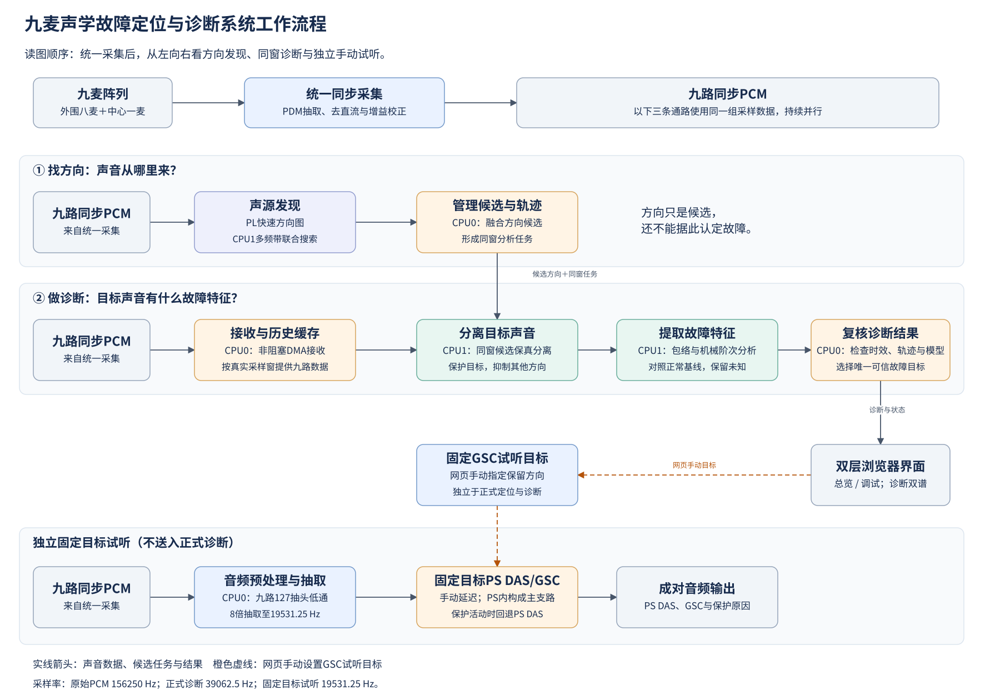](技术文档配图/第一部分_系统工作流程.drawio.svg)

*图1-1 系统工作流程。上支路完成声源发现和轨迹管理，中支路从同一时窗的九路声音中分离目标、提取特征并复核，下支路进行独立的固定目标试听。实线表示数据、任务和结果；橙色虚线从“双层浏览器界面”经“固定GSC试听目标”送到“固定目标PS DAS/GSC”，表示网页手动控制。*

### 1.2 应用领域

作品适用于电机、风机、水泵及轴承试验台的非接触声学监测。多台设备同时发声时，可以先按方向选择观察对象，再比较其音频谱、包络谱及阶次特征。在实验室中，这一过程可用于对比不同转速和故障状态；在设备巡检中，可辅助寻找异常声方向并保存音频供复核。

诊断程序以轴承故障阶次特征为分析对象，使用轴承参数、转速绑定及对应的正常基线和故障模型。方向模型搜索阵列正面半球，输出方位角与俯仰角，不计算声源距离。

图1-2给出旋转机械外部布置麦克风阵列的应用示例。本作品使用九麦阵列，设计内容包括声学处理器、片上数据搬运，以及定位、分离和诊断程序之间的数据关联。

[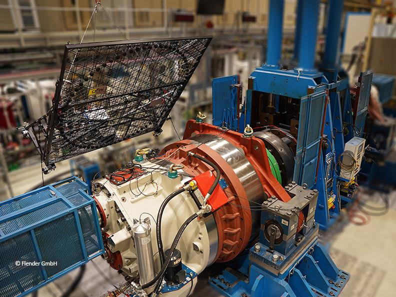](技术文档配图/第一部分_旋转机械声学检测应用.jpg)

*图1-2 工业旋转机械声学检测应用示例。图中为麦克风阵列与齿轮箱试验装置，用于说明非接触声学检测的应用场景，并非本作品的实测现场。图片来源：[gfai tech，Order Analysis on Gearboxes](https://www.gfaitech.com/applications/order-analysis-on-gearboxes)，原图署名© Flender GmbH。*

### 1.3 主要技术特点

系统按采集、定位、分析和控制划分模块，以PL处理连续数据，以PS双核执行窗口分析和交互。

表1-1 系统技术特点

| 模块 | 核心实现 | 设计作用 |
|---|---|---|
| 同步采集 | 双相PDM（脉冲密度调制）接收、CIC（级联积分梳状）抽取、去直流与通道增益校正 | 为时差计算提供同步PCM |
| PL声学处理器 | 自研五级RISC-V发射FFT、互谱、PHAT及SRP指令；RTL推进地址和搬运数据 | 将计算与重复访存组织分工 |
| 并行运算 | 八路SIMD（单指令多数据）支持乘加归约与逐元素更新；FFT与IFFT（快速傅里叶逆变换）共用变换核，SRP四麦对并行 | 适配FIR（有限冲激响应）滤波和频域定位 |
| PS双核分析 | CPU0接收、缓存和控制；CPU1搜索、分离并提取包络及阶次特征 | 使长窗诊断与连续采集并行 |
| 目标控制与试听 | 正式PL定向采用可信诊断和九路延迟原子提交；固定目标GSC采用网页手动设置 | 区分诊断授权与独立音频实验 |

### 1.4 主要性能指标

表1-2汇总已完成的算子对照测试结果。PL时间由RTL周期按40 MHz换算，PS软件时间在Windows宿主上测量；两类数据分别报告。

表1-2 主要性能指标

| 项目 | 原始方案（ms） | 创新方案（ms） | 加速比 | 测试范围 |
|---|---|---|---|---|
| 九麦完整方向评分 | 标量计算 276.234300 | 声学加速 2.058850 | 134.17× | 同一首窗、36麦对、1024格，原始窗口驻留至评分完成 |
| 1024点实数FFT | 标量计算 4.475900 | FFT扩展指令 0.165050 | 27.12× | 同一软核，包含装载、计算和取回 |
| 512点、32抽头FIR | 标量计算 6.919350 | 八路SIMD 0.378450 | 18.28× | 同一系数及定点规则，按算子测试范围计时 |
| 四麦对并行SRP | 串行扫描 3.686450 | 四麦对并行 0.232675 | 15.84× | 36麦对、1024格，从启动（START）到完成（DONE） |
| PS单宽带搜索 | 参考实现 8.0546 | 软件组合优化 6.1932 | 1.30× | 41次宿主测量的平均耗时，比较软件组合优化 |

注：加速比＝原始方案耗时÷创新方案耗时。连续定位结果间隔为3.273675—3.277075 ms（32窗RTL运行、31个发布间隔）；该项未设置原始方案对照，不计算加速比。

九麦评分的134.17倍来自专用运算、片上缓存、RTL搬运和采集期统计前移的共同作用。计时止于评分完成，PS往返、界面显示和后续质量检查在此范围之外。完整方法、逐级一致性、时间分布和原始结果链接见第三部分3.3.2—3.3.4节。

双层GUI（图形界面）、同网格联合评分和手动固定目标音频通路的实现说明见第二部分，已有测试的输入、方法和结果集中列于第三部分。

### 1.5 主要创新点

本作品针对软核标量计算、计算后的数据搬运及逐麦对方向扫描三类开销，设计声学扩展指令、缓存与搬运状态机和四麦对并行扫描结构。FFT和FIR完整函数对照的加速比分别为27.12、18.28；九麦完整方向评分的组合架构加速比为134.17。四麦对并行相对同结构单麦对扫描约为3.99倍，相对原串行扫描实现为15.84倍。各结果的输入、计时边界与证据见表1-6及第三部分。

#### 1.5.1 声学处理器与软硬件分工

**（1）针对声学运算扩展RISC-V处理器。**

我们依据RISC-V基础指令规范[[1]](#ref-1)实现五级流水软核，并为FFT/IFFT、共轭互谱、PHAT、SRP和向量运算增加指令接口。处理器负责发射指令和判断处理状态，具体计算交给相应执行单元。流水线保留前递、冒险处理、分支预测及多拍执行握手，计算结果按指令退休状态交接。采用自研软核，是为了用固件组织可调整的计算阶段，并用自定义指令调用专用单元；重复的地址推进和数据搬运交给RTL状态机，避免逐样点执行通用指令。

时域FIR和频域定位的数据访问方式不同，因此没有将它们全部放进同一种运算结构。八路实数SIMD既能将各路乘积相加，也能旁路求和树，分别输出逐元素更新结果；复数单元则用于频谱计算，支持4、8、16路配置，当前九麦工程采用4路。FFT和IFFT共用512点复数核心，完成1024点实数变换。当前PL连续FIR使用乘加求和模式，GSC权值仍由PS更新。

在相同软核及定点规则下，1024点实数FFT从179036拍降至6602拍；512点、32抽头FIR从276774拍降至15138拍。对应27.12倍与18.28倍均按完整测试函数比较，包含装载或历史处理等开销，数值核对见第三部分3.3.2节。

**（2）让计算单元和存储搬运配合工作。**

单独增加乘法器并不能消除定位程序中的访存开销。为此，RISC-V负责发射计算指令及结果检查，窗口组织、地址推进、预取和中间结果搬运由RTL状态机完成。状态机等待相关指令退休后再接管结果，避免计算单元刚完成、处理器尚未交接时就使用数据。

九路频谱各计算一次，随后由36个麦对共用；搬运时只保留需要的频点和相关时延区间。SRP将查表数据分到四组独立存储分区，每组并行读取相邻相关点并完成插值，再合并四个麦对的贡献。连续音频FIR也使用实数SIMD，通过请求仲裁以及历史、系数存储区划分与处理器共用资源。第一部分的134.17倍结果来自这些设计的共同作用。

**（3）按采样率和任务耗时分配PL、CPU0与CPU1的工作。**

PL负责156250 Hz同步采集、快速定位和连续DAS/FIR。CPU0负责DMA（直接存储器访问）接收、历史缓存、轨迹维护、任务提交及网络交互；CPU1读取历史快照，执行多频带搜索、声音分离和故障诊断。这样，长窗分析不必直接占用接收循环。

诊断音频经抗混叠后降至39062.5 Hz，保留1.024 s观察长度；固定目标GSC试听另用19531.25 Hz。各任务按原始采样编号选取窗口，并检查排队时间、总处理时间和结果年龄，处理落后时优先使用新窗口。512 ms是诊断任务的调度步长，512 ms在此表示任务发起步长；有效结果间隔按第三部分的具体测试条件报告。

**（4）实验扩展：固定目标GSC试听。**

CPU0将九路PCM低通并8倍抽取，在PS内生成独立DAS主支路和阻塞参考，由网页手动设置保留方向。输出残差驱动NLMS（归一化最小均方）更新，以统一的配对音频格式保存DAS/GSC成对音频；该支路不改写正式PL目标，也不作为故障诊断输入。处理结构见第二部分2.3.2.8节，合成输出路径验证见第三部分3.3.5节。

#### 1.5.2 定位与故障诊断中的处理方法

**（1）先区分声源方向，再分析各方向的声音。**

多台设备同时运行时，声音最强的设备未必发生故障。系统先搜索方向并建立轨迹，再从同一份九路快照中分离各候选声音，分别提取机械特征。结果保存轨迹、方向、采样区间和工况信息，便于回查异常发生在哪个时段、哪个方向。

系统综合候选声源的方向轨迹、故障诊断结果及数据有效性，确定唯一可信故障目标，并向PL提交对应的拾音方向，实现诊断结果对定向拾音的引导。手动GSC试听采用独立的目标设置，便于对指定方向的音频进行对比分析。

**（2）联合多个频带评分，并按实际观察时间维护轨迹。**

三频带搜索在600—2200、2200—4600、4600—8000 Hz分别计算方向评分，对有效频带的同一方向格取有符号均值，在联合图上统一找峰。联合评分最多输出三个候选，并检查峰值质量和实际观察支持。三个候选是程序输出容量。

程序按新观测、暂失、恢复和过期管理轨迹，用观察区间的并集计算覆盖时间，避免重叠窗口被重复计数。有效峰经局部拟合得到细角度，再由统一转向表生成延迟参数；声源暂失期间保留ID，但不增加新的方向证据。

**（3）分离声音时检查故障特征是否被保留。**

机械诊断依赖载频、调制和谐波，单纯追求干扰越小越好，可能同时损伤这些特征。因此，系统从混合快照估计协方差，用目标中心及邻近方向构造保护子空间，去除统计量中的目标贡献后，再利用残差协方差和正则化抑制其他方向。

目标中心保持单位响应，目标和干扰的邻近方向采用软约束，减轻方向误差及矩阵病态的影响。重构采用重叠相加和边界归一化。输出还要检查目标响应、干扰泄漏、权重范数、保留能量及故障载频；未通过检查的声音不进入确定性故障判断。

**（4）一次提交九路延迟，防止参数和结果混用。**

正式PL转向先写入完整影子向量，再统一提交，使九路延迟按同一组配置生效；软件同时检查采集代次、参数时效和读回结果。后续按样点边界应用并完成延迟平滑。手动GSC采用独立PS配置，不随这次转向自动改变。

定位、分离和正式转向使用同一套坐标、通道映射及标定参数。诊断还检查轨迹覆盖、模型匹配性、处理规则和转速状态。若仍有未解析方向，可以保留已完成的候选分析，但不授权可信故障定向。

#### 1.5.3 工程实现

下表列出定点计算、存储和数据处理中的具体做法。完整测试方法及数据见第三部分3.3节，对应材料见1.5.5节。

**（1）定点计算与存储。**

表1-3 定点计算与片上存储

| 实现细节 | 具体设计与作用 |
|---|---|
| SIMD宽累加与定点输出 | 实数SIMD采用宽累加器、受控舍入及饱和，明确乘加中间结果与输出的数值规则，使并行运算具有可核对的精度边界。 |
| 存储分区布局与同步BRAM（片上块存储器）预取 | 样点与系数按独立存储分区组织，将同步BRAM读延时纳入预取和排空逻辑，使执行单元的数据读取与流水推进配合。 |
| PHAT查表与分数SRP | PHAT采用幅值近似和倒数查表；SRP通过分数时差及相邻相关值插值生成方向评分，以明确的定点规则衔接计算与查表流水。 |

**（2）采集与PS计算。**

表1-4 采集与PS计算

| 实现细节 | 具体设计与作用 |
|---|---|
| 重叠采集与滚动统计 | 在1024点窗、512点步长的采集过程中累积统计，减少收窗后的重复扫描；预热状态独立于回卷样点计数，避免计数回卷破坏持续处理状态。 |
| 九麦有效通道组织 | 五根双相DATA形成十个采集槽，仅九路进入统计、36麦对计算和波束归一化；分层处理双相启动、CIC过渡和有效PCM发布，避免空槽及启动瞬态进入后续计算。 |
| 带自检的NEON向量抽取 | 使用ARM NEON向量指令使八个外围通道并行、中心通道单独处理，结合累加范围证明与启动输入对照自检；检测失败时回退标量实现，为PS长窗分析提供具有数值检查的抽取路径。 |
| PS成对实相关IFFT | 将两组共轭对称的互谱打包，一次复数IFFT得到两组实相关；九麦36对在每个频带由36次变换降为18次，并复用通道功率归一化公共项，减少多频带搜索的重复计算。 |
| 标定量化驱动的预计算 | 利用Q4原始延迟（4位小数，即1/16原始样点）与四倍抽取后的1/64样点关系，预计算方向—麦对地址及三次插值权重；标定变化时重新生成，减少PS搜索内循环的地址和系数运算。 |
| GSC归一化计算复用 | 同一次权值更新共享归一化倒数，通过余数修正恢复精确整数商，减少重复除法；该项为程序实现说明。 |

**（3）诊断数据检查。**

表1-5 诊断数据检查

| 实现细节 | 具体设计与作用 |
|---|---|
| 定位缩放与诊断幅度分流 | 定位分支按通道、按窗口去均值并选择二次幂缩放，提高弱信号的定点利用率；该临时缩放不写回诊断历史和录音。诊断使用已完成前端去直流及通道增益校正的同步PCM。 |
| 保留长窗信息的包络分析 | 解析选带、包络提取及多级抗混叠抽取后，使用一次4096点FFT分析2500个真实包络点，保留1.024 s观察信息；补零用于频谱采样，不增加物理分辨力。 |
| 转速关联的18维机械特征 | 提取四组轴承特征阶次及各自谐波，再加入1X、2X；硬件测速处理毛刺、稳定性与超时，转速变化后重新积累有效观察窗。 |
| 正常基线与未知拒识 | 将异常检测、类别判定和空间归因分开；模型、特征、分离和滤波状态不满足约定时保留未知，避免把任意异常直接解释为确定机械故障。 |

#### 1.5.4 可靠性与数据记录

**实时服务与通信负载隔离。** DMA和网络拥塞不会反向停止PL的PCM与DAS处理；下游丢失通过计数、CRC（循环冗余校验）、序号和采集代次暴露。故障恢复后更换采集代次并重新预热，旧窗口及旧结果不会继续作为当前证据。

**同快照展示与事件追溯。** 音频谱、包络谱、轨迹和诊断绑定同一采样窗口，配套疑似、报警与恢复状态；未知和断流不视为正常恢复，历史可由PC端归档。

**原始录音保存与回放。** 九路PCM长窗导出时记录采样身份和哈希，离线回放调用实际C搜索、分离和特征实现，训练工具复用相同特征前端。导出、回放与训练使用一致的通道顺序和采样率。

**构建文件核对。** 发布时记录源码、位流、PS镜像、模型及配套工程文件的配套关系与完整性，减少固件、模型与配置混用；完整重建条件见第二部分2.5节。

**定位失效隔离与受控恢复。** 定位窗口发生覆盖或丢失时，硬件锁存失败状态，取消活动窗口并禁止继续发布；恢复控制等待计算引擎空闲，累计丢失记录、更新采集代次并重新预热。实现见`rv32_overlap_localizer.v`和`rv32_localizer_recovery.v`。恢复后的窗口使用新的采集代次，异常前后的数据分别记录。

#### 1.5.5 创新点的量化验证

表1-6按“原始瓶颈、结构改动、量化结果、验证依据”列出主要创新点。完整架构、单个算子和同结构并行度使用不同对照，分别报告加速比。

表1-6 主要创新点的量化对照

| 原始瓶颈 | 具体结构改动 | 量化结果 | 验证依据与范围 |
|---|---|---|---|
| 标量FFT、FIR的循环运算及装载开销 | 软核增加FFT声学指令与八路实数SIMD执行单元，配套装载、运行和取回路径 | FFT：179036→6602拍，27.12倍；FIR：276774→15138拍，18.28倍 | 相同软核、输入与定点规则；RTL输出逐项核对，按完整测试函数计时，见表3-4 |
| 完整方向评分中的计算、地址推进和中间结果搬运 | 软核发射指令，RTL组织窗口统计、九路频谱缓存及阶段搬运，按指令退休交接 | 九麦1024格评分：11049372→82354拍，134.17倍 | 同一首窗、36麦对；原始窗口驻留至评分完成，包含组合架构改动，见表3-4 |
| 逐麦对方向扫描及查表读取 | 快速扫描采用独立存储分区与预取，再扩展为四麦对并行 | 原串行147458拍；快速单麦对37153拍；快速四麦对9307拍。同结构并行增益3.99倍，总对照15.84倍 | 每组2张方向图、2048个评分与参考一致；启动至完成计时，见表3-4 |
| PS多频带搜索重复计算相关变换和插值系数 | 两组实相关共用一次复数IFFT，预计算方向插值参数并复用归一化数据 | 每频带36次IFFT降为18次；单宽带搜索平均8.0546→6.1932 ms，1.30倍 | 同一Windows宿主、41次实际C函数计时；输出评分一致，见表3-6 |

#### 1.5.6 研究拓展与应用条件

联合搜索根据三个频带的方向评分生成候选。诊断流程采用正常基线及正常／故障／干扰三类模型，方向模型输出阵列正面半球的角度。

### 1.6 设计流程

设计从“需求与指标分解”开始，先确定九麦布局、同步采样与验证任务，再建立定位、分离和诊断的参考算法及定点规则。随后并行完成“PL声学处理器实现”和“PS分析与控制实现”，通过模块对照及软硬件联调检查结果。

[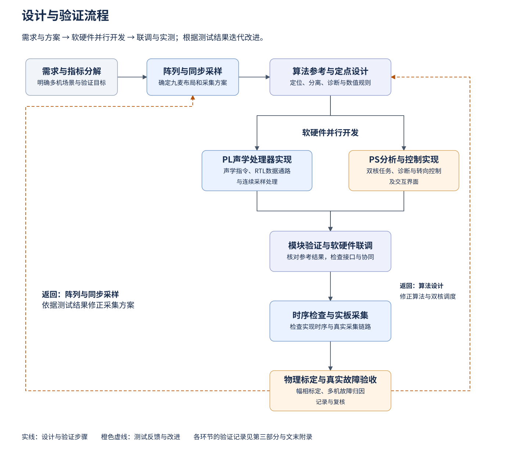](技术文档配图/第一部分_设计与验证流程.drawio.svg)

*图1-3 设计与验证流程。实线表示开发和验证顺序，橙色虚线表示根据最终测试结果返回前期设计。*

图1-3按设计步骤排列采集、处理器、算法及验证环节。“物理标定与真实故障验收”的左侧反馈返回“阵列与同步采样”，右侧反馈返回“算法参考与定点设计”，分别用于修正采集安装和算法调度。图中表示流程顺序，各项实际验证结果以第三部分记录为准。

### 1.7 验证方法与结果索引

验证材料按输入、实现方法、数值规则和计时范围组织。PL对照使用相同合成平面波窗口，核对中间结果及最终评分；PS对照在同一宿主环境中切换算法实现，核对整数评分、分离质量及耗时分布。

第一部分表1-2给出性能概览，第三部分3.3.2—3.3.4节列出测试方法、数据与计时范围，3.3.5节报告固定目标音频通路的合成测试，3.3.6节汇总已验证项目与证据。

---

## 第二部分  系统组成及功能说明

### 2.1 整体介绍

#### 2.1.1 系统组成与设计思路

系统由九麦阵列板、Zynq-7020平台[[2]](#ref-2)和PC浏览器组成。PL内自研的RISC-V声学处理器负责快速定位和连续DAS/FIR，PS双核负责历史数据、长窗诊断和网络交互。各模块用同一套原始采样编号关联声音、方向和诊断结果。

九只数字麦克风经PDM接收和抽取得到156250 Hz同步PCM，经过通道预处理后，同时送入PL定位、PL定向拾音和DMA历史缓存。CPU1从历史数据执行多频带搜索，并在固定时窗内分离、诊断候选声音。CPU0另有手动选方向的GSC试听支路，以19531.25 Hz输出成对PS DAS/GSC音频，不作为诊断输入。

CPU0持续接收DMA、维护历史与轨迹、复核结果，并处理寄存器控制和网络请求；CPU1复制固定采样区间，完成搜索、分离、包络和机械阶次分析。一次诊断中的候选使用同一份九路快照，避免比较不同时段的声音。

[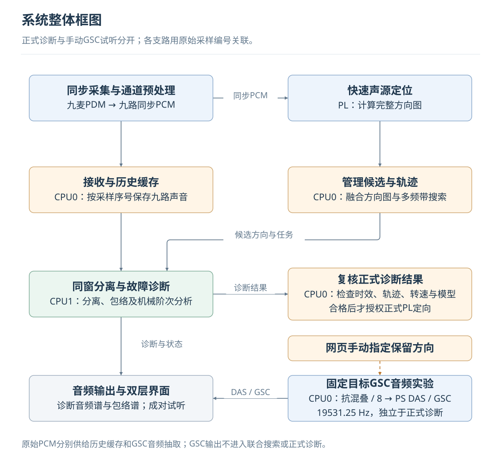](技术文档配图/第二部分_系统整体框图.drawio.svg)

*图2-1 系统整体框图。候选与轨迹向同窗分离发布方向与任务，分离诊断结果交CPU0复核。正式PL定向仍受可信条件约束。右下“固定目标GSC音频实验”直接使用九路原始PCM，其橙色虚线起于“网页手动指定保留方向”，与诊断复核分开；DAS/GSC成对音频流向“音频输出与双层界面”。*

#### 2.1.2 模块关系与数据有效性

快速定位回答当前声音主要来自哪些方向，故障诊断回答指定方向的声音是否具有与工况相符的机械异常特征。方向峰本身不作为故障结论；分离输出也需通过保真检查，才能进入后续特征分析。CPU0只在结果新鲜、轨迹与工况匹配、模型有效且存在唯一可信故障目标时提交拾音方向。条件不足时保留方向、频谱及拒绝原因，诊断显示未知或撤销可信定向。

每次分析保存会话标识、采集代次、原始采样区间、轨迹编号、方向、标定参数和转速来源。断流、历史覆盖或参数变化后，失效结果不再用于控制。诊断前核对音频处理方法、特征计算规则与模型要求是否一致。

表2-1 主要参数

| 项目 | 当前配置 | 设计含义 |
|---|---|---|
| 有效通道与麦对 | 9路，36麦对 | 外围八麦加中心一麦；第十采集槽不参与算法 |
| PL业务时钟 | 40 MHz | 采集、专用计算及控制的业务时钟 |
| PDM时钟与抽取 | 2.5 MHz，16倍CIC抽取 | 得到156250 Hz原始PCM |
| PL定位窗与步长 | 1024点／512点 | 窗长6.5536 ms，步长3.2768 ms |
| 方向搜索 | 32×32格，64点相关环 | 前半球方向搜索，不估计距离 |
| 固定目标试听采样率 | 19531.25 Hz | CPU0九路127抽头低通后8倍抽取；独立PS DAS/GSC |
| 默认转速来源 | 1800 rpm（30 Hz）预设 | 运行假设，不等同于外部测速实测 |
| 诊断采样率 | 39062.5 Hz | 原始PCM抗混叠后4倍抽取 |
| 诊断快照与有效音频 | 160256×9原始点；每候选40000点 | 含256原始点预热；有效观察1.024 s |
| 诊断调度步长 | 80000原始点，即512 ms | 发起任务的节奏，实际产出受任务耗时约束 |
| 历史容量 | 1048576原始帧 | 可保存约6.7109 s九路PCM |
| 候选数量与模型匹配 | 最多3候选；核对分离方法、特征规则与模型要求 | 分别检查分离方法及特征特征计算规则 |

表2-2 数据流、接口与时钟处理

| 数据环节 | 执行位置与传输接口 | 时钟与数据一致性处理 |
|---|---|---|
| 九麦输入与抽取 | 五根共享DATA接收双相PDM，十个采集槽中九槽有效，CIC抽取形成九路同步PCM | 2.5 MHz麦克风时钟由40 MHz业务时钟分频产生；接收和抽取逻辑仍在40 MHz域内，用采样使能选择相位，两相共用抽取节拍 |
| 定位计算 | PL内部RISC-V发射声学指令；RTL准备输入并搬运中间结果；专用单元执行FFT、互谱、PHAT和SRP | 计算与存储逻辑使用同一业务时钟，通过完成握手与指令退休交接，片上双缓冲区分活动窗口和待处理窗口 |
| 连续拾音 | PL内独立音频状态机执行九路DAS和32抽头FIR，与软核仲裁共享八路SIMD | 按PCM有效节拍处理；定位任务与音频任务使用独立状态和各自缓冲 |
| PL写入PS内存 | 同步FIFO（先进先出队列）接收打包记录，DMA通过64位AXI互连总线及PS的HP0高性能端口写入DDR外部内存 | PL计算、DMA与HP0的PL侧端口使用40 MHz时钟；AXI响应成功后发布生产位置，PS按所有权和序号消费 |
| PS控制与诊断 | AXI4-Lite访问控制寄存器；CPU0接收、缓存与交互，CPU1在历史快照上搜索、分离和诊断 | PS内部时钟转换由芯片AXI接口处理；软件另以缓存维护、内存屏障、序号及保护号管理共享数据 |
| 外部测速输入 | tacho_i接收异步测速脉冲，计数器测量相邻有效上升沿间隔 | 输入先经两级同步和稳定过滤，再进入40 MHz周期测量；转速代次与分析快照绑定 |

板级波形及最终时序验收列于文末附录。

### 2.2 硬件系统介绍

#### 2.2.1 硬件整体介绍

硬件由数字麦克风阵列板、Zynq-7020处理平台、外部测速输入和以太网接口组成。阵列使用九只IM73D122数字麦克风[[3]](#ref-3)，外围八只、中心一只，按当前配置采用3.3 V供电。两只麦克风通过不同PDM相位共用一根DATA线，九麦共使用五根DATA及一根公共PDM_CLK。PL使用十个采集槽接收数据，其中九槽有效，有效掩码为`0x1ff`。

PL内设置自研五级流水RISC-V、实数并行乘加单元、复数声学单元、共享FFT/IFFT、四麦对并行SRP、连续DAS/FIR和非阻塞DMA。RISC-V负责计算指令发射、质量判断和结果发布，RTL状态机负责缓存、地址推进及中间结果搬运。连续音频由独立状态机按采样节拍调度，PS长窗任务和网络服务无需逐样点干预PL运算。

PS通过AXI4-Lite访问控制寄存器，通过64位HP0数据通路接收DMA写入DDR的记录。主控制窗口为`0x43c00000`，DMA控制窗口为`0x43c10000`，各占4 KiB。数据记录携带样本序号、采集代次、方向配置编号及状态，供软件检查原始PCM、定向音频与控制参数是否一致。

#### 2.2.2 机械设计介绍

**（1）阵列布局与坐标系。** 阵列按竖直放置使用，声源位于正面。正面观察时，定义+x向右、+y向上、+z朝向声源，中心麦CH8为原点。图2-2按当前声孔坐标绘制，外围麦按实物通道顺序保留，不为获得规则外观重新排列PCM通道。

[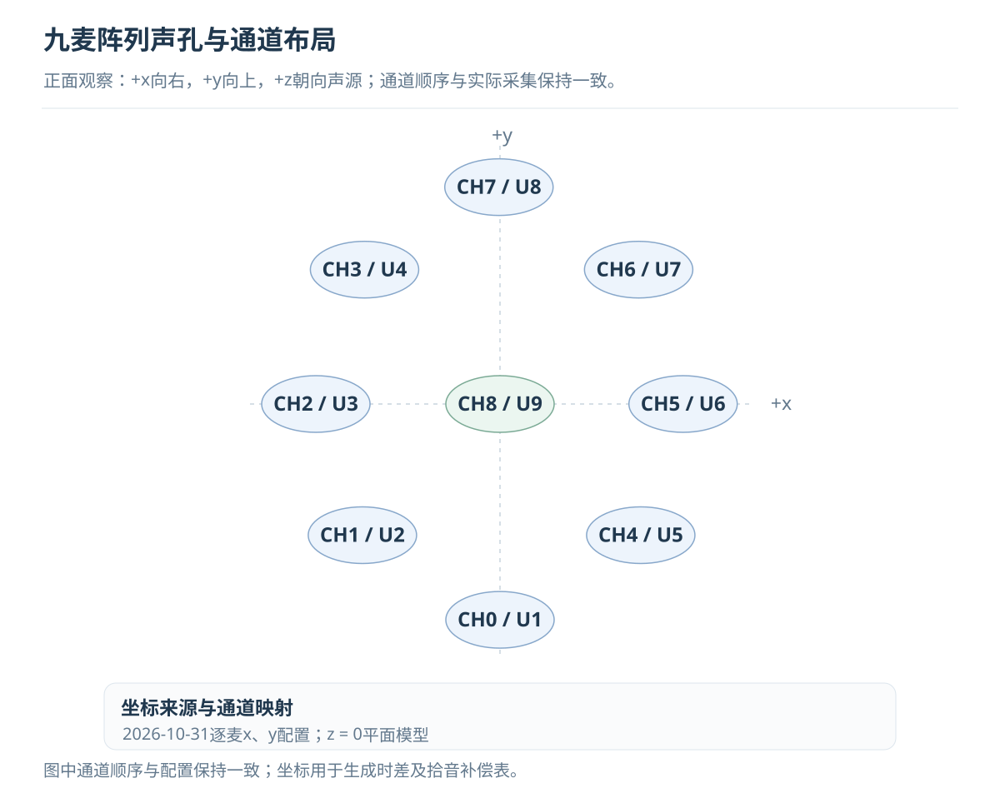](技术文档配图/第二部分_九麦阵列结构.drawio.svg)

*图2-2 九麦阵列声孔与通道布局。CH8为原点，CH0—CH8对应U1—U9；按2026-10-31配置中的逐麦x、y绘制，外围位置并非严格等半径或45°。图中数值为几何模型的配置坐标。*

表2-3 声孔坐标与通道映射

| 通道／实物标签 | x（mm） | y（mm） | 正视位置 |
|---|---:|---:|---|
| CH0／U1 | 0.000000 | -25.908052 | 下 |
| CH1／U2 | -16.510033 | -15.748031 | 左下 |
| CH2／U3 | -22.098044 | 0.000000 | 左 |
| CH3／U4 | -16.256033 | 16.129032 | 左上 |
| CH4／U5 | 16.891034 | -15.748031 | 右下 |
| CH5／U6 | 21.971044 | 0.000000 | 右 |
| CH6／U7 | 16.637033 | 16.129032 | 右上 |
| CH7／U8 | -0.127000 | 26.035052 | 上 |
| CH8／U9 | 0.000000 | 0.000000 | 中心 |

九路z坐标在平面阵列模型中设为0。表中数值直接来自逐麦坐标配置，用于生成时差表；小数位数表示配置存储精度。

**（2）结构尺寸与声学模型的联系。** 设第i支麦的位置为rᵢ，方位角为α、俯仰角为β，方向单位向量为：

$$
\mathbf{u}(\alpha,\beta)={\begin{bmatrix}\cos\beta\,\sin\alpha & \sin\beta & \cos\beta\,\cos\alpha\end{bmatrix}}^{\mathsf{T}}\tag{2-1}
$$

其中，α为方位角，β为俯仰角；上标T表示转置。

在远场模型下，以原始PCM样点为单位的到达延迟写为：

$$
d_i(\mathbf{u})=-\frac{f_s}{c}\,\mathbf{r}_i^{\mathsf{T}}\mathbf{u}+\delta_i,\qquad \tau_{ij}=d_i-d_j\tag{2-2}
$$

其中，fₛ为156250 Hz，c在当前配置中取343 m/s，δᵢ表示去除几何传播后的传感器相对延迟。几何坐标、通道映射和传感器偏差共同生成麦对时差表及拾音补偿表。阵列固定后应保持声孔无遮挡、正面朝向一致，并记录实际安装方向；平面阵列的方向模型仅搜索前半球。

声孔布局和CH0—CH8通道关系记录于阵列配置文件，表2-3列出定位模型使用的坐标，图2-2说明相应声孔位置。

#### 2.2.3 电路各模块介绍

##### 2.2.3.1 板级接口与信号连接

图2-3给出阵列、PL、PS及PC的关键接口。公共PDM_CLK由PL送往阵列，五根DATA由阵列返回PL；测速脉冲进入独立同步和滤波电路。PL以DMA传送数据，PS以寄存器事务下发控制，两类访问分别组织。

[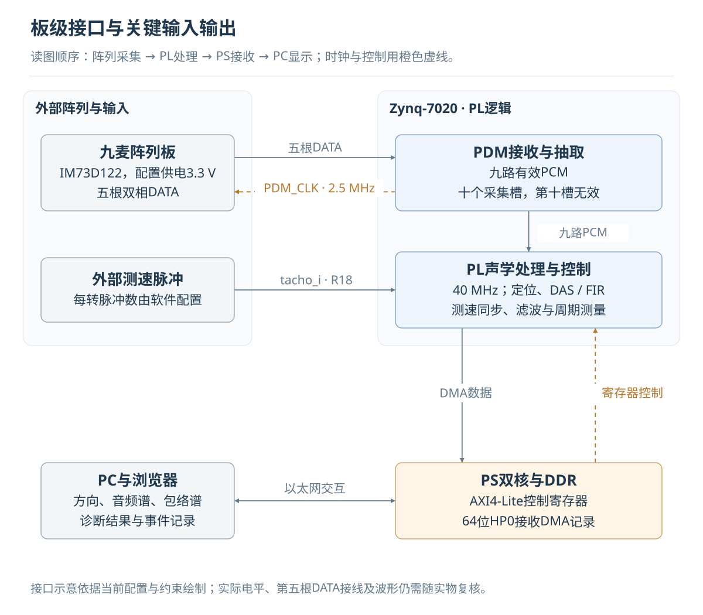](技术文档配图/第二部分_板级接口连接.drawio.svg)

*图2-3 板级接口与关键输入输出。五根DATA由阵列送入“PDM接收与抽取”，公共PDM_CLK由PL返回阵列；DMA将采样记录写入PS，寄存器访问由PS向PL下发控制，PC通过以太网交互。实线表示数据与信号，橙色虚线表示时钟或控制。阵列板原理图见图2-4。*

阵列板的原理图局部见图2-4。图（a）给出U1、U2接口：共用CLK和DATA_1，通过不同相位接收两路PDM；其他通道组见完整原理图。图（b）为H1连接器以及LED1、R1电源指示支路。

[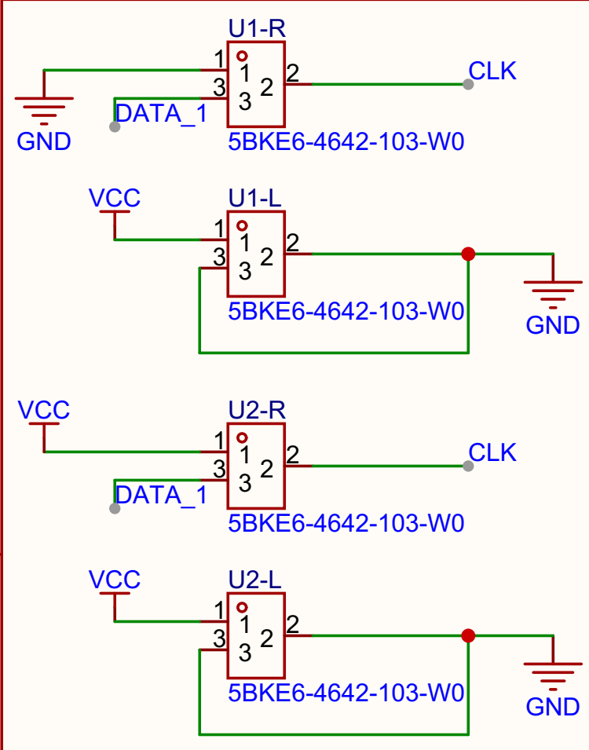](技术文档配图/第二部分_阵列板相位与共线DATA原理图.png)

*图2-4（a）阵列板麦克风接口与相位配置局部。截取自2026-10-22版原理图，示出U1、U2共用DATA_1及各自的相位配置连接；*

[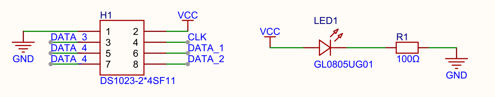](技术文档配图/第二部分_阵列板接口与电源原理图.png)

*图2-4（b）阵列板H1接口与电源指示电路。原图H1第5、7脚重复标为DATA_4；项目配置将其记录为图纸标签笔误，保留原始图纸供核对。通道映射使用配置文件中的DATA_1—DATA_5定义。*

查看完整阵列板原理图（PDF）

表2-4 板级关键接口与信号

| 信号／接口 | 当前引脚或宽度 | 连接与作用 |
|---|---|---|
| `pdm_clk_o` | V16，1路输出 | 公共2.5 MHz PDM时钟 |
| `pdm_din_i[0]` | T14 | CH0、CH1双相数据 |
| `pdm_din_i[1]` | Y17 | CH2、CH3双相数据 |
| `pdm_din_i[2]` | W16 | CH4、CH5双相数据 |
| `pdm_din_i[3]` | T15 | CH6、CH7双相数据 |
| `pdm_din_i[4]` | Y16 | 中心CH8及无效CH9槽 |
| `rst_n` | N16，低有效 | PL顶层复位 |
| `tacho_i` | R18，LVCMOS33 | 外部转速脉冲，经同步、去毛刺后测周期 |
| AXI4-Lite | 32位控制访问 | 采集、定位、转向与DMA寄存器 |
| AXI HP0 | 64位数据通路 | DMA记录写入PS DDR |

表2-4采用工程约束中的引脚定义。`circular9_array.json`记录通道映射及H1标签笔误说明；3.3 V为阵列供电配置值，2.5 MHz为PDM时钟设计值。

##### 2.2.3.2 PDM同步采集与通道预处理

PDM接收模块`rv32_pdm_array_rx`以40 MHz业务时钟产生采样使能，不将外部PDM_CLK另作内部业务时钟。每16个业务周期形成一个2.5 MHz PDM周期，在A、B两相分别取数，再以统一使能推进对应CIC。接收后按十槽组织向量，无效槽置零；九路有效PCM在同一拍发布，供后续时差计算使用。

每路CIC由三级积分、16倍抽取和三级梳状差分构成，其离散传递函数为：

$$
H(z)=\left(\frac{1-z^{-16}}{1-z^{-1}}\right)^3\tag{2-3}
$$

输出采样率为2500000／16＝156250 Hz，每个PCM采样间隔为6.4 μs。CIC内部使用24位模运算，抽取后作偏置、位移及饱和处理。启动逻辑先等待50 ms，再排除4帧CIC输出，随后开放有效数据；重新使能时重建启动状态。

`rv32_chan_align`逐通道去直流，再乘Q2.14定点增益（14位小数）并饱和输出。去直流采用一阶递推：

$$
y_i[n]=x_i[n]-x_i[n-1]+y_i[n-1]-\operatorname{ASR}_{9}\!\left(y_i[n-1]\right)\tag{2-4}
$$

其中，xᵢ[n]、yᵢ[n]分别为第i通道的输入与去直流输出，n为样本序号；ASR₉表示有符号算术右移9位，保持RTL整数运算的舍入规则。

通道增益和相对延迟由配置及标定表提供。定位前端逐窗去均值并作二次幂缩放，提高16位FFT的数值利用率；这些临时处理不写回历史缓存。本文所称原始PCM，是经过前端去直流、配置增益和16位截取后的九路同步PCM，不是PDM位流。

##### 2.2.3.3 自研RISC-V与声学执行结构

PL声学处理器由五级RISC-V与专用计算、搬运电路组成，如图2-5。处理器包含取指、译码、执行、访存和写回五级，配置前递、冒险控制、乘除法及分支预测。固件按定位阶段发射自定义计算指令；专用状态机准备输入、推进地址并转移中间结果。

[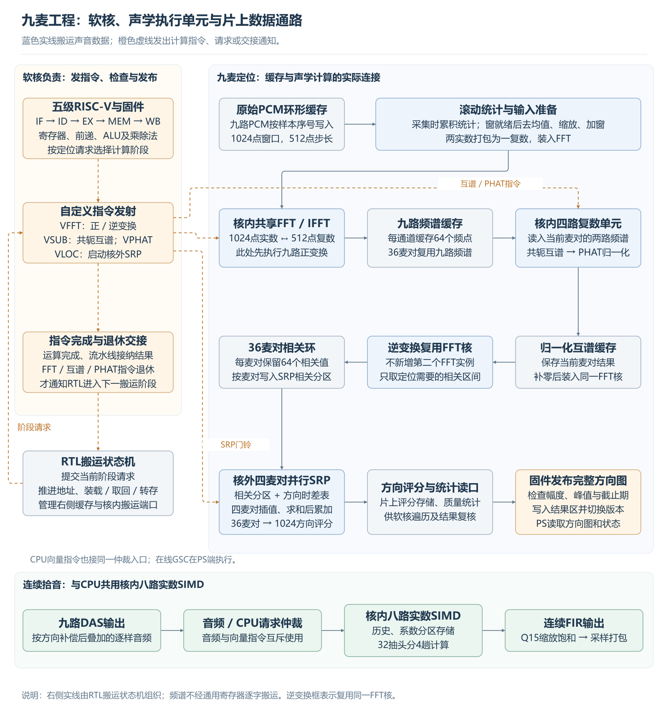](技术文档配图/第二部分_RISC-V软核内部数据通路.drawio.png)

*图2-5 九麦工程中软核与声学单元的数据通路。右侧沿实线依次完成输入准备、九路FFT、频谱缓存、麦对互谱与PHAT、复用FFT作逆变换、相关环存储及四麦对SRP；左侧软核用自定义指令启动计算，相关指令退休后，RTL搬运状态机才推进后续装载和转存。下方为连续DAS音频使用同一核内实数SIMD执行FIR的支路。橙色虚线表示指令、请求与交接，不传输整段音频。*

图2-5按九麦配置绘制。固件`fw_planar8.c`读取阶段请求，按请求发射FFT、互谱、PHAT、IFFT或SRP指令。九路窗口和频谱保存在片上缓存，`rv32_overlap_localizer`推进地址、装载和转存。核内配置共享FFT、四路复数单元和八路实数SIMD，SRP及其查表存储位于软核之外。

PL中的定位与连续拾音按图2-6分工。

[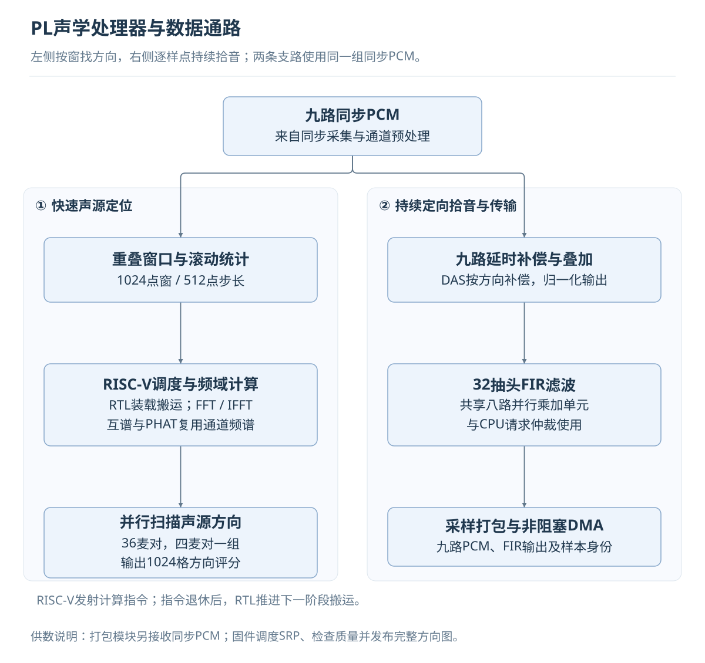](技术文档配图/第二部分_PL声学处理器.drawio.svg)

*图2-6 PL定位与连续拾音的分工。左支路依次完成窗口统计、频域计算和四麦对SRP；右支路完成DAS延迟补偿、共享SIMD的32抽头FIR及采样打包。两支路使用同一组同步PCM，打包模块同时接收原始PCM和PL FIR输出。具体执行与搬运连接见图2-5。*

FFT和复数单元的搬运端口与CPU计算请求通过选择逻辑协调。对应计算指令退休后，搬运状态机才接管后续数据；图中逆变换框表示同一FFT实例的复用。SRP则接收单拍启动门铃，固件轮询完成状态后检查评分并发布方向图。

实数单元采用固定八路并行乘加，按抽头号划分系数存储分区，按样本号划分历史存储分区。每路乘法使用16位操作数，乘积累加至40位；归约树将各路结果相加，完成FIR。32抽头需要四趟八路运算。逐元素更新模式旁路跨路归约，可支持通用系数更新；当前PL连续FIR使用固定系数，在线GSC自适应由PS执行。

复数声学单元负责共轭互谱和PHAT等频域运算，支持4／8／16路配置，当前九麦实例默认4路。FFT与IFFT采用快速傅里叶变换[[4]](#ref-4)并共用变换核：1024个实数样点先打包为512个复数，执行复变换和拆分，得到513个非负频率点；逆路径复用相应蝶形与存储。通道频谱只计算一次，供36个麦对复用。

表2-5 PL执行模块的输入输出

| 执行模块 | 主要输入 | 主要输出与职责 |
|---|---|---|
| 五级RISC-V | 定位请求编号、阶段类型、质量状态 | 发射FFT、互谱、PHAT及SRP指令，发布结果 |
| 八路实数乘加 | 16位样本与系数、抽头长度 | FIR归约结果，或逐元素更新结果 |
| FFT／IFFT | 打包实样本或频谱 | 通道频谱、相关序列 |
| 共轭互谱与PHAT | 两通道复频谱 | 相位归一化互谱 |
| 定位数据搬运状态机 | 窗口、通道／麦对索引、算子完成及退休确认 | 装载、预取、转存及阶段推进 |
| 四麦对并行SRP | 相关环、Q4时差表、方向格索引 | 1024个方向评分 |

当前九麦定位配置中，FFT、互谱和PHAT的完成交接，以及SRP启动，都以对应指令退休为准。片上系统（SoC）将退休的SRP指令转成单拍启动信号。连续FIR由音频状态机调度，与CPU向量请求仲裁后共用实数单元。

##### 2.2.3.4 重叠窗口定位与四麦对SRP

快速定位采用1024点窗、512点步长。采集期间对每个512点块累计和、平方和、峰值、极值及削顶数，相邻两块合并得到完整窗口统计，减少窗就绪后的重复扫描。硬件按通道装载去均值、缩放并经Hann窗[[5]](#ref-5)处理后的样本，依次完成9次FFT、36次互谱、36次PHAT、36次IFFT和1次SRP扫描。

定位采用广义互相关的PHAT加权[[6]](#ref-6)。对于第i、j支麦，共轭互谱见式（2-5）。选用PHAT加权，是为了减小频带幅度差异对相关评分的影响，使麦对时差估计主要利用相位信息，再将各麦对证据累积到同一方向网格。

$$
G_{ij}[k]=X_i[k]\,X_j^{*}[k]\tag{2-5}
$$

PHAT按近似模长及倒数表归一化，带外频点清零；当前配置200—8000 Hz在1024点频率网格上对应有效频点k＝2—52，约305.18—7934.57 Hz。每对麦只保留所需的64点相关环。

SRP-PHAT以方向扫描累计各麦对相关值[[7]](#ref-7)。本工程遍历32×32个方向格，按预先生成的时差表读取各麦对相关值。设Q4时差的整数部分为q、小数编码为f，则评分为：

$$
P(g)=\sum_{i<j}\left[R_{ij}[q]+\frac{f}{16}\left(R_{ij}[q+1]-R_{ij}[q]\right)\right]\tag{2-6}
$$

四个麦对分别使用独立查找表（LUT）和相关值存储分区，并行读出相邻相关点。每对先按既定定点规则插值与截断，再归约四对贡献，保持与串行参考一致。相关环长度、麦对并行度和方向格数分别管理，负时差按相关环宽度回绕。

评分完成后，固件执行峰值和输入质量检查，通过稳定序列号提交方向图。窗口覆盖、样本序号或阶段时限异常时，系统记录故障并重新预热，不沿用旧采集代次的定位结果。32×32方向网格和局部峰细化均为方向计算参数。

##### 2.2.3.5 持续定向拾音、原子转向与测速

连续DAS为九路通道各保留64点历史，根据补偿延迟读取邻近样点，支持线性及四点三次拉格朗日（Lagrange）插值。九路延迟统一减去最小值，使至少一路为零；补偿后求和并除以9，进行对称舍入归一化。其后通过共享八路实数单元完成32抽头FIR，持续产生定向音频。

转向采用影子向量与原子提交。PS一次写入方向格、配置编号、采集代次、时间戳及九个补偿延迟；PL检查字段完整、延迟范围、采集代次、序号和有效期后，一次切换全部九路活动向量。默认事务有效期为200 ms。新事务失败时保留仍在有效期内的旧活动向量；软件读回异常会主动撤销可信目标。

DAS在样点边界应用新的方向配置，并记录生效样本号。开启平滑时，每个原始样点的延迟变化不超过1/16样点。固定目标连续试听采用独立的PS延迟处理路径，流程见2.3.2.8节。

外部测速脉冲经两级同步、稳定过滤和上升沿周期测量后形成有效转速输入。软件配置每转脉冲数（PPR），按下式计算：

$$
n_{\mathrm{rpm}}=\frac{60\,f_{\mathrm{clk}}}{N_{\mathrm{period}}\,N_{\mathrm{ppr}}}\tag{2-7}
$$

其中，f_clk＝40 MHz为周期计数时钟，N_period为相邻有效测速脉冲的间隔拍数，N_ppr为每转脉冲数；n_rpm的单位为转／分。

诊断程序的转速接受区间为600—1800 rpm；启动配置可绑定1800 rpm默认预设，并保留预设来源标记。来源失效或显著变化后，软件推进转速代次并重新积累窗口。

##### 2.2.3.6 采样打包与非阻塞DMA

采样打包模块将同一采样编号的九路16位PCM、DAS/FIR输出、方向配置编号、生效样本号和状态组织为内部记录，再经DMA写入DDR所有权环。DDR槽为128字节，对应16拍64位AXI写入，并携带序号、时间戳及CRC等完整性信息。只有写响应成功且事务未故障时，DMA才推进已发布位置。

环满、内部队列满或总线故障时，传输副本可以丢弃并累计计数，DDR压力不反向阻塞PL采集和DAS。CPU0依据完成位置消费记录，检查连续性及CRC；连续传输异常使相关历史会话重新建立。该机制保持PL采样节奏，同时向软件明确暴露传输缺口。

[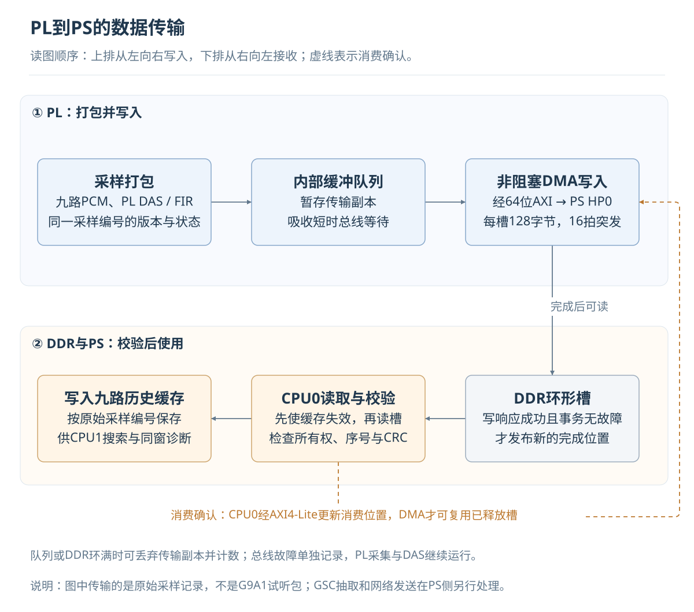](技术文档配图/第二部分_PL到PS数据传输.drawio.svg)

*图2-7 PL到PS的数据传输。上排从“采样打包”经“内部缓冲队列”进入“非阻塞DMA写入”，再写到下排右侧的“DDR环形槽”；CPU0按完成位置读取并校验，随后写入九路历史缓存。橙色虚线从“CPU0读取与校验”返回DMA，表示软件更新消费位置，允许DMA复用已释放槽，不是声音数据回传。*

这里的“非阻塞”指下游压力不暂停PL采集；传输仍可能丢失。DMA成功发布槽后CPU0才读取，CPU0完成消费后再释放；若来不及接收，通过丢失计数和采样序号记录缺口。图中的PL DAS/FIR记录与PS低采样率GSC试听数据分别处理。

### 2.3 软件系统介绍

#### 2.3.1 软件整体介绍

软件分为PL内RISC-V固件、PS双核程序、浏览器界面与PC工具四层。板端完成在线定位、搜索、分离及特征分析；浏览器显示方向、音频谱、包络谱和诊断状态；PC工具用于事件归档、原始PCM导出、离线回放及模型数据管理。

[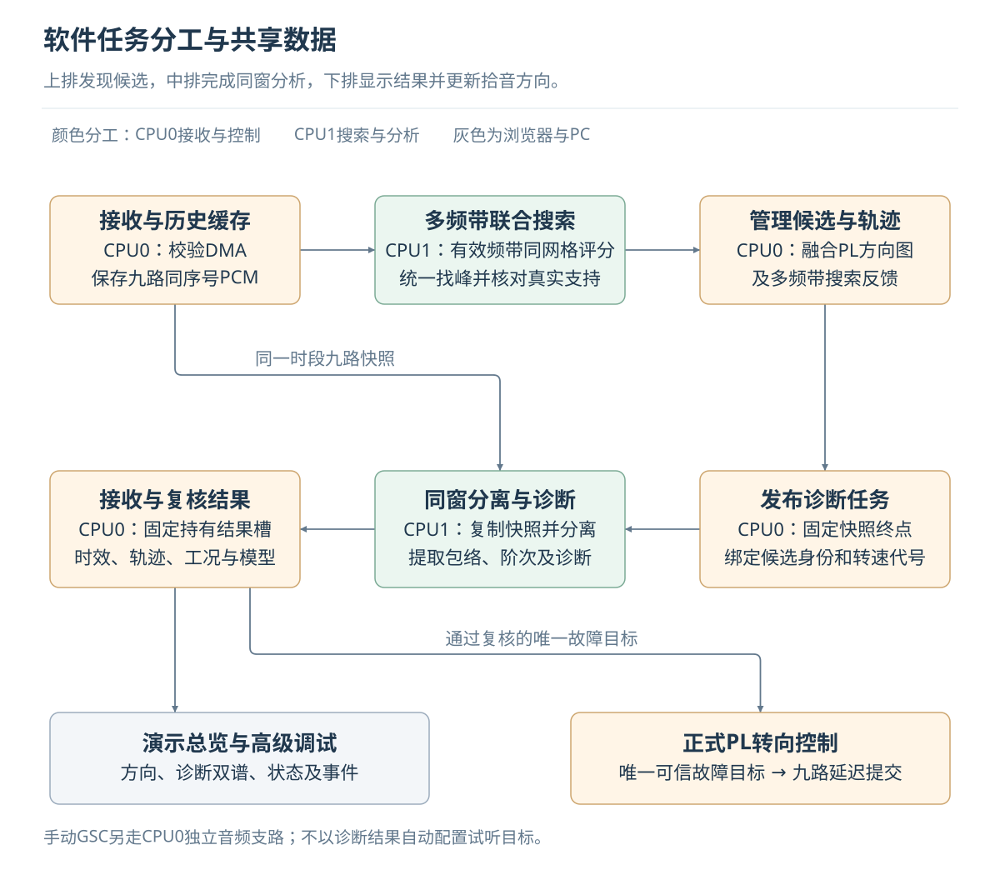](技术文档配图/第二部分_软件任务分工.drawio.svg)

*图2-8 软件任务分工与共享数据。CPU0维护历史和轨迹，CPU1执行“多频带联合搜索”并反馈候选；历史向“同窗分离与诊断”提供固定快照，轨迹管理经任务发布提供候选。复核结果分别流向双层界面和正式PL转向控制。手动GSC试听另走CPU0独立音频支路，不接收正式诊断目标作为自动授权。*

CPU0和CPU1采用AMP（非对称多处理）分工，共用ELF可执行文件中的不同启动入口。CPU1独立初始化MMU（内存管理单元）、一级缓存和浮点环境，加入SCU（双核缓存一致性控制单元）管理。共享历史与任务段配置为普通可缓存内存、采用写回策略（Normal Write-Back）；DMA槽区由PL写入，CPU读取前执行缓存失效和内存屏障。核间共享数据与DMA数据分别进行一致性处理。

历史区`.c9_history`位于`0x0A000000`，预留32 MiB；任务区`.c9_tasks`位于`0x09000000`，预留1 MiB；DMA区`.c9_dma`位于`0x08000000`，预留1 MiB，其中实际环槽区为512 KiB。频谱、协方差和整段音频放在CPU1独占DDR工作区，避免将大数组放入小容量栈。

任务通过原子状态转换交接，CPU0只替换尚未认领的任务。结果采用双槽：CPU1写入空槽后发布，CPU0接收后固定持有，使用新结果时再释放旧槽。HTTP分块读取同一结果期间，CPU1不能覆盖该缓冲。

#### 2.3.2 软件各模块介绍

##### 2.3.2.1 RISC-V定位固件

九麦固件启动时核对采集器、定位器和接口标识，再开放连续定位。主循环读取定位请求编号及阶段类型，复读确认后按请求发射FFT、互谱、PHAT、IFFT或SRP自定义指令；RTL准备输入和搬运结果，固件根据阶段完成情况继续调度。

一个窗口评分完成后，固件读取九通道统计、遍历1024方向格，完成输入幅度、峰值质量及截止期检查。评分采用双缓冲，当前窗口写入非活动块，提交时切换评分指针与序列号。CPU0分片读取并在前后复核序列，确认完整后供轨迹管理及HTTP复用。

本模块输入为定位任务票号、算子状态和评分，输出为完整方向图、质量原因及窗口身份。最强峰跟随用于测试；正式故障定向由PS诊断结果授权。

##### 2.3.2.2 连续接收、历史缓存与采样调度

`c9_live_poll()`分批消费已发布DMA槽，将最多16个已拥有的采样槽预取并批量确认，周期检查协作预算，返回CPU0主循环处理方向与网络。每个有效记录经`c9_history_push()`写入九路历史；断序、采集代次变化或环恢复会清理旧会话资格。

历史为单写者环形缓存。每槽保存PCM、完整样本序号和写入保护号。CPU0先发布奇数保护号，写入内容后改为偶数；CPU1复制时核对保护号、序号及复制后的状态。`c9_history_copy()`按指定`requested_end`复制，遇到覆盖、会话变化或并发改写即返回失败，采集写者无需等待。

诊断每隔80000个原始点发起一次，固定任务终点`end_sample`。若处理落后，调度器合并至最新到期终点并记录跳步，不积压无界旧任务。CPU1认领后按该终点复制160256×9快照，首256原始点供预热，剩余数据经4倍抽取后形成40000点有效音频。

任务层检查排队输入年龄小于80000原始点，完成时检查结果样本年龄小于468750点，并要求从排队到完成的总耗时小于3 s。512 ms为调度步长，3 s为独立的总耗时及结果年龄限制，二者不代表固定的有效结果刷新率。

##### 2.3.2.3 多频带搜索与方向轨迹

`c9_candidates_search()`从九路历史短窗发现候选，无需预先指定PL最强峰。当前完整输入为16640×9原始点，扣除预热后提供104.8576 ms真实证据。前端以127抽头Q15定点低通滤波（15位小数）抗混叠并4倍抽取，再用1024点窗、512点步长形成七个短时傅里叶变换（STFT）观察窗。

搜索分为600—2200、2200—4600、4600—8000 Hz三个频带，各计算36麦对的相关信息并对1024格评分。对有效频带的同一方向格取有符号评分均值，再从联合图中提取最多三个峰。中间求和使用64位避免溢出；候选需通过峰质量和实际观察支持检查，并采用有效的连续支持区间。

CPU0按方向夹角关联轨迹，不按能量名次继承ID。轨迹分为已观测、暂失、恢复中和过期；暂失可短时保留身份，但不新增方向证据。恢复需积累新鲜观测，明显移动后重新积累。`c9_track_coverage_reason()`按真实支持区间并集计算快照覆盖，诊断要求至少90%方向覆盖。

候选满足观测次数、覆盖和角度间隔要求后才进入诊断。若仍有方向未解析，可以显示已完成的分析，但不据此授权自动故障定向。轨迹ID记录方向变化，不能作为设备永久身份。

##### 2.3.2.4 CPU1诊断任务与结果交接

`c9_tasks_cpu1()`是后台工作入口。存在待诊断任务时，最多连续优先处理两次辅助搜索，随后尝试诊断；没有待诊断任务时继续提供辅助服务。诊断通过原子认领取得任务及空闲结果槽，再检查排队年龄、固定终点快照、采集身份与候选支持。

[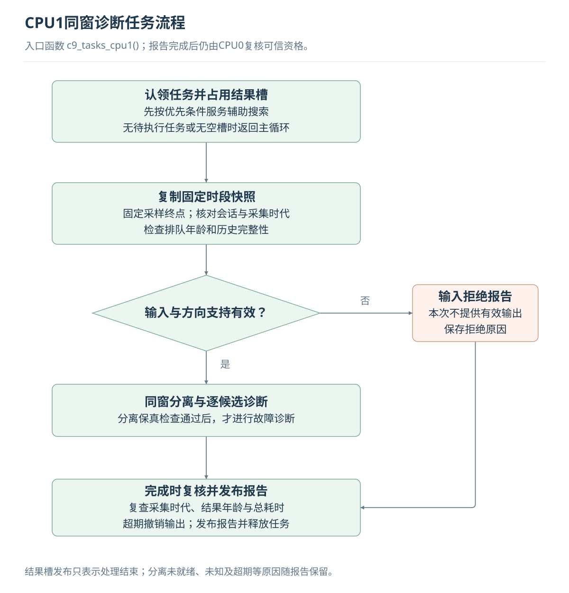](技术文档配图/第二部分_CPU1诊断任务流程.drawio.svg)

*图2-9 `c9_tasks_cpu1()`任务流程。主路径从“认领任务并占用结果槽”进入“复制固定时段快照”，再判断输入与方向支持是否有效。“是”分支执行同窗分离与逐候选诊断；“否”分支形成输入拒绝报告，随后从右侧汇入“完成时复核并发布报告”。没有待执行任务或没有空槽时返回主循环。分离未就绪、未知及超期均保留原因，结果槽发布只表示处理结束。*

任务的关键输入包括`sequence、end_sample、session、epoch、shaft_generation`及最多三个轨迹候选。通过输入检查后调用同窗分离，再对`ready_mask`中置位的候选调用`c9_diagnose()`；未就绪项保存绑定和拒绝原因。结束时重新读取历史状态，若采集代次、会话变化，或总耗时、结果年龄达到3 s，则清除可用输出。

结果包括分离报告、诊断标签、音频、显示用包络谱及耗时计数。CPU1以release语义发布结果槽，释放任务；CPU0接收后再核对新鲜度、轨迹、转速及模型，决定是否显示为有效诊断和是否授权拾音。

##### 2.3.2.5 同窗目标分离与保真检查

`c9_candidates_separate()`接收同一份`raw[160256][9]`、1至3个候选、统一转向LUT及CPU1工作区，输出`out[3][40000]`和质量报告。候选两两夹角小于25°时，程序拒绝本次分离；25°是输入判定阈值。

[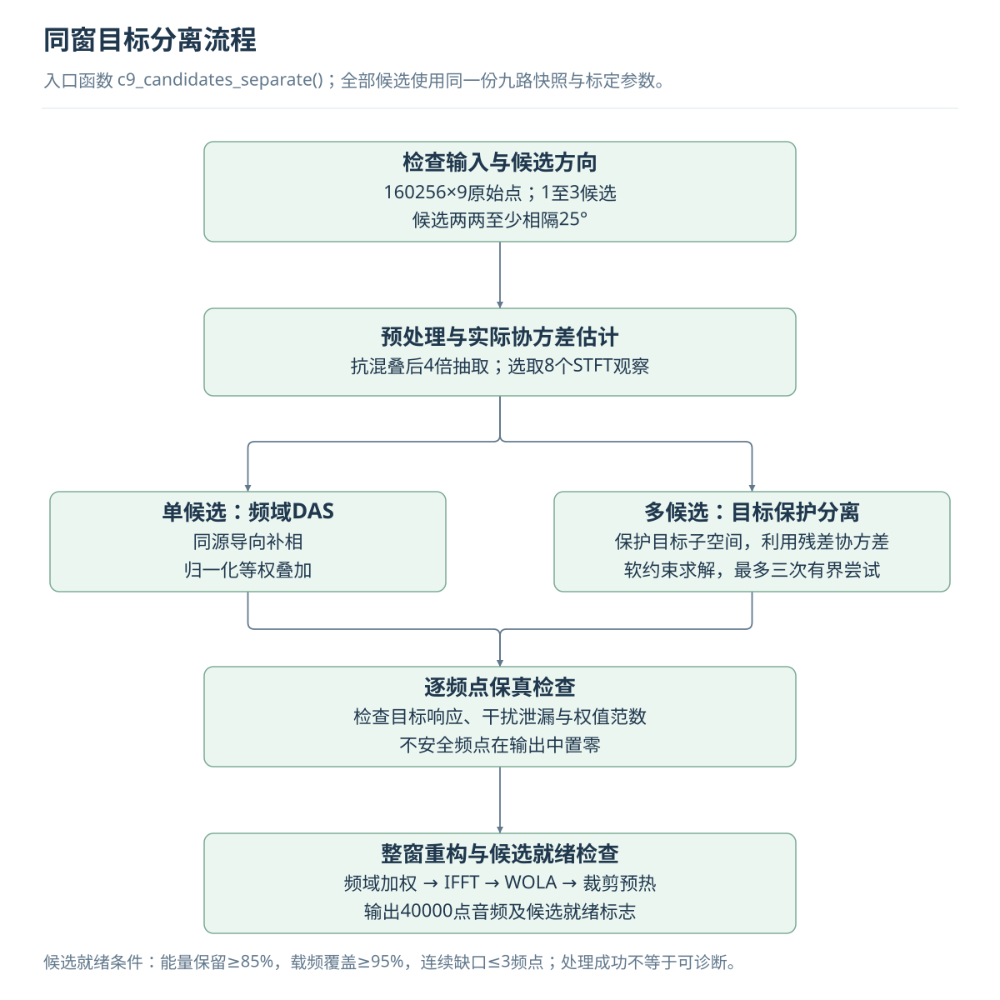](技术文档配图/第二部分_同窗分离流程.drawio.svg)

*图2-10 `c9_candidates_separate()`同窗分离流程。预处理后分为“单候选：频域DAS”与“多候选：目标保护分离”两个互斥分支，两支共同汇入“逐频点保真检查”，最后进行“整窗重构与候选就绪检查”。图下列出能量保留、载频覆盖及连续缺口门槛。函数返回成功与候选可诊断分别用返回值和`ready_mask`表达；外部会话、采集代次、轨迹及时间限制由图2-9任务层检查。*

分离先作抗混叠抽取，再从长窗选取八个实际短时频谱观察窗估计九通道协方差。对每个目标，由中心方向及水平、俯仰偏移形成五个导向样本，经正交化得到目标子空间U。投影矩阵及残差协方差为：

$$
\mathbf{P}=\mathbf{I}-\mathbf{U}\mathbf{U}^{\mathsf{H}},\qquad \mathbf{R}_{r}=\mathbf{P}\widehat{\mathbf{R}}_{x}\mathbf{P}^{\mathsf{H}}\tag{2-8}
$$

其中，I为单位矩阵，U的列向量构成目标保护子空间，上标H表示共轭转置；R̂ₓ为九通道输入的协方差估计，Rᵣ为投影后的残差协方差。

残差证据足够时，对其作迹归一化和25%单位阵收缩；目标扇区偏差、竞争方向抑制与残差统计共同构成正则化矩阵Rₑ。以列权向量表示，单位目标响应的最小方差形式[[8]](#ref-8)为：

$$
\mathbf{w}=\frac{\mathbf{R}_{e}^{-1}\mathbf{a}_{t}}{\mathbf{a}_{t}^{\mathsf{H}}\mathbf{R}_{e}^{-1}\mathbf{a}_{t}},\qquad Y=\mathbf{w}^{\mathsf{H}}\mathbf{X}\tag{2-9}
$$

其中，Rₑ为加入保护与正则化项后的求解协方差矩阵，aₜ为目标导向向量，w为分离权值；X为九通道频谱，Y为目标分离频谱。

实现采用目标保护与竞争扇区软约束，并在最多三次有界尝试内调整抑制强度。每个频点检查目标响应、竞争泄漏与权值范数；不满足条件的频点置零。单候选时使用同源导向矢量补相的频域等权DAS，仍经过带限和整窗重构。

整段滑动STFT使用所学权值加权，补共轭频谱后作IFFT，按加权重叠相加（WOLA）重构并逐点归一化，裁剪预热后输出40000点音频。候选需满足能量保留至少85%、固定2200—4600 Hz载频覆盖至少95%、连续缺口不超过3个频点等条件，才置位`ready_mask`。这样可防止大量删去故障载频后，仍将听感较安静的输出送入分类器。

##### 2.3.2.6 长窗包络、阶次特征与模型判别

`c9_diagnose()`输入候选音频、当前绑定轴频和`c9_diag_binding`。绑定同时包含轨迹、方向、采样起点、采集代次、特征计算规则及实际可用频点掩码，使特征和判断能追溯到同一份声音。

[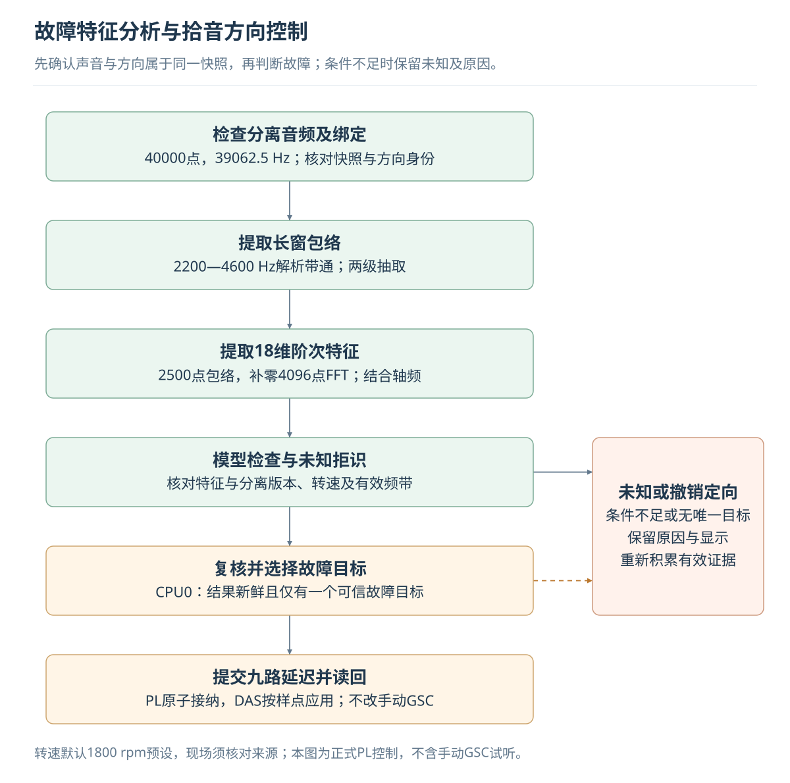](技术文档配图/第二部分_特征诊断与转向.drawio.svg)

*图2-11 故障特征分析与拾音方向控制。绿色主路径依次检查分离音频及绑定、提取长窗包络、提取18维阶次特征、执行模型检查与未知拒识；浅橙主路径由CPU0复核并选择故障目标，再提交九路延迟并读回。模型条件不足时向右进入“未知或撤销定向”；没有唯一可信故障目标时，由“复核并选择故障目标”沿橙色虚线撤销定向。*

包络前端`c9_env_analyze()`使用257抽头复解析带通，选取2200—4600 Hz并4倍抽取，取复幅度得到10000点包络；再经129抽头、900 Hz低通及4倍抽取，形成2500点、2441.40625 Hz包络。整段去均值、加Hann窗（汉宁窗）、补零至4096点，仅执行一次包络FFT。真实观察长度仍为1.024 s，补零后的约0.596 Hz频点间距只细化频谱采样。

特征按当前绑定轴频提取，并记录预设或实测转速的来源。包络及故障阶次分析参考滚动轴承诊断方法[[9]](#ref-9)。6004-2ZR配置为9个滚动体、滚动体直径6.35 mm、节圆直径31 mm、接触角0°、内圈旋转；对应保持架（FTF）、滚动体自转（BSF）、外圈通过（BPFO）、内圈通过（BPFI）四组特征阶次，约为0.39758、2.33853、3.57823、5.42177。每组取1至4次谐波，加上轴频1X、2X，共18维。轴承型号或运动假设改变时同步更新参数与模型。

正式模型支持正常基线以及正常／故障／干扰三类判别。三类判别计算带共享逆方差的18维平均平方距离，最近类别需同时满足类别半径和次近／最近距离比门槛；不足时拒识为未知。仅有正常基线时，异常只表示偏离正常范围，不能直接认定为具体轴承故障。

模型入口检查接口格式、特征计算规则、音频分离方法、转速域和实际可用频点是否符合模型要求。无有效模型、转速绑定无效、能量不足、削顶、载频缺失或处理规则不匹配时，程序保留拒绝原因。启动配置以1800 rpm预设建立转速绑定；转速变化或来源失效时更新状态，重新积累完整窗口。六类故障细分实验的结果不写入正式故障标签或定向有效位。

##### 2.3.2.7 九路延迟生成与可信目标控制

CPU0接收结果后，要求当前任务有效、转速代号匹配，并且恰有一个合格故障候选，才调用`c9_apply_target()`。零个、多个、过期或存在未解析方向时，撤销可信故障定向，继续保留各候选可显示的结果。

细角由方向评分局部拟合获得，边界、平坦峰和不合法曲率不强行细化。`c9_candidate_delays_q16()`依据转向LUT插值得到九路补偿，用于正式PL控制与分离。手动GSC也取该几何来源，但将原始延迟除8并量化至1/16音频样点，构成独立PS音频配置；两者的采样率和主支路计算方式不同。

正式控制先登记完整向量，再依次开始事务、写入元数据及九个延迟、提交并读回。活动配置编号、方向、采集代次、状态或延迟不符时撤销。PL接纳、DAS样点边界应用和平滑结束分别检查。`c9_gsc_manual_target()`另接收网页角度，不写PL目标或诊断目标；`/api/target/auto`为PL最强峰跟随，也不等同于可信故障定向。

##### 2.3.2.8 固定目标GSC试听与保护

广义旁瓣抵消器（GSC）[[10]](#ref-10)在本工程中作为CPU0上的固定目标音频处理分支。`/api/gsc/target?az=&el=`接收手动角度，`c9_gsc_manual_target()`生成九路音频域延迟并重置处理状态；接口以`nominal_uncalibrated=true`标记名义延迟模式。该支路使用PS自建DAS主支路，不提交正式PL拾音方向。

[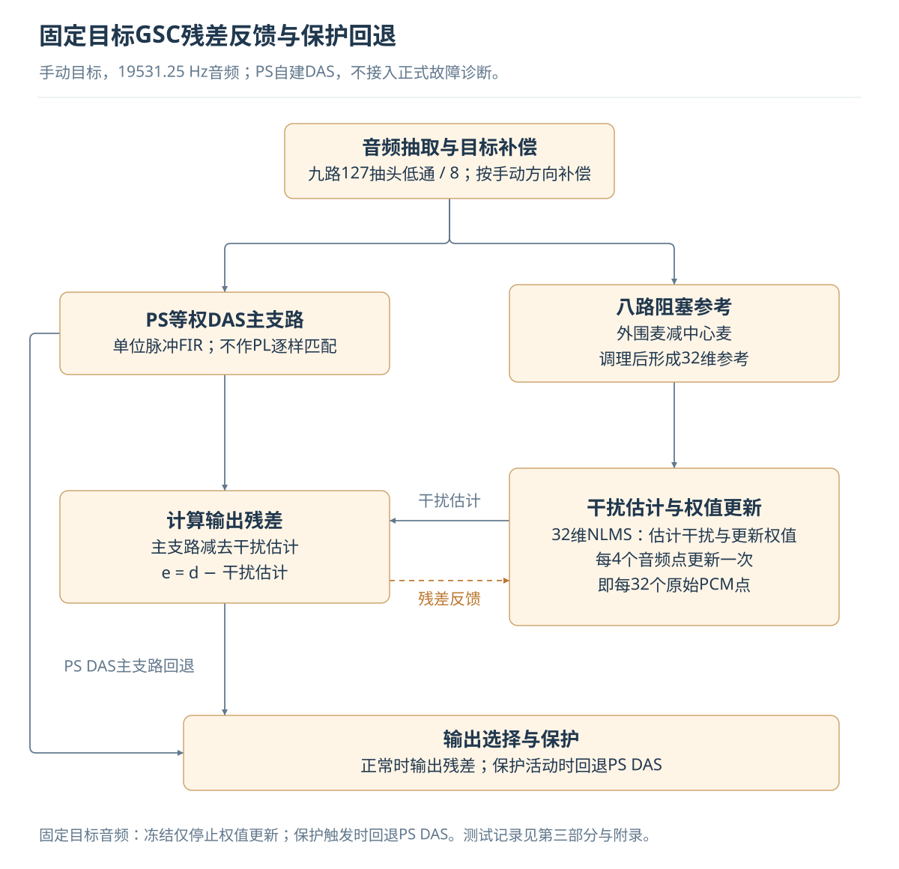](技术文档配图/第二部分_GSC残差反馈.drawio.svg)

*图2-12 固定目标GSC残差反馈与保护回退。九路原始PCM先经127抽头低通和8倍抽取，再按手动目标补偿。左侧PS等权DAS主支路与右侧八路阻塞参考并行；干扰估计送入“计算输出残差”，残差沿下方橙色虚线反馈权值更新。左侧独立回退线将PS DAS送至“输出选择与保护”。此处无PL逐样匹配准入，也不将音频送回同窗故障诊断。*

`gsc9_process_nominal()`使用PS自建主支路，当前FIR为单位脉冲，跳过旧`gsc9_process()`路径的PL DAS/FIR逐样比较。外围八麦与中心麦作差，经调理形成八路阻塞参考，每路四抽头、抽头间隔四个音频点，构成32维向量ξ。

$$
y=\mathbf{w}^{\mathsf{T}}\boldsymbol{\xi},\quad e=d-y,\quad \mathbf{w}\leftarrow\mathbf{w}+\frac{\mu\,e\,\boldsymbol{\xi}}{\varepsilon+\boldsymbol{\xi}^{\mathsf{T}}\boldsymbol{\xi}}\tag{2-10}
$$

其中，d为DAS主支路，ξ为32维阻塞参考向量，y为干扰估计，e为输出残差；μ为更新步长，ε为避免分母过小的保护量。权值更新受使能、冻结与保护状态控制。

试听预滤波在约4.6 kHz以上已明显衰减。GSC逐音频样点输出，每4个音频点更新一次权值，相当于32个原始PCM点；保护按64个音频点观察。512个音频点的稳定预热对应约26.2144 ms，这只是预热计数，并非整条通路时延。冻结暂停更新但仍可使用已有权值输出；保护触发则返回PS DAS，满足恢复条件后重新进入抵消处理。

`/api/gsc/on`同时请求GSC与录音，`off`关闭抵消但可继续录制DAS。未录音时，接收循环可跳过该可选音频处理分支，历史接收继续运行。界面分别显示GSC使能与保护状态，实际抑制效果通过配对音频评价。

固定目标音频通路的合成输出测试使用1536个活动样点，检查关闭与初始冻结状态的DAS等值关系及名义PS参考一致性，结果见第三部分3.3.5节。

##### 2.3.2.9 运算优化与标量回退

PS端在保持九通道、36麦对、三频带和1024格搜索范围的条件下减少重复计算。两组满足共轭对称性的相关频谱打包为一次复数IFFT，实部、虚部分别恢复两组相关，使每频带36次IFFT降为18次。通道自功率根跨麦对复用；Q4时差在4倍抽取后对应1/64分析样点，方向扫描的延迟编码和三次插值权重提前生成，LUT变化后重建。

抗混叠抽取利用系数对称性，外围八路以NEON并行、中心路单独处理。启动时与标量整数参考比较随机、满幅、交替满幅和脉冲输入，自检通过后启用，否则回退标量。GSC同一次权值更新共享分母，利用共享倒数与余数修正保持整数商一致。表3-6中的软件耗时来自指定宿主上的实际C实现计时。

##### 2.3.2.10 浏览器显示、健康监测与PC工具

浏览器提供“演示总览”和“高级调试”两层：总览集中显示方向、诊断及运行状态，调试层展开参数、联合评分和固定目标音频实验。HTTP读取CPU0已接收的结果，不在回调中重新运行FFT、搜索或诊断。

`/api/ps-score`只读已接受的联合评分快照，展示主峰S1、经角度抑制后的比较峰S2、差值ΔS及S1位置的各频带评分。原始评分不是置信度，S2也不自动代表第二声源。快照以会话、采集代次、序号和采样区间关联；同一采集代次内结果年龄不超过31250原始点（200 ms）才满足该接口的新鲜度条件，页面轮询不会刷新证据年龄。

`/api/candidates`提供候选、诊断及运行状态；`/api/gui/snapshot?sequence=...&index=...`返回同一诊断结果的4096点音频和128点包络显示谱，附轨迹、采集代次、会话与采样率。序号冲突时拒绝拼接。音频谱由浏览器去均值、加Hann窗（汉宁窗）计算，包络谱来自板端特征提取程序；二者属于同窗故障诊断显示，不是GSC抑制效果对比谱。暂停页面只暂停显示。

固定目标试听采用统一的配对音频格式，通过UDP（用户数据报协议）发送，默认发送至PC `192.168.2.20:1234`。48字节头部携带原始采样率156250和分母8；每条记录为原始样本号、PS DAS、GSC输出及原因码，共10字节，包尾含CRC。128条一包时共1332字节。音频率为19531.25 Hz，样本号仍按原始PCM计数，相邻音频记录通常相差8。该协议不传九路原始PCM。

PC端`pc/receive_audio.py`保存成对PCM、包记录和元数据，检查CRC、序号和会话，并统计各原因码的出现次数。回放或转WAV时按19531.25 Hz处理。九麦实时配置中的`/api/raw/start`进入连续UDP服务，接收工具按音频包头识别格式。

健康监测区分疑似、报警和恢复，未知、干扰与断流不作为正常恢复。九路原始长窗、同窗诊断快照和配对试听音频分别保存，并记录固件、几何、标定、转速来源及采样率，供事件回查与离线重放。

##### 2.3.2.11 关键函数输入输出

表2-6 关键函数输入输出

| 函数／执行位置 | 关键输入 | 关键输出或状态 |
|---|---|---|
| `c9_live_poll()`／CPU0 | 已发布DMA槽，输出与丢失计数指针 | 消费状态，推进接收与历史 |
| `c9_history_push()`／CPU0 | `history、packet[16]` | 发布带样本序号及保护号的九路PCM帧 |
| `c9_history_copy()`／CPU1 | 历史、帧数、`requested_end` | 独占`pcm[][9]`、首样本、采集代次、会话；失败返回0 |
| `c9_candidates_search()`／CPU1 | 九路短窗、LUT、工作区、采样上下文 | 候选、频带质量及真实支持区间 |
| `c9_tracks_update_intervals()`／CPU0 | 候选及对应起止样本 | 轨迹ID、状态和缺口 |
| `c9_tasks_cpu1()`／CPU1 | 已发布任务、可用结果槽、历史 | 分离与诊断报告、音频、耗时或拒绝原因 |
| `c9_candidates_separate()`／CPU1 | `raw[160256][9]、candidates、count、lut` | `out[3][40000]、ready_mask`及质量报告 |
| `c9_env_analyze()`／CPU1 | 40000点归一化音频、提取元数据指针 | 长窗包络谱及前端有效性信息 |
| `c9_diagnose()`／CPU1 | 音频、`shaft_hz、binding`及模型 | 正常／故障／干扰或未知，附原因与特征 |
| `c9_candidate_delays_q16()`／CPU0 | 候选细角、统一转向LUT | 九路定点补偿延迟（Q16，16位小数）或失败 |
| `c9_apply_target()`／CPU0 | 总线、候选、采集代次 | 完整原子事务及读回结果；失败撤销目标 |
| `c9_gsc_manual_target()`／CPU0 | 网页方位、俯仰和当前历史上下文 | 独立PS音频域延迟，重置试听状态，不改PL目标 |
| `gsc9_process_nominal()`／CPU0可选 | 抽取后的九路音频、PS名义目标配置、使能和冻结 | 成对PS DAS／GSC音频、保护原因与适应状态 |
| `/api/ps-score`／CPU0 | 已接受联合评分快照 | S1、S2、频带分数和原始证据年龄；无新增搜索 |
| `c9h_observe()`／CPU0 | 监测器及已复核诊断 | 趋势、报警、恢复及事件记录 |

接口将几何确认、标定参数、模型匹配性和转速状态作为独立有效性条件。结果槽发布表示一次任务执行结束，CPU0复核通过后才提交正式PL拾音方向。

### 2.4 功能模块与任务对应

表2-7汇总功能与执行模块的对应关系，便于对照前述数据通路和任务分工。

表2-7 功能模块与任务对应

| 系统功能 | 执行模块与职责 |
|---|---|
| 阵列布局、采样率和方向配置 | 阵列参数配置：统一通道映射、坐标、采样率与搜索网格 |
| PL模块连接与参数 | PL顶层：连接采集、软核、专用单元及传输接口 |
| PDM接收、抽取及通道预处理 | 采集与预处理：双相接收、CIC抽取、去直流及通道校正 |
| RISC-V、实数并行及声学执行 | 声学处理器：五级软核、八路实数SIMD及复数声学单元 |
| 重叠定位、SRP与生产固件 | 定位支路：窗口准备、频域运算、相关环及四麦对SRP扫描 |
| DAS、原子控制与DMA | 连续音频与传输：延迟叠加、方向统一提交及DDR写入 |
| 历史、搜索、分离及其数据格式约定 | 长窗分析：历史快照、多频带搜索及同窗声音分离 |
| 双核任务、采样调度与轨迹 | 双核调度：CPU0采集服务、CPU1分析及方向轨迹维护 |
| 包络、模型、转向与GSC | 诊断与反馈：特征提取、模型判断、可信目标定向及独立GSC试听 |
| 界面、监测与PC归档 | 展示与记录：状态显示、频谱展示、事件保存及离线回放 |
| 联合评分与固定目标音频 | 联合评分与试听：方向证据融合、PS定向音频及成对接收 |

### 2.5 部署文件与运行条件

部署文件包括BIT配置文件、ELF可执行文件、初始化和下载脚本。BIT配置PL电路，ELF运行PS程序；初始化和下载脚本负责装载顺序与处理器启动。重新构建需要配套的BSP（板级支持包）、XSA（硬件平台描述文件）及Vitis工具链。

---

## 第三部分  完成情况及性能参数

### 3.1 整体介绍

本作品采用九麦阵列与Zynq-7020平台，完成了声学RISC-V软核、片上数据搬运、方向计算及PS双核分析程序的设计。系统以声源方向为入口，将同一时段的九路声音与候选轨迹关联，再进行目标声音分离、包络和轴承阶次分析。PC浏览器用于查看方向、频谱、诊断状态和运行记录。

工程资料包含阵列布局与原理图、PL与PS源码、配套BIT和ELF，以及RTL仿真和宿主测试记录。已完成的对照包括九麦方向评分的数字计算与周期、FFT/FIR/SRP算子加速、宿主搜索与双候选分离，以及界面和固定目标音频的合成路径检查。

本部分按硬件、软件和功能测试说明完成情况。表1-2、表3-4至表3-6采用2026-10-28的算子对照测试记录，分别列明输入、平台与计时边界；联合评分、固定目标音频和整机运行按各自的验证范围说明。

系统硬件实物如下图所示，展示九麦阵列与Zynq-7020开发板的整体连接及板上布局。

| 实物照片（一） | 实物照片（二） | 实物照片（三） |
|:---:|:---:|:---:|
|  | 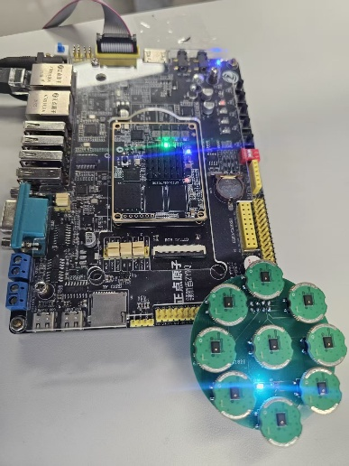 | 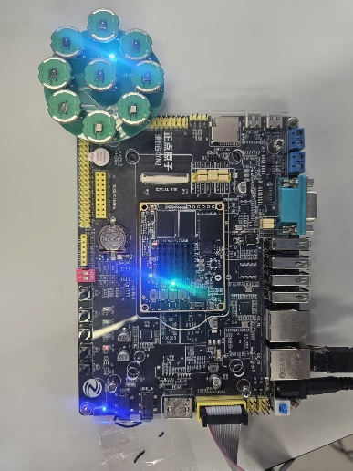 |

*图3-1 九麦阵列与Zynq-7020处理平台实物。*

### 3.2 工程成果

#### 3.2.1 机械成果

阵列采用外围八麦、中心一麦的平面布局，已建立CH0—CH8与U1—U9的通道对应关系，并在配置中录入逐麦x、y坐标。坐标用于生成麦对时差和拾音补偿表，定位、分离及转向使用同一套几何参数。

机械资料包括逐麦声孔坐标、平面阵列布局及通道映射，z在模型中设为0。坐标及通道表见第二部分2.2.2节。

阵列板完整原理图如下，保留原始器件标号、接口与相位配置，供阵列结构及通道连接对照。

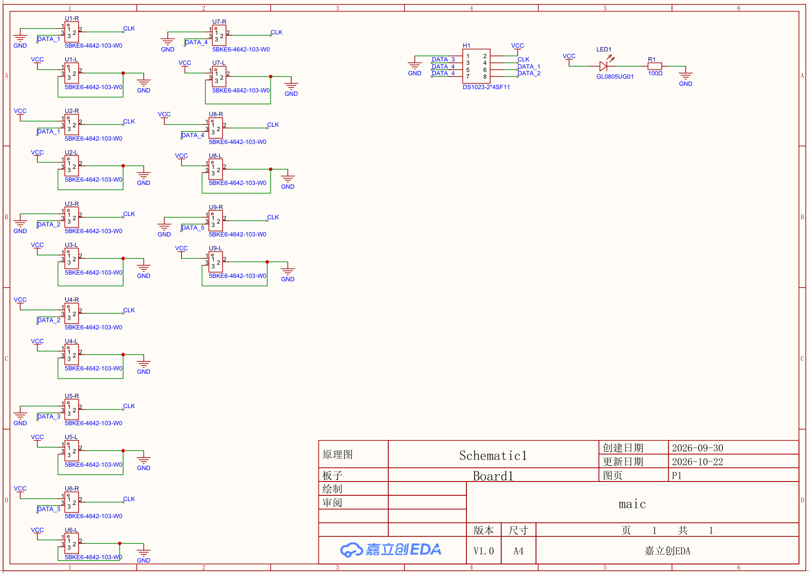

*图3-1附图 阵列板完整原理图。H1中重复DATA_4标签保留原图，实际通道映射按项目配置核对。*

#### 3.2.2 电路成果

阵列板原理图已纳入工程资料。九只数字麦克风通过五根DATA和一根公共CLK连接PL，同一DATA上的两路麦克风采用不同PDM相位。项目配置记录H1重复DATA_4为图纸标签笔误，保留原图与配置中的通道映射供对照。

PL侧实现了PDM接收、CIC抽取、去直流、配置增益、重叠窗口定位、定向DAS/FIR及非阻塞DMA。声学处理器由五级RISC-V、八路实数SIMD、四路复数声学单元、共享FFT/IFFT和核外四麦对SRP组成。自定义指令负责启动计算，RTL状态机负责装载、地址推进和中间结果转存。

电路整体结构及PL向PS的传输关系见图3-1补充。

[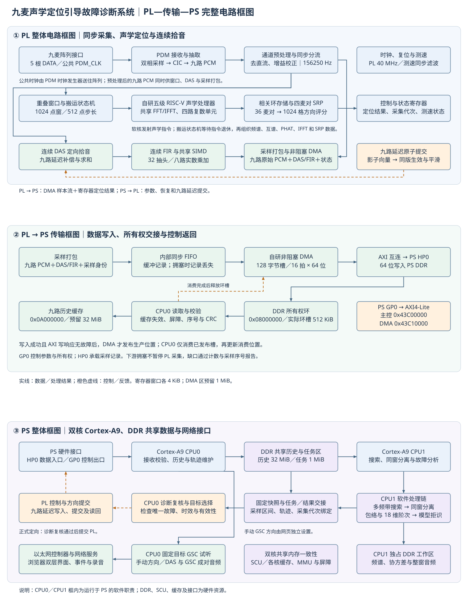](技术文档配图/pl-ps-complete-circuit.drawio.svg)

*图3-1补充 PL—传输—PS完整电路框图。上部为PL整体电路，中部为PL向PS的数据传输，下部为PS硬件资源及双核软件职责。通道预处理后的九路PCM分别供给重叠窗口、连续DAS和采样打包；DMA通过HP0写入DDR，CPU0读取校验后释放环槽。正式方向反馈从“CPU0诊断复核与目标选择”经“PL控制与方向提交”返回PL接口；手动GSC方向由网页独立设置。实线表示数据或处理结果，橙色虚线表示控制或反馈。该图为模块及接口框图。*

PDM采集波形如下，展示双相接收、CIC抽取、PCM有效脉冲及帧计数的时序关系。该截图采用64倍抽取、39.0625 kHz PCM配置。

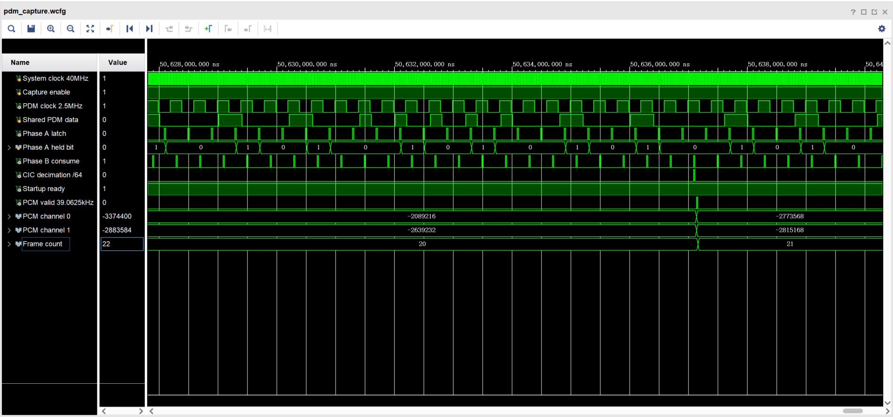

*图3-1波形 PDM双相采集与CIC抽取波形。图示配置与当前九麦工程的16倍抽取、156250 Hz原始PCM配置分别说明。*

表3-1 电路成果

| 电路成果 | 当前内容 | 对应材料 |
|---|---|---|
| 阵列板电路资料 | 麦克风接口、相位配置、H1连接器及电源指示支路 | 阵列板原理图 |
| 同步采集与预处理 | 九路有效PCM、公共采样编号、去直流和通道增益 | 第二部分2.2.3.2节及对应RTL |
| 声学计算与搬运 | FFT、互谱、PHAT、相关环、SRP和片上缓存 | 第二部分图2-5、图2-6 |
| 连续拾音 | 九路延迟补偿、共享SIMD的32抽头FIR | 第二部分2.2.3.5节 |
| PL到PS传输 | 128字节DDR槽、完成位置发布、CRC及消费确认 | 第二部分图2-7 |
| 发布文件 | BIT、ELF、初始化与下载脚本、哈希记录 | 第二部分2.5节 |

表3-1所列项目对应电路结构、RTL实现和发布文件；数字运算的数值及周期结果见3.3.2—3.3.3节。

#### 3.2.3 软件成果

软件分为软核固件、PS双核程序、浏览器和PC工具四部分。固件按窗口阶段发射计算指令，扫描评分后检查输入质量并发布方向图。CPU0负责连续接收、历史缓存、轨迹与网络；CPU1在固定快照上执行搜索、分离及诊断。任务和结果缓冲明确区分写入者与读取者，防止分析期间被覆盖。

浏览器已形成“演示总览”和“高级调试”两层界面。总览集中显示方向、诊断和运行状态，调试层提供联合评分、参数及手动固定目标试听。诊断音频谱和包络谱绑定同一结果序号，避免两张谱来自不同采样时段。

表3-2 软件成果

| 软件成果 | 已实现的内容 | 当前验证情况 |
|---|---|---|
| RISC-V定位固件 | 阶段请求识别、自定义指令发射、质量检查和方向图发布 | 32窗RTL记录完成逐级数值及结果发布检查 |
| 多频带搜索 | 三频带同网格联合评分、候选提取和实际支持区间 | 联合评分源码与接口已提供；2026-10-28宿主计时见表3-6 |
| 同窗分离与诊断 | 1—3候选、保护分离、保真检查、包络及18维阶次特征 | 指定合成双候选夹具的两路输出均通过保真检查 |
| 浏览器界面 | 总览、调试、方向与双谱、联合评分快照 | 评分显示状态检查通过 |
| 固定目标试听 | 手动目标、PS DAS/GSC成对输出、冻结及保护回退 | 1536个活动样点的合成输出路径检查通过 |
| PC工具 | 成对音频接收、包记录、事件归档及离线重放 | 已提供接收、归档和回放工具源码，记录结构见第二部分2.3.2.10节 |

GUI评分显示状态检查、部署文件一致性检查均通过；固定目标音频的合成输出通过1536个活动样点的参考比较。这三项分别验证界面状态、文件配套和指定输入下的处理路径。

### 3.3 特性成果

#### 3.3.1 采集与处理参数

表3-3 采集与处理参数

| 项目 | 当前配置 | 说明 |
|---|---:|---|
| 有效麦克风／麦对 | 9路／36对 | 第十采集槽无效 |
| PL业务时钟 | 40 MHz | RTL周期按此频率换算时间 |
| PDM时钟／抽取倍数 | 2.5 MHz／16 | 得到156250 Hz原始PCM |
| PL定位窗口／步长 | 1024／512点 | 窗长6.5536 ms，步长3.2768 ms |
| 方向网格／相关环 | 32×32格／64点 | 网格数量不等于实测测角精度 |
| PS诊断音频 | 39062.5 Hz，40000点 | 有效观察长度1.024 s |
| 诊断调度步长 | 512 ms | 实际有效结果间隔还受计算耗时和输入条件约束 |
| 固定目标试听 | 19531.25 Hz | 原始九路PCM低通后8倍抽取；独立于诊断 |
| 历史缓存 | 1048576原始帧 | 约6.7109 s九路PCM |

表3-3为配置与代码核对结果，列出采样率、窗口长度、网格规模、调度步长和缓冲容量；RTL与宿主测试耗时分别列于后续性能表。

#### 3.3.2 PL声学计算加速

本文性能对照使用RTL周期仿真和宿主实际C实现计时两类数据。RTL对照检查数字运算输出和阶段周期；宿主对照在同一电脑上切换软件实现并核对输出。两类测试均注明输入、实现方法和计时起止点，分别列示结果。

九麦架构主对照使用`-Os`及同一首个合成平面波窗口，加速方案在采集期前移统计。另以`-O2`标量构建作敏感性检查，记录9806381拍、245.159525 ms，相对同一加速路径为119.08倍。

表中时间由RTL周期按40 MHz换算，属于仿真计时。

40 MHz是本组测试周期换算与工程配置使用的业务时钟；器件最高工作频率以实际部署电路的布局布线时序报告为准。

表3-4 PL声学计算加速

| 测试项目 | 对照实现 | 加速实现 | 耗时比 | 计时范围 |
|---|---:|---:|---:|---|
| 九麦完整方向评分 | 276.234300 ms | 2.058850 ms | 134.17× | 同一首窗，原始窗口已驻留至1024个评分完成 |
| 1024点实数FFT | 4.475900 ms | 0.165050 ms | 27.12× | 同一软核，包含装载、运行及结果取回 |
| 512点、32抽头FIR | 6.919350 ms | 0.378450 ms | 18.28× | 同一软核及系数；包含测试约定的初始化、输出及检查 |
| 36麦对、1024格SRP | 3.686450 ms | 0.232675 ms | 15.84× | 串行与四麦对并行，从启动（START）到完成（DONE）；不含装载、读回 |

九麦评分的134.17倍来自专用运算、存储布局、自主搬运和采集期滚动统计的共同作用。计时止于评分完成，结果后处理、PS往返和网页显示在此范围之外。FFT、FIR和SRP分别按表中各自任务及基线比较。

[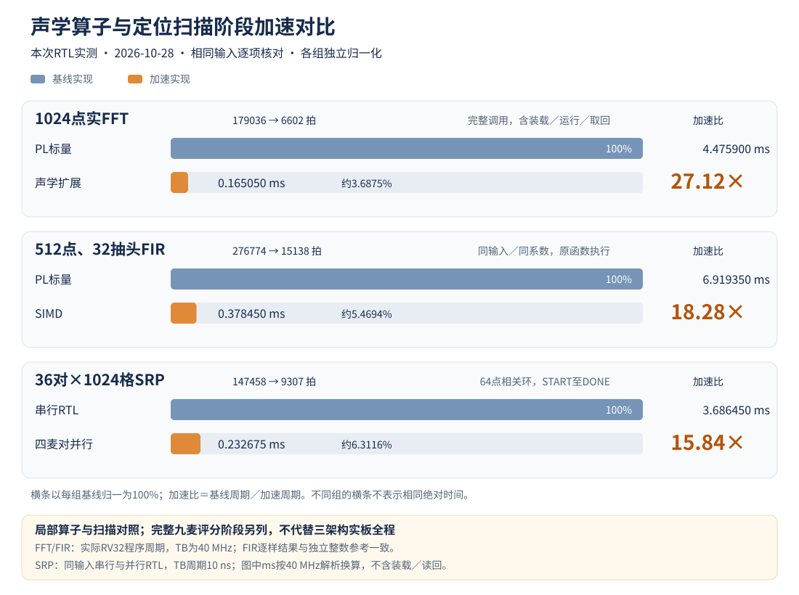](技术文档配图/第一部分_声学算子加速对比.svg)

*图3-2 基线RTL算子与SRP扫描对照。各组以自身基线归一为100%，毫秒按40 MHz换算；完整九麦方向评分见表3-4。*

SRP另比较了单麦对流水，串行、单麦对流水、四麦对流水分别为147458、37153和9307拍，对应3.686450、0.928825和0.232675 ms。单麦对相对串行快3.97倍，四麦对相对单麦对快3.99倍。各实现使用相同的相关数据、时差表及评分规则。

FFT的6602拍包含装载3088拍、RUN（运行）指令及握手919拍、取回2577拍和18拍调用／时间戳开销；917拍仅为引擎内部运行时间。FFT核对全部1026个int16（16位有符号整数）输出，FIR的512个标量和SIMD输出均与独立整数参考一致。

SRP原串行参考为147458拍，快速单麦对扫描为37153拍，快速四麦对扫描为9307拍。同为快速扫描结构时，四麦对并行的耗时比为37153／9307≈3.99；与原串行参考比较为147458／9307≈15.84。前者隔离了并行度变化，后者包含预取和扫描组织的共同改动。

#### 3.3.3 连续窗口处理与结果一致性

九麦加速路径连续运行32个重叠窗口，输入从对齐PCM位置注入。每窗实际执行9次FFT、36次互谱、36次PHAT、36次IFFT和1次SRP。

31个有效发布间隔的平均值为3.2766895 ms，对应约305.19次／秒的方向图更新率；该数值来自对齐PCM注入的32窗RTL测试，不作为包含麦克风、PS往返及网页显示的整机端到端帧率。

表3-5 连续窗口处理与结果一致性

| 指标 | 观测结果 | 范围说明 |
|---|---|---|
| 窗口首个PCM到软核稳定发布 | 9.172325—9.176225 ms | 包含该窗首末样本的采样跨度及发布处理 |
| 原始窗口就绪到1024评分完成 | 2.056600—2.058850 ms | 不含软核后续质量检查和发布 |
| 窗口末个PCM到软核稳定发布 | 2.625125—2.629025 ms | 包含后处理、发布及观测开销 |
| 稳定结果发布间隔 | 3.273675—3.277075 ms | 31个间隔，均值3.276690 ms |
| 32窗采集及连续音频丢失计数 | 均为0 | 仅对应本次RTL夹具与运行长度 |

首窗逐级核对45个统计词、576个复频谱词、2304个相关值和1024个方向评分，均与参考一致；连续32窗另核对1440个统计词和32768个评分。由此确认该输入下各阶段数值衔接及窗口连续推进。

此测试使用合成九路平面波，连续音频夹具采用单位脉冲系数，不包含真实麦克风采集、PDM输入、PS接收及网络。零丢失计数只适用于这32窗，不能替代长时间上板测试。

#### 3.3.4 PS算法的宿主处理耗时

2026-10-28软件测试使用Intel Core Ultra 5 338H、Windows 11及GCC 16.2.0，以`-O2`编译实际C实现。搜索变体先预热5次，每轮打乱测量顺序，由C内部高精度计时接口QueryPerformanceCounter计时；Python仅组织输入与结果，编译、脚本入口、文件读写和输入生成均不计时。测试未强制清空缓存或锁定频率。表3-6用于比较该宿主上的软件成本，Cortex-A9板端性能另行验证。

表3-6 PS算法宿主耗时

| 处理任务／实现 | 次数 | 平均／ms | 中位数P50／ms | 95%分位数P95／ms | 最大／ms |
|---|---:|---:|---:|---:|---:|
| 单宽带搜索：参考 | 41 | 8.0546 | 8.2887 | 9.0905 | 10.6421 |
| 单宽带搜索：仅预计算 | 41 | 7.3270 | 7.2885 | 8.2074 | 8.4095 |
| 单宽带搜索：仅成对IFFT与公共项复用 | 41 | 7.1921 | 7.1314 | 8.5132 | 10.8761 |
| 单宽带搜索：两项组合 | 41 | **6.1932** | 6.1764 | 7.2996 | 8.5765 |
| 三源分频输入：参考 | 41 | 8.2452 | 7.8109 | 9.1545 | 29.8846 |
| 三源分频输入：仅预计算 | 41 | 6.8764 | 6.9528 | 7.8826 | 8.5787 |
| 三源分频输入：仅成对IFFT与公共项复用 | 41 | 7.0267 | 6.7928 | 8.2627 | 16.3340 |
| 三源分频输入：两项组合 | 41 | **5.9606** | 6.0048 | 6.9277 | 7.7612 |
| 已知双候选完整分离 | 31 | **56.866** | 56.774 | 60.682 | 67.097 |
| 基线长窗包络前端 | 31 | **2.0698** | 2.0553 | 3.0238 | 3.4675 |

单宽带两项组合相对参考的耗时比为1.30，三源分频输入为1.38。搜索计时覆盖16640×9原始点、三个频带和1024格完整候选搜索；双候选分离覆盖160256×9输入到两路40000点音频，包络前端覆盖40000点输入的特征处理，不含分离和分类。

搜索优化前后的整数评分和公开反馈一致，双候选夹具的两路分离输出均通过保真检查。三源分频输入的本次测试输出两个候选，记录为“检出2／输入3”，不作为三源全部检出结果。表3-6报告这些指定输入下的宿主处理耗时。

#### 3.3.5 固定目标音频通路验证

固定目标音频合成测试对应CPU0上的独立处理支路：九路PCM低通并8倍抽取，在PS内生成DAS主支路及阻塞参考，执行NLMS抵消。网页手动设置目标，输出不送回正式联合搜索或同窗故障诊断。

`test_gsc_gui_output.py`对1536个活动样点完成参考比较，验证关闭、初始冻结状态下输出等于DAS，以及名义PS参考的一致性。该测试记录的是合成输入的输出路径结果。

上述合成输出检查已通过，验证范围为指定样点下的输出一致性。

#### 3.3.6 已验证项目及证据索引

表3-7 已验证项目及验证范围

| 已验证项目 | 验证条件与结果 | 正文对应位置 |
|---|---|---|
| 九麦方向评分 | 同一首个合成窗口、36麦对、1024格；276.234300 ms降至2.058850 ms | 表3-4 |
| FFT、FIR与SRP | 统一输入和定点规则；加速比分别为27.12、18.28、15.84 | 表3-4 |
| 连续窗口与数值一致性 | 32窗RTL夹具，数值核对一致；31个发布间隔为3.273675—3.277075 ms | 表3-5 |
| PS搜索与双候选分离 | 同一宿主、实际C实现；评分一致，双候选夹具的两路输出通过保真检查 | 表3-6 |
| GUI与发布清单 | 评分状态测试及文件一致性检查分别返回PASS | 第三部分3.2.3节 |
| 固定目标音频合成路径 | 1536个活动样点；关闭、初始冻结及名义PS参考比较通过 | 第三部分3.3.5节 |

表3-7中的结果均有相应记录。RTL周期、宿主耗时与接口检查分别使用各自测试条件，不将不同平台、不同计时边界的数据合并为整机实测指标。

---

## 第四部分  总结

### 4.1 可扩展之处

声学指令与RTL搬运接口相互独立，可按通道数、窗口长度和频带调整缓存与并行度；扩展时应同步核算存储带宽、时序和资源。软件侧可按设备型号和转速配置正常基线及故障模型，拓展变转速阶次分析。网页固定目标音频支路保留独立目标设置接口，可作为后续多目标音频处理的接口基础。

### 4.2 心得体会

九路声音持续到来，系统需要同时完成定位、音频输出、长窗诊断和网络服务。设计时既要计算单个算子的耗时，也要检查搬运、缓存和等待占用了多少时间，再按完整任务评价处理速度。

在PL部分，我们保留了软核发射指令的方式，把重复的装载、地址推进和结果转存交给RTL状态机。九路频谱计算一次后供多个麦对复用，SRP的并行计算也配套调整了存储分区。这样的分工保留了固件的调度能力，也减少了逐字搬运的开销。测试时需要把这些变化一起说明，避免将组合架构的收益全部归给某个执行单元。

多拍运算还有一个容易忽略的问题：计算单元完成，并不表示流水线已经接纳并提交了结果。FFT、互谱和PHAT必须等相关指令退休后再交接搬运，当前九麦SRP启动也取自退休信号。把这两个时刻分清，才能避免停顿或HALT（停机）时提前进入下一阶段。

定位和诊断的配合也需要明确条件。声音最强的方向未必是故障方向，分离后听起来更安静，也未必保留了故障载频。因此，我们让候选使用同一份快照，检查方向覆盖、分离质量、转速和模型。条件不足时保留未知及原因，比强行输出一个故障标签更便于后续复查。

固定目标音频支路的开发使我们进一步区分了接口验证、数值验证和持续负载测试。合成样点与参考一致，说明指定输入下的处理路径正确；运行效率和声学抑制属于另外的测试对象，必须分别记录。这样整理结果，能够明确每一项结论对应的证据。

测试材料同样是工程的一部分。原始输入、固件、标定、模型和计时起止点应逐项对应，RTL周期与宿主时间分别记录。本文按已完成的测试报告结果，将其余验证任务单独列于文末附录，便于后续按相同条件补充和复查。

---

## 第五部分  参考文献

[1] RISC-V INTERNATIONAL. The RISC-V Instruction Set Manual, Volume I: Unprivileged Architecture[S/OL]. Version 20240411, 2024[2026-11-03]. [官方版本](https://docs.riscv.org/reference/isa/v20240411/unpriv/unpriv-index.html).

[2] ADVANCED MICRO DEVICES. Zynq 7000 SoC Technical Reference Manual: UG585[R/OL]. Version 1.15, 2026-02-06[2026-11-03]. [官方手册](https://docs.amd.com/r/en-US/ug585-zynq-7000-SoC-TRM/Introduction).

[3] INFINEON TECHNOLOGIES AG. XENSIV MEMS Microphones IM73D122V01: Datasheet[R/OL]. Version 1.00, 2022-08-12[2026-11-03]. [官方数据手册](https://www.infineon.com/assets/row/public/documents/24/49/infineon-im73d122-datasheet-en.pdf).

[4] COOLEY J W, TUKEY J W. An algorithm for the machine calculation of complex Fourier series[J]. Mathematics of Computation, 1965, 19(90): 297-301. DOI: [10.1090/S0025-5718-1965-0178586-1](https://doi.org/10.1090/S0025-5718-1965-0178586-1).

[5] HARRIS F J. On the use of windows for harmonic analysis with the discrete Fourier transform[J]. Proceedings of the IEEE, 1978, 66(1): 51-83. DOI: [10.1109/PROC.1978.10837](https://doi.org/10.1109/PROC.1978.10837).

[6] KNAPP C H, CARTER G C. The generalized correlation method for estimation of time delay[J]. IEEE Transactions on Acoustics, Speech, and Signal Processing, 1976, 24(4): 320-327. DOI: [10.1109/TASSP.1976.1162830](https://doi.org/10.1109/TASSP.1976.1162830).

[7] DIBIASE J H, SILVERMAN H F, BRANDSTEIN M S. Robust localization in reverberant rooms[M]//BRANDSTEIN M, WARD D. Microphone Arrays: Signal Processing Techniques and Applications. Berlin, Heidelberg: Springer, 2001: 157-180. DOI: [10.1007/978-3-662-04619-7_8](https://doi.org/10.1007/978-3-662-04619-7_8).

[8] CAPON J. High-resolution frequency-wavenumber spectrum analysis[J]. Proceedings of the IEEE, 1969, 57(8): 1408-1418. DOI: [10.1109/PROC.1969.7278](https://doi.org/10.1109/PROC.1969.7278).

[9] RANDALL R B, ANTONI J. Rolling element bearing diagnostics—A tutorial[J]. Mechanical Systems and Signal Processing, 2011, 25(2): 485-520. DOI: [10.1016/j.ymssp.2010.07.017](https://doi.org/10.1016/j.ymssp.2010.07.017).

[10] GRIFFITHS L J, JIM C W. An alternative approach to linearly constrained adaptive beamforming[J]. IEEE Transactions on Antennas and Propagation, 1982, 30(1): 27-34. DOI: [10.1109/TAP.1982.1142739](https://doi.org/10.1109/TAP.1982.1142739).

---

## 附录  未完成验证项目清单

本附录集中列出未取得完整验证结果的项目，不计入正文已验证指标。正文中的算法阈值、窗口长度、网格规模和缓冲容量属于配置参数；RTL周期与宿主计时仅适用于第三部分列明的测试配置和条件。

### A.1 未完成的实测与验收

表A-1 未完成验证项目及提交要求

| 项目 | 已知状态与缺失结果 | 完成验证所需记录 |
|---|---|---|
| 阵列几何与幅相标定 | 配置已录入逐麦x、y，z按平面模型设为0；几何确认位和标定状态未确认，未形成实物幅相标定结论 | 声孔量测、通道顺序、逐麦增益与相位／时延、标定参数及前后对照 |
| 板级接口与同步采集 | 已有约束、原理图及PDM/CIC代码；供电、时钟、DATA及同步PCM的实测波形未形成完整记录；H1图纸重复DATA_4标签的修正版未提供 | 供电电平、2.5 MHz时钟、双相DATA、通道幅度与时差波形，修订图纸及实物接线核对 |
| 多声源定位与联合评分 | 现有计时结果来自算子仿真与宿主软件对照；三源宿主夹具输出两个候选；同网格联合评分未完成真实多机场景验收 | 指定距离、角度间隔、强弱差、混响和噪声下的定位误差、检出率、误检率及角分辨结果 |
| 同窗分离与真实故障诊断 | 已有指定合成双候选分离记录；独立真实故障录音、正式模型及泛化验收未完成；25°为分离输入阈值，不能作为实测角分辨率 | 原始九路录音、目标及干扰真值、保真与载频保留、拒识比例、识别结果及模型配置 |
| 转速与正式PL定向 | 启动绑定采用1800 rpm预设，不是实际测速；正式PL定向受几何、标定、模型、时效和唯一可信目标检查约束，未完成物理转向闭环验收 | 测速脉冲与轴频对照、模型转速域、九路延迟读回、实际拾音方向与拒绝／撤销用例 |
| 三架构A9性能与PS往返 | PS-ONLY、RISC-V标量及完整加速方案的同条件A9与往返对照未完成；宿主耗时不能替代板端耗时 | 同输入、同精度、同计时范围的A9耗时、PS往返、输出一致性及系统配置 |
| 双核满负载与长期运行 | 缺少实际部署程序的完整长稳记录；32窗RTL零丢失不代表实板长期零丢失 | CPU占用、有效结果间隔、95%／99%分位耗时（P95/P99）、最大耗时、DMA缺口、丢样、结果年龄和连续运行时长 |
| GSC声学效果与持续负载 | 合成输出路径已通过；有效抑制、目标音质及长期稳定性未验收；历史实际GSC处理出现DMA丢帧和搜索／诊断停滞 | 实际适应占比、成对DAS/GSC音频、干扰衰减、目标失真、保护恢复、DMA及搜索／诊断进度 |
| GSC和NEON优化的A9收益 | 共享归一化与NEON代码已提供；A9实际耗时收益及关键执行路径检查未形成通过记录 | ARM编译与自检、标量／NEON一致性、处理耗时与CPU占用 |
| FPGA实现与板级功耗 | 匹配最终BIT的布局布线资源、时序裕量、最高工作频率及板级功耗未完整汇总 | 同一部署电路的逻辑查找表（LUT）、触发器（FF）、块存储器（BRAM）、信号处理单元（DSP）、最高工作频率与时序报告、供电测量方法及功耗 |
| 故障恢复与原始录音链路 | 已有恢复、导出和回放代码；实际恢复耗时、长窗导出负载及匹配录音的端到端复核未完成 | 故障注入、恢复时序、采集代次变化、传输负载、录音哈希及回放结果 |
| 机械装配与发布重建 | 已有阵列布局和发布文件清单；外壳、支架、安装孔尺寸及装配记录未齐备；尚缺完整ARM重编译记录，外部BSP/XSA未随包提供 | 整机尺寸与装配资料、匹配BSP/XSA/Vitis的完整重建日志、发布文件哈希 |

### A.2 GSC历史记录的使用限制

早期约30 s测试主要处于目标保护旁路，已撤销为有效GSC稳定性证据。实际GSC处理时，DMA丢帧计数从428720增至444319，热图105648、搜索1082、诊断45保持不变；冻结权值8 s后，DMA丢帧计数仍从670633增至691166。2026-11-01短时复测记录搜索与诊断继续推进、DMA丢失未增加，但相对DAS的干扰衰减仅约0.1—0.3 dB，该记录不构成有效抑制验收。

1536个活动样点的合成参考比较保留为输出路径证据，不替代上述声学与负载验证。

### A.3 未纳入已完成功能的扩展方向

全网格投影残差找峰、六类故障细分的独立录音泛化、任意变速阶次重采样、声源距离测量、永久设备身份识别，以及DAS巡检／GSC双模式调度均未纳入本文已完成成果，不以其作为比赛性能指标。
