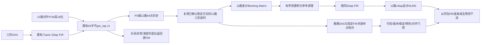

# 构建部署与操作

本手册集中说明上板准备、构建与下载、界面操作、数据采集、标定和诊断使用。专题中涉及不同配置时，必须按对应的通道数、采样率和软硬件配套条件执行。

## 专题目录
- [上板看 GUI 的最短路径（站 15 网页）](#doc-8edeeea203f7)
- [9 麦板首轮采集检查](#doc-ada9c67564e0)
- [九麦实测坐标、通道和幅相标定输入](#doc-1d088c4cd723)
- [方向候选分离后的 PS 诊断与数据工作流](#doc-7bc82840e2db)
- [9 麦圆阵定位延迟契约与验证边界](#doc-e447f69cf815)
- [九麦高速采集与离线解码](#doc-b14b4c29b0b6)
- [9 麦受控实测预检](#doc-b8665ba35c3f)
- [九麦故障方向系统的实测前就绪检查](#doc-0675290b2bcb)
- [用户确认输入资料（2026-10-26）](#doc-4e16264cbda5)
- [验收结论更正](#doc-573414a03aef)
- [八麦完整GUI → 九麦功能适配清单（2026-10-26）](#doc-8f3084ab857e)
- [八麦完整GUI → 九麦功能适配清单（2026-10-26）](#doc-c58de1502057)
- [M8：PS端定点GSC原型——实现前冻结的接口与验收](#doc-da93d60382a8)
- [同步原始多通道快照与校准](#doc-4a951694865a)
- [九麦完整GUI集成（2026-10-25）](#doc-e8e8b993cd19)
- [九麦完整GUI集成（2026-10-25）](#doc-2b979d731647)
- [九路128kHz原始录音实验配置](#doc-65bbd999546d)
- [2026-10-29 独立录音交付验证](#doc-da616c5acffb)

---

<a id="doc-8edeeea203f7"></a>

## 上板看 GUI 的最短路径（站 15 网页）

> 这份只讲一件事：**怎么让浏览器里出现那张诊断页面**。
> 算法口径看 `README.md`，板级 IO 看 `board_io.md`，本次页面做到哪一步看 `gui_das_progress.md`。

整条链是四段，缺任何一段浏览器都打不开：

```
① 板子活着（JTAG 扫得到）→ ② ELF 是你要的那份 → ③ 烧进去跑起来 → ④ PC 网卡同网段 → 浏览器
```

下面每一步都写了「怎么知道这一步成功了」，因为这条链上**失败的表现全一样**：浏览器打不开。
不写清楚通过标准，就会在最后一步反复试浏览器，而问题其实在第一段。

---

### 0. 前提（一次性）

| 东西 | 值 | 备注 |
|---|---|---|
| Vitis 2020.2 | `E:\Vivado2020.2\Vitis\2020.2` | `xsct` 在 `bin\xsct.bat`。仓库里几处文档只写 `xsct ...`，没写它装在哪 |
| Vitis 工作区 | `D:\Vitis` | 平台 `PS-PL` 必须已经建过（由 XSA 建，见 `create_ps_apps.tcl` 头部） |
| 板子 | 上电 + JTAG-HS1 一头插电脑、一头插板上 JTAG 排针 | |
| 网线 | 板子 PS 网口 ↔ PC 有线网卡，直连即可 | 板载 PHY 支持 auto-MDIX，不用交叉线 |
| 串口 | UART0，115200 8N1 | 只看启动横幅的话可选，但排障时很有用 |

---

### 1. 先确认板子活着

```bash
cat > /tmp/probe.tcl <<'EOF'
connect
foreach t [targets] { puts $t }
exit 0
EOF
"E:\Vivado2020.2\Vitis\2020.2\bin\xsct.bat" /tmp/probe.tcl
```

- ✅ **通过**：输出里有 `Cortex-A9 #0` / `Cortex-A9 #1`（或 `APU`）。
- ❌ **不通过**：只有 `1 whole scan chain (DR shift through all zeroes)`。

那一条的含义是**下载器认到了、板子那头一个字都不回** —— 也就是断在下载器到 SoC 之间。
按可能性查：板子有没有上电 → 排线是不是插在板子上（而不是只插在下载器那头）→ 启动模式跳线。

> 这一条实际踩过（2026-10-11）：`run_board.tcl` 一路跑到
> `no targets found with "name =~ "APU""` 才停，前面 `-check` 三个路径全是 OK。
> 路径齐不齐和板子在不在，是两件事。

**这一步过不了就别往下走**，后面全是白费。

---

### 2. 确认 ELF 是你要的那份

**只在刚改过 `sw/` 下的源码时才需要做。** 三步：

```bash
## 2a. 把仓库 sw/ 的源码拷进 Vitis app 的 src/
powershell -NoProfile -ExecutionPolicy Bypass -File scripts/install_ps_app.ps1 \
    -AppSrc "D:\Vitis\ui_app\src" -App ui -Force

## 2b. 编译
cat > /tmp/build_ui.tcl <<'EOF'
setws D:/Vitis
app build -name ui_app
exit 0
EOF
"E:\Vivado2020.2\Vitis\2020.2\bin\xsct.bat" /tmp/build_ui.tcl
```

- ✅ **通过**：`app build` 不报错，且 `D:\Vitis\ui_app\Debug\ui_app.elf` 的时间戳变成刚刚。
- ⚠ **`-Force` 必须有**：`sw/` 才是真值源。不带 `-Force` 时，脚本发现 app 里那份和仓库不一致会**拒绝覆盖**（故意的保护，别绕过）。

**怎么不看源码就确认 ELF 里是新页面**（页面标志串）：

```bash
grep -qa "Runtime measurements" "D:/Vitis/ui_app/Debug/ui_app.elf" \
  && echo "新页面在 ELF 里" || echo "还是旧的"
```

> 这条之所以有用：`ps_ui_page.h` 里页面是**编译进 ELF 的字符串常量**，
> 没有文件系统、没有外部资源。所以"页面上线了吗"这个问题，
> 等价于"ELF 里有没有那几个串"。

**上板前的整树一致性闸门**（不碰硬件，纯查文件）：

```bash
python scripts/check_board_ready.py
```

它比的是「Vitis 里的 ELF / Vitis src / 位流 / XSA / RTL 是不是同一次构建」。
⚠ 它报的 **"RTL 比位流新"** 那一类**不影响本页面上板**（本页面只要位流里有 GEM0），
但**改过 `rtl/` 之后想跑新逻辑就必须先 `scripts/export_xsa.tcl` 重出位流**。

---

### 3. 烧进去跑起来

```bash
"E:\Vivado2020.2\Vitis\2020.2\bin\xsct.bat" scripts/run_board.tcl -app ui_app
```

这一条按顺序干四件事，**次序不能换**：

1. `rst -system` 复位整个 Zynq（这样 A9#1 从 BootROM 的等待循环起来，两核分工才成立）
2. `fpga -file .../ps_pl_wrapper.bit` 烧 PL
3. `source ps7_init.tcl` + `ps7_init` + `ps7_post_config` 把 PS 配起来
4. `dow ui_app.elf` 下载，`con` 放它跑

- 想先**不接硬件**验路径齐不齐：加 `-check`，只打印三个路径然后退出。
- ✅ **通过**：最后一行是 `==> Running ui_app. Read PS UART0 at 115200 8N1.`

> ⚠ 这一步会把**整个 Zynq 复位一遍**。板子上如果还有别的东西在跑，先确认不需要它了。
> `scripts/jtag_guard.tcl` 会在开头查 JTAG 有没有被别的进程占着。

到这一步板子**已经在跑了**，不需要再动 Vitis GUI（Vitis 的 "Run As → Launch Hardware" 是另一条路，做的事一模一样）。

---

### 4. PC 网卡设成同网段

`Win+R` → `ncpa.cpl` → 右键那块**有线**网卡 → 属性 → 双击「Internet 协议版本 4 (TCP/IPv4)」：

| 字段 | 值 |
|---|---|
| IP 地址 | `192.168.2.20` |
| 子网掩码 | `255.255.255.0` |
| 网关 / DNS | **留空**（直连，链路上没有路由器） |

板子固定在 `192.168.2.10`，写死在 `sw/ps_ui.c` 的 `UI_IP_A..D` / `UI_GW_*`。
要换地址就改那几个宏**重新编译**（不用重出位流）。

> PC 同时连着 WiFi 时一般不用管：`192.168.2.0/24` 是直连网段，Windows 会走有线。
> 真出问题就在那块有线网卡上把「跃点数」调低。

**这一步设一次就一直有效**，以后重编重烧都不用再动。

---

### 5. 打开

```bash
ping -n 4 192.168.2.10                   # 先确认链路
curl -s http://192.168.2.10/api/status   # 再看有没有数
```

然后浏览器打开 **`http://192.168.2.10/`**。

页面每秒轮询 `/api/status` 一次。`/api/status` 的字段含义见 `sw/ps_ui_page.h`
的 `ui_json()`；它不是串口那行 `FDIAG` 的复制 —— 格式串只有 `ps_output.h` 那一处。

---

### 只改页面时的最短路径

日常改 `sw/ps_ui_page.h` 之后：

```
改源码 → 2a 拷源码 → 2b 重编 → 3 重烧 → 浏览器刷新
```

**第 4 步不用重做**（网卡设一次就够）。

⚠ **不用重出位流。** 位流里装的是 GEM0 这类硬件配置；页面是 ELF 里的字符串常量。
只有改了 `rtl/` 或 BD 才要重出位流 + 重导 XSA。

---

### 打不开时按症状查

| 症状 | 大概率原因 | 怎么办 |
|---|---|---|
| `no targets found with "name =~ "APU""`，扫描链全 0 | 板子没上电 / JTAG 排线没插到板上 | 回 §1 |
| `Build artifact missing: <path>` | 那个路径的文件不在 | 看它打的是哪个：ELF 没编（§2）还是位流没导出（`export_xsa.tcl`） |
| ping 不通 | PC 网卡没设 / 设错网段 | 回 §4，`ipconfig` 看那块网卡是不是 `192.168.2.20` |
| 浏览器空白 | 页面在，但 `/api/status` 没数 | `curl .../api/status`，看是不是 `{"have":0}` |
| `/api/status` 一直 `{"have":0}` | A9#1 还没出第一帧 | 串口看 `no frame from A9#1 yet (busy=?)`：`busy=1` 是在啃第一帧，`busy=0` 是它压根没起来 |
| 页面能开，但 Direction 显示 unavailable | **这是正常的，不是坏了** | `"grid_w":0` —— 方位要读 PL 固件的 SRP 结果（DTCM `0x3C60` 状态位），而 PL 那份是一次性 benchmark，没在跑 |
| 连不上 80 端口 | 别的程序占了端口 | 关掉再试；板上端口由 `UI_HTTP_PORT` 定，默认 80 |

---

### 页面现在显示的是什么（诚实条款）

- **Diagnosis 面板有真数**：类别 / 置信度 / 四类票数，来自站 11→12→13 整条链。
- **来源是合成自检帧**，不是真 PDM 波形 —— JSON 里 `"synthetic":1`，页面顶部会标出来。
  接真数据时只需换 `sw/ps_ui.c` 里 `cpu1_main()` 取波形那一行。
- **Localization 只有一个位置标记点**，整张 SRP 热力图的数组**没有通到 PS**。
- **两个频谱面板是空占位**，**Runtime measurements 是 "not connected"**。

页面**不会**在没有数据时生成演示曲线 —— 缺什么就显示什么在等。所以"看起来空"是设计，不是故障。

---

<a id="doc-ada9c67564e0"></a>

## 9 麦板首轮采集检查

用户已确认：板已到、供电 3.3 V，型号 IM73D122；2026-10-25 补充 H1 仅原理图标注错误，实物信号线正确，外圈八个麦克风位于 **30 mm 半径**的圆上，中心一个。当前生产配置已采用 30 mm 声孔圆，原方案 25 mm 假设不再作为当前坐标。具体通道顺序、朝向和幅相标定仍须逐麦实测，保持保护状态。

### H1 与 DATA_5：原理图标注及用户更正

依据用户提供的 `C:/Users/lenovo/Desktop/FPGA/SCH_Schematic1_2026-10-22.pdf` 第 1 页图形，H1 是右上方的 2×4 连接器，型号 DS1023-2*4SF11。以下按原理图引脚号记录，不代表从实物插接面观察的左右方向。

| H1 奇数脚 | 网络 | H1 偶数脚 | 网络 |
|---|---|---|---|
| 1 | GND | 2 | VCC（用户确认 3.3 V） |
| 3 | DATA_3 | 4 | CLK |
| 5 | DATA_4 | 6 | DATA_1 |
| 7 | DATA_4 | 8 | DATA_2 |

表中保留 PDF 原标注作为追溯记录。用户已明确这只是标注错误、实物五根 DATA 信号线正确，因此不再据 PDF 判定缺少 DATA5，也不要求返修。实际插座脚位按已确认实板接线使用；首轮逐麦测试记录九路对应，以采集结果核实第五条数据线和中心麦。

PDF 的 5BKE6-4642-103-W0 是连接器料号；实际芯片型号采用用户补充的 IM73D122。

### IM73D122 采集契约

已核对[英飞凌 IM73D122V01 官方数据手册](https://www.infineon.com/assets/row/public/documents/30/49/infineon-im73d122-datasheet-en.pdf) 1.00 版第 7～10 页：供电范围 1.62～3.6 V，高性能时钟区间包含 2.0～2.6 MHz。因此用户给出的 3.3 V 和工程 2.5 MHz 配置兼容。时钟占空比应为 40%～60%，DATA 有效延迟上限 100 ns；这项文档核对不代替板上 CLK/DATA 波形测量。

DECIM16 后 PCM 为 156250 Hz，1024 点观察区间约 6.55 ms，Hop512 为 3.2768 ms。首个 PCM 至结果接收的 10 ms 预算只适用于连续工作状态。手册给出启动稳定时间 20 ms（±0.5 dB）或 50 ms（±0.2 dB），冷启动和声学传感器内部群延迟必须单独报告，不能算成 10 ms 内已完成故障诊断。

### 当前 FPGA 端口

以下管脚已由本次布局布线 IO 报告核对。FPGA 封装管脚名需要再通过开发板原理图换算成扩展座位置。

| 麦板网络 | FPGA 端口 | 封装管脚 | 算法通道 |
|---|---|---|---|
| CLK | pdm_clk_o | V16 | 共享 2.5 MHz 时钟 |
| DATA_1 | pdm_din_i[0] | T14 | M0、M1 |
| DATA_2 | pdm_din_i[1] | Y17 | M2、M3 |
| DATA_3 | pdm_din_i[2] | W16 | M4、M5 |
| DATA_4 | pdm_din_i[3] | T15 | M6、M7 |
| DATA_5 | pdm_din_i[4] | Y16 | M8；另一个相位为空槽 |

同线两颗麦的相位/通道必须逐颗激励实测。当前配置是 10 槽存储、9 路有效、掩码 0x1ff；中心麦需要落在 M8 而非被屏蔽的第 10 槽。原理图不能证明实际声孔坐标与几何配置一致。

### 配套软件与首轮观察

2026-10-25 方向扫描与多候选分离版本的测试包位于 `build/circular9_direction_release`，包含 pl.bit、hardware.xsa、ps_ui.elf、ps7_init.tcl 与 manifest.json。此前 `build/circular9_release` 保留为原构建证据，不能混用新旧 ELF/LUT。PS 程序使用匹配 XSA 的 BSP 链接，发布脚本核对 XSA 内嵌 bit、RV32 字节、方向 LUT 和各测试源码哈希。新包尚未上板验收；方向分离和真实诊断的边界见 [当前实现说明](工程设计与接口.md#doc-60cd04405fe2)。

完成接线核对后，在工程根目录使用既有 `scripts/run_board.tcl`，显式指定上述 bit、ELF 和 init；加 `-check` 只核对文件，不连接或下载。实际下载会复位 Zynq 并覆盖当前 PL 配置。UART 为 115200 8N1。

PC 网口可设 192.168.2.20/24，网页为 http://192.168.2.10/ 。`/api/status` 中应观察 input_channels=9、input_error=0、mic_valid、mic_seq、mic_frozen、mic_rms_ppm、mic_peak_ppm、mic_clipped。逐颗近距离、低音量激励并记录响应通道；声音会传播到其他麦，不要求其余通道完全为零。共享线两相都更新、有 PDM 翻转或 RMS 非零均不能单独证明两颗麦独立响应。

当前几何/标定未确认，因此定位拒绝和 GSC 旁路可能是预期保护状态。先验收 9 颗麦逐一对应、无冻结、序号持续前进、无持续削顶和无新增丢样，再做几何与定位标定；不要使用仿真专用已确认几何镜像绕过保护。

---

<a id="doc-1d088c4cd723"></a>

## 九麦实测坐标、通道和幅相标定输入

当前用户确认的几何是外圈八个声孔、声孔圆半径30mm、中心一个声孔。旧方案的25mm保留为历史假设。配置中的30mm名义PCB半径不构成麦克风封装到板边的净距证明；本工具始终保留 `clearance_unverified: true`，也始终输出 `board_tested: false`。

本轮补齐的是**实测记录进入同一套方向LUT、RV32/PS头文件和发布身份的通路**，不自动估计增益或时延，不生成测量结论，不设置实板验收通过。未审核记录可以生成受保护的外置配置；不能凭模板或者理想圆坐标解除保护。

### 坐标与通道约定

面对阵列声孔正面：`+x` 向右、`+y` 向上、`+z` 指向正面声源，坐标单位米。原点取中心声孔附近、声孔所在平面；声孔坐标应由PCB资料或实际测量取得。二维扫描仍只覆盖正面半空间，不做距离扫描。

`microphones` 按实物标签 `mic_id: 0..8` 记录声孔中心坐标，不要求外圈仍是精确理想圆，也不要求物理mic0恰好在最右边。`channel_to_mic[ch]` 表示FPGA原始PCM采集通道ch实际接到哪个实物麦。外圈0..7可置换，必须通过逐麦敲击/近场声音和通道能量验证。

**中心mic8必须对应capture slot8。** 当前GSC和有效通道掩码采用这个约定；若实物中心落在其他槽，先核对并修正接线，工具会拒绝用置换掩盖该问题。第9槽是未使用的第十个采集时隙，其生成增益固定为0。

工具把物理麦坐标按上述映射转换为 `channel_positions_m`；生成器中的几何位置、幅度修正和传感器时延均按**原始采集通道顺序**解释。

### 创建待填写记录

在工程根目录运行，输出文件使用新路径：

```powershell
& C:/msys64/ucrt64/bin/python.exe scripts/circular9_calibration.py template --config configs/circular9_array.json --output measurements/circular9_20261025/record.json
```

模板中的实际坐标、映射、采样契约、增益、时延和残差全部为 `null`，六个确认项全部为false。`expected_capture_contract` 仅是当前工程预期值，不能当作测量结果。实际 `capture_contract` 要根据所用时钟、抽取设置和采集时间戳核对后填写，并在 `sources.clock` 中记录依据。

记录绑定创建时源配置文件的原始字节SHA256。若源配置发生变化，工具会拒绝沿用旧记录；应重新生成模板并人工复核相关测量。

### 幅度与传感器相对时延

`channel_gain_q14[9]` 是施加到原始PCM的正幅度修正系数：修正倍率为 `gain/16384`。未标定默认值是16384。实际对齐器用有符号16位Q2.14，允许范围8192..32767；**32768会变为负数，禁止使用。** 超出约±6dB的通道应先检查麦克风、供电和接线，不能用极端增益掩盖坏通道。

`channel_delay_samples[9]` 是**去除已知几何传播后，传感器本身相对参考通道的到达时延**，参考ch0必须为0，绝对值不能超过4个原始PCM采样周期。当前156250Hz下一个周期为6.4μs。数值允许小数；较晚到达的传感器取正数。不能把诊断降采样后的采样数填进来，也不能把几何传播时延再重复填一次。

生成器统一计算：

```text
arrival[ch] = -dot(position[ch], direction) * Fs / sound_speed
              + channel_delay_samples[ch]
SRP pair(a,b) = floor((arrival[a] - arrival[b]) * 16)
steer[ch]    = floor((arrival[0] - arrival[ch]) * 16)
```

因此SRP定位、方向拾音和PS分离使用同一个总到达模型。合法的系数也可能使64点相关窗口溢出；生成器会拒绝这种组合，不能截断后继续使用。

增益/时延可以由独立声场测量和离线拟合提供，本工具不负责拟合。应保存实际录音、已知声源方向、坐标、频率响应和拟合报告，使用另一段数据复核残差。拟合的带内覆盖至少300Hz至配置的上限频率，当前为8000Hz。记录九路的 `gain_rms_db`、`phase_rms_deg`、`delay_rms_samples`；现有保守门限分别为0.5dB、10°、0.25个原始采样。超限意味着当前恒增益/恒时延模型未得到支持，不能通过勾选确认绕过。

### 来源、证据和审核

填写阵列实物标识 `array_id`、测量人 `operator` 和带时区的ISO8601时间，例如 `2026-10-25T15:30:00+08:00`。`sources` 分别说明坐标、映射、时钟、增益和时延的来源。

`evidence_files` 引用实际文件，条目格式为：

```json
{
  "path": "gain_delay_fit.csv",
  "sha256": "填写该实际文件的64位小写SHA256",
  "roles": ["gain", "delay", "fit"]
}
```

相对路径以测量记录所在目录为基准。外置配置保存该目录的绝对路径 `geometry_measurement.evidence_root`。工具会读取证据文件并核对哈希，正式构建及 `--validate-only` 也会重新读取和核对；生成配置后删除或修改证据，构建将拒绝确认。审核记录至少要有gain、delay、fit三类证据引用。来源文字和哈希用于可追溯，不能自行证明测量方法正确。

只有真实测量和残差复核完成后，才把六个 `confirmations` 设为true。此时输出 `measured_reviewed`、非零标定版本以及已确认几何。只要任一项未确认，输出仍为 `unmeasured`、版本0和未确认几何。空着的增益/时延仅在未声称已测量的草稿中转成unity/0，以保留开发通路；它们不会因此成为实测值。

### 校验、生成外置配置与正式构建

```powershell
& C:/msys64/ucrt64/bin/python.exe scripts/circular9_calibration.py validate --config configs/circular9_array.json --record measurements/circular9_20261025/record.json
& C:/msys64/ucrt64/bin/python.exe scripts/circular9_calibration.py build --config configs/circular9_array.json --record measurements/circular9_20261025/record.json --output measurements/circular9_20261025/calibrated.json
& C:/msys64/ucrt64/bin/python.exe scripts/build_circular9.py --config measurements/circular9_20261025/calibrated.json --validate-only
```

外置配置和旁边的 `.manifest.json` 使用新文件名，工具不覆盖已有记录。`--validate-only` 不写固件、LUT或头文件。确认使用该记录后，正式生成必须显式指定同一文件：

```powershell
& C:/msys64/ucrt64/bin/python.exe scripts/build_circular9.py --config measurements/circular9_20261025/calibrated.json
```

正式构建输出的 `build/circular9/build_manifest.json` 记录原输入的绝对路径 `config_path` 和原始字节摘要 `config_sha256`；运行时geometry版本也来自同一原始文件。`calibration_evidence_sha256` 保存实际核对过的证据绝对路径到摘要的映射，证据同时进入源文件摘要清单。发布时必须复制这份原配置文件字节，不能把重序列化的 `profile.json` 当成同一版本身份。`profile.json` 是带默认增益、时延和状态的有效配置快照。

正式头文件包含 `acoustic_gain_q14[10]`、`ACOUSTIC_CALIBRATION_STATUS`、标定版本与同源SRP/steer LUT。工具不会自动改写默认 `configs/circular9_array.json`，也不会自动下载FPGA或设置 `board_tested`。

### 软件验证范围

```powershell
& C:/msys64/ucrt64/bin/python.exe scripts/check_circular9_calibration.py
```

独立测试使用明确标识的合成坐标、合成增益/时延和临时证据文件，验证外圈置换、中心槽限制、30mm声孔圆、有限数、平面和二维孔径退化、来源绑定、残差门限、证据变更、保护状态，以及SRP/steer的独立数学期望。它不会运行生产固件生成，也不代表真实九麦已完成幅相标定或实板验收。

---

<a id="doc-7bc82840e2db"></a>

## 方向候选分离后的 PS 诊断与数据工作流

本流程对应外圈 8 麦加中心 1 麦的正常机器声、故障机器声、干扰声三声源测试。诊断输入必须是某一方向候选分离后的单声道音频，不能把当前最响的位置直接当作故障方向。

### 输入与结果绑定

`sw/circular9_diagnosis.c` 在 PS 诊断核心处理 40000 点、39062.5 Hz（1.024 秒）、归一化至 ±1 的分离音频。它沿用现有 6004-2ZR 的四组机械阶次及其四次谐波，再加 1X、2X，共 18 维包络谱特征。2026-10-25 优化后的特征契约为 **`C9F2` / `0x43394632`**；旧 `C9F1` 数据和模型必须重新提取、重新训练，不能修改编号后复用。归档 `ps_features.h` 的 6205 特征实现不变。

新流程为：**257 抽头复解析带通 FIR → 4:1 抽取 → 求复数幅度包络 → 129 抽头抗混叠低通 FIR → 4:1 抽取 → 整段包络 Hann → 一次 4096 点 FFT → 机械阶次附近取峰 → 18 维中位数归一化。** 对称/反对称 FIR 成对计算，每段约 273.25 万次 FIR 乘法，FFT 从旧版 24 次 8192 点降到一次 4096 点。FIR 边界作对称延拓并由整段 Hann 降权，延拓不增加真实观察时间；工作区静态分配，无堆分配。

固定载波频带暂选 **2200–4600 Hz**，400 Hz 过渡保护带对应内部 2600–4200 Hz；Blackman FIR 为平滑过渡，不是砖墙截止。包络抗混叠低通名义截止 900 Hz，足以容纳 1800 rpm 时最高选取的 BPFI 四次谐波约 650.61 Hz。这个载波频带只是当前三声源几何下的工程配置，**没有经过真实 6004 空气声录音证明是最佳共振频带**。以后根据录音改带宽、系数、抽取、特征取值或归一化，必须更新契约并重训。

整段得到 2500 个真实包络样本、2441.40625 Hz，仍覆盖 1.024 秒。补零到 4096 点后的频点间隔为 **0.596046 Hz**，但记录时间的倒数仍是 **0.9765625 Hz**，Hann 等效噪声带宽约 **1.46543 Hz**、从主峰到第一个零点约 **1.95391 Hz**；不能把补零频点间隔当作两音可分辨能力。机械阶次的取峰半宽为 **max(0.9765625 Hz，目标频率 × 1%)**，并排除 DC；这替代旧版 ±2 个 4.768 Hz 频点的宽范围，600 rpm 的 FTF 约 3.976 Hz 不再直接落入旧 DC 搜索范围，同时允许高阶成分有少量频偏。1% 是尚待实测验证的工程容差，不是转速跟踪器或已验证的轴承滑移模型。真实转速不稳、机械滑移及低阶相近成分仍会影响分辨能力；超出容差不能强行称为对应故障阶次。

分离来源契约另记为 `C9S3` / `0x43395333`，包含 127 抽头抗混叠 FIR、4:1 抽取、1024 点 STFT/512 点步长、真实输入协方差及导向细化/稳健约束分离。未通过约束和噪声增益条件的频率 bin 清零，7 个 32 位字明确记录 202 个 bin（8–209）的可用掩码；诊断载波覆盖不足时不得提交诊断。这些条件随候选方向变化，会影响诊断特征，不能只记录采样率而忽略分离过程。旧 C9S1/C9S2 模型和特征数据均拒绝，必须用当前前端重新采集与训练。

报告的 `extraction` 保留状态、观察时间、载波频带/过渡保护带、包络采样率/样本数、FFT 长度/次数、频点间隔、Hann 带宽以及载波和调制 RMS。状态为 `1`（完成）、`2`（缺乏载波）、`3`（缺乏明显调制）、`4`（非法输入），`0` 表示未执行提取。未调制纯音可以作为正常或干扰训练数据，不能仅因缺乏调制就断言正常。缺乏载波时即使已有模型也返回未知；采集工具拒绝将此类段落写入训练集。默认没有模型仍为 `unknown / no_model`，供核对输入。

每份结果保留 `track_id`、方向网格、方位角/俯仰角、采集 epoch、该段起始采样序号和样本数。方向有效、轨迹稳定、分离条件通过、采样快照完整四个条件均成立时才允许绑定诊断与方向。轨迹消失、采样换代或数据缺失时，旧诊断不能继续附在新方向上。诊断角度来自采样时的候选轨迹，不能在诊断结束后读取最新主峰进行替换。

该模块的特征计算使用静态工作区，只能由一个诊断工作者调用。音频采集、FPGA 定位和 UI 轮询不能等待该函数。1.024 秒诊断观察窗与低于 10 ms 的定位链路是两个独立指标。

### 重叠更新与弱源辅助方向

诊断每窗仍是 40000 点、1.024 秒，改为在原始 156250 Hz 采样域每 **80000 点（512 ms）**发起一次。作业固定记录快照结束采样序号，CPU1 精确复制该窗口，不在启动后悄悄改用另一个最新窗口。运行或排队过慢时只保留最新合格作业，并计数跳过的 hop、替换的待执行作业；不积累历史队列。原始历史区现在为 1048576 帧、约 6.71 秒，单独保留 32 MiB，并在两个核上按 1 MiB 段映射为非缓存。

每次作业同时检查原始样本年龄和硬件计时器测得的排队/计算总耗时；排队输入超过 512 ms、计算或结果年龄超过 3000 ms、输入换代或完整快照/方向覆盖不足时撤销该次诊断，不输出伪实时结果。`/api/candidates` 的 `diagnostic_scheduler` 包含最大排队、计算、总耗时、结果年龄以及拒绝/超期计数；实际 Cortex-A9 是否持续满足预算仍需上板测量。采样时钟决定调度，计时器用于测量，不能以本机模拟时钟代替实际运行速度。

CPU1 独立辅助搜索最近 16640 个原始样本，以 8192 点 hop 检查三个频带。它不需要已有方向轨迹，CPU0 也不做 FFT。每个候选只把实际 STFT 支持区间写入独立辅助轨迹；至少三个新的真实观测、足够覆盖完整诊断区间后才允许加入诊断。重复反馈、错误 session/epoch/几何/标定/RPM generation、过期输入及短暂突发均不能刷新支持。CPU1 最多补三个仍在 200 ms 有效期内的近期窗口；算力不足造成的间隙必须保留，不填成稳定方向。主方向与辅助方向在球面上去重，最多三个目标，主方向身份优先。辅助结果属于声学方向证据，不是故障标签。

故障确认仍绑定原始诊断快照；定向拾音提交的是当前仍被支持的轨迹角度。失去唯一故障、轨迹消失、提交失败或方向过期时，关闭旧细角并保持未选择状态，不继续沿用旧故障方向。

### 模型状态

默认没有目标设备的已验证模型：`label=unknown`、`reason=no_model`，仍输出特征供真实数据采集。归档的 6205 模型不会作为 6004 诊断回退。

- 正常基线模型：输出正常距离或异常提示。异常仅表示偏离正常基线，不能区分机械故障与其他声音，不能产生故障方向锁定。
- 三类模型：正常、已确认故障、干扰。采用类中心和类内方差标准化距离，并设置类内距离上限及第一、第二候选之间的间隔；分布外样本和相互混淆的样本输出未知。
- 未验证模型只输出 `provisional_label`。正式 `label` 继续为未知，`fault_direction_valid=0`。
- 已验证三类模型在输入、方向绑定、分离条件和分类拒识检查均通过时，才可给出 `label=fault`、`fault_direction_valid=1`。这是模型在已验收测试域内的结论，不代表任意机器或任意故障均适用。

静音、非有限数、越界音频、超过 40 个接近满幅的采样、非法采样长度、缺失绑定、模型契约不符、转速超出已训练范围均拒绝确认故障。`distance` 和 `margin` 是特征空间距离指标，不是概率、置信百分比或故障严重程度。

模型 ABI 为 2，额外保存分离契约和最多 16 种训练中实际出现的可用 bin 掩码。推理遇到未训练的掩码时返回 `unknown / unseen_separation_filter`，不把清零频带造成的特征变化误认为故障。验收数据里的新掩码计为拒识，不能自动加入训练白名单。此版本保守限制模型的已验收角度组合；改变三源位置后若掩码变化，应补充独立训练及验收数据，而不能绕过保护。

### 真实数据的采集

先分别单独播放三个声源，确认角度与分离音频，再进入三声源混合。保存播放原始录音及真实标签，记录设备、故障依据、扬声器、音量、方位、转速、阵列标定版本。每次独立录制或独立采集试验分配唯一 `recording_id`，同一源录音的切片及重叠窗始终使用同一个 ID。不能仅改 ID 把同一录音拆成训练和验收数据。

诊断特征应从实板实际分离音频采集。直接由扬声器播放前的源 WAV 训练，会遗漏扬声器频响、声场、分离滤波等影响。干扰类别必须包含本次要验证的干扰类型；尚未见过的干扰应允许返回未知。

训练和独立验收应覆盖：不同方位、声压、背景、信干比，以及故障源不是最响的情况。更换源录音、改变摆位和增益再验收，避免模型仅识别某段文件或音量。仅有某一种故障录音时，不能宣称覆盖其他故障类型。

`pc/circular9_dataset.py collect` 按指定轨迹记录 PS 特征 JSONL：

```powershell
python pc/circular9_dataset.py collect --track 1 --label normal --recording-id normal_run_01 --seconds 30 --output recordings/normal_run_01.jsonl
```

`--track` 必须选择已经对照单独播放试验确认的声源轨迹；不能按当前热力图最大值自动打标签。分别采集 `normal`、`fault`、`interference`。采集文件包含快照绑定、特征契约、18 维特征、RMS、实际使用的 `shaft_hz`。转速必须来自可靠转速输入或操作员实际设置，不能把固定 25 Hz 当作 600–1800 rpm 全范围数据。采集接口为 `/api/candidates`；若改变 HTTP 地址使用 `--url`。

网页的“确认实际转速”调用 `/api/rpm?value=实际rpm`，范围 600–1800。未确认时采集工具拒绝给特征打转速标签。转速改变后，应等待新的完整诊断段；此前的段不能改贴新转速。

### 导出并试听候选分离音频

```powershell
python pc/circular9_dataset.py audio --index 0 --output recordings/candidate_trial_01 --wav48k
```

`--index` 是 `/api/candidates` 返回数组的序号，区别于持久 `track_id`。工具先保存该快照的轨迹、角度、epoch 等信息，再用快照序号读取全部 40000 点音频。每次请求最多 512 点；快照过期（HTTP 409/408）、类型错误、缺少字节都会中止，不能拼接不同段冒充连续录音。失败后重新运行会读取新的完整快照。

输出 `.pcm` 为原始单声道 16 位小端样本，`.json` 明确记录采样率 `78125/2`，不能在 WAV 头中直接写 39062 或 39063 来替代。可选 `.wav` 使用线性插值转换为 48000 Hz、49152 点，保持 1.024 秒时长，供试听比较；训练和 PS 诊断继续使用原始采样率及其特征，不能用试听文件替换。

分别保留三个方向的音频，检查目标声音是否增强、其他源是否仍有泄漏，以及故障源较小时的表现。方向性提取不等于完全无串扰；不能只听到一段声音就宣称源已完全分离。三源混合测试需要量化目标保留、干扰抑制和诊断混淆；空间不可分辨或分离条件不足时应保持未知。

### 拟合、独立验收与接入

将训练 JSONL 合并为 `train.jsonl`，独立验收 JSONL 合并为 `validation.jsonl`。工具会拒绝重复候选快照，以及训练、验收之间同名的原始录制 ID。每个拟合类别至少 3 段、来自至少 2 次独立录制；这只是防止误操作的最低门槛，并不代表统计充分。

```powershell
python pc/circular9_dataset.py fit --train recordings/train.jsonl --validation recordings/validation.jsonl --version 1 --output configs/models/c9_trial_v1.json
```

输出同名 JSON 证据与 C 头文件，默认 `UNVALIDATED`。工具给出逐类精确率、召回率和包含未知拒识的混淆矩阵，拒识计入召回率损失。正常基线试验可以仅使用正常录制并加 `--baseline`；这种模型不能确认机械故障。

对真实试验结果人工核查后，以新的版本及路径运行 `--review-id 实物验收报告编号`。此时要求独立验收每类至少 3 段且来自至少 2 次录制，并通过显式门限（默认精确率 0.95、召回率 0.90），才将模型标为已验证。门限通过只覆盖所采集的测试域，不能代替连续录制、三源混合、不同位置及信干比的系统验收。工具不提供“忽略验收强制确认故障”开关。

模型头文件只能通过编译选项 `C9_DIAG_MODEL_HEADER` 显式接入 `sw/circular9_diagnosis.c`。头文件定义 `c9_configured_diag_model`，包含 ABI、特征契约、版本、验证标志、训练转速范围和参数。重新编译 PS 程序后核对运行 API 返回的版本，旧 ELF 不会自动加载新文件。不要改写默认空模型来伪造已验证状态。

构建脚本 `scripts/build_ui_pipeline.ps1` 提供 `-DiagnosticModel configs/models/已验收模型.h` 参数；与现有 `-Live -MatchingPlWindow -ActiveChannels 9 -BspDir 匹配的BSP目录` 一起使用。省略该参数时仍构建默认未知模型。头文件对应的 JSON 训练来源哈希和验收证据应与 PS ELF 一起保存。

正式发布模型时，同名 `.h` 和 `.json` 必须同时存在，且 JSON 保留原训练/验证数据文件的绝对路径、SHA256 和独立录制 ID。发布工具使用已知导出器逐字节重建头文件，并重读原数据重算验证结果；至少每类 2 次独立录制、3 段验证数据，精确率不低于 0.95、召回率不低于 0.90，并有实际审核编号，才允许三类模型的 `classifier_validated=true`。正常基线或未验证模型仍为 false。旧导出物缺少来源字段时需要用保留的原数据重新导出；不能只修改布尔值或复制旧头文件。

发布包同时保存 `diagnostic_model.h/json`、模型版本和审核编号；板端预检要求它们与运行程序、人工实测审核记录完全一致。当前默认发布没有真实模型，版本为 0，仍拒绝故障方向声明。此软件发布检查不证明人工标签正确，也不替代三音箱独立系统验收。

若仅在 1500 rpm 训练，模型仅允许 25 Hz；要支持 600–1800 rpm，必须覆盖相应范围，并独立验证跨转速表现。转速归一化并不自动保证跨转速泛化。

### 软件验证

```powershell
python scripts/check_circular9_diagnosis.py
python scripts/check_circular9_envelope.py
```

此检查覆盖三类距离判别、正常基线不产生故障标签、未验证模型不锁定方向、全部绑定保护、静音/越界/NaN/削顶/非法契约、生成头文件实际编译以及训练验收录制 ID 隔离。使用的都是明确标记的合成测试夹具；运行该检查不会创建或验证真实机械故障模型。

包络专项检查用独立解析 AM 波形和直接 DFT 比较，覆盖 600/1800 rpm、600 rpm 的 FTF 与 1X 相互区分、1800 rpm 最高选取谐波偏移 0.8% 仍被接纳而偏移 2.5% 不被误取、载波频带边缘、DC 偏置、纯音、静音、首尾脉冲和包络抗混叠。当前合成 AM 的目标频点幅度误差小于 0.0002。相同本机编译器和预热输入测得单候选特征提取约快 3 倍；这只是本机原生测试，**不是 Cortex-A9 的实测速度，也不包含分离、采集和 UI 延时**。应上板复测 PS 核耗时与持续处理负载。

本机若 `python` 命令仍指向 Windows 应用别名，可将以上命令中的 `python` 替换为 `C:/msys64/ucrt64/bin/python.exe`。结果分别保存在 `build/circular9_diagnosis_checks/results.json` 和 `build/circular9_envelope_checks/results.json`，均明确标注为合成软件验证，不构成真实机器故障模型验收。

---

<a id="doc-e447f69cf815"></a>

## 9 麦圆阵定位延迟契约与验证边界

日期：2026-10-23，更新至 2026-10-25。本文记录 DECIM=16、每窗仍为 1024 点、50% 重叠，以及后续纯方向扫描和先分离后诊断的实现与验收口径。本文是原方案的增补，不修改桌面标准或原方案正文。

桌面 `C:\Users\lenovo\Desktop\circular9_fault_localization_plan_20261022.md` 与仓库 [原实施方案](工程设计与接口.md#doc-240e9cca772c) 的 SHA-256 均为 `5496461712f7b4ea5a25c75e8b067932a31eeb56ae06eb9999d3c56d91b1e422`。本文对采样率和延迟目标的调整依据用户后续要求；原方案的实物、标定、数据和准确度验收要求仍然有效。

### 1. 目标与当前证据

目标是将**稳态单个 1024 点定位窗口从首个有效 PCM 采样，到 PS 接收并校验这一窗口的定位结果，控制在 10 ms 以内**。必须包含窗口收集、PL 运算、RV32 自定义指令调度及结果发布、跨 PS/PL 接口传输、PS 调度等待与一致性校验。

这个数字目前是验收目标。RTL 仿真的 `first_pcm_to_rv32` 只到 RV32 发布，不能单独证明整个目标通过。PC 上运行 PS 原生 C 模型也不能证明 Cortex-A9 的执行耗时、DDR 争用或 lwIP 调度满足目标。

物理声压变化还会经过麦克风内部转换、PDM 接收和数字前端。现有 SoC 的采样时间锚点和仿真 `first_input` 均取 `pdm_valid_aligned`，即通道对齐后的 PCM 进入定位器的时刻，不能把此前的麦克风内部转换、PDM/CIC 和对齐延迟当成零。若报告“声音到 PS 小于 10 ms”，必须把这些前端延迟纳入同一实测链路。不能将“单窗结果已经发布”直接表述为“故障声源已可信确认”。

本次完成记录中，数字前端为 DECIM=16，配置和生成头文件的 `localizer_hop` 为 512，已运行 50% 重叠连续仿真。纯方向 LUT 与 `D3` 固件重新验证后，32 窗的首个对齐 PCM 到 RV32 稳定发布为 **9.153775–9.155650 ms**，采集和音频丢失计数均为 0；这仍不包含 PS 真机接收耗时。9 麦定位 ABI 为 `P9D2`（`0x50394432`），40 MHz 时钟不变，不能加载旧采样率、旧方向表或旧 ABI 的固件代替验证。

### 2. 固定的采样与阵列口径

| 项目 | 当前值或目标 | 依据与状态 |
|---|---|---|
| 有效麦克风 | 外圈 8 + 中心 1，共 9 路 | 用户已确认布局 |
| PCB 半径 | 30 mm | 用户约束 |
| 声孔圆半径 | 30 mm | 2026-10-25 用户确认；逐通道坐标、相位及朝向仍待实测标定 |
| 采集接口 | 5 DATA、10 槽，有效掩码 `0x1ff` | 空槽不参与定位或音频平均 |
| PL 时钟 | 40 MHz | 延迟周期换算基准；最终实现和板卡必须一致 |
| PDM 时钟 | 2.5 MHz | DECIM 调整不改变共享线 A/B 接收时序 |
| CIC 抽取比 | 16 | `2,500,000 / 16 = 156,250 Hz` |
| PCM 采样周期 | 6.4 µs | `256` 个 PL 时钟周期 |
| 每通道定位窗 | 1024 个真实 PCM 样点 | 没有补零或插值冒充新采样 |
| 完整窗口时间预算 | 6.5536 ms | `1024 / 156250` |
| 首样本至末样本跨度 | 6.5472 ms | `1023 / 156250`；与窗口预算相差一个采样周期 |
| 50% 重叠 | hop=512，名义更新间隔 3.2768 ms | 已通过 32 窗连续数字仿真；长期与板卡运行待验收 |
| 定位计算 | 9 路 FFT、36 对相关、32×32 SRP 图 | 保留 RV32 自定义指令和 PL 加速器 |
| 扫描方向 | 32×32 个前半球方向，水平角／俯仰角均以 5.625° 间隔取中心 | 不扫描距离；0° 为阵列正前方，正水平角向右，正俯仰角向上 |
| 相关延迟表 | 64 lag、分数样点插值 | 已随新采样率重算；使用完整 36 对麦克风 |

频点由 `f(k)=k×156250/1024` 决定，间隔为 152.587890625 Hz。当前定位有效频点为 `k=2…52`，对应约 305.176…7934.570 Hz。配置的 `200–8000 Hz` 是选带意图，不能解释为 1024 点离散频谱中存在恰好 200 Hz 的频点。搬运缓存的填充频点也不能当成有效 PHAT 频带。

提高 PCM 采样率缩短了同样 1024 点覆盖的实际时间。这不自动保持原来 39.0625 kHz、1024 点窗的频率分辨率、弱声检测能力或定位精度。用户已经确认 9 麦板到货、3.3 V 供电，但通道和幅相标定未验收，不能承诺实物测角误差、多声源可分离角度、抗混响性能或故障检测率。用户已确认阵列竖放、音箱在前方不超过 180°；共面阵列仍有前后镜像歧义，当前前半球是安装约束，不是算法已分辨板前板后。角度与模型细节见 [纯方向扫描说明](工程设计与接口.md#doc-8ff9571ea39c)。

### 3. 50% 重叠解决更新间隔，不消除窗口时长

连续窗口如下，每个窗口仍独立使用 1024 个样点：

```text
窗口 0：样本    0 … 1023
窗口 1：样本  512 … 1535
窗口 2：样本 1024 … 2047
```

首个完整窗口仍需收集约 6.5536 ms。进入稳态后，每增加 512 个样点可以产生一个新窗口，所以理想发布间隔为 3.2768 ms。一个已经开始收集的窗口不会因为与上一个窗口重叠，就只剩 512 点的观察时间。

两个约束必须同时验收：

1. **单窗时延：**采集预算、计算与 RV32 发布、PS 接收合计小于 10 ms。若按 `1024/Fs` 预留采集预算，后续阶段合计余量为 3.4464 ms，尚未代替物理前端延迟测量。
2. **持续吞吐：**每 3.2768 ms 有一个新窗口。当前共享计算引擎及结果存储必须及时释放，不能靠排队、丢窗或重复发布旧结果维持表面刷新率。能够流水重叠的阶段可分别统计，但必须同时验证缓存所有权和结果完整性。

仅证明“某一帧计算小于 10 ms”不够。应记录连续窗口的样本起点、窗口序号、发布时刻、原始样本丢失、窗口丢失和音频丢失；检查窗口起点每次恰好增加 512，且每个已发布结果对应正确的采集区间。

### 4. 分段时间戳与 PS 终点

建议报告每个窗口的以下时间点，使用可关联的 PL 时基或经过校准的跨时基换算：

| 时间点 | 含义 |
|---|---|
| `t_pcm_first` | 本窗首个对齐 PCM 采样进入定位器，使用 `pdm_valid_aligned` 时间锚点 |
| `t_pcm_last` | 本窗第 1024 个对齐 PCM 采样进入定位器 |
| `t_rv_publish` | RV32 完成质量信息与定位结果，并提交稳定序列号 |
| `t_ps_metadata` | PS 收到同一窗口的坐标、得分、质量状态、窗口序号与采集时间，并通过一致性校验 |
| `t_ps_map` | PS 读取这一窗口完整 1024 格热力图，并通过读取前后序列号校验 |
| `t_display` | 浏览器实际显示该结果；包含网络传输与浏览器调度 |

主数字定位指标为 `t_ps_metadata - t_pcm_first`，同时保留 `t_rv_publish - t_pcm_first` 以区分硬件计算和 PS 接收问题。若需求中的“结果”包含完整热力图，则应另报告 `t_ps_map - t_pcm_first`；不能使用元数据收到的时刻代替整图收到的时刻。

热力图可以由 PS 读取，浏览器进行配色和展示。PS 读取必须受稳定序列号保护，不能把两个窗口的网格混在一起。网络或网页刷新周期不应驱动定位计算和 PS 的实时结果接收。浏览器显示延迟应单列，不能因页面看起来流畅而判定数字链路满足 10 ms。

每次测试至少报告最大时延、分位数、超过 10 ms 的次数以及关联丢样/丢窗计数。发生故障恢复、重新启动、质量拒绝或几何未确认时，必须保留状态标志，不得用旧坐标伪装新有效结果。

PS 已加入 100 µs 目标轮询间隔，以及每个稳定发布的**首次**元数据接收计时，避免网页重复读取同一结果污染统计。`/api/gsc` 提供 `pcm_to_ps_us`、`pcm_to_ps_max_us`、`deadline_misses`、有效结果单独统计、跳过发布计数和时钟错误计数。P95/P99 是 250 µs 分桶的上界，不能作为精确分位数引用。旧结果阈值按 `10 ms + 向上取整的 hop + 100 µs` 计算，当前为 13.377 ms；这是“旧结果失效”的年龄阈值，不是把单窗 10 ms 目标放宽为 13.377 ms。PS 调度目标、ARM 编译通过和统计代码存在，都不等于已测得实机 10 ms 达标。

### 5. 声音突变到方向确认：另一个时延指标

当前 `location_track()` 的行为是：

- 没有已确认方向时，需要 2 个连续且位置接近的合格观察。
- 已确认方向附近的合格观察可继续使用原方向。
- 偏离当前方向但未达到大跳变条件时，重新确认需要 2 个合格观察；大跳变需要 3 个。
- 不合格观察会清空待确认计数；连续失效也会撤销已知方向。

因此，一个窗口在 10 ms 内得到候选结果，不意味着声音突变后 10 ms 内必定切换拾音方向。设 hop 时间为 `H`，单窗完整处理到 PS 的时延为 `L`。在变化恰好对齐新窗口、后续窗口全部合格且候选一致的理想条件下，2/3 帧确认还需约 `L+H` / `L+2H`。非对齐变化还要考虑窗口位置和新旧声音混合；质量拒绝会进一步延长确认时间。

50% 重叠的相邻窗口共享一半样点。保留相同的 2/3 帧计数会缩短确认所覆盖的时间，但不能把这些观察当成相互独立的新证据，或直接宣称与原来较长时间确认具有相同的误检率。确认门限与稳定性需要在最终 hop 配置下验收。

验收必须分别测量“首个新候选”“可信方向提交”“DAS 实际应用新转向”“PS GSC 恢复有效自适应”，并采用相同的变化时刻与样本序号。不能通过关闭质量门限、跳过确认或强制接受仿真注入的峰值，把跟踪结果写成真实声学准确度通过。

自动故障选择还需要候选方向在整个诊断快照内保持稳定，逐个候选分离后再诊断。RV32 的 2/3 帧定位确认不能代替这个诊断绑定条件。自动故障模式无已接受目标时，PS 发送 `D3` 撤销方向可信状态；仅在恰好一个仍有效的候选被诊断为故障时发送 `D1 + grid`。`D2` 跟随最强峰保留为单独测试模式，不能据此宣称故障已识别。`D3` 不必擦除内部缓存的转向系数，验收应检查可信标志及有效音频状态，而不是只看内部 `beam_locked`。

### 6. 定位、定向音频与故障诊断的不同时间尺度

代码中的三条路径应分别计时：

| 路径 | 当前实现口径 | 延迟报告方式 |
|---|---|---|
| 定位 | 156.25 kHz、1024 点、FFT/GCC-PHAT/SRP、RV32 质量与跟踪 | 按单窗和持续更新分别报告 |
| 定向音频 / PS GSC | PL 分数延时 DAS、32 tap FIR，PS 匹配前端与自适应处理 | 报告样本年龄、转向过渡和 GSC 热身；自动故障模式须先获得有效故障目标，人工选向可单独测试 |
| 候选分离／故障诊断 | CPU1 从同一份 9 路原始快照低通并 4:1 抽取至 39.0625 kHz，分离候选方向，再逐路诊断 | 每路诊断段 40000 点，即 1.024 s，另加稳定方向观察、排队、快照复制、分离和诊断处理时间 |

32 tap FIR 由 `build_circular9.py` 按 156.25 kHz 重新生成，使用名义 10 kHz 截止的 Hamming 窗低通；PS GSC 使用相同系数检查 PL 输出。它不等同于“32 tap 就是完整抗混叠验收通过”。

诊断抽取使用 `circular9_decimator.h` 的 127 tap Blackman 低通，名义截止 12 kHz，先滤波再每 4 点输出一次。连续选中目标路径位于 `circular9_audio.c`；多候选路径在 CPU1 从同一份原始快照分别处理，再进行带安全频点掩码的空间分离。它属于诊断支路，不应加到 SRP 定位窗口的收集时长中，也不能在诊断时跳过滤波只每四点取一个样点。断流、会话或恢复版本变化必须废弃历史绑定，不能把两段音频混为一个诊断窗口。

CPU0 持续接收采样并写入 16 MiB 独立非缓存共享区，当前保留 524288 帧，约 3.3554 s；CPU1 复制 160256 帧到自己的快照，得到含预热样点的 9 路独占输入，所有候选共享该输入时间区间。旧的原始快照命令会暂停定位，该协议的暂停／恢复已作单独测试；9 麦连续 UDP 和候选历史快照不依靠这个暂停命令。1.024 s 在 600–1800 rpm 下覆盖约 10.24–30.72 转，可作为诊断起始窗口，但实际故障可检出性仍须用目标设备数据验证。

独立检查生成镜像中的 32 tap 系数和诊断 127 tap 系数，两者均对称、Q15 系数和均为 32768。单独线性相位 FIR 的解析群延迟分别为 15.5 / 63 个高速样点，即 99.2 / 403.2 µs。这些数值只描述滤波器响应，不包含 DAS 转向延时、GSC 热身、抽取相位、DMA、PS 调度、音频分块或声学前端，也不证明阻带或真实声音性能达标。

当前 PS GSC 在稳定样点不足时旁路，存在 512 个高速 PCM 样点、即 3.2768 ms 的热身判据；权重更新每 4 个高速样点触发一次。新方向提交到可用 GSC 还包含转向过渡等状态；纯方向格 800 的受控夹具中，从第一个可信包到第一个有效自适应样点实际间隔为 871 个高速样点，即 **5.5744 ms**，不能把它简化为固定 3.2768 ms，也不能沿用旧距离平面夹具的 4.6656 ms。这一夹具不代表所有转向的最大值。真实新板的标定、模型对齐和稳定性仍需验证。即使定位时限通过，也不能据此宣称 GSC 已达到真实设备上的抑噪或目标保真指标。

目标轴承配置为 6004-2ZR，用户给定速度范围按 600–1800 rpm 使用。目标数据、正常基线和模型验证仍未完成；不能把 1.024 s 的诊断段塞进“全功能均小于 10 ms”的说法，也不能沿用旧轴承模型给出已确认的故障类别。

### 7. 冷启动与稳态分开

PDM 接收默认有 2,000,000 个 PL 周期、即 50 ms 的麦克风启动门控，并随后丢弃 CIC 过渡输出。冷启动首帧还要等待完整定位窗和计算。50% 重叠不能消除启动门控。

复位或重新使能到首个结果，应作为冷启动指标报告；运行中发生变化到新结果，应作为跟踪指标报告；同一稳态窗口首样本到 PS 收到结果，才是单窗数字链路指标。三者不能互换。

### 8. 本次数字验证结果与实现状态

本次优化把窗口统计放入采集过程、减少 FFT 无效频点搬运，并使用 4 对并行的 SRP 扫描；完整 36 对、1024 格和 RV32 自定义指令调度保持。下表是数字验证结果，实物状态仍为 `hardware_tested=false`。

| 验证与证据 | 观察值 | 结论边界 |
|---|---|---|
| 50% 重叠完整 SoC，`build/circular9_checks/results.json` | 32 窗；首对齐 PCM → RV32 偶数序列号稳定发布 9.153775–9.155650 ms | 包括窗口收集，发布完成后才计时；没有 Cortex-A9 实际接收时延 |
| 同一 32 窗的末样本 → 稳定发布 | 2.606575–2.608450 ms | 由上一行逐窗总时延减去 6.5472 ms 首末样本跨度；不同于固件内部截止较早的处理统计 |
| 连续吞吐 | 窗口起点逐次增加 512；名义间隔 3.2768 ms；实际 RV32 发布间隔 131013–131084 个周期，约 3.275325–3.277100 ms | 发布存在轮询抖动；采集和音频丢失为 0，测试检查无丢窗；不承诺每次发布间隔恰好相等 |
| 完整 PDM 针脚仿真，`build/circular9_e2e/results.json` | 8 窗；首对齐 PCM → RV32 9.159225–9.162625 ms | 使用实际接收/CIC RTL，不是实物麦克风；对应测试版本和结果哈希单独保留 |
| 受控可信方向夹具 | 20 窗；PS 原生 C 处理 11157 个包，8344 个有效 GSC 样点，4 个诊断音频块，对齐错误 0 | 合成峰值与测试几何用于验证控制/音频链；不证明真实声源定位正确或 Cortex-A9 处理速度 |
| 诊断目标保持／选择 | `D3 → D1(800) → D3`，10 窗测试通过 | 无诊断目标时不建立可信方向；选择后允许样点边界应用，撤销后清除可信状态；不代表分类模型已验证 |
| SRP 四对并行扫描 | 每次 9306 个 40 MHz 周期，即 0.23265 ms | 只是 SRP 子阶段，不代替整窗时延 |
| FFT 稀疏搬运，`build/fft_sparse/results.json` | 12 个用例、6148 个输出词与 `sw/fw/fw_fft.c` 标量参考逐位一致；禁用稀疏掩码的负对照被检出 | 包含正/逆变换及残留频点检查；不是整机或声学性能测试 |
| PS 接收调度与统计 | 100 µs 目标轮询、10 ms 首次接收阈值、13.377 ms 旧结果失效、P95/P99 上界及超时计数；ARM 编译通过 | ARM 编译与原生测试不等于板上运行达标；完整热力图接收仍需单独实测 |

以下逐位对照针对此前距离平面 LUT 与其相同输入的优化前后实现，作为历史等价性证据保留；不应拿这些旧图像与本次不同的方向 LUT／平面波输入逐位比较：

1. `build/c9_hop1024_fast/continuous_fast` 与真正的 DECIM16 三遍参考 `build/c9_3pass_reference/continuous_fast`，32 窗共 64 个 score/stat 文件一致。名字为 `continuous_reference` 的历史目录不能替代这个 DECIM16 对照。
2. 新 HOP512 的第 1、3、…、31 窗与上述 HOP1024 的第 1…16 窗对应的 32 个 score/stat 文件一致；只有覆盖相同样本区间的窗口才作这种比较。
3. 本次纯方向输入的全部 32 窗统计仍由 `check_circular9.py` 独立重算。新增 `check_circular9_direction.py` 对 46080 个 SRP／转向延时作独立投影检查，并检验角度表及数值范围；5 个解析 GCC／SRP 方向主峰均正确。数字一致不等于证明算法在真实新阵列上满足精度目标。

本次完整 PDM 数字测试中，启动到首个对齐 PCM 为 50.166125 ms，启动到首个候选为 59.328750 ms。旧三遍/两遍处理记录约 11.616/11.154 ms，仅作为优化前历史对照；旧启动到首候选约 61.783 ms 也已被本次结果替代。这些启动数值包含测试的接收与门控安排，不是实物麦克风启动规格。

32 窗结果距离 10 ms 留给 PS 接收的余量约为 0.844350 ms，PDM 针脚夹具最慢值的余量为 0.837375 ms；这只是当前数字仿真与目标的差额，仍需 PS 实际首次接收测量。几何尚未确认的生产镜像仍报告拒绝状态，不能把“算完”当成“声学有效定位通过”。

结果文件保存源码哈希；本次 RV32 固件 SHA-256 为 `7144d9395c1c50484d77b1af1fe8bc8f83f3ce6701b88329b3a501121b1e1671`。32 窗验证结果文件 SHA-256 为 `a6108b627b1af9bf27027185ca5061e252431b1006f7982c7f45c7030b17acfb`，PDM 端到端结果文件 SHA-256 为 `363ec4bf278508992020111ebfd76e55e2bfc82f6c81ada47aa0331c5c8f9cef`，FFT 稀疏验证结果文件 SHA-256 为 `4967eafa4d8a1ef0790c88ee571a1cd5faf4a85aeae902600021522d9832bf6a`。若重新运行覆盖文件，应按新哈希重新审阅结果，不能混用不同版本的时间终点。

2026-10-24 核对更新：新的 HOP512 / `P9D2` 全工程 Vivado 构建已在 `c9ov50` 短路径工程完成，`build/c9ov50_resume2_console.log` 记录 `FLOW_PASS`，新版 bitstream 与 XSA 均已导出。最终报告 `build/circular9_gsc/timing_zynq.rpt` 的 setup WNS 为 0.925 ns、hold WHS 为 0.019 ns；资源为 42757 LUT、94.5 BRAM、141 DSP。匹配该 XSA 的 BSP 已重新生成于 `build/circular9_bsp_20261024`，配套 PS 链接和发布包核验流程已经完成建立；`scripts/package_circular9.py` 必须核对当前 PS 内嵌的 RV32、LUT、源码及测试版本，不能用早先 ARM 编译通过的旧镜像冒充新软件包。2026-10-25 的方向与诊断变更未改动 61 个 RTL 文件，故复用已通过时序的 bit／XSA，由新 PS 装载新固件及方向 LUT。内部实现时序通过尚未证明板级 PDM 时序、真实多源分离、模型准确率或 PS 实时运行通过，实物验收仍未完成。

### 9. 仍需实物验收的项目

- 新 9 麦板的声孔坐标、通道映射、共享 DATA 时序、真实采样率和通道同步。
- 麦克风内部延迟、PDM/CIC 到有效 PCM 的延迟，以及完整声学输入到 PS 的时延。
- 幅度与相位标定；有效几何与标定版本需要对应实际板卡。
- Cortex-A9 在 GSC、DMA、UDP、HTTP 和热力图读取同时运行时的最坏调度时延，及长期无丢样/丢窗运行。
- 按原方案场景测量定位误差、混响/干扰下的拒绝与确认行为、转向音频质量；高速采样本身不等于这些指标通过。
- 6004-2ZR、600–1800 rpm 的正常与故障录音、正常基线、目标模型和独立验证。

源码审计入口：`configs/circular9_array.json`、`rtl/array/rv32_pdm_clkgen.v`、`rtl/array/rv32_overlap_localizer.v`、`rtl/soc/rv32_soc.v`、`sw/fw/fw_planar8.c`、`sw/fw/fw_location_quality.h`、`scripts/build_circular9.py`、`sw/circular9_direction.h`、`sw/gsc9.c`、`sw/circular9_audio.c`、`sw/circular9_decimator.h`、`sw/circular9_candidates.c`、`sw/circular9_tracking.h`、`sw/circular9_diagnosis.c`、`sw/ps_circular9_tasks.h`、`sw/ps_circular9_api.h`、`sw/ps_circular9_live.h`。

---

<a id="doc-b14b4c29b0b6"></a>

## 九麦高速采集与离线解码

首轮实测推荐在线仅保存原始协议包，采完后再生成逐采样 JSON 与 PCM。当前每通道采样率为 156250 Hz，在线写 156250 行/秒 JSON 会额外占用 PC 的 CPU 与磁盘。本工具不改变 FPGA/PS 采样、滤波、定位或诊断。

用户最新确认外圈声孔圆半径为 30 mm、实物 H1 信号线正确、麦克风为 Infineon IM73D122；官方规格已核对支持工程的 3.3 V 与 2.5 MHz，仍需板上波形验收。原始包采集可供九路独立验证和后续标定，但收到数据不等于通道、几何、角度或故障模型已经验收。

### 推荐首轮采集

在工程根目录运行，输出目录必须是新目录：

```powershell
& C:/msys64/ucrt64/bin/python.exe pc/circular9_receive.py --packets-only --seconds 30 --output recordings/nine_mic_run01
```

默认监听 `0.0.0.0:1234`，可用 `--bind`、`--port` 修改。PS 发往的 PC 地址仍需与实际网卡一致。快速模式写出：

- `packets.c9`：未经重采样、未经 PCM 重新打包的原始 UDP 负载，按旧格式 `uint32 小端长度 + 原始包` 保存；以 256 KiB 有界缓存批量落盘。
- `manifest.json`：CRC/协议有效包、非法包、样本、丢包/重复/乱序、分段、实际 socket 接收缓冲及原始捕获 SHA-256。
- `events.jsonl`：不连续原因，最多记录前 1024 次事件；后续事件累计计数，避免错误流重新变成高速 JSON 写入。

快速模式不生成 `frames.jsonl` 和逐段 PCM，不解包九路 PCM 为逐样本字典；仍校验完整外层 CRC、每槽 CRC/所有权、版本、采样率和 GSC 旁路状态。协议支持每包 1～8 个样本，最大 C9C2 长度 1124 字节。

按满 8 样本/包估算，UDP 负载约 **21.95 MB/s**，30 秒捕获文件约 **661 MB**；网卡、链路和磁盘必须实测能持续承担这一流量。100 Mbit/s 链路无法无损承载这个协议的满速流量。快速保存减少 PC 工作量，不会自动提高开发板发包能力或证明网路无丢包。

### 采完后离线转换

```powershell
& C:/msys64/ucrt64/bin/python.exe pc/circular9_receive.py --decode-capture recordings/nine_mic_run01/packets.c9 --output recordings/nine_mic_run01_decoded
```

离线模式不打开 UDP socket。它使用同一个协议解码器，输出原有格式：

- `segment0000_raw9.pcm`：九路交织 signed-int16 小端，每帧 18 字节，采样率准确为 156250/1 Hz。
- `segment0000_fir.pcm`、`segment0000_gsc.pcm`：对应 FIR 和 GSC 输出，signed-int16 小端。
- `frames.jsonl`：每个样本的时间戳、方向版本、epoch、可信状态、丢样计数及分段号。
- `manifest.json`、`events.jsonl`：完整性与分段统计；完整转换还记录原始捕获文件 SHA-256。

会话、包序号、采样序号、时间戳、epoch、几何/标定版本或丢样计数不连续会开始新段。被 CRC/所有权检查拒绝的包也会强制切段，即使后续样本编号看起来连续，也不会将两侧悄悄拼接。计数正常 32 位回绕不会被误判为丢包。

如果捕获末尾只有半个长度或半个包，或者长度超出 UDP 上限，工具明确报错并保留 `completed=false` 的部分转换清单；不会猜测下一个包的起点。边界内的非法 C9C2 数据报被计为非法包，保留在原始捕获中，转换时跳过并切段。

### 兼容已有使用方式

不加新参数仍会在线同时保存原始包、PCM 和逐样本 JSON：

```powershell
& C:/msys64/ucrt64/bin/python.exe pc/circular9_receive.py --seconds 30 --output recordings/nine_mic_full_run01
```

既有 `decode(data)` 接口和 `packets.c9` 长度前缀格式保持兼容。新共享模块 `pc/circular9_capture.py` 必须和入口脚本一起保留。

### 软件验证

```powershell
& C:/msys64/ucrt64/bin/python.exe scripts/check_circular9_receive.py
```

检查包含原 C 协议写入夹具和 332 个逐字节破坏反例、伪造外层 CRC 后的内层 CRC/所有权检查、快速/默认/离线 PCM 与元数据逐字节一致、丢包/乱序/版本变化切段、正常回绕、断包/超大长度、有界事件记录，以及真实本机 UDP 回环的入口测试。

本机小规模落盘测试的快速模式约可处理 60 万样本/秒，完整解码约 15 万样本/秒；准确数值保存在 `build/circular9_receive_checks/results.json`。这只是本机协议验证和落盘结果，不是实际板卡、网卡或长时间持续采集的验收。正式采集应检查 `invalid_packets`、`missing_packets`、`missing_samples`、`segments`，并保留源包供复查。

---

<a id="doc-b8665ba35c3f"></a>

## 9 麦受控实测预检

`pc/circular9_preflight.py` 只读检查板端接口、匹配发布包和操作者审核记录，分别判断可以开始哪一阶段的受控试验。它不下载 FPGA、不修改 RPM、不选择目标，也不启停 GSC。

当前实物事实：用户确认麦克风为 Infineon IM73D122，外圈 8 个声孔的圆半径为 **30 mm**，中心 1 麦，阵列竖放、声源位于正面半空间。用户已说明 H1 是原理图标注错误，实物接线正确；逐麦响应、通道相位和声孔坐标仍需实测，不能从网名推断。IM73D122 的 3.3 V、2.5 MHz 配置已按[官方数据手册](https://www.infineon.com/assets/row/public/documents/30/49/infineon-im73d122-datasheet-en.pdf)核对，但板上实际电压、时钟频率/占空比和连线质量尚不能由软件证明。

### 三种资格分别报告

| 输出 | 满足条件后可以做什么 | 不代表什么 |
|---|---|---|
| `capture-ready` | 在人工接线/电气/下载审核后，进行逐麦、原始录音和标定采集 | 不证明 9 颗麦独立对应、不证明方向准确、不证明模型有效 |
| `localization-ready` | 在上述基础上，执行带角度真值的方向试验 | 不代表三声源一定可分；分辨能力需实测 |
| `fault-diagnosis-ready` | 在上述基础上，执行已验证模型测试域内的故障诊断试验 | 不代表当前一定存在故障，也不代替独立音箱/设备真值 |

未标定、无真实诊断模型时，`capture-ready` 仍可通过，用于补齐这些实测数据；另外两项必须保持未通过。只具备正常基线的异常检测不能取得故障诊断资格。任何阶段通过都不把 `board_acceptance` 改成 true，完整板级验收仍需独立保存长时间连续性、角度误差、分离保真和识别统计。

### 1. 准备当前发布包和人工审核记录

使用根代理本轮重新构建的 `build/circular9_direction_release`。旧 ELF 缺少新增运行契约字段时，工具会拒绝，不用默认值补齐。

在工程根目录执行；以下 `python` 可替换为本机有效的 Python 3.9 以上解释器，本工作站为 `C:/msys64/ucrt64/bin/python.exe`。

```powershell
python pc/circular9_preflight.py --write-review-template measurements/review_run01.json
```

先建立 `measurements` 目录。模板中的已知型号和规格核对不会自动变成板上测量结果。按实物填写以下信息：

- `board_id`、`review_id`、带时区的 `reviewed_at`，例如 `2026-10-25T20:00:00+08:00`。
- `electrical`：实际供电电压、实际 PDM CLK 频率和占空比、独立 DATA_5 路径与 FPGA 扩展排针核对。IM73D122 数据手册允许 VDD 1.62～3.6 V，2.5 MHz 属高性能时钟区，≤3 MHz 时占空比 40～60%；工具按本工程目标额外要求实测 CLK 为 2.5 MHz±1%。模板未预填示波器或电压读数。
- `deployment`：实际下载的发布包 manifest、`pl.bit`、`ps_ui.elf` 的 SHA256，以及确已使用同一套文件的人工核对。哈希可用 PowerShell `Get-FileHash -Algorithm SHA256` 获取，填写小写十六进制。工具核对运行声明和包文件，不能远程读取并认证整个 PL/ELF 内存。
- `localization`：只有完成逐颗激励、声孔坐标测量和幅相标定后，才填写对应 true、非零标定版本及审核编号。首次录音允许保留 false。
- `diagnosis`：只有真实录音模型按独立原始录音分组完成验证后，才填写模型版本及验收编号；版本必须同时匹配包 `model_version` 和运行版本，验收编号必须精确匹配包 `model_review_id`，不能借用另一模型的非空编号。模型头/JSON 同样受包文件哈希检查。RPM 必须来自实际测量或可靠的机器设置，并记录来源。首次采集允许保留版本 0、空编号。

审核记录是操作者声明，必须有对应测量/下载记录支撑。更换硬件、连线、发布包、标定或模型后更新记录，不能直接沿用之前的 true。

### 2. 获取只读预检报告

PC 网口使用 192.168.2.20/24，板端默认 192.168.2.10。完成匹配包下载、PDM 冷启动和系统启动后，适度播放宽带声音，使各麦有活动且不削顶。首次诊断还需要完整稳定观察窗和 CPU1 处理时间；不能上电后立即拿不到候选就认定故障。

```powershell
python pc/circular9_preflight.py --package build/circular9_direction_release --url http://192.168.2.10 --review measurements/review_run01.json --output measurements/preflight_run01.json
```

默认读取 3 轮，每轮依次只读 `/api/status`、`/api/gsc`、`/api/candidates`、`/api/heatmap`，轮间隔 1 秒。报告保留原始 HTTP JSON 证据、每个门限及拒绝原因。每次使用新输出文件名，不覆盖上一轮记录。

主要核对项：

- 发布包中全部文件的长度和 SHA256；生产 ABI P9D2、C9F2/C9S3、9 路/10 槽/掩码 511、DECIM16、156250 Hz、1024 点窗/512 点 hop、36 麦对，以及本轮 30 mm 声孔圆半径。S3 加入实际协方差和多频带辅助搜索，旧 S2 诊断模型不能沿用；新增细角导向控制的配套 PL/PS 构建也须来自同一包。
- `/api/gsc` 声明的 ABI、RV32 ITCM 哈希和几何版本与包一致。几何版本是配置身份，不是实际几何测量证据。
- 音频块与麦克风快照序号确实前进，九路电平数组完整、无冻结、无削顶、探测期间无新增丢样/时钟错误。九路均有电平不能替代逐麦独立映射验收。
- 定位图完整、提交序号前进、年龄有效；多声源造成的单主峰歧义本身不会当成采集失败。
- 物理定位审核、运行 `geometry_confirmed`、`calibration_status=measured_reviewed`、非零标定版本一致，才能升级定位资格。
- PS 计时必须有新增样本且已观察最大值不超过 10000 µs；统计范围是首个对齐 PCM 到 PS 首次收到元数据，排除麦克风启动、声传播、浏览器显示和诊断窗。短预检不能替代完整负载持续测试。
- 诊断 RPM、模型验收、40000 点快照绑定、载频提取和 2200～4600 Hz 分离掩码完整性一致。候选过期、丢包后绑定改变、错误模型、缺失载频时不能声称有效故障方向。
- 故障模式中，没有唯一合格故障方向却连续两轮报告 GSC active，会拒绝。单轮跨端点瞬态会提示复测；工具没有物理转向回读能力。

默认退出码 0 仅表示当前在线 `capture-ready` 已满足；退出码 2 表示请求阶段未满足。需要强制某一更高阶段时：

```powershell
python pc/circular9_preflight.py --package build/circular9_direction_release --review measurements/review_run02.json --require-stage localization-ready --output measurements/preflight_run02.json
```

JSON 中每阶段有 `conditions_satisfied`、`ready_now`、`own_blockers` 和前序条件状态。不能只看退出码 0 就宣称全部通过。

### 3. 保存原始数据，再复核传输证据

使用现有接收工具，不把串口日志或浏览器图像当作原始九路音频：

```powershell
python pc/circular9_receive.py --packets-only --seconds 30 --output recordings/raw_run01
python pc/circular9_preflight.py --package build/circular9_direction_release --review measurements/review_run01.json --recording recordings/raw_run01 --output measurements/preflight_raw_run01.json
```

先只收原包可减少实时逐点 PCM/JSON 解码负载，实际持续吞吐和丢包仍需测量。需要 PCM 文件时再离线转换：

```powershell
python pc/circular9_receive.py --decode-capture recordings/raw_run01/packets.c9 --output recordings/raw_run01_decoded
```

预检重新解析 `packets.c9` 原包，验证 CRC/所有权、九路配置、单一 session/epoch、逐点序号连续、40 MHz 时间戳每点 256 tick、无上游/软件丢失、九路原始信号非恒值且无满量程削顶，并匹配本轮几何/标定版本。它不会静默拼接跨丢包片段。录音质量通过仍不证明空间映射正确；逐麦标定应采用对应的采集与标定工作流。

正常机器、故障机器和干扰音需要独立真值。先各音箱单独播放确认映射和录音，再同步播放三个声源；交换位置和音量，尤其验证故障源更小时是否仍被检出。标注特征与导出分离音频继续使用 `pc/circular9_dataset.py`，不能把方向图最大值当作故障标签。

### 4. 重放旧报告与离线软件自检

在线报告保存原始 `http_evidence`、选择的包 manifest 和人工审核记录/哈希。可以直接重放该报告，也可重放另存的 HTTP 证据对象：

```powershell
python pc/circular9_preflight.py --package build/circular9_direction_release --review measurements/review_run01.json --offline measurements/preflight_run01.json --output measurements/replayed_run01.json
python scripts/check_circular9_preflight.py
```

离线模式始终 `ready_now=false`，即使所有历史条件满足也不能取得当前实板资格；证据默认超过 300 秒则视为陈旧。离线测试使用明确标注为合成的包、人工审核和 HTTP/C9C2 夹具，结果位于 `build/circular9_preflight_checks/results.json`，不能当作板上验收数据。

### 软件不能补写的实测证据

当前仍需要实物产生：板上 VDD/CLK 波形、九颗麦逐一响应及相位/槽位顺序、实测声孔坐标和幅相标定、带真实角度的方向/分离录音、实际 RPM 来源、独立正常/故障/干扰数据及模型验证、运行真实网络/UI/GSC/CPU1 负载下的 PS 延时和持续丢样统计。IM73D122 型号与 H1 标注问题已由用户澄清，不再列为“型号未知/确定缺线”；也不能因为这两项澄清就虚构以上实测结果。

---

<a id="doc-0675290b2bcb"></a>

## 九麦故障方向系统的实测前就绪检查

2026-10-25。阵列竖放，外圈 8 麦加中心 1 麦，用户确认外圈声孔圆半径 **30 mm**；音箱位于正面 180° 半空间，只输出方向，不扫描距离。芯片型号 **IM73D122** 和 3.3 V 已由用户确认，官方规格已核对兼容 2.5 MHz PDM 时钟。H1 是原理图标注问题，用户确认实物信号线正确。实际波形、通道映射、完整几何和标定仍须记录实测证据。

软件一致性通过表示可以开始受保护的实物验证，**不表示故障方向已通过实物验收**。默认没有真实录音验收的故障模型，诊断保持未知。当前工程保留 RV32 自定义指令、PL 定位硬件和 PS 端 GSC 闭环。

### 只读检查

在工程根目录执行：

```powershell
& C:/msys64/ucrt64/bin/python.exe scripts/check_circular9_readiness.py
& C:/msys64/ucrt64/bin/python.exe scripts/check_circular9_readiness_test.py
```

第一条读取源码、构建、测试和 `build/circular9_direction_release`，仅写入自己的 `build/circular9_readiness/results.json`。不接触开发板、不复位、不烧写、不训练模型。退出码 0 只表示 `software_ready_for_guarded_bringup=true`；`physical_ready_for_fault_direction_acceptance` 始终为 false。源码或构建正在变化、发布包尚未更新时，应等待完整重新构建和打包后执行最终检查。

硬件尚在构建时，可先执行 `scripts/check_circular9_readiness_test.py --helpers-only`：它使用独立构造的 ELF32 和临时源码/布线记录做解析及拒绝条件测试，不依赖旧包，也不代替最终完整审计。

检查覆盖：

- 9 路有效麦克风、10 个采集槽、1024 点定位窗、512 点定位步长、16 倍抽取、方向扫描和原方案保留哈希。生产前端契约为 **C9F2/C9S3**。
- RV32/PS 构建源码哈希，从七个 PS 生产编译单元递归追踪本地头文件。新增头文件未被构建记录时拒绝通过。
- 实际 ARM ELF、内嵌 RV32 固件和两张方向 LUT。直接读取 ELF 符号与分配段，核对 DMA 在 `0x08000000` 独占 1 MiB，任务区在 `0x09000000` 独占 1 MiB，历史区在 `0x0a000000` 独占 **32 MiB**；三段均为隔离的 NOLOAD/NOBITS 段，不能与其他已分配段重叠。历史容量为 `1<<20` 原始采样点，约 6.71 秒。原生管线测试还核对 32 个历史映射页和 1 个任务映射页均设置为非缓存；这些是构建与调用证据，不能替代实板缓存一致性验证。
- 共 **20 组**当前数字证明：定位、方向、候选分离、诊断、PS 管线、PDM 至 GSC、候选保持、跟踪、包络特征、GSC 回归、加载器、校准工具、实测预检查、接收器、模型发布门控，以及新增的 GSC 热路径与目标保护、转速/细角控制 RTL、PS 控制、诊断调度、CPU1 辅助搜索。逐一检查通过状态与当前源码哈希。
- 诊断仍使用真实 **1.024 秒**观察窗，原始采样域步长 **80000 点，即 512 ms**。排队任务只保留最新窗口；排队超过 512 ms、计算或结果年龄超过 3000 ms、支持覆盖不足或会话/RPM 代际变化均拒绝结果。
- 辅助弱源搜索由 CPU1 独立处理最近 16640 点，步长 8192 点；实际 FFT 证据至多保留 200 ms。按每个候选真实支持区间累计观察，重复或旧会话结果不能保活，不把短时峰当作完整诊断观察。CPU0 不运行该 FFT 搜索。
- 发布包每个文件的长度与哈希、当前构建/文档副本、匹配 BSP/XSA/bit/init、完成的实现日志及非负 Setup/Hold 时序。

反例只使用临时目录或内存副本，包括源码变更、新头文件依赖、16 MiB 历史区误用、把 NOBITS 当成已初始化数据、发布 ELF 损坏、重新计算哈希的过期测试副本、遗漏 `.vh`/XDC/TCL 的旧布线证明，以及仅修改 JSON 声称实物通过。

### 最新硬件和配置绑定

当前硬件工程为 `build/c9opt`，硬件导出为 `build/circular9_optimized_hw`，完成日志为 `build/c9opt_console.log`。检查 `routed_source_proof.json` 必须包含全部 RTL `.v`、`.vh`、XDC、TCL、`scripts/filelist.f` 和证明生成工具本身；文件集合与当前工程严格相同，字节哈希、bit/XSA 哈希及包清单 `routed_source_sha256` 一致。只包含旧 `.v` 集合的历史证明不够。XSA 中的 bit 还必须与独立发布 bit 逐字节对应，新 BSP 必须来自这份 XSA。

活动配置由 `build/circular9/build_manifest.json` 的绝对 `config_path` 和原始字节 `config_sha256` 指定；包内 `array.json` 必须是该输入原文件。允许精确绑定的配置位于工程外，以及同一清单 `calibration_evidence_sha256` 逐一列出的绝对证据文件；其他任意工程外路径仍拒绝。修改这些配置或证据后须重新生成、重建并刷新相关证明。

选中模型时，重建已知导出器生成的完整 `.h`，核对配对 JSON、原始训练/验收数据哈希、录制 ID 隔离和阈值；直接读取 ARM ELF 的 `c9_configured_diag_model`，按 ABI2 比较全部模型参数。无模型时实际 ELF 的版本、种类、验证标志均须为 0。包内 `model_version`、`model_review_id`、`classifier_validated` 及配对模型文件必须与编译选择一致；只有门控明确绑定的模型及数据路径可额外位于工程外。软件模型门控不能证明物理标签和实物准确率。

### 延时和识别证据的边界

定位数字延时必须从**首个对齐 PCM 采样到 RV32 稳定发布**计时，已包含 1024 点窗口收集，并小于 10 ms。当前实际数值以就绪 JSON 的 `current_digital_evidence.details.latency_ms_max` 和对应的新 RTL 仿真证明为准。PS 首次收取、网络、麦克风模拟/数字群延迟及故障身份确认不在这个已证明边界内。原生计算速度或 ARM 成功编译不能替代 Cortex-A9 带全负载的最大耗时测量。

重叠分帧缩短结果更新间隔，不能把诊断观察时间缩短为 512 ms。C9F2 的 1.024 秒包络观察保持不变：补零 FFT 的 0.596 Hz 频点间距不是物理分辨率，Hann 等效噪声带宽约 1.465 Hz。2200–4600 Hz 载频是待真实录音验证的工程配置。C9S3 使用实际输入协方差和受保护分离权重；C9S1/C9S2 的数据或模型不得重新贴标签复用，须按现前端重新采集、提取、训练与验收。

### 实物验收仍须取得的证据

| 条件 | 所需实测证据 |
|---|---|
| 电气与九路映射 | 实际 3.3 V、CLK 占空比、DATA 时序；逐麦激励、通道/相位、有效第九槽核对 |
| 几何与幅相校准 | 30 mm 半径基础上的完整声孔坐标、通道顺序、朝向、延迟/增益；标定输入须绑定原始采集证据 |
| PS 运行截止期 | 采集、GSC、CPU1 搜索/分离/诊断及 HTTP/UDP 同时运行时，首次收取最大延时、P95/P99、队列等待、CPU1 超时和丢样计数 |
| 三声源分离 | 单源至三源的角度真值、分离音频、目标保留/SIR；覆盖故障源弱于正常和干扰的场景 |
| 故障模型 | 当前 C9F2/C9S3 分离录音、正常/故障/干扰标签、600–1800 rpm 的真实转速；按原始录制 ID 隔离训练与验收 |
| 方向和持续运行 | 方向角误差、漏检/误报/拒识、实际故障确认时间，以及持续无意外冻结和丢样的证据 |

连接与独立通道核对完成前，故障热力图空白或 GSC 旁路可能是保护条件未满足。不要用仿真几何或人为设置“模型已验证”绕过证据。参考 [上板检查](构建部署与操作.md#doc-ada9c67564e0)、[诊断工作流](构建部署与操作.md#doc-7bc82840e2db)、[优化完成与证据范围](测试验证与问题记录.md#doc-73520ff0027d)。

首轮高速采集使用 [原始包保存与离线转换](构建部署与操作.md#doc-b14b4c29b0b6) 的 `--packets-only`，采集结束后用同一解码器导出 PCM；再按 [实测预检查](构建部署与操作.md#doc-b8665ba35c3f) 和 [校准输入](构建部署与操作.md#doc-1d088c4cd723) 保存证据。工具不会因编译或数字仿真通过而自动解除实物保护。

---

<a id="doc-4e16264cbda5"></a>

## 用户确认输入资料（2026-10-26）

来源：本聊天用户明确确认；未把人工几何确认等同于幅相校准验收。

- 当前播放为测试音：不设置电机转速。
- 用户另有真实采集电机资料，报告1800rpm、SKF6004、数据集名FSTF。资料路径、传感器类型、采样率、故障标签及模型尚未取得；1800rpm仅适用于对应录音条件，非当前测试音。
- 九麦半径30mm，外围45度间隔；右侧起逆时针U6 U7 U8 U4 U3 U2 U1 U5；U9在中心；CH0对应U1依此至CH8对应U9。
- 与当前配置的通道坐标逐项核对一致（1e-12m容差）。无需修改坐标或重新生成位流。

|通道|模块|X(mm)|Y(mm)|Z(mm)|
|---|---|---:|---:|---:|
|CH0|U1|-0.000000|-30.000000|0.000000|
|CH1|U2|-21.213203|-21.213203|0.000000|
|CH2|U3|-30.000000|0.000000|0.000000|
|CH3|U4|-21.213203|21.213203|0.000000|
|CH4|U5|21.213203|-21.213203|0.000000|
|CH5|U6|30.000000|0.000000|0.000000|
|CH6|U7|21.213203|21.213203|0.000000|
|CH7|U8|0.000000|30.000000|0.000000|
|CH8|U9|0.000000|0.000000|0.000000|

几何构建保护当前还要求clock/decimation、gain/delay测量、拟合残差及审核记录，不能据此人工确认伪造geometry_measurement或calibration_version。未设置转速、未更改标定标志、未替换分类器。

---

<a id="doc-573414a03aef"></a>

## 验收结论更正

此前30秒单FSTF测试主要处于目标保护旁路，不能作为真实GSC满负载验收。用户复现已只读核实：DMA丢帧428720→444319，热图105648、搜索1082、诊断45全部不变，PL帧推进。GSC实际处理且目标保护未激活。

冻结系数8秒后仍丢帧670633→691166，热图/搜索/诊断仍不更新。因此不是只优化NLMS权重更新就能解决，抵消输出路径整体仍超预算。已关闭UDP并恢复允许自适应设置，搜索恢复。

本版不推荐用于干扰抑制验收。保留全部通过与失败的历史记录，不将此前受保护旁路下的通过外推至一般使用。后续需要减少实际输出计算成本或重分配DSP执行资源，并在保护未激活、实际GSC工作的情况下做持续测试。

---

<a id="doc-8f3084ab857e"></a>

## 八麦完整GUI → 九麦功能适配清单（2026-10-26）

目标工程：pipeline_latest4；参考pipeline_latest2的ps_ui_page.h、ps_ui_gcc_debug.js和live8_48k_health。

|八麦能力|九麦实现与数据来源|
|---|---|
|状态、刷新、暂停、保存|状态API、连接响应年龄、暂停显示、系统JSON导出|
|定位与留痕|原九麦方向热图、5秒轨迹、候选显示开关、拒绝原因和通过/拒绝计数；保留角度坐标，不套用八麦近场XY|
|增强音频及包络双谱|九麦同候选/同序号分离音频与C9F2包络；手动或可选5秒自动更新；无快照不伪造结果|
|音频RMS/DC/峰值|九路固定列宽数值表；RMS按现有API语义展示，不擅称AC RMS|
|双麦相位|现有双路同步波形、相关/GCC；新增同一九路快照四组AC RMS与相关系数|
|GCC正峰/负谷/绝对峰|同一九路快照全部36对、几何时延边界、129点曲线、可选XYZ三维理论时延、JSON导出|
|原始采集与校准下载|现有九路二进制下载，新增带元数据PCM/GCC JSON；不停止PL|
|独立输入观察|新增1024点原始通道FFT，可在诊断快照不存在时手动使用；不是DAS/GSC增强谱、不是诊断包络|
|GSC控制及性能|保留请求/旁路/冻结/恢复、目标模式、DMA延迟；补几何/校准、有效样本与全部诊断调度字段|
|健康趋势|保留按轨迹历史、增加15分钟及1小时窗口；板内容量仍256，不保证保留整小时|
|预警参数|迁入疑似/报警/恢复次数设置；仅PS应用阈值，重置连续计数而保留报警事件；不改定位阈值|
|事件追溯|保留事件详情/导出、PC SQLite归档、展示历史/事件/轨迹溢出|

旧八麦四分类投票、旧载频1400–4600Hz和旧XY平面坐标不机械拷贝：九麦保持C9S3/C9F2、实际模型有效性与角度几何。
未改RTL/XDC/RISC-V、采样、GCC/SRP/DAS/GSC及诊断计算。GUI调试GCC为原有浏览器实现。

本地测试：profiles/full_gui9/check.py。包含健康状态机、路由、页面编译、模拟DOM、36对GCC/原始输入无诊断模式、409失败标注、SQLite、诊断、降采样及几何。
模拟数据仅用于离线测试；尚未上板，不声称性能或声学验收通过。
本次不替换build/full_gui9_release；原program.ps1仍指向原发布包，不能用旧包验证本次GUI。

---

<a id="doc-c58de1502057"></a>

## 八麦完整GUI → 九麦功能适配清单（2026-10-26）

本专题内容与[对应记录](#doc-8f3084ab857e)一致。

---

<a id="doc-da93d60382a8"></a>

## M8：PS端定点GSC原型——实现前冻结的接口与验收

本文先于M8 Golden/C原型写入。以M7交付和M6完整RTL基线为前提；不把PS软件原型称为已部署板卡功能。M8状态以 `build/m8_20261016/acceptance.json` 为准，没有该文件时为IN_PROGRESS。

### 数据/时间契约



| 数据 | 输入组标签 | 历史年龄/稳定条件 |
|---|---|---|
| tap raw | sample_seq=n，12通道同组 | 接口内无附加PCM延时；已通过channel align |
| 三阶每路 | n | floor(delay_i)+0..3；多项式自身有1样点公共因果延时 |
| DAS | n | 与RTL相同每路Q14对称舍入/饱和、12路平均 |
| FIR波束/参考 | n | 相同32个Q15系数和0..31历史；不可凭空认为固定15.5样点 |
| NLMS | n | 每路参考0..3点；当前输出采用更新前权重 |
| 原型输出 | n | 始终一个输入包对应一个输出，无新增流式样点延迟 |

PS配置提供(epoch, direction_version, direction_id)、实际稳定的十二路Q16延时和固定FIR系数。保留12路输入、11路阻塞参考，每参考4tap，共44个可更新系数。输入不改变既有12/1024/512/66/1024定位规模。BM定义为(对齐ch0..10−对齐ch11)/2，先做差分再用与波束相同的FIR。PS端同时重建DAS/FIR；稳定预热后任一包不匹配即旁路并清自适应权重，不允许用错年龄RAW直接减波束。

tap v1缺少渐变中逐组十二路实际延时。原型**不猜测轨迹**：transition=1、方向不可信、版本/epoch/ID不一致、sample_seq不连续、overflow计数改变、包格式错误时旁路/冻结，重新稳定128组后才允许自适应。128组覆盖最大60+3+31+3的历史需求。异常不会阻塞或修改PL定位、DAS和SIMD主链。

GSC关闭时返回tap word7的高16位原FIR，逐样点相同，不添加音频延迟。重新使能从零权重开始；方向更新后等待外部配置匹配新稳定方向。FIR变更不在v1元数据中，必须受控同步配置；重建比较不能替代真实通道/校准版本的板级证据。

### 冻结的Golden算法/验收

初始候选整数NLMS：Q15权重、mu=8192/32768、epsilon=2^20，能量为44个int16参考平方之和；更新量为mu_q15×error×reference/(energy+epsilon)，除法向零取整。权重逐项限制到int16范围；初始总L1范数上限8.0，超限清权重并旁路。该候选实际未通过，保留原始规范副本、源码和FAIL数据；最终保护与参考调理变化见下文，未降低SNR/目标损失验收门槛。

代表性合成测试在首次正式运行前固定：Fs39062.5Hz、三维TEST_ONLY阵列、300–6000Hz宽带目标/定向干扰、三组方向组合、每组32768样点、固定seed20261016。目标：每组最后8192样点的SNR改善≥3dB、固定最终权重重放隔离目标时目标增益≥−1dB；报告收敛时间、噪声/目标分量、全部失败而非只选成功场景。仅为模型验收，真实声场另行验收。

定点C必须与独立Python Golden逐样点一致；关闭GSC、冻结、错版本、epoch改变、序号缺口/回卷、overflow、转向、错误FIR/延时、强干扰/饱和、系数边界、无效配置均有反例及恢复检查。另用真实DAS RTL+既有八lane SIMD FIR+gsc_tap生成包，验证PS对齐重建及旁路。资源选择以当前PL资源和原型实测主机吞吐/代码体积报告为依据，Cortex-A9交叉编译与板上实际吞吐必须分开，不能把主机速度换算成板上PASS。

### 实际A/B、最终算法与边界

三组原始PCM、方向、FIR和评价区间始终相同，SNR≥3dB、目标增益≥−1dB及目标相对RMS误差≤0.2的标准保持不变。所有失败目录保留。

| 候选 | 三组SNR改善dB | 保护事件 | 结论 |
|---|---|---|---|
| 原差分BM、4tap NLMS、L1≤8 | 1.400 / 0.835 / 1.203 | 7 / 7 / 8次保护重启 | FAIL |
| 改用系数能量界、无参考调理 | 1.597 / 1.284 / 1.505 | 0 / 0 / 0 | FAIL |
| 有界参考调理及系数能量界 | 10.303 / 9.289 / 8.937 | 0 / 0 / 0 | PASS_MODEL |

`conditioning/metrics.json`记录4/8/16/32tap因果最小二乘诊断：原参考条件数约5.3万至13.3万，无约束解需要很大系数。紧凑阵列的差分BM具有低频空间零点，仅堆短自适应FIR或提高保护阈值不能解决；没有通过换成更容易的噪声集制造PASS。

最终BM之后、相同32tap FIR之前，逐参考增加泄漏积分器：`s <- s - sign(s)*ceil(abs(s)/64) + BM`，`r=clip16(trunc(s/4))`。其状态由有界int16 BM输入限制在约±2^21内，静音时会衰减至0；参考饱和显式计数并冻结更新。该滤波只作用于阻塞参考，不改变主DAS/FIR路径。系数仍逐项限制到[−32768,32767]，最终采用sum(w²)≤16×32768²（L2≤4）保护，并在预测前、更新后均检查；比用相关参考的L1和作为发散判据更合理。强干扰、内存系数异常等注入验证清权重、旁路及恢复。主输出饱和、原FIR输入饱和和参考饱和均冻结更新并分别计数。

最终三场景的目标增益分别−0.2983/−0.4002/−0.1030dB，目标相对RMS误差0.03509/0.04930/0.01236；98,304个C输出样点及全部最终44系数与独立整数Golden逐项一致。原始Golden字段convergence_seconds=0.0262144表示连续三个合格1024点区间的**起始时刻**；完整三个区间结束、可确认的时间为0.1048576s，不能把26ms当成在线提前确认收敛。合成模型不是实际语音或板上声场评价。

关闭时三组98,304点逐位等于原FIR；冻结训练后系数不变、输出与固定权重独立卷积一致。测试还包括坏magic/保留位、错误version/epoch/direction/group_delay、未来effective_sample、untrusted、transition、跳号/重复/overflow、错误DAS/FIR、32位序号回卷、恢复时version回卷、关闭重启、系数破坏、最大60+15/16延时、强输入及高增益FIR饱和、非法配置。所有异常保留原FIR输出，恢复在128组预热后进行，不掩盖任何计数。

`tb/tb_gsc12_frontend.v`连接实际DAS、实际rv32_core八lane SIMD FIR和实际gsc_tap，没有FIR算术桩；生成256个真实包，最大音频处理198拍。Python/C重建逐包与真实RTL的DAS/FIR完全一致，C自适应输出与Golden一致。完整SoC另运行八窗，RAW/window/audio均零丢失；512组方向原子/渐变和tap慢消费回归通过。渐变期间PS原型始终旁路，不宣称运行了缺少元数据的渐变GSC。

### 软件放置、资源及可运行产物

当前PL基线已使用111.5/140 BRAM36等效、33217/53200 LUT，时序余量0.258ns。选择先提供PS定点软件原型，避免在没有收益/资源证据时把44阶自适应和参考滤波塞入PL。状态2928字节；Cortex-A9 -O2模块对象text4664字节，本地静态栈报告process自身208字节（不代表含库调用的整程序栈上界）。本地主机实际批处理约47万至91万组/秒，远高于39062.5组/秒，但这**不是Cortex-A9吞吐实测**。

`sw/gsc12.c/.h`可供PS端消费者显式调用；默认由调用者enabled=0保持旁路。`build/m8_20261016_selftest/gsc12_selftest.elf`是完整可链接的Cortex-A9离线自测ELF，含真实RTL的256包和独立Golden期望值，入口_start、DDR链接地址0x00100000，状态符号gsc12_selftest_status。它仅完成构建，没有下载或运行；仍需要匹配的PS初始化、板卡和后续DMA输入，不能把文件中的PASS常量当成实测结果。生产ARM构建不含GSC12_TEST故障注入函数。

没有新增PL RTL，也没有改动M0–M7生产文件。PL实现按全部输入哈希复用本次M6实际结果（REUSED_IDENTICAL_PL_INPUTS）：40MHz WNS+0.258/WHS+0.023ns、33217 LUT/18165 FF/111.5 BRAM36/133 DSP。没有声称又执行一次相同布局布线，也没有将主机运行速度或ARM链接成功写成板上实时PASS。

### 复现及交付

WSL源码根，新输出目录：

```sh
python3 scripts/evaluate_gsc12.py --integrate-refs --output build/m8_20261016/golden_conditioned
python3 scripts/check_gsc12.py --golden build/m8_20261016/golden_conditioned --output build/m8_20261016/c_verified
python3 scripts/check_gsc12_rtl.py --library build/m8_20261016/c_verified/gsc12.so --output build/m8_20261016/rtl_packets
python3 scripts/check_localizer12_safety.py --windows 8 --output build/m8_20261016/safety --report-name baseline8
python3 scripts/check_integrated_interfaces.py --output build/m8_20261016/interfaces
```

Windows：`powershell -NoProfile -ExecutionPolicy Bypass -File scripts/build_gsc12_selftest.ps1 -Tag m8_20261016_selftest`。ARM编译使用Vitis2020.2的arm-none-eabi-gcc、cortex-a9/vfpv3/hard float；原始compile/size/symbol/stack日志保留。`golden`、`golden_energy_guard`、`conditioning`、`guard_ab_before`、`prefilter_ab_before`、`c_v1`保存失败及A/B证据，没有删除或改写成PASS。

实际PS运算周期、DMA输入后的竞争/实时性、实测标定/几何、真实语音失真和环境噪声改善仍DEFERRED_HARDWARE。该版本只保证已列场景，不能保证任意强目标泄漏、混响和空间分布噪声均达到3dB；生产使能需实体映射/标定及真实数据验收。

---

<a id="doc-4a951694865a"></a>

## 同步原始多通道快照与校准

8麦及12麦候选GUI的“下载同步原始快照”保存1024个采样时刻，采样率为78125/2=39062.5Hz，窗口26.2144ms。它来自去波束相加之前的同步采集缓存；每路是PCM24截去低8位后的有符号int16，不是PDM位流。音频DAS/FIR继续运行，定位计算在快照复制期间暂时暂停，网页显示“校准快照暂停”。

RV32冻结两bank并发布请求号/第一样点/序号。PS每轮最多读取32个打包字，拷贝到独立缓冲后归还；浏览器传输从PS缓冲读取。请求号、发布状态和相邻bank序号均检查，过期/取消不会发布混合快照。GUI原始接口不自动修改增益、延时或坐标。

`GET /api/raw/start`返回202及请求号；忙或固件不支持返回409。`GET /api/raw`等待返回202，完成返回application/octet-stream，失败返回409。PC入口：

```powershell
python scripts/analyze_raw_capture.py --url http://192.168.2.10 --output build/calibration
python scripts/analyze_raw_capture.py --input microphones.raw --output build/calibration
```

文件前64字节为16个小端uint32：magic=0x52415701、header_bytes=64、请求号、通道数、帧数、fs_num、fs_den、first_sample、首bank序号、sample_bits=16、后6字保留0。其后为frame-major小端int16：一个采样时刻的所有通道连续排列，总文件大小64+1024×channels×2。第一样点为PL采集的32位计数，需按会话及回绕处理，不能与目前PS音频流的相对起点直接相减。

分析器保存原始文件、npz和json，输出各路DC、去均值RMS、峰值、clip及相对GCC时差。已知声源XYZ与真实阵列坐标同时提供后，才可从观测时差减去几何预测，得到候选通道固定延时。普通声音的观测时差包含声源方向，不能直接作为校准偏差。12麦坐标尚未确定，工具拒绝伪造几何。

校准在多个已知声源位置、多个频带重复，检查通道顺序、接L/R边沿、时差残差是否固定以及频响/增益是否一致。1024点适合通路/相位检查；稳定频响和混响评估需要重复快照或后续连续多路录音，不能把单个短窗当成房间声学验收。

本轮数字验收含8/12/16路宿主拷贝、超时、请求切换、序号回绕和8/12麦真实RV32固件SoC导出；尚未下载并测量真实阵列。

---

<a id="doc-e8e8b993cd19"></a>

> 最新本地入口：`program_latest.ps1 -Program -OpenPage`（2026-10-27离线收口包 `build/gui_offline_ready_20261027`：连续PCM导出默认关闭，FSTF六类实验仍未验证，待上板验收）。每次交付须附最新加载指令；以下旧入口保留作历史版本。

> 2026-10-27多源离线包：`build/gui_multisource_offline_20261027`（多源峰仲裁与FSTF实验显示），保留作历史版本。

> 2026-10-26诊断快照修复：新入口 `program_snapshot_repaired.ps1`，独立发布包，不覆盖下文旧包。实板流水线已恢复，分类/多电机未验收。详见 [修复记录](../README.md)。

## 九麦完整GUI集成（2026-10-25）

保留 `pipeline_latest4` 九麦PL、RV32、DMA、C9S3分离、C9F2诊断和模型保护，迁入 `pipeline_latest2` 的完整监测界面风格与功能。不是八麦48k版本，也不是旧九麦25mm近场版本。生产配置仍为PDM 2.5MHz、原始PCM 156250Hz、诊断39062.5Hz、30mm圆环加中心、前半球方向搜索。

### 上板与历史归档

```powershell
## 默认只校验文件，不连接板卡。
powershell -NoProfile -ExecutionPolicy Bypass -File "F:\RISC-V\pipeline_latest4\zynq_-pl_-simd_-verilog\profiles\full_gui9\program.ps1"
## 显式加载配套bit/ELF/init，打开192.168.2.10。
powershell -NoProfile -ExecutionPolicy Bypass -File "F:\RISC-V\pipeline_latest4\zynq_-pl_-simd_-verilog\profiles\full_gui9\program.ps1" -Program -OpenPage
## 可选PC SQLite持久归档，打开127.0.0.1:8769查看同一完整GUI。
powershell -NoProfile -ExecutionPolicy Bypass -File "F:\RISC-V\pipeline_latest4\zynq_-pl_-simd_-verilog\profiles\full_gui9\start_archive.ps1"
```

JTAG加载易失，不写Flash；板卡供电、JTAG、PS网口需接好，电脑网口应为192.168.2.20/24。早期仅离线构建；2026-10-25/26在用户确认JTAG接好后进行了易失上板排查，原始记录见下文。

### 界面和数据来源

- 方向热图：原`/api/heatmap`，水平角/俯仰角，无距离扫描；最多5秒候选留痕。热图轮询目标10Hz，候选/通道状态2Hz，健康监测与运行指标1Hz；实际刷新受链路限制，串行请求不会叠加。
- 候选与诊断：原`/api/candidates`；按轨迹展示，不把声学轨迹当作机器身份。不配置真实模型时保持未知，不套用八麦旧四分类模型或票数。
- 选中轨迹波形：点击“获取同快照波形”。音频谱使用该快照前4096点，由浏览器去均值/Hann/FFT；包络谱只复制CPU1已计算的C9F2 FFT，0–900Hz分组最大值，排除DC。两者独立峰值归一；轨迹/序号改变或HTTP409即清除/拒绝混合快照。包络载频仍2200–4600Hz，算法未改成旧1400–4600Hz。
- 双麦调试：CPU0分64点片段读取现有历史，片段之间服务实时音频。1024点同帧原始PCM，保留时延，不移位、不反相。浏览器计算AC相关系数及GCC正峰/负谷/绝对峰；搜索范围随156250Hz及名义30mm几何计算，不能直接认作真实声学TDOA。可手动单帧、连续10帧、导出JSON或下载九路同步原始快照。
- 九路原始下载：`/api/debug/raw`，32字节小端头（8个uint32：C9R1=0x43395231、Fs、点数、通道数、保留、起点、epoch、session），后接1024×9交错int16。双路接口C9P1头第4/5字为通道A/B，后接1024×2 int16。读取不会停止或重新配置PL。
- 固定表格列宽与等宽数字，保留系统快照、通道电平、RMS、频谱轴、事件详情与导出。

### 监测与事件

`circular9_health.h`为CPU0固定容量监测器：按轨迹、采集session和epoch分别累计。只读取现有诊断，不重复分类；模型有效、结果新鲜、转速有效且绑定匹配才计为有效诊断。连续3次异常进入疑似、5次进入报警、10次有效正常恢复关闭；恢复期再次异常返回报警。未知、干扰、断流不作为正常恢复。`anomaly`仅为异常报警，不能标成已确认机械故障。

板内256条趋势、32事件、8轨迹槽；满容量覆盖已关闭事件，未关闭报警不被静默覆盖，溢出计数显示在API。每条记录包含PS运行毫秒、诊断/采集标识、角度、真实RMS、标签、模型和状态。没有RTC，不将运行时间当作绝对发生时间。事件保存首次、确认、恢复观察、关闭时间；离线未关闭事件不被自动标成已恢复。

板上重启会清RAM。可选PC标准库SQLite在`%LOCALAPPDATA%\AcousticHealth9\health.sqlite3`保存跨重启历史，按绑定会话及ID去重，保留最多100000记录和5000事件。PC接收UTC单独保存，不能等同声源发生UTC。写盘和查询只在PC执行；网络或写盘错误不反馈中断PS。服务只监听127.0.0.1。完整GUI的“查看PC归档”可查询1/5/30分钟内历史，较多记录抽取真实记录展示，历史事件可看详情。

“启用/关闭监测”只关闭新增记录和报警累积，保留旧报警；浏览器暂停/关闭不影响PS监测。板内日志无磁盘写入。

### 修改范围与性能边界

新增 `sw/circular9_health.h`、`sw/ps_circular9_gui.h`、可读的 `sw/circular9_full_gui.js`。`ps_ui.c`只增加初始化、后台接入和路由；`ps_ui_page.h`替换内嵌页面，HTTP正文容量61440字节，保持原16位传输长度上限以内。`ps_circular9_tasks.h`每个结果增加三路128点包络显示副本。`circular9_diagnosis.c/.h`仅新增既有FFT压缩导出，不修改特征、模型或分类结果。`build_ui_pipeline.ps1`补本机PowerShell哈希兼容。原文件备份在`build/gui9_original`。

RTL/XDC本轮无修改。RV32镜像重新用本机编译器生成，因此生成头可能有差异，配套镜像和LUT随新ELF一起发布；没有沿用旧发布包。新位流、XSA、BSP、PS ELF必须配套。

新增监测结构宿主`sizeof=29208`字节，双路调试暂存18432字节，两个跨核结果共增加约1560字节。HTTP正文及连接缓冲也随容量增加，最终ARM ELF的资源见交付报告。新增包络压缩耗时仍纳入原CPU1截止期统计；512ms保留为调度hop和排队输入年龄，计算/结果年龄预算已于2026-10-26改为3000ms（见下文）。已测部分连续采集、热图和辅助搜索耗时，详见下文；完整分类延迟、CPU占用率与连续UDP录音负载仍未验收。

### 验证

`python profiles/full_gui9/check.py`执行针对性C状态机/API、C字符串页面还原、浏览器DOM/原始GCC范围、SQLite重启去重/故障隔离、原诊断回归。浏览器测试明确使用离线模拟输入，不是现场测量。新增显示不调用第二套PS诊断算法；未重复整套定位/采样扫描。

真实板仍需确认：页面连续刷新与长时间不丢样；候选与图谱序号一致；多声源分离；实际模型/标定；原PS截止期与新增监测开关对照；PC归档断线重连；真实故障触发/恢复。几何、标定、模型及转速保护均未绕过。


### 上板无数据修复（2026-10-25/26）

这次修复保留九麦RTL/XDC、2.5MHz PDM、156250Hz PCM、39062.5Hz诊断、GCC/SRP和C9F2特征/分类规则。既有发布包备份在 `build/gui9_live_fix_original/release/`。没有远程Git操作。

- `/api/status`：通道电平原被旧单路 `audio.valid` 提前返回隐藏。九麦走独立候选任务，因此旧 `have=0` 不能代表原始采集停止。电平字段现独立输出，界面明确区分旧单路计数与九路DMA计数。
- 原始DMA：CPU0将其独占的DMA槽区映射为Normal WB；每次读取已发布、128字节对齐的槽前显式失效缓存。保留CRC、序号、所有权和屏障检查，避免非缓存逐字节读取占满6.4us采样预算。该区不由CPU写数据。
- CPU间共享：CPU-only历史和任务页使用相同Normal WB shareable映射，双核SMP/SCU一致性。DMA槽缓存协议与CPU间历史协议不同，不得省略前者的失效操作。任务曾停在claim状态；变更后CPU1能够持续完成搜索。
- 评分发布：RV32使用两块1024点DTCM评分缓冲，短提交期间保护元数据；CPU0按128点片段复制，一致性校验成功后提交本地完整缓存。HTTP只读完整缓存，过期图明确标注，不把时序收敛当外部采样验证。
- 搜索预算：原7观察帧任务实测约237ms，超过200ms期限。降采样去掉稳态逐tap边界判断，整数累加依据 `sum(abs(taps))=55056` 的严格范围证明使用32位，输出与旧64位参考逐样本一致。ARM八通道整数NEON进一步复用系数；每次启动在ARM上做6类输入自检，失败回退标量；API `decimator_vector_status=7` 才表示自检通过且启用。
- 辅助搜索配置最终为16640原始点：256点预热+104.8576ms真实证据、7个重叠STFT观察，hop仍8192，最大年龄仍200ms。较早的8448点/3观察版本覆盖不足，已由stage5替换。原1.024s分离/诊断窗口不变；512ms仍是调度hop和排队输入年龄，计算/结果年龄预算为3000ms。
- 默认关闭无人接收的全速UDP连续录音及其连续单路输出处理，CPU1独立分离/诊断和GUI原始快照继续工作。界面提供开启/关闭控制；开启后的实时负载尚未验收，不能把关闭状态的零丢帧结论外推至开启状态。GSC请求仍可设置，但录音关闭时连续输出明确旁路。

#### 已保存的实板证据

`build/gui9_live_verification/` 每轮JSON含加载ELF哈希、bit哈希、UTC查询时间及完整原始API响应：

- `search_recovered_pre_gui.json`：三帧辅助搜索恢复版本。约194s运行时累计30,415,191个采样帧，DMA丢样/CRC错误均0；辅助搜索1432次完成且1432次接受，最大137.573ms，超时0。该版本尚未启用NEON与历史缓存优化。
- `fixed_source_30cm_60s.json`：用户确认中心约30cm宽带播放，30次完整热图响应。大部分前段主提议接近正前方；只用于连通/方向响应观察，没有角度标定。曾有一次分离诊断完成耗时1309.521ms，总1360.782ms，超过512ms，被标为过期，**不是通过结果**。
- `fixed_source_vector_coherent_60s.json`：NEON自检7、历史缓存优化版本。辅助搜索最大105.360ms，30轮均无DMA丢样/CRC错误；一次接收结果被新鲜度检查拒绝。没有形成完整稳定诊断窗口，诊断任务未启动，**不能据此认定新版诊断时限通过**。

JSON查询时段不等同于精确声源播放时段；实际播放起止由用户操作，没有外部触发时间戳。上述方向与分离指标不构成真实故障准确率或多声源实测分离效果。未确认几何、幅相标定、模型与实际转速，保护仍保持，不能为比赛显示而强行标为有效。

#### 回归及剩余验收

`check.py`新增无单路诊断时九路电平仍输出的回归，以及5类输入×5种长度×9通道、288045个逐样本等价比较，并检查32位累加上界。原健康/API/页面/浏览器/归档/诊断检查均通过。`scripts/check_circular9_candidates.py` 原历史并发、分离、噪声/失配/离网格/载频保护/多频带回归通过；`scripts/check_circular9_tracking.py` 62项检查通过。这些为宿主机测试，ARM NEON由实板自检另证。

仍须验证：稳定声源下新版完整分离诊断能否持续落在3000ms预算内、512ms调度hop下的实际结果节奏；多候选最坏负载；连续UDP录音；多客户端/长时间运行；实际9麦位置和通道幅相标定；部署匹配C9F2/C9S3的真实验证模型及实际转速。现阶段应表述为“九路采集/热图/辅助搜索恢复，完整诊断仍有未验收项”，不能声称整机修复和准确性全部通过。


### 九麦通道位置修正（2026-10-26）

用户确认：正面观察，从最右侧逆时针为CH5、CH6、CH7、CH3、CH2、CH1、CH0、CH4，闭合回CH5；中心仍按CH8，半径仍30mm。仅改变通道空间坐标，不重排PCM、不交换DIN、不修改XDC、时钟或抽取比。此前假设CH0最右、依次递增，与实际不符。

| 通道 | X (mm) | Y (mm) | 位置 |
|---|---:|---:|---|
| CH0 | 0 | -30 | 下 |
| CH1 | -21.2132 | -21.2132 | 左下 |
| CH2 | -30 | 0 | 左 |
| CH3 | -21.2132 | 21.2132 | 左上 |
| CH4 | 21.2132 | -21.2132 | 右下 |
| CH5 | 30 | 0 | 右 |
| CH6 | 21.2132 | 21.2132 | 右上 |
| CH7 | 0 | 30 | 上 |
| CH8 | 0 | 0 | 中心 |

SRP的36对×1024点延时表、DAS/PS分离的9路×1024点转向表均按新坐标重新生成。GUI双路GCC的物理时延范围也从同一配置生成，去掉旧的按CH编号递增计算圆环坐标的写法。旧包、原坐标及页面备份在 `build/gui9_before_geometry_20261026/`。

通道顺序确认不等同于幅相标定完成，未伪造测量记录或将模型/标定保护强行置为通过。几何表由PS启动加载到PL，修正后必须使用重新生成的PS ELF；RTL/XDC不变，沿用已配套的bitstream即可，不需要为了改坐标重跑布局布线。本次坐标修正的新版本尚未进行声源上板验收，旧版本的声源方向结果不能当作修正后结果。

---

<a id="doc-2b979d731647"></a>

> 最新本地入口：`program_latest.ps1 -Program -OpenPage`（2026-10-27离线收口包 `build/gui_offline_ready_20261027`：连续PCM导出默认关闭，FSTF六类实验仍未验证，待上板验收）。每次交付须附最新加载指令；以下旧入口保留作历史版本。

> 2026-10-27多源离线包：`build/gui_multisource_offline_20261027`（多源峰仲裁与FSTF实验显示），保留作历史版本。

> 2026-10-26诊断快照修复：新入口 `program_snapshot_repaired.ps1`，独立发布包，不覆盖下文旧包。实板流水线已恢复，分类/多电机未验收。详见 修复记录。

## 九麦完整GUI集成（2026-10-25）

保留 `pipeline_latest4` 九麦PL、RV32、DMA、C9S3分离、C9F2诊断和模型保护，迁入 `pipeline_latest2` 的完整监测界面风格与功能。不是八麦48k版本，也不是旧九麦25mm近场版本。生产配置仍为PDM 2.5MHz、原始PCM 156250Hz、诊断39062.5Hz、30mm圆环加中心、前半球方向搜索。

### 上板与历史归档

```powershell
## 默认只校验文件，不连接板卡。
powershell -NoProfile -ExecutionPolicy Bypass -File "F:\RISC-V\pipeline_latest4\zynq_-pl_-simd_-verilog\profiles\full_gui9\program.ps1"
## 显式加载配套bit/ELF/init，打开192.168.2.10。
powershell -NoProfile -ExecutionPolicy Bypass -File "F:\RISC-V\pipeline_latest4\zynq_-pl_-simd_-verilog\profiles\full_gui9\program.ps1" -Program -OpenPage
## 可选PC SQLite持久归档，打开127.0.0.1:8769查看同一完整GUI。
powershell -NoProfile -ExecutionPolicy Bypass -File "F:\RISC-V\pipeline_latest4\zynq_-pl_-simd_-verilog\profiles\full_gui9\start_archive.ps1"
```

JTAG加载易失，不写Flash；板卡供电、JTAG、PS网口需接好，电脑网口应为192.168.2.20/24。早期仅离线构建；2026-10-25/26在用户确认JTAG接好后进行了易失上板排查，原始记录见下文。

### 界面和数据来源

- 方向热图：原`/api/heatmap`，水平角/俯仰角，无距离扫描；最多5秒候选留痕。热图轮询目标10Hz，候选/通道状态2Hz，健康监测与运行指标1Hz；实际刷新受链路限制，串行请求不会叠加。
- 候选与诊断：原`/api/candidates`；按轨迹展示，不把声学轨迹当作机器身份。不配置真实模型时保持未知，不套用八麦旧四分类模型或票数。
- 选中轨迹波形：点击“获取同快照波形”。音频谱使用该快照前4096点，由浏览器去均值/Hann/FFT；包络谱只复制CPU1已计算的C9F2 FFT，0–900Hz分组最大值，排除DC。两者独立峰值归一；轨迹/序号改变或HTTP409即清除/拒绝混合快照。包络载频仍2200–4600Hz，算法未改成旧1400–4600Hz。
- 双麦调试：CPU0分64点片段读取现有历史，片段之间服务实时音频。1024点同帧原始PCM，保留时延，不移位、不反相。浏览器计算AC相关系数及GCC正峰/负谷/绝对峰；搜索范围随156250Hz及名义30mm几何计算，不能直接认作真实声学TDOA。可手动单帧、连续10帧、导出JSON或下载九路同步原始快照。
- 九路原始下载：`/api/debug/raw`，32字节小端头（8个uint32：C9R1=0x43395231、Fs、点数、通道数、保留、起点、epoch、session），后接1024×9交错int16。双路接口C9P1头第4/5字为通道A/B，后接1024×2 int16。读取不会停止或重新配置PL。
- 固定表格列宽与等宽数字，保留系统快照、通道电平、RMS、频谱轴、事件详情与导出。

### 监测与事件

`circular9_health.h`为CPU0固定容量监测器：按轨迹、采集session和epoch分别累计。只读取现有诊断，不重复分类；模型有效、结果新鲜、转速有效且绑定匹配才计为有效诊断。连续3次异常进入疑似、5次进入报警、10次有效正常恢复关闭；恢复期再次异常返回报警。未知、干扰、断流不作为正常恢复。`anomaly`仅为异常报警，不能标成已确认机械故障。

板内256条趋势、32事件、8轨迹槽；满容量覆盖已关闭事件，未关闭报警不被静默覆盖，溢出计数显示在API。每条记录包含PS运行毫秒、诊断/采集标识、角度、真实RMS、标签、模型和状态。没有RTC，不将运行时间当作绝对发生时间。事件保存首次、确认、恢复观察、关闭时间；离线未关闭事件不被自动标成已恢复。

板上重启会清RAM。可选PC标准库SQLite在`%LOCALAPPDATA%\AcousticHealth9\health.sqlite3`保存跨重启历史，按绑定会话及ID去重，保留最多100000记录和5000事件。PC接收UTC单独保存，不能等同声源发生UTC。写盘和查询只在PC执行；网络或写盘错误不反馈中断PS。服务只监听127.0.0.1。完整GUI的“查看PC归档”可查询1/5/30分钟内历史，较多记录抽取真实记录展示，历史事件可看详情。

“启用/关闭监测”只关闭新增记录和报警累积，保留旧报警；浏览器暂停/关闭不影响PS监测。板内日志无磁盘写入。

### 修改范围与性能边界

新增 `sw/circular9_health.h`、`sw/ps_circular9_gui.h`、可读的 `sw/circular9_full_gui.js`。`ps_ui.c`只增加初始化、后台接入和路由；`ps_ui_page.h`替换内嵌页面，HTTP正文容量61440字节，保持原16位传输长度上限以内。`ps_circular9_tasks.h`每个结果增加三路128点包络显示副本。`circular9_diagnosis.c/.h`仅新增既有FFT压缩导出，不修改特征、模型或分类结果。`build_ui_pipeline.ps1`补本机PowerShell哈希兼容。原文件备份在`build/gui9_original`。

RTL/XDC本轮无修改。RV32镜像重新用本机编译器生成，因此生成头可能有差异，配套镜像和LUT随新ELF一起发布；没有沿用旧发布包。新位流、XSA、BSP、PS ELF必须配套。

新增监测结构宿主`sizeof=29208`字节，双路调试暂存18432字节，两个跨核结果共增加约1560字节。HTTP正文及连接缓冲也随容量增加，最终ARM ELF的资源见交付报告。新增包络压缩耗时仍纳入原CPU1截止期统计；512ms保留为调度hop和排队输入年龄，计算/结果年龄预算已于2026-10-26改为3000ms（见下文）。已测部分连续采集、热图和辅助搜索耗时，详见下文；完整分类延迟、CPU占用率与连续UDP录音负载仍未验收。

### 验证

`python profiles/full_gui9/check.py`执行针对性C状态机/API、C字符串页面还原、浏览器DOM/原始GCC范围、SQLite重启去重/故障隔离、原诊断回归。浏览器测试明确使用离线模拟输入，不是现场测量。新增显示不调用第二套PS诊断算法；未重复整套定位/采样扫描。

真实板仍需确认：页面连续刷新与长时间不丢样；候选与图谱序号一致；多声源分离；实际模型/标定；原PS截止期与新增监测开关对照；PC归档断线重连；真实故障触发/恢复。几何、标定、模型及转速保护均未绕过。


### 上板无数据修复（2026-10-25/26）

这次修复保留九麦RTL/XDC、2.5MHz PDM、156250Hz PCM、39062.5Hz诊断、GCC/SRP和C9F2特征/分类规则。既有发布包备份在 `build/gui9_live_fix_original/release/`。没有远程Git操作。

- `/api/status`：通道电平原被旧单路 `audio.valid` 提前返回隐藏。九麦走独立候选任务，因此旧 `have=0` 不能代表原始采集停止。电平字段现独立输出，界面明确区分旧单路计数与九路DMA计数。
- 原始DMA：CPU0将其独占的DMA槽区映射为Normal WB；每次读取已发布、128字节对齐的槽前显式失效缓存。保留CRC、序号、所有权和屏障检查，避免非缓存逐字节读取占满6.4us采样预算。该区不由CPU写数据。
- CPU间共享：CPU-only历史和任务页使用相同Normal WB shareable映射，双核SMP/SCU一致性。DMA槽缓存协议与CPU间历史协议不同，不得省略前者的失效操作。任务曾停在claim状态；变更后CPU1能够持续完成搜索。
- 评分发布：RV32使用两块1024点DTCM评分缓冲，短提交期间保护元数据；CPU0按128点片段复制，一致性校验成功后提交本地完整缓存。HTTP只读完整缓存，过期图明确标注，不把时序收敛当外部采样验证。
- 搜索预算：原7观察帧任务实测约237ms，超过200ms期限。降采样去掉稳态逐tap边界判断，整数累加依据 `sum(abs(taps))=55056` 的严格范围证明使用32位，输出与旧64位参考逐样本一致。ARM八通道整数NEON进一步复用系数；每次启动在ARM上做6类输入自检，失败回退标量；API `decimator_vector_status=7` 才表示自检通过且启用。
- 辅助搜索配置最终为16640原始点：256点预热+104.8576ms真实证据、7个重叠STFT观察，hop仍8192，最大年龄仍200ms。较早的8448点/3观察版本覆盖不足，已由stage5替换。原1.024s分离/诊断窗口不变；512ms仍是调度hop和排队输入年龄，计算/结果年龄预算为3000ms。
- 默认关闭无人接收的全速UDP连续录音及其连续单路输出处理，CPU1独立分离/诊断和GUI原始快照继续工作。界面提供开启/关闭控制；开启后的实时负载尚未验收，不能把关闭状态的零丢帧结论外推至开启状态。GSC请求仍可设置，但录音关闭时连续输出明确旁路。

#### 已保存的实板证据

`build/gui9_live_verification/` 每轮JSON含加载ELF哈希、bit哈希、UTC查询时间及完整原始API响应：

- `search_recovered_pre_gui.json`：三帧辅助搜索恢复版本。约194s运行时累计30,415,191个采样帧，DMA丢样/CRC错误均0；辅助搜索1432次完成且1432次接受，最大137.573ms，超时0。该版本尚未启用NEON与历史缓存优化。
- `fixed_source_30cm_60s.json`：用户确认中心约30cm宽带播放，30次完整热图响应。大部分前段主提议接近正前方；只用于连通/方向响应观察，没有角度标定。曾有一次分离诊断完成耗时1309.521ms，总1360.782ms，超过512ms，被标为过期，**不是通过结果**。
- `fixed_source_vector_coherent_60s.json`：NEON自检7、历史缓存优化版本。辅助搜索最大105.360ms，30轮均无DMA丢样/CRC错误；一次接收结果被新鲜度检查拒绝。没有形成完整稳定诊断窗口，诊断任务未启动，**不能据此认定新版诊断时限通过**。

JSON查询时段不等同于精确声源播放时段；实际播放起止由用户操作，没有外部触发时间戳。上述方向与分离指标不构成真实故障准确率或多声源实测分离效果。未确认几何、幅相标定、模型与实际转速，保护仍保持，不能为比赛显示而强行标为有效。

#### 回归及剩余验收

`check.py`新增无单路诊断时九路电平仍输出的回归，以及5类输入×5种长度×9通道、288045个逐样本等价比较，并检查32位累加上界。原健康/API/页面/浏览器/归档/诊断检查均通过。`scripts/check_circular9_candidates.py` 原历史并发、分离、噪声/失配/离网格/载频保护/多频带回归通过；`scripts/check_circular9_tracking.py` 62项检查通过。这些为宿主机测试，ARM NEON由实板自检另证。

仍须验证：稳定声源下新版完整分离诊断能否持续落在3000ms预算内、512ms调度hop下的实际结果节奏；多候选最坏负载；连续UDP录音；多客户端/长时间运行；实际9麦位置和通道幅相标定；部署匹配C9F2/C9S3的真实验证模型及实际转速。现阶段应表述为“九路采集/热图/辅助搜索恢复，完整诊断仍有未验收项”，不能声称整机修复和准确性全部通过。


### 九麦通道位置修正（2026-10-26）

用户确认：正面观察，从最右侧逆时针为CH5、CH6、CH7、CH3、CH2、CH1、CH0、CH4，闭合回CH5；中心仍按CH8，半径仍30mm。仅改变通道空间坐标，不重排PCM、不交换DIN、不修改XDC、时钟或抽取比。此前假设CH0最右、依次递增，与实际不符。

| 通道 | X (mm) | Y (mm) | 位置 |
|---|---:|---:|---|
| CH0 | 0 | -30 | 下 |
| CH1 | -21.2132 | -21.2132 | 左下 |
| CH2 | -30 | 0 | 左 |
| CH3 | -21.2132 | 21.2132 | 左上 |
| CH4 | 21.2132 | -21.2132 | 右下 |
| CH5 | 30 | 0 | 右 |
| CH6 | 21.2132 | 21.2132 | 右上 |
| CH7 | 0 | 30 | 上 |
| CH8 | 0 | 0 | 中心 |

SRP的36对×1024点延时表、DAS/PS分离的9路×1024点转向表均按新坐标重新生成。GUI双路GCC的物理时延范围也从同一配置生成，去掉旧的按CH编号递增计算圆环坐标的写法。旧包、原坐标及页面备份在 `build/gui9_before_geometry_20261026/`。

通道顺序确认不等同于幅相标定完成，未伪造测量记录或将模型/标定保护强行置为通过。几何表由PS启动加载到PL，修正后必须使用重新生成的PS ELF；RTL/XDC不变，沿用已配套的bitstream即可，不需要为了改坐标重跑布局布线。本次坐标修正的新版本尚未进行声源上板验收，旧版本的声源方向结果不能当作修正后结果。

---

<a id="doc-65bbd999546d"></a>

## 九路128kHz原始录音实验配置

状态：独立开发配置；没有上板验收。生产代码、入口和发布包未修改。

### 阶段一审查
当前生产架构是40MHz /16 PDM=2.5MHz，CIC R16输出156250Hz。10个逻辑槽、5根DIN，active mask0x1ff；CH0..CH8=U1..U9，第10槽禁用。共享线A低半周期保存、B高半周期读取，统一CIC节拍输出。它保证共同输出节拍，不能证明物理模块输出独立、LR实接正确或电气采点安全。
现有DMA每帧128字节，具有所有权计数、CRC、源样点序号、64位系统时钟时间戳、FIFO/DMA丢弃统计。pdm_stream.c负责复制、校验及归还。原有短窗口导出上限160256帧，不能反复拼接为无缝30秒。
现有平台无可复用SD/FatFs文件写入链路，采用独立裸机程序与PC接收程序；不运行CPU1、定位、DAS、GSC、诊断或Web。PC流式保存，板端1024帧PCM块+4096槽DMA环，环约32ms，必须实测服务预算。网络故障不补零、不复制，立即认定本次录音失败。UDP不保证重传，当前实现以严格检测失败为原则，不承诺网络丢包时仍能成功。

### 数据流和采样时刻
独立raw9_clkgen：40MHz相位累加器，quarter平均8.192MHz，PDM平均2.048MHz，16倍CIC=128000Hz。quarter间隔4/5拍，PCM间隔312/313拍。没有重采样和插值。量化节拍抖动小于1个系统周期；频率准确度仍取决于实物时钟。不能将标称频率称为频率计实测值。
CLK下降沿后下一quarter锁存A，上升沿后下一quarter消费B；采样点约100/125ns后，A保持到B消费。CIC输入打一拍后消费；两路CIC均同节拍。A/B物理时隙约相差244ns，保留此硬件固有偏差，不添加跨通道补偿。CIC相同ORDER3/ACC24/R16；24位PCM统一取[23:8]为signed16，未做增益、归一化、极性修改、空间对齐。CIC的通带下垂与阻带需按研究频带评价，128kHz不代表麦克风有64kHz模拟带宽。
raw9_rx是生产接收模块的独立命名副本，改动仅时钟模块名，源哈希见source_manifest.json。raw9_frontend直接打包CIC输出，绕开原生产DAS等待的rv32_gsc_tap；沿用传输格式是为了复用校验器，包中方向及DAS字段为0，不表示运行了这些算法。

### 通道映射
按当前configs/circular9_array.json：DIN0=T14、DIN1=Y17、DIN2=W16、DIN3=T15、DIN4=Y16，CLK=V16；同DIN的2k/2k+1分配A/B；CH0=U1直至CH8=U9。LR实际接法、电气独立性仍须实物核对。保持LVCMOS33、弱下拉。输入false_path仅为内部STA范围声明，绝非外部输入时序验收。

### 构建及运行
从仓库根执行：
```
powershell -NoProfile -ExecutionPolicy Bypass -File profiles/raw9_128k/build_ps.ps1
vivado -mode batch -source profiles/raw9_128k/build_pl.tcl
```
PL脚本拒绝覆盖已有构建目录；重跑应选择新的独立out目录。PS默认使用本次独立XSA生成的匹配BSP，已完成重新链接。
录音程序仅接受身份寄存器0x52393132匹配的专用位流，不能在生产位流上运行。独立program.ps1已提供，默认仅核验哈希；加-Program才加载位流及ELF。不会自动开始录音。
准备电脑IP192.168.2.20/24，板端192.168.2.10，UDP1235。加载匹配录音位流和ELF后，电脑命令：
```
python profiles/raw9_128k/tools/receive.py --out D:/captures/experiment_001
python profiles/raw9_128k/tools/analyze.py D:/captures/experiment_001/recording_9ch_128k_s16le.pcm --out D:/captures/experiment_001/analysis
```
接收器显式发送START，自动结束30s；Ctrl+C停止，或手动UDP发送STOP。仅完整收到3840000帧与板端无错终止报告才改名为recording_9ch_128k_s16le.pcm；失败保留recording.partial.pcm和metadata.json。目录不能预先存在。每帧CH0..8小端有符号16位交织，共18字节。分析输出JSON统计、九轴SVG；大小/统计不能替代连续性证据。

### 必须完成的实板验收
1. 位流及IO报告确认五DIN、CLK、电平偏置与生产实际接线一致；频率计测平均CLK2.048MHz及占空比；示波器确认有效DATA采点。
2. 九颗分别近场激励检查通道对应；共同固定宽带声源检查同DIN非复制、非异常反相，必要时记录原始时隙。不能从数字仿真推断模块健康。
3. 连续30s录音，帧数3840000、字节69120000、包号/源样点/时间戳连续、CRC无错、DMA/FIFO/写入计数0。检查末首时间戳差约1199999687/1199999688个40MHz周期。
4. 对比已知位置声源的互相关延时，验证移动产生连续合理TDOA。同步输出不等于声学相位已校准。
5. 接收器停收、断网、不可写目录、拔线，必须报告失败，不能输出完整成功状态。实测PS服务时间、网络接收丢包、磁盘开销。
6. 录音配置退出后重新加载原生产发布包，检查定位诊断功能；不混用位流/ELF。

### 当前离线证据
XSim clock：10ms 20480 PDM/1280 PCM节拍；RX512帧，四种双相组合均出现、共同valid、CH9屏蔽通过。它不是独立实物验证。
C录音核心：3840000合成帧计69120000字节，已测缺帧、写错、背压；接收器合成测试已测九路已知延时、缺包、乱序、截断及不完整结束。ARM严格编译链接通过。Vivado完整实现与实际IO核查已完成，WNS+7.027ns/WHS+0.015ns，详见VERIFICATION.md；没有上板验收。

---

<a id="doc-da616c5acffb"></a>

## 2026-10-29 独立录音交付验证

本次仅新增 profiles/raw9_128k；保留原始latest4全部未提交修改。没有执行烧录、网络录音、远程Git操作。

### 已执行
- XSim时钟：400000个40MHz周期（10ms），A/B各20480次，抽取1280次；连续PCM节拍312/313拍。
- XSim接收：512帧，00/01/10/11计数2121/1975/1974/2122；共同valid，禁用槽清零，九路刺激不被复制。测试不是物理麦克风独立性证明。
- 原CIC模块复用，未改数学实现。没有重新做完整模拟麦克风噪声整形/模拟频响仿真。
- C核心完整3840000帧、69120000字节计数与九路已知整样点偏移逐样核对；缺帧、背压、写失败测试通过。
- PC接收器合成60000包、3840000帧、69120000字节通过；九路排序/已知延时、乱序、缺包、截断及不完整结束拒绝通过。
- 离线分析工具8192合成帧、9路统计/非复制检查、SVG生成通过。
- 新XSA生成匹配BSP后ARM -Wall -Wextra -Werror 编译链接通过；不是PS实机性能验收。
- Vivado实现：WNS +7.027ns，WHS +0.015ns，TNS/THS0；5024 LUT、4281 FF、0DSP、0BRAM。不是生产九麦计算系统的资源数。
- 实现网表IO核查：DIN0..4=T14/Y17/W16/T15/Y16，LVCMOS33、PULLDOWN；CLK=V16。报告build/raw9_128k_pl_try3/io.rpt。
- 默认program.ps1运行仅做文件哈希检查，通过；未访问JTAG。

### 构建产物
- build/raw9_128k_pl_try3/raw9.xsa、timing.rpt、utilization.rpt、io.rpt、drc.rpt。
- build/raw9_128k_bsp：匹配硬件平台。
- build/raw9_128k_ps/raw9.elf、raw9.map：DMA区域0x08000000，1MiB，应用链接区限制64MiB以内。
- build/raw9_128k_release：位流、ELF、XSA对应ps7_init.tcl、哈希清单、显式加载入口。清单状态BOARD_UNTESTED。

### 验收边界
尚未取得真实69.12MB录音。不能声称九路电气独立性、实物时钟精度、麦克风输出窗口、真实网络/磁盘吞吐、CPU占用或30秒零丢帧已经通过。UDP没有重传；出现网络丢包会报告失败，而不是隐藏缺口。物理输入false_path未覆盖外部源同步时序。128kHz是标称PCM输出速率，不是64kHz模拟声学带宽。
暂不增加Web界面，独立命令行作为第一版控制入口。未提供WAV，因为交织PCM为主交付。需要SD独立落盘、重传/可靠流、更多抗混叠滤波或GUI时可在实测瓶颈确定后增量开发，不能把这些写作本次已实现。

### 上板最小流程
先运行发布包program.ps1（不带-Program）核验。用户准备好后加-Program加载独立模式；它会替换板上当前易失运行程序，磁盘生产包不变。PC设192.168.2.20/24，显式运行tools/receive.py --out新的实验目录，开始30秒录音。查看metadata与statistics，并核对九颗分别近场响应、固定/移动宽带声源的TDOA。完成后用原生产指令恢复定位诊断模式。

### 首次实板失败与发送队列修复
用户第一次实板报告：PC3264帧/58752字节，源首末时间戳12929851671/12931131359，对应4096源样点；DMA丢弃/错误/超时/源缺口为0，旧overflow_count=1。旧sink在一块1024帧内连续发送16包，其中任一发送返回非OK即失败；flush失败被重复计为overflow。该报告定位到发送块中途失败，尚未取得具体lwIP错误码，不能认定是特定一种硬件资源耗尽。
修复：8个1024帧输出块队列（147456字节PCM，约64ms），每主循环最多发送4包，返回网络输入服务回收资源。发送失败保持同一包和序号，2秒无发送进展则终止失败；队列满仍失败，不修改采样、CIC、PL、DMA。新状态包含write_errors、tx_retries、tx_queue_peak_blocks、tx_sent_frames、tx_last_error、tx_queue_full，暂时发送错误恢复后不等于录音失败。
完整30秒规模发送队列模拟测试覆盖周期性暂时失败、精确字节及不重复/不跳包、队列满拒绝，通过。扩展结束报告接收测试通过。ARM严格编译链接通过。修复版未上板验收。新发布路径build/raw9_128k_release_txq；旧包保留。UDP在网络中丢失的数据仍无法重传，该修复针对本机发送暂时背压。

### 6.93秒发送队列满：分配前回收修复
用户提供新实板报告：源896000帧，PC/发送887040帧，DMA drop/error/timeout和源gap均0，tx_retries=115554、tx_queue_peak_blocks=8、tx_queue_full=1、write_errors=1、tx_last_error=0。根据该ELF的send_packet实现，UDP返回非OK一定赋值非零tx_error，但pbuf_alloc失败直接返回而未赋值，因此这些计数强烈指向pbuf申请失败。尚不能直接断言底层是中断、堆碎片或驱动泄漏。
已有BSP low_level_output在发送描述符少于阈值时调用process_sent_bds；该调用位于pbuf申请之后。新PS程序在pbuf申请前主动调用同一驱动函数，使用SYS_ARCH_PROTECT串行化，只回收GEM已经标记完成的描述符，避免申请失败绕过回收路径。未修改BSP、PL、采样或缓存大小。
新增tx_alloc_failures/tx_reclaimed_descriptors/tx_free_descriptors。新的112字节结束报告兼容原76/100字节解析。完整离线回归、扩展状态解析与匹配BSP ARM严格编译通过；未上板或主动开始录音。新发布build/raw9_128k_release_txreclaim；仍需用户30秒测试确认，不承诺仅此修复即可完成实板验收。

---
