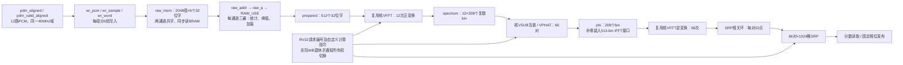
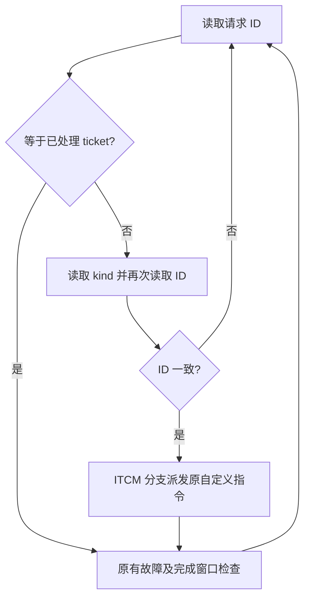
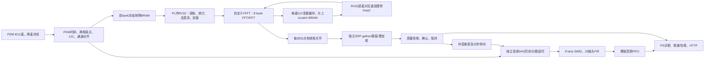

# 测试验证与问题记录

本手册集中保存数字仿真、接口检查、开发测量及问题处理记录。不同时间、通道配置、平台和计时边界的结果分别保留；早期记录不自动构成当前整机的验收结论。正式提交指标及未完成项目以技术报告为准。

## 专题目录
- [DAS/FIR 正式验收（2026-10-11）](#doc-b348d71d6696)
- [9 麦候选跟踪、稳健分离与整段包络优化](#doc-7aad92b3720f)
- [9 麦优化实现与验收边界（2026-10-25）](#doc-73520ff0027d)
- [12麦RV32分段周期统计](#doc-06380d3b8d13)
- [GSC 移除与 PL 收尾记录](#doc-4b8f0546e410)
- [GUI 信号验证进度（2026-10-12）](#doc-4f88bef19d36)
- [12麦连续运行、RAW覆盖与零静默丢窗验收](#doc-67db7ab2c459)
- [M10：有实测 profile 的固件派发优化](#doc-a981b1f48698)
- [M6–M10 实施交付索引](#doc-99ed4c13cdde)
- [M6：12路PDM共线接口与同步审计](#doc-c81a73ad870d)
- [M9：DDR DMA、PS 环及 UDP 实施](#doc-2bbe31dde3fe)
- [实测数据台账](#doc-bf23fa285305)
- [PL/PS 合并检查](#doc-56799a2b0982)
- [双麦采集复核与综合错误处理（2026-10-22）](#doc-c4c6b5310dd1)
- [PDM双麦共线整改报告](#doc-41ff9b6b0192)
- [ZYNQ-7020 12麦六线PDM收敛性整改报告](#doc-6891b9f26665)
- [ZYNQ-7020 PDM验收自动化与RAM映射实验](#doc-44e29cbe1431)
- [RV32 memory audit — 2026-10-14](#doc-4276cfe85e29)
- [Phase 4 RTL design review — awaiting user approval](#doc-359c7a3ddcc4)
- [RV32访存专项 Phase 0～6 执行报告](#doc-478b3d59fdbf)
- [平面8麦延时实测（2026-10-21）](#doc-ea6866d7b450)
- [平面8麦生产调度降延时报告（2026-10-21）](#doc-2fa2950280ba)
- [PS 回放上板记录](#doc-2923b9fda20c)
- [GSC修复 + 双层GUI合并版](#doc-3c5d35be407b)
- [8麦平面与12麦立体阵列：系统分析、分阶段优化和验证](#doc-80835265067f)
- [上传前本地核验](#doc-77e72b7e58b7)
- [验收结论更正](#doc-109dc1fbeaeb)
- [声源定位与DAS优化 M1–M5 最终实施报告](#doc-2d763ca0c8fb)

---

<a id="doc-b348d71d6696"></a>

## DAS/FIR 正式验收（2026-10-11）

本页取代旧版“GSC 必须通过”要求。生产目标为八通道 PDM → 对齐/直流阻断 → 连续 DAS → 32 抽头固定 FIR；GSC/NLMS 不参与生产构建，VUPD 动态执行次数必须为零。旧 GSC 源码与测试只保留作历史对照。

### 一次验收
在 WSL 中，从工程目录运行：

```bash
bash scripts/test_das_release.sh
```

它构建两套独立镜像，执行基础 RTL 回归、独立模型比较、PDM 引脚一致性检查、连续流测试和正式声学验收。通过标志为 `DAS_RELEASE_SIM_PASS`。不得用 LED、静态指令计数或空输入代替声学验收。

验收固件 `fw_main.c` 用确定性场景对照 FFT/GCC/SRP/DAS/FIR；生产固件 `fw_live.c` 读取真实 PDM 采集窗口的两个连续 512 样点 bank，计算四对 GCC-PHAT、4×256 SRP，并驱动转向块。定位使用周期快照，定位计算期间连续 DAS/FIR 不暂停；不声称原始采集窗口无间隙。

### 硬件边界
- 基线：8 通道，40 MHz，PCM 39.0625 kHz，每样点 1024 拍。
- 连续 FIR 复用原有 `u_vec_unit` 八路 SIMD-MAC，使用 W1/XP3；验收固件使用 W0。不是另建 MAC 阵列。
- DAS 每通道 64 样点历史，Q16 延迟量化到 1/16 样点，最大 62+15/16 样点。延迟来自真实转向寄存器，向量边界原子更新；忙或未锁定时保持最近有效延迟。
- 固定 FIR：32 抽头、Q15、10 kHz 低通。独立响应模型测得 200–8000 Hz 纹波 0.058806 dB，12 kHz 起阻带衰减 46.407149 dB。它是带限滤波，不是自适应干扰抵消或完整 CIC 补偿。
- SIMD 仲裁允许 CPU 标量/FFT 继续执行；CPU 向量操作与音频共享单元。即使 CPU 被 halt，音频仍可运行，因此音频占用时禁止 PS 改写系数。
- FIFO 满、非法延迟、空 FIFO 读取等均可观测，不得以静默丢样作为成功。

### 新寄存器
PS AXI 基址为 `0x43C00000`；下表偏移均相对基址。

| 偏移 | 名称 | 定义 |
|---|---|---|
| 0x380 | CTRL | bit0 使能，bit2 自动转向；bit1 清零只允许新会话未收样且停机空闲 |
| 0x384 | STATUS | bit0 忙，bit1 锁定，bit2 错误；bits11:3 FIFO 占用 |
| 0x388 | OUTPUTS | 成功输出样点数 |
| 0x38C | DATA | 读取并弹出一条；低16位 DAS，高16位 FIR，均有符号 |
| 0x390 | DROPS | 丢样计数 |
| 0x394 | MAX_CYCLES | 最大样点处理拍数 |
| 0x398 | ACCEPTED | 接受样点数 |
| 0x39C | VERSION | 0x44415301 |
| 0x3A0–0x3BC | DELAY0–7 | 手动 Q16 延迟 |

原始采集 PS 窗口仍为 0x300–0x37F；新增 RV32 核内镜像为 0xC000。生产固件拥有原始采集 bank，运行时 PS 不得争抢其读指针/释放操作；PS 只消费独立音频 FIFO。开始新 FIR 会话必须复位 SoC，避免旧延迟线残留。

### 必须通过的证据
1. 512 样点 FIR 标量/SIMD 指纹与独立整数模型匹配；加速非零且快于标量。
2. 动态 PUSH=512、VRED=512、VUPD=0；VFFT 实际执行且次数完整。
3. `--corrupt-fir` 必须在 0x38C8 被拒绝，返回 `ACOUSTIC_RTL_FAIL`。
4. 真实 RTL PDM 管脚位流产生非零 PCM，捕获原始数据与 FIFO 中 DAS/FIR 逐样点精确比较。
5. 真实 RV32 生产固件至少完成三轮定位、转向锁定，音频持续输出，无 trap/丢样/错误。
6. 连续流 1200 样点包含极值、历史回绕、分数/大延迟、转向忙保持、CPU 并发 PUSH；FIFO 溢出负例计数必须准确。故意替换原始bank形成不连续快照，必须输出LIVE_SEQUENCE_REJECTED，错误码2且未完成定位。
7. 样点最大处理时间必须不超过 819 拍（1024 拍预算的 80%）。
8. Vivado 全器件实现 setup/hold 均非负，且输出同一次实现的 bit/XSA。综合通过不能替代布线时序。

### ARM 与上板
```powershell
powershell -NoProfile -ExecutionPolicy Bypass -File scripts/build_acoustic_ps.ps1
powershell -NoProfile -ExecutionPolicy Bypass -File scripts/build_acoustic_ps.ps1 -Live
```

两套 ARM 程序用 DDR 链接脚本；ITCM/DTCM 镜像分别验证 SHA256，不使用旧 OCM 程序。生产 ELF 为 `build/acoustic_arm/live_das.elf`。它消费 FIFO 到 DDR 环形缓冲 `live_audio_ring`，默认运行 23,437,500 个样点（10 分钟），结束检查定位轮次、异常、丢样和处理期限，并要求存在非零 FIR 输出、观察到转向锁定且八路 frozen 掩码为零，打印 `LIVE_DAS_PASS/FAIL`。环形缓冲只保留最近 4096 条，不是全程录音或网络音频产品。

2026-10-11 用户确认暂未连接硬件。当前不得声称物理麦克风采集、十分钟板上连续运行、实际角度准确度或声场定向增益通过。连接后用本次 bit/XSA 对应的 ps7_init 和 live ELF 上板；同一版本日志与声场测试结果才算物理证据。真实诊断应用、UDP/音频回放不在本次 PL 收尾范围。

---

<a id="doc-7aad92b3720f"></a>

> 当前实现状态以 [2026-10-25 优化完成说明](测试验证与问题记录.md#doc-73520ff0027d) 和最新源码哈希验收为准。本文件保留前阶段架构、C9S2 或旧几何的历史说明；当前分离契约为 C9S3，PL/PS 已实现共享细化延时、实际协方差、多频带辅助搜索和硬件测速。下文历史数值不自动作为新版本证据。

## 9 麦候选跟踪、稳健分离与整段包络优化

本轮根据用户“先优化”的要求完成软件优化。安装约束仍是竖放阵列、正面 180°；用户最新确认声孔圆半径 **30 mm**、外圈八麦加中心一麦。先定位和分离候选，再由 PS 确认故障并绑定方向。PL/RV32 在诊断前不知哪个源是故障，热力图主峰不等于故障位置。

### 本轮变化

| 环节 | 优化前 | 本轮实现 |
|---|---|---|
| PS 候选读取 | 每约 100 ms，一张图取峰 | 每约 20 ms，四观测时间尺度的指数证据积累，并要求当前图有局部峰支持 |
| 短暂漏检 | 一次漏检立即删除 ID | 最长约 150 ms 保留身份并暂停故障定向；连续三次有效观测才恢复 |
| 窗口支持 | 连续锚点时间检查 | 记录实际缺测区间，完整快照至少 90% 方向支持；重复或逆序时间不增加支持 |
| PS 导向角 | 5.625° 网格中心 | 曲率有效时二维局部拟合，最多每轴半格；校准 Q4 LUT 双线性插值导向 |
| 分离 | C9S1 单点最小范数 LCMV | C9S2 扇区保护、软抑制、正则化、权重范数和载频完整性检查 |
| 包络特征 | C9F1 八个短窗，共 24 次 8192 FFT，间隔 4.768 Hz | C9F2 完整 1.024 s 包络、抗混叠抽取、一次 4096 FFT |

`circular9_proposals.h` 的历史证据不能独自制造当前声源：累积峰附近必须有本帧局部极大值，消失的历史峰会转入漏检状态。仍只运行一张宽带 PL 方向图；本轮没有增加多频带 PL 扫描，也没有完成诊断频带反向加权定位。20 ms 是低速候选证据路径，原快速定位发布仍按 512 点 Hop 运行。

### 轨迹、角度和最终拾音

`circular9_tracking.h` 区分连续观测、短暂缺测、恢复确认及过期。保留轨迹身份不代表仍允许输出故障方向。相近源合并、长期丢失、采集 session/epoch 切换或明显转向均保守地重新确认；三槽占满时，瞬时更响的新候选不能抢占仍在短暂保留期的旧身份。

细化角度及其不确定度从候选、跟踪、共享作业、分离一直传到诊断和 API。平坦峰、鞍点、边界或异常拟合拒绝细化。合成峰拟合误差不能作为实物测角精度。**PL 的最终连续 DAS/GSC 仍使用原粗网格对应的延时**，未把细化角度悄悄写入运行 LUT；PS 候选分离使用插值导向。

### C9S2 分离的取舍

对每个候选，用中心及四个邻近角度构建扇区。保护角度至少 3°、至多 6°，目标中心归一化为单位响应；抑制其他候选的扇区，并惩罚目标扇区的增益变化。正则化强度有三档有界尝试，不进行无收敛上限的优化。单候选时保留普通 DAS，不做九阶矩阵求逆。

保留频点须满足权重平方范数不超过 8、预测目标扇区幅度保持在 0.85～1.15、其他候选中心预测泄漏功率比不超过 0.01、邻近扇区不超过 0.03。这是导向模型检查，不能证明真实混响录音的抑制量。 unsafe 频点不送入诊断音频；在原能量门限之外，固定载频内至少 95% 频点可用且连续缺失不超过三个频点，否则 ready 位清除。

旧 1400–4600 Hz 载频在小孔径、三个近同高声源的夹具中存在较大缺口。本轮将 C9F2/C9S2 工程载频共同配置为 **2200–4600 Hz**，用同一头文件常量避免分离与诊断漂移。解析 FIR 有平滑过渡，内部保护范围为约 2600–4200 Hz。该选择仅是可测试工程配置，尚未从真实 6004 空气声确定最优共振频带。后续实测选频需要改变特征契约、重新提取数据和训练，不能改频带后沿用旧模型。

下表保留旧 25 mm 几何、旧测试表取整方式的无混响合成历史对照，不作为当前 30 mm 固件的性能证据；弱目标比最大干扰低约 18 dB：

| 场景 | 对照 | C9S2 | 说明 |
|---|---:|---:|---|
| 理想导向 SIR | C9S1 43.65 dB | 30.69 dB | 理想零陷变浅 |
| 3° 导向误差 SIR | C9S1 8.37 dB | 10.18 dB | 目标幅度约保留 99.6% |
| 连续离格方向 SIR | 粗网格 12.23 dB | 细化后 27.23 dB | 同一 C9S2 下比较导向角 |
| 独立传感器噪声的输出 SNR | C9S1 36.55 dB | 32.64 dB | 不是所有指标都改善 |

当前 30 mm 独立声场测试已统一使用生产表的 floor Q4 量化约定，实际生产表另由整条 PS 任务流水线覆盖。新夹具结果：理想 SIR 28.539 dB，3° 偏差 SIR 12.270 dB，离格粗方向 14.511 dB、细方向 28.273 dB，传感器噪声输出 SNR 33.306 dB。旧取整测试的部分数值更高，不混用两组结果。新的载频反例保留能量 99.986%，但 63 个载频点中只有 55 个可用、连续缺八点，正确拒绝诊断。近角度病态案例也拒绝。以上都是测试夹具结果，不能当作房间内三音箱实测指标。

### C9F2 整段包络

处理链为 40000 点、39062.5 Hz 音频，257 tap 解析选带 FIR 按四倍抽取，取复数幅度，再以 129 tap 抗混叠 FIR 四倍抽取。得到 2500 个真实包络样本，仍覆盖 **1.024 s**，加 Hann 后补零至 4096 点做一次 FFT。

- 包络采样率为 2441.40625 Hz，滤波低通工程参数为 900 Hz。
- 补零频点间隔为 0.596046 Hz；它不增加真实观察时间或物理分辨力。
- Hann 等效噪声带宽约 1.46543 Hz，第一零点偏移约 1.95391 Hz。
- 600 rpm 下 FTF 约 3.976 Hz，取峰排除 DC；搜索半宽为 `max(1/1.024 Hz, 目标频率×1%)`，是尚待实录验证的速度/滑移容差。
- 报告载频 RMS、调制 RMS、观察长度、FFT 数量和窗宽。缺乏载频时，即使配置模型也保持未知；无调制纯音可以作为正常或干扰训练样本。

18 维机械阶次结构仍采用 6004 参数，但算法和数值已改变：**C9F1/C9S1 的数据或模型不能重新贴成 C9F2/C9S2。** 训练工具要求新契约、实际提取状态和滤波掩码。当前仍没有真实训练模型，生产默认为未知。

独立解析调幅与直接 DFT 测试覆盖 600/1800 rpm、FTF/1X、载频边缘、DC、纯音、静音、边缘脉冲、抗混叠，以及高阶频率偏移正反例。本机预热提取约快 3 倍；该比值不是 Cortex-A9 耗时。实际 CPU0 定位收取截止期、CPU1 分离和诊断周期仍待上板测量。

### 验证、版本和使用

以下脚本通过后生成源码哈希证据：`check_circular9_proposals.py`、`check_circular9_tracking.py`、`check_circular9_candidates.py`、`check_circular9_envelope.py`、`check_circular9_diagnosis.py`、`check_circular9_pipeline.py`。完整本机运行链覆盖实际历史、候选、三路分离、新特征、JSON、PCM 导出、漏检恢复和旧故障标签不复用。

`check_gsc9.py` 再次通过：2048 包匹配独立 NLMS 期望值，含八类元数据保护。PS GSC 代码闭环保留，但仍针对最终选中的一个方向；三候选诊断前分离在 PS CPU1。GSC 的实板听音、故障特征保真及连续不丢样尚未验收。

PL/RV32、采样配置和 LUT 没有变化，已验证的首个对齐 PCM 到 RV32 的 9.153775～9.155650 ms 证据可继续使用；这不证明新 PS 负载也已满足端到端 10 ms。生产 PS 用匹配 BSP 重新编译，`build/circular9_direction_release` 更新为本轮无模型版本。网页显示候选保留/恢复状态与细化角度，模型缺失或条件不足时保持未知。

原实施方案不修改。实物仍需核对第九路接线、声孔几何和标定，真实故障模型须用本轮实际分离输出重新采集、训练及独立验收。[总体链路](工程设计与接口.md#doc-60cd04405fe2) 和 [数据工作流](构建部署与操作.md#doc-7bc82840e2db) 给出使用方法。

---

<a id="doc-73520ff0027d"></a>

## 9 麦优化实现与验收边界（2026-10-25）

本文件记录用户“全部做完”对应的软件和硬件实现，GUI 暂不扩展。原始 `circular9_fault_localization_plan_20261022.md` 保持原文；本文件与最新构建、回归和只读资格审计一起说明当前状态，不能把实现完成当作实板验收通过。

### 固定配置与处理顺序

用户确认：IM73D122、3.3 V，外圈 8 麦声孔圆半径 **30 mm**，中心 1 麦；阵列竖放，测试声源位于正面半空间。只扫描方向，不扫描距离。正前方为 0°，向右为正水平角，向上为正俯仰角。通道到声孔位置的实际对应、幅相和朝向仍需采集标定；原理图 DATA 标号错误已由用户说明为标注问题。

处理链：

```text
9 路 PDM → PL 同步采集/16 倍抽取 → 156250 Hz PCM
  ├─ PL FFT/36 对 PHAT/IFFT/SRP + RV32 自定义指令 → 快速方向热力图
  ├─ 原始 9 路 PCM DMA → PS CPU0 连续接收、历史环、方向跟踪
  │    └─ PS CPU1 多频带搜索 → 补充候选 → 同一快照最多三路分离
  │         → C9F2 特征与 C9S3 模型诊断 → 故障标签绑定轨迹 ID/方向
  └─ 已确认且仍有效的故障方向 → 原子细化延时 → PL DAS/FIR
       → 带同一延时版本的原始数据 → PS CPU0 GSC → 定向音频
```

PL 的最强峰只代表声学候选。故障方向必须经过 PS 诊断确认；模型缺失、特征不可用、多个故障候选歧义、方向过期或转速不可信时不输出确定故障结论。

### 本轮优化

| 项目 | 当前实现 | 证据入口 |
|---|---|---|
| CPU0 GSC 计算 | 预计算三次插值系数，复用归一化分母，精确商修正；保留整数运算结果及原 ABI | `check_gsc9.py`、`check_gsc9_hotpath.py` |
| GSC 目标保护 | 监视阻塞支路的目标泄漏；命中时清自适应权重、暂返匹配 DAS/FIR，恢复后继续适应 | `docs/gsc9_hotpath_guard_20261025.md` |
| 重叠诊断 | 1.024 s 真实观察长度，按样本时钟每 80000 点/512 ms 调度；精确快照终点；只保留最新待处理任务 | `check_circular9_schedule.py`、`check_circular9_pipeline.py` |
| 诊断超载保护 | 记录排队、计算、总耗时和样本年龄；排队输入超出 512 ms、计算/结果年龄超出 3000 ms 或代际不符即拒绝该结论，无无限队列 | 任务指标及管线负例 |
| 弱源发现 | CPU1 对独立原始片段做三频带 coherence/PHAT/SRP，不要求已有宽带主峰或轨迹；反馈携带实际支持区间 | `check_circular9_candidates.py`、管线集成负例 |
| 分离 | 从同一混合快照的实际 STFT 数据估计目标保护后的残差协方差，收缩正则化；保留扇区、权重范数、泄漏和载频完整性保护 | `check_circular9_candidates.py` |
| 连续方向导向 | 标定 Q4 LUT 双线性有理数插值、逐通道精确向下取整、公共偏移归零；PL 和 PS 使用同一向量 | `check_circular9_ps_control.py` |
| 原子提交 | 9 通道完整影子寄存器提交；版本、epoch、时间戳、范围、TTL 和读回校验；异常撤销定向 | `check_circular9_control.py`、`check_circular9_ps_control.py` |
| 原始历史环 | 1048576 帧，156250 Hz 下 6.7108864 s；独占 32 MiB 共享区，两核统一非缓存映射 | 候选测试、管线测试及 ARM 链接布局检查 |
| 实际测速 | PL 输入双触发同步、毛刺过滤、周期一致性、300 ms 超时；PS 显式配置每转脉冲数，600–1800 rpm 范围及新代际采样屏障 | RTL 控制测试、PS 控制测试 |

CPU1 辅助搜索频带为 600–2200、2200–4600、4600–8000 Hz。默认每 8192 个原始采样/52.4288 ms 请求，单次证据约 104.8576 ms；计算迟到或反馈结束点超过 200 ms 不得续期。缓慢搜索负责发现候选，不承诺首次发现小于 10 ms。重复反馈不能增加支持时长；缺测、历史交叠和采集断代分别处理。

协方差优化用实际混合音频学习权重。评估已知源贡献时，固定从同一混合快照学习的权重，再分解输出；禁止分别用单声源重学权重后声称得到同一分离器的 SIR。保真度、载频缺口和输出可诊断性均参与拒绝，不把低能量的失真输出作为“分离成功”。

本次独立合成声场回归的部分结果如下；这些是受控夹具结果，不是实板指标：

| 用例 | 数字结果 |
|---|---|
| 比最响源低 18.06 dB 的三源分离 | 目标输出 SIR 32.21 dB，目标幅度约 0.99986，三候选可诊断保护通过 |
| 非均匀传感器噪声、20%/8 ms 空间反射 | 相同输入、冻结权重比较：先验 SNR 4.70 dB，实际协方差 SNR 8.83 dB；目标幅度约 1.00605 |
| 同输入 CPU1 全带相关图缺少低 22.50 dB 弱源的局部峰 | 三频带搜索从真实 PCM/STFT 中找到该弱源；15%/8 ms 反射加噪声用例仍检出；不是 PL 实测图对照 |
| 实际 SoC 细角切换 | 同粗格内 token1→token2→OFF 返回粗方向，三个阶段均有可信原始包和有效 GSC，11157 包逐样检查无 PL/PS 对齐错误 |
| 异常控制 | 18135 项原生检查，含 3072 组精确插值向量、4096 逐样导向/FIR、18 项 HTTP 非法输入与测速/断代保护 |

协方差优化在 3° 导向误差夹具上的 SIR 为 10.64 dB；不同夹具间不能承诺所有指标都提升。载频大缺口、相近病态方向、短突发、纯噪声和过期反馈均有拒绝用例。

### 延迟的定义

1024 点、156250 Hz 对应窗口时长 **6.5536 ms**，首点到第 1024 点相隔 6.5472 ms。512 点 Hop 的更新间隔是 **3.2768 ms**。重叠分帧降低更新间隔，不能把一个新事件尚未采到的历史变成已有证据。

快速数字链按首个对齐 PCM 到 RV32 完整发布计算；`build/circular9_checks/results.json` 给出当前 RTL/固件的实测仿真最大值，打包脚本要求它小于 10 ms。`build/circular9_e2e/results.json` 另记录 PDM 输入经过真实 CIC 和 RV32 的测试。两者都不代替真实麦克风的上电稳定时间、Cortex-A9 调度、PS 收取或网络显示延迟。

本轮最终 32 窗连续生产固件回归：首个对齐 PCM 到 RV32 完整发布为 **9.153300–9.155925 ms**，最后 PCM 后最大 **2.608725 ms**；采集丢帧和音频丢帧均为 0。静音、削顶、未标定几何、快照暂停恢复和故障方向保持用例也通过。数字链剩余时间余量不足 0.85 ms，PS 实际接收截止期仍须单独实测。

PS 诊断必须观察 1.024 s 才能维持当前低转速阶次特征定义；512 ms 是调度 hop 和排队输入年龄，计算/结果年龄预算为 3000 ms。完整“新故障出现到类别确认”不能称为小于 10 ms。若超载，系统拒绝迟到结果并报告计数；是否在目标板上稳定满足截止期，需要实际并发负载测量。

### 控制接口

连接开发板后可使用原有 HTTP API。手动 RPM 默认不确认，必须显式提供实测值：

- `GET /api/rpm?value=1200`：切换手动输入并确认该转速。
- `GET /api/rpm/source?mode=tacho&ppr=1`：启用硬件周期测速，PPR 必须与实际传感器一致。
- `GET /api/rpm/source?mode=manual`：关闭测速，清除旧确认，等待重新提供实测值。
- `GET /api/rpm/state`：读取测速模式、周期、年龄、状态、细化提交错误及 GSC 目标保护指标。

转速失效、明显变化、采集 session/epoch 变化会撤销旧故障目标，重新积累本代际音频。未安装测速传感器时可使用有依据的手动转速；软件不会默认为 1200 rpm 已经实测。

测速输入 `tacho_i` 当前约束在 FPGA 封装 **R18、LVCMOS33**，带输入上拉。开发板上实际接插件的脚号需要按该板引出表核对；硬件测速验证需提供共地且电平匹配的实际脉冲，并确认 PPR。

细化延时控制扩展位于已有 PDM AXI 窗口 `0x3f0..0x3fc`，签名为 `C9X1`。装载器拒绝缺少签名的旧 bit。Fine 版本由原始音频数据包完整携带；PS 保留有界版本缓存，未知、淘汰或不匹配向量不得驱动 GSC 适应。硬件提交完整后仍须通过读回；任何失败均实际 OFF，即使之前已经处于禁止定向状态。

### 契约和发布

特征契约保持 **C9F2**，分离契约升级为 **C9S3**。旧 C9S1/C9S2 录音特征、模型和验收报告不能重新标号沿用。生产默认仍为无真实模型/未知；需要用当前分离输出采集正常和故障数据，按独立录制会话划分训练与验证，再经模型发布校验接入。

本轮必须重新实现 FPGA，并从该 XSA 新建 BSP、重编 PS。`routed_source_proof.json` 绑定实现开始和完成时的全部 RTL、约束、Tcl、bit 与 XSA；`package_circular9.py` 再核实当前源码、RV32、LUT、PS、BSP 和各项回归。旧 bit 的源码证明不适用于本轮。

新版硬件实现已通过：40 MHz，Setup 最差裕量 **+0.495 ns**、Hold **+0.031 ns**，两者违例端点为 0；bit 与 XSA 内嵌位流哈希一致，完整布线源码证明状态为 `ROUTED_SOURCE_AND_XSA_MATCHED`。这是静态时序和产物一致性证明，实板运行仍未验证。

交付目录为 `build/circular9_direction_release`，只读审计为 `scripts/check_circular9_readiness.py`。只有当前哈希、数字回归、实现时序、匹配平台和发布包检查全部通过，才能标记 `SOFTWARE_READY_PHYSICAL_UNVERIFIED`。

在本机已映射到工程的 `X:` 短路径中重建，硬件命令为：

```powershell
Set-Location X:/
New-Item -ItemType Directory -Force X:/build/vivado_temp | Out-Null
$env:TEMP='X:/build/vivado_temp'
$env:TMP='X:/build/vivado_temp'
& D:/AMDDesignTools/2025.2/Vivado/bin/vivado.bat -mode batch -notrace -source scripts/run_circular9_optimized_flow.tcl -log build/c9opt_flow.log -journal build/c9opt_flow.jou
```

硬件成功后，用 `build_circular9_platform.tcl` 为 **不存在的新工作区**生成 BSP，再以 `build_ui_pipeline.ps1 -Live -MatchingPlWindow -ActiveChannels 9 -BspDir <新BSP>` 重编。`package_circular9.py --bsp-workspace <新工作区>` 要求匹配新 XSA 并核对全部 20 组证明；源码、配置、测试或文档发生变化时，相应证据或包必须重新生成。审计命令为 `python scripts/check_circular9_readiness.py`，反例为 `python scripts/check_circular9_readiness_test.py`。

### 仍需实物验收

开发板尚未连接，因此下列事项保留未验收：九通道逐路激励与映射、声孔坐标/朝向/幅相标定、测速传感器波形、真实三声源弱故障分离与方向误差、故障特征保留、真实模型、PS 并发截止期及长时间不丢样。IM73D122 型号、3.3 V、30 mm 几何是用户确认的实物信息，不能自动替代这些测量。

当前交付目标是可执行且有保护的上板采集、标定与三声源验证版本。真实故障方向验收必须在完成上述采集后给出结果；禁止通过修改确认位或伪造模型绕过保护。

---

<a id="doc-06380d3b8d13"></a>

## 12麦RV32分段周期统计

运行 `wsl python3 scripts/check_cycle_profile.py`。计时构建使用
`FW_CYCLE_PROFILE=1`，独立输出到 `build/das12_profile/`，不替换生产镜像、
生产PS内嵌头文件或下载板卡。正常构建不启用计时。

核的 `rtl/csr/rv32_csr.v` 将 CSR 0xC00 映射到64位 mcycle 的低32位，
每个非复位时钟增加，包括流水线阻塞期间。FFT RUN通过 stall/done阻塞指令，
直到完成，因此RUN前后rdcycle包含完整FFT运算等待时间，无须另加忙轮询。
`read_cycles()`带memory编译器屏障；它不是DMA或异步外设完成屏障。
无符号减法允许计数器回绕，前提是单段小于2^32拍（40MHz约107.37秒）。

每路记录五段原始周期：采集读取及原始统计；预处理/加窗及函数、计时、
统计赋值开销的剩余时间；512次PUSH含内存加载；阻塞RUN；513次POP含缓存存储。
前两段不是纯数据搬运。重复rdcycle基线单独提供，不自动扣除。
计时会增加少量周期并可能改变编译器寄存器分配，不能把结果当未插桩版本的精确耗时。

RESULT相对0x2800，以32位字编号：128为奇偶发布序号，129为CYP1标识
0x43595031，130为完成帧号，131为通道数，132为背靠背rdcycle基线，133为每路字段数5；
134起按通道连续存储上述五段。12路末字段为193（0x2B04）。读者应前后校验128
相同且为偶数，并核验标识和通道数。链接脚本保留结果区0x2800..0x2BFF，
位于BSS之后、栈之前。计时数据不会通过当前GUI自动显示。

RTL测试执行真实固件，两轮快照验证采集统计、持续DAS/FIR逐点结果、无丢样、
无退休异常，并验证计时发布及RUN包含阻塞周期；输出最新完成帧的12路统计。
`profile.log`保留原始证据，`summary.json`给出每段12路合计及40MHz时间折算。
这些是合成PCM注入条件的RTL仿真，不是物理麦克风或PS Cortex-A9周期。

也可在先构建计时固件后使用Vivado XSim：
`powershell -NoProfile -ExecutionPolicy Bypass -File scripts/check_live16_xsim.ps1 -Twelve -CycleProfile`。
随后运行 `wsl python3 scripts/check_cycle_profile.py --analyze-only --log build/das12_profile/xsim/simulation.log`
汇总该次结果。RUN检查对照核内实际FFT阻塞拍数，不使用任意固定耗时阈值。

### 2026-10-14 合并前历史验证结果

计时固件编译通过；Vivado XSim两轮完整12麦SoC通过，4438个连续音频样点，
无丢样、无RV32退休异常，几何未启用。日志为
`build/das12_profile/xsim/simulation.log`，汇总为`build/das12_profile/summary.json`。
背靠背rdcycle基线2拍；各路PUSH3594拍、RUN920拍、POP3086拍。

| 最新完成帧12路合计 | 周期 | 按40MHz折算/ms |
|---|---:|---:|
| 采集读取及原始统计 | 533804 | 13.345100 |
| 预处理/加窗及剩余开销 | 599613 | 14.990325 |
| FFT PUSH | 43128 | 1.078200 |
| FFT RUN | 11040 | 0.276000 |
| FFT POP | 37032 | 0.925800 |
| 五段合计 | 1224617 | 30.615425 |

五段不包括26.2144ms采集等待、结果发布和外围调度，也不包含尚未启用的
66对GCC/IFFT与方位搜索。FFT三段中输入输出占87.9%，不能扩展为整机搬运占比。
单帧五段合计已超过13.1072ms帧移预算，需要优化采集读取和预处理，不能仅增加缓冲。
这是最新一帧的仿真数据，不是多帧平均、最坏耗时或实板结果。
初次Icarus检查使用错误的RUN>=2000拍阈值而失败；最终测试改为对照RTL实际
阻塞拍数并由XSim通过。未修改RTL、未下载板卡。

### 与远端优化融合

保留成对采集、IFFT SEEK/相关环、原始采集接口和两边的测试。
生产版几何未确认时只计算电平统计，不计算无消费者的FFT；计时版显式运行
12路FFT以测量五段，不启用虚构几何、定位或自动转向。
每对共字采集耗时只记在偶数通道，奇数通道capture为0，汇总时不重复计算。
计时结果从旧104区迁至128区，避开RAW_RESULT的104..115。
上表是合并前历史数据，合并后的结果以重新运行的日志及summary.json为准。

合并验证：生产12麦两轮/2659连续音频样点、计时版两轮/4136连续音频样点均
通过XSim，丢样0且无退休异常。原始快照XSim导出12288样点，释放/取消通过，
2084连续音频样点且丢样0。成对采集、原始采集PS/固件宿主测试与GUI测试均通过。
计时版每帧采集读事务6144，保持成对读取优化。

| 合并后计时版最新帧12路合计 | 周期 | 40MHz折算/ms |
|---|---:|---:|
| 成对采集及原始统计 | 378580 | 9.464500 |
| 预处理/加窗及相关开销 | 597847 | 14.946175 |
| PUSH | 43108 | 1.077700 |
| RUN | 11040 | 0.276000 |
| POP | 37032 | 0.925800 |
| 合计 | 1067607 | 26.690175 |

生产模式因几何未确认而跳过FFT，不能将上述计时版耗时视为生产快照耗时。
本次没有重新生成bit/XSA或上板；旧实现/发布清单不代表当前合并源码已重新实现。

---

<a id="doc-4b8f0546e410"></a>

## GSC 移除与 PL 收尾记录

日期：2026-10-11。实施依据：工程根目录《GSC移除与DAS_SIMD实施计划书_2026-10-11.md》。本轮只完成计划内八通道 PL 数据面与配套固件/验收，不替代实板声场验证。

### 已实现
1. 生产构建以固定 FIR 取代 GSC，验收/ARM/PS-only 使用相同整数内核与独立参考模型；归档 GSC 不参与生产链接或强制验收。
2. rv32_das_stream 接入八路真实对齐 PCM，64 样点历史、分数延迟、自动转向原子更新及 FIFO/错误/拍数计数。
3. 音频控制器在现有八路 SIMD-MAC 上执行 PUSH/VRED 固定 FIR；W1/XP3 与 CPU 的基准 W0 分离，仲裁覆盖 CPU halt 和并发向量请求，PS 系数窗口具备占用保护。
4. 新 RV32 原始采集 MMIO 镜像和快照模式；fw_live 从两个连续 512 样点 bank 读取真实 PCM，执行四对 GCC-PHAT、硬件 SRP、自然逐帧转向更新。定位计算不暂停连续增强音频。
5. 两套 ARM 下载/回读程序、DDR 链接、镜像哈希检查；生产程序默认十分钟消费测试及最近 4096 条音频 DDR 环形缓存。
6. Vivado 独立项目输出、实现时序硬门禁、bit/XSA 导出；上板脚本支持指定匹配 bit/init/ELF，避免覆盖旧项目产物。
7. 修复综合发现的 SRP RAM 双写端问题；替换正式验收中的旧 GSC 要求，增加真实 PDM 和破坏 FIR 结果的负向控制。

### 仿真证据
| 项目 | 结果 | 日志 |
|---|---|---|
| FIR 512 样点标量/SIMD | 292196/15714 拍，18.60×；整数指纹一致 | build/acoustic_rtl.log |
| FFT 标量/硬件 | 199026/7625 拍 | build/acoustic_rtl.log |
| 动态指令 | PUSH512 / VRED512 / VUPD0 / VFFT7182，fault0 | build/acoustic_rtl.log |
| 管脚位流到音频 | 64/64 非零样点与真实捕获 PCM 推导值逐点一致 | build/acoustic_rtl.log |
| 真实固件闭环 | 3 次定位、5280 条连续音频、锁定且无错误 | build/acoustic_rtl.log |
| 快照序号负例 | bank0/bank1 序号2/1，错误码2、定位0次 | build/acoustic_rtl.log |
| 连续流压力 | 1200 样点；CPU PUSH 并发最大76拍；溢出负例4条 | build/das_stream.log |
| PS-only 对照 | 14/14 独立参考比较 | build/das_release.log |

76 拍占每样点 1024 拍预算的 7.42%，低于 819 拍门限。这是 RTL 仿真测量，不是板上时序/实时性证据。上述角度 grid=123 仅说明位流合成场景可以完成定位，不代表实际声场角度精度。

### 工程验收入口
完整 RTL/模型回归：bash scripts/test_das_release.sh。ARM：scripts/build_acoustic_ps.ps1，生产版加 -Live。FPGA：设置 ZYNQ_PROJ_DIR=build/das_fir_zynq 后运行 scripts/run_zynq_flow.tcl。详细寄存器和判据见 acoustic_acceptance.md。

### 实现与预算
完整实现数字：Vivado 2020.2、xc7z020clg400-1、40 MHz，最终WNS=+0.060ns、WHS=+0.034ns，setup/hold失效端点均为0。LUT27745（52.15%）、FF14020（13.18%）、BRAM31.5（22.50%）、DSP175（79.55%）。裕量仍偏小，后续RTL修改须重新实现。

FFT写回增加一级寄存，级间与拆分末尾补排空周期：WNS从+0.004ns增至+0.060ns，硬件FFT固件拍数从7615增至7625，正/逆/满幅结果不变。DAS RAM控制改用同步复位，新增历史RAM的异步控制DRC警告已消除。

内部未约束端点、无时钟寄存器、组合环均为0。8条PDM DIN由原XDC显式false-path，采样窗口模型给出setup16ns/hold84.5ns（解析值，非板测）；4条未设output-delay是3个LED和PDM时钟输出。接口线缆/麦克风电气时序仍待实测。旧tacho同步器目标不存在的约束警告未匹配，也未屏蔽有效路径；当前tacho无RTL消费者，不宣称转速功能完成。

定位计算562361拍=14.06ms，含采集等待的快照周期1610650拍=40.27ms，约24.83Hz；连续音频仍为39.0625kHz。这是按计划门禁采用的“连续流音频＋周期定位快照”，不是原始bank无间隙。整机仿真对照：基准轮5351718/3750704拍（1.4269×），产品形态轮5061444/3450408拍（1.4669×），不含Cortex-A9自身周期。

产物：build/das_fir_zynq/rv32_zynq.runs/impl_1/ps_pl_wrapper.bit、build/das_fir.xsa、build/acoustic_arm/live_das.elf。scripts/package_das_release.py检查XSA内bit一致性、双TCM哈希、时序及验收标记，输出build/das_fir_release_manifest.json；不替代ARM构建和物理验收。

### 明确未验证
用户确认暂未连接硬件，因此未执行烧录、物理麦克风数据、板上十分钟连续运行、定位准确度和定向增益测试。不能把仿真 PASS 写成物理 PASS。

固定输出 FIR 已满足本期 SIMD 复用目标；八路独立分数延迟 FIR、CIC 专用补偿、多波束、网络音频及诊断 PS 产品属于扩展项，不冒充本期完成内容。当前 DAS 使用线性分数插值；固定带限 FIR 不能恢复 GSC 的自适应干扰抑制能力。

---

<a id="doc-4f88bef19d36"></a>

## GUI 信号验证进度（2026-10-12）

最新几何已由用户实测图修正为平行四边形，覆盖下文历史的矩形估计：按 CH0/1/2/3 为 M0/M3/M2/M1，中心坐标/mm 为 (23.18,22.21)、(-23.18,9.79)、(-23.18,-22.21)、(23.18,-9.79)。J3 接线不变，定位和转向表已重新生成；详见 [四麦配置](../README.md)。

定位显示按用户反馈升级：浏览器轮询 200 ms（5 Hz），同一定位序号不重复入轨迹，SVG 留痕 5 秒/最多 30 点，按时间淡出。无效定位保留最近有效位置最多 1.5 秒并降低亮度，随后隐藏；大于 120 mm 的显示位置跳变需要连续两次新结果相差不超过 60 mm 才接受，已接受位置做 0.45 权重平滑。此为页面滤波，未更改原始定位数据、DAS 转向或音频诊断；显示平滑会增加跟随延迟，不是定位精度改进。暂停显示时轨迹也暂停。

宿主测试覆盖保持/超时、跳变确认、平滑、重复序号及轨迹过期。实板 `python scripts/check_board_location_refresh.py`：29.83 秒 150 次请求，最长 HTTP 47 ms，定位帧增加 632、音频增加 29 帧，PL/PS 丢样和段重置均为 0。新版首页 HTTP 200、14123 字节；日志 `build/das4/live_board_location_5hz_1.json`。5 Hz 为页面目标刷新率，网络延迟和防重叠保护可能降低实际刷新率；定位算法本身速率未调整。用户已观察到定位随左右声源方向变化，尚无定量精度验收。

独立实时定位已接入：RESULT(30) 为奇偶发布序号，RESULT(31) 为唯一正峰值有效标记；PS 在同一序号内读取 RESULT(1/2/6/7) 的帧号、网格、峰值、次峰值。API 新增 loc_seq/valid/grid/frame/age_ms/best/second；loc_age_ms 是 PS 观测到序号变化后的时间，不是采样时间戳。定位与当前音频段尚未同步，页面明确说明，不覆盖音频关联字段。无正峰值、峰值并列或超过 3 秒未更新时隐藏定位点。定位坐标采用照片视角 16×16 网格，X/Y 为 ±200 mm、Z=300 mm。

接入过程中发现并修复低电平定点定位全零，详见 [098](../README.md)。最新 30 秒实板记录显示定位帧增加 633、27 个不同网格、25/57 次读取有唯一有效峰值；音频新增 29 帧，PL/PS 丢样和段重置均为 0。环境声会产生无效或跳动的峰值，尚未验收已知位置声源的方向与误差。页面已更新至 13134 字节，首页返回 HTTP 200。

已完成频谱显示修正和四麦逐路电平观测。当前网页 http://192.168.2.10/。

调试界面已中文化，包含标题、按钮、动态状态、诊断类别及电平说明，管脚、单位与 API 字段保留原格式。新增页面触发的 TCP 缓冲区限制已修复，详见 [097](../README.md)。最新中文版本实板验证：20 次首页均完整返回 11992 字节；并发 30 秒监测新增 29 帧、2282 块，最大处理耗时 323 ms，PL/PS 丢样及段重置均为 0。日志 `build/das4/homepage_cn_http_1.json`、`build/das4/live_board_cn_http_1.json`。

音频谱不再把 0 Hz 放进首组最大值，单独报告窗口直流；同时显示 40000 点段的均值、RMS、峰值和端点削波数量，单位为满刻度 ppm，网页换算为 %FS。首组仍包含非零低频，不能把低频声音当作直流。
展示包络用未加窗音频进行带限解析包络提取，再去加权均值、加一次 Hann。分类保留训练兼容的旧特征算法，GUI 明确说明；若改变分类算法，需另做训练数据一致性和模型验收。

四麦电平由 PL 固件读取现有的 1024 点定位快照时计算。结果放在 DTCM 的 RESULT(8～27)：每路 sum、sum-square low/high、peak、clipped 共 5 个字；平方和用完整 64 位累加。RESULT(28) 是奇偶序号，RESULT(29)=0x4d494335。PS 使用独立读口读取，前后校验序号，拒绝跨帧混合快照，不暂停 RV32，不消费或修改定位 bank。
四路快照位于 PL 去直流之后、DAS 之前。它与 40000 点输出段不同时刻，不能直接用两者 RMS 比值声称增强收益。

用户已确认照片视角的接线：CH0=右上/J3.34、CH1=左上/J3.32、CH2=左下/J3.33、CH3=右下/J3.35，CLK=36，3.3V=38，GND=37。以阵列中心为原点、右为 +X、上为 +Y，坐标分别为 (25,17.5)、(-25,17.5)、(-25,-17.5)、(25,-17.5) mm；间距仍为近似值。位置对应确认不等于定位精度已验收。

宿主检查覆盖无调制纯音、偏置、约 100 Hz 幅度调制、常值/削波、64 位平方和、负均值和撕裂快照拒绝；Cortex-A9 和 RV32 本机编译通过。四麦位流不变，启动时加载更新的 RV32 固件。
上板连续 30 秒观测（`build/das4/live_board_levels_1.json`）：57 次请求，29 个新诊断帧、2275 个新块，30 组不同曲线，mic_seq 增加 1324；最大处理耗时 322 ms，PL/PS 丢样及段重置为 0。一次观测输出均值 0 ppm、窗口 DC 4 ppm、RMS 566 ppm、峰值 2319 ppm、削波 0；四路 RMS 为 626/620/638/679 ppm，PDM frozen=0xF0。以上是环境声采样实测，不是受控声源或 SNR 验收。

逐麦操作：在页面观察 CH0～3 RMS，依次靠近每颗麦克风发声并记录哪一路响应最大；对着阵列发声后退远，确认曲线和电平响应。结果可用“保存快照”保存。没有受控刺激前，不声称单麦对应关系或通道校准通过。
后续再接同一时段的参考单麦与 DAS 音频保存/试听、增强前后对照，以及定位/转向准确性验证。当前 PL FIFO 只提供 DAS/FIR 同一时刻的两个值，不包含同步参考单麦；新增同步参考需要改 PL 接口。

---

<a id="doc-67db7ab2c459"></a>

## 12麦连续运行、RAW覆盖与零静默丢窗验收

任务依据：`D:\Users\xyfhhh\Downloads\fengxianyanshou.md`，原文副本在`build/localizer12_safety/taskbook.md`。入口HEAD为`1f5ae420cf914458303df17c2cc47366bf963de0`；原有父目录文档删除保持原样，没有reset、提交、烧板或写Flash。既有已验收产物由`protected_artifacts.json`记录哈希，最终检查必须全部不变。

本报告以数据安全为首要判据。最终统计由`scripts/report_localizer12_safety.py`从实际日志生成；未完成的构建和测试不算PASS。中间版`validated`/`final`目录保留历史结果，最终候选使用`release`及`final_implementation`，不能混用源码哈希。

最终结论：本次规定范围的非周期256/1024窗、相关功能/访存回归、压力故障隔离及匹配当前RTL的40MHz实现已通过。固定节拍停顿边界逐阶段列示，长停顿的CORRECT_LATE/EXPLICIT_LOSS不冒充严格实时成功。完整产物及哈希为`build/localizer12_safety/release_manifest.json`，交付门控输出`LOCALIZER12_SAFETY_PACKAGE_PASS`。

### 信号与所有权



采集、RAW写入、RAW读取和计算均在同一40MHz时钟域；这段通路没有异步CDC。输入24位PCM取`pcm_i[ch*24+8+:16]`，两个16位通道打包一字，地址`(sample_seq mod 2048)*6+(channel>>1)`。八路SIMD音频FIR仍独立连续运行。

`pending`只有一个待启动窗口槽，忙时新窗口到达会显式增加`window_drop`，并不存在能吸收任意CPU停顿的多窗队列。1024点窗口不是一次性复制到完整12通道工作RAM：各通道读取三遍，通道之间穿插FFT，所以RAW最后依赖时刻须包含此前通道FFT输入、计算和读回。

### 覆盖生命周期的精确口径

设窗口最早样点为F，组n输入有效拍为V(n)，连续正常输入满足`V(n+1)-V(n)=1024`。组写入在输入拍锁存后，分别于`V(n)+1 ... V(n)+6`写word0...word5。第c通道对应字在：

`D(n,c)=V(n+2048)+1+(c>>1)`

开始覆盖旧数据。窗口最后样点的有效拍为`Tready=V(F+1023)`，因此最旧word0首次覆盖为：

`D(F,0)-Tready=1025*1024+1=1049601拍=26.240025ms`。

```text
Tready          +6      +7       +8          +9             最后RAW_USE          +1049601
最后样点有效 → 最后一字写完 → 窗口调度 → 第一次BRAM读 → 第一次RAW接受 → 12路三遍RAW释放 → 最旧word0被覆盖
                                        请求拍          返回/消费拍
```

同步读的`raw_q`在上升沿捕获旧RAM内容；监测器按READ_FIRST影子RAM处理同拍读写，先求读返回标签，再更新写标签。每个RAW_USE都比较全局期望样点序号、影子返回序号和非周期PCM值，覆盖三遍全部读取，正常每窗**36864次**。返回与请求只差一拍，RAW端没有ready反压协议，因此不能合法地任意增加RAW BRAM返回拍数；算子侧反压、核访存应答等待分别通过各自已有接口注入。

两个不同的RAW裕量分别报告：

1. **逐读取覆盖余量**：`D(F+n,c)-RAW请求拍`，对每次实际使用的数据取最小值。请求拍同时写入同地址时虽仿真READ_FIRST可返回旧字，本验收仍以正余量作为正常通过口径。
2. **全部RAW释放的保守余量**：`D(F,0)-最后一次RAW_USE拍`。它要求整窗所有RAW访问在最早覆盖之前完成，比逐读取生命期更保守。

若将逐读取余量的终点改为下一拍RAW_USE有效消费，数值比请求拍口径少1拍：正常最小956064拍=23.901600ms。请求拍已经把正确数据捕获到raw_q，不能再把BRAM本体的覆盖时间直接等同于该寄存器数据失效。逐请求CSV同时列出请求、返回/消费及覆盖拍，便于核对边沿。

输入/发布预算另算：Hop是524288拍；`Hop-max_compute`是计算预算，`Hop-max_latency`是发布预算。RAW环容量52.4288ms、上述覆盖余量、约5ms计算预算及约3.28ms发布预算都不能互相替代。23ns BRAM路径和WNS/WHS不能加到毫秒级算法延迟。

### 实测发现与最小修复

| 问题 | 修复前实际证据 | 最小变化及代价 |
|---|---|---|
| HALT丢失WB内容 | PHAT阶段5000拍HALT后互谱退休65次，预期66；组合压力出现分数不符 | `rv32_core`的MEM/WB在HALT时保持，退休和寄存器写入仍单独门控；不增加数据缓存 |
| 报错后仍能发布结果 | 长SRP等待增加window_drop后，继续出现RESULT_AFTER_LOSS | 本地sticky failed状态，错误同拍优先取消窗口、屏蔽搬运和后续结果；复位才清除故障，重新使能不能掩盖计数 |
| 采样计数器回卷静默跳窗 | 调度专测FIRST 512→2048，预期1024，raw_drop/window_drop仍0 | 增加一位window_primed，替代回卷后失效的`>=1024`预热条件；原2048点缓存不扩容 |
| EX接受不等于WB退休 | SRP请求后偏移31拍HALT，硬件可完成，但SRP指令仍未退休 | 定位专用FFT/GCC完成通知改为实际退休；定位专用SRP门铃由退休后寄存发出，通用接口保留 |

回卷专测将已经正常运行的相对计数整体平移2048整数倍，并相反平移`source_first`，保持环地址和全局样点内容不变，跨过32位零点；不是声称在板上运行了30.54小时。正常采样下32位组计数约30.542小时回卷。修复后专测连续FIRST 1024、1536、2048、2560，全部RAW值一致。该专测及reset/disable/reenable专测使用算子握手桩，只证明控制器与RAW行为，不能冒充真实FFT/GCC/SRP算术回归。

故障处理不会降低计算规模，也不通过停采样换PASS。测试输入在首次启用后持续提供；故障后的固件可显式关闭定位，但音频输入仍继续。故障窗口不发布；已显式丢失的场景记EXPLICIT_LOSS，不记实时成功。

错误计数表示故障事件；failed状态下不再声称持续处理窗口，也不能将计数1当作后续总共只损失了一个窗口。恢复须显式reset并重新收满窗口。回卷专测还将tick移到32位时钟计数的零点附近，检查跨回卷的固定发布间隔；40MHz下tick约107.374秒回卷，和PCM组计数约30.542小时回卷是两种不同边界。

### 监测与压力口径

非周期输入由32位全局样点索引、通道及seed散列产生，含正负满幅边界值。主seed为20261015，额外seed及外部sample_id回卷另测。独立host C定点模型计算每个新窗口的统计/准备/12路FFT/66对PHAT及IFFT/1024格分数。没有以硬件RAM内容自身作为golden。影子RAW RAM另外记录每个32位字最近写入的样点序号，避免PCM值偶然相等掩盖覆盖。

注入只存在于build中的RTL副本：算子背压同时门控生产者ready与接收端实际accept；访存等待同时门控CPU和fabric应答；产品综合不包含测试门控、影子标签或监测端口。协议保持断言检查反压期间地址/数据稳定，完成通知必须与实际退休一致。组合突发使用互不整除的周期，避免与1024拍输入锁相。

主矩阵的固件轮询是0xD000无读副作用寄存器；另增**真实DTCM读写自检固件**，每次调度循环执行读/写/读校验，错误值触发非法指令使测试立即失败。该固件在build内生成，使用独立ELF，不替换交付的连续测试ELF。DTCM正常4窗及5000、10000、50000、100000、200000、700000拍应答等待共7场景，前6个数据正确，700000拍显式损失；5000/10000/50000拍保持固定发布相位，100000/200000拍的fixed_phase为false，不称固定节拍成功。实际DTCM等待分别为4998、9998、49998、99998、199998、699998个请求有效周期，正常接受229899次、各压力场景均有正的接受计数，证明实际RAM请求受压而非只有CPU HALT。计数requests表示请求有效拍数，不是去重事务数。

粗测覆盖HALT的准备前/RAW早期/RAW末尾/FFT/GCC/PHAT/IFFT/SRP/发布等待，访存等待的六阶段，以及FFT/GCC/IFFT输入背压。每组测试0、5000、10000、50000、100000、150000、200000、300000、500000、700000拍。共183场景。细化逐阶段单独求相邻拍边界，再复测边界±1拍、注入偏移1/31拍、后续窗口及偏移7拍；不能将一个相位的边界称为全局HALT保证值。

`PASS`表示该场景数据正确且在所测Hop截止内；`CORRECT_LATE`表示所有数据正确、无静默跳窗，但结果截止未通过；`EXPLICIT_LOSS`表示明确报错并隔离结果；`ERROR`为真正失败，脚本返回非零。固定发布相位还单独记录`fixed_phase`，避免将可接受的显式降级误称固定节拍运行。

不丢窗完成边界与固定相位边界分别扫描。前者允许CORRECT_LATE，不是最大严格实时HALT值；后者在已有前序结果的窗口上检查所有间隔。每组都只报告实测相邻拍转折，调度轮询相位和注入偏移可能产生非单调性，不能称为所有输入、所有相位的数学全局极限。`before`在首窗是首次数据到齐前IDLE，而在target=2是上一窗口刚发布后的IDLE，两者含有不同长度的空闲时间，必须分别解释。

### 可复现入口与构建隔离

在WSL仓库根目录：

```sh
python3 scripts/check_localizer12_safety.py --windows 1024 --output build/localizer12_safety/release --report-name long1024
python3 scripts/check_localizer12_safety.py --reuse-model --windows 256 --output build/localizer12_safety/release --report-name baseline256
python3 scripts/check_localizer12_safety.py --reuse-model --matrix --jobs 3 --output build/localizer12_safety/release --report-name matrix
python3 scripts/check_localizer12_safety.py --reuse-model --refine --jobs 3 --output build/localizer12_safety/release --report-name boundaries
python3 scripts/check_localizer12_safety.py --reuse-model --realtime-refine --jobs 3 --output build/localizer12_safety/release --report-name realtime_boundaries
python3 scripts/check_localizer12_safety.py --reuse-model --kind halt --phase srp --duration 5000 --target 2 --offset 31 --windows 6 --output build/localizer12_safety/release --report-name replay
python3 scripts/check_localizer12_safety.py --dtcm-probe --kind mem --phase raw --duration 5000 --windows 4 --output build/localizer12_safety/dtcm_probe --report-name wait5000
python3 scripts/check_localizer12_safety_units.py
python3 scripts/check_localizer12_safety_units.py --before
python3 scripts/check_localizer12.py --windows 256 --output build/localizer12_safety/release_periodic256
python3 scripts/check_rv32_mem_regression.py --output build/localizer12_safety/release_regression
python3 scripts/check_rv32_mem_perf.py --output build/localizer12_safety/release_mem
python3 scripts/check_rv32_mem_perf.py --mmio-unrolled --output build/localizer12_safety/release_mmio
python3 scripts/test_overlap50_strict.py
python3 scripts/report_localizer12_safety.py
python3 scripts/package_localizer12_safety.py
```

`--windows 0`的调度固件持续运行；长跑由监测器达到目标窗数后结束仿真，不是固件256窗自停。单场景可以指定seed、phase、duration、target和offset；输出log/JSON及目标窗口全部RAW访问CSV。模型来源受RTL/ROM/C++/wrapper哈希检查，变更后必须重新编译。

原生XSim用`build_live12.py --transfer --windows 4 --output build/localizer12_safety/release_xsim_fw`生成独立固件，再以`check_live16_xsim.ps1 -Transfer -SnapshotFrames 4 -RunTag safety_release4 -TransferBuild build\localizer12_safety\release_xsim_fw`运行。完整Vivado使用`ZYNQ_PROJ_DIR=.../localizer12_safety/final_zynq`、`ZYNQ_OUTPUT_DIR=.../localizer12_safety/final_implementation`、DAS_ACTIVE_CHANNELS=12、LOCALIZER_FLOORPLAN=1、ZYNQ_RESUME_IMPL=0；先确认无并发Vivado。

### 证据与验收范围

实际场景表、相邻拍边界、RAW逐通道/逐pass生命周期、窗口时间线、manifest及报告在`build/localizer12_safety`；最终汇总为`safety_evidence.json`。中间压力测试确实发现过失败，保留原FAIL日志，不能只交付通过日志。

### 已完成的最终实测与改前对照

| 项目 | 改前证据 | 最终实测 |
|---|---|---|
| 输入规模 | 40MHz、12路、1024点/512Hop、2048点RAW、66对、1024格 | 全部保留，未扩RAW、未复制算子 |
| 非周期逐点检查 | 周期2048点向量不能区分同地址新旧样点 | 1024窗、37748736次三遍RAW读取，标签及数值全部正确 |
| 主长跑音频 | 旧256窗131968/131968/drop0 | 525184/525184/drop0、max101拍 |
| 正常非周期256窗 | 无该输入基线 | 256窗全部正确，255次间隔均524288拍 |
| 正常非周期1024窗 | 未测 | 1024窗全部正确，1023次间隔均524288拍 |
| 最后样点→首次RAW接受 | 未单独记录 | 每窗9拍；BRAM请求在前一拍 |
| 最后样点→全部RAW释放 | 未单独记录 | 95567..95588拍，即2.389175..2.389700ms |
| 最旧word0覆盖时限 | 不能由52.4ms容量直接判断 | Tready+1049601拍，即26.240025ms |
| 正常逐读取最小覆盖余量 | 未测标签生命期 | **956065拍=23.901625ms** |
| 全RAW释放保守余量范围 | 未测 | **954013..954034拍=23.850325..23.850850ms** |
| 第一窗口逐读取余量范围 | 未测 | 956065..2095099拍，即23.901625..52.377475ms；最大值为该窗实测，不冒称任意压力下最大值 |
| 非周期最大计算 | 原报告周期向量323568拍 | 323587拍=8.089675ms；输入/固件不同，不作单一RTL因果A/B |
| 同原周期向量256窗最大计算 | 323568拍 | 323586拍，增加18拍=0.45μs；完整黄金与退休计数通过 |
| 正常发布延迟 | 393217拍 | 仍393217拍=9.830425ms，均值/P99/最大相同 |
| 正常计算预算余量 | 200720拍 | 非周期200701拍=5.017525ms；不是HALT保证值 |
| 发布预算余量 | 131071拍 | 仍131071拍=3.276775ms；不是RAW覆盖裕量 |
| 原始丢失/跳窗 | 原正常场景0/0 | 正常256/1024均0/0；压力显式损失独立列示 |
| 粗测183场景 | 123数据成功/47显式损失/**13错误** | **128按截止正确/2数值正确但超发布间隔/53显式损失/0错误** |
| 回卷/重启/同字读写 | 3个专项均复现失败 | 当前3个专项PASS；控制器范围，算子为桩 |
| CPU/PS/FFT/SIMD/capture/SRP | 9项旧回归 | 当前9项全部PASS |
| 访存及严格统计 | 旧76+8+17项 | 当前76+8+17项全部PASS，CSR/exported均100847 |
| 原生XSim | 旧4窗 | 当前4窗全部黄金与真实指令通过，音频2944/2944/drop0 |
| WNS / WHS | +0.622 / +0.030ns | **+0.869 / +0.033ns**，TNS/THS0、40MHz FLOW_PASS |
| LUT / FF | 29752 / 16824 | 29781 / 16856，增加29 LUT/32 FF（完整实现差值） |
| BRAM / DSP / LUTRAM | 111.5 / 132 / 2884 | 111.5 / 132 / 2884，不增加大数据存储 |
| RAW BRAM输出最差所报路径 | 未细分 | 19.492ns，其中布线11.198ns，余量+4.609ns |

1024窗约覆盖13.445秒输入、超过256个RAW环绕周期；4096窗未执行，不以有限仿真证明无限时长可靠性。32位tick/组计数回卷由单独加速边界试验证明控制行为，不声称物理板卡已运行对应时长。

粗测中的两个CORRECT_LATE是发布等待期300000拍HALT/访存等待：全部四窗数值和序号正确、无丢样，但最大结果间隔547306/547304拍，超过524288。它们必须保留为实时未通过，不能因每窗计算仍小于Hop而写成严格实时PASS。

压力最小RAW余量另有单场景重放CSV：`release/halt_raw_500000_w0_o0_n5_s20261015_b0_raw.csv`。最小点为通道3、第三遍、样点0，请求1638036拍、有效消费1638037拍、同字覆盖2165762拍；请求口径余量527726拍。损失告警在1640455拍，最小点确实发生在告警前，非取消消费或报错后的伪样点。该窗口没有发布。它直接说明：系统先受Hop/单窗所有权约束，RAW尚未覆盖也可能必须退出实时态。

实际RAW RAMB位置及WRITE_MODE_A/B在`final_implementation/localizer_bram_locations.csv`：16个RAW RAMB36为A=READ_FIRST、B=WRITE_FIRST；其他RAM存在不同配置，不能统称READ_FIRST。RAW/准备RAM/频谱/PHAT/SRP各自时序报告单独输出。RTL同字读写专测按非阻塞赋值读取旧字，端口模式属性本身不证明跨端口碰撞返回值，仍不替代真实板上碰撞验证。产品生命周期危险边沿优先隔离消费和结果，不依赖该碰撞返回值。

P0风险（静默跳窗、错误后发布、HALT丢WB、退休前所有权切换）均实施最小修复并保留修复前反例；固定节拍在较长停顿下可能失守，必须按后续实测边界表使用，不承诺任意停顿仍实时。部署前的PDM采集、真实几何和实板持续运行仍未验收。

<!-- SAFETY_GENERATED_BEGIN -->
### 实测各阶段临界点与安全裕量（自动从日志生成）

主seed=20261015；下表是指定注入点的相邻拍转折。完成边界在target=0测量，固定相位边界在target=2测量；包含后续窗口验证。带偏移的结果见stress_results.csv，不将本表解释为所有相位的全局极限。

| 类型/阶段 | 首次注入点相对首窗ready（拍） | 尚依赖RAW | 不丢窗完成临界：成功/显式损失（拍） | 固定相位临界：通过/不通过（拍） |
|---|---:|---|---:|---:|
| halt/before | 1 | 是 | 207380 / 207381 | 207380 / 207381 |
| halt/raw | 43 | 是 | 207330 / 207331 | 76257 / 76258 |
| halt/rawlate | 95542 | 是 | 201280 / 201281 | 70207 / 70208 |
| halt/fft | 6668 | 是 | 200705 / 200706 | 69632 / 69633 |
| halt/gcc | 97992 | 否 | 200705 / 200706 | 69632 / 69633 |
| halt/phat | 98080 | 否 | 200705 / 200706 | 69632 / 69633 |
| halt/ifft | 99000 | 否 | 200705 / 200706 | 69632 / 69633 |
| halt/srp | 253396 | 否 | 200704 / 200705 | 69631 / 69632 |
| halt/publish | 323588 | 否 | 408059 / 408060 | 276995 / 276996 |
| mem/raw | 43 | 是 | 207335 / 207336 | 76259 / 76260 |
| mem/fft | 6668 | 是 | 200709 / 200710 | 69635 / 69636 |
| mem/gcc | 97992 | 否 | 200707 / 200708 | 69635 / 69636 |
| mem/ifft | 99000 | 否 | 200708 / 200709 | 69636 / 69637 |
| mem/srp | 253396 | 否 | 200704 / 200705 | 69632 / 69633 |
| mem/publish | 323588 | 否 | 408061 / 408062 | 276997 / 276998 |
| op/fftin | 6155 | 是 | 200718 / 200719 | 69641 / 69642 |
| op/gccin | 97574 | 否 | 200708 / 200709 | 69633 / 69634 |
| op/ifftin | 98486 | 否 | 200717 / 200718 | 69642 / 69643 |

`before`的固定相位测试从前一结果发布后的IDLE开始，相对目标新窗口ready约提前131070拍；表中首窗注入点不能与它直接混为同一时刻。一次停顿落在RAW三遍、核等待、已退休算子自主运行或发布等待，影响不同。

当前全部已记录压力场景的最小逐读取RAW余量为 **527726拍 = 13.193150ms**（含显式损失前的读取）；未出现标签错误后仍发布。正常1024窗的956065拍与该压力最小值分列。

所测18个基准注入位置中，最小的固定相位通过临界点为69631拍（1.740775ms）；它不是52.4ms缓存容量，也不是23.9ms正常RAW余量。偏移与输入种子改变后须复测。

<!-- SAFETY_GENERATED_END -->

仿真证明的范围是所列输入、seed、窗口数、注入位置和协议模型下的数据正确性、显式损失与隔离行为；STA证明的是匹配综合网表在40MHz约束下的建立/保持时序。真实PDM输入、实际麦克风几何、物理BRAM碰撞/板级长跑及真实声场定位仍须板卡验证，不能由本报告宣布实板PASS。

---

<a id="doc-a981b1f48698"></a>

## M10：有实测 profile 的固件派发优化

正式结果以 `build/m10_20261016/acceptance.json` 与 `release_manifest.json` 为准；文件生成前本阶段仍在验证。器件配置 `xc7z020clg400-1`，40MHz。真实芯片后缀、PDM 电气窗口、生产几何、PS/DDR/网口实时吞吐及声学效果继续 `DEFERRED_HARDWARE`。

### 范围和保护边界

本任务主动实施的生产优化为 `sw/fw/fw_localizer12.c`，测试环境另修正 `tb/tb_localizer12_safety.v` 的 PHAT 接受条件。并行任务的 PS 采样诊断所有权检查、可选 RAM overlay 入口及外部窗口工具也按用户确认保留合并，区别列于清单。CPU 五级流水、自定义指令语义、八 lane SIMD、FFT/PHAT/SRP 算术、DAS 三阶插值、方向原子更新、DMA/UDP/GSC 实现及生产配置均未改。12 路 / 1024 FFT / 512 Hop / 66 对 / 1024 格保持。

开始前完整核验 M9 发布清单 3585 文件、221739994 字节；`before_sources.json`、`before/fw_localizer12.c`、`before/tb_localizer12_safety.v` 保留原始输入。M9 的源文件哈希描述的是当时版本；本阶段明确登记上述两个文件的变化，不把新源码与旧固件镜像混同。

16:00 的核验发现并行任务追加了六项工具/诊断改动。`audit_m10_concurrent_merge.py` 对 Python 默认路径移除未启用的 overlay 分支后核对旧 SHA256，对 Tcl 默认路径恢复原字节（含行结束符）后核对旧 SHA256；历史源码副本放入 before，不修改当前文件。新实验分支未启用，本次综合日志也没有 overlay 启用标记；当前验收覆盖默认12路配置。外部窗口审计仍使用此前冻结的模型副本。PS 诊断新增银行读取后的序号复核、拒绝释放检查和错误退出；12个协议用例及ARM编译通过，原版四个缺陷由相同测试独立检出并保留。并行改动不冒充本任务固件优化的收益。

并行追加的支持文档保留旧清单哈希及当前快照，未替换旧测试报告或网表。新增 `pdm_external_assumptions.json` 不属于此前综合输入；逐项验证其假设与本轮冻结分析一致（tDV100ns/tHZ5ns、CLK/DATA走线各0..3ns、不确定度2ns）。它标记 ASSUMED_NOT_MEASURED，不改变当前硬件或生产坐标。源码、二进制及数值验收证据仍逐文件验证，文档版本变化单独登记。

### 先测量，再改动

`scripts/profile_localizer12.py` 在完整 SoC 安全测试上增加仿真探针，只修改输出目录中的 wrapper/CPP。数学仍由真实 RTL 执行并对独立 C Golden 检查；RTL 生产源码没有插入计数器。

测量包括：真实退休事件和 PC、活跃运算期间 PC、已应答 MMIO 事务、实际非 MMIO RAM 请求和等待、取指/运算等待、状态驻留、211 条每窗算子的派发延迟、FFT 状态、八 lane VRED 发射、RAW 有效双端口访问/同址冲突、SRP busy。重叠等待计数不视为互斥分类，不将未阻塞真实 RAM 请求的周期称作 DTCM 压力。

8 窗口原版测得：

- 12 正 FFT、66 逆 FFT、66 互谱、66 PHAT、1 SRP / 窗；调用总数 211 / 窗。
- 1728 次 DTCM 请求及 1728 拍等待，其中 1688=211×8 次是派发跳转表读取，40 次是结果写回。全阶段等待并不由 DTCM 主导，未修改其握手。
- 算子派发共 59742 拍；FFT/AC 实际等待共 650880 拍；SRP busy 共 544896 拍，即 68112 / 窗。
- 4992 个音频输出、159744 个 MAC 槽，即每样点固定 32 MAC；八 lane 每样点发射 4 批，约占 1024 拍的 0.391%。这是物理发射槽统计，包含零系数/热身，不是非零有效乘法或功耗估计。
- 1728 拍 RAW 读写并行，同址冲突 0；RAW/preprocess 状态平均 73750.75 拍/窗。
- PC 与 MMIO 热点明细保存于 `profile_pc.csv`、`profile_mmio.csv`；各模块驻留和派发分布保存于 `profile_states.csv`、`profile_dispatch.csv`。

各组状态的平均拍数（包括该阶段 IO 与 CPU 派发，不等于纯算术内核耗时）：

| 阶段 | 原版 | 最终 |
|---|---:|---:|
| RAW/preprocess | 73750.75 | 73750.75 |
| 正 FFT 的 IO/运行/输出 | 23807.00 | 23690.00 |
| 互谱 IO/运行 | 33461.75 | 33014.50 |
| PHAT IO/运行 | 26668.00 | 26280.50 |
| 逆 FFT IO/运行 | 93324.00 | 92601.75 |
| SRP 与评分回读 | 70190.00 | 70196.00 |
| 固定发布相位等待 | 69763.50 | 71431.50 |

### 实施和独立 A/B

原循环每次读取 id→kind→id，再检查故障和窗口。新循环先读 id，只有 ticket 变化时才读取 kind 并再次校验 id；故障和完成窗口仍每轮检查。RTL 在 RUN 入口增加 ticket，rearm 保留 ticket；uint32 回绕后新 ID 与上一个 ticket 仍不同。没有移除 volatile 或自定义指令的 memory clobber。

GCC 原本为五项 switch 生成 DTCM 跳转表。对 main 使用 `optimize("no-jump-tables")`，使分支保留在 ITCM。编译工具链仍为项目 GNU RV32，五个自定义指令编码均保持。



先在 `candidates` 建立独立源码，逐项跑 8 窗口完整算术检查；只有测得收益才写入正式固件。每个候选均保留源码、镜像、ELF、CSV、日志及哈希。

| 候选 | 最坏 compute 拍 | 8 窗派发总拍 | DTCM 请求 | 退休指令 |
|---|---:|---:|---:|---:|
| 原版 | 323462 | 59742 | 1728 | 2685052 |
| 仅 ID 优先 | 322846 | 55358 | 1728 | 2511134 |
| 仅移除跳转表 | 321904 | 46924 | 40 | 2660554 |
| 合并并写入正式源码 | 321791 | 46926 | 40 | 2512582 |

相同 8 窗输入节省 1671 拍，0.5166%，在 40MHz 下为 41.775µs。退休指令减少 6.4233%；ITCM 文本 448→468 字节，增加 20 字节；DTCM .data 24→0 字节，HEX 仍按装载格式保留至少一个零字。物理 ITCM/DTCM 容量及 BRAM 没有缩减。

代价：MMIO 应答从 1059770 增至 1111016，增加 4.8356%；更快轮询使内存/取指等待计数上升。SRP 与评分回读阶段略增 6 拍/窗，其他阶段收益大于该增加。没有据退休数下降宣称功耗降低。FFT/AC 等待、SRP busy 和全部算术调用数量不变。

固定结果发布偏移保持 393216，外部发布延迟仍为 393217 拍；Hop 524288 拍和输出采样率不变。计算提前完成增加的是发布前余量，未宣称端到端发布延迟下降。8 窗 A/B 与 1024/4096 窗最坏值分开统计，完整回归值见 acceptance.json。

### 压力回归发现并修正的测试问题

首轮 1024 正常窗通过，但压力矩阵有 9 个 `PHAT_GOLDEN` 错误，全部位于相同过载边界。该轮 `m10_regression_20261016` 不计验收，未完成的 4096 回放也不计通过。

`diagnose_localizer12_boundary.py` 增加观察端口，在报错周期 1640454 直接测得：

```
loss_now=1 run_ok=0 ac_start=0 ac_fire=0 phi_check=1
```

窗口已经组合判定过载，生产 RTL 禁止接受 PHAT 事务；sticky window_drop 在下一时钟才可见。旧 testbench 用 `state==H_POP && ready` 误把未接受数据当成有效结果，CPU 调度提前后触发了这一采样错误。生产 RTL 原有失效保护没有修改。

最小修正只把 phi_check 改成 `state==H_POP && ac_start && ac_ready`。Golden 数值比较、正常每窗完整覆盖和实时分类规则全部保留。旧 bench 及失败日志保留于 before / boundary_diagnosis；诊断脚本使用旧 bench 副本可继续重现原错误，不回滚当前文件。

`check_localizer12_checker.py` 故意翻转实际被接受的 PHAT 观测的一位，必须在 `first_loss=0` 时触发 `PHAT_GOLDEN`；该负例通过，证明有效数据的检查仍能失败。重跑原版和最终版的健康 profile，全部计数、派发分布和状态驻留与修正前完全相同，记录 `normal_checker_equivalence_verified=true`。

正式全回归从头重建于 `m10_regression_v2_20261016`；未把 9 个错误改写成 PASS，也未跳过场景。额外测试包括 ticket CSR 偏移 `0xfffffff0` 跨回绕、300000 拍同一过载场景、真实 DMA 永久 AW 阻塞隔离及 4 个校准 RTL 回放。

### Vivado、资源、拥塞和功耗口径

新工程 `m10_impl_20261016_project` 完成综合、布局布线、bit/XSA；仅生成文件，未烧写。资源与 M9 启用 DMA 的配置完全一致：36156 LUT、20515 FF、111.5 BRAM36、133 DSP；WNS +0.919ns、WHS +0.020ns，TNS/THS=0。相对 M5 的资源增长来自 M9 的 DMA 和合入 PDM 改动，不归因于本次固件优化。

关键路径为 DAS 的 `snap_reg[9][15]` 到 `sum_reg[19]`，逻辑深度 28，数据路径 23.519ns，其中路由 12.532ns。`congestion.rpt` 未记录超过 level 5 的拥塞窗口。没有用该报告声称 SIMD 或 CPU 五级流水必须重写，也未调整时钟频率。

`audit_m10_routed.tcl` 重新检查 part/pin/clock/CDC、内部未约束端点、DATA/CLOCK datapath 预算，以及独立资格时钟的外部 setup/hold 正例与负例。外部板级延迟仍是假设，分析 XDC 仅在独立会话使用，不加入生产工程，不写回 DCP。

工具运行了 M9/M10 的 vectorless `report_power`：均为 1.917W、估计结温 47.1°C、Confidence Low。没有 SAIF 或固件实际切换活动，不能区分本次轮询变化的动态功耗，也不代表板上功耗或温升实测。

WHS 比 M5 少 0.003ns，余量很小；与 M9 相同，未因固件优化改变。器件报告只支持配置的 XC7Z020，不能外推 XC7Z010。

### 构建和复现

```powershell
wsl python3 scripts/profile_localizer12.py --firmware build/m10_20261016/before/fw_localizer12.c --output build/new_m10_before --windows 8
wsl python3 scripts/profile_localizer12.py --output build/new_m10_after --windows 8
wsl python3 scripts/check_localizer12_request_wrap.py --output build/new_m10_wrap --windows 8
wsl python3 scripts/check_localizer12_checker.py --output build/new_m10_checker_negative
wsl python3 scripts/diagnose_localizer12_boundary.py --output build/new_m10_old_failure
wsl python3 scripts/run_integrated_validation.py --tag new_m10_regression
wsl python3 scripts/build_live12.py --transfer --windows 0 --hot-o2 --output build/new_m10_rv32
```

正式 `rv32_release` 为连续运行的 TEST_GEOMETRY_ONLY 固件，配套 `itcm.hex`、`dtcm.hex`、ELF、装载头文件及 build_manifest；与最终仿真镜像逐字相同。RV32 控制程序通过 PS 装载独立 ITCM/DTCM，本轮只生成和验证镜像，未执行硬件装载。生产几何仍为空，未以测试 LUT 启用真实定位。

匹配新 XSA 的 Vitis BSP 前两轮因 Windows 文件占用，内部重新生成 BSP 失败。保留两个失败工作区和日志；第三轮使用 `build_stream_platform_v3.tcl`，在 platform generate 前等待 5 秒，生成新目录成功。未改共享工作区、未删除失败目录。`ps_default_release` 与 `ps_gsc_release` 均以匹配的 M10 XSA/BSP 编译链接，代码、标定、缓存协议与 M9 相同，未运行上板。

### 最终验收资料

全量要求包括：528 场景、4 个全 1024 评分的基线物理场景、4 个 M7 校准场景、1024/4096 窗零 RAW/window/audio 丢失、183 压力场景逐项与 M9 比较、9 个 CPU 测试、76 内存测试、8 MMIO 测试、17 严格验收、实际 50000 拍 DTCM 阻塞、19 辅助 RTL、4 窗 XSim、回绕及负例、DMA 隔离。全部满足后才生成 acceptance.json 和最终文件清单；CORRECT_LATE 与 EXPLICIT_LOSS 保持独立分类。

独立验证未修改的 M6–M9 功能通过其原输入/证据哈希继承，M10 全 SoC 又逐样点检查 RAW/DAS/FIR/tap 及方向联动。最新发布清单描述当前源码；旧阶段清单里的固件和 testbench 版本通过 before 副本继续可追溯。

仍待真实硬件验收的内容：芯片完整标记、12 麦接线/供电/启动窗口、坐标/通道映射和标定采集、真实角度和降噪、PS GSC/DDR/网口吞吐及拥塞运行。没有执行 Git 提交、Git 复位/清理、板卡烧写或板卡复位。

---

<a id="doc-99ed4c13cdde"></a>

## M6–M10 实施交付索引

全部阶段的软件/RTL适用验收完成；实板状态均为 DEFERRED_HARDWARE。保持12路、1024 FFT、512 Hop、66对、1024格、八lane SIMD和40MHz。生产坐标与通道映射仍未填入。

| 阶段 | 结果 | 报告 |
|---|---|---|
| M6 | PASS_SIM_IMPL；1024/4096窗及完整实现 | [PDM同步审计](测试验证与问题记录.md#doc-c81a73ad870d) |
| M7 | PASS_SOFTWARE_RTL_REGRESSION | [几何标定机制](工程设计与接口.md#doc-36ee4a19e848) |
| M8 | PASS_PROTOTYPE_SOFTWARE_RTL；合成SNR提升8.94–10.30dB | [GSC原型](构建部署与操作.md#doc-da93d60382a8) |
| M9 | PASS_SOFTWARE_RTL_IMPL；DMA、PS环、UDP及GSC应用mock | [DMA/UDP实施](测试验证与问题记录.md#doc-2bbe31dde3fe) |
| M10 | PASS_SIM_IMPL_MEASURED_OPTIMIZATION | [固件派发优化](测试验证与问题记录.md#doc-a981b1f48698) |

M10完整4096窗最坏计算从M5的323463拍降到321794拍，节省1669拍（41.725微秒，0.5160%）。固定发布延迟仍为393217拍。MMIO总访问增加4.84%，代码增加20字节；未声称功耗下降。

本轮最终回归：1024和4096窗零RAW/window/audio丢失，4096窗150994944次RAW检查；183压力分类{"PASS": 128, "EXPLICIT_LOSS": 53, "CORRECT_LATE": 2}，相对M9无退步。非实时正确与显式损失保持独立分类。另有528模型、4个基线及4个校准RTL场景、19辅助RTL、CPU/内存/MMIO/严格验收、真实50000拍DTCM阻塞、XSim、ticket回绕、错误接受数据负例、DMA隔离。

最新Vivado为xc7z020clg400-1：WNS +0.919ns、WHS +0.020ns，TNS/THS=0；36156 LUT、20515 FF、111.5 BRAM36、133 DSP。WHS余量较小。外部PDM窗口仅在明确假设下分析通过。

### 当前交付与复验

- 最终acceptance
- 完整文件/哈希清单
- 修改文件清单
- A/B数据 / 逐项压力对比
- 连续RV32镜像与ELF
- 新XSA / 时序
- PS默认旁路ELF / 显式TEST_ONLY GSC ELF

复验：`wsl python3 scripts/verify_stage_release.py --manifest build/m10_20261016/release_manifest.json`。所有重新仿真/构建命令见各阶段报告，并使用新输出目录。旧阶段清单对应历史源版本；M10 before目录保存本轮修改前固件和testbench。

### 实板待验收

芯片完整型号、12麦DATA/LR/CLK和供电、电气启动窗口、生产几何/通道映射和真实标定、Cortex-A9 GSC与DDR缓存/DMA/网口吞吐、拥塞长跑、实测角度和音质均待验收。RV32固件仍标TEST_GEOMETRY_ONLY，PS应用也保留UNVERIFIED标志；未用测试坐标启用生产定位。没有执行Git提交、Git复位/清理或板卡烧写/复位。

---

<a id="doc-c81a73ad870d"></a>

## M6：12路PDM共线接口与同步审计

本文件记录源码能够证明的拓扑及数字验证边界。阶段结论由 `build/m6_20261016/acceptance.json` 给出；在该文件生成前，本阶段为 IN_PROGRESS。任务来源为用户提供的 `D:/Users/xyfhhh/Downloads/GSC及其优化.md`，原文副本保存在本次build目录。

### 受保护基线

源码根为 `zynq_-pl_-simd_-verilog`，不是旁边的历史同名目录。只读HEAD、初始Git状态和修改前SHA256分别见 `build/m6_20261016/head.txt`、`git_status_before.txt`、`before_hashes.json`。M5报告：`docs/声源定位_DAS_M1-M5实施报告_2026-10-15.md`；M0审计：`docs/M0_工程审计_2026-10-15.md`；验收和绑定清单：`build/zynq12_integrated_plan/reports/final/acceptance.json`、`release_manifest.json`。本次前置逐文件复核1790项及11处报告链接，RELEASE_HANDOFF_PASS。

`scripts/create_zynq_project.tcl:19` 指定 **xc7z020clg400-1**。完整顶层 `ps_pl_wrapper` 来自Block Design生成，内部 `rtl/soc/rv32_ps_top.v` 默认12通道、每线双麦，调用 `rv32_soc`。PS FCLK_CLK0为40MHz，PDM时钟由 `rtl/array/rv32_pdm_clkgen.v` 的10位同步计数器产生。Vivado安装为 `D:/Vivado/Vivado/2020.2`。实体芯片丝印、BOM、十二麦线束并未提供，本次不能核验实物part；尤其不能把7020资源结论用于7010。

### 12通道映射：仅源码配置可证，实体全部未验收

| RTL通道 | DATA索引 | 配置封装脚 | 文档J3针 | 预期LR | 驱动半周期 | mic编号/实体位置 |
|---:|---:|---|---:|---|---|---|
| 0 | 0 | Y16 | 31 | GND | 低 | UNVERIFIED_HARDWARE |
| 1 | 0 | Y16 | 31 | VDD | 高 | UNVERIFIED_HARDWARE |
| 2 | 1 | Y17 | 32 | GND | 低 | UNVERIFIED_HARDWARE |
| 3 | 1 | Y17 | 32 | VDD | 高 | UNVERIFIED_HARDWARE |
| 4 | 2 | T15 | 33 | GND | 低 | UNVERIFIED_HARDWARE |
| 5 | 2 | T15 | 33 | VDD | 高 | UNVERIFIED_HARDWARE |
| 6 | 3 | T14 | 34 | GND | 低 | UNVERIFIED_HARDWARE |
| 7 | 3 | T14 | 34 | VDD | 高 | UNVERIFIED_HARDWARE |
| 8 | 4 | W16 | 35 | GND | 低 | UNVERIFIED_HARDWARE |
| 9 | 4 | W16 | 35 | VDD | 高 | UNVERIFIED_HARDWARE |
| 10 | 5 | T17 | 26 | GND | 低 | UNVERIFIED_HARDWARE |
| 11 | 5 | T17 | 26 | VDD | 高 | UNVERIFIED_HARDWARE |

共用CLK配置V16/J3.36。依据：`rtl/soc/rv32_ps_top.v:18`、`:54`；`rtl/soc/rv32_soc.v:13`、`:523`；`rtl/array/rv32_pdm_array_rx.v:101`的CH_A/CH_B；`constrs/ps_pl_wrapper.xdc:97`起的引脚模板；`docs/board_io.md:86`起的J3表；`configs/production_array.json`。模板有8根DIN，但工程Tcl仅生成当前六线profile，不能把模板宽度当成实体接线证明。mic ID与坐标映射仍为空，测试编号不可替代实体编号。

### 手册、电气窗口与跨域边界

本机原始手册 `D:/Users/xyfhhh/Desktop/Infineon-IM73D122-DataSheet-v01_00-EN.pdf`，版本1.00、2022-08-12。可检索提取文本在 `build/m6_20261016/datasheet.txt`；原PDF的SHA256由阶段清单绑定。

第10页表8：LR=GND下降沿驱动、上升沿高阻；LR=VDD相反。第8–9页表6：tDD=40..80ns，tHZ=5..30ns，tDV最大100ns（100pF/100kΩ条件）。第8页启动时间20ms对应±0.5dB灵敏度、50ms对应±0.2dB；第9页上电3ms内开始输出交替idle tone，不代表此时已经获得有效声学信号。

FPGA没有用PDM_CLK作为内部采样时钟，没有IDDR，也没有新增时钟域；数据用40MHz时钟在两个受控使能点采样。低相位在HOLD_TICK=4采到phase_a_q，高相位在CONSUME_TICK=12消费；所有CIC同时消费并共用64位抽取节拍。采样触发器在对应tick末沿采样，因此相对驱动沿为125ns，不能误写为100ns。

此前预算假设CLK去程5ns、DATA回程3ns、setup 1ns、hold 0.5ns：setup=125−5−100−3−1=16ns；保守hold=200+5+5−125−0.5=84.5ns。**这些板级延迟没有实测，不是STA证明。** 新测试108ns为沿到数据有效的合成总延迟；124ns只证明1ns前转换的数字行为，不证明物理建立保持。140ns反例明确失败。

现有XDC对PDM DIN的false_path使外部往返窗口不受内部STA覆盖。不得用WNS或no_clock=0宣称该外部路径已闭合。本轮不修改封装脚、XDC或生产RTL，故没有新增CDC或新增未约束内部路径；原始PDM电气采样窗口仍 DEFERRED_HARDWARE。

本次显式 `report_cdc -details` 报出12条 **CDC-1 Critical**：每根DATA分别到A保持寄存器与B的CIC输入寄存器，全部为已有外部PDM false_path。另读取M5原routed checkpoint用同一命令作逐行对照；最终验收器要求路径集合完全相同。这里的通过条件是**无新增路径**，不是“CDC关键告警为0”，更不是实物电气窗口已验证。完整路径在 `build/m6_20261016/routed_audit/cdc.rpt` 与 `m5_routed_audit/cdc.rpt`。

### 数字样点与声学时间不能混同

每麦每400ns一位，2.5Mbit/s；每64位抽取，39.0625kHz；所有12路valid及RAW PCM索引同时出现。新增测试把使能后的第一个posedge定义为第1拍：第一组数字PCM在第1022拍后有效，相邻组间隔1024拍；align valid再延1拍，frame_cnt在下游消费前更新为对应的1起始组号。异步复位和16种停启相位逐一复测。第一组包含未经历首个下降沿的A启动位，独立参考显式包含该位，不丢掉首帧来制造一致。

**数字valid不是麦克风声学就绪标志。** 电源/时钟启动后20/50ms稳定时间及CIC/DC建立时间需要采集端上板验证，并由实际采集/标定流程决定舍弃范围；不能据本次第1022拍声明首个可用于实测定位的音频样点。

所有CIC同拍输出只保证接口组同步。两相位源的有效时间可有200ns差（0.0078125 PCM点，343m/s下0.0686mm声程）；不能照抄旧注释的“相位差精确为零”作为声学结论。新增独立浮点测试覆盖24方向、全66对/1024点/1024格；半位偏差导致1/24搜索峰变化，整PCM点偏差导致24/24峰变化。300–8000Hz下理想等幅目标六A/六B相加的最坏幅度损失0.000109731dB，仅为该模型结果，不是实际DAS品质实测。

### 实际开发与复现

新增 `tb/tb_pdm12_sync.v`、`scripts/check_pdm12_sync.py`、`scripts/check_pdm12_acoustic.py`、`scripts/check_pdm12_xsim.ps1`。独立宽位CIC参考复用既有TB中的 `pdm_ref_cic`，参考从每麦的源序列而非DATA总线取得输入。驱动器具备延迟与高阻，两个LR相同且相反电平时产生X；这只证明仿真可发现冲突，FPGA真实二值采样无法直接检测X或证明无电气争用。

六个Icarus场景每项1320个通道样点检查；正常、最大延迟、近采点、LR交换均零数值差异。冲突及迟到反例各110组数值异常，属于**预期检测到故障**，不计入正常音频成功。XSim另外独立执行正常、交换、冲突、迟到四类。开发中的测试调度竞争、xelab参数拆分及timescale错误均保留原日志；修正测试程序后在新目录重跑。

WSL从源码根执行：

```sh
python3 scripts/check_pdm12_sync.py --output build/m6_20261016/sync_final
python3 scripts/check_pdm12_acoustic.py --output build/m6_20261016/acoustic
python3 scripts/integrated_acoustics.py --output build/m6_20261016/model528
python3 scripts/check_integrated_auxiliary.py --output build/m6_20261016/auxiliary
python3 scripts/run_integrated_validation.py --tag m6_regression_20261016
python3 scripts/check_localizer12_safety.py --dtcm-probe --kind mem --phase raw --duration 50000 --windows 4 --output build/m6_20261016/dtcm_real --report-name dtcm50000
```

Windows从源码根执行：

```powershell
powershell -NoProfile -ExecutionPolicy Bypass -File scripts/check_pdm12_xsim.ps1 -Tag m6_20261016_xsim_verified
powershell -NoProfile -ExecutionPolicy Bypass -File scripts/check_live16_xsim.ps1 -Transfer -SnapshotFrames 4 -RunTag m6_soc_xsim_20261016 -TransferBuild build/m6_20261016/xsim_fw
```

复现必须换输出名，不覆盖本次证据。完整Vivado采用既有 `run_zynq_flow.tcl`，独立 `ZYNQ_PROJ_DIR=build/zynq12_integrated_plan/m6_impl_20261016_project`、`ZYNQ_OUTPUT_DIR=build/zynq12_integrated_plan/m6_impl_20261016`、`DAS_ACTIVE_CHANNELS=12`、`LOCALIZER_FLOORPLAN=1`、`ZYNQ_RESUME_IMPL=0`。先核对已有Vivado只有用户GUI且本次目录未存在，独立batch运行，未关闭或操作用户GUI。无JTAG、烧写、Git提交/复位/清理。

### 待实体验收

需要实物part照片/BOM、十二麦连接表（mic ID、DATA、LR、CLK、供电）、实际三维坐标及方向定义。示波器验证每根DATA的驱动/高阻交接、走线负载、CLK回程、电平兼容与采样窗口；记录启动稳定时间、缺麦半周期RC保持、同LR争用；采集同步声源数据核验真实通道次序与相位偏差。以上全部 UNVERIFIED_HARDWARE / DEFERRED_HARDWARE，不因数字回归PASS转为硬件PASS。

---

<a id="doc-2bbe31dde3fe"></a>

## M9：DDR DMA、PS 环及 UDP 实施

本文配套 `build/m9_merge_20261016/acceptance.json` 才构成阶段验收；不存在该文件时，状态仍是验证中。真实 DDR、PS 实时处理、以太网吞吐和声学效果均为 `DEFERRED_HARDWARE`。

### 合并边界与主链隔离

用户已确认保留并合并另一任务的 PDM 启动及约束改动。本阶段在 `build/m9_merge_20261016/merged_sources.json` 冻结合并输入，保留原 `build/m9_20261016` 的失败、漂移审计与实现快照。没有回滚或覆盖另一任务的修改。

12 路、1024 FFT、512 Hop、66 对、1024 格、40MHz、八 lane SIMD 和生产几何保护门均保持。新增 DMA 接 GSC tap 的独立输出，不参与 FFT/RAW/DAS 的接受条件。DMA 的 stream_ready 恒为 1；队列满、环满、禁用、故障时丢弃传输副本并计数，不背压主链。

```mermaid
flowchart LR
 PDM[PDM 12ch] --> LOC[原定位与方向链]
 PDM --> DAS[原 DAS + SIMD FIR]
 LOC --> DAS
 DAS --> TAP[GSC tap: RAW + 元数据 + DAS/FIR]
 TAP --> Q[独立队列与捕获时间戳]
 Q --> DMA[AXI4 写主机]
 DMA --> HP[PS HP0 64bit / 40MHz]
 HP --> DDR[DDR 128B 槽环]
 DDR --> COPY[PS invalidate / copy / release]
 COPY --> GSC[可选 PS GSC / 默认 FIR 旁路]
 GSC --> UDP[lwIP RAW UDP]
 UDP --> PC[PC 校验与丢包统计]
```



`PDM_STREAM_DMA=0` 为工程默认值，tap ready 接常量 1；`=1` 时启用模块及 HP0，增加 GP0→CSR 分支。主控制地址仍为 `0x43C00000`，DMA CSR 为 `0x43C10000`。PS 网络程序只附接已经运行的匹配 PL，不加载 RV32 固件、不改 FIR、不启动/复位 PDM、不复位任一 CPU、不烧写。未初始化原链路时不会生成伪造音频，统计帧数保持 0。

### PDM 合并后的额外验证

生产接收器默认等待 2,000,000 拍，即 50ms，再等待 4 个 CIC 帧，同时丢弃第一组未完整驱动的相位配对。停止/复位后重新执行。已有 raw 数字对照使用显式零/零诊断参数；生产默认值由 `check_pdm_shared.py` 单独验证，不能把诊断模式的首帧时间当成生产启动验收。

XDC 保持实体引脚不变，用 DATA 5ns 和 CLOCK 10ns datapath 最大值替代旧的整条 DATA false path。路由后检查覆盖六根 DATA 的 12 个端点，CLOCK 路径报告包含 FDCE 的 clk-to-Q。实际 CLOCK 路径 7.537ns，余量 2.463ns；最差 DATA 预算余量 1.014ns。外部预算中的走线、供电、负载和相对时钟偏斜仍是假设；`datapath_only` 不检查 hold，hold 只做条件窗口分析，不宣称完整外部 hold STA 或板级通过。详见 `docs/pdm_shared_timing.md`、`configs/pdm_interface_timing.json` 及本阶段 `routed_audit/pdm_interface`。

另在同一 routed DCP 的独立只读分析会话中，使用被冻结的 `external_window/pdm_external_window.tcl` 建立资格采样时钟模型，保留真实输出 clk-to-Q、输入路径和捕获时钟传播。假设 PCB CLK+DATA 最大共 6ns、tDV=100ns、tHZ=5ns、相对不确定度 2ns：A/B setup 分别 +5.246/+5.279ns，hold +81.277/+80.899ns；dmax 增加 100ns 后 A/B setup 均负，dmin 减少 200ns 后 A/B hold 均负。此分析不是生产约束文件，输出的 ANALYSIS_ONLY_NOT_FOR_BUILD.xdc 未加入任何工程，也未写回 DCP。它补充条件 setup/hold 证据，仍不证明板级条件成立。

14:23 的 XDC 后续改动仅涉及注释。`constraint_equivalence.json` 比较当前模板生成的六线有效命令与实际实现所用文件，逐条完全一致；原实现 source_manifest 保留原输入哈希，没有改写。配套 PS 启动诊断改为先有界等待首次 PCM 再计量短窗口，正常/死采集 mock 以及 ARM 编译均通过；引脚检查含负例。M5 的报告、二进制和其他证据保持，源码及四份支持文档的授权变更另列入 `m5_changed_paths.json`，不宣称旧发布清单与新工作区字节完全相同。

### 所有权与错误恢复

独立 4 深度输入队列；每个 DDR 槽为 128 字节、128 字节对齐，通过一笔 16×64bit INCR burst 写入。仅收到 OKAY B 响应后 producer 才增加。PS acquire producer → invalidate 当前槽 → 内存屏障 → 拷贝 128 字节 → 校验 → 屏障 → 更新 consumer。PS 不返回/保留仍被 DMA 拥有的 DDR 指针；UDP/GSC 均在释放后操作本地副本。

producer/consumer 是 uint32 模运算，环大小为 2^log2、log2=4..12，使用量不得超过容量。其他 PL 统计饱和并置状态位。超时后不能撤销 AXI VALID 或丢弃已经发出的写事务；保持地址、数据和 VALID 等待握手/响应，隔离并停止发布。恢复只在禁用且事务排空后清故障/冲刷未发布队列，保留已发布所有权。永久不响应时保持隔离、有界轮询并继续服务网络，主链仍运行。

PS 应用链接脚本把应用、BSS、堆栈限制在 64MiB 以下，另以 NOLOAD 保留 `0x08000000..0x0807FFFF`，共 4096 槽/512KiB，覆盖 104.8576ms PCM。初始化先 flush 专用区；消费只 invalidate 当前槽，禁止在该区域分配其他可写对象。缓存行为在软件模型中验证，真实 ARM/DDR 一致性仍待实板。

#### CSR（字节偏移）

| 偏移 | 内容 |
|---|---|
| 00 | ID `0x394D4450` |
| 04 | enable bit0；disabled+idle 才能 clear fault bit1 / flush queue bit2 |
| 08 / 0C | DDR base / ring log2 |
| 10 / 14 | consumer release / producer acquire |
| 18 / 1C / 20 | 丢弃、AXI 错误、超时累计 |
| 24 | state[2:0]、enabled bit3、fault bit4、queue[7:5]、计数饱和 bit8 |
| 28 | 超时拍数，至少 16 |
| 2C / 30 / 34 / 38 / 3C | 配置错误、输入累计、队列占用、最近故障、环占用 |
| 40 | quiescent 状态同时设置 producer/consumer，用于新会话和回绕验证 |
| 44 | quiescent 状态设置标定版本 |

DDR 地址范围限制为 `0x01000000..0x0FFFFFFF`；必须保证环末端不超过 `0x10000000`。初始化遇到未释放所有权会拒绝，不能通过重新设 consumer 掩盖丢帧。

#### DDR 槽（小端）

| 字节 | 内容 |
|---|---|
| 0..63 | 原 GSC tap v1 的 16 个 32 位字，契约不变 |
| 64..71 | RAW sample_valid 捕获的 40MHz 64 位时间戳，与 FIFO 数据配对 |
| 72..75 / 76..79 | DMA owner sequence / 传输丢弃快照 |
| 80..83 / 84..87 | magic `0x394D4450` / 长度 128 |
| 88..91 / 92..95 | 标定版本 / `0x0010000C`（16bit、12ch） |
| 96..119 | 保留，必须为 0 |
| 120..123 / 124..127 | 标准 CRC32（前 120 字节）/ owner sequence 按位取反 |

### PS UDP 应用与协议

`sw/ps_stream_udp.c` 使用 standalone + lwIP 2.1.1 RAW API。新 BSP 关闭 TCP、TCP_QUEUE_OOSEQ、DHCP，开启 UDP；从匹配 XSA 在独立 Vitis 目录生成，未改共享工作区。应用建立 GEM0/GIC 中断、周期调用 RX/ARP/link 服务，以 4 帧分包，尾批超过 1ms 则发送。默认板端 `192.168.2.10`、接收端 `192.168.2.20:1234`，可在构建定义中调整；本轮未运行这些网络操作。

每次发送尝试均递增 packet_sequence，pbuf 不足、send 错误和编码拒绝均统计软件丢弃；错误/丢弃计数饱和，序号按 uint32 回绕。来源时间戳回退会创建新 stream_id，丢弃未完成的旧批次并计数，避免跨来源混包。packet_sequence 与 sample_seq 的缺口由接收器分别报告。UDP 不保证送达或顺序；接收器只保存至多 64 个历史来源 ID，清空历史后不能识别任意久以前来源的重放，序号/时间检查以当前来源为界。

包头 48 字节，`<IHHIIIHHIHHIIII`：magic、协议 1、头长 48、stream_id、packet_sequence、first_sample_seq、帧数、12 通道、采样率×10=390625、16bit、flags、标定版本、payload 长度、DMA 丢弃快照、时间戳时钟 40000000Hz。每帧为 DDR 槽 128 字节 + int16 GSC 输出 + uint16 bypass reason，共 132 字节；末尾 4 字节标准 CRC32 覆盖前面的整包。

flags bit0=请求 GSC，bit1=含 RAW，bit2=未完成硬件验收，bit3=来源重启提示（接收也按 stream_id 判断），bit4=PL 计数饱和。当前应用始终保留 bit2，非零标定版本或 TEST_ONLY 配置不等于板级验收。

4 帧 UDP payload 580 字节；正常约 9765.625 包/秒，UDP payload 约 5.664MB/s。这里只是协议带宽计算，不是实测吞吐。CPU 来不及消费时环满丢传输副本，网络发送失败丢本地副本，二者分别计数，不改变核心定位规模。

默认 GSC 关闭，输出逐帧为原 word7 高半字 FIR。`-EnableGsc` 必须配 `-GscProfile`，TEST_ONLY 还要 `-AllowTestProfile`。生成器调用 M7 严格校验器，生成全部 1024×12 延时及 32 FIR 系数、校准 blob 与校验和；延时使用与生产转向 LUT 完全相同的负数取整方式。它不会安装或修改 PL 几何。运行前必须另行保证 PL 已加载同一标定、转向 LUT、FIR 和方向元数据；版本/epoch/方向变化后重建稳定配置，渐变及不一致自动旁路，稳定 128 组后才自适应。真实波束重建逐帧比对仍保留，但不能代替真实接线和参数来源的验收。

### 可复现命令

所有输出目录必须是新目录。WSL 执行 Python/RTL测试；PowerShell 用独立进程运行本地构建脚本，不修改系统执行策略。

```powershell
wsl python3 scripts/check_pdm_shared.py --output build/new_m9_shared
wsl python3 scripts/check_pdm12_sync.py --output build/new_m9_sync
powershell -NoProfile -ExecutionPolicy Bypass -File scripts/check_pdm12_xsim.ps1 -Tag new_m9_xsim
wsl python3 scripts/check_stream_dma.py --output build/new_m9_dma
wsl python3 scripts/check_gsc_timestamp.py --output build/new_m9_timestamp
wsl python3 scripts/check_dma_isolation.py --output build/new_m9_isolation
wsl python3 scripts/check_pdm_stream.py --output build/new_m9_software
wsl python3 scripts/check_ps_stream_app.py --output build/new_m9_app --profile build/m7_20261016/calibration_release/test_only_fitted.json
wsl python3 scripts/run_integrated_validation.py --tag new_m9_regression
```

Vivado：新工程、新输出目录，`DAS_ACTIVE_CHANNELS=12`、`LOCALIZER_FLOORPLAN=1`、`PDM_STREAM_DMA=1`、`ZYNQ_RESUME_IMPL=0`，执行 `scripts/run_zynq_flow.tcl`，同时要求 FLOW_PASS 和非负 setup/hold。没有操作已打开的 GUI 工程。路由审计脚本保存在 `build/m9_merge_20261016/audit_routed.tcl`，包含 pin/clock/CDC/约束/时序及 `report_pdm_interface`，成功标记为 M9_MERGED_ROUTED_AUDIT_PASS。

```powershell
& D:/Vivado/Vitis/2020.2/bin/xsct.bat scripts/build_stream_platform.tcl build/zynq12_integrated_plan/m9_merge_impl_20261016/das_fir.xsa build/new_m9_platform
powershell -NoProfile -ExecutionPolicy Bypass -File scripts/build_ps_stream.ps1 -PlatformDir build/new_m9_platform/pdm9/export/pdm9 -Xsa build/zynq12_integrated_plan/m9_merge_impl_20261016/das_fir.xsa -Output build/new_m9_ps
## 接收命令仅供以后真实验收；本轮只对127.0.0.1进行过socket回环：
## python3 pc/pdm_stream_receive.py --bind 192.168.2.20 --peer 192.168.2.10 --seconds 60
```

### 已测证据与限制

- `shared_startup_release`：9 个生产启动/故障模式及两个 raw 诊断兼容测试；`sync` 6 类，XSim 4 类；包含默认完整 50ms、复位/停用各相位、LR 冲突/交换、缺失相位、迟到反例。配套测试 bench 的后续合并也重新验证，旧目录只保留历史证据。
- `dma`：102108 输入 = 101124 发布 + 984 明确丢弃，包含 100000 连续帧、owner 回绕、CSR 各顺序、背压稳定性、1 BRESP 错误、3 超时及 15 配置错误。
- `software_release`：100000 帧非一致缓存/所有权模型及 UDP 本机回环，CRC/重复/乱序/重启/边界/故障恢复；真实 M8 RTL 包接 C GSC 再接 UDP 解码。
- `app_loop_release`：运行实际 PS 应用循环，仅替换 MMIO/缓存/lwIP/GIC API，输入由真实 DAS+八 lane SIMD FIR+tap RTL 生成；默认旁路 256 帧逐点一致，GSC 128 帧热身+128 帧激活与独立模型一致；故障组 256 输入=246 发送+9 明确软件丢弃+1 CRC 拒绝，恰好一次恢复。另外循环使用真实 256 帧 fixture 验证实际应用环/分包/解码 100000 帧零未知缺失；不宣称为 100000 帧连续 RTL 算术仿真。该模型不模拟真实以太网驱动和 ARM 执行时间。
- `isolation`：真实 DMA AW 永久不接受时，定位/DAS 整链 8 窗口、294912 RAW 检查零损失，传输侧 4992 输入、4991 丢弃、1 隔离事务。
- `ps_default_release` / `ps_gsc_release`：匹配合并版本 XSA 的 ARM ELF，Werror 构建；只构建、未运行。链接后检查专用 DMA 区、128KiB 堆、64KiB 主栈及应用末地址，避免链接选项顺序导致保留区尺寸与意图不一致。
- `build/pdm12_runs/m9_merge_20261016_soc_xsim`：4 窗口整 SoC XSim；`model528`、`calibrated_rtl_release`、19 项 `auxiliary` 及完整回归见 acceptance.json。M9 校准回放包装器保留四个场景各自的完整 RTL 日志，避免旧 harness 的公共文件名被后一个场景覆盖；不改 M7 算术用例或原脚本。

最终 Vivado：xc7z020clg400-1，36156 LUT、20515 FF、111.5 BRAM36、133 DSP；WNS +0.919ns、WHS +0.020ns，TNS/THS=0。相对 M5 增加 2939 LUT、2350 FF；BRAM/DSP 不变。WHS 比 M5 少 0.003ns，仍为非负但余量很小，必须继续保留真实硬件/后续实现风险。不能用这些数值宣称 XC7Z010 可实现，也不把放置随机差异当成 M10 算法优化。

缺省关闭 DMA 的独立完整实现 `m9_merge_off_impl_20261016` 同样 FLOW_PASS：33439 LUT、18197 FF、111.5 BRAM36、133 DSP；WNS +0.673ns、WHS +0.015ns、TNS/THS=0。启用 DMA 相对该合并基线增加 2717 LUT、2318 FF，不新增 BRAM/DSP。关闭配置 WHS 比 M5 少 0.008ns，作为后续复现与实现风险明确保留。

验证中遇到的错误均保留：旧源码快照回归漂移；初版 BSP TCP_QUEUE_OOSEQ 冲突；新链接脚本替换未锚定造成语法错误；WSL stderr 诊断触发 PowerShell 异常及单元素 splat/宏引号问题；应用测试错误地从帧而非包头读取 stream_id。这些问题已修正，最终目录与早期失败目录分开；阶段最终状态只能由 finalizer 判定。

待实板：芯片完整标记、CLK/DATA/LR/VCCO 与启动电气窗口、真实标定和匹配 PL 初始化、HP0 DDR/缓存一致性、Cortex-A9 GSC 及网络实时吞吐、网口丢包/拥塞长跑、真实声学精度和降噪音质。未执行板卡程序下载、烧写或复位。

---

<a id="doc-bf23fa285305"></a>

## 实测数据台账

### 2026-10-16：PDM验收自动化、PS异常处理及独立RAM映射

详见[本轮报告](测试验证与问题记录.md#doc-44e29cbe1431)、[问题128](../README.md)。以下为软件/工具实跑，不是板测。

| 指标 | 改前/基线 | 本轮结果与来源 |
|---|---|---|
| 外部时序验收入口 | 独立报告，未统一强制退出 | 12端点×Setup/Hold=24检查；正常自动化通过；实际tDV超界返回1；五项流程失败注入通过。external_gate、gate_selftest及project_gate_final |
| PS bank错误传播 | META0/513、SEQ变化、释放拒绝均可返回成功 | 修复后12场景通过；错误返回1且不释放未知所有权bank；FRAME/SEQ回卷及同slot补满通过。ps_before_repro与project_gate_final/ps |
| ARM软件 | 本轮修改前未交叉编译 | ARM GCC9.2.0编译链接通过；text24528/data1144/bss546864字节（包含BSP/链接布局），非板级配套验收 |
| SRP隔离BRAM/LUT/FF | 32 / 248 / 326 | 23.5 / 247 / 325；OOC同25ns约束；WNS17.161→17.366、WHS.093→.097ns |
| Localizer隔离BRAM/LUT/FF | 25 / 2058 / 982 | 21 / 2088 / 984；RAW12288×32分三bank；WNS7.278→6.522、WHS.143→.157ns |
| 原始数值回归 | 原SRP三个TB | 候选通过逐位、寄存器、吞吐TB；66×1024 FAST保持68112周期，非FAST270337周期 |
| 64窗SoC连续与数值 | 基线2359296次RAW、33664音频组、drop0 | combined逐项相同；compute最大321794、latency393217、发布间隔524288、RAW最小余量956168周期；LOCALIZER_PCM_TEST/TEST_ONLY几何 |

完整SoC最终实际routed：BRAM111.5→99（85RAMB36+28RAMB18，省12.5）；LUT33427→33468、FF18197→18222、DSP133不变；WNS.794→.257ns、WHS.032→.018ns，TNS/THS0。54228条可布线网络全部完成、routing errors0；默认DRC471项Warning、无Error/Critical Warning，含规则报告上限，未宣称DRC零告警。最终检查点外部12端点/24项Setup/Hold门控通过，最差+4.907/+81.079ns（板级参数仍假设）。来源ram_soc_combined、ram_audit、ram_external及final_acceptance.json；最终状态PASS_ISOLATED_EXPERIMENT、未推广生产。生产RTL和XDC保持基线；真实载板均UNVERIFIED_HARDWARE。

### 2026-10-16：PDM收敛复核（条件STA、独立实验、PS首帧）

详见[收敛报告](测试验证与问题记录.md#doc-6891b9f26665)、[问题127](../README.md)。本轮生产RTL63文件不变，硬件UNVERIFIED_HARDWARE。

| 指标 | 改前/基线 | 本轮实际结果与口径 |
|---|---|---|
| 完整SoC外部Setup/Hold | 仅分段max datapath护栏及解析Hold，不能作为完整STA | 新分析A +5.314/+80.999ns，B +5.503/+80.972ns；Vivado2020.2重开原routed.dcp，PCB每程0..3ns假设，非实测 |
| 模型负例 | 无自动边沿窗口负例 | 输入max+100ns后Setup最差−94.686ns；失效min−200ns后Hold最差−119.028ns；24路径逐端点验证 |
| 独立125ns | 生产采点125ns | 新独立实现Setup最差5.866ns、Hold80.726ns；内部WNS/WHS .677/.069ns |
| 独立150ns | 未替换生产 | Setup31.115ns、Hold55.305ns；内部WNS/WHS .614/.055ns；独立实验 |
| 独立175ns | 未替换生产 | Setup55.916ns、Hold30.841ns；内部WNS/WHS .934/.052ns；独立实验 |
| PS测量顺序 | 实际C mock：early_measure=1，返回2 | 首帧有界等待后正常3bank/288字通过；无首帧有界退出通过；非真实PS计时 |
| 生产50ms启动 | 既有门控不改 | 实际重跑first_cycle2004990、84通道比较无误，12路1024拍间隔；startup_regression11例通过 |
| PS/AXI首帧 | raw ID0、align ID1既有语义 | 硬复位/停用重启/软复位3epoch，各FIRST1/SEQ0；288字逐字比较通过；启动参数缩短4096 |
| 三采点/故障扩展 | 原有正常/冲突/缺麦测试 | function_final14例；keeper缺A/B各7组错误且frozen0；远端CLK停止/畸变仍有37/39组valid，只有TB检出，不是硬件检测PASS |
| 原始数字兼容 | 原M6脚本未显式区分门控 | 诊断配置startup0/settle0；WSL六例、原生xsim四例通过；生产启动另测 |
| SoC BRAM | 前轮实现111.5块 | 本轮重开检查点归属：SRP32、transfer25、scratch16、core12、capture8、steer7、DTCM/ITCM各4、xsp3、beam.5；98RAMB36+27RAMB18=111.5/140（79.64%），未实现资源节省 |

运行命令及完整日志：`build/pdm_convergence/{external_final.log,phase_impl.log,function_final/results.json,startup_regression/results.json,ps_axi_final.log,ps_c_final/results.json,resources/attribution.json,acceptance.json}`；复现入口 `scripts/validate_pdm_convergence.py`。不同报告范围不可混成完整SoC新布局或板级PASS。

### 2026-10-16：PDM双麦共线整改（仿真/解析/实现分开）

| 指标 | 改前 | 整改后与来源 |
|---|---|---|
| 首PCM发布 | 1022拍，未区分声学启动 | 默认2,004,990拍=50.12475ms；`check_pdm_shared.py`的default_50ms实跑 |
| 稳态帧间隔/每通道位数 | 原M6数字模型1024拍 | 独立三态/宽位参考逐帧验证1024拍、64 bit；正常场景0失配 |
| 首对PDM位 | A可能尚未被驱动 | 默认丢弃首对，后续同拍送12个CIC；raw诊断显式例外 |
| 输入路径约束 | 整条false_path | 5ns max datapath；CLK输出含clk-to-Q预算10ns；PCB区间是假设 |
| A/B解析setup/hold | 旧5/3ns估算16/84.5ns | 新完整假设上界setup0ns、hold76ns；`analyze_pdm_interface.py`，不是实测 |
| 独立接口实现 | 本次前未运行 | Vivado2020.2，WNS0.677ns、WHS0.069ns，TNS/THS0；非完整SoC |
| 完整SoC实现 | 不复用旧M9/历史实现作本次验收 | 本次Vivado2020.2完整synth/route/post-route phys_opt：WNS0.794ns、WHS0.032ns、TNS/THS0；LUT33427、FF18197、BRAM111.5、DSP133 |
| 整机PDM CLOCK输出 | 未受10ns预算检查 | routed7.070ns（含clk-to-Q0.518ns），余量2.930ns；六DATA共12端点有max路径 |
| CLK输出路径 | 未检查 | 独立接口routed6.521ns，含clk-to-Q0.456ns；10ns预算余量3.479ns |
| 故障反例 | M6已有冲突/迟到检测 | 新模型分开tDD/tDV/tHZ；冲突和迟到各检出140组异常，均为预期故障 |

命令、日志、源码绑定和全SoC实现最终状态见 [PDM整改报告](测试验证与问题记录.md#doc-41ff9b6b0192)。全部非实板麦克风测量。

### 2026-10-15：非周期连续运行安全验收（当前构建）

详细信号、公式、压力边界和复现命令见[安全报告](测试验证与问题记录.md#doc-67db7ab2c459)。当前40MHz STA与仿真源哈希匹配，旧产物哈希另行保护；均非实板数据。

| 指标 | 改前 | 当前实测 / 来源 |
|---|---|---|
| RAW生命期检查 | 2048周期输入，只查一遍原始值 | 非周期1024窗，三遍37748736次序号和值检查；`check_localizer12_safety.py --windows 1024 --output build/localizer12_safety/release` |
| 最早覆盖时限 | 未精确拆写边沿 | 最后样点+1049601拍/26.240025ms；每组6字写入、首字+1拍，解析加实际监测 |
| RAW最后依赖 | 未测 | ready后95567..95588拍；窗口CSV和RAW逐请求CSV |
| 正常RAW逐读取最小余量 | 未测 | 956065拍/23.901625ms；不是HALT容忍值 |
| 全RAW释放保守最小余量 | 未测 | 954013拍/23.850325ms；`report_localizer12_safety.py` |
| 正常1024窗音频 | 原周期256窗131968/131968/drop0 | 非周期525184/525184/drop0、max101拍；约13.445秒输入 |
| 正常发布时间/间隔 | 393217/524288拍 | 保持393217拍；1023个间隔均524288拍，逐窗数值全对 |
| 同周期256窗最大计算 | 323568拍 | 323586拍，+18拍/0.45μs；`check_localizer12.py --output build/localizer12_safety/release_periodic256` |
| 非周期最大计算 | 无同输入基线 | 323587拍/8.089675ms；计算预算余量200701拍/5.017525ms，不当HALT阈值 |
| 粗压力183场景 | 123数据正确、47显式损失、13错误 | 128按截止正确、2正确但发布超时、53显式损失、0错误；两版相同注入矩阵，固件调度版本有差异 |
| HALT PHAT 5000拍 | 互谱退休65/66 | 真实指令计数及全链数值正确；保留修复前CUSTOM_COUNT日志 |
| 32位组计数回卷 | FIRST512→2048且丢窗计数0 | FIRST512→1024→1536，计数回卷与tick回卷专项通过 |
| reset/reenable/同字碰撞 | 专项3个FAIL已复现 | 当前3个PASS，握手桩仅证明控制器/RAW，不冒充算术 |
| 功能/访存/统计 | 旧9/76/8/17项 | 当前全部PASS，CSR/exported=100847；新输出release_* |
| 原生XSim4窗 | 旧版4窗 | 当前黄金全对，音频2944/2944/drop0，`safety_release4` |
| 完整STA WNS/WHS | +0.622/+0.030ns | +0.869/+0.033ns，TNS/THS0，FLOW_PASS；`final_implementation` |
| LUT/FF/BRAM/DSP/LUTRAM | 29752/16824/111.5/132/2884 | 29781/16856/111.5/132/2884，不增加RAW容量 |
| RAW BRAM最差所报路径 | 未细分 | 数据19.492ns，其中布线11.198ns，余量4.609ns；不加到算法ms延迟 |

该节以下为历史构建及其原有口径。真实PDM、板级持续运行、实际几何仍未验收；4096窗未运行。

2026-10-13 防漂移版16麦最终验收（数字XSim/实际RV32固件，非实阵列）：旧固件7帧/75564点、第三轮锁定→新固件8帧/88919个连续DAS/FIR样点逐位通过、第四轮锁定；16路最终延迟等于独立几何参考，稳定增强256点，最终丢样0。指纹`LIVE16_NATURAL_PASS frames=8 samples=88919 steered_samples=44589 settled_samples=256 drops=0`，日志`build/das16_loc/xsim_natural/simulation.log`；第2～8帧总周期均值11349073.286拍，40MHz折算283.726832ms/3.524517Hz，旧275.414488ms/3.630891Hz。同步读等待与质量处理增加约8.312ms/帧；未达到20～50Hz，真实阵列帧率/声学精度仍未验收。XSim本轮墙钟43分31秒；`check_live16_xsim.ps1 -Natural`。`package_live16.py`通过并生成新`live16_manifest.json`，纳入最新源码/场景的FFT缓存、1024评分、持续音频、150个质量测试和全部匹配产物哈希；不能复用历史日志。16麦下载路径`run_board.tcl -check`通过，无硬件连接/复位。

2026-10-13 四麦新版真实40MHz实现（非上板声学验收）：LUT27750→27678，DSP175、BRAM31.5不变；WNS+0.491ns、WHS+0.025ns，setup/hold/pulse-width失效端点0。`run_zynq_flow.tcl`，DAS_ACTIVE_CHANNELS=4，日志`build/das4_release_console.log`；`package_ui_live.py --debug4`通过参数/引脚/位流-XSA一致、固件映像和新鲜度检查。17帧/34535样点的新固件测试也纳入清单。历史固定16麦统计固件补齐同样的INDEX读等待后，前端、捕获、DAS及1200样点完整SoC通过；`check_live16_stage1.py`，`build/location_fixed_test.log`。固定版PS显式`-FixedDas16`构建通过，text166780B；固定版旧位流未重建，不能把历史固定版清单当作本次生产定位验收。

2026-10-13 四麦完整SoC防漂移验收（XSim/真实RV32固件、合成PCM，非实板）：修正转向忙期间黄金参考保持旧补偿后，17帧、34535个连续DAS/FIR样点逐位一致，丢样0；声源帧1待确认/帧2有效，纯直流第11～13帧reason=5且DAS补偿不变，恢复帧14待确认/帧15有效，格197几何补偿正确。计算约103万拍，源码读延迟和预处理均在本次固件内。命令`check_live16_xsim.ps1 -Debug4`，日志`build/das4/xsim_quality/simulation.log`；[106](../README.md)旧参考在33990样点失败，不是已确认的RTL音频错误。

同日PS/GUI宿主回归：中文首页16183字节完整分段发送，TCP背压与有界写入通过；噪声拒绝、并列相邻主峰、元数据seqlock/旧固件兼容、显示过期和确认后重新捕获通过，25段并发音频丢样0。命令`check_ps_apps.py`、`check_ui_page.js`，日志`build/location_ps_console.log`、`build/location_gui_console.log`。本地ARM真实BSP链接：16麦定位text727692B、四麦text182156B，data均3380B/BSS均6346832B，共享DDR0x400000；`build_ui_pipeline.ps1`，未下载。

2026-10-13 定位防漂移（实际C定点内核的合成场景，非实阵列）：每种阵列16个有效声源、59个无效观测；旧判断→新质量判断，四麦误发布25/59→0/59，16麦48/59→0/59；新判断有效源均16/16通过，最大格点误差四麦26.6667mm、16麦18.2479mm。直流10000+弱源30场景旧→新误差四麦346.6667→0mm、16麦335.4839→0mm。`python scripts/check_location_robustness.py`，原始150条记录`build/location_robustness/comparison.json`；其中独立保留噪声种子99173检验固定门限。无混响软件结果不能推广为实板准确率。宿主状态机120次/5个原始相邻格→1个确认格，孤立大跳拒绝，持续大跳第3次通过。见[102](../README.md)。

同日接口数值修正（数字验证）：四麦转向LUT补偿不一致格数256/256→0/256，格197有效通道Q4补偿[0,0,0,0]→[20,30,7,0]，`python scripts/check_debug4_geometry.py`以实际固件距离核独立对照2048个转向条目及1024个SRP条目。16麦FFT缓存旧读时序7910/8208字不同→0/8208，`scripts/check_live16_xsim.ps1 -SpectraOnly`，日志`build/das16_loc/xsim_spectra/simulation.log`。旧输入按上一索引及bank边界重建后与错误缓存全部吻合，说明是同步读协议而非FFT舍入；见[103](../README.md)、[105](../README.md)。

同日默认16麦生产位流重建：不设置LIVE16_LOCALIZATION、仅DAS_ACTIVE_CHANNELS=16，实际wrapper绑定定位值1（Vivado输出1'B1），120对/1024格；40MHz WNS+0.164ns、WHS+0.022ns，失效端点0，LUT34139、DSP191、BRAM93.5，与上一显式定位实现相同。`run_zynq_flow.tcl`，`build/das16_loc_console.log`及对应timing/util报告。防漂移固件的8帧持续验收与88919点音频检查已完成，旧7帧成绩属于历史版本。

2026-10-13 16麦生产固件持续验收：第五轮暂停、完整收敛/末尾丢样未知 → 从复位完整运行7轮、第三轮自行锁定、全部16路补偿收敛到独立几何参考。连续DAS/FIR 75564点逐位通过，其中转向状态43288点，收敛后再连续核对256个稳定增强点；末尾读取丢样寄存器0。命令 `powershell -ExecutionPolicy Bypass -File scripts/check_live16_xsim.ps1 -Natural`，指纹 `LIVE16_NATURAL_PASS frames=7 samples=75564 steered_samples=43288 settled_samples=256 drops=0`，原始日志 `build/das16_loc/xsim_natural/simulation_pre_quality_7frames.log`。各轮计算拍数 9968351/9968539/9968651/9968810/9968386/9968556/9966844，总拍数 11015972/11016351/11017278/11017333/11016741/11016319/11015455。第2～7轮总周期均值11016579.500拍，按40MHz解析275.414488ms/3.630891Hz；拍数来自数字仿真实测，时间/频率是折算，不是实阵列实测。仍未满足README的20～50Hz目标。`package_live16.py` 通过，最终清单 `build/das16_loc/live16_manifest.json`；当前四麦板未下载、16麦实阵列未验收。

2026-10-12 16 麦定位扩容（软件参考/RTL 仿真）：启用配置由 4 对×256 格、R_LEN=1024 → 120 对×1024 格、R_LEN=32；同等120对的 R 存储解析为 245760→7680 B。`build_live16.py` 的圆阵/扫描平面 LUT 最大绝对延迟解析为 7.781992 样点，100 mm 基线全空间上界约11.39样点。`check_live16_model.py` 两个无噪声、单声源预设网格 773/250 均选中原格；120×1024 个短环插值全部等于原1024点相关查询。`tb_live16_location` 两场景全部1024评分逐位匹配，扫描实测614400拍（TB启动任务返回后等待614399拍；40MHz解析15.36ms），16路补偿及仅CH15改变的检测/步长通过。此项不代表真实定位误差为零。详见 [定位配置](../README.md)。

当前16麦几何解析：半径50mm，相邻间距 `2*r*sin(pi/16)`=19.509032202mm，声速343m/s时相邻基线半波长界限 `343/(2*d)`=8790.799986Hz；替代README当前硬件事实中误沿用的8麦38.3mm/4482Hz。历史8麦PSF与实测保留原配置；该解析界限不能代替16麦声学定位性能测量。

同日定位配置 OOC 综合中间结果：LUT34400、DSP191、BRAM93.5。最终40MHz实现：固定16麦 → 定位16麦，LUT33003→34139、DSP191→191、BRAM36.5→93.5；WNS+0.044→+0.164 ns、WHS+0.021→+0.022 ns，setup/hold/pulse-width失效端点均0。取 `build/das16/util_zynq.rpt`、`build/das16_loc/util_zynq.rpt` 与各自 `timing_zynq.rpt`；`run_zynq_flow.tcl`，DAS_ACTIVE_CHANNELS=16、LIVE16_LOCALIZATION=1，FLOW_PASS且XSA/位流已生成。资源占比LUT64.17%、DSP86.82%、BRAM66.79%。

同日完整SoC（Icarus数字仿真）：真实RV32固件在16路合成PCM注入条件下完成首帧定位，grid773/valid1，全部1024评分匹配参考。计算9968351拍、含快照等待总耗时11015972拍；按生产40MHz解析249.208775ms/275.399300ms，首帧折算3.63Hz，未达到README的20～50Hz目标。TB时钟100MHz，报告拍数是仿真实测，毫秒与频率是解析值，未测稳态更新率及真实16麦帧率。连续DAS/FIR11014点、丢样0；首个固件定位之后暂停CPU，PS测试接口重复提交网格773，全部16路补偿正确、256个转向样点逐位匹配。生产迟滞另由模块TB覆盖，未测连续固件多帧锁定耗时。命令 `iverilog -g2012 -Irtl -s tb_live16_soc ...` / `vvp -i ...`，入口 `scripts/check_live16_localization.py`，本次原始日志 `build/das16_loc/soc.log`。匹配产物检查 `python scripts/package_live16.py`：LIVE16_PACKAGE_PASS；未下载当前四麦板。

同日XSim交叉复核：临时声明转换修前在样点2323返回DAS=0、参考−8220；修后11014点逐位通过、256个转向点、丢样0，首帧9968351/11015972拍与Icarus一致。命令 `scripts/check_live16_xsim.ps1`，日志 `build/das16_loc/xsim/simulation.log`，见 [101](../README.md)。16麦 `run_board.tcl ... -check` 验证位流/PS ELF/ps7_init路径匹配，仅检查路径，没有连接硬件。

同日生产固件持续XSim：第1/2/3/4/5轮计算拍数9968351/9968539/9968651/9968810/9968386，总拍数11015972/11016351/11017278/11017333/11016741，锁定0/0/1/1/1；不经PS重复提交目标，保留生产3/3/64策略，第三次自行锁定。五轮均为网格773；最后进度至少63488个音频样点未报告输出不一致。用户要求第五轮后暂停，已主动终止仿真；完整延迟收敛与末尾丢样寄存器检查尚未完成。阶段清单 `build/das16_loc/live16_partial_manifest.json` 的release_ready=false；早期首帧校验清单因PS页面更新已移除，最终清单待持续收敛验收后重生。暂停原始日志现保存为 `build/das16_loc/xsim_natural/simulation_paused_frame5.log`；下述“待验收”属于当时状态，已由2026-10-13完整重跑补齐。

同日16麦调试页补充定位耗时/方向锁定提示，并将5Hz标为页面轮询；C宿主HTTP测试首页15377B、完整分段传输通过，JS覆盖249.2ms、等待确认/锁定/错误状态通过。ARM定位版ELF text725396B、data3380B、BSS6346832B，共享DDR地址0x400000；仅本地构建，未下载四麦板。

2026-10-12 16 麦第一阶段（数字仿真/真实 Vivado 实现，非阵列实测）：DAS 4/8/16 路 TB 各 1200 点，最长处理 76/76/132 拍，预算 1024 拍；16 麦共线前端 34 项通过；SoC 真实 RV32 固件完成 16 路快照统计，连续 DAS/FIR 1200 点一致、FIFO 丢样 0。首次集成测试等待窗口不足，扩充窗口后在仿真时刻 17,704,651 ns 完成；TB 时钟为 100 MHz，此时间不能当作 40 MHz 实板延迟。复现 `scripts/check_live16_stage1.py`，SoC 日志 `build/das16_soc_sim.log`。

16 麦独立 Zynq 实现：40 MHz，首次布线 WNS=-0.057 ns / 1 个 setup 失效端点 → 布线后优化 WNS=+0.044 ns、WHS=+0.021 ns，setup/hold/pulse-width 失效端点 0。四麦 → 16 麦 LUT 27750→33003、DSP 175→191、BRAM 31.5→36.5；分别取 `build/das4/util_zynq.rpt` 与 `build/das16/util_zynq.rpt`。命令 `run_zynq_flow.tcl`，DAS_ACTIVE_CHANNELS=16，独立输出目录 `build/das16*`；`package_live16_fixed.py` 验证通过。详情 [第一阶段](../README.md)，真实 16 麦未接入、未验收。

2026-10-12 定位轨迹/高刷新实板验证：页面轮询目标 1 Hz → 5 Hz，`python scripts/check_board_location_refresh.py` 在 29.83 秒完成 150 请求，最长 HTTP 47 ms，定位帧增加 632、音频新增 29 帧，PL/PS 丢样及段重置 0；首页 HTTP 200、14123 字节。短期留痕 5 秒、无效位置保持最多 1.5 秒、跳变确认和显示平滑由 JS 宿主测试验证，算法输出不变。日志 `build/das4/live_board_location_5hz_1.json`。

2026-10-12 独立定位实测：接入 API 后原始定位 best/second 在 57 次请求中均为 0；四麦定位临时输入归一化后 30 秒 57 次请求出现 27 个不同网格、25 次唯一有效峰值，best 为 0～3357，定位帧增加 633。音频 29 新帧、2274 块、最大诊断 322 ms，PL/PS 丢样及段重置为 0。日志 `build/das4/live_board_location_1.json`、`build/das4/live_board_location_scaled_1.json`。仅验证更新/数值恢复，未验证受控声源定位精度；详见 [098](../README.md)。

2026-10-12 四麦位置对齐：用户确认 CH0/J3.34=右上、CH1/J3.32=左上、CH2/J3.33=左下、CH3/J3.35=右下。更新 geometry、RV32 SRP 与 PS 加载的 steering LUT 后重新上板，10 秒监测新增 9 帧、734 块，最大诊断 322 ms，PL/PS 丢样与段重置 0；首页 HTTP 200、12028 字节。日志 `build/das4/live_board_mapping_1.json`。此项验证固件更新后通路，不代表定位精度验收。

2026-10-12 中文首页传输修正（实板）：旧英文首页 8927 字节超过 TCP_SND_BUF=8192，curl 52 空响应；修复分段发送后中文首页 11992 字节，20/20 次 HTTP 200 且与源码完全一致。并发 `monitor_live4_board.ps1 -Seconds 30`：57 次状态请求、29 帧、2282 块、30 组曲线，最大诊断 323 ms，PL/PS 丢样和段重置 0。日志 `build/das4/homepage_cn_http_1.json` 与 `build/das4/live_board_cn_http_1.json`；详见 [097](../README.md)。

2026-10-12 GUI 修正（宿主/实板实测，详见 [记录](测试验证与问题记录.md#doc-4f88bef19d36)）：无调制纯音低频伪影 204.804166 → 2.0948611e-12；命令 `python scripts/check_ps_apps.py`。真实四麦单段诊断含展示计算 163 → 322 ms；30 秒 29 帧、PL/PS 丢样 0，命令 `scripts/monitor_live4_board.ps1`，日志 `build/das4/live_board_levels_1.json`。分类特征算法未改变，展示与分类处理已明确区分。

> **规矩：每次量到数字，当场记在这里。** 验收时要能一眼看出"比原来好了多少"。
> 每条必须写清 **怎么量的**（命令/脚本）和 **口径来源**：
> **实测** / **解析**（能推导的）/ **推**（估的）。三者不能混着报。

| 记号 | 含义 |
|---|---|
| 实测 | 在真板子 / 真核 / 真仿真器上跑出来的数 |
| 解析 | 由公式推出来的，不依赖测量 |
| 推 | 有依据的估计，**未验证** |

---

### 1. 上板功能（Cortex-A9 ↔ PL）

| 指标 | 修前 | 修后 | 怎么量的 | 口径 | 日期 |
|---|---|---|---|---|---|
| DDR 写 128 字错数 | **11 / 128** | **0 / 128** | `xsct scripts/probe_write_drop_ocm_vs_ddr.tcl` | 实测 | 2026-10-04 |
| OCM 写 128 字错数（对照） | 0 / 128 | 0 / 128 | 同上 | 实测 | 2026-10-04 |
| A9 跑 app | 卡死，**要断电** | **`PASS (0 failures)`** | `run_board.tcl -app rv32_app` + 串口 | 实测 | 2026-10-04 |
| 串口输出 | **0 字节**（历史上从未有过） | 完整自检 [1]→[5] 全绿 | `record_board_uart.ps1` | 实测 | 2026-10-04 |
| PDM PS 程序帧率 | 未上板 | **39066.7 Hz**（目标 39062.5，0.01%） | `run_board.tcl -app pdm_app` | 实测 | 2026-10-04 |
| XSA 内 `ps7_init.tcl` | 旧值 | 与 Vitis 那份**逐字节一致** | `zipfile` 比对 md5 | 实测 | 2026-10-04 |
| `D:\Vitis\PS-PL\hw\ps7_init.tcl`（本机复查） | **Sep 21**，2Gb/MT41K128M16 的旧版 | 换成 BD 产出物，4Gb/MT41K256M16，md5 `69aec0e1…` | `diff` 两份 = **129 行**，全在 DDR 段；`0xF8006014` `0x0004159B`→`0x0004285B` | 实测 | 2026-10-05 |
| DDR 写 128 字错数（换 ps7_init 后本机复查） | 11 / 128 | **0 / 128** | `xsct scripts/probe_write_drop_ocm_vs_ddr.tcl` | 实测 | 2026-10-05 |
| RV32 核退役指令数（1 s 内） | **0**（核从没被启动，`CTRL`=复位值 `0x2`） | **40,983,285**（`RETIRE_CNT(1)`=98,563,666 / `(2)`=139,546,951，`TRAP_CNT` 全 0） | `xsct scripts/probe_core_alive.tcl` | 实测 | 2026-10-05 |
| A9 跑 app 的自检计数 | `failures = 0x29C30DD7`（垃圾 ⇒ `.bss` 未清，C 运行时没启动） | **`failures = 0`**（A9 `pc`=`0x100680`、`CPSR` 模式 `0x1F`） | `xsct build/probe_why_stuck.tcl` 经 JTAG 读 `0x00108024` | 实测 | 2026-10-05 |
| W0 系数 bank 清 0（独立回读，app 之外的另一条口） | 未验 | **非零 0 / 120**，`coef_err_q`=0 | `xsct build/probe_coef_bank.tcl` | 实测 | 2026-10-05 |
| RV32 核退役指令数（**新位流**，本机重建） | 40,983,285（10-05 位流） | **40,477,624**（`RETIRE_CNT`=100,486,563 / 140,964,187，`TRAP_CNT` 全 0） | `xsct scripts/probe_core_alive.tcl` | 实测 | 2026-10-06 |
| PDM 通路上板复验（**新位流**） | 未在新位流上验过 | **`PDM_ONBOARD_PASS`**：`FROZEN`=0xFF（8 路）／`GAIN`=16384／两 bank 重采后 0/16 满刻度／`ACK_SEQ`/`RELEASE` 握手过 | `xsct scripts/test_pdm_onboard.tcl -no-program` | 实测 | 2026-10-06 |
| PDM `FRAME_CNT` 帧率（**新位流**） | — | **38,921.3 Hz**（216 ms 主机计时窗口内 8407 样点） | 同上，第 3 节 | 实测（**粗**） | 2026-10-06 |
| PDM **采样窗口余量**（两麦共线改动的依据） | setup **+16 ns** / hold +85 ns（`SAMPLE_TICK=4`） | setup **+41 ns** / hold **+60 ns**（`HOLD_TICK=5` / `CONSUME_TICK=13`）—— **已被下一行取代** | `python3 scripts/golden/pdm_decim.py` §8 | **解析**（datasheet `t_DV`=100 ns 等 + **推**的板级往返 5/3 ns），已接进 `verify.ps1` 第 29 项 | 2026-10-10 |
| PDM **采点移到 125 ns**（`HOLD_TICK=5/13` → `4/12`） | setup **+41 ns** / hold +60 ns（tick 5/13，扫描平衡点） | setup **+16 ns** / hold **+85 ns**（tick 4/12，**有意靠前 1 拍**，硬判据 ≥10 ns 仍过） | 同上 §8；TB `iverilog … -s tb_pdm_array_rx` 34/34 PASS | **解析**（同上一行口径）；TB 是**实测** | 2026-10-10 |
| PDM **16 麦共线**的资源/时序 | 8 麦：阵列前端 1671 LUT / 1621 FF，全设计 WNS **+0.461 ns** | 固定16麦全设计LUT33003/DSP191/BRAM36.5，WNS+0.044ns；定位16麦全设计LUT34139/DSP191/BRAM93.5，WNS+0.164ns（范围不同于旧前端单项） | `run_zynq_flow.tcl` → `build/das16*/timing_zynq.rpt` / `util_zynq.rpt` | Vivado实现实测，非阵列实测 | 2026-10-12 |
| A9 跑 app + **串口自检**（**新位流**） | 10-05：未在新位流上验过 | **`PASS (0 failures)`**，自检 [1]→[5] 全绿：软复位后核 HALT／ITCM+DTCM 读写回比过／W0 系数 bank 清 0／`TRAP_CNT`=0／`TOHOST_CNT`=3／`LED_STATE` 取到 1,2,4 三个值 | `xsct scripts/run_board.tcl -app rv32_app` + `powershell -File scripts/record_board_uart.ps1 -Port COM4` | 实测 | 2026-10-06 |

**2026-10-06 这一组的前提（本机重建位流的两个条件）**：

1. **`build/fft_tw.hex` 必须先存在。** 全仓库**没有任何脚本生成它**，而 `scripts/rom_preload.tcl`
   只检查、只 WARN 不报错 ⇒ 缺了它综合会**静默出空旋转因子 ROM**（见
   [issues/038](../README.md)：乘法器被优化掉、**资源数反而好看**、TB 全绿）。
   当时本机 numpy 不可用，改用纯 python 从 `sw/fw/fw_tables.c` 的 `g_tw_re`/`g_tw_im` 复现，
   **逐条比对 0 / 512 不符**。判据：核的 `runme.log` 里没有 `8-4445`、没有 `could not open`。
   （⚠ 2026-10-06 晚：本机已换装 **Python 3.12.10**，numpy/matplotlib **已可用** ——
   "本机 numpy 装不上"那条作废，`scripts/golden/` 下的金标准生成器现在跑得动。）
2. **核的 OOC 子 run 要带 `-directive PerformanceOptimized`** —— 自查 `runme.log` 第 13 行，
   见 [issues/075](../README.md)。

本机位流 md5 `1c931518e7d381cf7a4ecb9bacacc204`（≠ 上板验过的 `cd0b2bb8…`）；
核的综合日志里出现 `rv32_steer_regs` / `rv32_xsp_regs` / `rv32_srp_regs` ⇒ **含旧位流没有的新逻辑**。
时序/资源与 §9.1 那一列**六个数字一字不差**（WNS +1.051 / WHS +0.037 / LUT 22,911 / FF 15,521 /
BRAM 29 / DSP 124）。

> ⚠ `FRAME_CNT` 那个 38,921.3 Hz **与 10-04 的 39066.7 Hz 口径不同，不能直接比**：
> 10-04 是 PS 程序自报的帧率，这个是 JTAG 读计数器配 **216 ms 主机计时窗口** ——
> 窗口本身的抖动就有 ±0.3%，有效位不够。**要报帧率精度仍以 10-04 那一条为准。**

**2026-10-05 这一组的前提**：本机的 `ps7_init.tcl` 比 067 的修复还旧，本次换了才通过。

**2026-10-05 这一组的前提**：本机的 `ps7_init.tcl` 比 067 的修复还旧，本次换了才通过。
见 [issues/074](../README.md)。⚠ 判据：DDR 配置**不进 bitstream**，
「BD 重建过」推不出「上板 DDR 参数对」。

**根因与修法**见 [issues/067](../README.md)：
板上是 NT5CC256M16（4Gb/1GB），配置里是 MT41K128M16（2Gb/512MB）。

### 2. 时序 / 资源（Zynq 40 MHz，产品口径）

| 指标 | 起点 | 现在 | 怎么量的 | 口径 | 日期 |
|---|---|---|---|---|---|
| WNS | −6.544 ns | **+0.726 ns** | `run_zynq_flow.ps1` → `build/timing_zynq.rpt` | 实测 | 2026-10-04 |
| WHS | — | **+0.037 ns** | 同上 | 实测 | 2026-10-04 |
| 失效端点 | 9762 | **0** | 同上 | 实测 | 2026-10-04 |
| LUT | 148,380（279%，place 失败） | **22,065 / 53,200 = 41.5%** | `report_utilization` | 实测 | 2026-10-04 |
| 重跑一致性 | — | 改 DDR 配置后重跑流程，WNS/WHS **一字不差** | 两次流程的 `timing_zynq.rpt` | 实测 | 2026-10-04 |

**2026-10-05 本机复测（同一口径：Zynq 40 MHz 产品配置）**：WNS **+0.461 ns**、WHS **+0.023 ns**、
setup/hold/pulse-width 三项的失效端点**全 0**、LUT **21,968 / 53,200 = 41.29%**。
怎么量的：`vivado -mode batch -source scripts/run_zynq_flow.tcl` → `build/timing_zynq.rpt`、`build/util_zynq.rpt`。
`timing_zynq.rpt` 的 Design Timing Summary 数字行：`0.461 0.000 0 47159 0.023 0.000 0 47159 11.250 0.000 0 16253`。

与上面 10-04 那一组差 **WNS 0.265 ns、LUT 97 个（0.44%）**。**这个差没有查明**，但已排除两条：

- **不是 directive。** 10-04 那次的脚本（`git show HEAD:scripts/run_zynq_flow.tcl`）里，
  `set_property ... DIRECTIVE` 外面那层守卫是「run 不存在就只 WARN」，并且**没有 `reset_run` 子 run**
  ⇒ 那次实际上跑的是**默认口径**。而本机默认口径给 +0.461、改成 `PerformanceOptimized`（runme.log 实证
  已带上 `-directive`）**还是 +0.461**，两次跑的资源也逐位相同 ⇒ **directive 对本设计实测是 no-op**。
  见 [issues/075](../README.md)。
- **不是「跑一次的抖动」。** 两台机器**各自**都重复跑过、各自数字一字不差
  （10-04：「改 DDR 配置后重跑，WNS/WHS 一字不差」；本机：两次同值）
  ⇒ 是**跨机器/环境级的稳定差**，不是随机噪声。

⇒ 判为**工具环境差异**（两台都报 `Vivado v2020.2`，patch 级别无从核对；本机在 `E:\Vivado2020.2`，
仓库文档写的是 `D:\Vivado`）。**本机复现不出 +0.726。**
**工程上两组都算收敛**（失效端点都是 0），但做 16 麦余量判断时要用**本机的 +0.461** —— 见 §2.1 末尾。

#### 2.1 PDM 前端的资源分解，以及「换 16 麦要加多少」

**分模块（routed 实测）**
`scripts/report_ooc_hier.tcl` → `build/util_hier.rpt`。全设计 **21,968 LUT / 15,077 FF / 22 RAMB / 116 DSP**
（**本机 2026-10-05 实测**。§2 表里那条 22,065 是 10-04 在**另一台机器**上的读数，差 0.44% ——
就是 §2 里那个未查明的跨机器差。不影响本节任何结论：分模块数字与增量都是**本机现测**的）。

| 模块 | LUT | FF | RAMB36 | RAMB18 | DSP |
|---|---|---|---|---|---|
| `u_pdm_rx`（8× CIC + clkgen + frozen 检测） | 1671 | 1621 | 0 | 0 | 0 |
| `u_pdm_align`（去直流 + 增益，N_CH=8） | 800 | 409 | 0 | 0 | **16** |
| `u_pdm_cap`（双 bank 采集缓冲，N_CH=8） | 1404 | 561 | **4** | 0 | 0 |
| **PDM 前端小计** | **3875** | **2591** | **4** | **0** | **16** |

PDM 前端只占全设计 LUT 的 17.6%、DSP 的 13.8%。单个 CIC 通道 = 202 LUT / 164 FF；
`u_pdm_align` 的 16 个 DSP 是增益乘法（32×16 拆成 2 个 DSP48E1 × 8 通道）。

**通道数翻倍的增量（孤立综合实测）**
`scripts/report_pdm_16ch_ooc.tcl`，同一条件把 PDM 前端 5 个 RTL 综合两遍：

| N_CH | LUT | FF | BRAM tile | DSP |
|---|---|---|---|---|
| 8 | 3726 | 2574 | 4 | 16 |
| 16 | 7116 | 4822 | 8 | 32 |
| **增量** | **+3390** | **+2248** | **+4** | **+16** |

口径：**实测**，但是**孤立综合**（`-mode out_of_context`），不是顶层内联后的数字。
它与 routed 里 8 麦的实测值（3875 / 2591 / 4 / 16）吻合到 4% 以内，所以增量可以
直接加到基线上去。

> ⚠ **2026-10-10：上表那两行是「16 根独立线」，不是现在的共线拓扑。** 脚本的
> `N_CH` 当时驱动的是**线数**，所以它建的是 16 线 × 1 麦。共线是 8 线 × 2 麦 ——
> CIC 数、frozen 位数、align/capture 的 N_CH 都对得上，是个合理的**代理**，
> 但那 8 个保持寄存器与 2:1 输入选择它没有。脚本已加 `MICS_PER_LINE` 泛型并改跑
> **三组**（`8/1`、`16/1`、`16/2`），第三组才是出货拓扑。**那三组还没跑** ——
> 跑出来之前，`16/2` 的资源增量只能按代理口径引用。

**16 麦的全局推算**（基线实测 + 增量实测，只做加法；占比是推的）

| 资源 | 8 麦实测 | 16 麦推算 | 7020 总量 | 16 麦占比 |
|---|---|---|---|---|
| Slice LUT | 21968 | 25358 | 53200 | 47.7% |
| Slice Registers | 15077 | 17325 | 106400 | 16.3% |
| Block RAM Tile | 22 | 26 | 140 | 18.6% |
| DSPs | 116 | 132 | 220 | 60.0% |
| Slice | 7855 | ≈9065 | 13300 | ≈68% |

**结论：资源够用。** 最紧的两项是 DSP（52.7% → 60.0%）和 Slice（59.1% → ≈68%），
都还有余量；BRAM 和 IO 完全不是约束（16 麦要 17 根信号脚，现在才用 21/125 个 IOB）。

⚠ **这里没有量到的**：16 麦的**时序**（WNS/WHS）和**布线拥塞**。
8 麦现在 WNS 只剩 **+0.461 ns**（本机实测；余量只占 25 ns 周期的 1.8%），而 `sample_valid_o = en_i & (&ch_valid_w)` 会从
8 输入变 16 输入、capture 的读多路选择器会变宽，都在关键路径附近。
**要回答"16 麦时序还收不收得住"，必须把 `rv32_soc.v` 的 N_CH 改成 16 跑一遍完整实现。**

### 3. PL 固件内核拍数（rv32im @ 40 MHz，真核仿真）

⚠ 全部来自 `tb_fw_*` 的 `rdcycle()`，**同一份固件、同一轮**。

| 内核 | 拍数 | 怎么量的 | 口径 | 日期 |
|---|---|---|---|---|
| FFT（1024 点） | 199,079 | `tb_fw_srp` 的 RES 基线打印 | 实测 | 2026-10-04 |
| GCC-PHAT（一对） | 673,595 | 同上 | 实测 | 2026-10-04 |
| 互相关（不白化） | 228,052 | 同上 | 实测 | 2026-10-04 |
| SRP（一对 × 256 格） | 65,888 | 同上 | 实测 | 2026-10-04 |
| "DAS"指纹版（SRP 核复用，`fw_main.c §5`） | 65,886 | 同上 | 实测 | 2026-10-04 |
| **DAS 波束形成（真，`fw_das.c`）** | **836,028** = **204 拍/样点/通道**（`-O2` + extern） | `tb_fw_das`（2026-10-07 复跑） | 实测 | 2026-10-07 |
| 整轮固件（FFT+GCC+SRP+DAS，**无 GSC**） | **3,641,333** | 由 `tb_fw_gsc` 的整轮 − GSC 得出 | 推 | 2026-10-05 |

⚠ **548,305 那个数是另一个构建的**（`static inline` 公共头版，`.text` 会越界的那一版），
见 §6 的"尺寸 vs 速度"对照表。**当前构建是 836,028，不是 548,305** —— 别再引用旧数。
| **GSC（`fw_gsc.c`，一趟算三条）** | **5,881,708** = **11,487 拍/样点**（改前 7,554,520 / 14,755） | `tb_fw_gsc` | 实测 | 2026-10-07 |
| 整轮固件（+GSC） | **11,279,197** | `tb_fw_gsc`（+ 五个 `tb_fw_*` 同报此值） | 实测 | 2026-10-07 |

> ⚠ **2026-10-07 重测**：DAS 843,540 → **836,028**（−0.9%）、GSC 5,994,517 → **5,881,708**。
> 这两处漂移**不是加速器改的**，是 `fw_gsc.c` 的阵列三条宏在 `FW_HAVE_HW=0` 时
> 编成空操作、`fw_scene.h` 的 `rdcycle` 在非 RISC-V 上走外部实现 ⇒
> **寄存器分配变了**。同一份源码、同一轮，只是编译器排得不一样。
> 引用请用本表这一列（2026-10-07），它是与 §13 整机对账同一次构建的。
> ⚠ 后面 §6 的"尺寸 vs 速度"对照表、§7.5 的 DAS/GSC 占比表里仍有 **843,540** ——
> 那两张表比的是**两个构建之间的相对差**（extern 的 +54%、DAS 的 7.5% 占比），
> 相对差不受这 0.9% 影响，所以没有重跑；**但它们不是"当前 DAS 拍数"的出处**。
> ⚠ 五个 `tb_fw_*` 全部报**同一个整轮数 11,279,197 拍 / 退休 8,139,380 条** ——
> 确定性复现，也是"它们跑的是同一份固件"的自证。

**GSC 的 −20.6%（−1,560,003 拍）来自 `docs/measurements.md` §7.7 的倒数替换除法，
零 RTL、SNR 一字不变。**

**逐段占比（整轮 9,635,850 拍）**：

| 段 | 拍数 | 占比 |
|---|---|---|
| **GSC** | 5,994,517 | **62.2%** |
| ├ 场景生成 | 870,744 | 9.0% |
| └ **NLMS 内核** | **5,123,773** | **53.2%** |
| DAS 波束形成 | 843,540 | 8.8% |
| FFT + GCC + SRP + 其余 | ≈ 2,797,793 | 29.0% |

⚠⚠ **这一栏直接决定"加速器该打哪里"**：DAS 只占 8.8%（打它是 §0.8 的错误），
**GSC 占 62.2%（打它才是对的）**。见 §7。

#### 6.1 平分成本：GSC 内部（**估算错过一次，记在这里**）

| 项 | 拍/样点 | 占 GSC | 怎么来的 |
|---|---|---|---|
| 7 路 × 16 抽头的整数**除法**（112 次） | 3,808 | **26%** | 除法器实测 32 拍迭代（`rv32_div_unit.v`）+ 开销 ≈ 34 拍/条 |
| 其余（阻塞矩阵 / 3 条延迟线 / 3 次滤波 / 范数 / 24 次插值调用） | ≈ 10,947 | 74% | 实测总数 14,755 减上一行 |

⚠ **我在这一步估错过一次**：先算出"112 次除法 × 34 拍 = 3,808"，就据此说
"除法是大头、不用做 RTL"。**实测 14,755 拍/样点，除法只占 26%。**
错在**把"单条指令贵"当成了"总代价大"** —— 没有量总数就报结论。
（这与 §0.8「加速器做在 16% 的那一段上」是同一个病：**先报结论、后去量**。）

#### 6.2 GSC 的**实测**分段（固件自己报的，不是估的）

固件内置了分段计时（`FW_GSC_EXTRA[4]`，其余由总拍数推出来 —— 见 `fw_mem.h` 里的
说明：8 次/样点的 `rdcycle` 展开会把 `.text` 顶过 0x2000）：

| 段 | 拍数 | 占 GSC | **占整个固件** |
|---|---|---|---|
| 场景生成（8 麦 × 3 分量 × 2 次 hash） | 868,750 | 11.5% | ~7.8% |
| **NLMS 内核**（阻塞 / 3 条延迟线 / 3 次滤波 / 范数 / 更新） | **6,685,013** | **88.5%** | **~60%** |
| （其中：112 次/样点的整数除法） | ~1,950,000 | 26% | ~17% |

**⇒ 靶子是 NLMS 内核的那 112 抽头乘加 + 访存，不是除法。**

**⇒ 2026-10-05 修正**：这里原来接着写"它天生是 MAC reduction 的形状 —— 核里已经有 SIMD-MAC，
再写一份用它的版本即可"。**前半句对，后半句当时判断错了方向**：
阵列**确实**能装下（见 §7.1.b 的交织映射，已在真 RTL 上验通），
但**不是"直接喂"** —— 需要把 7 路参考**交织成一条流**，并重推定点口径。
设计与验证状态见 [docs/gsc_vec_design.md](工程设计与接口.md#doc-4e8518844077)。

**逐段占比**（整轮 3,354,659 拍）：DAS 波束形成 **16.3%**；其余 83.7% 是 FFT/GCC/SRP。
⚠ 这与 [issues/036 / README §0.8](../README.md) 的教训直接相关：
**加速器打在这 16% 上，端到端最多省 16%。**

### 4. 波束形成 SNR（DAS vs GSC）

**场景**：8 麦 UCA（半径 50 mm，面 z=300 mm），目标 (120,−80) mm、干扰 (−180,120) mm，
目标:噪声 30 dB、目标:干扰 **0 dB**（等响），512 样点。

| 口径 | 单麦 | DAS | GSC | **GSC 相对 DAS** | 怎么量的 | 日期 |
|---|---|---|---|---|---|---|
| 浮点金标准（**混响**场景，128–256 抽头） | +0.69 | +6.20 | +7.46 | **+1.25 dB** | `scripts/golden/check_bf.py` | 2026-10-04 |
| 浮点上界（**本场景**，L=32，μ=0.05） | +0.25 | +6.73 | +7.29 | **+0.56 dB** | `build/float_vs_fixed_gsc.py` | 2026-10-04 |
| **固件定点（L=16，μ=3/64）** | +0.25 | +6.73 | **+6.98** | **+0.25 dB** | `scripts/golden/fw_gsc_model.py`（模型） | 2026-10-04 |
| **同上，在真核上跑出来** | +0.25 | **+6.74** | **+6.98** | **+0.25 dB** | `tb/tb_fw_gsc`（`PASS`，6 指纹逐位相等） | 2026-10-04 |

⚠ 最后两行的差别：模型用浮点算功率和，**真核用 `>>3` 定标累加**，所以 DAS 那格
+6.73 vs +6.74 —— **0.01 dB 的量化差，不是不一致**（指纹是逐位相等的）。

**拿到浮点增益的比例：约 45%**（0.25 / 0.56）。差距在**更新算术**里（截断除法 + 误差通路移位），
**不在回归量精度**——Q_SHIFT 5/6/7 三档只差 0.02 dB（见 §5）。

#### 4.1 三条口径不能混用（重要）

- `check_bf.py` 是**一阶混响**场景、抽头 128–256；
- 固件版是**无混响**、抽头 16。
两个数**都对**，但**不能互相代替**。验收报数时必须写明是哪一个。

### 5. GSC 找参数的过程（都是扫出来的，不是拍的）

| 扫描 | 结果 | 结论 |
|---|---|---|
| 抽头 L = 16 / 24 / 32 | 相对 DAS **+0.25 / +0.18 / +0.16 dB** | **抽头越少越好** —— NLMS 收敛时间 ∝ L/μ，一帧只 512 样点来不及收敛。浮点同规律（L=32 最好，64/128 反而差）。DTCM 也从 1824 B 降到 928 B ⇒ **又更好又更省** |
| μ_num = 1…16 | +0.13 / **+0.15** / +0.04 / −0.11 / −0.65 / −1.17 / −2.19 / −3.02 | 峰在 μ_eff≈0.03–0.05，与浮点最优 0.05 一致 |
| 回归量精度 Q_SHIFT = 5 / 6 / 7 | +6.90 / +6.89 / +6.88 dB | **只差 0.02 dB ⇒ 0.4 dB 的差距不来自量化**，别再堆精度 |
| 权值限幅 ±2 vs ±4 | 增益无差别（\|W\|max 只到 136/4096） | 取 ±2，给累加器让余量 |

### 6. 固件构建约束（改内核时要盯的三条线）

| 约束 | 上限 | 现在 | 怎么量的 |
|---|---|---|---|
| `.text` 结束 | < **0x2400** | **0x212c**（余 **724 B**） | `build_fw.sh` 自动检查（越界直接失败） |
| `.bss` 结束 | ≤ 0x2800 | **0x27f0**（余 16 B，紧） | 同上 |
| 栈最大单帧 | < 可用栈的一半 | **208 B / 880 B** | `-fstack-usage` 实测，构建时对照 |

⚠ **`.text` 那条线 2026-10-06 从 0x2000 放宽到 0x2400**（转向块的固件驱动要用，
`.text` 从 0x1ecc 长到 0x212c）。放宽的依据写在 `scripts/build_fw.sh:97-108`：
0x2000 是早期设计留下的守卫，而仿真和上板两条加载路径**都是按"字数"填 ITCM**、
根本没有这条线，ITCM 是 16 KB = 4096 字，0x2400 只用到 2304 字。**保留一条线是为了
不让它无界地长**，不是因为它到了物理边界。
⚠ 反过来 **DTCM 那两条闸门（`.data` < 0x3000、`.bss` ≤ 0x2800）没有放宽、也放不宽** ——
那是真物理边界，而且转向块的驱动已经把 `.bss` 顶到 0x27f0，**只剩 16 B**。

⚠ **0x1ecc 是"标量 GSC + 阵列 GSC 同装一份镜像"之后的值**（2026-10-05）：
按 §7.1.b 的交织映射把阵列版做进 `fw_gsc_run(mode=1)`，**两条支路共用场景生成/阻塞/范数/
校验和**，只差"滤波怎么做" ⇒ 只多花 **320 B**。若各写一个完整函数，那要 ~1,300+~1,100 B，
**装不下**。见 [gsc_vec_design.md](工程设计与接口.md#doc-4e8518844077) §6.1。

#### 6.0 这一次腾出的 600 字节：**按"这段代码执行几次"分配优化级别**

`.text` 从 **0x1fe4 → 0x1d8c（−600 B，余量 28 B → 628 B）**，**拍数一个没变**。

| 文件 | `-O2` | `-Os` | 省 | 换不换 |
|---|---|---|---|---|
| **fw_main**（`main` 只跑**一次**） | 2,540 | **2,052** | **+488** | ✅ 换（`main` 2112→1568 B） |
| fw_scene（插值，**每样点调 24 次**） | 556 | 288 | 268 | ❌ **别换**，热 |
| fw_gsc（占整轮 67.5%） | 1,308 | 1,148 | 160 | ❌ **别换**，热 |
| fw_fft / gcc / das | | | ≤68 | ❌ 不值得 |

**⇒ 尺寸要按"这段代码会被执行几次"来分配优化级别。**
CLAUDE.md §6 那条「`-Os` 让 DAS 慢 2.9×」说的是**把 `-Os` 用在整个固件上**
（连 `fw_scene` 的插值热路径一起压了）—— **不是"`-Os` 不能用"**。
`main` 跑一次，压它是**纯赚**。

⚠⚠ **`.text` 只剩 28 字节。** 再往固件里加任何东西都会越界 ——
**这是"要动固件就先想清楚放不放得下"的硬约束**，不是"注意一下"。
（改前是 0x1fc0 / 余 64 B；本轮倒数替换 +0x24。）

⚠ 2026-10-04 踩过：加 GSC 后 `.text` 冲到 0x212c **越界**。根因是公共头里的
`static inline` 在**每个 .c 各生成一份**代码。

**修法对比（两条都量过）**：

| 做法 | `.text` | **DAS 一帧拍数** | 结论 |
|---|---|---|---|
| `static inline` 公共头 + `-O2` | 0x212c ✗ 越界 | **548,305** | 尺寸不行（但**最快**） |
| 同上 + **`-Os`** | 0x1b7c ✓ | **1,586,974**（+2.9×） | 尺寸行了，**速度崩了** |
| **公共函数改 extern + `-O2`** | **0x1f54** ✓ | **843,540**（+54%） | ✅ 当前用的 |

⚠ **extern 也不是免费的**：每次调用有开销，而插值是**每样点 24 次**的热路径。
实测 DAS 从 548,305 涨到 843,540（+54%）。**这是"尺寸 vs 速度"的真实取舍**，
不是"正确 vs 错误" —— 想要两者都对，得**减少调用次数**（现在 DAS 和 GSC
各自把同一场景的 24 次插值又算了一遍，是重复劳动），见 §7 的加速方案。

⚠⚠ **`-Os` 的代价必须记住**：它把 DAS 的拍数**涨了 2.9 倍**（548,305 → 1,586,974），
而**拍数就是这个工程的产品指标** —— 为了 1.5 KB 的代码空间牺牲近 3 倍的实时性，
是明显划不来的。尺寸问题要在**结构上**解（消除重复），不是在优化级别上压。

---

### 7. 加速决策的依据（GSC 占 67.5% 之后）

**先看靶子对不对**（README §0.8 的教训是"别加速错的那一段"）：

| 候选 | 占固件 | 值不值得加速 |
|---|---|---|
| DAS | 7.5% | ✗ 加速它端到端最多省 7.5% —— 正是 §0.8 那个 1.044× 的形状 |
| **GSC** | **67.5%** | ✅ **才是对的靶子** |

**再看用什么手段**（从便宜到贵，且**优先用已有的硅**）：

| 方案 | 预计收益 | 依据 / 状态 |
|---|---|---|
| **① 把除法移出内层循环**：1 次求倒数 + 112 次乘法 | GSC 的 ~26% ⇒ 固件的 ~17% | 除法器实测 34 拍 vs 乘法器 1 拍（组合）。⚠ 取整语义要在固件与模型两侧同改，否则逐位对不上 |
| **② 共用场景生成** | 现在 DAS 与 GSC **各自**把同一帧的 24 次插值算了一遍 | 结构问题，实测依据见 §6 |
| **③ 用核里已有的 SIMD-MAC**（`rtl/vec/rv32_vec_unit.v`） | 待量 | 内核与 SIMD-MAC 是**已实现且逐位验证过**的（README §0.5/§0.6）。NLMS 的内层（7 路 × 16 抽头的乘加）**正是 MAC reduction 的形状** —— **优先用它，而不是新写 RTL** |
| ④ 新写 GSC 专用 RTL 加速器 | 待量 | **最后才考虑**：先看 ①②③ 之后剩下多少 |

#### 7.1 ⚠⚠ SIMD-MAC **装得下 GSC** —— 我在这里错过两次，两次都记下来

**7.1.a 第一次错：说它"装不下"（结论已被推翻）**

我查了端口表，数出"7 路参考 vs 2 套系数 / 5 条延迟线"，就下了"装不下"的结论：

| 资源 | 单元提供 | GSC 需要（**按每路一条线数**） | |
|---|---|---|---|
| `w` 系数实例（`wsel_i`） | 2 | 7 | ✗ |
| 延迟线（`data_i`+`ch_i`） | 5 | 7 | ✗ |

**这个数法本身就是错的。** 错在**默认"每路参考必须各占一条延迟线、各占一套系数"**
—— 从没想过参考路可以**交织进同一条流**。

**7.1.b 正解：交织映射（2026-10-05 验证）**

```
把 ref j 的第 n 个样点推到位置 m = 7n + j
⇒ h_j(n−k) = x(7n + j − 7k)
⇒ 阵列的 y = Σ_t w[t]·x(nq − t) 只要令 t = (7−j) + 7k，就有 x(nq−t) = h_j(n−k)
```

于是 GSC 滤波器退化成**一个 113 抽头的普通 FIR**（`t=0` 空一格置 0）：

| 资源 | 单元提供 | **交织后**需要 | |
|---|---|---|---|
| `w` 系数实例 | 2 | **1** | ✓ |
| 系数容量（`len_i` 6 位 ⇒ 64 趟） | **512 抽头** | **120 抽头** | ✓ |
| 延迟线 | 5 | **3**（mix / tgt / oth 各一条交织流） | ✓ |
| VUPD 的更新源 | `data_i` 选中的那条线 | 就用 mix 那条（无需重复推） | ✓ |
| 系数精度 | 24 位（Q15 + 8 位小数） | \|W\|max=136 ⇒ 余量充足 | ✓ |

**验证（`build/check_interleave_map.py` 的等价物，带负例对照）**：

| 系数重排 | 不符 |
|---|---|
| `t = j + 7k`（差一位） | 24/24 FAIL |
| `t = (7−j) + 7k` 翻转末位 | 24/24 FAIL |
| 随机 | 24/24 FAIL |
| **`t = (7−j) + 7k`** | **0/24 OK** |

⚠ **负例对照是必须的**：第一版我把"同一个式子算两遍"当对照，那个对照**没有能力失败**
—— 正是 §8 记的那个病。

**⇒ §7.2 的选项 A（降 ref 数）整个不必要了**，§7.4 的 ref 扫描也不用再看：
**ref=7（唯一稳定为正的那档）原样装得进去。**

**7.1.c 第二次错（更值得记）：为什么第一次会错**

因为**我在数"滤波器个数"，而这道题的单位是"抽头"**。
`rv32_vec_unit` 是一个 **MAC 归约引擎**（lane = 抽头 mod 8，趟 = 抽头/8），
它不认识"通道"这个概念 —— 通道只是**延迟线的选择**。
所以正确的问题是"**这 7 路历史能不能拼成一条流**"，而不是"它有几个滤波器槽"。
**把靶子的形状说清楚之前就动手对齐形状，是 §0.8 的同一个病。**

**仍未验的点（不许当成已成立）**：
- 21 PUSH + 3 RUN + 3 POP + 1 VUPD 的**真实拍数**（按握手估 ~100 拍/样点，**推**，未实测）
- Q15/24 位系数定标能否复现模型的 SNR（**定点口径要重新推导**，模型现在是 Q12）
- 范数 Σh² 阵列**不给**（VMUL 是 Σ|x|）⇒ 得在固件里做
  （可用**滑动和**：每样点只需 14 次乘法，而不是 112 次 — 推，未实测）


#### 7.2 选项（**都还没量，不许猜**）

| 方案 | 做法 | 未验的点 |
|---|---|---|
| **A** | 把 ref 数从 7 降到 ≤5，让它装进矢量单元的 5 条延迟线 | **降 ref 后 GSC 还赚不赚**（§26.3.2 说成对相减是"第一版"，本就可换更省/更优的组合） |
| **B** | 时分复用：每 ref 各推一次 16 点历史 + 载各自系数 | 每样点约 250 条指令 ⇒ 相对标量 ~1,300 拍/样点可能只有 ~5× |
| **C** | 新写 GSC 专用 RTL | 收益要先由 A/B 的残值决定 |

**先做 A**：纯模型层面的实验（便宜），且同时回答"ref 数降到几才划算"和
"降到 5 路后能不能装进阵列"。**若 A 证明 5 路仍有正收益，则 SIMD-MAC 直接可用，一行 RTL 都不用写。**

#### 7.3 选项 A 的实测结果（`build/sweep_gsc_refs.py`）

| ref 数 | 最好 GSC | **相对 DAS** | 装得进 SIMD-MAC？ |
|---|---|---|---|
| 1 | +7.16 dB (μ=1) | **+0.42** | ✓（数字最高，但**结论不可采**，见下） |
| 2 | +6.60 (μ=1) | −0.13 | ✓ |
| 3 | +6.93 (μ=2) | +0.20 | ✓ |
| 4 | +7.00 (μ=4) | +0.26 | ✓ |
| 5 | +7.03 (μ=3) | **+0.30** | ✓ |
| 6 | +7.01 (μ=3) | +0.28 | — |
| 7（当前实现） | +6.98 (μ=3) | +0.25 | ✗ |

⚠⚠ **先修正一处我自己的看漏**：我一开始说"SIMD-MAC 有 5 条延迟线，所以 ref ≤ 5 装得下" ——
**错了**。延迟线确实是 5 条，但**系数窗 `w` 只有 2 个**：

```
W0_BASE 0..63    w[ch0]      \
W1_BASE 64..127  w[ch1]       >  选择靠 ch_q[0]，**只有 1 位**
S0_BASE 128..159 四条通路的 ŝ，各 64 tap
延迟线：X_BASE + XP0..XP3（data_q ? XP0 + ch_q*64 : X）  ← 5 条
                ↑ 系数侧只有 2 个窗，数据侧有 5 条线 —— 两者不是一回事
```

⇒ **并发可用的自适应 `w` 滤波器最多 2 个**（由 `ch_q[0]` 选）。
**我上一条把"延迟线条数"当成了"滤波器个数"。**

**决策结论（修正后）**：

> **只有 ref ≤ 2 装得进 SIMD-MAC。** 而实测里恰好只有 ref=1(+0.42) 与 ref=2(−0.13)
> 落在这个范围，**ref=2 又是那个异常值** ⇒ **ref=1 能不能用，必须先把它量准**。

#### 7.4 ref=1/2 量准的结果（`build/sweep_gsc_refs2.py`）——**负面，但决定性**

加密 μ 网格到 12 档、换 **3 个噪声实现**重跑：

| ref | 实现0000 | 实现1111 | 实现2222 | 最小 | 最大 |
|---|---|---|---|---|---|
| **1** | +0.42 | +0.77 | **−0.97** | **−0.97** | +0.77 |
| **2** | −0.13 | −0.12 | −0.28 | **−0.28** | −0.12 |
| **7** | +0.25 | +0.24 | +0.26 | **+0.24** | +0.26 |

1. **ref=1 的"+0.42 最好"是噪声** —— 换个实现掉到 **−0.97**。
   （上一版只有 6 档 μ + 单一场景，不足以下结论 —— **没量准就不该采信**。）
2. **ref=2 三个实现下稳定为负** ⇒ GSC 稳定地比 DAS 差。
3. **ref=7 稳定为正。**

> **⇒ 这两档都不成立：ref=1 不稳定、ref=2 稳定为负。**
> ~~"参考路数不是自由参数 —— 装得进 SIMD-MAC 的只有这两档"~~ ← **这个前提已作废**：
> **§7.1.b 的交织映射让 ref=7 原样装得进去**，所以"降到 ≤2 路"这个约束根本不存在。
>
> **本节的价值只剩一条（但它很重要）**：**ref 数不能随便降** ——
> 降到 1~2 路时 GSC 就不再可靠地优于 DAS。所以**该做的是把 7 路装进去，
> 而不是把 7 路砍到能装为止。**

#### 7.5 ⚠⚠ 量到这里冒出一个比加速器更重要的问题

| | SNR 收益 | 拍数 | 占固件 |
|---|---|---|---|
| **DAS** | **+6.73 dB** | 843,540 | 7.5% |
| GSC（在 DAS 之上追加） | **+0.25 dB** | 7,553,763 | **67.5%** |

**DAS 用 11% 的代价拿到 96% 的收益；GSC 再花 9 倍于 DAS 的拍数只多买 0.25 dB。**
（§26.6 本来就预警过"GSC 不一定比 DAS 好、收益只在有条件时显出来"。）

⇒ 真正该问的不是"GSC 的加速器怎么写"，而是「**GSC 值不值得留**」：

| 选项 | SNR | 拍数 |
|---|---|---|
| **A. 只跑 DAS** | +6.73 dB（96%） | 7.5% |
| **B. 保住 GSC + 写加速器** | +6.98 dB（100%） | 67.5% → 加速后待量 |
| **C. 保住 GSC 不加** | +6.98 dB | 67.5% |

**加速器的收益要用"腾出的拍数"衡量，不是 dB** —— 它能让 B 从 67.5% 降下来。
但**这个项目值不值得为 0.25 dB 付 67.5% 的基本代价，是个产品决策**，不是技术决策。

⚠ **不能下的结论**："ref=1 最好"。

> ~~`ref=2` 是负的而 ref=1/3 都是正的 —— 不是单调趋势。每档只在 6 个 μ 里挑最好，
> 加上单一场景实现，这个抖动更可能是**搜索太粗 + 噪声**。要断言 ref 依赖关系，
> 得把 μ 网格加密并跑多个场景实现 —— **还没做**。~~
>
> **2026-10-05 已做**（§7.4）：μ 加密到 12 档、跑 3 个噪声实现。结论是
> **ref=1 本身就是抖的**（−0.97…+0.77），不是"搜索太粗"—— 加密网格也没救。
> 这条警示的**方法**是对的（"抖动就先别下结论"），**指向的原因**错了。

---

#### 7.6 阵列侧实测：GSC 的交织映射**在真 RTL 上跑通了**

`tb/tb_gsc_vec_map.v`（`verify.ps1` 第 11b 项）。**这一项推翻 §7.1.a 的"装不下"。**

| 指标 | 实测 | 口径 |
|---|---|---|
| 7 路交织成 1 条流后，阵列输出 = 7 路 FIR 的和 | **23072 = 闭式 448×19+14560，逐位相等** | 实测 |
| 负例（ref 0/6 系数对调） | **14112 ≠ 23072** ⇒ 判据是活的 | 实测 |
| `PUSH` 一次 | **4 拍** | 实测 |
| `VRED` 15 趟（120 抽头，含握手） | **25 拍** | 实测 |
| 阵列侧每 GSC 样点（21 PUSH + 3 VRED + VUPD） | **≈ 184 拍** | 推（由上面两个数算） |
| 对照：标量 GSC | **14,755 拍/样点** | 实测（§3） |

⚠⚠ **本 TB 的第一版骗过了自己两次**，都记下来：
① 期望值取 `W[j][k]=1` ⇒ `Σ_j Σ_k h[j][N−k]` **对 j 的置换不变**，
   于是"把 ref 顺序搞反"照样算出正确答案（实测错位重排给出 4648 = 期望值）。
   **对称的期望值查不出对称的错误。** 改成 `W[j][k]=j+1` 才有判别力。
② 把 `h[j][n]` 里的 `n`（GSC 样点号）与交织位置 `7n+j` 混了 ⇒ 正例先算错。
**两条都是靠"负例必须 FAIL"这一条纪律抓出来的。**

设计与后续步骤见 [docs/gsc_vec_design.md](工程设计与接口.md#doc-4e8518844077)。

#### 7.7 ✅ 倒数替换除法：GSC **−20.6%**，零 RTL、SNR 一字不变

**动机**：GSC 每个样点做 **112 次除法，而 112 个分子共用同一个除数 `nrm`**。
核里的除法是 32 次迭代的恢复余数（**34 拍**），乘法是组合逻辑**单拍**（还有 `mulhu`）。

**做法**：每个样点只算**一次**倒数，其余 111 次换成 `mulhsu`：

```c
uint32_t rcp = 0xFFFFFFFFu / (uint32_t)nrm + 1u;      /* ≈ 2³²/nrm，一个样点一次 */
int32_t  K   = MU_NUM * (e_mix >> UPD_SHIFT);
...  int32_t P = K * h_mix[i];
     uint32_t a = (P < 0) ? -P : P;
     d = (P<0 ? -1 : 1) * (int32_t)(((uint64_t)a * rcp) >> 32);   /* = mulhsu */
```

**反汇编确认 GCC 真的编成了单拍 `mulhsu`**（不是软件 64 位乘法），
更新环路从「~10 条指令 + 34 拍除法停顿」变成 **16 条指令、零停顿**。

| | 改前 | 改后 | |
|---|---|---|---|
| GSC 一趟 | 7,554,520 | **5,994,517** | **−20.6%** |
| GSC 每样点 | 14,755 | **11,708** | |
| 整轮固件 | 11,195,853 | **9,635,850** | −13.9% |
| SNR（相对 DAS） | +0.25 dB | **+0.25 dB** | **一字不变** |
| 6 个指纹 | | **逐位相等** | `tb_fw_gsc` PASS |

**精度代价（实测，`build/cmp_recip_vs_div.py`）**：

| | 结果 |
|---|---|
| SNR 差（倒数 vs 除法） | **+0.0000 dB** |
| **112 个权值末值** | **逐位相同（最大差 0）** |

解析上的上界是「绝对误差 < 1 个最低位、**恒偏大**」——
`r·nrm = 2³²+δ`（`δ<nrm`）⇒ `a·r/2³² < a/nrm + 0.5`。**这批数据一个都没触发**，
但**别的场景可能触发** ⇒ 真正保证固件↔模型一致的是**指纹**，不是 SNR。

⚠ 代价：`.text` +0x24（28 B）—— 那时余量只有 28 B，见 §6.0 怎么腾出来的。

**⇒ 这一条是"先量再改"的正面例子**：除法单条贵（34 拍）但**只占 26%**（§6.1 估错过一次），
而"先算倒数再乘"把 26% 里的绝大部分拿掉了 —— 且**不动一行 RTL**。

#### 7.9 ✅ 阵列版 GSC 跑通：**2.93×**，且 SNR 反而更高

`tb/tb_fw_gsc.v`（标量 + 阵列**两份实现同装一份镜像**，各自 `rdcycle`）。
设计见 [gsc_vec_design.md](工程设计与接口.md#doc-4e8518844077)，三个坑见 [071](../README.md)/
[072](../README.md)/[073](../README.md)。

| | 标量支路 | **阵列支路** | |
|---|---|---|---|
| 每样点拍数 | 11,483 | **3,921** | **2.93×** |
| GSC 一趟 | 5,879,599 | **2,007,838** | |
| SNR（相对 DAS） | +0.25 dB | **+0.38 dB** | **反而更高** |
| 指纹 | 6 个逐位相等 | `p_e_target`/`p_e_other` **与模型逐位相等** | ✓ |

**GSC 的三段历史**（同一场景）：

| 版本 | 每样点 | 一趟 | 累计 |
|---|---|---|---|
| 原始（除法更新） | 14,755 | 7,554,520 | 1× |
| + 倒数替换（§7.7） | 11,708 | 5,994,517 | **1.26×** |
| **+ 阵列版同装** | 标量 11,483 / **阵列 3,921** | 5,879,599 / **2,007,838** | **3.76×**（对原始） |

**整轮固件**：11,576,112 拍（跑两趟 GSC —— 这是"基线 vs 加速"对照要付的代价；
只跑阵列那趟就是 9.6 M − 5.9 M + 2.0 M ≈ **5.7 M**）。

⚠ **为什么阵列版 SNR 更高**：阵列的系数存储是 **24 位**，VUPD 的增量落在多出的 8 位小数上；
标量版每次更新不足 1 个 Q12 LSB 就被截断**丢掉**，阵列版**会累积**。详见 §5.1.1。

⚠ `.text` = **0x1ed4**（余 300 B）—— 阵列支路只多花 **320 B**，因为场景生成/阻塞/范数/
校验和**只编一份**。各写一个完整函数要 ~1,300+~1,100 B，**装不下**。

### 8. 历史加速器普查（当前结论以 §12 为准）

**2026-10-07 更正**：本节下面的“只有 VFFT”“SIMD 无固件调用”“GSC 装不下”是早期记录，
已被 GSC 交织实现取代。正式 PS 入口现已下载声学镜像，GSC 是必选验收；本轮通过真实
AXI/RV32 RTL 动态统计 PUSH/VRED/VUPD/VFFT，见 §12。

**口径：实测** —— 直接数固件镜像机器码里 `opcode == 0x0B` 的字，按 `funct3` 分类。
脚本见本节末。这是**唯一**能回答"加速器有没有被用上"的口径（读源码会漏掉 `.insn`）。

| 固件镜像 | 自定义指令 | `funct3` 分布 | 落到哪块硬件 |
|---|---|---|---|
| `sw/fw/fw_itcm.hex`（**当前 PDM 固件**） | 3 条 | `{7:3}` | **只有 VFFT** |

⚠ 本节原先还有两行（`sw/fxlms_demo.hex` 6 条、`sw/anc_hybrid.hex` 16 条，都落到
8-lane 阵列）—— 那两个镜像属于上一版 ANC，已随 ANC 于 2026-10-06 一并移除，
数字保留在 docs/archive/ 的旧档案里。

`funct3` 对照（`rtl/rv32_defines.vh` / `rtl/decode/rv32_decoder.v`）：

| funct3 | 指令 | 单元 |
|---|---|---|
| 0/1/2/3 | PUSH / VRED / VUPD / VMUL | 8-lane SIMD-MAC 阵列 `rtl/vec/rv32_vec_unit.v` |
| 4/5/6 | VCMUL / VPHAT / VSUB | 声学扩展 `rtl/acoustic/rv32_acoustic_ext.v` |
| 7 | VFFT | 核内 512 点复 FFT `rtl/acoustic/rv32_fft_bfly.v` |

**三条结论**：

1. **VFFT 是唯一被当前波束形成固件使用的加速器**，3 处，全在 `fw_fft.c`。
   战绩：软件 FFT 198,905 拍 → 硬件 **7,606 拍 = 26.15×**（README §0.8，2026-09-22）。
   而 FFT/IFFT 是**产品规模下 88.6% 的那一段** —— 这是 SIMD-MAC 真正赚到钱的地方。
2. ⚠ **8-lane 阵列（PUSH/VRED/VUPD/VMUL）在 `sw/` 全树里 0 处使用。**
   在册固件一条都没发过它 —— 上一版 ANC 的镜像（`fxlms_demo.hex` / `anc_hybrid.hex`）
   确实在用，但那两个镜像和 ANC 一起于 2026-10-06 移除了。RTL 侧逐位验证过
   （`tb_vec_unit` / `tb_gsc_vec_map`），只是**没有产品固件走它**。
   它装不下 7 路参考的 GSC（§7.1：`wsel` 1 位 ⇒ 2 个滤波器实例）这条结论依然成立。
3. ⚠ **声学扩展指令（VCMUL/VPHAT/VSUB）在 `sw/` 全树里 0 处使用** ——
   RTL 逐位验证过（`tb_acoustic_ext`），但**没有任何固件发过它**。
   `fw_gcc.c` 的互谱是纯 C 整数乘（`(xr*yr + xim*yim + 16384) >> 15`）。
   README §0.8 记的原因是"**搬运占 98.5%**"—— 即它算得再快也卡在进/出数据上。

**怎么量的**（可复现；`0x0B` 是自定义指令的 opcode，`funct3` 在 bits[14:12]）：

```bash
python3 - <<'EOF'
import collections
for h in ['sw/fw/fw_itcm.hex']:
    w=[int(l.strip(),16) for l in open(h) if l.strip()]
    c=collections.Counter((v>>12)&7 for v in w if (v & 0x7F)==0x0B)
    print('%-22s %5d 字  %3d 条  %s' % (h, len(w), sum(c.values()), dict(sorted(c.items()))))
EOF
```

⚠⚠ **本节的教训（记下来，因为这次连着踩了两次）**：普查这类"有没有用到"的问题，
**必须让命令有能力找到肯定例**，否则 0 和"命令写错"分不开。这一轮里：
`gcc -S f1.c f2.c … -o -`（多输入时不写 stdout，得到假的 0）、
`grep '0x0B,7'`（匹配不到 `0x0B, 7`，又得到一个假的 0）。
**两次都差点据此宣布"固件一条都没用"。** 现在按**镜像机器码**数，并且带正例对照。

### 9. 定位加速器接进 SoC（2026-10-05）

**改前**：`rv32_srp_scan` 与 `rv32_xspec_phat` **只在各自的 TB 里存在** ——
`rtl/soc/rv32_soc.v` 里没有任何引用 ⇒ 综合时被剪掉，**产品位流里根本没有这两块**；
核上跑的是固件标量版。两个 TB 在 `filelist.f` 里所以一直参与编译，
但**没有任何 verify 项把它们当过 top**（列在清单里只是"编译"，不是"跑过"）。

**改后**：两块各包一个双口寄存器外壳（`rtl/srp/rv32_srp_regs.v` /
`rtl/gcc/rv32_xsp_regs.v`），核走 MMIO 页 **0x8000 / 0x9000**、PS 走 AXI 窗口
**0x400 / 0x500**；发起用 **custom-1 门铃**（opcode 0x2B，此前是非法指令）。

| 指标 | 改前 | 改后 | 怎么量的 | 口径 | 日期 |
|---|---|---|---|---|---|
| SRP 扫描（4 对 × 16×16 = 256 格） | 固件标量 **263,552** 拍（65,888/对 × 4，§3） | **5,121** 拍 | `tb_srp_regs` 读 `RUN_CYCLES` | 实测 | 2026-10-05 |
| 同一份工作的 RTL/固件比 | — | **≈51×**（仅扫描本身） | 上一行两数相除 | 解析 | 2026-10-05 |
| 窗口回读 P（4×256） | — | **0 / 256 错**（逐位相等） | `tb_srp_regs` 段 5，对 `build/srp4x256_p_ref.hex` | 实测 | 2026-10-05 |
| 两个端口读同一组寄存器 | — | **0 / 256 错** | `tb_srp_regs` 段 6（核口 vs PS 口） | 实测 | 2026-10-05 |
| 互谱限带的带内计数 `inband_cnt` | — | **205**（= 209−5+1） | `tb_xspec_regs` 段 3 | 实测 | 2026-10-05 |
| 带外 bin 的 Ψ | — | **恰好 0**（0/308 非零） | `tb_xspec_regs` 段 4 | 实测 | 2026-10-05 |
| **门铃是否 stall 核** | — | **+2 拍**（=那两条指令本身） | `tb_loc_core`：同一程序带/不带门铃比拍数 | 实测 | 2026-10-05 |
| 门铃触发次数 | — | **1**（每条门铃一次） | `tb_loc_core` 数 `srp_start_o`/`xsp_start_o` 脉冲 | 实测 | 2026-10-05 |
| 保留编码 funct3=2 | 非法（trap） | **仍非法**（faults=3999，邮箱从未被写） | `tb_loc_core` 程序 C | 实测 | 2026-10-05 |

⚠⚠ **口径必须跟着报**：`263,552 → 5,121` 比的是**扫描本身**。
RTL 侧要另外付**窗口搬运**（4 对 × 1024 条 R ≈ 4,096 拍窗口写；LUT 只在 init 装一次），
所以**别把 ≈51× 说成端到端**。端到端要等链级 TB 把搬运算进去再报。

#### 9.1 时序与资源（把两块接进网表之后）

**怎么量的**：`vivado -mode batch -source scripts/run_zynq_flow.tcl` →
`build/timing_zynq.rpt` / `build/util_zynq.rpt`（本机 2026-10-05，Zynq 40 MHz 产品口径）。

| 指标 | 接 RTL 前（本机基线） | 接进来（含除法器那版） | 去掉除法器之后（10-05） | **10-06：转向块也进网表** | 口径 |
|---|---|---|---|---|---|
| **WNS** | +0.461 ns | **−19.125 ns**（80 端点失效） | **+1.051 ns**，失效端点 **0** | **+0.262 ns**，失效端点 **0** | 实测 |
| WHS | +0.023 ns | 0.012 ns | **+0.037 ns** | **+0.040 ns** | 实测 |
| Slice LUTs | 22,065（41.48%） | 23,077（43.38%） | **22,911 / 53,200 = 43.07%** | **21,148 / 53,200 = 39.75%** | 实测 |
| Slice Registers | 15,082 | 15,528 | **15,521 / 106,400 = 14.59%** | **12,947 / 106,400 = 12.17%** | 实测 |
| Block RAM Tile | 26 | 29 | **29 / 140 = 20.71%** | **28 / 140 = 20.00%** | 实测 |
| DSPs | 116 | 124 | **124 / 220 = 56.36%** | **128 / 220 = 58.18%** | 实测 |
| 时序总端点 | — | — | 47,159 | **41,343** | 实测 |

⚠ **最后一列与前三列不是同一张网表**，差的那部分**不能归给单一改动**：

- 这一版里**波束转向块（`rv32_steer` + `rv32_steer_regs`）已经进网表**（§11），
- **ANC / I2S 整条通路已于 2026-10-06 从仓库移除**（问题档案见 `docs/archive/`），
- 还有 MMIO 写口的三行改动（`rv32_soc.v`）。

转向块是**加**，ANC 是**减**，所以 LUT 反而比 10-05 少 1,763 个 —— 这次**没有做二分**，
只能说"三者合起来的结果是 WNS +0.262 / 失效端点 0"。要单独归因得一个个加回去重跑。

**中间那一列是一份重要的反面证据**：两块接进来后**第一次**时序就破了，而且
80 个失效端点**全在 `rv32_xspec_phat` 内部**（`midx2_q → pr3_q`，46.284 ns、
64 级逻辑、38 个 CARRY4）。根因是 `inv_lut` 里写成了 `常量 / 变量` 的除法，
Vivado 不折它、直接给了一个 32 位除法器。改成"同一个公式在展开期算成 16 条
常量表"之后就闭合了（延迟仍是 3 拍，`tb_xspec_phat` 仍 1173 拍、逐位不变）。

⚠⚠ **这块的时序以前从没被量过** —— 它一直不在网表里（没被实例化 ⇒ 综合时被剪掉）。
"TB 全绿 ≠ 能综合 ≠ 装得下 ≠ 时序收敛"的**第四关**，这次踩到了。

⚠ **+0.461 → +1.051 这 0.59 ns 不一定是真实改善**：本仓已记过跨机器/跨次运行的
差异（§2 里 10-04 的 +0.726 与本机 +0.461 差 0.265 ns，原因未查明）。
**能确定的是"失效端点 0"**，改善幅度存疑。

⚠ **流程绿 ≠ 时序收敛**：`run_zynq_flow.tcl` 在时序违规时**照样**打 `FLOW_PASS`
并写出位流（上面那一版 −19.125 ns 就是），只有实现步骤失败才 `FLOW_FAIL`。
所以"位流出来了"不能当作"能上板"。

⚠ 另一条不能含糊的：`rv32_srp_scan` 的头注释**自己写着"不是 SIMD-MAC 的落点"**
（依据是 SRP 只占整条定位链 4.1%、FFT/IFFT 占 87.7%）。
**接它是为了"能力"（全网格 × 全 28 对），不是为了快** —— 报数时必须这么报。

### 10. 「定位 → 定向增强」那根箭头（2026-10-05）

**改前**：这条链**从没被端到端跑过**。`check_srp.py` 定位、`check_bf.py` 增强，
但两者之间**没有数据流** —— `check_bf.py:34` 的 `TARGET` 写死，
DAS 永远朝同一个方向对齐，与 SRP 报什么无关（全仓库没有任何脚本同时
import `srp_phat` 和 `beamform`，已 grep 确认）。所以「定位结果用于定向增强」
这句话在代码里一次都没被验证过。

**改后**：`scripts/golden/check_loc_beam.py` 把链合起来跑 ——
`Locator.locate` → 迟滞（§26.5.2）+ 渐变（§26.5.1）→ `beamform.das` 朝 θ̂ 对齐。

**怎么量的**：`python3 scripts/golden/check_loc_beam.py`（存档 `results/beamform/summary.txt`），
场景与 `check_srp.py` / `check_bf.py` 同族（UCA 8 麦、`ROOM_DESK` 一阶混响、
目标 `(0.12,-0.08)`、干扰 `(-0.18,0.12)`、4096 样点 = 104.9 ms、25 点 5×5 扫描）。
增益一律是**相对单麦**（第 0 路不做任何空间处理）。

| 指标 | 改前 | 改后 | 怎么量的 | 口径 | 日期 |
|---|---|---|---|---|---|
| 单点：朝 θ̂ 对齐（θ̂ 误差 0.16 cm） | — | **+6.01 dB** | 实验 1 | 实测 | 2026-10-05 |
| 单点：朝真值对齐（上界） | — | **+6.01 dB** | 同上 | 实测 | 2026-10-05 |
| 单点：**反例 A** 朝阵列中心（错向） | — | **+0.49 dB** | 同上 | 实测 | 2026-10-05 |
| 单点：**反例 A′** 朝干扰源 | — | **−6.54 dB**（抵消目标） | 同上 | 实测 | 2026-10-05 |
| 25 点扫描：箭头**接上**（窄带 4–8 kHz） | — | **+8.17 dB** | 实验 2 | 实测 | 2026-10-05 |
| 25 点扫描：**转向钉死**（= 今天 `check_bf.py` 的行为） | — | **+0.58 dB** | 同上 | 实测 | 2026-10-05 |
| 25 点扫描：朝真值（上界） | — | **+8.29 dB** | 同上 | 实测 | 2026-10-05 |
| **接上相对钉死的改善** | — | **+7.59 dB** | 上一行两数相减 | 解析 | 2026-10-05 |
| 25 点扫描：接上（**宽带** 200 Hz–8 kHz） | — | **+4.75 dB** | 实验 2 | 实测 | 2026-10-05 |
| 25 点扫描：接上 − 上界（窄带 / 宽带） | — | **−0.12 / +0.01 dB** | 同上 | 实测 | 2026-10-05 |
| 迟滞：单帧跳变 | 无实现 | **进 HOLD 不 RELEASE**，committed 不被推动 | 实验 3 | 实测 | 2026-10-05 |
| 迟滞：持续移位 | 无实现 | **RELEASE 后重新锁定**到新位置 | 实验 3 | 实测 | 2026-10-05 |
| 渐变：不渐变时一帧跳变 | 无实现 | **6.49 样点**（会爆音） | 实验 4 | 实测 | 2026-10-05 |
| 渐变：step=0.2 单帧最大变化 | 无实现 | **1.30 样点**，5 帧走满、残差 **0** | 实验 4 | 实测 | 2026-10-05 |

#### 10.1 定位失手 vs 箭头失手 —— 必须分开报

**同响度方向性干扰（0 dB）下 SRP 本身会锁到干扰源上**，这是**定位**的局限，不是箭头的：

| 麦上 目标:干扰 | 25 点平均定位误差 | P90 | max |
|---|---|---|---|
| 60 dB（干扰可忽略） | 0.87 cm | 1.92 | 1.99 |
| 20 dB | 0.91 cm | 1.92 | 2.05 |
| 10 dB | 1.10 cm | 1.93 | 3.08 |
| 6 dB | 1.20 cm | 2.11 | 3.30 |
| **3 dB** | **6.81 cm** | **29.30** | **43.94** |
| **0 dB** | **13.06 cm** | **37.33** | **44.23** |

0 dB 那一档 25 点里只有 **16 点**定位成功（< 10 cm）。在失手的点上，箭头
**忠实地朝 θ̂ 转**，于是 DAS 朝错方向对齐、把目标抵消掉 ⇒ **负增益**。
⚠ **这恰恰是箭头真接上了的证据**：若箭头没接，增益不会随 θ̂ 变
（0 dB 档"接上"平均 +0.37 dB，"钉死"反而 +0.68 dB —— 因为钉死那个方向碰巧
离真值更近；这说明**定位错了的时候，接上反而更差**，正是应有的行为）。

⚠ **频带口径（§0.3.5）**：阵列只在 ≈4–8 kHz 有方向性。窄带 **+8.17 dB** 与
宽带 **+4.75 dB** 的差就是 4 kHz 以下那段只稀释不贡献的直接体现。**两组都不能省。**

### 11. 波束转向闭环（2026-10-06）

**改前**：§10 那根箭头只在**算法层**接上了（`check_loc_beam.py` 把 `Locator.locate`
的 θ̂ 喂给 `beamform.das`）。硬件上这条路**一个字节都没有** —— SRP 报出的格号进不了
DAS，`rv32_steer` / `rv32_steer_regs` 只活在各自的 TB 里，综合时被剪掉。

**改后**：两块进 SoC —— `rv32_steer`（几何）+ `rv32_steer_regs`（寄存器窗口，
含 §26.5.1 渐变与 §26.5.2 迟滞）。核走 MMIO 页 **0xA000**、PS 走 AXI 窗口 **0x600**，
门铃同样是 custom-1（funct3=010）。固件侧 §9 调它，结果写 `FW_STEER_BASE`。

**关键设计发现（值得单独记）**　要算的对齐补偿是

    comp_m = τ_{0m} − min_j τ_{0j}

它**只用 SRP 现成的那 7 对延迟就能推出来** ⇒ 转向核**没有 isqrt、没有除法**：
8 次查表 + 1 次求最小 + 8 次相减。与真几何在 3000 个随机点上相差 **0 LSB**。

| 指标 | 值 | 怎么量的 | 口径 | 日期 |
|---|---|---|---|---|
| 一趟更新（硬件拍数） | **19 拍**（8 查表 + 求 min + 8 相减） | `tb_steer` 段 4 | 实测 | 2026-10-06 |
| 与真几何的差 | **0 LSB / 3000 随机点** | `tb_steer` 段 1–3 | 实测 | 2026-10-06 |
| 转向块进网表后 WNS | **+0.262 ns**，失效端点 **0** | §9.1 最后一列 | 实测 | 2026-10-06 |
| 算法层那根箭头的增益 | 见 §10（窄带 **+8.17 dB**） | `check_loc_beam.py` | 实测 | 2026-10-05 |

**跑起来之前先撞上一个整核冻结**（详见 [issues/084](../README.md)）：
`rv32_steer.v` 的几何 LUT 故意不带复位（BRAM 推断），而**生产路径上没有任何地方装它** ——
`fw_steer.c` 连 `S_WDATA` 宏都没有、`ps_main.c` 只清 GSC 的系数 bank、SoC 级 TB 与
`gen_synth_top.tcl` 全把 `steer_cfg_*` 接 0。于是 §9 读回 X，固件拿 X 做分支，X 经
`rv32_fetch_stage.v:48` 那个三元式**按位合并**进 PC ⇒ 整核零退休硬冻结。
这是**第五关**（前面四关是 §9.1 那条"TB 全绿 ≠ 能综合 ≠ 装得下 ≠ 时序收敛"）：
**接上了 ≠ 有人喂它数据。** 一个块"能跑"和"跑得出结果"之间还差一次**上电序列**。

**同一个 §9 上还有两处没修**：

- [085](../README.md)：`fw_steer_query` 对 `S_RDATA` 做了
  **重复解包**。RTL 在 `rv32_steer.v:84-92` 就已经把打包值还原成 Q16 样点
  （实测 `comp_rd_q = 0x0000e000` = 0.875 样点），固件又解一次 ⇒ `CK_NOW ≠ CK_REF`。
- [086](../README.md)：`EXTRA(8)` 越界一个字，
  `0x3C60` 正好是 `FW_STEER_BASE + 0` ⇒ 阵列那路的进度探针与 `STEER_RES_STATUS` 抢同一个字。

#### 11.1 上机复跑（2026-10-06 21:28）

甲（TB 侧补 LUT 预装）落地后，六个仿真一起跑：

| 仿真 | 结局 | 用时 |
|---|---|---|
| `tb_fw_fft` | **PASS** | 3456 s |
| `tb_fw_gcc` | **PASS** | 3432 s |
| `tb_fw_srp` | **PASS**（此前是红的） | 3441 s |
| `tb_fw_das` | **PASS** | 3469 s |
| `tb_fw_gsc` | **PASS** | 3443 s |
| `tb_fw_steer_probe`（本次新写） | **FAIL 3 处** | — |

五份 TB 的输出**一字不差**停在 `11,678,233 拍 / 退休 8,178,695 条指令` —— 同一个
固件整轮、确定性复现。对照冻结时的指纹（**7782978** / **6471367**）：084 的冻结
确认解除。

⚠ 其中 **`tb_fw_srp` 就是 2026-10-06 早些时候报"红"的那个**，而它的**验收数一个
没变**（延迟转储 0/256 不符、累加器 0/256 不符、峰值格号 224/224、DAS 校验和
23766/23766）—— 也就是说那个红**不是固件错、不是判据错，就是 084**：§9 把核冻死
之后走不到后面的 GSC 段，了结标记不再出现。

**探针读 `FW_STEER_BASE`（0x3C60）的 8 个字：**

| 字 | 值 | 判读 |
|---|---|---|
| `STATUS` | **3** | ✅ 查询成功 + 块已 LOCKED |
| `CYCLES` | 431413 | ✅ 受控那趟真跑了 |
| `CK_REF` | `0x00134000` | ✅ **与金标准逐位一致** |
| `CK_NOW` | `0xfa000000` = **−1536 样点** | ❌ 应 ≈ +19.2 样点（同口径） |
| `GRID` | **224** = SRP 的 `RES(12)` | ✅ 两路一致 |
| 壳内部 | `en=1 locked=1 werr=0`，`target=committed=cand=224` | ✅ **转向块本身是好的** |
| §7 固定转向 DAS | **+6.74 dB** | — |
| §9 受控转向 DAS | **+0.09 dB**（差 **−6.64 dB**） | ❌ 延迟改错量的必然后果 |

**这一轮把 085 从推断变成了实测**：同一趟固件里，`fw_steer_unpack14` 作用在
**真正打包**的参照表上给出正确结果（`CK_REF` 对上金标准），作用在 **`A_RDATA`
上（它已经是 Q16）** 就翻符号、差两个数量级。同一个函数、两个输入、一对一错 ——
重复解包的直接证据。探针那 3 处 FAIL，2 处是它；第 3 处是**探针自己写死的格号
常数过时**（早先我按 `gx = round((x+0.2)/0.025)` 手推成 76/92，方向搞反了，
真值 224），已改。

⚠ 因此**本节的闭环数仍然不算数**：`comp_now[]` 的量纲是错的（085），
`STEER_RES_STATUS` 那个字有两个写者（086）。两条都修完、且真机上 `ps_main.c`
补了 `load_steer_lut()` 之后，才能往这里填**闭环的端到端数字**。

### 12. 正式声学入口与强制 GSC 验收（2026-10-07）

`sw/ps_main.c` 改为下载声学 ITCM/DTCM、预装 GSC W0 系数和转向 LUT，
读取 FFT/GCC/DAS/GSC 的实际结果与周期。LED 状态不参与成功判定。
GSC 的 SIMD 滤波与权值更新必须执行，不能作为可选项或只检查镜像有指令编码。

本轮 `scripts/test_acoustic_acceptance.sh` 编译同一份 PS 源码，通过真实 AXI/RV32 RTL
下载并运行固件，结果由真实 RTL 运算产生，口径是 **RTL 仿真**：

| 指标 | 本轮结果 |
|---|---:|
| FFT 标量 / VFFT | 198915 / 7607 拍 |
| GSC 标量 / SIMD | 5872947 / 2010313 拍，512 样点场景，约 2.92× |
| 实际退休 PUSH / VRED / VUPD | 10752 / 1536 / 512 |
| 实际退休 VFFT | 1026（含装载、计算、取回） |
| 退休 fault | 0 |
| FFT 513 bin / GCC 1024 点 / DAS、GSC 模型指纹 | 全通过 |
| 破坏 GSC 目标功率的负例 | 返回 FAIL，确认 GSC 不能绕过 |
| Cortex-A9 程序的真实 BSP 编译链接 | 通过，未执行物理板卡 |

本轮还修复 `fw_steer_query` 的 Q16 重复解包，移除 GSC `EXTRA(8)` 对转向结果区
的越界探针，补上正式 PS 启动路径的 LUT 预装。转向查询锁定与格号检查通过；
SRP 当前固件仍以四对共用相关序列测试算力，不能宣称是真实八麦定位到增强验证。

日志：`build/acoustic_rtl.log`、`build/acoustic_gsc_negative.log`、`build/acoustic_ps_compile.log`。
本轮没有重出位流、没有物理上板复验。完整步骤见 [acoustic_acceptance.md](测试验证与问题记录.md#doc-b348d71d6696)。

### 13. 整机加速比：加速镜像 vs 全标量基线（2026-10-07）

**这是本项目的「端到端」数**，用来取代 §0.8 那个 1.044×。口径见本节末 ——
读之前先看那一栏，它与 §0.8 的 1.044× **不是一个东西**，不能互推。

**怎么量的**：

```bash
bash scripts/test_whole_machine.sh      # 两边都跑；也可以 accel / base 单跑
```

真 PS 程序（`sw/ps_main.c`）经真 AXI 驱动真 PS/PL RTL（`rv32_ps_top`），
计的是放核到固件落完成标记之间的 RTL 拍数。两份镜像**同一份源码**
（`sw/fw/fw_main.c`），只差 `FW_ACCEL`。

**两种工作负载口径**，两个轴正交，四种组合全量（`FW_ACCEL` × `FW_BENCH_ROUND`）：

| 口径 | 基线 FW_ACCEL=0 | 加速 FW_ACCEL=1 | **加速比** | 日期 |
|---|---:|---:|---:|---|
| **基准轮**（`FW_BENCH_ROUND=1`，含对照趟） | 16,753,103 | 11,329,502 | **1.4787×** | 2026-10-08 |
| **产品形态轮**（`=0`，GSC 只跑一趟） | 10,758,262 | 5,434,741 | **1.9795×** | 2026-10-08 |

⚠⚠ **两个数都对，回答的不是同一个问题，报数时必须写明是哪一个**：

- **基准轮** = 「把加速器拿掉，这一版固件会慢多少」。它含一个**只为对照而存在**
  的 GSC 标量趟（产品上不跑，用来给两次的 SNR 与指纹做基线）。那一趟占加速轮的
  **52%**（5,881,708 / 11,329,502）⇒ 这个口径**低估**了加速器的价值。
- **产品形态轮** = 「产品上这套 PL 值多少」。`FW_BENCH_ROUND=0` 去掉那些只为对照
  而跑的重复段。**仍然偏保守**：§4 那 4 次标量 FFT 基准（约 79.5 万拍）两个镜像
  里都在、也都不是产品形态的工作，留着只会稀释比值。

**两者都是实测**（同一套脚本、同一套 RTL），不是相减推出来的。

| 指标 | 基线镜像 FW_ACCEL=0 | 加速镜像 FW_ACCEL=1 | 口径 | 日期 |
|---|---:|---:|---|---|
| **整机拍数** | **16,753,103** | **11,329,502** | 实测（verilator 协同仿真） | 2026-10-07 |
| **⇒ 整机加速比** | — | **1.4787×**（省 32.37%） | 实测（两数相除） | 2026-10-07 |
| 标量 FFT（§4 基准） | 198,915 | 198,915 | 实测 | 2026-10-07 |
| 硬件 VFFT（§4b） | 198,827（= 标量） | **7,607** | 实测 | 2026-10-07 |
| GSC 第一趟（标量） | 5,992,424 | 5,881,708 | 实测 | 2026-10-07 |
| GSC 第二趟 | 5,992,352（标量） | **2,013,531**（SIMD-MAC） | 实测 | 2026-10-07 |
| 自定义指令退休数 | **全 0** | PUSH 10752 / VRED 1536 / VUPD 512 / VFFT **7182** | 实测 | 2026-10-07 |
| 加速镜像声学验收 | — | `ACOUSTIC_RESULT_PASS (0 failures)` | 实测 | 2026-10-07 |

**VFFT 7182 = 7 × 1026** —— 5 次正变换（生产链 4 次 + §4b 1 次）+ 2 次逆变换。
逆变换一次也是 1026 条退休（513 PUSH + 1 RUN + 512 POP），与正变换同数。

**两处必须一起报的口径**：

1. **不含 Cortex-A9 自身的周期数。** RTL 里看不见 A9，计的是 PL 侧的拍数，
   含 PS 的逐字下载/回读与全部 AXI 往返。所以它是"整机"在 **PS+PL 数据面**上的
   口径，**不是**墙钟延迟。产品口径要上板（见 §14）。
   ⚠⚠ **两个镜像都是 PS+PL** —— 同一个 PS 程序、同一套 AXI、同一颗 RV32 核，
   差的是**核里谁在算**（标量 C / VFFT / SIMD-MAC 阵列）。所以这一节量的是
   **「PL 内部两种实现」**，**不是** §14 那个「PS-only vs PS+PL」。
   **两本账，别混。**
2. **其中约 229,872 拍（占基线 1.4%）不是加速器的贡献**：两个镜像里标量 GSC
   的代码生成不同（基线把阵列那三条宏编成空操作，寄存器分配随之变化，
   5,881,708 → 5,992,424，每趟 +1.9%）。按"同一份代码、只换执行单元"折算，
   比值是 **16,523,231 → 11,329,502 = 1.4584×**。两个数都对，
   **1.4787× 是"拿掉加速器之后实际会怎样"，1.4584× 是"只换执行单元"**，
   报数时写明是哪一个。

#### 13.1 这一版的时序与资源（**加逆变换之后**，Zynq 40 MHz 产品口径）

**怎么量的**：`vivado -mode batch -notrace -source scripts/run_zynq_flow.tcl` →
`build/timing_zynq.rpt` / `build/util_zynq.rpt`（本机 2026-10-07，PowerShell 原生）。

| 指标 | §9.1 最后一列（10-06，加逆变换前） | **本版（10-07，加逆变换后）** | 差 |
|---|---:|---:|---:|
| **WNS** | +0.262 ns | **+0.011 ns** | **−0.251** |
| **失效端点** | 0 | **0** ✓ | — |
| WHS | +0.040 ns | **+0.051 ns** | +0.011 |
| Slice LUTs | 21,148（39.75%） | **22,062（41.47%）** | +914 |
| Slice Registers | 12,947（12.17%） | **13,043（12.26%）** | +96 |
| Block RAM Tile | 28（20.00%） | **28（20.00%）** | 0 |
| DSPs | 128（58.18%） | **142（64.55%）** | **+14** |
| 时序总端点 | 41,343 | 41,950 | +607 |

⚠⚠ **时序收敛，但余量只剩 +0.011 ns**（周期的 0.04%）。

##### 关键路径**不在** FFT 单元 —— 在 `u_steer`

**怎么量的**：`build/timing_zynq.rpt` 的前 14 条路径（`Slack (MET)` 块）逐条看归属：

| slack | 起点 | 模块 |
|---:|---|---|
| **+0.011 / +0.018 / +0.059 / +0.065 / +0.083 / +0.094** | `ramp_start_reg[3][0]` | **`u_steer`** |
| +0.051 | `geo_q_reg[5][24]` | `u_steer` |
| +0.051 / +0.107 / +0.108 / +0.113 | `g_pipe[*].twq_reg` | `u_fft_bfly` |
| +0.055 / +0.063 … | CIC `acc_reg` / `comb_d_reg` | `u_pdm_rx` |

⇒ **前 7 条里 6 条是 `u_steer` 的 ramp 那一段**（`ramp_start → gap_max 的 7 路
比较树 → 32×8 乘法 → step_w → step_q`，28 级逻辑、16 个 CARRY4，布线占 51%）。
**`u_fft_bfly` 自己最差只有 +0.051 ns** —— 它比 steer 那条还松 0.04 ns。

> ⚠ **订正**：本节初稿写的是"这 0.251 ns 是本版加的逆变换吃掉的"，**那是推的、
> 而且被上面这份路径报告否掉了**。当时只看到 DSP 从 128 涨到 142 就下了结论，
> 没有去看关键路径在哪 —— 正是 CLAUDE.md §0 说的"先报结论、后去量"。
> **0.251 ns 相对 10-06 的差，目前归因不明**（有可能是这次改动的布局扰动，
> 因为那条路径 51% 是布线；也有可能是 §2 记过的跨次运行差异）。
> 要归因得把 RTL 回退到 HEAD 重跑一次流程做 A/B —— **还没做**。

**这意味着修 FFT 的拆分流水救不了 WNS**（它比 steer 那条还松）。

##### 修掉 `u_steer` 的 ramp 路径：**WNS +0.011 → +0.170 ns**

**改法**：`gap_max` 比较树的输入从 `comp_tgt − ramp_start` 换成
`geo_q − comp_out`，中间压一级寄存器。**一个数都没变** —— `comp_tgt`/`ramp_start`
是在 Q_FSM 那拍从 `geo_q`/`comp_out` 装进去的，Q_STEP 在它的下一拍，两对值逐位相同；
下游状态机一拍没多、也没少。原理与全过程见 [issues/088](../README.md)。

| 指标 | 10-06 | 加逆变换后 | **修 ramp 之后** | 怎么量的 |
|---|---:|---:|---:|---|
| **WNS** | +0.262 ns | +0.011 ns | **+0.170 ns** | `build/timing_zynq.rpt` |
| **失效端点** | 0 | 0 | **0** ✓ | 同上 |
| WHS | +0.040 ns | +0.051 ns | **+0.021 ns** | 同上 |
| Slice LUTs | 21,148（39.75%） | 22,062（41.47%） | **21,981（41.32%）** | `build/util_zynq.rpt` |
| Slice Registers | 12,947 | 13,043 | **12,787** | 同上 |
| Block RAM Tile | 28 | 28 | **28（20.00%）** | 同上 |
| DSPs | 128（58.18%） | 142（64.55%） | **142（64.55%）** | 同上 |
| 时序总端点 | 41,343 | 41,950 | 41,279 | 同上 |

- FF 少了 **256 = 8 × 32** —— 正好是那八个 `ramp_start` 寄存器，改完之后没人读它，
  被综合剪掉了。这个数对上了，是"换源等价"的一个旁证。
- **新约束换成了 `u_fft_bfly`**（+0.170 ns，路径是 `g_pipe[1].twq_reg[1]` →
  `g_bank[6].mem` 的写地址）。`u_steer` **已经跌出前十**（原来占 7 条）。
- **判据**：`tb_steer` / `tb_steer_regs` 都 PASS，且改动前后 `tb_steer_regs`
  的输出**逐字节 diff 为空** —— 行为没动，只动了时序。

**与 §0.8 的 1.044× 的关系**：那个数把"加速器落在 11.4% 的那一段"除以
"整条 GCC-PHAT"，**分母是一条内核**。这一个把"整个固件整轮"除以"整个固件整轮"，
**分母是一条链**。两个数都对，回答的不是同一个问题 —— 前者是"这条指令值不值"，
后者是"这套 PL 值不值"。⛔ **不要再拿 1.044× 当端到端数报。**

### 14. PS-only vs PS+PL（**2026-10-08 上板实测，下面全部是实测数**）

README §34 要的是 `PS-only vs PS+PL`。PS-only 那一半是
`sw/ps_only.c` —— 把**同一份** `sw/fw/fw_main.c`（`#define main fw_workload`）
编到 Cortex-A9 上自己算完，用 PMU 的 `PMCCNTR` 计时。

**怎么量的**：
```powershell
## 两个 ELF 都按 **DDR 链接脚本**（D:/Vitis/rv32_app/src/lscript.ld）链接
xsct build/board_run.tcl build/ps_only_arm/ps_only_ddr.elf ps_only
## 串口 COM6 115200 → PS_ONLY_PMCR / PS_ONLY_CYCLES / PS_ONLY_RES / PS_ONLY_EXTRA
```

| 指标 | 值 | 怎么量的 | 口径 | 日期 |
|---|---|---|---|---|
| **PS-only 整轮** | **9,944,153 A9 拍** | 真板 PMCCNTR（PMCR=0x41093001，D=0） | **实测** | 2026-10-08 |
| A9 主频 | **670.6 MHz** | 全局定时器（`0xF8F00200`）5 s 差值 ÷5×2 | **实测** | 2026-10-08 |
| **⇒ PS-only 墙钟** | **14.91 ms** | 上两行相除 | 解析 | 2026-10-08 |
| PS-only 与 PL 固件的结果一致性 | **18/18 项逐位一致** | `check_ps_only_results.py`（host）+ 真板 RES 回读 | 实测 | 2026-10-08 |

**真板上的指纹**（与 PL 侧同一个完成标记与 GSC 校验和，逐位一致）：
`RES[15]=0xC0DE0001` ✓、`RES[30]=0x00020B7C` ✓、`RES[31]=0x03F1A3AC` ✓、
`EXTRA[0]=0x04BDC040` ✓。

#### 14.1 ⚠⚠ 这个比较**不站在 PL 这一边** —— 必须如实说

| | 周期数 | 主频 | **墙钟** |
|---|---:|---:|---:|
| **PS-only**（A9 自己算） | 9,944,153 | 667 MHz | **14.91 ms** |
| PL 标量（基准轮） | 16,753,103 | 40 MHz | 418.8 ms |
| PL 标量（产品形态轮） | 10,758,262 | 40 MHz | 268.9 ms |
| PL 加速（产品形态轮） | 5,434,741 | 40 MHz | 135.9 ms |

- **周期口径上 PL 是赢的**：产品形态轮里 PL 加速版只用 **5.43 M 拍**，比 A9 的
  9.94 M 少 **1.83×** —— 自研硬件单元确实比 A9 标量更"少拍子"。
- **墙钟口径上 PL 输 9 倍**：40 MHz vs 667 MHz 差 16.7 倍，把周期优势吃光还倒欠。
- **⇒ PS-only 在 14.91 ms 内做完，一帧预算 26.21 ms（1024/39062.5 s）⇒ 占 57%
  单核**。这与 README §0.3.3 估算的"≈51% CPU"对得上。
- **⇒ 这正是 §0.3.3 早就写下的结论，现在有真板数字了**：
  **「PS 算不动」站不住**（它算得动，还更快）；**「PS 给不出确定性」站得住**。
  PL 换来的不是吞吐/延迟，是 **CPU 占用**（A9 几乎全空出来做诊断）与
  **确定性**（§36 的 jitter 与 P95/P99，**还没量**）。

⚠ **两条不能省的前提**（少了它们，PS-only 的数没有意义）：
1. **结果逐位一致**（上表第四行）—— 否则两边跑的不是同一件事，倍数无意义。
2. **PS-only 少跑一节**：转向块是 PL 的硬件，A9 上没有，`fw_steer.c` 不参与
   编译（`ps_only.c` 给桩），§9 整节跳过。这一节占整轮约 **2.6%**（PL 侧
   受控 DAS 实测 431,413 拍），报数时要扣。理由写在 `sw/ps_only.c` 头部。

#### 14.2 上板时踩的两个坑（都是"看起来完全合理"的那一类）

| 坑 | 症状 | 根因 |
|---|---|---|
| **PMCR 的 ÷64** | 第一次读到 **156,550** 拍 —— "PS 果然快"，完全合理 | Cortex-A9 的 `PMCR[3]`(D) **复位默认是 1 ⇒ PMCCNTR 每 64 拍才加一**。不清它就是小 64 倍。清掉之后 9,944,153（= 156,550 × 63.5） |
| **OCM 只到 0x2FFFF** | `dow` 报 `OCM is not enabled at 0x00030000`；更早那次是 A9 **静默进 Abort 模式**、串口一个字节没有 | `sw/lscript_ocm.ld` 声明 `ORIGIN=0x20000 LENGTH=0x20000`（到 0x3FFFF），而 **BSP 自己的 `lscript.ld` 写的是 `ps7_ram_0: ORIGIN=0x0 LENGTH=0x30000`** —— OCM 只有 192 KB。栈落在 0x31FD0 ⇒ 一用栈就 data abort。**改用 DDR 链接脚本**（`run_board.tcl` 的注释本来就写着"以 DDR 的为准，OCM 只兜底"） |

### 15. 声学固件**第一次真板复验**（2026-10-08）

§12 那条"物理板卡复验尚未进行"到此为止。同一份 `sw/ps_main.c`、今天重出的位流、
DDR 链接的 ARM ELF，上板跑：

| 项 | 真板结果 |
|---|---|
| `ACOUSTIC_RESULT_PASS` | **0 failures**（19 项 `[ok]` 全绿） |
| **cycles 与协同仿真对比** | **一字不差**：`198915 / 7607 / 5881708 / 2013531` |
| VFFT 513 bin / GCC 1024 点 / DAS·GSC 指纹 | 全通过（对独立 golden） |
| 转向查询锁格号 | 通过 |
| ITCM SHA256 | `5b19ab90…`（与镜像一致） |

**怎么量的**：`xsct build/board_run.tcl build/acoustic_arm/acoustic_ddr.elf rv32_app`
+ COM6 115200 抓串口（日志 `build/board_uart_acoustic.log`）。

⚠⚠ **`cycles:` 那一行与 verilator 协同仿真逐位相同**，这是这一轮最有价值的一条：
**说明 §13 那套整机口径的仿真是可信的模型**，不是"仿真里跑得好看"。
真板与仿真在**同一个固件、同一轮**上给出同一个拍数。

日志：`build/board_uart_acoustic.log`、`build/board_run.tcl`。

### 16. 逐帧抖动（README §35 单帧延迟 / §36 J = T_max − T_min，2026-10-08 真板）

**口径**：一帧 = 正变换（2 次）→ 互谱/PHAT → 逆变换+峰值 → 定位扫描 → 定向增强
→ GSC 一趟。**两个平台跑的是 `fw_main.c` 里同一个 `frame_once()`**，只差
实现（核走 VFFT/SIMD-MAC 阵列，A9 走标量 C）。

**怎么量的**：
```bash
## 核：FW_JITTER_N=8（核上仿真一拍算一拍；它是确定性的，8 次够了）
FW_ACCEL=1 FW_BENCH_ROUND=0 FW_JITTER_N=8 bash scripts/build_fw.sh
ACOUSTIC_IMAGE_OUT=sw/acoustic_image_jit.h python3 scripts/gen_acoustic_image.py
## + ps_main.c 带 -DACOUSTIC_JITTER -DACOUSTIC_MEASURE_ONLY 编 A9 的 ELF
## A9：FW_JITTER_N=256（要 P95/P99，且它在真板上跑，0.5 秒的事）
```
两边都在真板上跑（`build/board_run.tcl`），日志
`build/board_uart_pljit.log` / `build/board_uart_jitter.log`。
⚠ `sw/acoustic_image_jit.h` 是**用完即删**的（规范镜像仍是 `acoustic_image.h`）——
`ps_main.c` 里对它的引用在 `#ifdef ACOUSTIC_JITTER` 里，不定义该宏就不需要这个头。

| | n | min | p50 | p95 | p99 | max | mean | **J = max−min** | J/mean |
|---|---:|---:|---:|---:|---:|---:|---:|---:|---:|
| **PS+PL 加速**（RV32 @40 MHz） | 8 | 3,265,161 | — | — | — | 3,265,777 | 3,265,525 | **616** | **0.019%** |
| **PS-only**（A9 @667 MHz） | 256 | 5,141,853 | 5,143,276 | 5,145,584 | 5,146,287 | 5,146,825 | 5,143,584 | **4,972** | **0.097%** |

**⇒ 墙钟单帧延迟**：

| | 拍数 | 主频 | **单帧** | 对 26.21 ms 帧预算 |
|---|---:|---:|---:|---:|
| PS+PL 加速 | 3,265,525 | 40 MHz | **81.6 ms** | **3.11× 超预算** ✗ |
| PS-only | 5,143,584 | 667 MHz | **7.71 ms** | **29.4%** ✓ |

#### 16.1 这一节推翻了两条常见的说法（都是我自己先前默认的）

1. **「PL 是零抖动的」——不成立。** 实测 J = 616 拍（0.019%），**不是 0**。
   看 sum − n·min = 2,910 拍、`last == min`：这是**前几帧的冷启动**（分支预测器
   预热，同一个现象在 `tb_fw_fft` 里记过："第一趟有冷分支/写回差异"），
   稳态之后是平的。但**"零"这个说法本身要改**：准确的说法是
   **"稳态无抖动，启动有一次性的暂态，幅度 0.02%"**。

2. **「PS 抖动大」——在这个裸机场景下也不成立。** A9 的 J 只有 **0.097%**。
   没有任何中断、缓存预热之后，A9 也相当确定。**0.1% vs 0.02% 是 5 倍，
   不是数量级**。真要拉开差距得把中断、DMA、双核、DDR 争用放进来 ——
   那是产品场景，**还没量**。

**⇒ 所以 PL 真正的账是这一条，不是抖动也不是延迟**：

| | A9 占用 |
|---|---:|
| PS-only | 单帧 **5.14 M 拍 @667 MHz = 7.71 ms ⇒ 29.4% 单核** |
| PS+PL | A9 只做下载/回读/读结果，**DSP 部分 ≈ 0** |

**PL 换来的是「把 A9 从 29% 的实时负载里解放出来」**（去跑 §27 的故障诊断），
外加墙钟上**输 10.6 倍**（81.6 ms vs 7.71 ms）、抖动的 5 倍差距。
**这个结论对 PL 不利，但它是实测。** 与 §14.1 是同一件事的两面。

⚠ **没量到的**：中断/DMA/双核争用下的抖动；真实 PDM 声场下的连续运行。

### 17. 八路 DAS / SIMD FIR 发布验收（2026-10-11）

本节对应用户明确移除 GSC 的新方案；前文 GSC 数据保留为历史，旧 GSC 强制门禁不再适用于当前生产构建。算法不同，不能把旧 GSC 与新 FIR 周期比写成同一任务加速比。

| 测量 | 当前结果 | 范围 |
|---|---|---|
| FIR 512 点标量 / SIMD | 292196 / 15714 拍，18.60 倍 | 同一 Q15 整数 FIR，独立参考逐点核对 |
| FFT 标量 / 硬件 | 199026 / 7625 拍 | 实际 RV32 固件 |
| 音频并发压力 | 最大 76 / 1024 拍，1200 点 | CPU PUSH 并发，FIFO 溢出负例 4 条 |
| 管脚位流到增强输出 | 64 点全部非零且逐点匹配 | RTL PDM 激励，不是物理麦克风 |
| 连续定位固件 | 3 次定位、5280 条音频、锁定且 error=0 | 真正加载固件并运行 RTL |
| 不连续快照负例 | error=2、定位轮次=0 | bank 序号 2/1，被正确拒绝 |
| 定位预算 | 计算 562361 拍；采集加计算 1610650 拍 | 40MHz 下 14.06ms / 40.27ms，约 24.83Hz |
| 整机基准轮标量 / 加速 | 5351718 / 3750704 拍，1.4269 倍 | 包含仿真 PS AXI 传输和轮询，不含 A9 自身周期 |
| 整机产品形态轮标量 / 加速 | 5061444 / 3450408 拍，1.4669 倍 | 同上；不是连续固件定位延迟 |

FFT 写回流水前后同一八路架构的实现对照：WNS +0.004ns 至 +0.060ns；最终 WHS +0.034ns，setup/hold 失效端点均为零。最终 LUT27745、FF14020、BRAM31.5、DSP175；前版 LUT27255、FF13738、BRAM31.5、DSP175。硬件 FFT 增加 10 拍，正逆变换整数结果不变。布局优化会影响资源，不将全部资源差异归因于单个寄存器修改。

复现入口：`bash scripts/test_das_release.sh`、`bash scripts/test_whole_machine.sh`；ARM 用 `scripts/build_acoustic_ps.ps1` 及 `-Live` 构建，PS-only 用 `scripts/build_ps_only.ps1`。最终 FPGA 使用 `ZYNQ_PROJ_DIR=build/das_fir_zynq` 的完整 run_zynq_flow。日志在 build/das_release.log、acoustic_rtl.log、das_stream.log、das_whole_machine.log 和 timing_zynq.rpt。

完整回归、ARM 编译链接和 FPGA 实现通过，不代表实板通过。外部 PDM false-path、LED/PDM_CLK 输出约束范围及采样窗口模型见 [收尾记录](测试验证与问题记录.md#doc-4b8f0546e410)。用户确认未连接硬件，十分钟板上运行、角度准确度和声场增益尚未验收。

### 2026-10-13 SRP 索引推进重叠优化

口径：RTL 仿真和独立 Vivado OOC 布局布线实测，非完整 SoC 或实板。前后均使用同一整数参考；扫描周期从 start 撤销计到 DONE。

| 指标 | 改前 | 改后 | 怎么量的 |
|---|---:|---:|---|
| 4对×256格扫描 | 5120拍 | 4097拍 | tb_srp_throughput，三次扫描含中断重启 |
| 28对×256格扫描 | 35840拍 | 28673拍 | 同上 |
| 66对×1024格扫描 | 337920拍 | 270337拍 | 同上；这是12麦配对规模，非实际几何 |
| 120对×1024格扫描 | 614400拍 | 491521拍 | 同上 |
| 66对 OOC LUT/FF | 138/159 | 139/159 | check_srp_optimization.tcl，xc7z020clg400-1 |
| 66对 OOC BRAM tile/DSP | 30/1 | 30/1 | 同上 |
| 66对 OOC 内部 WNS/WHS | +12.024/+0.070ns | +12.549/+0.093ns | 同上，25ns时钟；不包含整机和外部接口时序 |

`bash scripts/test_srp_throughput.sh`覆盖4/28/66/120对的全部评分、符号/小数/环形索引、重复扫描和中断重启。真实声学向量`tb_srp_scan`有1024/1024评分逐位一致；关闭插值反证有1024/1024不同。`tb_srp_regs`核侧与PS侧评分相同，忙期间写入被拒绝。两份OOC报告在`build/accelerator_optimization/{before,after}_{utilization,timing}.rpt`；时序变化包含布局因素，不能直接外推完整SoC时序。

扫描周期约减少20%；尚未测本次修改后的整机定位帧率，也未生成匹配的新整机位流。实际12麦三维延时表等待图纸。过程见[107](../README.md)，后续适配见[12麦记录](../README.md)。

### 2026-10-13 生产默认切换12麦

配置声明/解析值（不是实板测量）：

| 项目 | 修改前默认 | 修改后默认 | 依据 |
|---|---:|---:|---|
| SoC活跃通道 / DATA线 | 8 / 8 | 12 / 6 | rv32_soc/rv32_ps_top与实际生成BD |
| SRP麦对 / 评分位置 | 4 / 256 | 66 / 1024 | 默认参数实例检查；几何未启用 |
| 每时刻采集字数 | 4 | 6 | rv32_pdm_capture.WORDS |
| 每512时刻bank纯数据 | 8192字节 | 12288字节 | 容量解析，不是物理BRAM占用 |

本次数字验收/工具实测：

| 项目 | 结果 | 怎么量的 |
|---|---|---|
| 共线PDM前端 | 34项通过，6线12通道 | check_live12.py / tb_pdm_array_rx |
| 采集缓冲 | 39项通过，连续6字步长/双bank/序号/增益 | check_live12.py / tb_pdm_capture |
| 12路DAS/FIR | 1200点逐位通过，最大104拍，预算1024拍 | tb_das_stream.ACTIVE_CHANNELS=12 |
| 实际固件完整SoC | Icarus与XSim均2轮/4412音频点，丢样0，12路统计正确 | tb_live12_soc；XSim用check_live16_xsim.ps1 -Twelve |
| PS/界面 | 编译/协议测试及12行电平、66对/几何待定提示通过 | check_ps_apps.py；node check_ui_page.js |
| RV32 ELF size口径 | text2272、data0、bss760字节 | build_live12.py；text包含1028字节只读表，bss包含512字节结果保留区 |
| 12麦PS/PL顶层综合 | LUT31556、FF15295、BRAM tile84.5、DSP183 | check_live12_synth.tcl，xc7z020clg400-1，非完整实现 |
| Vivado BD/wrapper | 12通道、每线2麦、pdm_din_i[5:0] | create_zynq_project.tcl，独立build/das12_zynq |
| ARM独立采音程序 | 编译链接通过 | build_acoustic_ps.ps1 -Live，live_das12.elf |
| 配置证据清单 | LIVE12_CONFIGURATION_PACKAGE_PASS | package_live12.py |

不把旧8/16麦布局布线资源与新12麦综合资源混作前后对照。实际三维延时表等待图纸；完整新bit/XSA、完整GUI ARM链接和实板未完成。本轮没有下载板卡。详见[12麦配置](../README.md)、[108](../README.md)、[109](../README.md)。

### 2026-10-13 用户GUI实现与XDC警告修复

| 指标 | 修复前GUI运行 | 修复后 | 来源/口径 |
|---|---|---|---|
| 完整12麦实现WNS/WHS | +0.709/+0.048ns | 未重跑 | 用户GUI生成的impl_1/ps_pl_wrapper_timing_summary_routed.rpt |
| setup/hold/pulse-width违规端点 | 0/0/0 | 未重跑 | 同上；旧约束版实现 |
| 生成器12/16麦DATA数量 | XDC if被忽略 | 6/8，纯XDC | check_pdm_constraints.py，真实Tcl解释器；不是Vivado实现 |
| 不支持的控制流反证 | 原模板没有拦截 | 注入if被拒绝 | 同上 |
| tacho假路径目标 | tacho_s1_q_reg不存在 | 删除失效例外 | 当前RTL无tacho同步器，不扩大false-path范围 |

截图中的HW Target shutdown是硬件连接关闭事件，与RTL实现完成不同。新约束应用/新实现及实板结果未宣称完成；见[110](../README.md)。

### 附：怎么往这里加一条

1. 先跑出数（命令写进"怎么量的"列）
2. 标清口径（实测/解析/推）——**推的必须标出来**
3. 如果是"改前 vs 改后"，两列都要填，不要只留新数
4. 相关的过程与误判写进 `docs/issues/`，这里只留**数字和判据**

### 2026-10-14 双阵列复用、lane与FFT位宽优化

完整过程、约束范围和下一阶段建议见[系统报告](测试验证与问题记录.md#doc-80835265067f)与[111](../README.md)。基线先保存；源日志/实现报告SHA256在 `build/system_optimization/summary.json`。

| 测量 | 改前 | 改后 | 口径 / 复现 |
|---|---:|---:|---|
| 8麦计算周期均值，第2～8帧 | 2894484.714 | 1904857 | 实际RV32+RTL；独立基线/最终 `check_live16_xsim.ps1 -Live8 -Natural` |
| 8麦完整周期均值 | 3942441 | 2953021.429 | 同一合成PCM、连续DAS/FIR；40MHz折算98.561→73.826ms |
| 8麦周期折算定位帧率 | 10.146Hz | 13.545Hz | 仿真折算，不是板测；计算/整轮分别1.520/1.335倍 |
| 8麦首帧scratch读取 | 124832 | 61552 | `profile_acoustic_system.py` 完成事务计数；写入仍44040 |
| SRP 28对×1024 / 66对×1024 | 143360 / 337920 | 114689 / 270337 | 66对的前值为5拍旧核，12麦入库本身已4拍；`check_system_kernels.py` |
| 8麦LUT / FF / DSP / BRAM tile | 27684 / 14017 / 175 / 57.5 | 22505 / 13826 / 111 / 57.5 | 完整Zynq布局布线 |
| 8麦WNS / WHS / TNS | +0.514 / +0.030 / 0ns | +0.913 / +0.024 / 0ns | 40MHz；THS=0，setup/hold失败端点0 |
| 12麦无几何快照第2轮 | 2411733拍 | 1668609拍 | 同编译器真实固件；60.293→41.715ms，**不是12麦定位** |
| 12麦无几何FFT I/O / scratch写 | 12300 / 43020 | 0 / 0 | 无消费者FFT与FRAME写取消；12路统计/DAS不变 |
| 12麦最终LUT / FF / DSP / BRAM | 原目录无完整报告 | 26134 / 15588 / 119 / 84.5 | 本轮完整实现；不与历史综合数字混比 |
| 12麦中间 / 最终WNS、DSP | +0.430ns、143 | +0.306ns、119 | 同4 lane备用支路，FFT32→17位；两轮TNS/THS=0 |
| ACOU 4/8/16 lane LUT | 4/16计算原先失败 | 3364 / 6445 / 10900 | 修复参数化后的OOC40MHz；`measure_acoustic_ooc.tcl` |
| ACOU 4/8/16 lane FF / DSP | 原非8配置不正确 | 174/28、275/56、13820/112 | 16读口输入RAM退化；BRAM均0 |
| ACOU 4/8/16 lane VCMUL / VPHAT | 不作错误输出的性能对比 | 56/160、30/82、17/43拍 | 同一TB握手；不是主定位固件周期 |
| 缓存GCC数值与传统API | 原始接口 | 89组91136样点/24组传统API全部相等 | `check_cached_gcc_optimization.py`，只读cache未变 |
| FFT系数17位 | 32位版本 | 10万有符号例及正逆FFT全相等 | `tb_fft_multiplier_width`、`tb_fft_bfly`、`tb_fft_ifft` |
| 连续音频8 / 12麦 | 基线8帧31056点 / 12两轮4703点 | 8帧23327点 / 12两轮3257点 | 全部逐位一致，丢样0；因周期不同样点数不同 |
| 二次峰细化平均/P90误差 | 固定C 16.916 / 39.655mm | 15.005 / 36.866mm | 120个合成场景宿主模型，未上RTL/实板；`evaluate_localization_options.py` |
| 多峰粗细搜索候选 / 漏峰 | 全搜索1024 | 浮点均311.342、各模型120例漏峰0 | 模型计数不是硬件周期或普遍保证 |
| 模近似欧氏模误差范围 | 旧注释混同系数误差 | -0.016%～+8.235% | 解析整数角度扫，半径30000、100001角；`measure_das_separation.py` |


### 2026-10-14 第二轮最终验收（数字功能与完整实现，未上板）

| 项目 | 首轮/原始 | 本轮 | 口径/复现 |
|---|---|---|---|
| CAP DATA/INDEX次数8麦 | 各8192/帧 | 各4096/帧 | 实际RV32固件RTL计数 |
| CAP DATA/INDEX次数12麦 | 各12288/轮 | 各6144/轮 | 实际RV32固件RTL计数 |
| 12麦无几何总周期 | 1668609 | 1425655 | 第二轮快照；40MHz仿真，非三维定位/非实板 |
| 12麦连续音频/丢样 | 首轮3257/0 | 本轮2780/0 | 两轮统计全部匹配；执行时间不同不比较样点数大小 |
| 原始PS样点验收 | 无接口 | 12麦12288逐位一致 | SoC模拟PS读取，release/cancel，2084连续音频点、0drop |
| CPU声学指令4/8/16 lane | 原译码错误 | 4866/4762/4710拍 | 两次208点核加搬运；`check_acoustic_instructions.py` |
| 8麦SIMD第3帧 | 修复前15394对参考15077 | 全部1024评分一致 | 修复XSim最高位查找差异；最终连续8帧全部评分/细化一致 |
| 8麦计算 / 总周期 | 初始2894484.714 / 3942441 | 1244786.857 / 2292722.429 | 8帧第2～8帧均值，真实RV32固件XSim，40MHz折算57.318ms/17.4465Hz |
| 8麦完整LUT / FF / DSP / BRAM | 首轮22505 / 13826 / 111 / 57.5 | 24750 / 13929 / 123 / 57.5 | PerformanceOptimized OOC核心+完整40MHz布局布线，非预测 |
| 8麦完整WNS / WHS | 首轮+0.913 / +0.024ns | +0.844 / +0.028ns | TNS/THS均0、setup/hold失败端点0 |
| 12麦完整LUT / FF / DSP / BRAM | 首轮26134 / 15588 / 119 / 84.5 | 28383 / 15684 / 131 / 84.5 | 最终共享内核修复后完整40MHz实现；几何关闭 |
| 12麦完整WNS / WHS | 首轮+0.306 / +0.035ns | +0.615 / +0.029ns | 最终值替代中间+1.069/+0.032口径，TNS/THS及失败端点均0 |
| 连续8麦 / 12麦 / 丢样 | 首轮23327 / 3257 / 0 | 本轮18167 / 2780 / 0 | 8帧自动转向、两轮全部五项统计、DAS/FIR逐位；运行长度不同 |
| 原始导出8麦 / 12麦 | 无同步原始网络导出 | 8192 / 12288点逐位一致 | 实际RV32固件SoC模拟PS读取，持续2072/2084音频点、0drop |
| IFFT每对POP / SEEK | 512 / 0字 | 16 / 1字 | 32个相关环样点与完整IFFT一致；FFT总IO36900→23040/8麦帧 |
| 复数核4/8/16 OOC LUT | 见首轮 | 3359 / 6439 / 10843 | 模块内部独立布线，不代表顶层资源 |
| 复数核4/8/16 OOC FF / DSP | 见首轮 | 187/28、307/56、13786/112 | 16 lane输入存储退化；生产复数核选4、连续FIR仍8 |
| 复数核4/8/16 OOC WNS / WHS | 见首轮 | +5.197/+0.074、+4.245/+0.017、+3.567/+0.136ns | 40MHz内部路径，无接口输入输出延迟，不推算整机Fmax |
| SIMD模型坐标平均/P90/最大mm | 格点16.808811 / 39.655473 / 74.302016 | 定点细化14.999493 / 36.868159 / 79.940618 | 120合成场景，最大误差不保证改善；完整tracker另有8帧RTL验收 |
| 噪声/无效模型误发布 | scalar 0/59 | SIMD 0/59 | 另16源场景通过，非实阵列误报率；`check_location_robustness.py --channels 8 --simd-model` |
| 倒数幅度范围两模拟器 | 幅度6：Icarus10402 / XSim15888不一致 | 65536种幅度全部一致 | `check_simd_numerics.py`含真实弱频点，升序无反馈编码 |
| GUI请求设定 / 留痕 | 5Hz / 5s | 10Hz / 5s | 单请求防积压，浏览器测试与ARM链接通过，网络实测未做 |

逐项代码/分步/全实现及剩余项见[系统报告§10](测试验证与问题记录.md#doc-80835265067f)，机器可读数据`build/system_optimization/stage2_summary.json`。12麦28.0573Hz为电平快照，不是定位；8麦20～50Hz目标尚未达到。

### 2026-10-14：RV32访存专项与12/66/SRP实板基线

基线HEAD 10f6c3a+工作区测试/固件修改；每份manifest记录实际源码SHA256。
功能RTL未改。实板为JTAG识别的xc7z020，当前XSA/bit重建，40MHz，Vivado2020.2。
下列算法均为1024 FFT、全部66对、32点相关环；SRP仅隔离TEST几何，不代表真实定位。

| 指标 | 修改前 | 修改后/实测 | 命令、证据、口径 |
|---|---:|---:|---|
| DTCM/MMIO请求→应答间隔 | 未独立计量 | 1个边沿间隔/2个MEM占用拍 | `check_rv32_mem_perf.py`，transactions.csv四事件；RTL仿真 |
| 连续独立DTCM/MMIO吞吐 | 不能从两拍应答推定 | 约3 cycles/access | 1024展开lw/sw；DTCM3072拍含2条中段指针指令，MMIO3070拍；非循环减法估算 |
| 实板微基准一致性 | 无 | 76/76 rdcycle逐项等于仿真 | `check_rv32_mem_board.tcl`+`report_rv32_mem_perf.py`；真实板卡 |
| Capture等待分解 | 约376k拍总耗时 | MMIO18444、DTCM6378、scratch12288，共37110 | `--mem-profile`，4帧MEM_STAGE，约9.9%，等待不是阶段总耗时 |
| 全有效算法阶段LSU等待 | 未分解 | 250439拍 | application_stall_breakdown.csv；包含SRP轮询重叠，只有宽松收益上界 |
| Fused prepare平均拍数 | 597689.5 | 486914.25 | numeric_baseline vs numeric_fused，4帧264对逐位一致，节省110775.25；无SRP的同向量A/B |
| -Os→-O2实板capture | 375817.5 | 363676.5 | board_profile_os vs board_profile，4帧均值；物理输入未重放，不作数值等价证据 |
| -Os→-O2实板prepare | 486816.5 | 455543.5 | 同上、融合路径；固定向量数值另由SoC验收 |
| -Os→-O2实板GCC66 | 766614 | 699766 | 所有66对实际观测，无缺对 |
| -Os→-O2实板算法阶段合计 | 2027748.5 | 1917205.5 | 含12FFT/66GCC/SRP相关装载、scan、score readback；不含额外数值核对，仍不是重叠完整定位时延 |
| 对524288预算的差值 | +1503460.5 | +1392917.5 | 算术差；严格实时FAIL，不能用其平均周期宣称持续输出 |
| SRP硬件66×1024 | 未执行不能推定 | 270338拍 | SoC逐格参考及实板RUNCYC；CPU wait270361(-Os)含查询边界 |
| 合成SRP数值/音频 | 无此模式 | 4帧264对/4096 scores逐位PASS；16647音频点、0drop | mem_full_chain XSim完整链、额外full IFFT与phiCopy独立计时 |
| 原始半块重叠视图 | 无 | 273个宿主窗口PASS、state24792字节 | fw_overlap12_test，4/16/256半块、边界/回绕/忙消费者/缺口；未接实板，不声称周期收益 |
| 完整实板音频/异常 | 未测 | 两个4帧A/B运行drop=0、trap=0 | A9持续消费FIFO；真实几何准确性NOT_VALIDATED |
| 当前RTL资源/WNS/WHS | 旧构建独立口径 | 28383 LUT/15684 FF/84.5 BRAM/131 DSP；+0.615/+0.029ns | 当前源码完整FLOW_PASS；不是待批准CPU优化后的资源 |
| CSR minstret重复计数 | 尚未独立对照 | CSR126784、真实导出100846，差25938 | TB差值恰好等于held-WB事件；发现缺陷未修，rdcycle不受影响，见issues116 |

复现命令、原始日志、阶段验收与尚未执行项目见[访存审计](测试验证与问题记录.md#doc-4276cfe85e29)、
[瓶颈](工程设计与接口.md#doc-1c81f267545d)、[RTL方案](测试验证与问题记录.md#doc-359c7a3ddcc4)。
Snapshot FIRST相差约4161～4162，目标512；snapshot DROP=0不证明原始连续。
O2的同向量完整SoC数值四帧/264对/4096 SRP scores已PASS，音频15947、0drop；
算法+SRP标记周边开销均值1922374拍，不能与实板更窄的阶段计时和1917205.5混用。

### 2026-10-15：三任务书授权实施前历史复核（已被下文最终实现更新）

HEAD仍10f6c3a，进入本轮时已有CPU退休/取指、FAST_SCAN和独立localizer修改。
此前“当前RTL未改/CSR待修/3 cycles/access”和板级/时序数据仅属于2026-10-14归档构建。
本轮没有更改产品功能RTL、没有烧板；完整命令与边界见
[执行报告](../README.md)，问题见[117](../README.md)、
[118](../README.md)。

| 指标 | 归档/改前 | 本次实测 | 怎么量、口径 |
|---|---:|---:|---|
| 1024展开DTCM lw/sw | 3072拍 | 2050拍 | `check_rv32_mem_perf.py --output build/taskbook_20261015/mem`；含2条指针调整，仿真、不同RTL构建 |
| 1024展开MMIO lw/sw | 3070拍 | 2048拍 | 同脚本`--mmio-unrolled`；约2 cycles/access，应答仍1个边沿延迟 |
| CSR/exported退休日志 | 126784/100846不一致 | 100847/100847一致 | 主76场景、28534事务；held-WB28523未重复计CSR |
| 主微基准音频 | 旧156/156、drop0 | 128/128、drop0、max101拍 | 执行周期缩短，运行长度不同，不是新RTL板级证据 |
| 独立重叠硬件窗口 | 旧4窗/内部449574拍 | 16窗/外部449582拍 | `check_overlap_localizer.py --windows 16`；最后样点到结果，原始逐点196608点一致 |
| 重叠结果间隔均值/P99/最大 | 旧未记录 | 524288/524288/524288拍 | 15个间隔；16窗不足以证明长期尾部，输入2048点周期向量 |
| 正FFT/GCC/IFFT/SRP格点 | 旧4窗局部 | 192/1056/1056/16384 | 同16窗日志；所有参考逐位一致，未减少66对 |
| 丢块/跳窗/音频drop | 模块无音频证据 | 0/0/UNKNOWN | strict_summary明确MODULE不是SOC |
| 当前非完整链五段 | 归档1067607拍 | 931766拍 | `check_cycle_profile.py`；12正FFT，GCC/SRP/转向0，不能当完整定位 |
| 当前完整快照阶段合计均值 | 归档同向量O2 1922374拍 | 1724172.25拍 | `taskbook_20261015`四帧/264对/4096分数逐位PASS；省198201.75拍/10.3103%，继承CPU/SRP改动共同结果 |
| 当前完整快照GCC66 | 归档实板699766，不作同输入A/B | 601684拍 | 当前合成PCM四帧均值；GCC自身超Hop77396拍，FIRST仍3594不是512 |
| 当前有效阶段LSU等待 | 归档-Os 250439拍，非直接A/B | 236923拍 | 当前O2 1..7及9阶段TB探针；删除全部仍有1487249.25拍，不能靠ready达标 |
| 当前完整SoC音频/黄金误差 | 归档不同运行长度 | 14375点/drop0/max101拍；所有黄金误差0 | TEST_GEOMETRY_ONLY，不是实际声场精度；100MHz TB按40MHz折算 |
| RESULT compute/total | 归档1069666/2118170 | 933444/1981550拍 | 最新完整frame2，音频3870/drop0；100MHz TB周期按40MHz折算 |
| 候选OOC LUT/FF/BRAM/DSP | 未测 | 29573/2496/29/78 | Vivado2020.2、7020完整候选；`check_overlap_localizer_synth.tcl` |
| 候选LUTRAM/可用位置 | 未测 | 17468/17400 | UTLZ-1导致布局失败；WNS/WHS不可用，不能记成0ns |
| 整机严格方案A | 未通过 | FAIL/INCOMPLETE | 仅16模块窗、音频未知、无SoC接入、资源超限；256-Hop整机NOT RUN |

### 2026-10-15：授权自主搬运/核指令计算/BRAM最终实现

用户“进行修改”授权后实施，当前状态及边界见[最终实现报告](../README.md)。以下均为当前RTL仿真或Vivado实际布局布线结果，不是实板测量。

| 指标 | 改前/中间版 | 最终实测 | 怎么量、口径 |
|---|---:|---:|---|
| 完整SoC严格窗口覆盖 | 独立模块16窗，不通过SoC验收 | 256窗PASS | `check_localizer12.py --windows 256 --tag final256`加`summarize_localizer12.py ... --implementation build/localizer12_final/implementation`，当前源码哈希门控 |
| 每窗最大计算时间 | 本轮中间版389012拍 | 323568拍/8.0892ms | 同向量256窗，连续预取减少65444拍/16.82% |
| 最后样点到结果发布 | 中间版491521拍 | 每窗393217拍/9.830425ms | 40MHz、固定相位；与compute分开记录 |
| 结果间隔 | 未定相位曾524289/524296拍 | 255次均524288拍 | 13.1072ms，12路/66对/1024格/512Hop |
| 音频输入/输出/drop | 中间版132064/132064/0 | 131968/131968/0 | 运行终止相位不同；最终端点排空，max101拍 |
| raw_drop/window_drop | 中间版0/0 | 0/0 | FIRST 0..130560，间隔512；逐点3145728比较一致 |
| 核退休FFT/IFFT/互谱/PHAT/SRP | 独立自主模块无此证据 | 3072/16896/16896/16896/256 | 真实RV32 compute指令，数据搬运由状态机 |
| 产品WNS/WHS | 中间版+0.242/+0.030ns | +0.622/+0.030ns | 同本轮架构前后，40MHz完整SoC，TNS/THS0；非单独Pblock因果对照 |
| 产品LUT/FF/BRAM/DSP | 中间版29739/16839/111.5/132 | 29752/16824/111.5/132 | `localizer12_final/implementation/util_zynq.rpt`；不能用旧独立模块总LUT比较 |
| LUTRAM | 旧候选独立模块17468，布局失败 | 当前整机2884 | 不同范围；验证BRAM映射解决容量限制，不声明同范围释放14584 LUT |
| 原生XSim四窗音频 | 提前结束2944/2943 | 排空后2944/2944/drop0 | `transfer_final4_drained`，原生40MHz，不依赖Verilator测试宏 |
| CPU/PS/FFT/SIMD/capture/SRP回归 | 旧7项 | 当前9项PASS | `check_rv32_mem_regression.py`；FAST66×1024=68112拍，GRID1/环绕/有符号/abort/restart通过 |
| 访存/统计 | 旧CSR多计 | 76主+8MMIO+17严格反例PASS | 当前CSR=exported=100847；主28534事务，音频128/128/drop0 |

当前真实角度准确度/板级持续运行：NOT RUN，实际几何仍未提供；不得引用历史板测为新RTL证据。

同网表物理A/B：`compare_localizer_floorplan.tcl`从同一synth_1起点、同一实现指令完整重跑无Pblock布局布线。无约束→软Pblock：WNS +0.596→+0.622ns，WHS +0.039→+0.030ns，所报最差BRAM输出路径余量+0.862→+1.116ns、数据延时23.652→23.376ns、其中布线10.340→10.138ns。两版最差FFT lane不同，比较的是各版最差路径；不声明同一条网线变短或全局最优。无约束29759 LUT/16821 FF，BRAM111.5/DSP132不变；日志及报告在`build/localizer12_final/unconstrained`，选用软Pblock产物。

---

<a id="doc-56799a2b0982"></a>

## PL/PS 合并检查

后续修复状态：PS 已适配现有 FIFO、集成 PL 初始化，LF 哈希问题已修复，本机 bit/XSA/ELF 已生成且核验通过。最新运行边界见 [FIFO 对接说明](工程设计与接口.md#doc-12d3572777af)。下文保留合并刚完成时的检查结果。

2026-10-12，检查提交 `9a85ecc`，PL 主线提交 `853547d`。检查时工作树干净；本次仅检查及添加记录，没有下载硬件或修改接口实现。

### 结论

PL 连续八麦 DAS/SIMD FIR 与 PS 诊断 GUI 的代码都已合入，但接口和启动仍分离，不能当成真实音频到网页的完整版本。

| 项目 | PL 当前实现 | PS GUI 当前期待 | 影响 |
|---|---|---|---|
| 寄存器窗口 | 0x380，ID 在 0x39c 为 0x44415301 | 0x700，MAGIC 为 0x44415331 | GUI 真实驱动不能读取 PL 当前流 |
| 输出结构 | 256 项 FIFO，每项低16位 DAS、高16位 FIR 输出 | 512 点块，两个16位样点打包一个32位字 | 修改基址无法解决数据格式差异 |
| 所有权 | 读取 0x38c 即弹出一项 | 选 bank、读完整块、ACK、RELEASE | 接收流程不同 |
| 关联元数据 | FIFO 项无首样点、目标和转向版本 | 每块携带时间轴、目标、网格、转向版本 | 无法可靠关联音频段和位置 |
| 启动 | ps_live.c 加载固件、FIR系数、转向表并启用流 | ps_ui.c 仅启动 A9 双核和接收队列 | GUI 缺少 PL 启动流程 |

FIFO 256 点在名义 39062.5 Hz 下只有 6.5536 ms 缓冲，应验证 CPU0 网络处理和初始化期间的消费间隔；两个程序不能同时消费同一个 FIFO。定位网格当前仍为 16×16；README 的 32×32 是规格/预算讨论，并未变成生产固件的 32×32 扫描。

### 本机复核

- `scripts/check_ps_apps.py` 通过，包括协议、拼段、并发和 PS 回放全通路可执行测试。
- `node scripts/check_ui_page.js` 通过。
- `scripts/build_ui_pipeline.ps1 -Live -MatchingPlWindow` 完成 ARM 编译及 BSP 链接；编译通过不代表存在匹配的 PL 接口。
- FIR 独立模型检查通过，32 taps、通带 200–8000 Hz、阻带 12000 Hz 以上。
- 本机重新执行连续 DAS/FIR RTL 测试通过：1200 样点逐点比较，最大 76 拍，CPU 向量请求并发、溢出负例计数 4 正确。
- 真实流 ARM 构建被镜像哈希校验拦截：`Stale acoustic image header`。已确认 fw_live 的 ITCM/DTCM hex 检出为 CRLF，归一化为 LF 后均匹配头文件记录的哈希。这是文本换行问题，尚未修改；发布流程须统一换行并保持完整性校验。
- 发布打包未通过：缺少 `build/das_fir_zynq_console.log`，预期新位流、XSA、live ARM ELF 也未在本机约定路径出现。不能据此复核另一机器的实现时序或发布包。

### 下一步

先统一实际接口：实现约定双 bank 输出，或明确新增 FIFO 适配及可靠元数据方案。将 PL 固件与系数加载流程整合进 GUI 启动，统一消费所有权，并确保网络阻塞不会导致音频 FIFO 溢出。然后生成匹配 bit/XSA/init/ELF，在回放测试以外运行真实采集到诊断、网页的整机验收。真实声场定位、增强收益和诊断模型有效性仍需物理测试。

---

<a id="doc-c4c6b5310dd1"></a>

## 双麦采集复核与综合错误处理（2026-10-22）

### 当前结论

用户确认的 `[Common 17-354] Could not open 'C' for writing`，出现在
`ila_pdm_raw_synth_1` 的进程启动阶段，早于 `source ila_pdm_raw.tcl`。
原日志后续仍有 `synth_design completed successfully`，所以不能将它解释为 RTL 语法错误。

已对原先 GUI 打开的工程 `build/pdm_ila_20261021/project/pdm_ila.xpr`，以及
同窗口诊断工程 `build/pdm_ila_20261021/sync40/project/pdm_ila.xpr`，禁用原始 ILA
的 IP 缓存、重置对应综合 run、按单任务先后重新综合 ILA 和顶层。
两工程均完成真正综合，两个 run 的新 `runme.log` 均没有 `ERROR:`。
没有通过降低错误等级或过滤错误信息来处理问题。

错误现象已消除；此次未复现其底层写文件失败，不能断言根因一定是路径长度、
权限或并发。构建入口改为串行启动综合任务，并增加子 run 日志检查；
即使 Vivado 报告进度 100%，日志存在 ERROR 仍会中止。

### 本轮修正

- `scripts/recheck_pdm_synthesis.tcl`：不使用 ILA 缓存的重新综合与日志验收。
- `scripts/build_pdm_ila.tcl`：综合启动任务数改为 1，并检查所有综合子 run 的日志。
- `tb/tb_pdm_shared_startup.v`：按参数生成通道与 DATA 数，保留默认 12 路，新增实际 8 路验证能力。
- `scripts/check_pdm_shared.py`：显式指定通道数、采样参数，修正 Windows 子进程输出解码。
- `scripts/check_pdm_integration.py`：修正 Windows 路径在正则替换中的反斜杠错误及文本编码。
- `scripts/pdm_external_window.tcl`：移除固定 6 根 DATA 的假设；按实际端口数检查，
  根据当前采样参数验证时序要求。仍只适用于其定义的 40 MHz / 2.5 MHz 时序模型。

本轮没有修改生产接收器的采集算法，没有把 PCM 取反或减去直流偏置当作修复。

### 采集复核结果

重新下载已经审计过引脚的 `sync40/pdm_ila.bit`，抓取三段原始窗口和三段 PCM。
标签 `recheck_20261022`；08:34:15 已恢复停钟位流，后续综合和静态检查不操作板卡。

| 检查 | 结果与边界 |
|---|---|
| 引脚与指定 PDM_48K_8ch 参考对照 | DATA=T14/Y17/W16/T15，CLK=V16，LVCMOS33，一致 |
| 8 路、4 根 DATA，HOLD=4/CONSUME=12 | 9 个共线模型用例通过 |
| 8 路、4 根 DATA，HOLD=6/CONSUME=14 | 9 个共线模型用例通过 |
| 上述模型内容 | 正常、最大延迟、驱动释放边界、LR 对调、冲突、缺 A、缺 B、采样过晚负对照、50 ms 启动 |
| 接收器回归 | 34 项通过；另外 12 路兼容性检查 1320 次比较零失配 |
| 采集缓冲回归 | 35 项通过；其整链段使用单麦每线，不能代替前面的双麦模型验证 |
| 本轮板上 PCM | 24576 帧，无 invalid、无帧序跳变 |
| 同窗口实际消费位到 PCM | 独立卷积验证 120 个 24 位输出，零失配 |
| 时钟、分频、A 保持控制 | 本轮原始窗口未发现控制关系错误 |
| 外部窗口静态模型 | 实际 4 根 DATA、8 个采样端点，建立/保持共 16 项通过；假定 dmax=106 ns、dmin=5 ns、uncertainty=2 ns |
| 时序门禁负对照 | dmax=206 ns 时检出建立违例；dmin=-195 ns 时检出保持违例 |

### 尚未解决的采集异常

四条线的 A 位流在本轮短窗中 1 比例仍约 0.75；PCM A 通道均值约 +440 万。
这不是双麦采集验收通过的状态。

三段原始窗口中，第一段 T15 对应 DATA3 在一次 tick=14 采样处，
ILA 原始输入探针与接收器 B 输入寄存器值不一致：raw DIN=9，B 寄存器=1，异或=8。
另两段未出现该不一致。输入分别通往不同寄存器，转换附近可能出现不同采样结果；
这不能单独证明接收 RTL 有计算错误，也不能把它视为采样稳定性已通过。
实际消费位到 PCM 的 120 次比较使用接收器自身的实际输入寄存器值，不掩盖这项差异。

本轮逐时刻统计仍显示低半周期一段稳定且明显偏置，高半周期后段有分散转换。
结合此前 125 ns、175 ns、降至 1.25 MHz、输入不同弱偏置等试验，
目前没有找到能使四对恢复正常的采样参数，也没有发现可复现的通道拆分或 CIC 算法错误。
静态时序模型的外部延迟是假定值，不是板上实测值。

下一步需要 CLK 与 DATA 在 FPGA 接收端的同屏示波器波形，重点看两个半周期的
实际稳定区、幅度和边沿，而不只是确认存在跳变。到此之前不认定 PCB 错误。
当前保持停钟；准备测量后，再按同一配置启动时钟以便与 ILA 对照。

### 证据

统一位于 `build/pdm_ila_20261021/`：

- `synthesis_original_error.log`、`synthesis_gui_original_error.log`：原始错误留档。
- `synthesis_fresh.log`、`synthesis_gui_fresh.log`：禁用缓存后的重新综合记录。
- `recheck_20261022_verification.json`：数字验证汇总。
- `recheck_20261022_raw*.csv/.ila`、`recheck_20261022_pcm*.csv/.ila`：新一轮上板原始数据。
- `recheck_20261022_bitexact.json`、`recheck_20261022_phase_detail.json`：独立算术及采样差异明细。
- `window_recheck_negative.log`、`window_recheck_20261022/`：静态窗口及负对照。

模块针序已按用户纠正后的手绘图处理；先前 LR/NC 混淆推断已撤回，见
[原理图核对](工程设计与接口.md#doc-e112d5991758)。


### 同线 U1/U2 靠近说话测试（第一轮）

用户按提示先靠近 U1、再靠近 U2 发声；每阶段通过 ready/go 文件协调，在提示后启动
PCM 捕获，每次三段独立的 8192 帧窗口，不是连续录音十秒。环境声标签
`acoustic_baseline_20261022`；发声标签 `acoustic_u1_take1`、`acoustic_u2_take1`。
U2 阶段结束 09:39:45 已恢复停钟。

用去均值、Hann 窗 FFT 和窗能量归一化统计 300–3500 Hz RMS，取三个窗口中位数。
零均值仅用于诊断能量计算，未改变 FPGA 输出或将原始偏置认作已修复。

| 阶段 | CH0 dBFS | CH1 dBFS | CH0−CH1 dB |
|---|---:|---:|---:|
| 环境声 | -31.75 | -30.57 | -1.19 |
| 靠近 U1 | -28.93 | -28.65 | -0.27 |
| 靠近 U2 | -28.18 | -27.57 | -0.62 |

按原理图 DATA1 对应 CH0/CH1。两次发声时，这对通道均有能量变化，
但没有出现清晰且重复的“靠近 U1 则 CH0 占优、靠近 U2 则 CH1 占优”的结果；
不能据此证明同线两颗麦分别正确采集，也不能判定两颗麦必定不独立。
其他通道同样变化，可能涉及声音串入、位置/通道对应、输入异常或短窗发声差异，
本轮不能确定具体原因，不应据此更改针序或交换通道。
原始偏置未解决，当前仍为未验收。

数据及图表：`build/pdm_ila_20261021/acoustic_independence_take1.json/.png`，
可复算脚本 `scripts/compare_pdm_acoustic.py`。


### U2 拆除、仅 U1 保留的对照（2026-10-22）

用户报告已拆除 U2 并重新上电；未要求移动其他接线。本轮使用与双麦对照相同的
`sync40` 位流（40 MHz / PDM 2.5 MHz、175 ns 采样、DATA 弱下拉），
标签 `u2_removed_take1`，抓取三段同窗口原始数据和三段各 8192 帧 PCM。
09:48:47 已恢复停钟。

| DATA1 指标 | 两麦环境声对照 | 拆 U2 后、仅 U1 |
|---|---:|---:|
| 原始 A 相位 1 比例（第一窗口） | 79.69% | 51.17% |
| 原始 B 相位 1 比例（第一窗口） | 27.34% | 51.17% |
| CH0 均值（三段范围） | +440～447 万 | +25.6～27.0 万 |
| CH0 去均值 RMS（三段范围） | 65.7～74.9 万 | 0.53～0.78 万 |
| CH0/CH1 相同样点比例 | 0% | 100%，共 24576 样点 |

其余 DATA 的 A 相位仍在约 73%～76%，PCM 大偏置仍在；变化主要发生在 DATA1。
三段同窗口独立卷积共 120 个输出比较零失配，说明接收器对本轮实际消费位的计算仍一致。

本次干预定位到 U1/U2 共线组合：拆掉 U2 后该线原始位流恢复接近 50%，
异常不能仅用两颗麦距离 2 cm 或空调声解释。尚不能据此确定 LR 接错、模块内部
行为、某颗模块异常、插接/背板问题或两颗同相驱动；这些仍需反向单麦对照及电气证据。

仅 U1 时两路 PCM 完全相同，可能来自未驱动半周期的线路电容保持；
缺麦通道不必为零，不能将这两路相同 PCM 当作双麦存在或软件复制的证明。

下一项有区分力的对照：由用户在完全断电状态下取下 U1、装回 U2，保持其余接线，
重新上电后使用相同配置抓取。未经用户确认完成换装，不操作相应后续捕获。
数据留档 `u2_removed_take1_comparison.json`、`u2_removed_take1_analysis.json`、
`u2_removed_take1_bitexact.json` 及原始 CSV/ILA，均位于 `build/pdm_ila_20261021/`。


### U2 单麦状态的反向对照（待明确确认 U1 已取下）

上一条指令要求断电后取下 U1、装回 U2；用户回复“U2装上了，测试吧”。
本轮按该上下文以仅 U2 状态抓取，安装状态尚需明确确认，不能将其当成已独立测量的事实。
标签 `u2_only_ambient_take1`；与 U1 单麦使用相同 sync40 位流。
09:57:45 自动恢复停钟，未写 Flash。

- DATA1 A/B 的 1 比例第一窗口均为 50.98%；CH0/CH1 共 24576 样点完全相同。
- CH0/CH1 均值三段分别约 +21.65/+21.86/+22.04 万，未出现双麦时约 +440 万的偏置。
- 三段独立算术核对共 120 个输出零失配。
- 更关键的是：三段 DATA1 跳变次数分别 388、386、391，全部位于分频 tick=1。
- 仅 U1 的三段跳变次数分别 369、377、387，也全部位于 tick=1。
- div[3] 为 CLOCK；tick=0 是低半周起点、tick=8 是高半周起点。
  因此两次单麦对照都在同一半周发生数据更新，而不是各自占据相反的半周。

若用户确认本轮 U1 确已取下，则形成两颗模块同相输出的强证据：应优先核对 U2
实际模块 L/R 针电平与模块定义/内部连通性。它不直接证明具体焊点错误、器件损坏或
输出争用电流，也不靠该推断直接要求改线。两路 PCM 不同或距离 2 cm 不能否定此相位证据。

本轮先不追加声音测试：原始更新相位已有区分力，需要先明确安装状态，再检查真实 L/R。
完整统计为 `build/pdm_ila_20261021/single_mic_phase_comparison_take1.json`。


#### 安装状态已确认

用户随后明确回复“U1 已取下，仅 U2 保留”。因此上面的反向对照安装状态已确认，
不再以此为未决前提。两颗麦分别独立安装时，DATA1 都在相同低半周期更新，
构成当前没有按预期交替输出的强证据；尚不能确定故障具体发生在选择电平、模块接口
定义、模块内部连接或器件本身。

下一步保持仅 U2，停钟状态不变；用直流电压测量确认 U2 实际模块的 L/R 针相对
模块 GND 是约 0 V 还是约 3.3 V，并同位置复核 VCC。此前“一低一高”的用户确认
保留为既有信息，但新相位证据要求核实模块实际针脚处的数值，不能仅凭原理图网络名。
带电只测直流电压，不测电阻/蜂鸣通断；不要把 L/R 直接跨接 3.3V。


### 原始参考配置实测对照已完成

见 [参考采集方案实测对照](工程设计与接口.md#doc-cf157dd02c51)。用户已将全部麦克风插回；完整 PDM_48K 原始采集源码构建上板后，四组同线 PCM 仍各自连续 24576 样点相同、均值约 +0.53 满刻度。仅改变输入弱下拉会让两路不再相同，但偏置仍在。当前与参考的接收器在统一时钟参数的差分仿真中 1888 个通道样点零失配。最后 10:36:43 已恢复停钟，双麦共线未验收；截图对应原版源码仍未核实。


### 截图真实来源 PDM 已找到并完成新对照

用户新指定 `C:/Users/lenovo/Desktop/FPGA/PDM`，其源码和 LTX 信号名与截图一致。已原样测试已有位流，并保留采集源码新增 200 MHz ILA，和当前默认 125 ns 采点对照。最终图、376 对参考低/高相采样及 Vivado 视图见 [当前与截图参考的边沿对照](工程设计与接口.md#doc-9b4f229e9bbf)。此前 PDM_48K 的结果不能代替这份参考；最终对照只涉及当前与 PDM。最后 11:02:37 已恢复停钟。

---

<a id="doc-41ff9b6b0192"></a>

## PDM双麦共线整改报告

日期：2026-10-16。工程：`D:/Users/xyfhhh/Desktop/PDM/zynq_-pl_-simd_-verilog`；目标XC7Z020CLG400-1。

### 当前结论

RTL专项、19项扩展回归、3项采集/SoC/AXI及2项FFT/IFFT测试通过；独立接口Vivado综合/布局布线完成。完整SoC实现状态：**PASS**。真实载板、供电、负载、PCB延迟和声学定位均 **UNVERIFIED_HARDWARE**，不得将数字仿真或条件预算通过冒充硬件验收。

### T01—T10

| 任务 | 状态 | 修改/核查文件 | 实际证据 | 遗留 |
|---|---|---|---|---|
| T01 | PASS | rtl/soc/rv32_ps_top.v、rv32_soc.v，初始Git状态/全源码哈希 | build/pdm_shared_remediation/baseline；baseline_preservation.json | 原用户GSC/传输改动保留，未提交 |
| T02 | UNVERIFIED | constrs/ps_pl_wrapper.xdc、docs/board_io.md；底板/核心板PDF | hardware/sources.json、逐页文本和PNG；pins.log、constraints.log | 文档引脚映射一致；真实12麦载板、VCCIO电压未确认 |
| T03 | UNVERIFIED | 源码XDC、configs/pdm_interface_timing.json、analyze_pdm_interface.py、report_pdm_interface.tcl | timing/budget.json；vivado_interface/interface_reports；全SoC状态PASS | 条件max路径验证完成；hold为解析，板级区间及相对时钟偏斜待实测/全路径核实 |
| T04 | PASS | tb/tb_pdm_shared_startup.v、scripts/check_pdm_shared.py | rtl_release/results.json及逐场景日志 | 双独立三态源；缺麦为理想下拉，冲突检测为仿真检查器 |
| T05 | PASS | rtl/array/rv32_pdm_array_rx.v、tb/tb_pdm_capture.v | default_50ms及16相位重启；integration_final | 50ms+4帧；VDD须在使能前有效，DC高通另有建立时间 |
| T06 | PASS | 新专项TB、原算术诊断TB | 每路64 bit/帧、12路valid同步、1024拍间隔、宽位参考0失配 | 不证明声学采样同时 |
| T07 | PASS | check_pdm_integration.py、implement_pdm_interface.tcl、implement_pdm_soc.tcl | rtl_release.log、regression.log、integration_final.log、Vivado driver/report | 全SoCPASS；无烧写、无板级验收 |
| T08 | PASS | 只读rv32_overlap_localizer.v、production_array.json、pdm12_geometry.py | geometry.log；原文件哈希保持 | 66对枚举；真实坐标、映射保持关闭 |
| T09 | PASS | docs/pdm_shared_timing.md、pdm_array_spec.md、golden/pdm_decim.py文字 | acoustic/results.json、acoustic.log | TEST_ONLY；无固定200ns声学校正写入 |
| T10 | PASS | README.md、docs/board_io.md、pdm_array_spec.md、RTL注释、TB日志文字 | 源码差异、pins.log反例检查 | 合法8/16配置及历史板测仍明确保留历史口径 |

表中T02/T03使用UNVERIFIED表示完整验收边界未闭合，不否认已完成的软件整改。具体仿真PASS仅限下列已执行场景。

### 基线、修改与兼容

初始工作区已有GSC时间戳、PS顶层、工程创建脚本和传输接口改动，原Git补丁和源SHA256保存在baseline目录。非本任务文件哈希检查通过；PS顶层保留用户GSC端口与连接。本轮无git提交、reset --hard、清理用户文件、硬件复位或烧写。

前基线重新运行原M6六场景与阵列34项，日志在baseline。先前只读审计未搜索到工程目录外原理图，本轮已找到桌面原始PDF；不能继续写成“本机没有底板/核心板图纸”。12麦载板图仍未提供。

关键变化：

* PDM输入整条false_path → 5ns输入max datapath及10ns CLOCK输出max datapath；引脚、IOSTANDARD和采样相位不改。
* 原数字valid立即发布 → 首对PDM不消费、50ms等待、其后4帧CIC清除后发布；首raw valid期间计数0、align消费后的下游首组ID1，保持旧接口语义，间隔1024拍。
* 接收器仍12通道/6根DATA、12个独立CIC；CIC算术、GCC、FFT、SIMD与DAS RTL未重写。
* MIC_STARTUP_CYCLES=0且CIC_SETTLE_FRAMES=0仅用于明确raw诊断。旧阵列TB显式使用该模式；旧采集TB使用4096拍缩放等待，保留4帧清除，完整生产参数单独运行。

### 引脚与原理图

| DATA | FPGA脚 | J3 | RTL通道 / 目标LR |
|---|---|---:|---|
| DIN0 | Y16 |31|0/GND，1/VDD|
| DIN1 | Y17 |32|2/GND，3/VDD|
| DIN2 | T15 |33|4/GND，5/VDD|
| DIN3 | T14 |34|6/GND，7/VDD|
| DIN4 | W16 |35|8/GND，9/VDD|
| DIN5 | T17 |26|10/GND，11/VDD|
| CLK | V16 |36|全部12麦共用，实体待确认|

原PDF：桌面`_领航者ZYNQ_FPGA_底板原理图_V3.4.pdf.pdf`第2页J3网络、`ZYNQ7010_7020核心板原理图_2V5.pdf`第3页Bank34封装脚、第7页供电。已目视核对上述目标映射，Bank34接VCCIO。V3.9底板图作为另一个版本归档，不能假定就是实际板卡。LVCMOS33是工程电平选择，VCCIO实际值未量；载板L/R、DATA并接、CLK树均UNVERIFIED_HARDWARE。

### 时序模型与工具边界

40MHz /16产生2.5MHz、每位400ns；HOLD=4/CONSUME=12的实际采样沿为125ns/325ns，距对应驱动沿均125ns。没有增加IDDR或两级同步器。

手册v1.00第8—10页：tDD40..80ns、tDV最大100ns、tHZ5..30ns。板级假设：CLOCK输出≤10ns、PCB CLK/DATA各0..3ns、FPGA输入路径≤5ns、FF setup/hold各2ns、相对clock skew/jitter2ns。最坏setup=0ns、hold=76ns；不是实测。增加1ns未预算延迟的解析反例判失败。

独立接口Vivado2020.2 Build3064766，真实器件xc7z020clg400-1，完成synth/opt/place/route：WNS0.677ns、WHS0.069ns、TNS/THS0。输入12个端点均有max路径，最小余量0.677ns。CLOCK路径6.521ns包含clk-to-Q0.456ns，预算余量3.479ns。资源3205 LUT、2012 FF；这是独立接口包装，不是整机资源。

AMD UG903规定max_delay datapath_only会忽略STA hold要求；因此min报告不能宣称PDM hold STA通过。hold结果来自显式外部窗口解析。check_timing仍可能提示六个输入没有传统set_input_delay；这里有显式max datapath预算，不将该提示或全设计WHS当成外部接口验收。要完成外部验收，还需实际板延迟、负载和完整采样时钟偏斜；独立包装的布局不能替代全SoC路径。

完整SoC：PASS。完整SoC最终WNS +0.794ns、WHS +0.032ns，TNS/THS为0；12个输入采样端点有有效max路径，A最小余量0.794ns、B最小余量0.981ns；CLK输出7.070ns含clk-to-Q0.518ns，余量2.930ns。资源33427 LUT、18197 FF、111.5 BRAM36、133 DSP。这些是当前整机routed报告，非硬件测量。report_cdc明确跳过没有传统input_delay的PDM端口，不能将CDC表中的零记录当成PDM CDC安全证明。

日志`vivado_soc_driver.log`保留首次run需要reset的脚本错误；修正仅对本次新建工程执行reset_run，不影响用户工程，重跑见`vivado_soc_retry_driver.log`。最终报告在vivado_soc目录，未生成/下载板级位流。

### 专项仿真结果

| 场景 | 状态 | 指纹 |
|---|---|---|
| normal_min | PASS | `PDM_SHARED_PASS mode=0 dv=40 startup=8192 first_cycle=13310 checks=1680 detected=0` |
| normal_max | PASS | `PDM_SHARED_PASS mode=0 dv=116 startup=8192 first_cycle=13310 checks=1680 detected=0` |
| drive_release_boundary | PASS | `PDM_SHARED_PASS mode=0 dv=116 startup=8192 first_cycle=13310 checks=1680 detected=0` |
| swap | PASS | `PDM_SHARED_PASS mode=1 dv=116 startup=8192 first_cycle=13310 checks=1680 detected=0` |
| conflict | PASS | `PDM_SHARED_PASS mode=2 dv=108 startup=8192 first_cycle=13310 checks=1680 detected=140` |
| missing_a | PASS | `PDM_SHARED_PASS mode=3 dv=108 startup=8192 first_cycle=13310 checks=1680 detected=0` |
| missing_b | PASS | `PDM_SHARED_PASS mode=4 dv=108 startup=8192 first_cycle=13310 checks=1680 detected=0` |
| late_negative | PASS | `PDM_SHARED_PASS mode=5 dv=140 startup=8192 first_cycle=13310 checks=1680 detected=140` |
| default_50ms | PASS | `PDM_SHARED_PASS mode=0 dv=116 startup=2000000 first_cycle=2004990 checks=84 detected=0` |
| tb_pdm_array_rx | PASS | `PASS: tb_pdm_array_rx 全部 34 项通过（175287 拍）` |
| tb_pdm12_sync | PASS | `PDM12_SYNC_PASS mode=0 delay_ns=108 checks=1320 mismatches=0 unknowns=0 first_cycle=1022` |

短等待场景每项1680个通道样点检查，覆盖随机/全0/全1/交替码、16相位停启及复位、125ns采点断言、64 bit/PCM、1024拍间隔。完整50ms场景还在启动边界由全0切换到全1，检查首次发布已无CIC启动过渡。冲突/迟到检出为预期故障，不能计为正常音频。

开发失败日志保留：rtl_final是新TB端口类型声明错误；integration是旧等待上限失配；integration_acceptance含PS TB语言版本不兼容；fft_regression是旧TB输出非UTF8字节导致日志解码失败。修正驱动后只以rtl_release、integration_final、fft_final和regression终态为验收依据，不引用失败目录作PASS。

### 66对、GCC与DAS

RTL按(0,1)..(0,11),(1,2)..(10,11)枚举66对；接收通道2k/2k+1仍对应线k两半周期。production_array的mic_xyz/channel_to_mic/coordinate_frame仍为空，physical_mapping_confirmed=false，geometry_enabled=0；无TEST_ONLY数据写入生产标定。

200ns是数字采样间隔，不是实测声学偏差。复用当前M6 TEST_ONLY实验重新执行24方向、66对GCC/SRP：假设半位延迟改变1/24个搜索峰，整PCM点延迟改变24/24；理想等幅六A六B模型8kHz内最坏DAS损失0.0001097301dB，仅为受控模型。模型不证明实阵列角度或DAS品质。

### 复现命令

WSL在工程根执行（输出目录必须为新目录）：

```sh
python3 scripts/analyze_pdm_interface.py
python3 scripts/check_pdm_constraints.py
python3 scripts/check_pdm_pins.py
python3 scripts/check_pdm12_geometry.py
python3 scripts/check_pdm_shared.py --output build/pdm_shared_remediation/reproduce_rtl
python3 scripts/check_pdm_integration.py --output build/pdm_shared_remediation/reproduce_integration
python3 scripts/check_integrated_auxiliary.py --output build/pdm_shared_remediation/reproduce_regression
python3 scripts/check_pdm12_acoustic.py --output build/pdm_shared_remediation/reproduce_acoustic
```

Vivado以PowerShell执行`D:/Vivado/Vivado/2020.2/bin/vivado.bat -mode batch -notrace -source scripts/implement_pdm_interface.tcl`及`implement_pdm_soc.tcl`；实际日志和journal均在本次build根目录。默认构建脚本拒绝覆盖已有证据目录；全SoC仅允许明确--resume本次工程。版本文本、实际逐项命令和源SHA256均随结果JSON保存。

### 下一阶段

补齐真实12麦载板图及BOM/板卡版本；确认六DATA并接、相反L/R、共同CLK、供电与Bank34电平；以实测替换PCB假设，核对100pF测试条件及边沿/振铃/相对时钟偏斜；再用真实采集验证启动、缺麦、电气冲突边界和通道编号；获得生产坐标后才进行声学延迟/增益标定与真实定位/DAS验收。不得直接写死200ns补偿。

---

<a id="doc-6891b9f26665"></a>

## ZYNQ-7020 12麦六线PDM收敛性整改报告

日期：2026-10-16。配置：XC7Z020CLG400-1，40MHz、2.5MHz PDM、12独立通道、64倍抽取、39.0625kHz、66对、FFT1024/Hop512。本轮生产采样仍为125ns；150/175ns仅独立实验。所有63个生产RTL文件与本轮基线及前轮回归manifest逐文件SHA256相同，未重写CIC、GCC-PHAT、FFT/IFFT、SIMD、DAS。没有烧写、复位实板、清理用户文件或Git提交。

总体：**PASS：软件整改、可复现功能测试、明确假设下的外部STA及模型负例；UNVERIFIED_HARDWARE：真实12麦载板、电平、负载、传播与声学验收。** 源码XDC仍是分段max datapath实现护栏；完整Setup/Hold是单独运行的条件分析，不能把两者合称生产工程已自动完成外部验收。

### 任务交付表

以下路径相对工程根目录。实际输出统一位于 `build/pdm_convergence/`，不引用历史日志充当本轮运行；完整SoC使用前轮routed.dcp重新打开分析，独立三个相位则本轮实际重新综合、布局、布线。

| 任务 | 状态 | 修改/新增文件 | 实际测试、Vivado报告 | 未验证事项 |
|---|---|---|---|---|
| 1 外部Setup/Hold | PASS（假设下） | scripts/pdm_external_window.tcl、check_pdm_external_sta.tcl、probe_pdm_convergence.tcl；constrs/ps_pl_wrapper.xdc仅注释；docs/pdm_external_window.md | external_final.log；external_final/nominal125/{setup.rpt,hold.rpt,paths.csv}，全部24路径；两个负例分别检出Setup/Hold失败 | PCB/阈值/负载假设未实测，UNVERIFIED_HARDWARE；分析XDC不得加入生产构建 |
| 2 三相位独立实验 | PASS（实验） | scripts/compare_pdm_sample_points.tcl、pdm_interface_timing_top.v、check_pdm_convergence.py；tb/tb_pdm_shared_startup.v | phase_impl.log；phase_impl/{125,150,175}/{internal_timing.rpt,utilization.rpt,routed.dcp,external_window/}；function_final/results.json共14例 | 150/175未替换生产，未完整SoC重新布线；实验不决定真实声学相位 |
| 3 启动/清除/AXI | PASS（仿真） | sw/ps_pdm.c:181起；scripts/check_ps_pdm_startup.py、check_pdm_integration.py；tb/tb_pdm_ps_firstframe.v | startup_regression/results.json 11项；ps_axi_final.log三epoch/288字；ps_c_before和ps_c_final/results.json | host C mock不是ARM板级耗时；NOP统计窗口不是校准计时；实际VDD提前有效未验证 |
| 4 故障与边界 | PASS（检查器） | tb/tb_pdm_shared_startup.v:52起；scripts/check_pdm_convergence.py；check_pdm12_sync.py、check_pdm12_xsim.ps1明确raw诊断门控 | function_final/results.json；startup_regression；m6_diagnostic/results.json六例；m6_xsim/run0..3.log四例 | 系统未证明真实缺麦/CLK/争用检测；keeper为数字反例，不是模拟RC；UNVERIFIED_HARDWARE |
| 5 资源及优化方案 | PASS（归属分析） | scripts/analyze_pdm_resources.py；本报告 | probe_retry.log；probe/{utilization_hierarchical.rpt,ram_utilization.rpt,bram_cells.csv}；resources/attribution.json | 仅提案未修改核，未宣称节省已实现；完整SoC实现本轮未重跑，使用源码哈希匹配的已有路由检查点 |
| 6 硬件验收边界 | UNVERIFIED_HARDWARE | 本报告、docs/pdm_external_window.md、pdm_shared_timing.md、issues/127-pdm-external-window-and-ps-startup.md、measurements.md | acceptance.json记录软件证据及hardware状态 | 无真实12麦载板原理图、板级测量、真实阵列几何与声学结果 |

总验收器：`scripts/validate_pdm_convergence.py`，输出 `acceptance.json`。状态只表示其列出的证据通过，不扩展成新一轮全算法回归或实板验收。此前用户改动留在工作区，基线见 `baseline/git_status.txt`、`baseline/hashes.json`；C原始副本见 `baseline/ps_pdm.c`。

### 已证实的问题与处理

| 严重度 | 文件/信号 | 证据及处理 | 当前状态 |
|---|---|---|---|
| HIGH | constrs/ps_pl_wrapper.xdc末尾两条set_max_delay；PDM A/B采样D | datapath_only屏蔽Hold，分段路径未自动组合外部窗口。新增完整传播时钟分析、24路径检查及Setup/Hold负例，保留实现护栏；未盲删false_path或增加同步器/IDDR | 条件分析PASS；生产自动全接口验收仍需接入独立分析流程与实测参数 |
| MEDIUM | sw/ps_pdm.c:181，R_FRAME首帧等待 | 修改前实际C host测试返回2：early_measure=1。增加POLL_LIMIT有界等待首帧变化，再进行计数；无首帧时明确失败退出 | 修改后正常/无数据两例PASS |
| HIGH（能力边界） | frozen_o、无外部CLK回读；XDC旧断线检测描述 | keeper缺A/B均出现7组错误PCM而frozen全0；CLK被停止/畸变时仍输出37/39组valid。修正XDC及C注释，明确检查器与真实检测能力不同 | 反例PASS；未新增硬件故障检测，实际诊断UNVERIFIED_HARDWARE |
| MEDIUM（容量风险） | u_srp、g_localizer.u_transfer、g_live16_scratch等RAM | 111.5/140 BRAM，剩28.5；进一步加速必须审查端口/数据生命周期，不能只按算力增加并行核 | 已定位，优化仅提案 |
| HIGH（验收缺口） | 真实载板L/R、VDD/VCCO、负载与往返传播 | 无对应实物证据。RTL/约束映射不能确认载板内部双麦接线，更不能证明电平兼容 | UNVERIFIED_HARDWARE |

### 关键差异

生产RTL：**本轮零差异**。生产默认125ns采样、50ms门控、四个CIC输出帧等待均保留。XDC命令无变化，仅纠正frozen能力描述、增加条件分析入口说明。

PS C逻辑差异：

```c
/* 原先直接进入f1/短窗口计数；现在先等待首个有效PCM组。 */
for (i = 0; i < POLL_LIMIT; i++) {
    if (Xil_In32(RV32_BASE + R_FRAME) != started) break;
}
if (i == POLL_LIMIT) {
    xil_printf("[FAIL] PDM startup produced no PCM group\r\n");
    return 1;
}
f1 = Xil_In32(RV32_BASE + R_FRAME);
```

测试变更：仅实验wrapper增加HOLD/CONSUME参数；TB为各只麦独立三态驱动，新增弱keeper、独立mic_clk故障和参数化相位；原始M6脚本显式使用startup=0/settle=0诊断配置，避免旧raw参考与50ms生产门控混用。生产启动由单独默认参数测试覆盖。

### Setup/Hold结果与三相位比较

完整模型、公式、边沿选择和风险见 [pdm_external_window.md](工程设计与接口.md#doc-2cd098810e2b)。数据手册tDV100ns、tHZ最小5ns；CLK与DATA PCB延迟各0..3ns、额外不确定性2ns为假设。实际FPGA输出、输入及捕获时钟均由路由STA传播。

| 范围/采样位置 | A Setup/Hold ns | B Setup/Hold ns | 原真实约束下内部WNS/WHS ns |
|---|---:|---:|---:|
| 完整SoC 125ns | +5.314 / +80.999 | +5.503 / +80.972 | 前轮路由+0.794 / +0.032，本轮未重实现 |
| 独立接口125ns | +5.866 / +80.726 | +5.934 / +80.748 | +0.677 / +0.069 |
| 独立接口150ns | +31.115 / +55.658 | +31.232 / +55.305 | +0.614 / +0.055 |
| 独立接口175ns | +55.916 / +30.879 | +55.953 / +30.841 | +0.934 / +0.052 |

三个独立实现均TNS/THS=0。内部WNS包含max datapath护栏，不表示外部Hold覆盖；外部抽象模型不用于内部逻辑验收。三个实现布局不同，不能把外部裕量差归因于采样位置之外的优化。150/175增加Setup同时减少Hold；生产125ns保持不变。若后续考虑替换，须先冻结真实载板延迟/电平模型，再做完整SoC实现、回归和实板测量。

完整SoC负例：max外部延迟由106改206ns，A/B Setup变−94.686/−94.497ns，Hold保持正；min由5改−195ns，Hold变−119.001/−119.028ns，Setup保持正。验证器逐端点核验，避免只检查一条最差路径或空报告。

### 启动、首位、清除与帧编号

`rtl/array/rv32_pdm_array_rx.v:65`起保持原有raw诊断分支、启动计数和CIC策略；`output_ready`需启动和滤波等待同时完成。第一对不完整PDM数据被排除。CIC在复位/停用时清除状态；启动期间持续积分，50ms结束时并没有再次清零，而是再抑制四个抽取输出，以滤波器有限响应冲刷过渡数据。默认完整时长测试通过参考比较；不把滤波冲刷误称为寄存器清零。没有修改CIC实现。

默认参数实际仿真 `startup_regression/default_50ms_1.log`：第一raw有效cycle=2,004,990，12通道逐值比较84次、零差异；稳态组间隔1024个40MHz周期。50ms按VDD有效且外部CLK正常为前提；PL没有VDD/外部CLK监测，因此门控结束不是麦克风真实就绪测量。50ms策略目标±0.2dB，不宣称高通或全声学链已稳定。

参数缩短的PS/AXI集成TB只将启动改4096周期，保持CIC settle=4、真实AXI与capture协议，每bank16帧、每帧6字。硬复位、软件停用重启、SoC软复位共3epoch，每次first_raw_cycle=9215，raw ID=0，align ID=1，bank FIRST=1、SEQ=0；累计288字逐字一致。raw valid时计数尚为0，下一拍align valid时计数为1是现有接口语义；没有把它误判为少一帧或擅自改编号。ACKSEQ/RELEASE及索引读同样验证。

PS实际C源程序host测试：修改前顺序检查失败被正确观察；修改后首帧等待、三bank/288字读取通过；永不出帧时有界退出通过。ARM工具链/真实PS运行未执行，POLL_LIMIT对应的板上时长及NOP窗口精度未确认。

### 仿真覆盖与故障含义

| 场景 | 本轮证据 | 结论 |
|---|---|---|
| 正常L/R、交换L/R、固定及随机模式 | startup_regression与function_final；独立A/B三态实例 | 逐通道参考一致；交换应表现为对应通道交换 |
| 同L/R争用 | startup_regression/conflict与m6_diagnostic、原生xsim mode2 | 总线X/数值错误必须被TB检出；不是硬件电流检测 |
| tDD80/tHZ5边界、tDV116数字往返 | startup_regression/drive_release_boundary；三相位nominal | 正常数字模型通过；非模拟阈值/RC签核 |
| 采样前1ns/后1ns | 每相位124/126、149/151、174/176ns | 前1ns功能通过，后1ns必须检出数值错误；前1ns不构成器件Setup满足的证据 |
| 缺A/B、弱keeper保留另一只麦电平 | function_final/keeper_missing_a/b | 各7次错误组且frozen=0；证明只看PCM不变不足以可靠识别缺麦 |
| 运行中拔掉双麦 | function_final/unplug_both_keeper | 参考比较检出37组错误，不据此声称硬件已感知拔线 |
| CLK保持低、额外畸变边沿 | clock_stuck_low/clock_runt | 外部TB监视器分别记录38485/2495次异常检查事件（不是故障次数）；故障期间仍有37/39组valid |
| 50ms启动、清除、重启、16种停用/复位相位 | startup_regression默认案例、function_final各nominal、PS三epoch | 无提前正常PCM、12路同步、稳态1024拍；不等于实物启动已验证 |

keeper采用弱数字驱动，模拟高阻期间可能保持已知电平的反例；未建模线容充放电、电气过流、IBUF阈值或亚稳态。CLK故障施加在麦克风所见时钟，PL内部发生器继续运行，模拟连线失效；缺少回读的设计无法知道远端是否仍收到时钟。未凭此修改核心接收结构。

### 完整SoC资源归属与后续方案

本轮Vivado重新打开 `build/pdm_shared_remediation/vivado_soc/routed.dcp`，报告层级和全部BRAM primitives。63个RTL源哈希与该阶段回归manifest匹配；没有新增SoC布局结果。完整检查点资源为LUT33427、FF18197、BRAM111.5、DSP133；BRAM为98个RAMB36E1+27个RAMB18E1。

| 实际层级 | BRAM36等效 | 已核对的内容 |
|---|---:|---|
| u_srp | 32 | LUT27、相关缓存r_mem4、p_mem1 |
| g_localizer.u_transfer | 25 | raw_mem16、spectrum8、phi0.5、prepared0.5 |
| g_live16_scratch.u_ram | 16 | rtl/soc/rv32_soc.v:262，真实16384×32 scratch，不按层级名推断16麦配置 |
| u_core | 12 | FFT twiddle共8个RAMB18=4；8 SIMD lanes各系数/数据bank共16个RAMB18=8 |
| u_pdm_cap | 8 | PCM采集存储 |
| u_steer | 7 | 几何/转向LUT |
| u_dtcm + u_itcm | 8 | 各4 |
| u_xsp | 3 | xi/xj/psi各1 |
| u_beam | 0.5 | history |
| 总计 | 111.5 / 140 | 79.64%，剩28.5；PDM CIC不占这些BRAM |

后续只建议独立实验，不实施未经测量的替换：

1. **优先审查SRP LUT形状与端口映射。** `rtl/srp/rv32_srp_scan.v:91`为66×1024×9=608256逻辑位，实际27块。报告有深度拆分及双端口映射，不能按总bit数认定浪费必可消除。研究保留9位格式的显式行列分段、地址流水及BRAM模式选择；先用同网表/同约束比较块数与频率，再做66对/1024网格数值回归，不缩网格换资源。
2. **定位缓存生命周期与端口需求。** `rtl/array/rv32_overlap_localizer.v:47/49`为12288×32 raw和2496×32 spectrum，实际16/8块；spectrum同时读A/B并写，不是简单单读RAM。先记录1024窗/512Hop、HALT、故障恢复期间生存区间与端口并发，评估bank分区/重用scratch或更紧密映射。不能盲减缓冲深度，保留丢窗保护与最坏计算时限。
3. **FFT/IFFT与GCC-PHAT继续共享引擎、改调度先于复制。** 复用已有FFT/twiddle/互谱缓存，量化每Hop524288周期内的空闲和端口冲突；将数据搬运、FFT、PHAT排程实验与声学算法分离。8份twiddle有并发端口需求，未经地址并发分析不能直接合并。外部DDR迁移要另验AXI最坏延迟、带宽及音频连续性，不能只计算平均带宽。
4. **SIMD保持8 lanes。** 实际 `rtl/vec/rv32_vec_unit.v:70`系数256×24、数据512×16，每lane一bank，共114688逻辑bit占8 BRAM36等效，约38.9%原始容量利用率。可实验部分小bank LUTRAM或重排打包，代价是LUT/布线/端口/碰撞语义；理论最多释放这8块，不是已实现收益。不要依据旧vec_bank头注释的128×24推导资源，也不扩32 lanes。
5. 每个候选独立分支/实验目录，先给资源与周期A/B，再跑原数值/连续性/恢复回归、完整SoC布局布线。硬门槛保持12路、66对、1024/512、无声学测试坐标生产放行。

### 复现命令、日志与工具

工具：Vivado2020.2 Build3064766（报告头），Icarus Verilog11、WSL Python3、GCC。仿真命令由results.json逐例记录。PowerShell从工程目录运行Vivado；下列命令为本轮实际调用，已有输出目录受保护，重跑需改为新目录：

```powershell
& D:\Vivado\Vivado\2020.2\bin\vivado.bat -mode batch -notrace -source scripts/probe_pdm_convergence.tcl -log build/pdm_convergence/probe_retry.log -journal build/pdm_convergence/probe_retry.jou
& D:\Vivado\Vivado\2020.2\bin\vivado.bat -mode batch -notrace -source scripts/check_pdm_external_sta.tcl -log build/pdm_convergence/external_final.log -journal build/pdm_convergence/external_final.jou -tclargs build/pdm_convergence/external_final
& D:\Vivado\Vivado\2020.2\bin\vivado.bat -mode batch -notrace -source scripts/compare_pdm_sample_points.tcl -log build/pdm_convergence/phase_impl.log -journal build/pdm_convergence/phase_impl.jou
```

WSL在工程路径运行：

```sh
python3 scripts/check_pdm_convergence.py --output build/pdm_convergence/function_final
python3 scripts/check_pdm_shared.py --output build/pdm_convergence/startup_regression
python3 scripts/check_pdm_integration.py --output build/pdm_convergence/ps_axi_final --top tb_pdm_ps_firstframe
python3 scripts/check_ps_pdm_startup.py --before --output build/pdm_convergence/ps_c_before
python3 scripts/check_ps_pdm_startup.py --output build/pdm_convergence/ps_c_final
python3 scripts/check_pdm12_sync.py --output build/pdm_convergence/m6_diagnostic
python3 scripts/analyze_pdm_resources.py
python3 scripts/validate_pdm_convergence.py
```

原生仿真命令：`powershell -NoProfile -ExecutionPolicy Bypass -File scripts/check_pdm12_xsim.ps1 -Tag pdm_convergence/m6_xsim`，结果 `m6_xsim_retry.log` 的M6_XSIM_PASS、各run*.log。Bypass只针对该子进程，没有修改系统执行策略。

开发中失败记录保留：probe.log为不支持reset_path帮助命令；ps_axi早期记录为TB依赖缺失及错误假设DATA自动递增（实际协议必须写INDEX，已改TB）；function早期日志的复位监视器误报已修正TB，再跑最终14例；直接运行PowerShell脚本受执行策略阻止，使用子进程后通过。这些不是最终RTL回归失败，也未删除旧记录。

### 硬件后续验收

以下全部 **UNVERIFIED_HARDWARE**：真实六根DATA各接哪两只麦、相反L/R、公共CLK连通及物理编号；IM73D122供电与Bank34 VCCO/VIH/VIL兼容；CLK驱动12负载的边沿/占空比/振铃；DATA电容、下拉、共享争用与高阻释放；各线最坏CLK/DATA往返延迟；温压边界Setup/Hold；电源时序与50ms起点；真实声学相位差、阵列坐标、66对定位精度及DAS转向效果。

下一阶段先取得载板原理图和电平/示波器证据，用实测区间替换条件模型，再决定是否需要采样点或电气修改。A/B的200ns是数字采样时间差，不直接当作声学延迟；不写死固定声学补偿。真实阵列几何未知时继续保留生产门控，TEST_ONLY几何不作为标定结果。

---

<a id="doc-44e29cbe1431"></a>

## ZYNQ-7020 PDM验收自动化与RAM映射实验

2026-10-16。本轮接续上一轮完成项，不重做三采点比较或原异常矩阵。生产架构保留12麦、6 DATA、125ns、40MHz/2.5MHz/64倍抽取/39.0625kHz、66对、FFT1024/Hop512；CIC、GCC-PHAT、FFT/IFFT、SIMD-MAC、DAS及全部生产RTL保持基线不变。独立RAM候选位于build，不替换生产模块。未烧写、实板复位、清理用户文件或Git提交。

### 交付与状态

实际运行证据根目录：`build/pdm_acceptance_next/`。基线：`baseline/git_status.txt`、`baseline/hashes.json`，记录开始前已有用户改动。以下状态区分软件、隔离模块、完整SoC与实板。

| 任务 | 状态 | 文件 | 实际证据 | 未完成/边界 |
|---|---|---|---|---|
| 1 外部时序自动验收 | PASS_CONDITIONAL | configs/pdm_external_assumptions.json；scripts/accept_pdm_external.ps1、pdm_external_acceptance.py、accept_pdm_project.ps1/.py、check_pdm_external_sta.tcl、pdm_external_window.tcl、check_pdm_acceptance_gate.py | external_gate/acceptance.json；external_gate_negative_exit.txt=1；gate_selftest/results.json；project_gate_final/acceptance.json | 板级参数是假设；资格时钟不加入生产XDC；不代表硬件验收 |
| 2 PS机制及ARM编译 | PASS_SOFTWARE | sw/ps_pdm.c；scripts/check_ps_pdm_startup.py、ps_pdm_protocol_mock.c、build_ps_pdm.ps1 | ps_protocol_before：四个错误场景暴露；project_gate_final/ps/results.json：12场景通过；project_gate_final/arm/manifest.json：ARM GCC9.2.0编译链接通过 | 真实AXI停滞、缓存属性、超时实长、外部重启ABA、板上运行UNVERIFIED_HARDWARE |
| 3 低资源诊断方案 | PASS（提案交付） | docs/pdm_diagnostic_proposal.md | 前轮反例作为需求依据，本轮未重复故障仿真、未修改生产数据路径 | 外部回读引脚/电气方案及资源综合待审批；诊断硬件能力UNVERIFIED_HARDWARE |
| 4 RAM映射实验 | PASS（隔离实验） | scripts/prepare_pdm_ram_experiments.py、compare_pdm_ram_mapping.tcl、check_pdm_ram_numeric.py；build内四种映射 | ram_ooc/summary.csv；ram_numeric/results.json；ram_sim_baseline及ram_sim_combined的64窗结果 | OOC不等于完整SoC；只改SRP LUT与Localizer RAW存储形状 |
| 5 候选资源验收 | PASS（独立组合候选） | scripts/check_localizer12_safety.py新增显式overlay；create_zynq_project.tcl新增仅实验overlay；run_pdm_ram_impl.ps1、audit_pdm_ram_candidate.tcl、validate_pdm_ram_release.py | ram_soc_combined完整项目、日志、routed.dcp；ram_audit、ram_external；final_acceptance.json | 不自动推广；单独SRP/RAW候选未分别做完整SoC，不能单独作为生产替换 |
| 6 硬件证据清单 | BLOCKED（缺实物证据） | docs/pdm12_hardware_acceptance_checklist.md | 逐项列出原理图、电压、波形、坐标和标定材料 | 所有实板项目UNVERIFIED_HARDWARE |

### 外部时序自动化合同

单一入口 `scripts/accept_pdm_project.ps1`：执行外部窗口门控、PS协议测试、可选ARM编译链接并聚合结果。任一必需步骤失败返回非零。外部证据可复用，但必须重新检查DCP哈希、完整源码清单及24路径，不能只信旧PASS字符串。

`accept_pdm_external.ps1`先验证独立JSON配置及源码SHA256，要求完整RTL/header清单，生成仅数值的Tcl输入，再在独立Vivado进程打开routed检查点。A/B各6端点，每端点Setup/Hold各一次；缺路径、未知例外、采样关系不为125/−75ns、传播时钟缺失或负裕量，均Tcl exit1。Postflight检查CSV并记录DCP哈希/假设/源码哈希；生产XDC未修改，不保存抽象资格时钟覆盖原DCP。

配置明确标注ASSUMED_NOT_MEASURED：tDV100ns、tHZ最小5ns、CLK与DATA PCB传播各0..3ns、相对不确定性2ns。实际负载、阈值和传播未测，不能升级成硬件PASS。本轮自动化正常路径复用已建立模型并实际执行一次，最差Setup+5.314ns、Hold+80.972ns；不是重新做采点选择。故意将tDV上界改为200ns，真实Vivado门控失败、外层进程退出1且不生成acceptance PASS。额外五项流程测试：正常通过，删除端点、负裕量、残留datapath_only、不完整manifest均拒绝。

旧检查点的source_manifest是来源参考；新流程记录实际DCP哈希以便后续复用检查。不要把任意DCP和任意源码清单拼成可信构建，必须由受控实现流程产生和保存对应证据。本轮新候选由run_pdm_ram_impl.ps1在实现前后校验所有实际输入源，生成独立source_manifest.json。

### PS已证实缺陷与修复

首帧有界等待原逻辑保留。新增协议测试先在修改前实际C程序上复现四类静默成功：META=0、META=513、读取期间SEQ变化、RELEASE被拒绝；随后作以下有限修改：

- 主循环不再continue吞掉read_bank失败，而是返回1。
- 所有DATA读取后复核SEQ，变化则拒绝ACK/RELEASE。
- ACKSEQ后RELEASE，再检查被选bank是否仍READY且SEQ未变；该情况报告释放失败。若同slot已被重新填满、SEQ变化，不误报。
- frozen使用12位掩码0xFFF，修复原来与0xFFFF比较导致“全12路恒定”分支无法命中的问题；位图不作为缺麦证明。

12个最终场景：正常、FRAME回卷、SEQ回卷、两次启动且FRAME连续非零、同slot立即补满、最大512帧长度、无首帧、首帧后无bank、META=0、META=513、SEQ中途变化、拒绝释放。模型检查SELECT→SEQ/META/FIRST→逐字INDEX/DATA→ACKSEQ→RELEASE的顺序，并检查禁止错误释放。源码中的静态函数通过包含实际C文件运行，不复制一份协议实现冒充测试。

算术检查：轮询i小于20,000,000，未到uint32回卷；FRAME使用不等比较及uint32差值，可跨一次回卷（约30.54小时/2^32采样组）；若测量间隔跨完整2^32圈，差值无法区分。len先限制1..512，len×6最多3072，不溢出。每通道最多512个int16样本，int64 sum充分。SEQ比较与ACK原值支持FFFFFFFF→0回卷。

限制：CTRL重启capture epoch与PDM停用再使能不同，不能假定FRAME每次CTRL写都归零。单一SEQ不能覆盖外部重启后重复SEQ的ABA，要求capture单一控制者。POLL_LIMIT不是实时时间预算，也无法中断不返回的AXI读。host模型检查软件顺序，不模拟真实AXI背压、ARM缓存/MMU或总线故障。硬件MMIO必须正确映射为Device/Strongly Ordered非缓存区域。

交叉编译使用本机Vitis2020.2提供的ARM GCC9.2.0，`-mcpu=cortex-a9 -mfpu=vfpv3 -mfloat-abi=hard -O2 -Wall -Wextra -Werror`；实际使用已有M9 BSP和链接脚本，只做编译链接。ELF text24528、data1144、bss546864字节；较大bss含BSP/链接布局，不能解读为ps_pdm.c本身需要如此多RAM。没有声称该BSP/XSA与新候选完成板级配套验收，也未下载ELF。

### RAM映射、端口与周期基线

生成器创建baseline、srp_banked、raw_banked、combined四个目录。生产文件没有替换：SRP候选仅66×1024/17位地址时启用分段，其他合法参数沿用原映射；RAW深度和宽度保持12288×32。

| 对象 | 原逻辑与端口合同（源码分析） | 实验映射 | 语义约束 |
|---|---|---|---|
| SRP LUT | 67584×9，1同步读+1配置写；busy期间禁止配置写 | 32768+32768+2048三个9位bank，最后小尾部独立映射 | bank选择与RAM同步读同拍注册，读延迟仍一拍，不加扫描周期；写范围/忙门控保留 |
| SRP相关/分数缓存 | r_mem4块、p_mem1块，原FAST流水 | 不改 | 66对、1024格、插值/回卷/有符号语义不改 |
| Localizer RAW | 12288×32；连续采集1写与窗口处理1读可并发；同钟同步读 | 3×4096×32，注册bank选择后输出组合mux | 深度、地址、读延迟不改；不减少2048组环形保留区；不修改丢窗/失败隔离 |
| spectrum | 2496×32，两路同步读和FFT阶段写；源代码端口推断导致复制 | 不改（仍8块） | 不盲合并双读端口；后续若共享端口需另验调度 |

端口并发是源码合同，不是实物BRAM跨端口碰撞签核。原始数值和64窗全SoC仿真覆盖实际运行中的RAW读写/环形回卷；不能由此宣称任意同址跨端口行为已通过实板验证。

#### 同工具同约束隔离实现结果

Vivado2020.2，XC7Z020CLG400-1、25ns时钟，实际综合、布局布线；OOC只检查内部路径，端口无外部时序不作为接口验收。

| 模块 | 映射 | RAMB36/RAMB18 | BRAM36等效 | LUT / FF / DSP | WNS / WHS ns |
|---|---|---:|---:|---:|---:|
| SRP | 基线 | 32/0 | 32 | 248 / 326 / 1 | 17.161 / 0.093 |
| SRP | 分段 | 23/1 | 23.5 | 247 / 325 / 1 | 17.366 / 0.097 |
| Localizer | 基线 | 24/2 | 25 | 2058 / 982 / 1 | 7.278 / 0.143 |
| Localizer | RAW分段 | 20/2 | 21 | 2088 / 984 / 1 | 6.522 / 0.157 |

SRP释放8.5块、RAW释放4块，总12.5块。Localizer增加30 LUT/2 FF，内部Setup裕量下降0.756ns，不能只报告省BRAM而忽略mux开销。SRP LUT本身27→18.5块，其余5块未改。独立映射对比不等同于完整SoC资源或时序结果。

#### 数值、连续PCM和计算周期

原SRP三个TB通过：tb_srp_scan逐位参考/反证，tb_srp_regs配置接口，tb_srp_throughput的多配置/有符号/分数/回卷/重启/abort，包含66对FAST和非FAST。只对生成TB中的层级内存检查路径做适配，没有改原参考算法。

原Localizer四窗TB同样通过，记录于 `ram_localizer_numeric/results.json`：FFT/PHAT/相关环/SRP分数/统计逐项一致，RAW比较49152次，四窗首索引0/512/1024/1536，最大延迟315277周期，稳态间隔524288周期，drop0。只将初始化LUT适配为分段内存写入；算法参考和检查器不变。日志有原32位hex文件读取9位LUT的多余高位警告，文件有效值不超过511，高位为零，不是数据截断错误。该模块延迟与CPU调度SoC的393217周期属于不同范围，不可混用。

基线与combined分别先跑8窗，再用相同已编译且哈希匹配模型跑64窗：

| 指标 | 基线64窗 | combined64窗 |
|---|---:|---:|
| RAW逐点比较 | 2359296 | 2359296 |
| 12路输入组/音频输出 | 33664 / 33664 | 33664 / 33664 |
| raw/window/audio/GSC overflow | 0 / 0 / 0 / 0 | 0 / 0 / 0 / 0 |
| 最大compute | 321794周期 | 321794周期 |
| 最大输入就绪到发布 | 393217周期 | 393217周期 |
| 稳定发布间隔 | 524288周期 | 524288周期 |
| RAW最小余量 | 956168周期 | 956168周期 |

SoC oracle核对实际RAW、FFT、PHAT、相关环、SRP分数和音频输出，固定12路/66对/1024窗/512Hop。使用LOCALIZER_PCM_TEST注入同步PCM和TEST_ONLY几何，不是物理PDM或实际声学标定。有限64窗不替代所有历史长跑/压力场景，也不提升实板状态。

### 完整SoC实现结果

combined候选完整SoC实际综合、布局布线、phys_opt及最终route_design通过，保存 `ram_soc_combined/routed.dcp`。完整日志 `ram_soc_combined.log` 与 `ram_soc_combined_console.log`，退出0并分别包含PDM_SOC_IMPL_PASS_CONDITIONAL和PDM_RAM_FULL_SOC_IMPL_PASS。新项目目录为 `ram_soc_combined/project`，未生成板上验收或下载结果。

| 指标 | 原完整SoC检查点 | combined最终routed | 差异/边界 |
|---|---:|---:|---|
| LUT | 33427 | 33468 | +41 |
| FF | 18197 | 18222 | +25 |
| BRAM36等效 | 111.5 / 140 | 99 / 140 | −12.5，79.64%→70.71%，剩41块 |
| DSP | 133 | 133 | 不变 |
| 内部WNS | +0.794ns | +0.257ns | 下降0.537ns，仍通过 |
| 内部WHS | +0.032ns | +0.018ns | 下降0.014ns，仍通过但余量较小 |
| TNS/THS | 0 / 0 | 0 / 0 | 当前约束下通过，不覆盖未建模板级未知项 |

原检查点是前轮已有布局，本轮不重复完整基线实现；两个模块OOC则是本轮同工具同约束重新跑的A/B。完整SoC两次布局的WNS差异不能全部归因于RAM结构，但必须报告实际结果，不能称资源减少带来时序改善。

默认routed DRC报告基线与候选均471项Warning，汇总类别/数量相同：CHECK-3=2、DPIP-1=229、DPOP-1=105、DPOP-2=95、REQP-1839=20、REQP-1840=20；未列Error/Critical Warning。CHECK-3表示REQP规则报告达到数量限制，不能据此断言所有单元告警完全相同或全部已排除风险。没有修改受保护核心来消除这些告警。RAM异步控制/复位释放与流水建议仍需后续独立审查，不能把Implementation PASS写成DRC零告警或硬件验收PASS。

新检查点的布线状态、RAM写模式及DRC单独保存于 `ram_audit/{route.rpt,ram.rpt,bram.csv,drc.rpt}`。54228条可布线网络全部布线，routing errors=0。原语为85个RAMB36E1+28个RAMB18E1=99块等效；完整层级中SRP23.5、Localizer21，其余归属与基线一致。三个RAW bank共12个RAMB36，实际A=READ_FIRST/B=WRITE_FIRST；这只是配置证据，不是任意同址跨端口碰撞的实板签核。

最终检查点的外部PDM窗口已实际重新门控，全部12端点/24项检查通过，最差Setup **+4.907ns**、Hold **+81.079ns**，结果 `ram_external/acceptance.json`。仍采用同一ASSUMED_NOT_MEASURED配置，生产采点125ns，生产XDC及全部63个RTL不替换。

最终聚合 `scripts/validate_pdm_ram_release.py` 实际返回0，`final_acceptance.log`包含PDM_NEXT_STAGE_EXPERIMENT_ACCEPTANCE_PASS，`final_acceptance.json`状态为PASS_ISOLATED_EXPERIMENT，production_promotion=NOT_PERFORMED、hardware=UNVERIFIED_HARDWARE。它核验原数值、当前源码/生成测试封装哈希、64窗连续性、完整SoC源清单、路由、DRC错误等级、内部及外部时序、ARM产物；缺任一必需证据即非零退出，不把旧PASS文字当作完成。

### 复现入口

以下从工程根目录执行，输出目录须未存在；没有清理旧目录。已有external证据可经哈希重新验证复用，避免重复运行已完成分析。

```powershell
powershell -NoProfile -ExecutionPolicy Bypass -File scripts/accept_pdm_project.ps1 -Checkpoint build/pdm_shared_remediation/vivado_soc/routed.dcp -Manifest build/pdm_shared_remediation/regression/source_manifest.json -ExternalEvidence build/pdm_acceptance_next/external_gate -Output build/pdm_acceptance_next/project_gate_final -Bsp build/m9_merge_20261016/platform_workspace/pdm9/ps7_cortexa9_0/standalone_domain/bsp/ps7_cortexa9_0 -LinkerScript build/m9_merge_20261016/ps_default_final/stream.ld
```

不提供ExternalEvidence时，入口强制运行独立Vivado STA，再执行PS测试；不提供Bsp/LinkerScript时仅省略ARM编译，不把未运行ARM项目标成PASS。ExecutionPolicy Bypass仅子进程有效，没有改系统策略。

```sh
python3 scripts/prepare_pdm_ram_experiments.py --output build/pdm_acceptance_next/ram_candidates
python3 scripts/check_pdm_ram_numeric.py --overlay build/pdm_acceptance_next/ram_candidates/combined --output build/pdm_acceptance_next/ram_numeric
python3 scripts/check_pdm_ram_numeric.py --localizer --overlay build/pdm_acceptance_next/ram_candidates/combined --output build/pdm_acceptance_next/ram_localizer_numeric
python3 scripts/check_localizer12_safety.py --windows 8 --output build/pdm_acceptance_next/ram_sim_baseline
python3 scripts/check_localizer12_safety.py --windows 8 --rtl-overlay build/pdm_acceptance_next/ram_candidates/combined --output build/pdm_acceptance_next/ram_sim_combined
python3 scripts/check_localizer12_safety.py --windows 64 --reuse-model --report-name continuous64 --rtl-overlay build/pdm_acceptance_next/ram_candidates/combined --output build/pdm_acceptance_next/ram_sim_combined
```

基线64窗命令同上但省略overlay并使用ram_sim_baseline输出。WSL执行仿真，Vivado只在PowerShell运行且不并发启动独立batch；已有GUI未操作。

```powershell
& D:\Vivado\Vivado\2020.2\bin\vivado.bat -mode batch -notrace -source scripts/compare_pdm_ram_mapping.tcl -log build/pdm_acceptance_next/ram_ooc.log -journal build/pdm_acceptance_next/ram_ooc.jou -tclargs build/pdm_acceptance_next/ram_candidates build/pdm_acceptance_next/ram_ooc
powershell -NoProfile -ExecutionPolicy Bypass -File scripts/run_pdm_ram_impl.ps1 -Overlay build/pdm_acceptance_next/ram_candidates/combined -Output build/pdm_acceptance_next/ram_soc_combined
& D:\Vivado\Vivado\2020.2\bin\vivado.bat -mode batch -notrace -source scripts/audit_pdm_ram_candidate.tcl -log build/pdm_acceptance_next/ram_audit.log -journal build/pdm_acceptance_next/ram_audit.jou -tclargs build/pdm_acceptance_next/ram_soc_combined/routed.dcp build/pdm_acceptance_next/ram_audit
powershell -NoProfile -ExecutionPolicy Bypass -File scripts/accept_pdm_external.ps1 -Checkpoint build/pdm_acceptance_next/ram_soc_combined/routed.dcp -Manifest build/pdm_acceptance_next/ram_soc_combined/source_manifest.json -Output build/pdm_acceptance_next/ram_external
```

最后在WSL运行 `python3 scripts/validate_pdm_ram_release.py`。工具版本记录在tool_versions.txt、ARM version.txt及Vivado报告头：Python3.10.12、host GCC11.4.0、Icarus11.0、Verilator4.038、Vivado2020.2 Build3064766、ARM GCC9.2.0。

编译及测试逐例命令保存在各results.json，ARM编译/链接参数保存在manifest.json。早期仅手工ARM链接命令因PowerShell逗号参数解析失败，未进入编译器；改用参数数组的build_ps_pdm.ps1后实际链接通过，没有改生产C来规避工具错误。

PS修复前源码已归档于 `baseline/ps_pdm.c`，SHA256与任务开始基线完全一致；可用 `check_ps_pdm_startup.py --protocol --expect-defects --source build/pdm_acceptance_next/baseline/ps_pdm.c --output <新目录>`复现四个失败场景。工作期间另外观察到analyze_localizer12_profile.py、diagnose_localizer12_boundary.py和安全TB的并发变更，均未覆盖或归为本轮修改；基线和候选64窗模型均绑定同一当前安全TB哈希。

### 仍需硬件的项目与下一阶段

实际源码改动清单：已有文件为 `sw/ps_pdm.c`、`scripts/check_ps_pdm_startup.py`、`scripts/check_localizer12_safety.py`、`scripts/check_pdm_external_sta.tcl`、`scripts/pdm_external_window.tcl`、`scripts/create_zynq_project.tcl`、`docs/measurements.md`、`docs/pdm_external_window.md`、`docs/issues/README.md`。新增配置、13个验收/实验脚本和4份文档的具体路径已逐项列于交付表及复现命令；实验Verilog仅在build/pdm_acceptance_next/ram_candidates下。没有修改生产RTL或源码XDC。

完整材料清单见[pdm12_hardware_acceptance_checklist.md](../README.md)，低资源方案见[pdm_diagnostic_proposal.md](工程设计与接口.md#doc-e2ef4caf9750)。需要真实12麦载板图/BOM、VDD/VCCO及电平、近远端CLK/DATA波形和传播、实际xyz/channel_to_mic、声学标定及当前bit/XSA/ELF配套长跑。全部UNVERIFIED_HARDWARE。

当前生产坐标仍未知，未把TEST_ONLY几何写成标定值，未加入200ns固定声学补偿。下一阶段应先核实电气模型和真实反馈点，再审批诊断旁路/CLK回读或候选RAM生产替换；不把仿真检查器当成硬件故障检测器。

---

<a id="doc-4276cfe85e29"></a>

## RV32 memory audit — 2026-10-14

> 2026-10-15复核：下文是2026-10-14归档基线，不是当前工作区状态。
> 本次进入工程时core退休门控、fetch保持请求、FAST_SCAN和独立overlap模块已经存在。
> 当前微基准为2 cycles/access，CSR与单次退休一致；旧实现报告不能验证这些改动。
> 当前验收与边界见[三文档执行复核](../README.md)。

Task: [taskbook](../README.md). Baseline HEAD `10f6c3a2ea686d82a2418cc175c757bd4df22076` plus the recorded working-tree firmware/tests. Functional `rtl/` diff is empty. Physical device discovered by XSCT: `xc7z020`; implemented part `xc7z020clg400-1`, Vivado 2020.2, FCLK 40 MHz. Full algorithm SoC TB has a 10 ns simulation clock; its cycles are converted at 40 MHz, not a 40 MHz waveform/timing test. The independent memory TB uses a 25 ns clock; board counters confirm its measurements.

### Phase 0 / Gate 0 — PASS

| Path | Actual source | Mechanism |
|---|---|---|
| LSU | `rtl/memory/rv32_lsu.v:29-52` | Combinational alignment, byte strobes, signed/unsigned extraction. No state/ready controller in LSU. The requested `rtl/core/rv32_lsu.v` does not exist. |
| MEM request/stall | `rtl/core/rv32_memory_stage.v:56-74` | Request follows valid memory op; write is gated by ready. Stall is valid aligned memory op AND NOT ready. |
| Address selection | `rtl/soc/rv32_soc.v:153-192` | MMIO pages, ordinary 16 KB DTCM; 64 KB scratch at `0x10000..0x1ffff` uses another instance of the same DTCM controller. |
| MMIO response | `rtl/soc/rv32_soc.v:207-228` | `mmio_ack_q <= dmem_mmio & ~mmio_ack_q`; read-data register captures peripheral mux. Ready pulse completes each request. |
| DTCM response | `rtl/soc/rv32_dtcm.v:55-108` | Synchronous RAM read, READ_FIRST. `ready_q <= req_i & ~ready_q`. CPU write is already response-gated upstream; physical RAM read runs every clock. |
| Pipeline hold | `rtl/core/rv32_pipeline_control.v:46-58`; `rtl/core/rv32_core.v:921,969` | Memory wait freezes IF, IF/ID, ID/EX, EX/MEM and MEM/WB. Retirement is masked during wait; held WB data stays available for forwarding. |
| Load-use | `rtl/execute/rv32_hazard_unit.v:17-19` | Immediate consumer interlock based on ID sources vs EX load destination. Hold and flush priority must remain consistent. |
| Forwarding | `rtl/execute/rv32_forward_unit.v:21-33` | EX/MEM takes priority over MEM/WB. Removing hold may invalidate the data used by a stalled EX consumer. |
| Trap / flush | `rtl/core/rv32_core.v:268-301,844-845` | EX valid suppressed by memory wait; trap committed on response, younger EX instruction killed. |
| IF restart | `rtl/core/rv32_fetch_stage.v:46-64`; `rtl/soc/rv32_itcm.v:73-80` | Memory stall drops instruction request; ITCM ready follows previous request. On release, IF must restart the synchronous request. This helps explain 3-cycle streams; it is not a second DTCM wait. |
| PS window | `rtl/soc/rv32_ps_memif.v:54-85`; `rtl/soc/rv32_dtcm.v:72-106` | Separate RAM port, one-cycle PS request pulses, synchronous read; writes allowed only under existing HALT/reset contract. Never rely on simultaneous same-address dual-port collisions. |

MMIO read pulses and write pulses differ. `rv32_soc.v:174-175` defines read from `~dmem_write`, where write is response-gated. Consequently a waiting store can also present a peripheral read pulse on its request edge. Capture `INDEX` has no read side effect, so the measured INDEX writes remain correct. This must be considered for any generic MMIO redesign; do not infer that read pulse count always equals retired loads. SRP/XSP/steering real read pulses are gated by `~mmio_ack_q` at lines 475/497/525; capture at line 425.

#### Capture ownership and packing

`rtl/array/rv32_pdm_capture.v:43-66,95-117,144,158-189,222-223`: 12 channels mean six packed words/sample; even microphone is low halfword, odd microphone high halfword. Each 512-sample half is 3072 words. DATA does **not** increment INDEX. INDEX write is followed by synchronous RAM settling; firmware deliberately reads STATUS before DATA. That read is not yet proven redundant.

CTRL=7 takes two halves then freezes snapshot capture while the raw source/DAS continue. CTRL=3 is continuous existing capture: two occupied banks cause input drops, never silent overwrite; ACKSEQ/RELEASE must match the selected published sequence. A snapshot DROP=0 is not continuous raw-data coverage. Board FIRST intervals of about 4161 samples prove the present window schedule is not Hop=512.

Firmware working regions: FFT cache `0x10000..0x1602f`, frame `0x19000..0x197ff`, correlation `0x19800..0x19fff`, scores `0x1a000..0x1afff`, second microphone frame `0x1b000..0x1b7ff`, audit PHI `0x1d000..0x1d803`. Results `0x2800..0x2bff`; stage marker is `0x2bc0`. This marker is diagnostic only. Profile flags/build manifests distinguish it from production.

### Phase 1 / Gate 1 — PASS

Commands, from the project directory:

```powershell
wsl python3 scripts/check_rv32_mem_perf.py
wsl python3 scripts/check_rv32_mem_perf.py --mmio-unrolled
& 'D:\Vivado\Vitis\2020.2\bin\xsct.bat' scripts/check_rv32_mem_board.tcl
wsl python3 scripts/report_rv32_mem_perf.py
```

Artifacts: `build/rv32_mem_perf/{manifest.json,bench_mem_access.S,bench_mem_access.elf,bench_mem_access.map,disassembly.txt,mem_access_baseline.csv,stall_breakdown.csv,transactions.csv,latency.csv,simulation.log,board.log,board_raw_cycles.csv}`. Unrolled MMIO has its own `mmio_unrolled/` directory. 76 main cases plus eight MMIO stream cases; lengths 1/16/256/1024. 28,534 main transactions, data checked independently at retirement; every store exactly one physical write pulse; no faults, no unstable waiting request, no reorder. Main audio: 156 inputs/outputs, drops=0, max processing=101 cycles. Ordinary MMIO test register is GPIO/LED; capture DATA is a prepared read-only bank fixture, and INDEX/DATA tests check the actual module data path. This fixture is not a continuous capture acceptance test.

All 76 board `rdcycle` values equal simulation exactly. Board microbench initializes/read-verifies all ITCM words and runs actual packed capture registers. The microbench stops PDM **after** measuring, before slow JTAG result retrieval can fill the output FIFO; this is an endpoint of a bounded test, not a production optimization or long-run audio test. The first exploratory board test overflowed the undrained FIFO and is retained as `board_fifo_overflow_exploratory.log`; its old PASS marker was incomplete. Current runner fails if audio DROP is nonzero.

| 1024 operations | Measured loop elapsed | LSU wait | Load-use overlap | Steady meaning |
|---|---:|---:|---:|---|
| DTCM `lw` loop | 6154 | 1024 | 0 | Includes pointer/branch loop overhead |
| DTCM load + dependent add | 8194 | 1024 | 1022 | Dependency adds about one cycle/iteration |
| DTCM load + independent add | 7170 | 1024 | 0 | Same number of instructions as dependent case |
| MMIO read loop | 6146 | 1024 | 0 | One wait per transaction |
| MMIO write loop | 6146 | 1024 | 0 | Exactly 1024 physical write pulses |
| Capture DATA loop | 6146 | 1024 | 0 | No auto increment |
| DTCM unrolled `lw/sw` | 3072 | 1024 | 0 | About 3 cycles/access; two pointer-adjust instructions at midpoint |
| MMIO unrolled read/write | 3070 | 1024 | 0 | Same ~3-cycle steady stream; no pointer adjustment |

Empty-loop elapsed=4110; raw `rdcycle` adds the measured timestamp boundary (e.g. 6157 vs 6154). Both elapsed and empty-loop subtraction are retained. Subtraction is not a proof of a 2-cycle steady CPU stream. Unrolled tests explicitly have no corresponding empty-loop subtraction.

#### Four transaction events

Each row is a real example in `transactions.csv`; acceptance of a read means the first synchronous sampling edge, while acceptance of a store is its actual write pulse. The bus has no separate accept wire.

| Kind | Request | Accept | Response | Retire |
|---|---:|---:|---:|---:|
| DTCM `lw` | 5304 | 5304 | 5305 | 5306 |
| DTCM `sw` | 13176 | 13177 | 13177 | 13178 |
| MMIO read | 102067 | 102067 | 102068 | 102069 |
| MMIO write | 109916 | 109917 | 109917 | 109918 |

Response latency is **one edge interval**, or **two occupied MEM cycles** including request and response. These definitions are kept separate from continuous instruction throughput. Unattributed opportunities: exact application-wide IF restart bubbles not yet isolated from simultaneous vector/divider/branch stalls; no claimed guaranteed CPU savings from those overlaps.

#### Additional defect: CSR instruction-retirement count

`rv32_core.v:324` feeds CSR with `memwb_valid`, while exported retirement at line 969 also masks memory wait/HALT. `rv32_csr.v:58-61` increments minstret on every such input. New test-only monitor measures minstret=126784, exported retire=100846, held-WB events=25938; the entire difference equals held WB during memory waits. No duplicate architectural store/load was observed; it is the **CSR counter** that overcounts. `rdcycle` uses mcycle and is unaffected. All performance retirement figures use exported one-shot retirement, not minstret. Functional fix requires approval; see proposal C0. Existing seven regressions passing does not clear this newly detected defect.

### Implementation and board provenance

Current unmodified RTL rebuilt using `scripts/run_zynq_flow.tcl` with `ZYNQ_PROJ_DIR=build/rv32_mem_perf/zynq`, `ZYNQ_OUTPUT_DIR=build/rv32_mem_perf/implementation`, `DAS_ACTIVE_CHANNELS=12`.
FLOW_PASS; 40 MHz WNS=+0.615 ns, WHS=+0.029 ns, TNS/THS=0. LUT=28383, FF=15684, BRAM=84.5/140, DSP=131/220. XSA includes matching bitstream and `ps7_init.tcl`, extracted under `build/rv32_mem_perf/hw/`. No functional RTL patch was applied. These figures replace neither old build-specific reports nor measurements for an unimplemented proposed RTL optimization.

---

<a id="doc-359c7a3ddcc4"></a>

## Phase 4 RTL design review — awaiting user approval

> 2026-10-15状态更新：以下为原设计评审。当前进入工程时已存在C0/A实现、FAST_SCAN
> 和独立重叠定位模块；本轮未替用户回退或继续改写这些RTL。
> 当前CSR/访存仿真通过，SoC集成、当前构建40MHz实现及256-Hop整机验收仍未完成。
> 具体集成选项及所需批准见[当前报告](../README.md)。

No functional patch to `rtl/` has been applied. The explicit stop rule is [taskbook Phase 4](../README.md): changes to actual memory handshake, Bank/RAM arbitration, address mapping or peripheral side effects require approval first. Evidence and baseline are in [audit](测试验证与问题记录.md#doc-4276cfe85e29) and [bottlenecks](工程设计与接口.md#doc-1c81f267545d).

### Recommendation

Prioritize a small **IF restart** experiment, while preserving the current data-memory response and one-shot MMIO effects. Do not start by deleting MEM Stall or making ready always high. It can improve CPU efficiency but cannot by itself satisfy the 524288-cycle target. Larger data movement and preprocessing/correlation acceleration remain necessary candidates.

### C0 — CSR retirement counter correction

Measured new defect: CSR minstret126784 vs exported one-shot retirement100846; extra25938 equals held-WB wait cycles. Proposed single connection change at `rv32_core.v:324`: `.retire_i(memwb_valid & ~memory_stall & ~halt_i)`, matching the existing exported retirement pulse. Keep all other CSR writes, counter splitting and existing fault-event policy unchanged in this scoped patch; separately review architectural fault-count policy. Add direct CSR/exported-count agreement tests under wait/HALT, byte loads, trap/flush and multicycle instructions. Expected performance gain=0 cycles; this corrects measurement/CSR behavior. Estimate 0 FF/BRAM/DSP and <=2 LUT; not synthesized. No data-memory/peripheral side effects or PS address changes. This is a functional core/retirement change and **must wait for approval**, even though the patch is small.

### A — preserve a parked instruction across data wait

Measured back-to-back DTCM load/store streams take about 3 cycles/access despite one response wait. `rv32_fetch_stage.v:46` drops imem_req on memory wait; ITCM ready drops the next clock. Proposed files: `rv32_fetch_stage.v`, possibly `rv32_pipeline_control.v`/IF-ID control if an explicit parked-valid state is required; TB only first. Separate instruction-memory request/retention from permission to advance PC or consume an instruction. Hold PC and pipeline registers throughout MEM wait; retain synchronous ITCM readiness for the parked instruction. Redirect/exception invalidates the parked entry before it can execute.

Expected benefit: up to one restart bubble per eligible transaction; unrolled stream analytical ideal ~3→2 cycles/access. Application upper bound <=250439 useful-stage memory waits in the -Os diagnostic, with actual eligibility **UNKNOWN** until a counter/waveform prototype. Guaranteed gain=0 before testing. This does not shorten the required BRAM read or SRP scan. Estimated incremental storage 0–64 FF, roughly 10–80 LUT, 0 BRAM/DSP; these are design estimates, not synthesis results. Risks: PC/rdata alignment during branch/trap redirect, stale parked instruction after HALT/soft reset, incorrect flush-vs-hold priority. Keep EX/MEM and MEM/WB wait/forwarding behavior unchanged; byte masks and peripheral transaction sequence unchanged. Existing VFFT/SIMD/divider multi-cycle stalls need separate eligibility; they must not advance or duplicate the parked instruction. PS TCM writes remain HALT-protected; resuming after writes must invalidate any parked instruction.

### B — tagged/pipelined DTCM request-response

Files: `rv32_dtcm.v:89-108`, `rv32_memory_stage.v:56-74`, `rv32_core.v:834-969`, potentially SoC/scratch instances. Keep synchronous BRAM one-edge read latency. Add explicit outstanding request identity/latched address, response validity and safe forwarding; permit a new independent request when the old response is consumed. Stores retain one physical pulse per retired store. Simultaneous read-after-write must have defined READ_FIRST/bypass ordering. Do not treat current req level as multiple requests.

Upper bound: only measured ordinary DTCM/scratch waits, excluding MMIO and sampling/validation work. It is below the 250439 all-wait bound and cannot close the >1.39 million-cycle candidate deficit. Single-issue MEM/WB and IF restart may prevent the advertised RAM throughput reaching CPU. Estimated ~100–300 FF / 100–500 LUT, no mandatory BRAM/DSP increase, contingent on the chosen outstanding depth. No achieved WNS is claimed. Ready→forward→EX path can become longer; re-run 40 MHz implementation and reject if WNS/WHS<0. This is a larger-risk change than A, so do not implement it first without evidence from A.

### C — MMIO request/effect/response separation

Files: `rv32_soc.v:174-228,425,475,497,525`, MEM stage request direction output/control if needed. Carry original read/write intent independent of ready-gated write pulse. Latch transaction address and read payload; issue peripheral read effect exactly once, and store effect exactly once on defined acceptance. Preserve one-edge registered response unless each addressed peripheral's data latency is separately proven. Capture INDEX/DATA synchronous settling cannot simply lose its dummy read. No register addresses or custom instruction encodings change.

Capture MMIO waits=18444 per 1024-point/12-channel snapshot (6144 packed words × INDEX/STATUS/DATA); a new half accounts for 3072 words. Even deleting all capture MMIO wait saves <=18444 snapshot cycles / 0.4611 ms, not the entire 9.4 ms capture. SRP poll wait largely overlaps fixed hardware latency. Estimated 32–128 FF / 50–200 LUT, 0 BRAM/DSP for one outstanding transaction; combinational ready must not recreate the old critical external mux loop. Risks: repeated FIFO pop, premature/duplicate SRP index increment, phantom read pulse on waiting stores, request direction mix-up, loss of latched read payload. Every peripheral needs an exact-effect test. Low potential gain suggests keeping current registered response unless correctness cleanup and a measurable gain justify the change.

### D — architectural paths for scheme A (separate approval)

| Candidate | Analytical cycle opportunity | Resource estimate / timing risk |
|---|---|---|
| Continuous capture Bank/ring + controlled raw-half copier | Removes CPU INDEX/STATUS/DATA loops and repeated raw-half ingest. Buffer depth alone cannot fix mean compute throughput. | Additional retained raw half=12 KB (~3 RAMB36 ideal); DMA/copy port needs ownership metadata and arbitration. Rough 200–1000 LUT/100–500 FF; estimates only. New port collision/drop and CDC/PS ownership risks. |
| Fixed-point DC/peak/scale/Hann engine feeding existing VFFT | Candidate CPU prepare currently ~455k cycles; a two-pass one-sample/clock datapath would need ~24576 clocks + setup (~0.6144 ms) for 12×1024. Gain upper estimate ~430k if all dependencies/resources fit. | Mean/peak dependency requires complete immutable raw window; raw storage/ports and exact int16/rounding semantics. Rough 2–8 DSP, 1–4 BRAM beyond raw storage, 1000–4000 LUT; synthesis required. Shared FIR priority retained. |
| VFFT/GCC block transfer with zero-padding handled inside controlled transfer engine | O2 forward PUSH+POP=80212.5 cycles; 66 inverse PUSH~237602/ring POP~7330, total~325144.5. Payload=12×(512+513)+66×(513+16)=47214 words. A hypothetical one-word/clock engine needs >=47214 clocks, saving <=277930.5 (~6.9483ms) before setup/arbitration. Existing FFT points/pairs remain unchanged. | Add block descriptor, guarded BRAM port/transfer arbitration; rough 1–4 BRAM, 500–2500 LUT, 200–1000 FF, 0–4 DSP; no measured implementation. Exact 513-bin masks, 66 rings and IFFT command order matter. |
| Pipeline the existing SRP scan, keeping all66×1024 work | Current scan270338 clocks. Hypothetical one completed pair/grid contribution per clock needs >=67584+pipeline-drain clocks; opportunity about202750 clocks (~5.069ms). This is a design target, not an achieved throughput. | LUT/R/P memory ports and pair-boundary accumulation must support the pipeline. Estimate extra1–4 BRAM/2–8 DSP/1000–3000 LUT/200–800 FF depending on banking; registered stages reduce arithmetic path depth but increase routing/hold risks. No implementation before separate approval. |

Current free device capacity is 24817 LUT, 90716 FF, 55.5 BRAM tiles, 89 DSP. This is arithmetic from the actual current implementation, **not** placement feasibility. Current margins WNS +0.615 ns / WHS +0.029 ns are small, so combined additional hardware must be routed and measured. No candidate is approved or implemented, and no proposed throughput is a PASS result.

### Required regression / rollback

One isolated branch/commit per approved option; retain current bit/XSA/ELF and CSV baselines. Test all signed/unsigned byte/half/word accesses and alignment traps, dependency forwarding, branch/jump/trap flush coincident with memory wait, WAW/RAW, request field stability, exactly-once stores and MMIO effects, PS HALT/window protections and soft reset, SIMD/PHAT/VFFT multi-cycle instruction single commit. Run 12-channel audio with max<1024 and drops=0; all 66 pairs/1024 SRP scores and complete 512-Hop windows must match references. Preserve eight-lane FIR; four-lane complex acoustic configuration remains baseline. Then full 40 MHz implementation, current part/tool versions, WNS/WHS>=0. Strict acceptance still requires 256+ consecutive complete overlapping results, no raw/window/audio drop.

Phase 5 baseline regression is PASS; **approved RTL regression is NOT EXECUTED**, because no functional RTL approval/patch exists. Phase 6 delivers the audit, CSVs, numerical/performance evidence and this concrete proposal; scheme A remains FAIL/INCOMPLETE. User approval is needed only for implementing a selected functional RTL option.

---

<a id="doc-478b3d59fdbf"></a>

## RV32访存专项 Phase 0～6 执行报告

> 2026-10-15勘误：本报告记录的是此前构建。当前工作区已含C0/A和独立硬件定位模块；
> “功能RTL未修改/CSR尚未修复”仅适用于下文归档基线。新复核与严格验收状态见
> [当前报告](../README.md)，旧时序/实板结果不能代替当前实现验收。

任务书已完整阅读并原样保存为`PDM_RV32_mem_taskbook.md`；最终方案A不变。
本轮源码基线HEAD `10f6c3a`，固件/测试修改在工作区，未推送。
实际板卡JTAG识别`xc7z020`；本轮当前RTL重新完成ZYNQ-7020/40MHz综合、实现、位流和XSA，
再执行实板测试。坐标和物理通道排列仍未知，生产配置所有几何字段保持null。

### 阶段验收

| 阶段 | 修改、测量和文件 | 命令/日志 | 周期收益及判据 | 状态/剩余项/批准 |
|---|---|---|---|---|
| Phase 0 | 审计SoC/DTCM/LSU/MEM/流水线/采集，`perf_rv32_mem_audit.md` | `rg`及源码位置已列在审计表；新实现`implementation.log`、timing/util报告 | 无功能修改；确认1个边沿应答延迟、约3拍连续吞吐，不能混用 | 审计PASS；发现CSR minstret重复计数，尚未修复 |
| Phase 1 | `check_rv32_mem_perf.py`、`tb_rv32_mem_perf.v`、`check_rv32_mem_board.tcl`、`report_rv32_mem_perf.py` | `wsl python3 scripts/check_rv32_mem_perf.py`；另加`--mmio-unrolled`；日志`build/rv32_mem_perf/` | 76+8场景PASS；主测试28534事务、156音频点；76项实板rdcycle完全等于仿真。单次写/负载数据/字节选通/退休顺序一致 | Gate 1 PASS；新CSR探针准确检出25938次held-WB重复计数，不作为ISA全通过 |
| Phase 2 | 应用MEM_STAGE归因；`gen_pdm12_test_srp.py`、`fw_live16.c`、`fw_fft.c`、XSim入口和TB；独立A9加载/音频消费/记录工具 | `mem_full_chain`四帧；`build_rv32_board_profile.py`和`check_rv32_profile_board.tcl`实板四帧 | 全12 FFT/264对GCC及4096 SRP分数逐位PASS；有效算法阶段LSU等待250439拍，capture仅37110等待拍 | 完整算法快照归因PASS；OVERLAP尚未接入连续Bank，不能称完整重叠性能 |
| Phase 3 | 保留packed读取；`fw_prepare_fused.h`；`--hot-o2`；`fw_overlap12.h`和宿主测试 | `numeric_baseline`→`numeric_fused`；`mem_full_chain`→`mem_full_chain_o2`；实板`board_profile_os`→`board_profile` | Fused prepare 597689.5→486914.25拍；O2实板算法阶段2027748.5→1917205.5拍，省110543拍/5.4515%；固定输入四帧数值PASS | 安全优化PASS，显式宏可回退；INDEX候选无收益未推广。半块复用仅HOST PASS273窗口，实际Hop收益NOT MEASURED |
| Phase 4 | `perf_rv32_optimization_plan.md`：C0 CSR计数、A取指恢复、B DTCM协议、C MMIO、D架构候选 | 仅方案，无功能RTL diff | C0省0拍，仅修计数；A上界≤符合条件的等待事务数；不能保证实时 | **等待批准**；不删除Stall，不强拉ready，不改Bank/端口/ISA编码 |
| Phase 5 | `check_rv32_mem_regression.py`；修复FFT旧TB未接`io_seek_i`；PS TB按原Verilog模式编译 | 7项既有回归PASS；两份全链SoC分别4帧/264对/4096分数；两份实板4帧drop0/trap0 | O2 SoC音频15947点、0drop、最长101拍；实板同样0drop | 既有回归PASS；新CSR缺陷未修。获批RTL后回归/256-Hop压力验收**NOT EXECUTED**；严格方案A FAIL |
| Phase 6 | 本报告、三份详细文档、measurements台账、issues115/116、CSV/ELF/MAP/反汇编/构建清单 | `report_rv32_mem_perf.py`及`report_rv32_board_profile.py` | 所有测量保留输入、范围、hash、日志；历史scope标签更正说明而非篡改日志 | 文档交付PASS，后续功能RTL等待批准 |

### 当前方案A的量化判断

实板优化后算法阶段均值1917205.5拍=47.9301375ms，最大1917636拍=47.9409ms。
较524288预算多1392917.5拍（均值），最大多1393348拍。
这是当前**完整1024点快照算法阶段之和**，不含验证用完整IFFT/PHI复制，
也不是已实现的512帧移Hop端到端时延；其快照每次仍搬两半原始数据。
实际计算墙钟（含额外数值核对）和采样等待另保留在CSV，未用阶段相加冒充持续输出。

即使重叠只搬新半块，66对GCC本身仍需699766拍，比Hop预算多175478拍；
减掉GCC所有实测LSU等待97746拍，也还约602014拍，尚未计12路FFT、准备和SRP。
SRP硬件扫描另需270338拍。只修访存ready不能保证方案A。
FIRST间隔约3986～3987（O2）或4161～4162（Os），目标512，故严格实时明确FAIL。
snapshot raw DROP=0不等于持续原始覆盖；本轮没有跳窗调度作为性能优化，
没有减少FFT点数、麦克风数或GCC对数来通过验收。

真正50%重叠的持续Bank服务、原始数据全覆盖、完整算法长时间无丢窗、256+Hop和
真实几何定位准确性仍未完成。半块宿主视图原型会明确拒绝慢消费者，不会伪造成功。

### 可重复执行的核心命令

```powershell
wsl python3 scripts/check_rv32_mem_perf.py
wsl python3 scripts/check_rv32_mem_perf.py --mmio-unrolled
wsl python3 scripts/check_rv32_mem_regression.py
wsl python3 scripts/gen_pdm12_test_srp.py
wsl python3 scripts/build_live12.py --profile --numeric66 --fused --test-srp --mem-profile --hot-o2
powershell -NoProfile -ExecutionPolicy Bypass -File scripts/check_live16_xsim.ps1 -Twelve -CycleProfile -Numeric66 -TestSrp -SnapshotFrames 4 -RunTag mem_full_chain_o2
wsl python3 scripts/summarize_pdm12_run.py build/pdm12_runs/mem_full_chain_o2 --numeric
wsl python3 scripts/report_rv32_mem_perf.py
```

实板ARM加载器编译/下载命令归档在`build/rv32_mem_perf/board_profile*/`，源码生成器和
XSCT脚本保留在`scripts/`。下载要先执行`check_jtag_owner.ps1`。
实板当前保留本轮测试位流，测试结束后RV32与A9停止，DAS停止继续入队；未写启动Flash。
这不是已经部署的持续定位程序。

当前实现资源：28383 LUT/15684 FF/84.5 BRAM/131 DSP，40MHz WNS+0.615ns、WHS+0.029ns。
这些是未修改软核功能协议的当前实现，不是待批准方案的综合结果。
下一步建议审阅并批准C0/A的小范围RTL实验，再依据实测收益决定更高层并行加速；
批准依据是任务书Phase 4“功能性RTL改动先展示具体方案，等待批准”的明确停止点。

---

<a id="doc-ea6866d7b450"></a>

## 平面8麦延时实测（2026-10-21）

> 本文保留优化前的顺序调度基线。生产固件已切换为CPU自定义指令调度＋自主搬运，最新延时与验证见 [生产调度降延时报告](测试验证与问题记录.md#doc-2fa2950280ba)。下表36 ms计算、62 ms更新不再代表当前生产调度。

40 MHz、39062.5 Hz PCM、8路/28对、1024点窗、32×32格。以下为周期精确RTL仿真，非板卡实测。每种调度运行3个完整定位窗、24次正FFT、84次逆FFT；测试同时连续输入PCM并消费DAS/FIR音频。

生产基线的ITCM逐字等于当前 `build/das8/fw/itcm.hex`。分段分析使用独立插桩固件；自主搬运使用原测试调度器，未替换生产固件。三个运行的输入和测试台哈希一致。定位/音频从通道对齐后的边界注入合成PCM；PDM首帧门控在独立接收器实例测量，因此这些数字不是从真实麦克风到网络输出的完整端到端实测。

| 测量项 | 延时（ms，最小–最大） | 口径 |
|---|---:|---|
| 生产：纯定位计算 | 36.142125–36.155350 | 固件 rdcycle，含搬运、预处理和结果处理 |
| 生产：采集等待＋计算 | 62.345825–62.356000 | 固件一次主循环，未包含PDM冷启动 |
| 生产：连续结果间隔 | 62.352900–62.357000 | 外部观测结果发布，两次间隔 |
| 插桩：等1024点窗 | 26.190400–26.201250 | 独立插桩，含边界写入开销 |
| 插桩：四对读取/统计＋八路预处理/FFT | 16.024750–16.037950 | 独立插桩，含边界写入开销 |
| 插桩：28对GCC-PHAT/IFFT及相关环写入 | 18.714900–18.715050 | 独立插桩，含边界写入开销 |
| 插桩：SRP发起到完成 | 0.723025–0.723025 | 独立插桩，含边界写入开销 |
| 插桩：1024分数读取与找峰 | 0.257225–0.257275 | 独立插桩，含边界写入开销 |
| 插桩：可信度/跟踪处理 | 0.453200–0.453400 | 独立插桩，含边界写入开销 |
| 硬件正FFT内核 | 0.022925–0.022925 | 单次RUN到done，不含装入和取回 |
| 硬件逆FFT内核 | 0.021350–0.021350 | 单次RUN到done，不含装入和取回 |
| SRP硬件扫描 | 0.722400–0.722400 | 28对×1024格 busy持续时间 |
| 转向几何核 | 0.000475–0.000475 | 独立8路LUT查表/补偿服务时间，不含跟踪确认和渐变 |
| DAS到FIR请求 | 0.001450–0.001450 | 未锁定、线性模式，前4样点 |
| FIR计算服务 | 0.000400–0.000400 | 32抽头调度、测试用单位冲激系数 |
| PCM输入到音频FIFO | 0.001850–0.001850 | 含DAS与FIR调度，非滤波群延迟 |
| 自主搬运实验：纯计算 | 4.033550–4.033625 | 窗口就绪到计算完成 |
| 自主搬运实验：末点就绪到发布 | 9.830400–9.830400 | 固定发布相位393216周期 |
| 自主搬运实验：发布间隔 | 13.107200–13.107200 | 硬件loc_done，不是软件轮询间隔 |

### 数据窗口与群延迟

- 单个PCM采样周期：25.6 μs；512点时长：13.1072 ms；1024点时长：26.2144 ms。首点到第1024点的时间跨度为26.1888 ms。
- 三阶64倍CIC的理论群延迟为94.5个PDM位周期，即37.8 μs；32抽头对称输出FIR的理论群延迟为15.5个PCM样点，即396.8 μs。它们不是上表的计算服务时间，也不能用计算耗时替代。
- 接收器从使能计数到首个有效PCM：50.124775 ms，包含默认50 ms启动门控、4帧CIC清除及采样相位对齐；数字输入为固定码型，未测真实麦克风启动。

### 连续性与限制

- 生产窗起点：[0, 2436, 4872]；相邻起点推进[2436, 2436]点，未实现512点Hop连续定位。固件重新使能采集，采集DROP寄存器为0不能证明定位没有窗口空档。
- 实验自主搬运窗起点：[0, 512, 1024]，保持512点Hop；三窗raw/window/audio drop均为0。只是短程实验，不是长跑或生产验收。
- 生产测试的定位拒绝原因码为[4, 4, 4]；结果发布延时不等于首次可信方向锁定延时。未测真实声源角度、声学精度、PS网络传输和UI刷新。
- 转向几何核使用实际8麦LUT独立触发；软件可信度确认、迟滞和音频平滑的完整转向响应未由该项覆盖。自主搬运调度器仍是测试固件，本轮未做两条定位路径逐位声学数值等价验证。

### 复现与原始证据

运行 `python -X utf8 scripts/measure_planar8_latency.py`，随后 `python -X utf8 scripts/summarize_planar8_latency.py`。
证据：`build/planar8_latency/{baseline,profile,overlap}.log`、各自 `_run.json`、`results.json` 和 `manifest.json`。脚本不修改生产固件或执行板卡下载。

---

<a id="doc-2fa2950280ba"></a>

## 平面8麦生产调度降延时报告（2026-10-21）

生产构建已从 `fw_live16.c` 的CPU逐项搬运切换到 `sw/fw/fw_planar8.c`：CPU仍通过自定义指令发起FFT、互谱、PHAT、IFFT和SRP，状态机负责缓存读写与数据搬运。40 MHz、39062.5 Hz PCM、8通道/28对、1024点窗、512点Hop、1024格。

| 测量项 | 优化前（ms） | 当前生产（ms） |
|---|---:|---:|
| 定位计算，含结果后处理 | 36.142125–36.155350 | 4.908100–4.909550 |
| 连续结果发布间隔 | 62.352900–62.357000 | 13.106675–13.107350 |
| 窗口末点到软件结果发布 | 约36.15 | 4.910225–4.911100 |
| 搬运/预处理/FFT/GCC/PHAT/IFFT/SRP硬件调度子链 | — | 4.070275–4.070875 |
| CPU统计读取、评分读取、可信度和跟踪等后处理 | — | 0.837825–0.839175 |

当前生产统计来自连续32窗RTL仿真，前窗起点0、512、1024，末窗起点15872；保持512点Hop。软件发布间隔有少量轮询和数据相关抖动，不能误写成每窗严格固定524288周期。窗口采集时长仍为26.2144 ms，采用重叠采集；计算约5 ms并不表示从首个样点起5 ms就有结果。

### 功能和架构

- 去掉8麦路径原固定393216周期的结果发布等待，计算完成即通知CPU；12麦历史配置仍保留原参数。
- CPU读取40字原始统计及1024个完整评分，继续执行原有输入质量、非局部峰值对比、方向确认和转向流程；没有降低可信度阈值换速度。
- 新增局部寄存器：D04C统计索引、D050统计值、D054评分索引、D058评分值。评分读口为同步RAM，固件设置索引后先读回索引，确保流水完成再读取评分。
- D05C写 `0x52535438` 只允许在定位停用且空闲、无故障时重启窗口计数，供原始录音暂停后恢复；不能清除故障恢复状态机的粘滞故障。
- D060返回 `0x50384f31`（P8O1）。新固件启动时检查该能力标识，防止配套旧bitstream而读取缺失的评分/统计接口。
- 原有原始录音请求/释放协议保留，暂停期间明确停止定位，释放后重新收窗并恢复连续调度。
- 音频DAS/SIMD FIR通路继续运行；本轮连续测试无音频drop。

### 验证证据

`check_planar8_production.py` 已通过：

1. 生产镜像与测试镜像ITCM逐字一致。
2. 对同一输入的3窗，生产路径与自主搬运实验路径的3072个评分、120字电平统计逐字相等。这不代表与旧标量PHAT实现或真实声学结果完全等价。
3. 连续32窗，raw/window/audio drop均为0，评分和统计读回逐字核对；每窗始终为512点Hop。
4. 静音、削顶输入拒绝转向。
5. 注入明确评分峰值，验证软件重复确认、迟滞和最终转向锁定。该测试是控制链验证，不是声学定位精度证明。
6. 原始录音暂停、释放后，生产定位继续发布结果。

32窗共由CPU退休256条正FFT启动、896条逆FFT启动、896条互谱启动、896条PHAT启动和32条SRP启动自定义指令。32窗约覆盖0.44秒仿真，不能替代长时间板卡验收。

生产构建入口仍为 `scripts/build_planar8.py`，输出 `build/das8/fw` 和 `sw/acoustic_planar8_image.h`。复现：

```text
python -X utf8 scripts/build_planar8.py --compiler-prefix <目录>/riscv64-unknown-elf-
python -X utf8 scripts/measure_planar8_latency.py --variants production overlap --windows 3
python -X utf8 scripts/check_planar8_production.py
python -X utf8 scripts/summarize_planar8_production.py
```

日志、逐窗结果和源文件哈希位于 `build/planar8_optimized/`。旧顺序调度测量保留在 `build/planar8_latency/`。

### 限制

以上为对齐后注入合成PCM的RTL周期测量。自然合成场景仍被质量门限拒绝，尚不能声称实际声源方向已可靠锁定。本次没有运行新的Vivado综合/布局布线或上板下载；更新的MMIO和统计读口需要重新生成匹配的bit/XSA后使用。PS网络、UI延时、板卡时序和实际声学效果不由本报告证明。

---

<a id="doc-2923b9fda20c"></a>

## PS 回放上板记录

2026-10-11，Zynq-7020，现有 PL 位流，`build/ui_pipeline_replay/ui.elf`。通过 JTAG 下载并运行，UART0 COM7 115200 8N1，PC 192.168.2.20，板卡 192.168.2.10。

两个 A9 核均识别成功，串口启动和分类正常；网口协商为 1000 Mbps，HTTP 首页返回 7212 字节，状态 JSON 包含完整音频段元数据和各 128 点的音频频谱、包络谱。CPU1 诊断及图谱计算耗时显示 162 ms，输入段为 40000 点，名义时长 1.024 秒。回放分类为 inner，票数 [3,1,96,0]；这只是合成测试结果。

第一轮连续监测约 44.36 秒，推进 43 段，耗时始终 162 ms，源丢样、PS 丢样与断续计数无增量。发现回放时间起点早于阻塞的 PHY 初始化，造成启动时跳过约 4 秒样点，已将回放起点移至网络初始化完成后。

修复后重新下载，连续监测约 34.03 秒，推进 34 段，耗时仍为 162 ms，源丢样、PS 丢样与断续计数无增量。原始记录：`build/ui_replay_board_uart_20261011.log`、`build/ui_replay_board_uart_fixed_20261011.log`、`build/ui_board_monitor.json`、`build/ui_board_monitor_fixed.json`。当前留在板上的是修复后的回放程序。

### 动态图谱验证

另行构建 `scripts/build_ui_pipeline.ps1 -DynamicReplay` 并下载后，采用两种调幅合成信号交替回放：载频 2 kHz、包络 100 Hz；载频 4 kHz、包络 200 Hz。每四个 40000 点段切换，即名义 4.096 秒。它只用于动态响应检查，分类结果没有真实故障含义。

`scripts/check_ui_dynamic_board.ps1` 连续检查约 24 秒，33 次状态读取覆盖帧 22 至 45。音频谱最大分组随场景在 13/26 之间切换，包络峰在 bin 21/42 之间切换，符合 FFT 分辨率；诊断耗时 162 ms，源及 PS 丢样均为 0。原始状态保存于 `build/ui_board_dynamic.json`。当前板上保留动态回放程序；默认不加 DynamicReplay 构建仍为固定回放。

复测命令：

```powershell
powershell -File scripts/monitor_ui_board.ps1 -Seconds 45 -Output build/ui_board_next.json
```

监测中的 audio_timeline_rate_hz 由离散诊断段首样点与 PC 请求时刻计算，存在约一段量化误差，不可用作 ADC 或 PL 实测采样率。当前没有启用真实 DAS 音频窗口，也未验证真实定位、真实增强和真实故障准确率。页面浏览器显示待用户确认，长期稳定性和真实模式仍待验收。

---

<a id="doc-3c5d35be407b"></a>

## GSC修复 + 双层GUI合并版

GSC热路径、音频滤波、定位与诊断源文件均与gsc_dsp_20261101相同。仅迁入GUI、联合评分只读API及静态资源路由。
包含演示总览/高级调试、放大的响应式双谱、提议固定列、联合评分新旧事件标记。“关闭GSC（DAS旁路）”控制/api/gsc/off。
ARM ELF编译通过，GUI评分状态测试通过。未将此前GSC版实板测试结果冒充本合并ELF实板验收，本合并包尚未下载。
音频输出19531.25Hz；原始采集156250Hz；默认1800rpm。PL比特流与GSC已验证基线SHA一致。
不包含真实双源干扰抑制效果验收。
上板后建议浏览器Ctrl+F5强制刷新，查看两页切换、双谱、评分、GSC关闭/开启，以及搜索/诊断持续更新。
回退使用releases/gsc_dsp_20261101/program.ps1 -Program -OpenPage。

---

<a id="doc-80835265067f"></a>

## 8麦平面与12麦立体阵列：系统分析、分阶段优化和验证

日期：2026-10-14。8麦入口为 `F:/RISC-V/pipeline_latest2/zynq_-pl_-simd_-verilog`；12麦入口为 `F:/RISC-V/xyf_workbench_12mic_431e6bf/pipeline_latest3/zynq_-pl_-simd_-verilog`。

第二轮也已完成数字功能与完整40MHz实现验收。**当前结果及交付以§10为准**；§1～9保留首轮基线、当时的分步实验与后续方案依据。没有把未知12麦坐标或真实声场补成合成数据。

这里的8麦是四根共线DIN、两列各四麦的独立矩形版本，不是旧8根独立DIN/4麦对/256格的历史配置。12麦是相邻三个相互垂直面各四麦、六根共线DIN的版本。两套接线、默认参数和固件选择入口保持各自约定。

### 1. 基线、证据和边界

先把12麦源树复制到 `build/system_optimization/reference12`，再建立不可混用的基线和优化实验目录。8麦既有BIT/XSA/实现报告确实存在；12麦原目录未附完整构建产物，其文档中的历史WNS、综合资源不能当作本机可复核的实现报告。本次重新编译、仿真、布局布线和链接PS程序。

数字分四种口径：RTL实际运行的周期；宿主C/浮点模型的算法结果；Vivado独立模块OOC；完整Zynq布局布线。40MHz折算的帧率是数字仿真推算，不是真实阵列上板实测帧率。OOC只约束内部路径，不代表顶层接口时序。没有在本轮下载板子。

12麦 `configs/production_array.json` 的 `channel_positions_m=null`、`geometry_status=awaiting_drawing` 是实质限制。固件默认 `FW_GEOMETRY_CONFIRMED=0`，不扫描SRP、不发布定位、不自动转向。1024是评分容量，尚不是已验证的三维角度网格。因此不能比较“8麦定位帧率”和“12麦电平快照帧率”来声称12麦定位更快。

<!-- MEASURED_RESULTS_BEGIN -->
| 测量 | 8麦基线 | 8麦优化后 | 口径 |
|---|---:|---:|---|
| 定位计算周期（第2～8帧均值） | 2894484.714 | 1904857.000 | 实际RV32+RTL仿真 |
| 采集+计算周期（同上） | 3942441.000 | 2953021.429 | 相同合成PCM、持续DAS/FIR |
| 周期折算更新率 | 10.146Hz | 13.545Hz | 40MHz折算，非板测 |
| 连续音频 / 丢样 | 31056 / 0 | 23327 / 0 | 八帧及收敛后256点逐位 |
| LUT / FF | 27684 / 14017 | 22505 / 13826 | 完整Zynq实现 |
| DSP / BRAM tile | 175 / 57.5 | 111 / 57.5 | 完整Zynq实现 |
| WNS / WHS | +0.514 / +0.030ns | +0.913 / +0.024ns | 40MHz |
| TNS / THS | 0.000 / 0.000 | 0.000 / 0.000 | 无setup/hold失败端点 |

8麦计算加速 1.520 倍，整轮加速 1.335 倍；拍数减少与加速倍数分开报。

| 测量 | 12麦基线 | 12麦优化后 | 口径 |
|---|---:|---:|---|
| 无几何快照总周期（第2帧） | 2411733 | 1668609 | 同编译器、原始统计+DAS链，不是定位 |
| 对应快照周期 / 频率 | 60.293ms / 16.586Hz | 41.715ms / 23.972Hz | 40MHz数字仿真折算 |
| 完整实现LUT / FF / DSP / BRAM | 原目录未带可核对报告 | 26134 / 15588 / 119 / 84.5 | 新做完整实现，不能拿历史综合数作同口径前值 |
| WNS / WHS / TNS | 无本地基线报告 | +0.306 / +0.035ns / 0.000ns | 40MHz，setup/hold失败0 |
| 三维定位 / 真实阵列 | 未启用 / 未验收 | 未启用 / 未验收 | 缺真实XYZ与映射 |

| 声学扩展lane | VCMUL / VPHAT拍数 | LUT / FF / DSP / BRAM | OOC WNS / WHS |
|---|---:|---:|---:|
| 4 | 56 / 160 | 3364 / 174 / 28 / 0.0 | +5.219 / +0.065ns |
| 8 | 30 / 82 | 6445 / 275 / 56 / 0.0 | +4.045 / +0.064ns |
| 16 | 17 / 43 | 10900 / 13820 / 112 / 0.0 | +3.656 / +0.164ns |

源日志和报告SHA256见 `build/system_optimization/summary.json`。上述单元拍数是同一TB握手口径，不是完整固件周期。
<!-- MEASURED_RESULTS_END -->

### 2. 实际模块连接、数据流和时钟域



12麦几何未启用时，从统计进入定位的分支关闭，连续DAS是零补偿等权平均。8麦的定位是固定Z=300mm平面、X/Y±200mm、32×32搜索。两者均为40MHz PL时钟、PDM 2.5MHz、PCM 39.0625kHz、每样点1024拍预算。

内部RV32、AXI寄存器、采集、SRP、DAS与SIMD都在FCLK_CLK0域；PDM时钟由该域计数器产生，接收器在PL时钟上按tick采点，没有把PDM_CLK作为第二个内部处理时钟。外部DIN是需按麦克风三态窗口处理的输入，不能仅凭内部STA通过就声称麦端setup/hold已测量。PS CPU/DDR/网口由PS硬核和AXI接口跨域；多字结果用seqlock保持一致，音频FIFO使用有效读取/消费协议。

`create_zynq_project.tcl`、PDM clkgen/array_rx、AXI slave和TCM模块是时钟与访问证据入口。外部PDM false-path属于当前约束策略，仍欠真实DIN/CLK波形、线长、负载和电压下的窗口验收。12麦使用修正后的纯六线生成XDC，未把8麦矩形J3映射覆盖到12麦。

### 3. 已确认的周期和存储瓶颈

#### 3.1 已经有效的数据复用

`fw_live16.c` 逐通道调用 `gcc_spectrum`，把每麦513个复数频点保存在scratch。逐麦对使用 `gcc_cached_pair`。8麦一帧为8次正FFT、28次IFFT，而不是56次正FFT；12麦启用完整定位时应为12次正FFT、66次IFFT。缓存一次FFT的优化已经存在，不能再次计作本轮收益。

FFT和相关工作区在片上DTCM/scratch BRAM，主要问题不是片外DDR带宽或DDR缓存缺失，而是RV32通过load/store和自定义PUSH/POP进行片上搬运。DTCM隔拍应答，MMIO也有登记应答；这些是协议实际开销，不能直接改成组合应答，否则会重现地址/数据错拍。

#### 3.2 逐对缓存复制和未使用峰值

旧 `gcc_cached_pair` 每对复制两个1026个int16数组到 `g_xi/g_xj`，然后 `gcc_finish` 扫描1024点求TDOA峰值；返回lag未用于SRP。旧PHAT循环还先计算带外频点互谱，再把其输出清零。

本轮把 `finish_common` 改为读取只读缓存指针；只有限带bin 6..209计算互谱，带外仍清零；SRP路径传空peak指针，不做无消费者的峰值扫描。传统 `gcc_finish/gcc_finish_raw` 保留全相关输出和峰值语义。89组缓存输入、91136个相关样点，以及24组传统API用例逐位一致，并检查输入缓存不被修改。两套工程共用此内核，但12麦当前几何关闭时不会执行逐对分支，不能报它当前已经取得同等定位加速。

#### 3.3 采集字重复读取

`channel(ch)` 对低/高半字分别设置INDEX、等待同步RAM、读取DATA。8麦每帧8192次DATA/INDEX访问，实际只有4096个不同采集字；12麦12288次访问对应6144个不同字。该重复由observer按完成的总线事务确认。

暂未把这条改成两通道一遍读取：需要明确第二原始帧的scratch存放、统计寄存器压力、加窗覆盖顺序和同时冻结两bank的所有权。预计总线事务可减半，但总帧周期不能因此直接报“减半”。下一步先在双通道临时帧副本中测周期，再决定是否迁移。

#### 3.4 SRP空转推进状态

12麦版已有4拍/格/对的SRP；8麦仍用独立S_NEXT推进。迁移后在S_T3登记写入并推进索引，下一格S_T0提交前一格写；末尾保留一拍排空再发布DONE。保持插值、同步RAM端口及重新启动/禁用语义。跨4/28/66/120对、256/1024格逐位测试和窗口测试通过。8麦扫描143360→114689拍；66对337920→270337拍属于原5拍核对比，不是说12麦入库时仍是5拍核。

#### 3.5 12麦未启用几何仍计算FFT

12麦旧固件统计后无条件 `location_prepare/gcc_spectrum`，随后因几何关闭直接continue，没有消费者读取缓存。现在只在 `FW_GEOMETRY_CONFIRMED` 时进行FRAME写入、预处理和FFT，无几何时scratch读写均为0。12路统计、连续DAS/FIR和“定位未启用”状态不变。这里只优化临时无几何通路，图纸到位后的完整66对定位周期仍需重测。

#### 3.6 流水线和等待的实际证据

`profile_acoustic_system.py` 只添加仿真observer，不插入固件指令。互斥周期分类按memory→FFT→DIV→VEC→ACOU→load-use→other优先级；SRP和音频活动是可重叠的旁路计数，不与互斥类别相加。函数计数是EX PC驻留，包含停顿和bubble，不冒充精确调用时间。

8麦基线第一帧：3942029个观察周期，memory 492896、FFT 31248、DIV 188826、load-use 221524；VEC和ACOU引起的CPU停顿均0。音频FIR在并行运行，因此“SIMD活动”不是“CPU被SIMD阻塞”。缓存直读等优化后scratch读取124832→61552；IFFT仍完整POP 512字，所以scratch写入44040尚未减少。不能把所有剩余时间归因于FFT算术，FFT核忙拍只是其中一小部分。

### 4. SIMD、自定义指令与硬件资源选择

`rv32_vec_unit` 的8 lane按抽头/样点bank划分，用于32抽头FIR；lane数不是麦克风数量。12麦不需要12 lane。32 MAC/样点、1024拍采样周期，持续FIR工作负载的平均有效MAC为0.03125/PL拍；突发发射期间才是8 MAC/拍。8麦历史最大76拍、12麦复核104拍，均远小于1024拍预算且无丢样；现阶段扩展FIR lane不是首要收益点。

`rv32_acoustic_ext` 是另一条复数向量支路。原LANES参数仅改乘法数量，pass计数器和POP bank寻址写死，4和16 lane实测算错。现已让PW、bank号、word地址和容量随4/8/16 lane变化。8 lane原行为不变；三个配置都通过VCMUL、VSUB、VPHAT、VRED2逐位验证。

这些单元级测试的PUSH=832、POP=416拍包含TB两拍调用节奏，不是核内单条PUSH两拍。完整实际固件的ACOU I/O调用数为0：生产PHAT仍是C实现。选择4 lane备用支路释放资源，不减小连续FIR的8 lane，也不宣称扩大备用核能提升当前定位帧率。通过 `rv32_core.ACOU_LANES` 传参：新矩形8麦和生产12麦选择4，显式兼容配置保留8。

16 lane OOC输入RAM因读口过多退化成大量寄存器，DSP112、FF13820；单元自身能布局通过不代表塞进完整Zynq仍资源可控。修复参数化后先比较数值、存储实现和整机使用情况，再谈最大并行度。

### 5. 时序收敛和无损位宽优化

仅缩备用声学核的8麦完整实现曾得到LUT22559、FF13827、DSP135、BRAM57.5，但WNS仅+0.015ns、WHS+0.049ns。该中间版通过STA，余量明显薄，不直接作为本轮最终结论。

真实最差路径来自FFT `g_pipe[6].twq` 到 `g_bank[*].wr_dat_q`，数据延迟约24.369ns、20级逻辑、3个DSP；不是凭模块名猜测SIMD或SRP为关键路径。FFT蝶形的共轭虚系数由16位扩到32位再取反，乘法宽度过大。改为17位符号扩展后取反，仍能表示 `-(-32768)=32768`，保留32位乘积/和及全部取整规则，不增加运算或排空周期。10万组含有符号最小值的运算、正常/满幅FFT和两种IFFT参考逐位通过；最终整机布局结果见量化表。

12麦完整实现的中间版为LUT26143/FF15590/DSP143/BRAM84.5、WNS+0.430ns/WHS+0.029ns；缩位后的最终版为26134/15588/119/84.5、+0.306/+0.035ns。两轮setup/hold均收敛，12麦布局后的余量没有像8麦一样增加，不能把8麦的WNS收益外推给12麦；采用最终版的依据是同周期同数值、DSP减少24、最终TNS/THS仍为0。

继续保留既有FFT读/算/登记写回及两拍drain，不删除依赖相关的flush。没有把单元OOC正WNS当作整机正WNS，也没有提高FCLK改变采样率。最终门槛是完整40MHz实现TNS/THS为0，setup/hold失败端点为0，BIT/XSA匹配，并通过同一固件持续音频测试。

### 6. 定位精度、校准和多声源增强

#### 6.1 几何和空间能力

8麦实际尺寸48.386mm×三段24.138mm，最大基线87.091862mm；任意方向最大时差9.918443样点，32点相关环足够。坐标秩2，阵列前后镜像距离完全相同，单靠这套共面阵列无法消除镜像。当前固定正Z平面相当于采用半空间/距离先验，不能声称输出真实三维距离。

12麦必须拿到真实XYZ、阵列轴和CH/DIN/LR映射后检查坐标秩、最大时差及相关环覆盖；三个面应非共面，但没有尺寸就不能确认32点环够用。新 `analyze_array_geometry.py` 对真实坐标检查这些条件，对空坐标明确报告缺失，不生成假立方体。

12麦角度搜索要采用真正的远场方向时差或按已知距离的近场球面时差；方位角在±180°/360°处的周期邻域、俯仰边界和极点，不能套用当前XY网格的距离/主瓣排除和tracker。1024候选可容纳一个粗网格，但不是已验证的角度精度。

#### 6.2 已有亚采样与离线对照

SRP和DAS已经使用1/16样点线性插值，不能建议“首次加入亚采样”。理论时差步长对应约0.549mm声程，但这不是坐标误差或角度精度。下一步优先实测通道固定延时/相位与麦位误差，再考虑更高小数位。

按8麦真实几何随机生成120个连续位置场景：清洁、0dB白噪声、一个-6dB相干镜像反射、较弱独立第二声源各30个。使用固定Z=300mm、floor16 LUT，对比离散峰、局部二次拟合及“四个粗峰+局部细搜”。浮点平均误差14.897→12.959mm；生产定点C宿主模型16.916→15.005mm，P90 39.655→36.866mm。粗细搜索在两种模型各120例中都未漏全搜索最高峰，平均候选约311个。

这些是模型、不是房间录音；反射不是实测RT60。定点C使用现有去直流/缩放/窗/FFT/PHAT，局部插值坐标用宿主浮点计算，未做RV32定点开销验收。这里未运行完整质量拒绝及时间tracker，不能把所有原始峰误差当作GUI有效点误差，也不能只看均值就上线二次拟合。建议先添加边缘、弱曲率、多峰保护，再在真实移动声源上测抖动、P90和响应延迟。

#### 6.3 校准、频带和目标身份

测同一已知位置声源的各麦同步原始数据，多个位置/多个频带重复；用相对GCC时差减去几何预测，求固定通道时延偏差，并测通道增益/频响。校准应使用原始多通道，不用已经DAS相加的一路信号倒推。第二轮已增加原始同步快照网络接口、请求/所有权/超时和配置标记，避免PS与RV32同时改变采集INDEX/bank，见[原始导出协议](构建部署与操作.md#doc-4a951694865a)。音频FIFO的相对起点与PL采集计数尚未统一，不能据此伪称音频与定位完全同步。

定位PHAT当前约200～8000Hz，诊断载频带仍1400～4600Hz，包络显示至605.6Hz；三者用途不同。8麦列间48.386mm和列内24.138mm对水平/垂直分辨力及窄带混叠的影响不同，不能用旧圆阵4～8kHz结论替代这套矩形阵列。当前幅值近似的“系数误差<0.1%”不等于欧氏模误差：本轮半径30000整数角度扫的模误差约-0.016%～+8.235%，需要区分相位、幅值和PHAT权重影响。

噪声掩膜/跨帧相干性权重是值得研究的下一步，但单帧 `|Xi Xj*|²/(|Xi|²|Xj|²)` 恒近1，不能用它充当有效相干性置信度；需多帧平滑或噪声估计并对弱源误拒绝做负控。多源时SRP最高峰通常是最强源，不自动等于指定目标。先做目标点选/ROI和多候选持续关联，保留全局重获，随后再研究带对角加载的MVDR/LCMV。

#### 6.4 DAS不是任意源分离

按真实8麦坐标做单位幅度频率响应解析：方向仅差5.45°的干扰，在1400～4600Hz下现有DAS仅改善SIR约0.067dB；差59.67°时约7.225dB。同一较远干扰在4000～8000Hz约20.817dB，是这个特定理想相干场景的解析结果，不是实测声场收益或普遍保证。理想连续分数延时没有明显拯救相邻方向的可分辨性，不能指望只增加插值位数实现近角度源分离。

更复杂的空间滤波先在PS求缓慢更新的权重，由PL保持确定性数据面；频域MVDR需要多帧协方差、阵列校准、加载和目标导向误差保护。12麦非共面几何有望减少平面镜像歧义，但实际孔径未知，不能预报它必然有更窄主瓣或多少dB抑制。

### 7. 后续优化优先级与各项验收

| 优先级/状态 | 修改模块与方案 | 周期/吞吐预期或实测 | 资源与时序 | 算法验证与适用性 |
|---|---|---|---|---|
| P0 已实施 | `fw_gcc.c` 缓存直读、取消无消费者峰值、只算有效band | 见整机实测；不重复计算已缓存FFT | C修改本身不新增DSP/BRAM；需匹配新ELF | 全相关/传统API逐位、缓存不可变；8麦立即有效，12麦完整定位后有效 |
| P0 已实施 | `rv32_srp_scan` 4拍扫描 | 8麦143360→114689；12麦已有此优化 | OOC及整机报告分别记录 | 全评分、分数/符号/回绕、重启/禁用；两规模通用 |
| P0 已实施 | 4/8/16复数核参数化，生产备用核选4 | 主固件无ACOU调用，定位周期不据此加速 | OOC4/8/16均测量；16 RAM退化，不选择最大并行度 | 四指令逐位；连续FIR仍8 lane，两规模适用 |
| P0 已实施 | 12麦几何关闭时停止无用途预处理/FFT | 只比较电平快照通路 | 不据此称FFT硬件被删除；未来定位启用恢复 | 12路电平、连续音频、不发布假几何；仅12麦临时通路 |
| P0 已实施 | FFT共轭系数32→17位 | FFT控制拍数不变 | 最差FFT路径驱动的无损优化；以完整实现为准 | 有符号最小值、正常/满幅正逆变换；两规模通用 |
| P1 下一步 | 双通道共字读取；采集统计搬到专用读/统计器 | DATA/INDEX事务理论减半，总周期收益须实测 | 双临时帧/统计累加器，BRAM端口和RAM延迟需测 | bank所有权、低高半字、负数能量及总电平；两规模 |
| P1 下一步 | 原始多通道校准导出与音频/定位共同时间戳 | 不预报定位周期收益，优先提高可信度 | 少量元数据/缓冲；检查AXI与FIFO背压 | 固定延时、增益、通道交换、丢块、定位年龄；两规模 |
| P1 12麦必须 | 真实XYZ和角度LUT/角度tracker | 66对完整链重新实测；不能从关闭几何路径外推 | 若孔径需更长R环，按新增相关存储实综合 | 全角域、极点、跨±180°、上下/前后镜像、角度P90 |
| P2 已做模型，未上线 | 局部二次拟合、多峰粗细搜索 | 候选平均约311是模型测量；SRP扫描减少约70%不等于全链减少70% | 动态候选RAM/无效评分掩码尚未实现，资源/WNS待测 | 与全搜索对照、多峰/边缘/弱曲率失败率；8麦先测、12麦需角度几何 |
| P2 研究 | IFFT随机POP/seek或环32点输出，减少无用相关搬运 | 当前512 POP字/对，实际32点只需16字；事务上限可省496字/对，真实周期未测 | 扩展指令/端口/指针；需时序与trap/commit检查 | 与完整IFFT环样点逐位；传统1024输出API保留；两规模 |
| P2 研究 | 频谱cache→互谱/PHAT→IFFT融合/DMA | 当前FFT/IFFT函数包含大量PUSH/POP，不拿核忙拍当端到端收益 | 多端口BRAM仲裁、保持FFT/DAS并发；资源/WNS待测 | 固定点幅值/相位、启动排空、阻塞、丢样；两规模 |
| P3 暂不扩大 | 固定FIR lane扩到16、多FFT并行核 | FIR已有样点预算余量；无当前瓶颈证据 | 需重写固定8 bank布局/归约，DSP/BRAM可能增加 | 只有达到吞吐瓶颈才测；不按麦数盲目扩lane |
| P3 研究 | 多帧权重PHAT、MVDR/LCMV目标增强 | 不报未知算法SIR/周期收益 | PS权重更新+PL固定数据面，矩阵/频点缓存需预算 | 两声源角差/功率差扫描、目标失真、SIR/SNR、混响；两规模，12麦先校准 |

每项先留原始波形/周期/资源基线，再跑模型、单元RTL、真实固件SoC、最后完整Zynq布局布线。通过后才替换匹配产物。新增算术/流水不得改变现有取整、提交及同步RAM读取语义；若主动改变算法，单独记录精度/稳定性收益和失败样例。

### 8. 实板算法验收方法

固定声源测试按阵列实际坐标定义真值，覆盖中心、边界、多个距离/方位/俯仰；8麦分别记录投影平面位置误差和角误差，12麦记录方位/俯仰联合角误差，不把未知距离当真值。每点保留至少几十秒原始多通道及增强音频，记录平均/P90/最大误差、无效发布率、静止抖动、跟踪响应和数据年龄。

两声源测试把目标和干扰分开录制，再混合验证；扫角差、相对功率及噪声。SIR应比较同一目标/干扰分量的输入输出能量，不能把DAS后总RMS下降当成抑制收益。记录目标频响损伤、SNR、失锁/错锁及帧率。强窄带、静音、断麦、相位交换、clip、非同步快照、FIFO满和网络慢读作为负控。房间混响条件/背景动作单独标注。

使用阵列原始录音回放做FPGA/PS-only一致对照，保持相同样点、网格、PHAT和窗。波形/固件/位流/坐标/校准参数均存SHA256；算法正确、资源、STA、真实声学分别下结论。

### 9. 复现入口与参考资料

在8麦根目录：`python scripts/check_cached_gcc_optimization.py`、`python scripts/check_system_kernels.py`、`python scripts/check_location_robustness.py --channels 8`、`python scripts/evaluate_localization_options.py`、`python scripts/measure_das_separation.py`。周期observer入口 `profile_acoustic_system.py`；模块实现入口 `measure_acoustic_ooc.tcl`；最终汇总 `report_system_optimization.py`。算法模型输出在 `build/system_optimization`，持续固件验证使用各独立目录的 `check_live16_xsim.ps1`。

本机实际工具为Vivado/Vitis 2020.2、原生Windows Icarus、MinGW GCC和RISC-V GCC；RISC-V现代编译器需要 `rv32im_zicsr`，12麦旧2272字节记录与本机2384字节基线不能视为同工具链对比。优化后的12麦无几何固件964字节。项目路径和BSP参数须按运行机器指定。

分级SRP搜索可参考 [IEEE H-SRP论文](https://ieeexplore.ieee.org/document/6857443/) 和 [SRP-PHAT-HSDA论文](https://arxiv.org/abs/1812.00115)；可靠时频选择可参考 [ETRI的GCC-PHAT扩散度掩膜研究](https://ksp.etri.re.kr/ksp/article/read?id=62818)；校准/导向偏差下的增强可参考 [Microsoft的增强MVDR论文](https://www.microsoft.com/en-us/research/wp-content/uploads/2016/02/MVDR_ICME2007.pdf)。这些论文提供候选方法，不替代本项目的周期、资源和真实声场验收。

### 10. 第二轮最终结果与六阶段实施状态

#### 10.1 六阶段与实际完成范围

| 阶段 | 已完成的工作 | 留给下一轮或依赖真实输入的内容 |
|---|---|---|
| 1 架构/瓶颈 | 双工程真实RTL、时钟、bank、等待和搬运调查；真实RV32固件周期/函数驻留计数；识别共字重复读、无用IFFT输出及未接入的复数核 | 实板网络负载/真实声音周期需同镜像复测 |
| 2 通用优化 | 12麦按实际帧宽寻址迁移到共享采集模块；8/12/16共用双通道读取/五项统计；共享SEEK、32点相关环、原始导出协议 | BRAM直接喂复数/FFT的DMA融合、硬件统计器和音频/定位统一时间戳未实施 |
| 3 SIMD | 真实CPU指令桥接、弱频点归一化修复；4/8/16 lane数值与OOC比较；8麦生产固件已使用4-lane VSUB/VPHAT，连续FIR仍8 lane | 12麦共用内核已接入但无几何时不运行，66对完整定位吞吐需坐标及LUT；没有把OOC替代顶层STA |
| 4 算法 | 限带PHAT保留；带边界/弱曲率保护的定点亚格坐标上线；120合成场景精度对照及75稳健性场景；原始同步快照可用于校准；DAS干扰分离响应已量化 | 真实校准、房间混响/多源验收、12麦角域与tracker；粗细搜索、多帧PHAT权重、MVDR/LCMV仅为候选方案 |
| 5 时序/正确性 | FFT延迟控制改为寄存一热；两模拟器幅度全覆盖、真实固件持续DAS/FIR、两套完整40MHz综合/布局布线/BIT/XSA通过 | 不预报更高FCLK能收敛；新关键路径见下表 |
| 6 量化/交付 | 保留原始及首轮证据，分步比较；原仓库已同步；配套BIT/XSA/A9 ELF/RV ELF、源码、配置、报告与SHA256检查 | 上板/声学验收独立记录，不在此轮宣称完成 |

这是按照收益、难度和风险选出的本轮实施范围，六阶段都实际执行了；不是把§7所有研究候选一次性上线，也不是宣称所有项目目标均已完成。

#### 10.2 最终整机周期与资源

| 指标 | 初始8麦 | 首轮8麦 | 本轮8麦 |
|---|---:|---:|---:|
| 定位计算均值/拍 | 2894484.714 | 1904857 | 1244786.857 |
| 采集加计算均值/拍 | 3942441 | 2953021.429 | 2292722.429 |
| 40MHz周期/ms | 98.5610 | 73.8255 | 57.3181 |
| 40MHz折算更新/Hz | 10.1460 | 13.5454 | 17.4465 |
| 完整实现LUT / FF | 27684 / 14017 | 22505 / 13826 | 24750 / 13929 |
| 完整实现DSP / BRAM Tile | 175 / 57.5 | 111 / 57.5 | 123 / 57.5 |
| WNS / WHS ns | +0.514 / +0.030 | +0.913 / +0.024 | +0.844 / +0.028 |

本轮比首轮计算少约34.65%，整轮少约22.36%；比初始整轮少约41.84%。定位仍未达到README的20～50Hz目标。采样率保持39062.5Hz，每1024个PL时钟采一个时刻；定位更新率和音频采样率是不同指标。

12麦无几何通路：首轮第二轮快照1668609拍/41.715225ms/23.9721Hz，本轮1425655拍/35.641375ms/28.0573Hz；约减少14.56%。最终LUT28383、FF15684、DSP131、BRAM84.5，WNS+0.615ns、WHS+0.029ns；首轮为26134/15588/119/84.5、+0.306/+0.035ns。两版TNS/THS均0、setup/hold失败端点均0。12麦数值仅为电平快照，不能当成66对三维定位帧率。8麦8帧/18167个音频点，12麦两轮/2780点；全部持续DAS/FIR逐位一致、丢样0。

#### 10.3 每项修改、证据和适用性

| 修改/模块 | 原始代码问题与改法 | 测量或分步结果 | 资源/时序与适用性 |
|---|---|---|---|
| `fw_capture_pair.h`、`fw_live16.c` | 原单路逐次读同一CAP打包字；一次读处理两路，64位能量及另一个临时帧，noinline减少栈溢出 | 8麦DATA/INDEX各8192→4096；12麦各12288→6144；零/正负满幅/随机的五项统计一致 | 临时帧用既有scratch；BRAM不增加。8/12/16通用，12无几何不写帧 |
| `rv32_pdm_capture.v` | 12麦6字帧不能用bank/pos/word拼接；迁移原12麦WORDS乘法寻址并加越界保护 | 修复INDEX6读X；12麦整机全部五项统计及12288个PS原始样点一致 | 8麦常量乘法化为移位；12麦完整STA已测，不假设乘6无成本 |
| `rv32_fft_bfly.v`、`fw_fft.c`、`fw_gcc.c` | 每对IFFT全部1024点回读，SRP只用32点；增加提交门控的指针SEEK，仅回读16字 | 每对512 POP→16 POP+1 SEEK；8麦FFT IO总数36900→23040，100对环样点与全IFFT一致 | 两规模通用；传统完整IFFT API保留。芯片存储容量不变，新增控制以整机STA验收 |
| `rv32_core.v`、`rv32_acoustic_ext.v`、`fw_gcc.c` | 复数核IO bank译码错误、16位倒数溢出；修复真实桥接、尾数/指数白化、17位共轭与双模拟器最高位差异 | SIMD每帧17472次IO、5936拍核忙；原scalar+环+细化候选约174.4万计算拍，最终约124.5万拍 | 最终比首轮DSP+12、LUT+2245、FF+103、BRAM不变；新增成本以最终完整实现为准。12几何关闭时不执行，不外推加速 |
| FFT延迟一热控制 | 布线关键路径曾由state_d译码穿过FFT写数据选择；提前寄存run/split/reverse选择 | 同周期、FFT/IFFT/SEEK参考一致；8麦分步实现WNS+0.099→+0.388ns，最终其他修改后+0.844ns | 控制寄存器小增量；不删除flush/drain。12最终STA单独测量 |
| `fw_location_quality.h`、`ps_mic_levels.h`、GUI | 仅整数格中心导致显示量化；局部二次拟合输出Q16坐标，边缘/非峰/弱曲率回退 | 120个合成场景的SIMD模型平均16.809→14.999mm、P90 39.655→36.868mm；完整8帧坐标逐位一致 | 改固件/PS，未给DAS增加细化方向LUT，DAS仍整数网格转向。12角域不能直接照搬XY拟合 |
| 原始快照、PS与PC分析工具 | PS/RV32共享CAP索引，缺少原始多路校准入口；FROMHOST请求、冻结元数据、限量读、归还/取消/超时 | 8麦8192/12麦12288样点逐位一致，连续2072/2084音频点、0drop；宿主8/12/16拷贝36864点一致 | PS独立缓冲，FIFO/RTL BRAM容量不增加；音频继续、定位暂缓。见协议文档 |
| GUI轮询 | 页面5Hz低于新定位更新；提高到100ms并保留fetching单请求保护和5秒轨迹 | HTML/JSON/拒绝/重获/轨迹及8/12通道显示测试通过，ARM实际链接通过 | 10Hz是请求设定上限，实际网络显示率尚未上板测量，不冒充10Hz实测 |

周期 observer 的第一帧计数为2292239，与固件范围计时2292208相差31拍，是观察起点/发布范围不同；比较周期用固件同范围均值。互斥计数：memory289715、FFT busy31248、div330、ACOU busy5936、load-use196821、other1768189，合计2292239；SRP114689、audio35824为重叠计数。other包含采集等待、正常取指执行及部分控制，不能称作纯空转。函数EX-PC驻留包括停顿/泡，不等于该函数实际退休指令数。

#### 10.4 Lane选择与新的关键路径

| 复数lane | 含真实CPU搬运的两核周期 | 独立模块LUT / FF / DSP | 独立模块WNS / WHS ns |
|---:|---:|---:|---:|
| 4 | 4866 | 3359 / 187 / 28 | +5.197 / +0.074 |
| 8 | 4762 | 6439 / 307 / 56 | +4.245 / +0.017 |
| 16 | 4710 | 10843 / 13786 / 112 | +3.567 / +0.136 |

这些是OOC内部布线指标，输入输出延迟没有顶层接口约束，不能拿余量推算完整工程最高工作频率。16 lane输入RAM退化，FF显著增加；4→16含搬运只快约3.2%。真实整机ACOU忙时间仅约占全轮0.26%，而搬运/预处理/等待远大于它；进一步扩lane收益很小，选择4。连续FIR的8-lane bank结构与复数核独立，不按麦数盲目增到16。

最终8麦和12麦最差路径均在未被当前生产固件调用的旧 `u_xsp/u_xsp` 互谱外设，来源`im1_q0` BRAM，终点`midx2_q`，35级逻辑。8麦数据延迟23.757ns（逻辑8.795、布线14.962），12麦24.038ns（逻辑8.760、布线15.278）。FFT控制一热之后瓶颈转移，因此不能继续把所有最差路径说成FFT。后续可测量对旧手动外设加流水或在专用生产profile裁剪的收益；这会涉及调试外设兼容性，本轮未贸然删除。

#### 10.5 定位稳定性、声音增强和边界

120场景是固定点C/RTL算术对应的合成模型，不是房间录音。二次拟合在SIMD模型的最大误差反而74.302→79.941mm，所以只改善平均/P90并不保证每一例更准；发布前仍使用原质量拒绝和3帧方向确认，DAS补偿继续采用整数格。75个稳健性场景中16个源场景通过、59个噪声/无效场景误发布0，不能当作真实环境误报率。8帧持续测试验证完整tracker、自动DAS转向及相关/坐标数值，不能代替固定声源抖动和移动跟踪声学实验。

SIMD的4位LUT主动改变了旧scalar除法权重，不能声称两者逐位相同：首场景峰格均805，分值99169→96093。实际硬件逐位比较的是独立对应LUT定点参考。采集、FFT、相关环和传统除法API仍有各自无损对照。弱频点归一化修复是恢复正确计算，不是额外的可靠频点掩膜；仍未加入跨帧协方差/相干度权重。

DAS对近角度干扰不能保证分离；§6.4的解析SIR结果和§8的分量分开测试方法仍有效。原始导出现在能支持实际通道/增益/延时校准，但没有真实录音就不自动拟合或应用参数。12麦没有XYZ时关闭定位是功能边界，硬件的66对/1024格容量不等于完成三维DOA。

#### 10.6 配套交付、复现和下一步

压缩包：`build/system_optimization/optimized_8mic_20261014_stage2.zip`、`optimized_12mic_20261014_stage2.zip`。包内包含匹配BIT/XSA、A9 `ui.elf`、RV32固件、PS初始化、源码/配置、实现报告、机器可读测量和SHA256检查；ACS3能力标记阻止旧位流启动新固件。12麦原仓库已同步实现并构建匹配固件/PS，原接线/独立默认和`channel_positions_m=null`保持。首轮包保留为历史配套，不互换BIT和ELF。本轮未上板、未制作BOOT.bin。

复现入口：`check_dual_array_stage2.py`（传输/统计/环）、`check_simd_numerics.py`（双模拟器弱频点/全部幅度）、`check_acoustic_instructions.py`（CPU指令/4/8/16 lane）、`check_live16_xsim.ps1 -Live8 -Natural -SimdPhat`（8帧定位）、12工程`-Twelve`（无几何）、两工程`-RawCapture`（原始导出）、`check_ps_apps.py`、`check_ui_page.js`、`report_dual_array_stage2.py`、`package_system_optimization.py --stage-two`。首次使用XSim需创建`build/xilinx_temp`；本机PowerShell入口通过`-ExecutionPolicy Bypass -File`调用；12工具路径通过参数指定。

后续优先拿真实8麦同步快照校准和固定/移动/多源声学验收；12麦拿到XYZ后生成角度LUT、检查R环范围与tracker，再测66对链。要达到20Hz，仅缩SRP或扩lane还不够：本轮SRP约占整轮5%，候选从1024降到约311的模型收益不能按70%外推整链。下一项应测量BRAM缓存直接喂互谱/PHAT/IFFT的搬运融合；音频/定位统一源时间戳也尚未实施。复杂MVDR/LCMV和多帧权重先离线对照，确认真实校准/弱源误拒绝与目标失真，再决定是否上线。

---

<a id="doc-77e72b7e58b7"></a>

## 上传前本地核验

- 对应observer源码configs/profiles/scripts/sw共615文件逐字节一致；正式算法未为本次上传修改。
- release/program.ps1默认本地校验：FULL_GUI9_FILES_PASS；未加-Program，未访问板卡。
- node tests/score_view_test.js：SCORE_VIEW_STATE_PASS。
- python project/scripts/test_gsc_gui_output.py（在project目录运行）：合成输出路径检查通过，1536 active samples；关闭/初始冻结等于DAS、名义PS参考一致。不是实板或声学效果验收。
- check_gsc9_hotpath.py未完成：脚本引用本机不存在的C:/msys64环境，编译输出解码失败；未为上传改动原测试脚本，不声称该项通过。
- 本次没有重新ARM编译，上传的是既有归档ELF，哈希见SOURCE_PROVENANCE.json和release/manifest.json；外部Vitis/BSP依赖未打包。
- 主分支现有文件保留；只新增版本目录及根README入口。不含双模式候选、B/D实验、实测录音或整个工作目录。
- 已知历史GSC实时性失败及当前抑制收益未证明：见README和docs/VALIDATION_REVOKED.md。

---

<a id="doc-109dc1fbeaeb"></a>

## 验收结论更正

此前30秒单FSTF测试主要处于目标保护旁路，不能作为真实GSC满负载验收。用户复现已只读核实：DMA丢帧428720→444319，热图105648、搜索1082、诊断45全部不变，PL帧推进。GSC实际处理且目标保护未激活。

冻结系数8秒后仍丢帧670633→691166，热图/搜索/诊断仍不更新。因此不是只优化NLMS权重更新就能解决，抵消输出路径整体仍超预算。已关闭UDP并恢复允许自适应设置，搜索恢复。

本版不推荐用于干扰抑制验收。保留全部通过与失败的历史记录，不将此前受保护旁路下的通过外推至一般使用。后续需要减少实际输出计算成本或重分配DSP执行资源，并在保护未激活、实际GSC工作的情况下做持续测试。

---

<a id="doc-2d763ca0c8fb"></a>

## 声源定位与DAS优化 M1–M5 最终实施报告

**结论：PASS_SIM_IMPL。M0–M5本轮数字模型、RTL仿真、完整40MHz实现和接口预留已完成；真实硬件验收DEFERRED_HARDWARE。**

没有减少12路/1024FFT/512Hop/66对/1024格规模，没有修改RISC-V核心、自定义指令执行体、八lane SIMD FIR主算子或生产几何。没有开发UDP、PS DMA或完整GSC，没有Git提交/复位或板卡烧写。

主要结果：528场景独立声场模型；干净场景夹角P90 4.981°、最大6.292°；4个物理场景RTL全部1024评分与实际峰值正确。三阶分数延时在300..8000Hz复数响应RMS误差下降约79.1%，增加1样点公共因果延时。方向版本/十二路延时在音频组边界一致，完整联动逐样点物理黄金通过；故障显式/可选自动恢复与GSC同步旁路通过。

正常1024和4096窗均0 RAW/window/audio丢失，固定间隔524288拍。4096窗实际覆盖53.710029秒输入。183压力场景128按时正确/2正确但超时/53显式损失/0未知错误；53显式损失不是53项实时成功。

40MHz routed WNS +0.258ns、WHS +0.023ns。资源33217 LUT/18165 FF/111.5 BRAM36等效/133 DSP。对比旧实现增加3436 LUT、1309 FF和1 DSP，BRAM不增加，时序余量有所下降。

### 分阶段完整交付

- [M0：当前架构、功能边界与基线审计](../README.md)
- M1：模型、几何、角误差、修改与日志
- M2：DAS品质、定点和时延A/B
- M3：方向原子更新及转向瞬态A/B
- M4：长跑、故障恢复及GSC边界
- M5：全量回归、资源/时序和交付
- [数据契约](工程设计与接口.md#doc-88190214067a)与[复现命令](工程设计与接口.md#doc-468ae1e0a38c)

### 文件与证据

实际主路径为12路PDM/对齐PCM分流到RAW定位与12路DAS；DAS先合成单声道，再由既有八lane SIMD MAC实现32tap固定音频FIR。八lane表示并行乘加吞吐，不是12支麦克风中的八支，亦不改变66对定位规模。测试坐标为右手X/Y/Z；方位角atan2(y,x)、俯仰角asin(z)。当前显式测试三维阵列空间秩3；线阵秩1、平面阵秩2，平面镜像存在相同TDOA。详细几何与通道映射见m1_release/geometry.json。

分数延时质量表同时列出整数、线性、三阶方案。当前完整系统最坏计算323463拍、发布延迟393217拍，分别为8.086575ms和9.830425ms；每Hop为13.1072ms。完整实现只有既有时钟关系，GSC旁路与DAS均工作在40MHz域，没有新增跨域通路。未来GSC需遵守数据契约中的原始PCM/波束历史年龄及渐变对齐，当前接口不宣称已实现Blocking Matrix。

正式结果根目录：build/zynq12_integrated_plan。验收数值见reports/final/acceptance.json；最终绑定清单release_manifest.json；新交付文件release_artifacts。原M0保护清单和最终protected_verification.json保留。

关键修改为rv32_das_stream.v、rv32_steer_regs.v、rv32_soc.v、rv32_overlap_localizer.v、fw_localizer12.c；新增direction_link、localizer_recovery、gsc_tap及系数头文件，配套独立模型、反例、单元与系统驱动。完整逐文件hash及差异列表在manifest，不以模块名称猜能力。

风险边界：真实坐标/接线未提供；测试几何不进入生产；映射错误可造成严重角误判；有限仿真不证明无限运行；GSC内部接口尚未接DMA，PS顶层可裁掉未使用tap；主波束群时延与方向渐变需由未来GSC按契约对齐；I/O与真实声场等待实物。任何旧候选FAIL/中止都保留，只有当前匹配源码的完整结果参与最终PASS。

---
