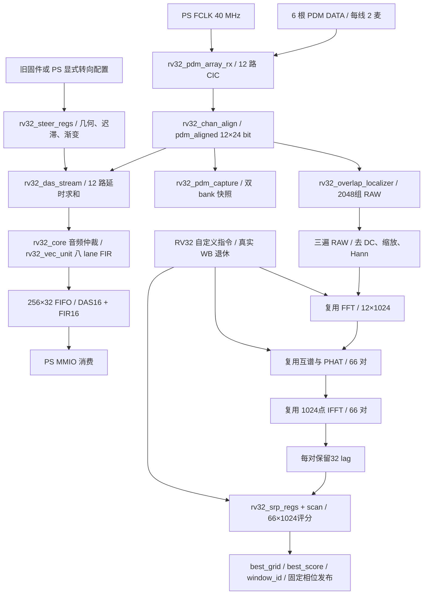

# M0 工程审计与后续阶段门槛

日期：2026-10-15。主依据：用户 Downloads 中《声源定位与DAS优化并为GSC留出接口.md》V2.0，以及本次直接读取的 RTL、软件、XDC、JSON、实际历史日志和 routed 报告。

结论：**M0 已完成代码路径和证据审计；整个 M1–M5 工程状态为 PARTIAL。没有修改 RTL、固件、生产几何、现有约束或旧验收产物。后续等待用户确认。**

## 1. 版本与审计边界

- 当前 HEAD：`117e731385a739a9870f9ab4611ec2456e1416b3`，工作区根为 `D:/Users/xyfhhh/Desktop/PDM`，实际源码树为 `zynq_-pl_-simd_-verilog`。
- 同级 `zynq_-pl_-simd-verilog` 为另一目录，不作为本轮开发树。
- 开始时 Windows Git 的 `status --short` 为空。审计只新增本报告和 `scripts/audit_m0_20261015.py`，测试及清单写入独占新目录。
- WSL Git 把大量既有文件显示为修改，而 Windows Git 没有对应修改；这是本次发现的跨平台 Git 状态差异，原因尚未进一步确定，不能据此清理或还原文件。保护依据为文件字节 SHA256，Windows 状态另行留档。
- 本轮新执行的是几何门控、控制器边界、XDC 生成检查及哈希检查。未重新执行 1024 窗算术长跑、183 场景、XSim 或 Vivado；下文明确列为历史证据复核。
- 产物根：`build/zynq12_integrated_plan/audit/m0_20261015/`。审计脚本拒绝覆盖已存在的输出目录；重新运行必须换目录。

## 2. 当前真实架构



**图中的 RESULT 没有直接连到 STEER：当前连续调度固件不提交转向，不能把旧路径能力画成已完成的新联动。**

### 2.1 输入与时钟

`rtl/soc/rv32_soc.v:9` 默认 `DAS_ACTIVE_CHANNELS=12`；`PDM_CHANNELS=12`、`PDM_MICS_PER_LINE=2`、`LOCALIZER_ACCEL=1`。输入是六根 DATA，不是十二根线。`rv32_pdm_array_rx` 用相位 A/B 解复用，逻辑通道 `2k/2k+1` 对应线 k 的两相位；这仅是电气顺序，并非真实空间坐标映射。

40MHz / 16 = 2.5MHz PDM，CIC decimation=64，因此同步 PCM 为 39,062.5Hz，每组 1024 个 PL 周期。`pdm_aligned` 为 288 bit，`pdm_valid_aligned` 为整组有效脉冲，没有对采样端的 ready 反压。仿真宏可绕过 PDM/CIC，直接注入 PCM：此类验收不能替代真实 PDM 接收电气验收。

定位与 DAS 的主数据通路均在 `clk_i` 40MHz 域，PS GP0/AXI 在当前工程也接此域；PDM_CLK 是分频输出，不应误当内部另一个运算域。未来 PS-GSC 流接口尚未建立，不能预先宣称其 CDC 已验收。核心多处异步复位与 RAM 同步控制复位并存，后续局部恢复必须逐模块界定。

### 2.2 DAS 与八 lane FIR 的关系

`rtl/soc/rv32_soc.v:419` 明确实例化 `rv32_das_stream #(.ACTIVE_CHANNELS(DAS_ACTIVE_CHANNELS))`，因此当前顶层确有十二路 DAS。模块自己默认参数仍为 8，头部仍写“Eight independent histories”，属于过时注释，不能据此认定顶层只有八路。

`rtl/beamformer/rv32_das_stream.v` 的实际计算：

| 项目 | 当前行为 | 审计结论 |
|---|---|---|
| 输入缩放 | `pcm_i[m*24+8 +:16]` | 取 24位 PCM 的高16位，低8位直接舍弃 |
| 历史 | `CHANNELS*64` 个16位样点 | 十二路为768×16；同步读，顺序写/读，未复制十二套 FIR |
| 延时 | `snap[21:16]` 整数，`snap[15:12]` 小数 | 配置外观 Q16，实际只用4位小数，1/16样点精度 |
| 插值 | `v0 + ((v1-v0)*frac >>>4)` | 两点线性插值，不是高阶分数延时滤波器 |
| 范围 | 拒绝 `delay>=0x003f0000` | 支持 [0,63) 样点，首期缺少历史补零 |
| 求和 | signed 21位 sum，十二路专用 `/12` | 已有十二路归一化；具体舍入、负数偏差须独立 golden 验证 |
| 输出 | `average[15:0]` | DAS 此处无显式饱和，合法线性插值/平均的幅度有界仍须满幅验证 |
| FIR | 单路 DAS 进入 core 音频仲裁 | `rv32_vec_unit.v:69` 固定8 lane；core `len=3`，为32 tap，lane不是麦克风 |
| FIR 定点 | `vec_hw_result >>>15` 后饱和16位 | 与 DAS 本体的截断/归一化应分开比较 |
| FIFO | 256×32，`{fir_result_i,das_q}` | 没有逐样点 sample_seq、方向版本或群延时标签 |
| 忙时输入/FIFO满 | 显式 `drop_q` 和 `error_q` | 不反压采样；不能宣称任意消费停顿无损 |

状态流为 WRITE → READ0/WAIT0 → READ1/WAIT1 → ADD/插值累加 → 平均 → EMIT → FIR。`fir_valid` 在 EMIT 保持直到 `fir_ready`，之后等 `fir_done`。历史 RAM 是当前顺序共享端口结构，应检查推断及地址/数据同步，而非先行复制计算引擎。当前历史证据音频最慢101拍，小于每组1024拍，但该数字不包含未来更高阶插值和方向切换代价。

### 2.3 定位数据搬运与计算规模

`rtl/array/rv32_overlap_localizer.v:47`：RAW `12288×32 bit = 2048组×6字`，每字打包两路 signed16 PCM，与 DAS 使用同样的高16位截取。窗口1024、Hop512；`window_primed` 区分首窗与计数器回卷。

三遍读取用于统计、范围/定标和 Hann 准备；prepared 打包 RAM、频谱 cache、PHAT缓存及 SRP 相关环各有独立时序。完整1024 FFT 并不意味着缓存或 PHAT 使用全部1024频点：现有通带缓存为 bin6..213 共208点，IFFT 其余频点按既有格式补零。保留的是完整1024点变换、十二路 FFT、66对互谱/PHAT/IFFT及1024格评分，不应把32 lag相关环误写为32点 IFFT。

调度模块只搬运和提出请求。`sw/fw/fw_localizer12.c:21` 起读取请求票号，执行 FFT/IFFT、互谱、PHAT、SRP 自定义指令；core 实际退休事件与完成通知维持所有权。十二路配置的 `ACOU_LANES=4` 是复数声学算子的并行度，和实数音频 FIR 的八 lane 是两个参数，后续不得混改。

`rv32_srp_regs` 在此配置为 N_PAIR=66、N_GRID=1024、R_LEN=32、IDX_W=5、FRAC_W=4，支持分数相关插值。选峰后等待固定发布相位，`best_grid` 是索引，未确认几何时并非已验收的方位角/俯仰角。

### 2.4 转向、原子性与故障现状

`rv32_steer` 查带符号延时 LUT，构造公共因果延时补偿；`rv32_steer_regs.v:270` 之后存在候选/保持/释放迟滞，Q_STEP 算步长，Q_RAMPW 同拍更新所有 `comp_out`。DAS 在 IDLE 接收音频组时一次快照整个向量，自动模式要求 locked 且 !busy。这提供了组内延时一致性的基础，不能称为完全没有平滑机制。

不过该渐变按转向触发事务推进，并非已证明的逐音频样点平滑；没有 `direction_version/effective_sample_seq` 契约，没有与本轮故障有效性统一的方向门控；当前连续定位固件未发转向指令。手写多个延时寄存器也没有完整的 shadow/commit 事务保证：若跨采样组写入，可能快照到部分新配置，需 M3 专测。

定位已有 source_gap、window_busy_loss、raw_overrun、sticky failed 和 run_ok 隔离；故障停止发布，CPU 还检查 RAW/window drop。禁用重启会清采样会话和预热，**不会解除 failed**，需复位。没有保留累计故障历史的 QUIESCE/REARM/WARMUP 受控恢复协议。DAS重新使能还涉及共享 FIR 历史复位边界。不能把清计数器或普通 reset 宣称为已实现自动恢复。

## 3. 已实现、缺失及未知矩阵

既有测试几何 `scripts/gen_pdm12_test_srp.py` 为三个坐标平面上每面4点，面内坐标取0.01/0.03m；仅作为合成阵列。测试网格为32个方位角（步进11.25°）×32个俯仰层（-90°到+90°，步进180/31°），共1024槽；两极各32个方位槽对应同一单位方向，因此只有962个不同的物理方向。M1应明确极点并列峰和量化误差，不能把“1024槽”直接解释为1024个均匀球面独立方向；保持1024计算规模不要求虚构角分辨率。现有数字测试的信号延时与此坐标配置也不能默认是同一物理声源生成。

| 功能 | 实现现状 | 验证边界/后续缺口 |
|---|---|---|
| 十二路 PCM/DAS | 已实现于当前顶层 | 有合成输入音频计数证据；无真实十二麦同步测量 |
| 八 lane 32 tap FIR | 已实现，须保留 | 与十二路延时求和分层，不能替代 DAS 质量评估 |
| 完整定位计算规模 | 已实现 | 历史 host C/RTL 数值验收，不等于声场精度 |
| 1024窗非周期/RAW标签 | 已有历史通过日志 | 本轮未重跑；覆盖约13.445秒输入，不是实板长跑 |
| 183场景压力 | 已有分类结果 | 超时与显式损失不计实时 PASS |
| 合成几何 LUT | 已有 TEST_ONLY 生成器 | 现有数值输入不构成完整物理到达时延声场基准 |
| 真实 XYZ/通道空间映射 | UNKNOWN | production_array.json 字段为 null/false，继续关闭 |
| 独立三维声场与角误差分布 | 未完成本计划验收 | 缺 off-grid、多源、混响/SNR、几何歧义矩阵 |
| DAS高阶插值/频带质量 A/B | 未完成 | 当前只有两点线性，缺独立带宽/相位/SNR定量结果 |
| 转向迟滞/渐变/组快照 | 已有基础机制 | 缺版本事务、音频瞬态阈值及连续定位联动验收 |
| 故障自动恢复 | 未实现完整协议 | 默认禁用；先显式确认恢复并保留故障证据 |
| 十二路 RAW访问 | 既有 snapshot/RAW协议 | 不等于独立连续PS-GSC同步旁路 |
| GSC主波束+PCM+方向契约 | 未完成 | das_audio_contract.h 仍为8路、0x700预留且注明旧bit不存在 |
| UDP / 完整 PS GSC | 本轮排除 | 不开发 |
| 板级声场定位/音质/长期运行 | DEFERRED_HARDWARE | 历史合成TEST算术上板记录也不能替代 |

## 4. 历史证据复核与定量基线

主基线使用 `build/localizer12_safety/release`，不混用 `final`。审计脚本输出历史统计及日志存在性，源码清单另逐字节对照。

| 指标 | release历史值 | 适用口径 |
|---|---:|---|
| 非周期正常窗数 | 1024 | 37748736次 RAW 检查，seed20261015 |
| raw_drop / window_drop | 0 / 0 | 该正常场景 |
| 结果间隔 | 524288拍 | 1023个间隔，13.1072ms |
| 最大计算 | 323587拍 / 8.089675ms | 非周期输入；不能与不同输入旧报告作单一因果 A/B |
| 最后样点至发布 | 393217拍 / 9.830425ms | 不是完整声学端到端延时 |
| 音频 in/out/drop | 525184 / 525184 / 0 | max101拍；计数正确不等于转向音质通过 |
| 正常最小 RAW覆盖余量 | 956065拍 / 23.901625ms | 不等于最大HALT保证值 |
| 已测最小固定相位停顿临界 | 69631拍 / 1.740775ms | 特定SRP注入点；不是全相位数学保证 |
| 粗压力183场景 | 128按时 / 2超时正确 / 53显式损失 / 0 ERROR | 只有128可归按时成功 |
| `final` 另套1024窗 | 最大323570拍、余量956082拍 | 单列保留，严禁拼接到release A/B |

可直接检查的原始记录：`release/normal_fft_0_w0_o0_n1024_s20261015_b0.log` 最后一行为 SAFETY_SUMMARY，各窗前有 RAW与发布时刻记录；`release/matrix_summary.json` 为逐场景分类。所有上述值都是本轮读取的历史证据，不标“本轮重跑PASS”。

`build/localizer12_safety/final_implementation` 中 Vivado 2020.2 routed 报告确认：

| 指标 | 当前历史实现 |
|---|---:|
| PART | xc7z020clg400-1 |
| clk_fpga_0 | 25ns / 40MHz |
| WNS / WHS | +0.869ns / +0.033ns |
| TNS / THS | 0 / 0 |
| LUT / FF / LUTRAM | 29781 / 16856 / 2884 |
| BRAM36等效 / DSP | 111.5 / 132 |
| BRAM剩余 / DSP剩余 | 28.5 / 88 |

这是既有完整实现证据，不是 M2–M4 新逻辑实现结果。`source_manifest_comparison.json` 给出它与当前 RTL 的匹配情况；构建HEAD不同必须靠逐文件哈希核实，不因提交号不同就认定RTL失配，也不因RTL匹配就认定ELF和LUT来源全部匹配。

逐字节核对实际结果：最终实现源码清单 **58/58匹配**；release仿真源码/监测器清单 **61/61匹配**；旧final清单 **59/61匹配**，不同项为 `rtl/core/rv32_core.v` 和 `rtl/soc/rv32_soc.v`。因此旧final的323570拍不能作为当前RTL的性能值。

固件构建清单 **102/103匹配**，不匹配的是 `scripts/build_live12.py`。本次查看 HEAD 相对前一提交的差异，包含持续运行 windows=0、独立 --output 和 --transfer-source 等构建入口变更；固件清单不是整体“完全匹配”。现有ELF可散列保留，但后续仍须以当前构建脚本在新目录重建并绑定ELF/ROM，而非覆盖旧清单消除差异。ELF自身与旧manifest哈希的核对另存 `delivery_review.json`。

### 4.1 约束与时序边界

建工程脚本 `scripts/create_zynq_project.tcl:19` 固定上述 PART，`:102` 设40MHz，`:521` 起通过 profile 生成纯 XDC。当前 final_zynq/generated_constraints/ps_pl_wrapper.xdc 含六根 DATA 引脚及 V16时钟输出，并将 PDM输入设 false_path。

timing_zynq.rpt 显示 no_clock=0、内部未约束端点=0，但仍有 no_input_delay=6、no_output_delay=4。故 WNS/WHS收敛证明内部约束范围，不能写成全部外设 I/O 时序闭合。PDM异步外部输入的 false_path、相位采样假设和真实麦克风驱动建立保持需要专门复核，M5不能用 false_path 掩盖新CDC。

## 5. 主要风险及资源预算

| 级别 | 风险 | 后续处置 |
|---|---|---|
| P0 | 测试几何/数值正确被包装成真实DOA | 配置TEST_ONLY隔离，真实几何继续关闭；M1独立声场与off-grid验证 |
| P0 | 切换方向与音频样点不一致、错误结果重新生效 | M3定义版本、窗口、sample生效点和异常门控，先锁验收 |
| P0 | CPU停顿/RAW所有权/WB退休修复倒退 | 保留现有机制，复用前反例及183场景，不单改ready |
| P0 | 不同build证据混用 | baseline按manifest和路径绑定，A/B同输入同固件同参数 |
| P1 | BRAM仅余28.5等效，新增大缓存挤占布线 | 优先复用历史与算子；额外存储先做综合预算 |
| P1 | 线性插值高频幅相误差、截断与负数偏差 | M2浮点/定点分层比较，不能用音量增加冒充SNR提高 |
| P1 | 手动逐通道配置跨组撕裂 | M3 shadow/commit或等价原子事务，记录实际生效组 |
| P1 | 只reset恢复导致丢故障历史/事务残留 | M4显式恢复、累计计数、完整1024点预热，自动模式默认关 |
| P1 | PS慢消费导致音频FIFO溢出 | GSC旁路独立隔离/显式丢失，绝不反压定位 |
| P1 | 32lag覆盖真实阵列未知 | 几何到位后核对最大TDOA和插值邻点，不能以缓存容量推断 |
| P1 | 旧接口固定8路/预留寄存器未实例化 | M4建立可仿真契约，不擅自把头文件当硬件能力 |

增量资源估算只作容量分析，不能当综合测量：当前DAS历史768×16=12288bit；多一份相同历史逻辑容量再增加12288bit，物理BRAM取决于推断。十二路同步16位PCM吞吐为937500 byte/s；另一路16位主波束为78125 byte/s；总原始有效负载约1.015625MB/s，不含元数据。保存一个512组PCM块需12288字节，理想容量至少3个BRAM36；双缓冲至少6个，实际宽深/端口分割可能更多。高阶滤波和淡化的DSP增量当前为UNKNOWN，先比较时间复用方案，不承诺零资源增量。

既有66×1024×9bit SRP延时表逻辑容量为608256bit；复制一份会显著消耗余量，因此M1只在隔离目录生成测试LUT，后续优先复用既有表。不得复制66套GCC引擎换取表面实时性。

## 6. M1→M5详细顺序与预先验收标准

所有阶段先保存 baseline_config.json、seed、输入/模型/源码哈希、验收阈值，再跑模型和必要的RTL修改。尚未测得的品质数据留UNKNOWN，不在结果出现后调整阈值。

| 阶段 | 顺序与工作 | 开始前锁定的标准 | 退出证据 |
|---|---|---|---|
| M1 | 定义坐标/角度符号→非退化12麦三维及平面/线阵对照→物理分数TDOA信号→独立浮点GCC/SRP→定点参考→RTL逐格比较 | 固定Fs/c/量化/seed；1024格角覆盖与最大量化误差先计算；预定SNR/混响/多源/off-grid矩阵和各自P50/P90/P99/最大误差阈值 | TEST_ONLY几何JSON、独立golden、逐场景CSV、分布图、LUT/输入hash、可观测性解释；真实生产几何仍关闭 |
| M2 | 当前两点线性A→整数延时对照→低阶B→仅选一种Farrow或多相C软件候选→资源预算→必要RTL | 先确定目标频带；逐样点位精确或明确LSB容差；满幅不溢出、0丢/重复；目标幅值与SNR分别验收；正常处理<1024拍/组 | A/B/C幅相、延时、失真、SNR、RTL逐样点及资源对比；无足够收益不强制合入C |
| M3 | 定义方向事务→测试模式结果到延时映射→shadow/commit→原子生效→渐变/短淡化择一→异常阻断 | direction_id/version/effective_sample_seq和ACK语义锁定；版本撕裂0，丢/重复0，失效方向放行0；瞬态幅度/短时能量上限在仿真前存配置 | 大角跳变、峰值/过零、每Hop抖动、同拍更新/复位测试及波形；生产自动转向继续门控 |
| M4 | 256窗快速→1024窗非周期→183压力扩展→受控恢复→GSC仿真sink→4096窗和回卷边界 | 正常raw/window_drop=0；无RESULT_AFTER_LOSS；压力四类单列；恢复保留首次现场和累计缺口，完整1024预热；sink反压不得影响主链 | 每场景JSON/CSV、恢复状态轨迹、实际覆盖时长、12PCM/主波束/方向时间对齐和溢出策略；自动恢复默认禁用 |
| M5 | 全功能/CPU/访存/自定义指令/FIR回归→原生XSim→全系统综合opt/place/route→BRAM/CDC/时序审计→manifest | 保持12/1024/512/66/1024与40MHz；正常1024窗全golden、1023间隔524288拍；WNS/WHS≥0、TNS/THS=0；同配置A/B | routed报告、资源差值、最坏计算及发布延时、全部脚本日志、bit/XSA/ELF/LUT绑定manifest；未跑项明确PARTIAL |

角误差、DAS目标频带、品质提升幅度及转向瞬态数值阈值目前没有足够声场基线，**留待各阶段开始时在首次正式测试前锁定**；M0不凭空发明“角误差已达标”。固定相位发布延时393217拍作为当前A值，新设计如更改必须解释并重新核对Hop截止及RAW所有权；不能暗中放宽实时要求。

### 6.1 经审计存在的复现入口

在源码根通过WSL执行，所有输出选择新目录，禁止复用旧release写入路径：

```sh
# 本轮M0，可重复运行但必须换输出目录
python3 scripts/audit_m0_20261015.py --output build/zynq12_integrated_plan/audit/m0_replay_NEW --checks
# 下列为后续阶段入口，本轮未执行
python3 scripts/check_localizer12_safety.py --windows 256 --output build/zynq12_integrated_plan/safety256_NEW --report-name baseline256
python3 scripts/check_localizer12_safety.py --windows 1024 --output build/zynq12_integrated_plan/safety1024_NEW --report-name integrated1024
python3 scripts/check_localizer12_safety.py --matrix --jobs 3 --output build/zynq12_integrated_plan/stress_NEW --report-name matrix
python3 scripts/check_rv32_mem_regression.py --output build/zynq12_integrated_plan/rv32_NEW
```

注意：上述 safety脚本目前仍使用部分共享固件输入路径，不能仅靠传入--output就认定完全隔离。后续正式重跑前应先核对/隔离所有固件、oracle和wrapper输出，保留M0哈希清单。`check_localizer12_safety_units.py`、`check_pdm_constraints.py` 原入口也写固定旧目录，本轮由审计包装器仅重定向输出后运行，未覆盖原结果。

原生XSim已有 `build_live12.py --transfer` 及 `check_live16_xsim.ps1 -Transfer` 入口；Vivado已有 `ZYNQ_PROJ_DIR/ZYNQ_OUTPUT_DIR`、`DAS_ACTIVE_CHANNELS=12`、`LOCALIZER_FLOORPLAN=1` 及禁用resume的全流程。M5执行前检查参数、实际输入manifest和无并发Vivado，不能只看进程退出0就标成功。

## 7. 本轮交付与验收解释

实际执行结果：

| 检查 | 本轮结果 | 证明范围 |
|---|---|---|
| `check_pdm12_geometry.py` | PASS | 66对唯一性、生产几何禁用、测试隔离、非法lag/插值邻点拒绝 |
| 控制器 rollover / sessions / collision | 3项PASS | Icarus RTL控制器单元测试，FFT等算子为桩，不代表真实算术全链 |
| `check_pdm_constraints.py` | PASS | 12路六DIN、16路八DIN的纯XDC生成及非法控制流拒绝 |
| 既有文件字节保护检查 | PASS | 3458个文件检查前后SHA256均相同，非副本备份 |
| 1024窗/183场景/XSim/Vivado全流程 | 本轮NOT_RUN | 仅复核已有日志和报告，未再次执行 |

`release` 的256窗、1024窗和183场景汇总所指日志均存在，无缺失日志；汇总中的历史PASS不自动升级为本轮全系统通过。当前阶段整体工程仍标PARTIAL。

- 修改文件：新增审计脚本及本报告；无RTL/固件/约束优化，因此“优化前后性能差值”为不适用，不能把历史差值记成本轮收益。
- 本轮发现的问题：八路历史描述已过时；final/release测量有差异；转向基础机制存在但新链路无版本化联动；GSC头文件仍8路/预留；PDM I/O时序不由内部WNS证明；跨平台Git状态存在差异。
- 本轮修复范围：通过新报告和绑定清单纠正认知及证据归属；以上功能缺口未擅自修改RTL。
- 实际新执行结果以 `checks.json`、各 `.log` 和 `baseline_preservation.json` 为准，不以本报告文字替代实际返回结果。
- `protected_artifacts.json` 保存源码、ROM、软件及已有bit/XSA/ELF/log/manifest的SHA256，`source_manifest_comparison.json` 核对历史构建来源，`historical_evidence_review.json` 复核场景分类和日志存在性，`source_anchors.txt` 提供信号文件行号索引，`audit_manifest.json` 绑定本次产物。
- 历史保护清单不宣称每一个被散列的旧artifact都曾验收，也不等于复制备份。未知构建链继续保留UNKNOWN。
- M0完成后停止在此，待用户确认后从M1开始，不提前开展大规模RTL修改。所有实麦、真实声场和板级长期验收标为DEFERRED_HARDWARE。
