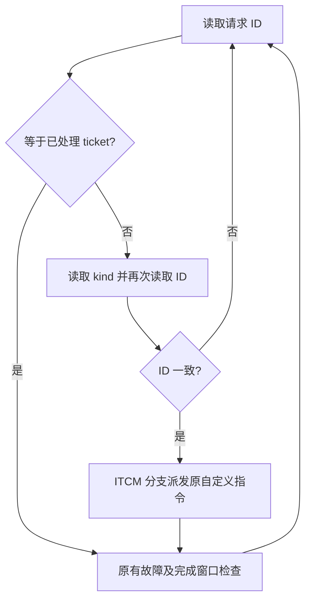

# M10：有实测 profile 的固件派发优化

正式结果以 `build/m10_20261016/acceptance.json` 与 `release_manifest.json` 为准；文件生成前本阶段仍在验证。器件配置 `xc7z020clg400-1`，40MHz。真实芯片后缀、PDM 电气窗口、生产几何、PS/DDR/网口实时吞吐及声学效果继续 `DEFERRED_HARDWARE`。

## 范围和保护边界

本任务主动实施的生产优化为 `sw/fw/fw_localizer12.c`，测试环境另修正 `tb/tb_localizer12_safety.v` 的 PHAT 接受条件。并行任务的 PS 采样诊断所有权检查、可选 RAM overlay 入口及外部窗口工具也按用户确认保留合并，区别列于清单。CPU 五级流水、自定义指令语义、八 lane SIMD、FFT/PHAT/SRP 算术、DAS 三阶插值、方向原子更新、DMA/UDP/GSC 实现及生产配置均未改。12 路 / 1024 FFT / 512 Hop / 66 对 / 1024 格保持。

开始前完整核验 M9 发布清单 3585 文件、221739994 字节；`before_sources.json`、`before/fw_localizer12.c`、`before/tb_localizer12_safety.v` 保留原始输入。M9 的源文件哈希描述的是当时版本；本阶段明确登记上述两个文件的变化，不把新源码与旧固件镜像混同。

16:00 的核验发现并行任务追加了六项工具/诊断改动。`audit_m10_concurrent_merge.py` 对 Python 默认路径移除未启用的 overlay 分支后核对旧 SHA256，对 Tcl 默认路径恢复原字节（含行结束符）后核对旧 SHA256；历史源码副本放入 before，不修改当前文件。新实验分支未启用，本次综合日志也没有 overlay 启用标记；当前验收覆盖默认12路配置。外部窗口审计仍使用此前冻结的模型副本。PS 诊断新增银行读取后的序号复核、拒绝释放检查和错误退出；12个协议用例及ARM编译通过，原版四个缺陷由相同测试独立检出并保留。并行改动不冒充本任务固件优化的收益。

并行追加的支持文档保留旧清单哈希及当前快照，未替换旧测试报告或网表。新增 `pdm_external_assumptions.json` 不属于此前综合输入；逐项验证其假设与本轮冻结分析一致（tDV100ns/tHZ5ns、CLK/DATA走线各0..3ns、不确定度2ns）。它标记 ASSUMED_NOT_MEASURED，不改变当前硬件或生产坐标。源码、二进制及数值验收证据仍逐文件验证，文档版本变化单独登记。

## 先测量，再改动

`scripts/profile_localizer12.py` 在完整 SoC 安全测试上增加仿真探针，只修改输出目录中的 wrapper/CPP。数学仍由真实 RTL 执行并对独立 C Golden 检查；RTL 生产源码没有插入计数器。

测量包括：真实退休事件和 PC、活跃运算期间 PC、已应答 MMIO 事务、实际非 MMIO RAM 请求和等待、取指/运算等待、状态驻留、211 条每窗算子的派发延迟、FFT 状态、八 lane VRED 发射、RAW 有效双端口访问/同址冲突、SRP busy。重叠等待计数不视为互斥分类，不将未阻塞真实 RAM 请求的周期称作 DTCM 压力。

8 窗口原版测得：

- 12 正 FFT、66 逆 FFT、66 互谱、66 PHAT、1 SRP / 窗；调用总数 211 / 窗。
- 1728 次 DTCM 请求及 1728 拍等待，其中 1688=211×8 次是派发跳转表读取，40 次是结果写回。全阶段等待并不由 DTCM 主导，未修改其握手。
- 算子派发共 59742 拍；FFT/AC 实际等待共 650880 拍；SRP busy 共 544896 拍，即 68112 / 窗。
- 4992 个音频输出、159744 个 MAC 槽，即每样点固定 32 MAC；八 lane 每样点发射 4 批，约占 1024 拍的 0.391%。这是物理发射槽统计，包含零系数/热身，不是非零有效乘法或功耗估计。
- 1728 拍 RAW 读写并行，同址冲突 0；RAW/preprocess 状态平均 73750.75 拍/窗。
- PC 与 MMIO 热点明细保存于 `profile_pc.csv`、`profile_mmio.csv`；各模块驻留和派发分布保存于 `profile_states.csv`、`profile_dispatch.csv`。

各组状态的平均拍数（包括该阶段 IO 与 CPU 派发，不等于纯算术内核耗时）：

| 阶段 | 原版 | 最终 |
|---|---:|---:|
| RAW/preprocess | 73750.75 | 73750.75 |
| 正 FFT 的 IO/运行/输出 | 23807.00 | 23690.00 |
| 互谱 IO/运行 | 33461.75 | 33014.50 |
| PHAT IO/运行 | 26668.00 | 26280.50 |
| 逆 FFT IO/运行 | 93324.00 | 92601.75 |
| SRP 与评分回读 | 70190.00 | 70196.00 |
| 固定发布相位等待 | 69763.50 | 71431.50 |

## 实施和独立 A/B

原循环每次读取 id→kind→id，再检查故障和窗口。新循环先读 id，只有 ticket 变化时才读取 kind 并再次校验 id；故障和完成窗口仍每轮检查。RTL 在 RUN 入口增加 ticket，rearm 保留 ticket；uint32 回绕后新 ID 与上一个 ticket 仍不同。没有移除 volatile 或自定义指令的 memory clobber。

GCC 原本为五项 switch 生成 DTCM 跳转表。对 main 使用 `optimize("no-jump-tables")`，使分支保留在 ITCM。编译工具链仍为项目 GNU RV32，五个自定义指令编码均保持。



先在 `candidates` 建立独立源码，逐项跑 8 窗口完整算术检查；只有测得收益才写入正式固件。每个候选均保留源码、镜像、ELF、CSV、日志及哈希。

| 候选 | 最坏 compute 拍 | 8 窗派发总拍 | DTCM 请求 | 退休指令 |
|---|---:|---:|---:|---:|
| 原版 | 323462 | 59742 | 1728 | 2685052 |
| 仅 ID 优先 | 322846 | 55358 | 1728 | 2511134 |
| 仅移除跳转表 | 321904 | 46924 | 40 | 2660554 |
| 合并并写入正式源码 | 321791 | 46926 | 40 | 2512582 |

相同 8 窗输入节省 1671 拍，0.5166%，在 40MHz 下为 41.775µs。退休指令减少 6.4233%；ITCM 文本 448→468 字节，增加 20 字节；DTCM .data 24→0 字节，HEX 仍按装载格式保留至少一个零字。物理 ITCM/DTCM 容量及 BRAM 没有缩减。

代价：MMIO 应答从 1059770 增至 1111016，增加 4.8356%；更快轮询使内存/取指等待计数上升。SRP 与评分回读阶段略增 6 拍/窗，其他阶段收益大于该增加。没有据退休数下降宣称功耗降低。FFT/AC 等待、SRP busy 和全部算术调用数量不变。

固定结果发布偏移保持 393216，外部发布延迟仍为 393217 拍；Hop 524288 拍和输出采样率不变。计算提前完成增加的是发布前余量，未宣称端到端发布延迟下降。8 窗 A/B 与 1024/4096 窗最坏值分开统计，完整回归值见 acceptance.json。

## 压力回归发现并修正的测试问题

首轮 1024 正常窗通过，但压力矩阵有 9 个 `PHAT_GOLDEN` 错误，全部位于相同过载边界。该轮 `m10_regression_20261016` 不计验收，未完成的 4096 回放也不计通过。

`diagnose_localizer12_boundary.py` 增加观察端口，在报错周期 1640454 直接测得：

```
loss_now=1 run_ok=0 ac_start=0 ac_fire=0 phi_check=1
```

窗口已经组合判定过载，生产 RTL 禁止接受 PHAT 事务；sticky window_drop 在下一时钟才可见。旧 testbench 用 `state==H_POP && ready` 误把未接受数据当成有效结果，CPU 调度提前后触发了这一采样错误。生产 RTL 原有失效保护没有修改。

最小修正只把 phi_check 改成 `state==H_POP && ac_start && ac_ready`。Golden 数值比较、正常每窗完整覆盖和实时分类规则全部保留。旧 bench 及失败日志保留于 before / boundary_diagnosis；诊断脚本使用旧 bench 副本可继续重现原错误，不回滚当前文件。

`check_localizer12_checker.py` 故意翻转实际被接受的 PHAT 观测的一位，必须在 `first_loss=0` 时触发 `PHAT_GOLDEN`；该负例通过，证明有效数据的检查仍能失败。重跑原版和最终版的健康 profile，全部计数、派发分布和状态驻留与修正前完全相同，记录 `normal_checker_equivalence_verified=true`。

正式全回归从头重建于 `m10_regression_v2_20261016`；未把 9 个错误改写成 PASS，也未跳过场景。额外测试包括 ticket CSR 偏移 `0xfffffff0` 跨回绕、300000 拍同一过载场景、真实 DMA 永久 AW 阻塞隔离及 4 个校准 RTL 回放。

## Vivado、资源、拥塞和功耗口径

新工程 `m10_impl_20261016_project` 完成综合、布局布线、bit/XSA；仅生成文件，未烧写。资源与 M9 启用 DMA 的配置完全一致：36156 LUT、20515 FF、111.5 BRAM36、133 DSP；WNS +0.919ns、WHS +0.020ns，TNS/THS=0。相对 M5 的资源增长来自 M9 的 DMA 和合入 PDM 改动，不归因于本次固件优化。

关键路径为 DAS 的 `snap_reg[9][15]` 到 `sum_reg[19]`，逻辑深度 28，数据路径 23.519ns，其中路由 12.532ns。`congestion.rpt` 未记录超过 level 5 的拥塞窗口。没有用该报告声称 SIMD 或 CPU 五级流水必须重写，也未调整时钟频率。

`audit_m10_routed.tcl` 重新检查 part/pin/clock/CDC、内部未约束端点、DATA/CLOCK datapath 预算，以及独立资格时钟的外部 setup/hold 正例与负例。外部板级延迟仍是假设，分析 XDC 仅在独立会话使用，不加入生产工程，不写回 DCP。

工具运行了 M9/M10 的 vectorless `report_power`：均为 1.917W、估计结温 47.1°C、Confidence Low。没有 SAIF 或固件实际切换活动，不能区分本次轮询变化的动态功耗，也不代表板上功耗或温升实测。

WHS 比 M5 少 0.003ns，余量很小；与 M9 相同，未因固件优化改变。器件报告只支持配置的 XC7Z020，不能外推 XC7Z010。

## 构建和复现

```powershell
wsl python3 scripts/profile_localizer12.py --firmware build/m10_20261016/before/fw_localizer12.c --output build/new_m10_before --windows 8
wsl python3 scripts/profile_localizer12.py --output build/new_m10_after --windows 8
wsl python3 scripts/check_localizer12_request_wrap.py --output build/new_m10_wrap --windows 8
wsl python3 scripts/check_localizer12_checker.py --output build/new_m10_checker_negative
wsl python3 scripts/diagnose_localizer12_boundary.py --output build/new_m10_old_failure
wsl python3 scripts/run_integrated_validation.py --tag new_m10_regression
wsl python3 scripts/build_live12.py --transfer --windows 0 --hot-o2 --output build/new_m10_rv32
```

正式 `rv32_release` 为连续运行的 TEST_GEOMETRY_ONLY 固件，配套 `itcm.hex`、`dtcm.hex`、ELF、装载头文件及 build_manifest；与最终仿真镜像逐字相同。RV32 控制程序通过 PS 装载独立 ITCM/DTCM，本轮只生成和验证镜像，未执行硬件装载。生产几何仍为空，未以测试 LUT 启用真实定位。

匹配新 XSA 的 Vitis BSP 前两轮因 Windows 文件占用，内部重新生成 BSP 失败。保留两个失败工作区和日志；第三轮使用 `build_stream_platform_v3.tcl`，在 platform generate 前等待 5 秒，生成新目录成功。未改共享工作区、未删除失败目录。`ps_default_release` 与 `ps_gsc_release` 均以匹配的 M10 XSA/BSP 编译链接，代码、标定、缓存协议与 M9 相同，未运行上板。

## 最终验收资料

全量要求包括：528 场景、4 个全 1024 评分的基线物理场景、4 个 M7 校准场景、1024/4096 窗零 RAW/window/audio 丢失、183 压力场景逐项与 M9 比较、9 个 CPU 测试、76 内存测试、8 MMIO 测试、17 严格验收、实际 50000 拍 DTCM 阻塞、19 辅助 RTL、4 窗 XSim、回绕及负例、DMA 隔离。全部满足后才生成 acceptance.json 和最终文件清单；CORRECT_LATE 与 EXPLICIT_LOSS 保持独立分类。

独立验证未修改的 M6–M9 功能通过其原输入/证据哈希继承，M10 全 SoC 又逐样点检查 RAW/DAS/FIR/tap 及方向联动。最新发布清单描述当前源码；旧阶段清单里的固件和 testbench 版本通过 before 副本继续可追溯。

仍待真实硬件验收的内容：芯片完整标记、12 麦接线/供电/启动窗口、坐标/通道映射和标定采集、真实角度和降噪、PS GSC/DDR/网口吞吐及拥塞运行。没有执行 Git 提交、Git 复位/清理、板卡烧写或板卡复位。
