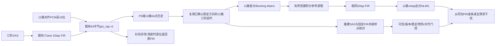

# M8：PS端定点GSC原型——实现前冻结的接口与验收

本文先于M8 Golden/C原型写入。以M7交付和M6完整RTL基线为前提；不把PS软件原型称为已部署板卡功能。M8状态以 `build/m8_20261016/acceptance.json` 为准，没有该文件时为IN_PROGRESS。

## 数据/时间契约



| 数据 | 输入组标签 | 历史年龄/稳定条件 |
|---|---|---|
| tap raw | sample_seq=n，12通道同组 | 接口内无附加PCM延时；已通过channel align |
| 三阶每路 | n | floor(delay_i)+0..3；多项式自身有1样点公共因果延时 |
| DAS | n | 与RTL相同每路Q14对称舍入/饱和、12路平均 |
| FIR波束/参考 | n | 相同32个Q15系数和0..31历史；不可凭空认为固定15.5样点 |
| NLMS | n | 每路参考0..3点；当前输出采用更新前权重 |
| 原型输出 | n | 始终一个输入包对应一个输出，无新增流式样点延迟 |

PS配置提供(epoch, direction_version, direction_id)、实际稳定的十二路Q16延时和固定FIR系数。保留12路输入、11路阻塞参考，每参考4tap，共44个可更新系数。输入不改变既有12/1024/512/66/1024定位规模。BM定义为(对齐ch0..10−对齐ch11)/2，先做差分再用与波束相同的FIR。PS端同时重建DAS/FIR；稳定预热后任一包不匹配即旁路并清自适应权重，不允许用错年龄RAW直接减波束。

tap v1缺少渐变中逐组十二路实际延时。原型**不猜测轨迹**：transition=1、方向不可信、版本/epoch/ID不一致、sample_seq不连续、overflow计数改变、包格式错误时旁路/冻结，重新稳定128组后才允许自适应。128组覆盖最大60+3+31+3的历史需求。异常不会阻塞或修改PL定位、DAS和SIMD主链。

GSC关闭时返回tap word7的高16位原FIR，逐样点相同，不添加音频延迟。重新使能从零权重开始；方向更新后等待外部配置匹配新稳定方向。FIR变更不在v1元数据中，必须受控同步配置；重建比较不能替代真实通道/校准版本的板级证据。

## 冻结的Golden算法/验收

初始候选整数NLMS：Q15权重、mu=8192/32768、epsilon=2^20，能量为44个int16参考平方之和；更新量为mu_q15×error×reference/(energy+epsilon)，除法向零取整。权重逐项限制到int16范围；初始总L1范数上限8.0，超限清权重并旁路。该候选实际未通过，保留原始规范副本、源码和FAIL数据；最终保护与参考调理变化见下文，未降低SNR/目标损失验收门槛。

代表性合成测试在首次正式运行前固定：Fs39062.5Hz、三维TEST_ONLY阵列、300–6000Hz宽带目标/定向干扰、三组方向组合、每组32768样点、固定seed20261016。目标：每组最后8192样点的SNR改善≥3dB、固定最终权重重放隔离目标时目标增益≥−1dB；报告收敛时间、噪声/目标分量、全部失败而非只选成功场景。仅为模型验收，真实声场另行验收。

定点C必须与独立Python Golden逐样点一致；关闭GSC、冻结、错版本、epoch改变、序号缺口/回卷、overflow、转向、错误FIR/延时、强干扰/饱和、系数边界、无效配置均有反例及恢复检查。另用真实DAS RTL+既有八lane SIMD FIR+gsc_tap生成包，验证PS对齐重建及旁路。资源选择以当前PL资源和原型实测主机吞吐/代码体积报告为依据，Cortex-A9交叉编译与板上实际吞吐必须分开，不能把主机速度换算成板上PASS。

## 实际A/B、最终算法与边界

三组原始PCM、方向、FIR和评价区间始终相同，SNR≥3dB、目标增益≥−1dB及目标相对RMS误差≤0.2的标准保持不变。所有失败目录保留。

| 候选 | 三组SNR改善dB | 保护事件 | 结论 |
|---|---|---|---|
| 原差分BM、4tap NLMS、L1≤8 | 1.400 / 0.835 / 1.203 | 7 / 7 / 8次保护重启 | FAIL |
| 改用系数能量界、无参考调理 | 1.597 / 1.284 / 1.505 | 0 / 0 / 0 | FAIL |
| 有界参考调理及系数能量界 | 10.303 / 9.289 / 8.937 | 0 / 0 / 0 | PASS_MODEL |

`conditioning/metrics.json`记录4/8/16/32tap因果最小二乘诊断：原参考条件数约5.3万至13.3万，无约束解需要很大系数。紧凑阵列的差分BM具有低频空间零点，仅堆短自适应FIR或提高保护阈值不能解决；没有通过换成更容易的噪声集制造PASS。

最终BM之后、相同32tap FIR之前，逐参考增加泄漏积分器：`s <- s - sign(s)*ceil(abs(s)/64) + BM`，`r=clip16(trunc(s/4))`。其状态由有界int16 BM输入限制在约±2^21内，静音时会衰减至0；参考饱和显式计数并冻结更新。该滤波只作用于阻塞参考，不改变主DAS/FIR路径。系数仍逐项限制到[−32768,32767]，最终采用sum(w²)≤16×32768²（L2≤4）保护，并在预测前、更新后均检查；比用相关参考的L1和作为发散判据更合理。强干扰、内存系数异常等注入验证清权重、旁路及恢复。主输出饱和、原FIR输入饱和和参考饱和均冻结更新并分别计数。

最终三场景的目标增益分别−0.2983/−0.4002/−0.1030dB，目标相对RMS误差0.03509/0.04930/0.01236；98,304个C输出样点及全部最终44系数与独立整数Golden逐项一致。原始Golden字段convergence_seconds=0.0262144表示连续三个合格1024点区间的**起始时刻**；完整三个区间结束、可确认的时间为0.1048576s，不能把26ms当成在线提前确认收敛。合成模型不是实际语音或板上声场评价。

关闭时三组98,304点逐位等于原FIR；冻结训练后系数不变、输出与固定权重独立卷积一致。测试还包括坏magic/保留位、错误version/epoch/direction/group_delay、未来effective_sample、untrusted、transition、跳号/重复/overflow、错误DAS/FIR、32位序号回卷、恢复时version回卷、关闭重启、系数破坏、最大60+15/16延时、强输入及高增益FIR饱和、非法配置。所有异常保留原FIR输出，恢复在128组预热后进行，不掩盖任何计数。

`tb/tb_gsc12_frontend.v`连接实际DAS、实际rv32_core八lane SIMD FIR和实际gsc_tap，没有FIR算术桩；生成256个真实包，最大音频处理198拍。Python/C重建逐包与真实RTL的DAS/FIR完全一致，C自适应输出与Golden一致。完整SoC另运行八窗，RAW/window/audio均零丢失；512组方向原子/渐变和tap慢消费回归通过。渐变期间PS原型始终旁路，不宣称运行了缺少元数据的渐变GSC。

## 软件放置、资源及可运行产物

当前PL基线已使用111.5/140 BRAM36等效、33217/53200 LUT，时序余量0.258ns。选择先提供PS定点软件原型，避免在没有收益/资源证据时把44阶自适应和参考滤波塞入PL。状态2928字节；Cortex-A9 -O2模块对象text4664字节，本地静态栈报告process自身208字节（不代表含库调用的整程序栈上界）。本地主机实际批处理约47万至91万组/秒，远高于39062.5组/秒，但这**不是Cortex-A9吞吐实测**。

`sw/gsc12.c/.h`可供PS端消费者显式调用；默认由调用者enabled=0保持旁路。`build/m8_20261016_selftest/gsc12_selftest.elf`是完整可链接的Cortex-A9离线自测ELF，含真实RTL的256包和独立Golden期望值，入口_start、DDR链接地址0x00100000，状态符号gsc12_selftest_status。它仅完成构建，没有下载或运行；仍需要匹配的PS初始化、板卡和后续DMA输入，不能把文件中的PASS常量当成实测结果。生产ARM构建不含GSC12_TEST故障注入函数。

没有新增PL RTL，也没有改动M0–M7生产文件。PL实现按全部输入哈希复用本次M6实际结果（REUSED_IDENTICAL_PL_INPUTS）：40MHz WNS+0.258/WHS+0.023ns、33217 LUT/18165 FF/111.5 BRAM36/133 DSP。没有声称又执行一次相同布局布线，也没有将主机运行速度或ARM链接成功写成板上实时PASS。

## 复现及交付

WSL源码根，新输出目录：

```sh
python3 scripts/evaluate_gsc12.py --integrate-refs --output build/m8_20261016/golden_conditioned
python3 scripts/check_gsc12.py --golden build/m8_20261016/golden_conditioned --output build/m8_20261016/c_verified
python3 scripts/check_gsc12_rtl.py --library build/m8_20261016/c_verified/gsc12.so --output build/m8_20261016/rtl_packets
python3 scripts/check_localizer12_safety.py --windows 8 --output build/m8_20261016/safety --report-name baseline8
python3 scripts/check_integrated_interfaces.py --output build/m8_20261016/interfaces
```

Windows：`powershell -NoProfile -ExecutionPolicy Bypass -File scripts/build_gsc12_selftest.ps1 -Tag m8_20261016_selftest`。ARM编译使用Vitis2020.2的arm-none-eabi-gcc、cortex-a9/vfpv3/hard float；原始compile/size/symbol/stack日志保留。`golden`、`golden_energy_guard`、`conditioning`、`guard_ab_before`、`prefilter_ab_before`、`c_v1`保存失败及A/B证据，没有删除或改写成PASS。

实际PS运算周期、DMA输入后的竞争/实时性、实测标定/几何、真实语音失真和环境噪声改善仍DEFERRED_HARDWARE。该版本只保证已列场景，不能保证任意强目标泄漏、混响和空间分布噪声均达到3dB；生产使能需实体映射/标定及真实数据验收。
