# M9：DDR DMA、PS 环及 UDP 实施

本文配套 `build/m9_merge_20261016/acceptance.json` 才构成阶段验收；不存在该文件时，状态仍是验证中。真实 DDR、PS 实时处理、以太网吞吐和声学效果均为 `DEFERRED_HARDWARE`。

## 合并边界与主链隔离

用户已确认保留并合并另一任务的 PDM 启动及约束改动。本阶段在 `build/m9_merge_20261016/merged_sources.json` 冻结合并输入，保留原 `build/m9_20261016` 的失败、漂移审计与实现快照。没有回滚或覆盖另一任务的修改。

12 路、1024 FFT、512 Hop、66 对、1024 格、40MHz、八 lane SIMD 和生产几何保护门均保持。新增 DMA 接 GSC tap 的独立输出，不参与 FFT/RAW/DAS 的接受条件。DMA 的 stream_ready 恒为 1；队列满、环满、禁用、故障时丢弃传输副本并计数，不背压主链。

```mermaid
flowchart LR
 PDM[PDM 12ch] --> LOC[原定位与方向链]
 PDM --> DAS[原 DAS + SIMD FIR]
 LOC --> DAS
 DAS --> TAP[GSC tap: RAW + 元数据 + DAS/FIR]
 TAP --> Q[独立队列与捕获时间戳]
 Q --> DMA[AXI4 写主机]
 DMA --> HP[PS HP0 64bit / 40MHz]
 HP --> DDR[DDR 128B 槽环]
 DDR --> COPY[PS invalidate / copy / release]
 COPY --> GSC[可选 PS GSC / 默认 FIR 旁路]
 GSC --> UDP[lwIP RAW UDP]
 UDP --> PC[PC 校验与丢包统计]
```



`PDM_STREAM_DMA=0` 为工程默认值，tap ready 接常量 1；`=1` 时启用模块及 HP0，增加 GP0→CSR 分支。主控制地址仍为 `0x43C00000`，DMA CSR 为 `0x43C10000`。PS 网络程序只附接已经运行的匹配 PL，不加载 RV32 固件、不改 FIR、不启动/复位 PDM、不复位任一 CPU、不烧写。未初始化原链路时不会生成伪造音频，统计帧数保持 0。

## PDM 合并后的额外验证

生产接收器默认等待 2,000,000 拍，即 50ms，再等待 4 个 CIC 帧，同时丢弃第一组未完整驱动的相位配对。停止/复位后重新执行。已有 raw 数字对照使用显式零/零诊断参数；生产默认值由 `check_pdm_shared.py` 单独验证，不能把诊断模式的首帧时间当成生产启动验收。

XDC 保持实体引脚不变，用 DATA 5ns 和 CLOCK 10ns datapath 最大值替代旧的整条 DATA false path。路由后检查覆盖六根 DATA 的 12 个端点，CLOCK 路径报告包含 FDCE 的 clk-to-Q。实际 CLOCK 路径 7.537ns，余量 2.463ns；最差 DATA 预算余量 1.014ns。外部预算中的走线、供电、负载和相对时钟偏斜仍是假设；`datapath_only` 不检查 hold，hold 只做条件窗口分析，不宣称完整外部 hold STA 或板级通过。详见 `docs/pdm_shared_timing.md`、`configs/pdm_interface_timing.json` 及本阶段 `routed_audit/pdm_interface`。

另在同一 routed DCP 的独立只读分析会话中，使用被冻结的 `external_window/pdm_external_window.tcl` 建立资格采样时钟模型，保留真实输出 clk-to-Q、输入路径和捕获时钟传播。假设 PCB CLK+DATA 最大共 6ns、tDV=100ns、tHZ=5ns、相对不确定度 2ns：A/B setup 分别 +5.246/+5.279ns，hold +81.277/+80.899ns；dmax 增加 100ns 后 A/B setup 均负，dmin 减少 200ns 后 A/B hold 均负。此分析不是生产约束文件，输出的 ANALYSIS_ONLY_NOT_FOR_BUILD.xdc 未加入任何工程，也未写回 DCP。它补充条件 setup/hold 证据，仍不证明板级条件成立。

14:23 的 XDC 后续改动仅涉及注释。`constraint_equivalence.json` 比较当前模板生成的六线有效命令与实际实现所用文件，逐条完全一致；原实现 source_manifest 保留原输入哈希，没有改写。配套 PS 启动诊断改为先有界等待首次 PCM 再计量短窗口，正常/死采集 mock 以及 ARM 编译均通过；引脚检查含负例。M5 的报告、二进制和其他证据保持，源码及四份支持文档的授权变更另列入 `m5_changed_paths.json`，不宣称旧发布清单与新工作区字节完全相同。

## 所有权与错误恢复

独立 4 深度输入队列；每个 DDR 槽为 128 字节、128 字节对齐，通过一笔 16×64bit INCR burst 写入。仅收到 OKAY B 响应后 producer 才增加。PS acquire producer → invalidate 当前槽 → 内存屏障 → 拷贝 128 字节 → 校验 → 屏障 → 更新 consumer。PS 不返回/保留仍被 DMA 拥有的 DDR 指针；UDP/GSC 均在释放后操作本地副本。

producer/consumer 是 uint32 模运算，环大小为 2^log2、log2=4..12，使用量不得超过容量。其他 PL 统计饱和并置状态位。超时后不能撤销 AXI VALID 或丢弃已经发出的写事务；保持地址、数据和 VALID 等待握手/响应，隔离并停止发布。恢复只在禁用且事务排空后清故障/冲刷未发布队列，保留已发布所有权。永久不响应时保持隔离、有界轮询并继续服务网络，主链仍运行。

PS 应用链接脚本把应用、BSS、堆栈限制在 64MiB 以下，另以 NOLOAD 保留 `0x08000000..0x0807FFFF`，共 4096 槽/512KiB，覆盖 104.8576ms PCM。初始化先 flush 专用区；消费只 invalidate 当前槽，禁止在该区域分配其他可写对象。缓存行为在软件模型中验证，真实 ARM/DDR 一致性仍待实板。

### CSR（字节偏移）

| 偏移 | 内容 |
|---|---|
| 00 | ID `0x394D4450` |
| 04 | enable bit0；disabled+idle 才能 clear fault bit1 / flush queue bit2 |
| 08 / 0C | DDR base / ring log2 |
| 10 / 14 | consumer release / producer acquire |
| 18 / 1C / 20 | 丢弃、AXI 错误、超时累计 |
| 24 | state[2:0]、enabled bit3、fault bit4、queue[7:5]、计数饱和 bit8 |
| 28 | 超时拍数，至少 16 |
| 2C / 30 / 34 / 38 / 3C | 配置错误、输入累计、队列占用、最近故障、环占用 |
| 40 | quiescent 状态同时设置 producer/consumer，用于新会话和回绕验证 |
| 44 | quiescent 状态设置标定版本 |

DDR 地址范围限制为 `0x01000000..0x0FFFFFFF`；必须保证环末端不超过 `0x10000000`。初始化遇到未释放所有权会拒绝，不能通过重新设 consumer 掩盖丢帧。

### DDR 槽（小端）

| 字节 | 内容 |
|---|---|
| 0..63 | 原 GSC tap v1 的 16 个 32 位字，契约不变 |
| 64..71 | RAW sample_valid 捕获的 40MHz 64 位时间戳，与 FIFO 数据配对 |
| 72..75 / 76..79 | DMA owner sequence / 传输丢弃快照 |
| 80..83 / 84..87 | magic `0x394D4450` / 长度 128 |
| 88..91 / 92..95 | 标定版本 / `0x0010000C`（16bit、12ch） |
| 96..119 | 保留，必须为 0 |
| 120..123 / 124..127 | 标准 CRC32（前 120 字节）/ owner sequence 按位取反 |

## PS UDP 应用与协议

`sw/ps_stream_udp.c` 使用 standalone + lwIP 2.1.1 RAW API。新 BSP 关闭 TCP、TCP_QUEUE_OOSEQ、DHCP，开启 UDP；从匹配 XSA 在独立 Vitis 目录生成，未改共享工作区。应用建立 GEM0/GIC 中断、周期调用 RX/ARP/link 服务，以 4 帧分包，尾批超过 1ms 则发送。默认板端 `192.168.2.10`、接收端 `192.168.2.20:1234`，可在构建定义中调整；本轮未运行这些网络操作。

每次发送尝试均递增 packet_sequence，pbuf 不足、send 错误和编码拒绝均统计软件丢弃；错误/丢弃计数饱和，序号按 uint32 回绕。来源时间戳回退会创建新 stream_id，丢弃未完成的旧批次并计数，避免跨来源混包。packet_sequence 与 sample_seq 的缺口由接收器分别报告。UDP 不保证送达或顺序；接收器只保存至多 64 个历史来源 ID，清空历史后不能识别任意久以前来源的重放，序号/时间检查以当前来源为界。

包头 48 字节，`<IHHIIIHHIHHIIII`：magic、协议 1、头长 48、stream_id、packet_sequence、first_sample_seq、帧数、12 通道、采样率×10=390625、16bit、flags、标定版本、payload 长度、DMA 丢弃快照、时间戳时钟 40000000Hz。每帧为 DDR 槽 128 字节 + int16 GSC 输出 + uint16 bypass reason，共 132 字节；末尾 4 字节标准 CRC32 覆盖前面的整包。

flags bit0=请求 GSC，bit1=含 RAW，bit2=未完成硬件验收，bit3=来源重启提示（接收也按 stream_id 判断），bit4=PL 计数饱和。当前应用始终保留 bit2，非零标定版本或 TEST_ONLY 配置不等于板级验收。

4 帧 UDP payload 580 字节；正常约 9765.625 包/秒，UDP payload 约 5.664MB/s。这里只是协议带宽计算，不是实测吞吐。CPU 来不及消费时环满丢传输副本，网络发送失败丢本地副本，二者分别计数，不改变核心定位规模。

默认 GSC 关闭，输出逐帧为原 word7 高半字 FIR。`-EnableGsc` 必须配 `-GscProfile`，TEST_ONLY 还要 `-AllowTestProfile`。生成器调用 M7 严格校验器，生成全部 1024×12 延时及 32 FIR 系数、校准 blob 与校验和；延时使用与生产转向 LUT 完全相同的负数取整方式。它不会安装或修改 PL 几何。运行前必须另行保证 PL 已加载同一标定、转向 LUT、FIR 和方向元数据；版本/epoch/方向变化后重建稳定配置，渐变及不一致自动旁路，稳定 128 组后才自适应。真实波束重建逐帧比对仍保留，但不能代替真实接线和参数来源的验收。

## 可复现命令

所有输出目录必须是新目录。WSL 执行 Python/RTL测试；PowerShell 用独立进程运行本地构建脚本，不修改系统执行策略。

```powershell
wsl python3 scripts/check_pdm_shared.py --output build/new_m9_shared
wsl python3 scripts/check_pdm12_sync.py --output build/new_m9_sync
powershell -NoProfile -ExecutionPolicy Bypass -File scripts/check_pdm12_xsim.ps1 -Tag new_m9_xsim
wsl python3 scripts/check_stream_dma.py --output build/new_m9_dma
wsl python3 scripts/check_gsc_timestamp.py --output build/new_m9_timestamp
wsl python3 scripts/check_dma_isolation.py --output build/new_m9_isolation
wsl python3 scripts/check_pdm_stream.py --output build/new_m9_software
wsl python3 scripts/check_ps_stream_app.py --output build/new_m9_app --profile build/m7_20261016/calibration_release/test_only_fitted.json
wsl python3 scripts/run_integrated_validation.py --tag new_m9_regression
```

Vivado：新工程、新输出目录，`DAS_ACTIVE_CHANNELS=12`、`LOCALIZER_FLOORPLAN=1`、`PDM_STREAM_DMA=1`、`ZYNQ_RESUME_IMPL=0`，执行 `scripts/run_zynq_flow.tcl`，同时要求 FLOW_PASS 和非负 setup/hold。没有操作已打开的 GUI 工程。路由审计脚本保存在 `build/m9_merge_20261016/audit_routed.tcl`，包含 pin/clock/CDC/约束/时序及 `report_pdm_interface`，成功标记为 M9_MERGED_ROUTED_AUDIT_PASS。

```powershell
& D:/Vivado/Vitis/2020.2/bin/xsct.bat scripts/build_stream_platform.tcl build/zynq12_integrated_plan/m9_merge_impl_20261016/das_fir.xsa build/new_m9_platform
powershell -NoProfile -ExecutionPolicy Bypass -File scripts/build_ps_stream.ps1 -PlatformDir build/new_m9_platform/pdm9/export/pdm9 -Xsa build/zynq12_integrated_plan/m9_merge_impl_20261016/das_fir.xsa -Output build/new_m9_ps
# 接收命令仅供以后真实验收；本轮只对127.0.0.1进行过socket回环：
# python3 pc/pdm_stream_receive.py --bind 192.168.2.20 --peer 192.168.2.10 --seconds 60
```

## 已测证据与限制

- `shared_startup_release`：9 个生产启动/故障模式及两个 raw 诊断兼容测试；`sync` 6 类，XSim 4 类；包含默认完整 50ms、复位/停用各相位、LR 冲突/交换、缺失相位、迟到反例。配套测试 bench 的后续合并也重新验证，旧目录只保留历史证据。
- `dma`：102108 输入 = 101124 发布 + 984 明确丢弃，包含 100000 连续帧、owner 回绕、CSR 各顺序、背压稳定性、1 BRESP 错误、3 超时及 15 配置错误。
- `software_release`：100000 帧非一致缓存/所有权模型及 UDP 本机回环，CRC/重复/乱序/重启/边界/故障恢复；真实 M8 RTL 包接 C GSC 再接 UDP 解码。
- `app_loop_release`：运行实际 PS 应用循环，仅替换 MMIO/缓存/lwIP/GIC API，输入由真实 DAS+八 lane SIMD FIR+tap RTL 生成；默认旁路 256 帧逐点一致，GSC 128 帧热身+128 帧激活与独立模型一致；故障组 256 输入=246 发送+9 明确软件丢弃+1 CRC 拒绝，恰好一次恢复。另外循环使用真实 256 帧 fixture 验证实际应用环/分包/解码 100000 帧零未知缺失；不宣称为 100000 帧连续 RTL 算术仿真。该模型不模拟真实以太网驱动和 ARM 执行时间。
- `isolation`：真实 DMA AW 永久不接受时，定位/DAS 整链 8 窗口、294912 RAW 检查零损失，传输侧 4992 输入、4991 丢弃、1 隔离事务。
- `ps_default_release` / `ps_gsc_release`：匹配合并版本 XSA 的 ARM ELF，Werror 构建；只构建、未运行。链接后检查专用 DMA 区、128KiB 堆、64KiB 主栈及应用末地址，避免链接选项顺序导致保留区尺寸与意图不一致。
- `build/pdm12_runs/m9_merge_20261016_soc_xsim`：4 窗口整 SoC XSim；`model528`、`calibrated_rtl_release`、19 项 `auxiliary` 及完整回归见 acceptance.json。M9 校准回放包装器保留四个场景各自的完整 RTL 日志，避免旧 harness 的公共文件名被后一个场景覆盖；不改 M7 算术用例或原脚本。

最终 Vivado：xc7z020clg400-1，36156 LUT、20515 FF、111.5 BRAM36、133 DSP；WNS +0.919ns、WHS +0.020ns，TNS/THS=0。相对 M5 增加 2939 LUT、2350 FF；BRAM/DSP 不变。WHS 比 M5 少 0.003ns，仍为非负但余量很小，必须继续保留真实硬件/后续实现风险。不能用这些数值宣称 XC7Z010 可实现，也不把放置随机差异当成 M10 算法优化。

缺省关闭 DMA 的独立完整实现 `m9_merge_off_impl_20261016` 同样 FLOW_PASS：33439 LUT、18197 FF、111.5 BRAM36、133 DSP；WNS +0.673ns、WHS +0.015ns、TNS/THS=0。启用 DMA 相对该合并基线增加 2717 LUT、2318 FF，不新增 BRAM/DSP。关闭配置 WHS 比 M5 少 0.008ns，作为后续复现与实现风险明确保留。

验证中遇到的错误均保留：旧源码快照回归漂移；初版 BSP TCP_QUEUE_OOSEQ 冲突；新链接脚本替换未锚定造成语法错误；WSL stderr 诊断触发 PowerShell 异常及单元素 splat/宏引号问题；应用测试错误地从帧而非包头读取 stream_id。这些问题已修正，最终目录与早期失败目录分开；阶段最终状态只能由 finalizer 判定。

待实板：芯片完整标记、CLK/DATA/LR/VCCO 与启动电气窗口、真实标定和匹配 PL 初始化、HP0 DDR/缓存一致性、Cortex-A9 GSC 及网络实时吞吐、网口丢包/拥塞长跑、真实声学精度和降噪音质。未执行板卡程序下载、烧写或复位。
