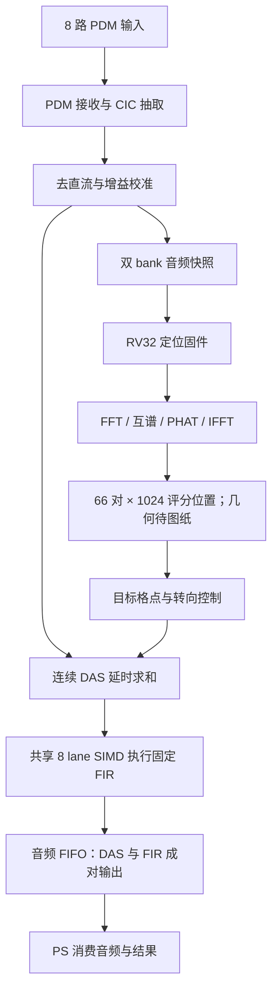

# PL 端全部内容详解：从麦克风引脚到声源定位与增强音频

编写日期：2026-10-12；生产配置更新：2026-10-13。适用工程：`D:\Users\xyfhhh\Desktop\PDM\zynq_-pl_-simd_-verilog`。

本文依据当前 RTL 的模块实例化、参数覆盖、寄存器译码、配套固件及验收文档编写。数字分为三类：**代码参数**、**按参数计算的解析值**、**已有文档记录的测量值**。本文编写过程中未重新运行仿真、Vivado 或物理板卡测试。

阅读原则：实际实例化及执行逻辑优先于旧注释。仓库保留了 16 路 PDM、GSC、ANC 等历史内容；这些文件的存在不等于当前生产系统采用它们。

2026-10-13更新：当前12麦已通过前端、采集、DAS/FIR、实际固件SoC及综合验证；真实三维几何未启用，详见[当前12麦配置](live12_configuration.md)。下文旧8/16麦实现数字是历史证据，不作为新12麦位流/时序结论。

## 目录

1. [PL 的定位与当前实现范围](#1-pl-的定位与当前实现范围)
2. [工程结构与顶层层次](#2-工程结构与顶层层次)
3. [时钟、复位及时间尺度](#3-时钟复位及时间尺度)
4. [PDM 麦克风采集前端](#4-pdm-麦克风采集前端)
5. [通道对齐、直流阻断与增益](#5-通道对齐直流阻断与增益)
6. [双 bank 原始音频快照](#6-双-bank-原始音频快照)
7. [连续 DAS 波束形成](#7-连续-das-波束形成)
8. [SIMD-MAC 与固定 FIR](#8-simd-mac-与固定-fir)
9. [RV32 五级流水线软核](#9-rv32-五级流水线软核)
10. [分支预测、冒险与异常](#10-分支预测冒险与异常)
11. [声学扩展与 FFT/IFFT](#11-声学扩展与-fftifft)
12. [互谱、PHAT 与声源定位](#12-互谱phat-与声源定位)
13. [SRP 空间扫描](#13-srp-空间扫描)
14. [转向几何与稳定控制](#14-转向几何与稳定控制)
15. [ITCM、DTCM 与内部访存](#15-itcmdtcm-与内部访存)
16. [PS–PL AXI-Lite 控制接口](#16-pspl-axi-lite-控制接口)
17. [寄存器及地址地图](#17-寄存器及地址地图)
18. [系统从上电到连续运行](#18-系统从上电到连续运行)
19. [数值格式、RAM 与资源](#19-数值格式ram-与资源)
20. [管脚、约束与板级边界](#20-管脚约束与板级边界)
21. [验证体系与已有结果](#21-验证体系与已有结果)
22. [故障定位与容易混淆的问题](#22-故障定位与容易混淆的问题)
23. [全部 RTL 文件职责索引](#23-全部-rtl-文件职责索引)
24. [推荐源码阅读路线](#24-推荐源码阅读路线)
25. 源码接口与实例化摘录附录。

## 1. PL 的定位与当前实现范围

### 1.1 PL 是什么

Zynq 中，PS 是 ARM 处理器及其硬核外设，PL 是可编程逻辑。Verilog 描述的寄存器、状态机、RAM 接口、乘法器和流水线经综合实现后，成为 FPGA 中真实的并行电路。

本工程的 PL 不是单一滤波器，而是一套包含 RISC-V 处理器的声学计算系统。PS 下载程序、配置参数、消费结果；PL 负责声音采集、连续音频处理、软核执行及定位加速。

特别要区分：**RV32 固件虽然是 C 程序，但运行在 PL 内的 RISC-V 软核上**。它不运行在 PS 的 Cortex-A9 上。ARM 应用属于 PS 软件，两者有不同的可执行文件、地址空间及下载过程。

### 1.2 当前生产基线

| 项目 | 当前值或行为 | 依据 |
|---|---|---|
| FPGA 配置器件 | `xc7z020clg400-1` | `scripts/create_zynq_project.tcl` |
| PL 产品时钟 | 40 MHz | Zynq 建工程脚本 |
| 采集通道数 | 12 路、6根DIN，每线两个麦克风 | `rv32_soc` 实例化通用接收模块，N_CH=12 |
| PDM 时钟 | 2.5 MHz | 40 MHz / 16，解析值 |
| 抽取比 | 64 | CIC 参数 |
| PCM 采样率 | 39.0625 kHz | 2.5 MHz / 64，解析值 |
| 连续输出路径 | PDM → 去直流/增益 → DAS → 32 抽头 FIR | 当前 SoC 接线 |
| SIMD 宽度 | 8 lane | 向量单元固定配置 |
| 定位扫描 | 66对、1024个评分位置，几何未启用 | 当前 SoC 参数覆盖；实际三维表待图纸 |
| 每对相关序列 | 32点紧凑相关环 | SRP实例R_LEN=32；图纸后复核最大时差 |
| 原始快照 | 两个512时刻bank，每通道1024样点 | 共享固件fw_live16.c按12通道编译 |
| GSC/NLMS | 不参与当前生产路径 | 正式验收与完成记录 |

12路采集、66个麦对和8 lane SIMD是三个不同的数量。66是12个麦的全部两两配对；lane仍对应FIR抽头。实际尺寸/坐标待图纸，当前不扫描/发布三维定位。

### 1.3 两条主数据路径



**连续路径**按样点运行，目标是每个采样周期都处理一个样点。**定位路径**按快照运行，取得一段多通道音频后计算位置，再更新波束延时。定位计算期间，连续 DAS/FIR 不需要停下来。

原始快照可以有采集间隙；连续音频与原始定位快照不是同一套“无间隙”承诺。

## 2. 工程结构与顶层层次

### 2.1 目录用途

| 目录 | 内容 |
|---|---|
| `rtl/` | 可综合硬件：软核、接口、采集、加速器、存储 |
| `constrs/` | 时钟与引脚等 XDC 约束 |
| `tb/` | 模块、固件执行及系统仿真 testbench |
| `scripts/` | 构建、模型、仿真、综合实现、导出、上板脚本 |
| `sw/fw/` | 在 PL 内 RV32 软核运行的固件 |
| `sw/` | PS ARM 应用、头文件、部分离线分析代码 |
| `docs/` | 设计、验收、测量和问题记录 |
| `build/` | 日志、镜像、报告、bit/XSA 等生成产物 |

旁边类似名字的 `zynq_-pl_-simd-verilog` 不是本文的主源码目录。

### 2.2 三层顶层

```text
ps_pl_wrapper                  Vivado Block Design 生成的系统包装
├─ PS7                         Zynq ARM/DDR/硬核外设
├─ 时钟与复位基础设施
└─ rv32_ps_top                 自定义 PL 子系统入口
   ├─ u_axi                    AXI-Lite 协议转换
   ├─ u_regs                   PS 控制、状态、窗口寄存器
   └─ u_soc                    rv32_soc
      ├─ u_core                RV32 核及核内多拍运算单元
      ├─ u_itcm / u_dtcm       指令 / 数据紧耦合存储
      ├─ u_pdm_rx              8 路 PDM 接收
      ├─ u_pdm_align           去直流与增益
      ├─ u_pdm_cap             双 bank 快照
      ├─ u_beam                DAS、历史、音频 FIFO
      ├─ u_srp                 SRP 寄存器壳及扫描核
      ├─ u_xsp                 互谱寄存器壳及 PHAT 流水线
      └─ u_steer               转向控制壳及几何核
```

`rv32_ps_top.v` 本身不包含 PS7。PS7 在 Block Design 中，PS 的 `M_AXI_GP0` 连接自定义 AXI 从接口，`FCLK_CLK0` 提供 PL 时钟，中断输出送到 PS 中断入口。

### 2.3 核内与核外加速器

核内包括 `rv32_vec_unit`、`rv32_acoustic_ext`、`rv32_fft_bfly` 和除法单元，直接与译码、暂停、提交及写回连接。

核外包括 SRP、流式互谱和转向块，主要通过 MMIO 寄存器访问，也接受核发出的启动门铃。它们虽在核外，仍属于 PL。

## 3. 时钟、复位及时间尺度

### 3.1 一个系统时钟，多种使能节拍

主要用户 RTL 使用 `clk_i`。PDM 接收、CIC、RV32、DAS 和加速器通过时钟使能或状态机安排工作，而不是给每种任务再建立一个随意分频的内部时钟域。

PDM 输出时钟是发给外部麦克风的信号。内部电路仍由 PL 系统时钟驱动，使用 `hold_en`、`bit_en`、`decim_en` 等脉冲决定何时采样、积分或输出。

| 时间尺度 | 解析值 | 意义 |
|---|---:|---|
| PL 一拍 | 25 ns | 40 MHz 系统时钟周期 |
| PDM 一周期 | 400 ns | 16 个 PL 周期 |
| PCM 一样点 | 25.6 μs | 1024 个 PL 周期 |
| 512 样点 | 13.1072 ms | 一个默认快照 bank 的采集长度 |
| 1024 样点 | 26.2144 ms | 定位音频窗口的长度 |

这些是按参数计算的时间，不包含软件轮询、等待、计算和总线访问开销。

### 3.2 每样点 1024 拍预算

连续处理链必须在下一组 PCM 到达前处理完当前组。1024 拍是系统样点间隔，不等于某个 FIR 单元可以独占的全部时间；DAS 历史读写、仲裁、FIR 及控制都消耗这个预算。

已有仿真记录的压力场景最大处理时间为 76 拍，但它只覆盖对应 testbench 场景，不是对任意未来配置的保证。

### 3.3 复位与 HALT

`rst_n_i` 是低有效复位。PS 控制层还产生软复位脉冲及 `halt`。软复位后核保持暂停，PS 必须明确启动，避免核在下载固件途中执行半写入的指令。

HALT 主要冻结 CPU 流水线。**当前连续音频控制器可以在 CPU HALT 时继续使用 SIMD**，所以“核已暂停”不等于“所有硬件都空闲”。系数窗口还必须检查加速器占用。

大 RAM 不应通过异步复位逐项清零。当前相关模块通过有效长度、状态、指针或覆盖写入判断数据是否有效，让 RAM 内容本身保持可推断的存储模板。

## 4. PDM 麦克风采集前端

### 4.1 PDM 与 PCM

PDM 每个时刻只有 0/1，声音幅值体现在一段时间内的脉冲密度。不能将单个 PDM 位当作一个 PCM 样点。CIC 对高速位流低通并抽取，形成多位 PCM。

当前外部接口是pdm_clk_o加pdm_din_i[5:0]，一个公共时钟、6根数据线。SoC直接绑定通用接收模块N_CH=12、MICS_PER_LINE=2；旧8ch/16ch包装器仅作显式兼容。

### 4.2 `rv32_pdm_clkgen.v`

该模块维护分频计数器，产生 PDM 输出时钟与采样使能。停用时分频状态清零，时钟输出有确定的停用状态。

当前默认 `HOLD_TICK=4`、`CONSUME_TICK=12`。它们是计数状态，不应直接按 `tick × 25 ns` 当作实际锁存时刻；消费触发器在对应周期结束的时钟沿采样。具体引脚时序必须结合 RTL、麦克风 datasheet、板上传播延迟和线缆来分析。

现有完成记录中的 setup 16 ns、hold 84.5 ns 属于采样窗口解析值，没有在本文中做物理重测。

### 4.3 `rv32_pdm_array_rx.v` 及包装器

通用接收模块负责组织时钟、采点、每通道 CIC 和统一输出。8ch/16ch 包装器只绑定参数并透传端口。

当前输出 `audio_vec_o` 是 12 × 24 = 288 位，通道 `m` 放在 `[m*24 +: 24]`。`sample_valid_o` 标记整组通道数据同时有效，`frame_cnt_o` 给出采样计数，`frozen_o` 提供输入冻结诊断。

冻结指示能提示数据线长期不变化，但不能单独证明麦克风故障；静音、接线、使能和输入模型都要一起检查。

### 4.4 `rv32_pdm_cic.v`

默认参数是三阶 CIC、抽取 64、24 位内部累加和24位输出：

```text
PDM 位 → 3 级高速积分器 → 每 64 位抽取 → 3 级低速梳状差分 → PCM
```

积分器累加输入，梳状器计算抽取序列的差分。理想 CIC 的直流增益为 `D^ORDER=64^3=262144`，代码用 OFFSET 去中心、用 SHIFT 映射输出尺度。

**中间累加器的补码回绕是设计的一部分**。不能把积分器随意改为饱和累加器；饱和会破坏积分和差分的对应关系。这里要求的是固定宽度模运算一致性。

CIC 不需要通用乘法器，适合多通道并行，但通带存在下垂。当前后级固定 FIR 是带限低通，不能自动宣称它完成了专门的 CIC 反响应补偿。

## 5. 通道对齐、直流阻断与增益

模块：`rtl/array/rv32_chan_align.v`。

### 5.1 对齐的含义

它按统一 valid 更新所有通道，保证输出向量和输出 valid 对应同一采样时刻。这里的“对齐”是数据节拍对齐，不是按照声源方向补偿传播时差；后者由 DAS 完成。

### 5.2 直流阻断

每通道保存上一输入和滤波状态，默认 `DC_K=9`：

```text
y[n] = x[n] − x[n−1] + y[n−1] − (y[n−1] >>> 9)
```

常量或缓慢变化的偏置被抑制。更新只发生在 `valid_i` 有效时，时间尺度按 PCM 样点计，不是每个 40 MHz 时钟都更新一次音频滤波状态。

算术右移对负数向负无穷取整，因此正负残差行为不完全对称。源码记录了很小的直流死区。这个现象应与通道全零、丢帧和麦克风故障区分。

### 5.3 增益及饱和

增益使用有符号 Q2.14，单位增益为整数 16384。输出计算为：

```text
校准输出 = saturate_to_24bit((滤波状态 × gain) >>> 14)
```

Q1.15 的有符号 16 位无法表示 +1.0；将 32768 填入会变成负数。因此这里选择 Q2.14。

当前采集控制器提供的增益寄存器复位值是 16384。`chan_align` 中旧注释仍有“增益复位为零”的表述，但该模块接收的是外部增益输入，系统默认值必须看 `rv32_pdm_capture` 的实际赋值。

### 5.4 24 位到 16 位

快照与 DAS 都取校准后 24 位 PCM 的高 16 位，即 `[23:8]`。这相当于丢弃最低 8 位，不是取低 16 位；后续参考模型、声学算法及幅值解释必须使用同一尺度。

## 6. 双 bank 原始音频快照

模块：`rtl/array/rv32_pdm_capture.v`。

### 6.1 为什么需要两个 bank

定位软件读取一个完整音频块时，采集还可能继续。双 bank 将采集侧和读取侧分开：一个 bank 写入，已发布 bank 保持稳定供消费者读取。

已发布的数据不能因为采集继续而被悄悄覆盖。模块使用 READY、SEQ、FIRST、ACKSEQ、RELEASE 管理所有权。

### 6.2 存储布局

12通道每时刻需要12 × 16 = 192位，即6个32位字：

| 字编号 | 低 16 位 | 高 16 位 |
|---|---|---|
| 0 | CH0 | CH1 |
| 1 | CH2 | CH3 |
| 2 | CH4 | CH5 |
| 3 | CH6 | CH7 |
| 4 | CH8 | CH9 |
| 5 | CH10 | CH11 |

默认每 bank 容量为 `2^9=512` 个采样时刻，因此每 bank 的纯音频数据是 512 × 6 × 4 = **12288 字节**，两个bank共 **24576 字节**。这些是逻辑数据容量，不是 Vivado 物理 BRAM 占用报告。

读取通道 `ch` 的第 `n` 个样点：

```text
word_index = 6*n + (ch >> 1)
sample = signed16(DATA >> (16*(ch & 1)))
```

### 6.3 发布和释放协议

1. 设置使能、采集长度和模式。
2. 等待所需 bank READY。
3. SELECT 选择 bank，读取 SEQ、FIRST 等元数据。
4. 设置 INDEX，从 DATA 读取打包音频；注意 DATA 读取具有索引副作用。
5. 将读到的 SEQ 写到 ACKSEQ。
6. 写 RELEASE，只有 ACKSEQ 与当前选中 bank 的序号匹配，才允许回收。

SEQ 识别“这是哪一块”，FIRST 识别“这块从哪个采样计数开始”。只读到了 READY 并不足以证明两块音频连续。

### 6.4 生产定位固件的连续性检查

`fw_live.c` 对两个 bank 要求：

```text
first1 − first0 == 512
seq1 − seq0 == 1
```

通过后才拼成1024样点定位窗口。序号错误的负向测试必须实际改变 bank 元数据或所有权情形，而不能只改一个与真实消费逻辑无关的变量。

### 6.5 不反压与丢弃

外部麦克风不能因软件没读完就暂停真实声音。缓存不可用时，模块记录丢弃情况而不无限阻塞采集。要分别理解“一个多通道采样时刻”和“一个512样点bank块”，不同代码中 frame 一词可能指不同层次。

快照模式取得一对稳定 bank 后允许计算，再释放、重新采集。当前产品没有承诺原始快照连续无间隙。

## 7. 连续 DAS 波束形成

模块：`rtl/beamformer/rv32_das_stream.v`。

### 7.1 DAS 的原理

同一个声源到达不同麦克风的时间不同。DAS 将各通道延迟到共同参考时间，再求和平均：

```text
das[n] = (1/M) × Σ x_m[n − d_m]
```

目标方向的信号更容易同相叠加。其它方向的信号无法同样对齐，但具体增益取决于频率、阵列几何、声场和延时误差，不能从模块名称推导实际提升多少 dB。

### 7.2 每通道历史

12通道各保留64个16位历史样点，共768个历史元素。写入新向量后，状态机逐通道读取需要的两个相邻历史值。

`head` 是环形历史指针，6位索引实现模64。`valid_len` 区分已经写入的历史与复位后尚未填充的位置；未有效的历史按零处理，避免依赖 RAM 上电内容。

### 7.3 分数延时

延时参数采用Q16表达，但实际插值只使用4位小数，分辨率为1/16样点。设整数部分为 `q`、小数部分为 `f/16`：

```text
v0 = history[n − q]
v1 = history[n − q − 1]
v  = v0 + ((v1 − v0) × f) / 16
```

当前合法延时上限为62+15/16样点；还需要读取后一历史点，不能把64点存储容量直接当作64样点合法延时。

它是线性插值，并不是每通道的多抽头分数延时 FIR。后面的32抽头 FIR 处理的是已经合成的单路音频。

12路求和后的平均为 `floor((sum+6)/12)`，包括负样本；不能用除8/16的右移代替。

### 7.4 原子转向更新

在接收一组新PCM时，DAS将12路延时一起快照到内部 `snap`。处理这一组样点期间使用同一版参数，避免通道0使用旧目标、通道11使用新目标。

自动模式中，转向已锁定且不忙时接收新补偿；忙或暂时不可用时保持最近有效延时。首次有效转向前或手动模式时使用手动延时寄存器。

非法补偿会置错误标志并保留可用参数，而不是无约束地读取历史RAM。

### 7.5 状态机逐步解释

```text
IDLE → WRITE → READ0 → WAIT0 → READ1 → WAIT1
     → ADD → 插值累加 → 下一通道
     → 平均 → EMIT → FIR → IDLE
```

WRITE将12路新样点写入历史。READ/WAIT安排同步RAM地址与返回数据。插值必须等两个历史值都稳定后计算。EMIT等待共享SIMD可接收，FIR等待结果，再将DAS与FIR成对写入FIFO。

源码中还有数值为9、10的状态用于插值累加与平均，不应只按有名字的 localparam 判断完整状态路径。

### 7.6 FIFO 与可观测错误

FIFO深度为256条，每条32位：`{fir_result[15:0], das_result[15:0]}`。

DATA读取弹出一条。空FIFO读回零不能当作有效音频；必须结合占用和错误状态。FIFO满时不覆盖未消费数据，而计入丢弃。处理忙时又到达新PCM也计入输入丢弃。

因此系统应同时看 ACCEPTED、OUTPUTS、DROPS、MAX_CYCLES 和 FIFO 占用。单看输出非零无法确认实时性。

## 8. SIMD-MAC 与固定 FIR

模块：`rtl/vec/rv32_vec_unit.v`、`rv32_vec_bank.v`；音频共享控制器位于 `rtl/core/rv32_core.v`。

### 8.1 8 lane 到底对应什么

当前32抽头FIR为：

```text
y[n] = Σ h[t] × x[n−t]，t=0..31
```

每lane处理一组抽头：`t=8*j+b`，`b=0..7`。32抽头分4趟完成：第一趟0..7，第二趟8..15，第三趟16..23，第四趟24..31。

这是对滤波抽头并行，而非对麦克风一一分配lane。12路麦已经在DAS中合成为一路。

### 8.2 系数和数据分 bank

系数t按 `t mod 8` 分bank、按 `floor(t/8)` 分字地址。这样一次可读出8个抽头系数。

延迟线按样本序号分bank，新样本只写一个bank。读地址考虑当前样本的商和余数，以及跨bank时的借位。

系数和数据使用独立存储，因为乘法需要同拍读取两者。将它们随意合并到一个单读口RAM会破坏并行吞吐。

### 8.3 运算流水

向量单元分阶段完成地址发出、RAM返回、乘法、每lane累加、归约和完成握手。每lane累加器为40位，用于容纳多抽头乘积和。

RUN期间不断送入后续趟，末尾DRAIN排空乘法与累加流水。加法树在lane累加稳定后做归约；过早求和可能得到看似合理的部分结果。

### 8.4 自定义向量操作

| 操作 | 含义 | 当前生产用途 |
|---|---|---|
| PUSH | 将新样本写入指定历史线 | 连续FIR写入DAS样点 |
| VRED | 实数乘累加并跨lane归约 | 固定32抽头FIR |
| VUPD | 逐元素更新系数 | 保留硬件能力，当前生产不执行自适应更新 |
| VMUL | 单元中的幅值/归约相关操作 | 按指令实现解释，不等于通用向量ISA |

保留VUPD不表示系统仍使用GSC。当前验收要求生产动态执行 `VUPD=0`。

### 8.5 连续音频控制器

CPU核内设独立音频状态机：

```text
A_IDLE → A_PUSH → A_PUSH_WAIT → A_RED → A_RED_WAIT → A_IDLE
```

它收到DAS样点后，通过同一个 `u_vec_unit` 执行PUSH和VRED。固定设置 `len_i=3` 表示4趟、32抽头；使用W1系数及XP3历史区域，与CPU基准测试使用的W0区域分离。

FIR输出将向量整数结果算术右移15位，再饱和到有符号16位。改变系数尺度时，输出缩放也必须一起调整。

### 8.6 CPU 与音频仲裁

音频取得单元后，用选择器接管start、op、len、data、channel等接口，直到完成。CPU标量和其它独立加速器操作仍可进行；CPU向量请求要等待共享单元的正确边界。

`audio_ready_o` 还检查没有向量启动、没有向量忙/完成冲突、没有系数读写。它不是简单的“音频状态为空闲就接收”。

PS系数窗口要求 `halt_q && !simd_active_i`。这避免CPU停住但音频仍忙时改写FIR系数。

### 8.7 固定 FIR 的功能边界

正式验收文档将当前滤波器定义为32抽头Q15、10kHz低通。已有独立响应模型记录了200–8000Hz纹波和12kHz起阻带衰减，详见验收文档。

它实现带限滤波，没有在线训练权重，不承担GSC自适应方向干扰抵消，也没有为每个麦克风配置独立32抽头滤波器。

## 9. RV32 五级流水线软核

核心：`rtl/core/rv32_core.v`。以下按实际分工解释，不将它视为完整Linux级处理器或通用商用RISC-V平台。

### 9.1 五级数据流

```text
IF 取指 → ID 译码 → EX 执行 → MEM 访存 → WB 写回
          IF/ID     ID/EX      EX/MEM     MEM/WB
```

不同指令可以同时处于不同阶段。流水寄存器保存指令有效位、操作数、目的寄存器、控制字段和故障信息。

### 9.2 IF：取指

`rv32_fetch_stage` 管理PC、取指请求、预测下一PC以及重定向。指令来自ITCM。分支或异常要求改变PC时，还必须冲刷已经进入流水但不应执行的指令。

### 9.3 ID：译码

`rv32_decode_stage` 组织译码、寄存器读取和立即数生成。

- `rv32_decoder` 将指令字段变成ALU、分支、访存、CSR及自定义操作控制。
- `rv32_regfile` 保存整数寄存器，x0按零寄存器语义处理。
- `rv32_imm_gen` 按不同指令格式拼接并符号扩展立即数。

自定义SIMD、声学、FFT和门铃指令也通过这条译码路径进入执行。

### 9.4 EX：执行

`rv32_execute_stage` 选择操作数、应用前递结果、计算ALU/分支结果并对接多拍单元。

`rv32_alu` 负责整数加减、逻辑、移位和比较等。`rv32_branch_unit` 判断分支是否成立及实际目标。乘法和除法由相应单元提供。

EX不应被理解为“所有复杂运算一个时钟完成”；FFT、向量及除法通过start/stall/done/commit协议跨多拍运行。

### 9.5 MEM：访存

`rv32_memory_stage` 和 `rv32_lsu` 处理load/store，请求DTCM或MMIO，按字节/半字/字大小组织数据、写掩码、扩展和故障。

load字节的符号扩展与零扩展不同。store数据还可能按地址低位移位，因此特殊MMIO寄存器必须按实现要求使用整字写，不能随意用sb/sh替代sw。

### 9.6 WB：写回及退休

`rv32_writeback_stage` 选择写回数据并形成退休信息。退休不是“取到一条指令”，而是流水推进到可提交边界的可观测事件。

PS可以观察最近退休PC、指令、故障及计数。确认核在工作时应组合检查这些信息、邮箱、结果和周期，而不只看LED。

### 9.7 valid、stall 和 flush

valid表示该流水位置包含有效指令；stall表示保留该阶段状态；flush表示清掉不应继续的指令。

这三者必须一致。如果暂停时仍向后送有效操作，可能重复执行；如果冲刷时没压住有副作用的start，错误路径也可能写RAM、修改指针或启动外设。

## 10. 分支预测、冒险与异常

### 10.1 分支预测组成

| 模块 | 当前默认规模 | 职责 |
|---|---:|---|
| `rv32_btb` | 32项 | 预测分支/跳转目标 |
| `rv32_pht_gshare` | 64项 | 使用分支历史预测方向 |
| `rv32_ras` | 8项 | 保存调用返回地址预测信息 |
| `rv32_branch_predictor` | 组合上述结构 | 向取指阶段提供预测 |

规模来自模块默认参数；完整连接见附录。预测错误时以执行阶段解析的真实结果重定向，不能让预测路径直接成为架构结果。

### 10.2 前递与停顿

前递将后级尚未写回的数据直接送给当前EX操作数，减少不必要停顿。load-use情况下数据可能尚未返回，必须暂停依赖指令。

`rv32_forward_unit` 负责可用数据选择，`rv32_hazard_unit` 判断数据依赖，`rv32_pipeline_control` 汇总HALT、访存等待、多拍单元及重定向等控制。

### 10.3 多拍协议

```text
start：提交运算请求
keep：当前指令仍有效，可继续
stall：运算未完成，需要暂停相关流水
done：结果已就绪
commit：结果已被核接收，释放本次运算
```

done与commit不能混为一谈。在核暂时不能接收结果时，多拍单元要避免反复启动或提前覆盖结果。

PUSH、POP、MMIO读弹出等有副作用操作尤其敏感。必须保证一条合法操作只发生一次。

### 10.4 CSR 与故障

`rv32_csr` 提供当前实现中的控制状态寄存器及异常相关逻辑；故障字段沿流水传递并被退休观察口记录。

非法指令、地址类故障与正常结果不能共用含糊的“完成”状态。具体支持的CSR编码、异常原因和指令范围以 `rv32_csr.v`、`rv32_defines.vh` 和decoder为准，不从“RV32”名称推断完整特权架构。

## 11. 声学扩展与 FFT/IFFT

### 11.1 声学扩展的分工

`rv32_acoustic_ext` 面向打包复数，而SIMD-MAC面向实数时间域抽头。复数按 `{im[15:0], re[15:0]}` 打包为32位字。

该单元保留PUSHA、PUSHB、POP等数据装载/读取接口以及VCMUL、VPHAT、VSUB、VRED2等操作。VSUB在该自定义指令语义中用于 `X × conj(Y)`，不能按名字理解成普通向量减法。

当前实际数组长度 `CN=208`，有效带内索引0..203，剩余位置用于按8lane对齐。模块头部还保留早期“512条存储”的描述，应以实际数组声明和localparam为准。

它与核外 `rv32_xspec_phat` 是两条独立硬件接口，不能把它们的参数、性能或访问协议混写成同一个模块。

### 11.2 FFT 结构

`rv32_fft_bfly` 实现512点复数核心，并通过实数打包/拆分支持1024点实数变换。正变换输出513个单边频谱bin。

```text
1024 个实数样点
→ 两两打包为512个复数
→ 位反转及9级蝶形
→ 实数FFT拆分
→ 513个单边频谱bin
```

逆变换走反向拆分、共轭因子蝶形和相应输出路径。它不是简单把正变换输入输出交换。

### 11.3 FFT 地址发生器

`rv32_fft_addr` 生成蝶形配对、bank/字地址与级内推进控制，使8bank存储按阶段安排访问。

早期蝶形中，一组的两个结果可落在不同bank。后续某些阶段的两个结果会落入同一bank不同地址，此时单写口无法同拍写两次，需要分拍写回。

第二个结果必须在第一次写回前寄存。否则异步读数据已被第一个写回污染，再计算第二个结果会使用修改后的输入。

### 11.4 定点缩放

FFT使用固定取整与逐级缩放。例如旋转因子乘法有明确的右移和舍入常量，蝶形每级再右移避免幅值溢出。

验收目标是与既有整数固件参考逐位一致。数学等价不等于定点逐位等价；调整括号、乘法位宽、符号扩展或舍入位置，都可能改变结果。

### 11.5 写回流水与排空

现有完成记录说明FFT写回增加了一级寄存，并在级间和拆分末尾增加排空周期。必须等最后一个待写回结果落到存储后才进入下阶段或宣布done。

这也是为什么减少几个WAIT/DRAIN状态不能只凭仿真波形中“看起来空着”来判断：它们可能在等待同步RAM或流水末项。

## 12. 互谱、PHAT 与声源定位

### 12.1 GCC-PHAT 整体流程

两路声音到达时差可通过相关函数寻找。GCC-PHAT先形成频域互谱，对其幅度归一化，再逆变换得到时延相关序列：

```text
X_i = FFT(x_i)
X_j = FFT(x_j)
G_ij = X_i × conj(X_j)
Ψ_ij = 限带(G_ij / |G_ij|)
R_ij = IFFT(Ψ_ij)
```

PHAT突出相位/延时信息，降低幅度差对相关峰的影响。接近零的幅值及带外噪声必须按定点策略处理。

### 12.2 `rv32_xspec_phat.v`

输入流每拍给出一个bin和两路复数。设 `X_i=a+jb`、`X_j=c+jd`：

```text
real(G) = a*c + b*d
imag(G) = b*c − a*d
```

模块将复数乘、幅值近似、前导位/指数、倒数查表、归一化及频带掩码组织为流水。输出valid和bin编号必须延迟到对应结果的同一拍。

### 12.3 避免开方和通用除法

幅值采用 `max(|re|,|im|)+0.414*min(|re|,|im|)` 的近似形式，0.414通过移位加减近似。倒数使用尾数LUT和指数移位，避免逐bin大除法器和开方器。

这是数值近似，需要参考模型证明算法指标可接受；不能称作精确欧几里得模长。

### 12.4 两条接口的频带边界不同

当前SoC中核外XSP实例覆盖 `BIN_LO=5`、`BIN_HI=209`。核内acoustic扩展则按原频谱bin6起的紧凑带内数据布局组织。

1024点实数FFT频率间隔按参数计算为 `39062.5/1024≈38.14697 Hz`。bin5约190.73Hz，bin6约228.88Hz，bin209约7972.72Hz。因此“200–8000Hz”是设计频带描述，准确端点要看所用路径的整数bin比较。

### 12.5 `rv32_xsp_regs.v`

该外壳管理频谱输入/结果数组、索引窗口、自增、启动、busy/done和错误。CPU和PS可访问同一组硬件寄存器。

**当前 `fw_live → fw_gcc` 生产链中，互谱和PHAT仍由RV32标量C循环执行**，幅值近似后使用整数除法取得倒数；正逆FFT通过 `FW_ACCEL` 选择硬件VFFT或标量参考。`fw_gcc.c` 没有通过0x9000窗口调用核外XSP，也没有调用核内VSUB/VPHAT完成这段循环。因此必须区分“已接入的硬件能力”与“当前生产固件实际使用的能力”。

生产固件还会在FFT前原地乘Hann窗。其标量幅值近似为 `max + min/2 − min/8 + min/32 + min/128`，不能将核外流水模块头部的另一种移位近似直接当作这份固件的逐位公式。

## 13. SRP 空间扫描

模块：`rv32_srp_scan.v` 和 `rv32_srp_regs.v`。

### 13.1 由时差到位置

对每个候选空间格点，几何表给出各麦克风对的预测时延，SRP从对应相关序列取值并求和：

```text
P(g) = Σ_pair R_pair(τ_pair(g))
最佳格点 = argmax_g P(g)
```

输出是格点空间谱，固件读取所有格点选择最大值，并将格号提交转向。格号必须使用同一份几何定义才能变成实际坐标或角度。

### 13.2 当前规模

SoC当前为N_PAIR=66、N_GRID=1024、R_LEN=32，转向表12×1024项。1024是已配置的评分容量；实际水平角/俯仰角及延时表等待图纸，不沿用旧固定高度XY网格。

模块默认值和旧说明常用28对、1024格，不能将默认规模的存储估算或周期数用于当前实例。

### 13.3 延迟表与线性插值

当前紧凑相关环的LUT元素包含5位整数索引及4位分数。每格读取两个相关值：

```text
R_interp = R[idx] + frac × (R[idx+1] − R[idx]) / 16
```

整数idx用于32点环，负时差映射到环尾；表生成和固件提取必须采用同一映射。32点是否覆盖实际阵列最大时差须在图纸到位后复核，不能根据1024个评分位置直接推导相关行长。

### 13.4 三类存储

| 存储 | 当前逻辑元素数 | 元素位宽 | 按声明计算的纯数据容量 |
|---|---:|---:|---:|
| 延迟LUT | 66×1024 | 9 | 76032字节 |
| 相关序列R | 66×32 | 16 | 4224字节 |
| 空间谱P | 1024 | 32 | 4096字节 |

以上未计器件RAM粒度、布局、复制和控制寄存器，不能替代资源报告。

### 13.5 为何没有直接用 SIMD-MAC 扫描

每个格点、每个麦克风对要读取不同相关下标，属于离散查表。8lane FIR的数据排布是规则抽头序列，不直接提供这种多地址gather读口。

当前SRP采用同步读和顺序插值流水。把加法改成并行之前，必须解决存储读口、地址和返回延迟，而不仅是增加乘法器。

### 13.6 外壳的保护

外壳提供LUT/R/P选择、ADDR、WDATA/RDATA自增、busy/done、错误及周期计数。

同步P读口比地址晚一拍。改变ADDR后立刻无等待地读，可能看到旧地址的数据；外壳提供相应错误处理。当前CPU MMIO和AXI访问节拍通常提供间隔，但未来替换总线时仍要保留协议。

## 14. 转向几何与稳定控制

模块：`rv32_steer.v` 与 `rv32_steer_regs.v`。

### 14.1 格号到延时

几何核从目标格点查出各通道相对通道0的延时，按同一参考生成非负补偿：

```text
comp_m = τ_0m − min_j τ_0j
```

它依靠查表、最小值和减法，不在线计算距离平方根。几何LUT必须提前由一致的阵列模型生成和装载。

### 14.2 SRP索引和转向延时不能共用解释

SRP中的整数下标允许模1024绕回。转向需要有符号传播时差，进行最小值和减法。将已绕回的无符号SRP索引直接作为转向数值会导致错误补偿。

转向LUT存有符号整数部分和4位分数，重建为Q16样点。必须先符号扩展到32位再移位，避免窄位宽左移丢失高位。

### 14.3 迟滞

控制壳用EMPTY、CANDIDATE、ACTIVE、HOLD、RELEASE等状态区分首次候选、稳定目标、短时偏离和释放。

候选需要持续若干帧才锁定；目标短时跳动进入保持，避免波束追着定位抖动不断切换。`CELL_TOL=2` 用于判定格点是否属于邻近区域。

### 14.4 渐变

新延时不一定瞬间替换，而按配置步长逐帧逼近。生产固件配置 `0x00030340`，即Q8步长0x40以及候选/保持帧参数各3。

“渐变”降低突然改变延迟造成的瞬态，但实际是否听到爆音仍需要物理音频测试。

### 14.5 两层原子性

转向壳负责产生稳定的一组comp和locked/busy；DAS在新样点向量边界再将整组comp快照。这样既保护几何计算过程，也保护12通道处理过程。

## 15. ITCM、DTCM 与内部访存

### 15.1 两块紧耦合存储

当前顶层默认ITCM与DTCM各4096个32位字，分别是16KiB逻辑容量。

ITCM保存RV32程序，DTCM保存数据、工作区及结果。它们位于PL中，不是PS DDR，也不是高速缓存。

两个地址空间可以由取指和数据接口分别访问；不能因为核侧都出现低地址就把两块存储理解为同一块RAM。

### 15.2 核与PS访问

核经自身取指/访存口访问；PS经TCM窗口发请求，选择ITCM或DTCM并提供地址和读写数据。请求及同步读返回之间有时序约定。

PS运行期读取可用于观察结果，写TCM必须先HALT，避免核正在读取的程序或数据被修改。同地址双端口冲突也不能依赖未定义行为。

### 15.3 MMIO译码

核侧数据地址除DTCM外，还可被 `rv32_soc` 译码到邮箱、LED、SRP、XSP、转向和采集窗口。

MMIO响应并非所有操作都在请求当拍完成。`mmio_ack_q` 与load/store有效阶段共同影响外设读写脉冲。

当前代码对部分读操作使用 `~mmio_ack_q` 避免重复读；外设写不能机械地套同一个门控。旧注释中“读写都持续两拍”的解释已与当前修正不完全一致，应以 `mmio_write`、LSU和实际实例端口表达式为准。

### 15.4 结果区域

`sw/fw/fw_mem.h` 定义结果、FFT工作区、音频及转向等布局。固件结果基址默认为 `0x2800`。这个地址属于RV32数据布局，不等于PS物理DDR地址。

PS通常通过DTCM窗口取得这些结果，或消费专门的硬件FIFO；这两条通路不同。

## 16. PS–PL AXI-Lite 控制接口

### 16.1 协议转换

`rv32_axi_lite_slave` 将AXI的AW/W/B与AR/R通道转换为内部单拍寄存器读写请求。

AW地址和W数据可以分别握手，不能假设永远同时到达。B表示写响应，R包含读数据与响应，VALID在READY接收前要保持正确。

AXI-Lite是控制寄存器接口，没有完整AXI突发数据通道。当前通过它读取音频FIFO，不代表实现了PL端AXI DMA。

### 16.2 内部读写时序

写请求：`reg_wr_i`一拍，地址、数据与字节选通同时有效。读请求：`reg_rd_i`一拍，寄存器层下一拍返回数据/错误。

统一延迟读约定让普通寄存器、同步TCM、系数和外设窗口可以接入同一输出路径。

### 16.3 控制寄存器

`rv32_ps_regs` 保存HALT、启动/单步/软复位控制、邮箱、退休、故障、周期及各种间接访问指针。

软复位和启动等脉冲先寄存再送出，减少从AXI地址组合译码直接穿过大量控制逻辑到RAM控制脚的长路径。

### 16.4 周期计数的解释

TOTAL/BUSY/IDLE用于观察核控制相关周期，SIMD统计汇总加速器忙信号。SoC将核内加速活动与SRP/XSP/转向busy合并。

因此CYC_SIMD不是“只有8lane乘法器在算FIR”的专用计数，也不能直接理解成某份算法的纯计算时间。计数定义必须与采样区间和RTL条件一起使用。

### 16.5 双访问端口

SRP/XSP/转向外壳将核和PS端口合并到同一硬件寄存器组，常以核请求优先选择地址和数据。它们不是两个完全独立的并发配置端口。

软件应安排所有权，避免PS在RV32计算过程中修改LUT、索引或控制。采集窗口也有核侧访问优先控制，不能默认两个消费者可以同时独立释放bank。

## 17. 寄存器及地址地图

### 17.1 PS物理基址与核地址

建工程脚本预期固定PS AXI基址为 `0x43C00000`、范围4KiB。脚本固定失败时仍要看实际生成地址段，不能只相信期望值。

| 功能 | PS侧相对AXI基址 | RV32核侧 |
|---|---|---|
| 核控制/状态/TCM窗口 | `0x000`起 | 不以同一地址镜像 |
| 采集快照/增益 | `0x300`起 | `0xC000`页 |
| 连续DAS/FIR | `0x380`起 | 当前主要由PS窗口访问 |
| SRP | `0x400`起 | `0x8000` |
| XSP/PHAT | `0x500`起 | `0x9000` |
| 转向 | `0x600`起 | `0xA000` |
| tohost/fromhost | PS寄存器`0x034/0x03C` | `0x4000/0x4004` |
| LED | PS只读镜像`0x090` | `0x5000` |

例如PS读取DAS数据的预期物理地址是 `0x43C0038C`，RV32读取快照DATA的地址是 `0xC020`。两种地址不能互换。

### 17.2 PS基础寄存器

| 偏移 | 名称 | 用途 |
|---|---|---|
| 0x000 | CTRL | 启动、HALT、单步、软复位等控制；操作前核对bit定义 |
| 0x004 | STATUS | 控制状态 |
| 0x008 / 0x00C | SRC_ADDR / SRC_LEN | 通用任务参数寄存器，生产用途取决于软件 |
| 0x010 / 0x014 | RESULT / SCORE | 既有结果视图，不能替代全部DTCM结果结构 |
| 0x018 / 0x01C | IRQ_STAT / IRQ_MASK | 中断状态和屏蔽 |
| 0x020 | RETIRE_CNT | 退休计数 |
| 0x024 / 0x028 / 0x02C | RETIRE_PC / INS / INF | 最近退休信息 |
| 0x030 | TRAP_CNT | 故障/异常观察计数 |
| 0x034 / 0x038 | TOHOST / TOHOST_CNT | 核写邮箱与更新计数 |
| 0x03C | FROMHOST | PS给核的邮箱值 |
| 0x040 / 0x044 / 0x048 / 0x04C | CYC_TOTAL / BUSY / SIMD / IDLE | 周期观察 |
| 0x080 / 0x084 / 0x088 / 0x08C | MEM_ADDR / WDATA / RDATA / CTRL | TCM间接访问 |
| 0x090 | LED_STATE | 核侧LED状态镜像 |
| 0x0C0 / 0x0C4 / 0x0C8 / 0x0CC | COEF_ADDR / WDATA / RDATA / CTRL | 系数间接访问及错误 |

CTRL、MEM_CTRL等不是单一通用bit协议；正式驱动应使用已有PS代码和实际译码。本文不凭名称臆造保留位语义。

### 17.3 快照寄存器

| PS偏移 | 字编号 | 名称 | 含义 |
|---|---:|---|---|
| 0x300 | 0 | CTRL | 采集使能、采集/快照模式 |
| 0x304 | 1 | STATUS | bank就绪等状态 |
| 0x308 | 2 | LEN | 块长度，当前生产设置512 |
| 0x30C | 3 | SELECT | 当前访问bank |
| 0x310 | 4 | SEQ | 选中bank序号 |
| 0x314 | 5 | FIRST | 选中bank首样点计数 |
| 0x318 | 6 | DROP | 丢弃计数 |
| 0x31C | 7 | INDEX | 音频字读取索引 |
| 0x320 | 8 | DATA | 同步RAM数据及读索引推进 |
| 0x324 | 9 | ACKSEQ | 释放确认序号 |
| 0x328 | 10 | RELEASE | 有序回收选中bank |
| 0x32C | 11 | FRAME | 前端采样计数 |
| 0x330 | 12 | FROZEN | 输入冻结位图 |
| 0x334 | 13 | META | 快照元数据 |
| 0x340..0x34C | 16..19 | GAIN_PAIR0..3 | 每字打包两个通道的Q2.14增益 |

核侧对应地址为 `0xC000+4*字编号`。例如 `fw_live` 用 `CAP(0)=7` 启用快照采集，具体清状态及模式副作用以控制写分支为准。

增益寄存器低16位控制偶数通道，高16位控制相邻奇数通道。例如0x340写 `0x40004000` 为CH0与CH1同时设置单位增益；12个通道共占6个增益寄存器，不能误以为每通道独占一字。

### 17.4 DAS/FIR寄存器

| PS偏移 | 名称 | 定义 |
|---|---|---|
| 0x380 | CTRL | bit0使能，bit2自动转向；bit1清零有严格新会话条件 |
| 0x384 | STATUS | bit0忙，bit1转向锁定，bit2错误，bits11:3为FIFO条数 |
| 0x388 | OUTPUTS | 成功写入输出FIFO的样点数 |
| 0x38C | DATA | 读即弹出，低16位DAS、高16位FIR |
| 0x390 | DROPS | 输入忙/输出满导致的丢弃 |
| 0x394 | MAX_CYCLES | 单样点最大处理拍数 |
| 0x398 | ACCEPTED | 接受的PCM向量数 |
| 0x39C | ID | 固定标识 `0x44415301` |
| 0x3A0..0x3BC | DELAY0..7 | 手动延时，Q16容器，实际1/16样点分辨率 |
| 0x3C0 | ACTIVE_CHANNELS | 当前有效求和通道配置 |

DATA不是无副作用状态寄存器。调试界面反复刷新它也会消费音频。

停止再重新使能连续链时还涉及共享FIR历史。源码明确指出重启会话需要SoC复位来同步重置FIR历史；不能只清DAS计数就认为所有音频状态已回到新会话。

### 17.5 SRP寄存器

| 字编号 | PS偏移 | 名称 | 用途 |
|---:|---|---|---|
| 0 | 0x400 | CTRL | START/EN/清DONE/清错误 |
| 1 | 0x404 | STATUS | BUSY、DONE、EN、WERR |
| 2 | 0x408 | ADDR | 选择LUT/R/P及元素索引 |
| 3 | 0x40C | WDATA | 装载LUT或相关序列，自动推进索引 |
| 4 | 0x410 | RDATA | 读取空间谱，自动推进索引 |
| 5 | 0x414 | CYCLES | 周期观测 |
| 6 | 0x418 | RUNCYC | 本次运行周期 |
| 7 | 0x41C | VERSION | 外壳自检寄存器 |

ADDR中SEL位在[16:15]，0=LUT、1=R、2=P。START为bit0，EN为bit1，启动时写3而非只写1，避免整体CTRL写入把EN清零。

### 17.6 XSP寄存器

| PS偏移 | 名称 | 用途 |
|---|---|---|
| 0x500 | CTRL | 启动及使能/状态清除 |
| 0x504 | STATUS | 忙、完成、错误 |
| 0x508 | ADDR | 频谱存储选择及索引 |
| 0x50C | WDATA | 输入频谱装载 |
| 0x510 | RDATA | 结果读取 |
| 0x514 | VERSION | 自检 |

存储选择、索引容量及忙时访问规则以XSP外壳为准，不能将SRP的SEL编码直接复制到XSP驱动。

### 17.7 转向寄存器

| PS偏移 | 名称 | 用途 |
|---|---|---|
| 0x600 | CTRL | START、EN、清DONE、清错误 |
| 0x604 | STATUS | BUSY/DONE/EN/WERR/LOCKED及状态/提交格号 |
| 0x608 | ADDR | LUT或COMP及索引 |
| 0x60C | WDATA | 装载转向LUT |
| 0x610 | RDATA | 读取补偿值 |
| 0x614 | TARGET | 写目标格号会触发更新 |
| 0x618 | CFG | 步长、保持帧数、候选帧数 |
| 0x61C | VERSION | 自检 |

CFG字段：bits7:0为Q8步长，bits15:8为保持帧数，bits23:16为候选帧数。ADDR的SEL=0用于LUT，SEL=1用于COMP。RDATA只对相应可读区域有效。

## 18. 系统从上电到连续运行

### 18.1 系统准备

加载匹配bitstream，初始化匹配PS硬件配置，运行对应ARM应用。bitstream决定硬件结构，RV32镜像决定软核程序，ARM ELF决定PS控制及消费行为；三者不能随意跨版本组合。

### 18.2 RV32装载

PS使核暂停，必要时软复位，将指令镜像写入ITCM，将数据镜像写入DTCM，再回读/校验。程序入口和链接布局要与RESET_PC、TCM容量一致。

### 18.3 参数初始化

装载固定FIR系数、几何LUT及采集参数。系数读写需要核暂停且共享加速器空闲。单位增益为Q2.14的16384。

### 18.4 启动连续数据流

使能PDM前端及DAS/FIR，PDM时钟开始输出；经过CIC和去直流滤波后，PCM同时进入历史链和快照链。FIR历史尚未填满时，缺失样点按有效性规则处理。

### 18.5 生产定位固件一轮

1. 开始双bank快照，等待两个bank发布。
2. 检查SEQ和FIRST是否连续。
3. 读取全部12通道，每通道组成1024点并独立预处理、缓存FFT与发布电平。
4. 实际几何未确定时跳过后续定位，持续采集与DAS/FIR；图纸后按66对计算互谱、PHAT与IFFT。
5. 几何启用后按统一映射写入每对32点紧凑相关环。
6. 几何启用后扫描66对×1024位置，读空间谱并判断方向质量。
7. 根据空间谱质量决定是否提交转向，避免平坦或非正空间谱直接驱动波束。
8. 发布结果、确认释放bank并进入下一轮。

12麦过程由共享源sw/fw/fw_live16.c按FW_ARRAY_CHANNELS=12编译后调度，连续音频控制器在此期间独立推进DAS/FIR。

### 18.6 PS消费

PS检查FIFO占用并读取DATA，解析DAS和FIR的有符号16位值，记录输出计数、丢样、最大周期和错误。PS也可通过DTCM读取定位结果及邮箱状态。

网页、分类、诊断、网络服务等代码位于PS软件，不应因为它们消费PL结果就计作PL RTL功能。

## 19. 数值格式、RAM 与资源

### 19.1 数值格式汇总

| 数据 | 表示 | 注意点 |
|---|---|---|
| PDM | 1位密度流 | 非PCM幅值 |
| CIC/校准PCM | 有符号24位 | 后续取高16位 |
| 快照/DAS/FIR音频 | 有符号16位 | 32位打包字中的半字需符号解释 |
| 通道增益 | Q2.14 | 16384=1.0 |
| FIR外部系数 | Q15 | 向量内部系数存储另保留小数位 |
| 向量lane累加 | 40位 | 防止多抽头中间和过早截断 |
| 打包复数 | 低16位实部、高16位虚部 | 正负值均需signed运算 |
| PHAT流输出 | Q2.14 | 可表示+1.0附近归一化结果 |
| 延时容器 | Q16样点 | 实际只用4位小数，即1/16样点 |
| SRP空间谱 | 有符号32位 | 最大值搜索要用signed比较 |

### 19.2 饱和、回绕和移位不是同一种操作

CIC内部允许模回绕；音频最终输出采用饱和；算术右移保留符号并有明确取整；FIFO只打包位模式，不替软件自动符号扩展。

例如16位 `0xFFFF` 是音频的-1。如果PS将它当65535计算能量或峰值，就会得到完全错误的诊断。

### 19.3 RAM推断

同步单写/单读模板适合BRAM；多异步读口可能使用LUTRAM及复制。Verilog数组声明不保证实现成块RAM。

FFT写口、SRP累加写口和DAS历史控制已在当前工程中做过结构修正。若同一数组出现不支持的多写行为，工具可能退化成大量触发器和多路器，仿真依然可以正确但实现装不下。

### 19.4 已有完整实现记录

以下引用 `docs/das_fir_completion.md` 的2026-10-11记录，本文未重跑：

| 项目 | 记录值 |
|---|---:|
| 工具及配置 | Vivado2020.2、xc7z020clg400-1、40MHz |
| LUT | 27745，52.15% |
| FF | 14020，13.18% |
| BRAM | 31.5，22.50% |
| DSP | 175，79.55% |
| WNS | +0.060ns |
| WHS | +0.034ns |
| setup/hold失效端点 | 均为0 |

这是当时完整实现报告的记录，不能作为任意后续RTL版本的时序结论。裕量较小，修改流水、复位、参数或约束后需要重新实现。

不能将“8lane×若干乘法器”的理论数量直接当整个系统DSP占用，FFT、互谱、增益和控制布局也影响资源。

## 20. 管脚、约束与板级边界

### 20.1 当前PDM引脚

依据 `constrs/ps_pl_wrapper.xdc` 与 `docs/board_io.md` 的当前J3映射：

| 信号 | J3针号 | FPGA封装脚 |
|---|---:|---|
| PDM_CLK | 36 | V16 |
| DIN0 | 31 | Y16 |
| DIN1 | 32 | Y17 |
| DIN2 | 33 | T15 |
| DIN3 | 34 | T14 |
| DIN4 | 35 | W16 |
| DIN5 | 26 | T17 |
| DIN6 | 27 | V18 |
| DIN7 | 28 | V17 |

电源、地、麦克风LR选择及线缆方向继续按board_io文档准备。J4备用表和旧I2S表不能替代当前XDC映射。

### 20.2 其它PL物理端口

LED0..2分别约束到H15、L15、J16，核通过0x5000寄存器驱动。

I2C通过PS I2C硬核的EMIO引到PL引脚E18/F17；属于系统集成中的PL引脚路径，不是本工程新实现的Verilog I2C控制器。

tacho输入保留在顶层与约束中，当前完成记录明确其没有有效RTL消费者，不能把旧转速功能说明当作当前PL已完成测速。

### 20.3 约束的含义

PDM DIN在现有XDC中显式false-path。这表示静态时序工具不按普通同步输入路径签核它们，不等于物理采样窗口自动满足。

LED和PDM输出时钟的外部输出延迟、线缆负载及麦克风电气窗口需要单独解释。内部WNS正值不能证明全部外部接口正确。

XDC应使用支持的约束命令；工具可能对不支持的Tcl控制流发出警告而继续，不能只看脚本退出码判断约束全部生效。

### 20.4 板上需要确认的事实

匹配bit/XSA/PS初始化/ELF、实际VCCO与IO电平、引脚连接、PDM时钟波形、每路输入响应及长时间输出统计都需要实际硬件验证。

本节描述当前接口，不声称本次编写文档时进行了烧录或麦克风验收。

## 21. 验证体系与已有结果

### 21.1 分层验证

| 层级 | 检查内容 | 不能替代什么 |
|---|---|---|
| Python/C参考模型 | 定点算法、系数响应、几何表 | 实际RTL执行 |
| 模块TB | CIC、DAS、SIMD、FFT、SRP等 | 顶层接线及固件调度 |
| 固件RTL仿真 | RV32实际执行、结果和动态指令 | FPGA实现/电气测试 |
| PS主机测试 | PS数据解析、队列、参考比较 | ARM实板行为 |
| ARM编译链接 | ELF生成与内存布局 | 板上程序运行 |
| 综合/布局布线 | RAM映射、资源、内部时序 | 麦克风及真实声场 |
| 物理验收 | 接线、长时间音频、定位误差、方向增益 | 仍需保留对应软件/硬件版本 |

### 21.2 推荐复现入口

在项目根目录的WSL环境中执行：

```bash
bash scripts/test_das_release.sh
bash scripts/test_whole_machine.sh
```

Windows可这样进入正式回归：

```powershell
wsl -e bash -lc "cd /mnt/d/Users/xyfhhh/Desktop/PDM/zynq_-pl_-simd_-verilog && bash scripts/test_das_release.sh"
```

ARM生产应用构建入口：

```powershell
powershell -NoProfile -ExecutionPolicy Bypass -File scripts/build_acoustic_ps.ps1 -Live
```

打包入口：

```bash
python3 scripts/package_das_release.py
```

Vivado产品流程参见 `scripts/run_zynq_flow.ps1`、`run_zynq_flow.tcl` 和完成记录。正式构建前检查没有另一Vivado进程同时占用工程；裸PL的50MHz探针流程不能替代40MHz产品流程。

### 21.3 关键TB分工

| TB | 重点 |
|---|---|
| `tb_pdm_array_rx` | 位流到PCM、通道接收 |
| `tb_chan_align` | 去直流、增益与valid对齐 |
| `tb_pdm_capture` | 双bank发布、读出和释放 |
| `tb_das_stream` | 分数延时、连续流、仲裁、FIFO满等 |
| `tb_vec_unit / tb_vec_core` | 向量运算及核内指令连接 |
| `tb_fft_addr / tb_fft_bfly / tb_fft_ifft` | 地址、FFT、正逆变换 |
| `tb_acoustic_ext / tb_xspec_phat / tb_xspec_regs` | 两种声学接口及外壳 |
| `tb_srp_scan / tb_srp_regs` | 插值扫描、存储与窗口 |
| `tb_steer / tb_steer_regs` | 几何、迟滞、渐变 |
| `tb_rv32_units / tb_rv32_soc / tb_rv32_ps` | 基础核、SoC及PS接口 |
| `tb_fw_*` | 固件在真实RTL核上的执行 |

历史GSC TB仍存在，不能用其名称替代当前DAS/FIR生产验收。

### 21.4 已记录的动态证据

以下来自完成记录，不是本次重测：

- FIR512样点标量/SIMD：292196/15714拍，18.60×。
- FFT标量/硬件：199026/7625拍。
- 验收动态指令：PUSH512、VRED512、VUPD0、VFFT7182、fault0。
- PDM位流到音频：64/64非零样点与捕获PCM推导值逐点一致。
- 生产固件闭环仿真：3次定位、5280条连续音频、锁定且无错误。
- 快照序号负例：错误码2、定位0次。
- 压力仿真：1200样点，CPU PUSH并发最大76拍，溢出负例4条。

这些计数来源于不同测试场景，不能把512样点固件验收的PUSH数直接作为5280条连续音频场景的全部操作数。

### 21.5 实时性记录

完成文档记录定位计算562361拍，对40MHz解析为约14.06ms；含等待的快照周期1610650拍约40.27ms，对应约24.83Hz。连续音频仍按39.0625kHz推进。

这些来自对应仿真和参数换算，不包含Cortex-A9自身周期，也不代表真实声场中的定位精度。

### 21.6 负向控制

有意义的验证还要主动破坏数据或结果，证明检测机制能拒绝错误：序号不连续、FIR结果损坏、非法延时、FIFO溢出、忙时写系数等。

正例通过只证明给定场景可运行；负例被正确拒绝才能说明错误路径确实被触发和观察到。

## 22. 故障定位与容易混淆的问题

### 22.1 按数据路径排查

| 现象 | 优先检查 |
|---|---|
| PDM时钟不动 | bit是否匹配、采集EN、复位、引脚 |
| frame递增但PCM全零 | 增益、接线、PDM位流、有效历史、取高16位尺度 |
| 某路长期异常 | 通道编号、冻结位、独立输入与电气测量 |
| bank一直不READY | 采集模式、LEN、写侧条件、释放状态 |
| 定位序号错误 | SELECT、ACKSEQ、RELEASE、FIRST连续性 |
| 核不退休 | HALT、RESET_PC、ITCM镜像、取指/流水故障 |
| 定位能跑但不锁定 | 空间谱质量、转向EN、候选帧数、LUT及格号 |
| DAS有数据而FIR异常 | W1系数、XP3历史、共享仲裁、Q15缩放 |
| FIFO越来越满 | PS读取速度、调试软件是否阻塞、输出计数 |
| 丢样增加 | MAX_CYCLES、共享单元占用、FIFO满、软件消费 |
| 仿真通过但实现失败 | RAM模板、多写口、复位、资源和时序报告 |

### 22.2 十个常见误解

1. PL内有CPU不意味着计算都由PS完成。
2. 8lane不等于8个麦克风各占一个lane。
3. 通道对齐模块不负责声源方向传播时差补偿。
4. 16ch文件存在不等于当前SoC采用16麦。
5. VUPD硬件保留不等于生产运行GSC。
6. 256格扫描不等于相关序列只有256点。
7. CPU HALT不等于连续音频及共享SIMD空闲。
8. 读取FIFO DATA会消费一条，不能用于无副作用刷新。
9. 1024样点窗口长度不等于完整定位周期。
10. WNS通过和RTL PASS都不能证明实际麦克风、声场或定位精度通过。

## 23. 全部 RTL 文件职责索引

本节覆盖当前 `rtl/` 下全部Verilog文件和公共定义。文件被编译不代表其中每个模块都被当前顶层实例化；包装器、通用寄存器和保留能力尤其要继续看实例树。

### 23.1 SoC与接口

| 文件 | 职责 |
|---|---|
| `soc/rv32_ps_top.v` | AXI、寄存器层与SoC整合 |
| `soc/rv32_soc.v` | 核、TCM、采集、DAS、定位外设总接线 |
| `soc/rv32_ps_regs.v` | PS控制状态、计数、邮箱和外设窗口 |
| `soc/rv32_axi_lite_slave.v` | AXI-Lite到内部寄存器脉冲 |
| `soc/rv32_ps_memif.v` | PS间接TCM访问控制 |
| `soc/rv32_itcm.v` | 指令紧耦合RAM |
| `soc/rv32_dtcm.v` | 数据紧耦合RAM |

### 23.2 软核阶段与流水寄存器

| 文件 | 职责 |
|---|---|
| `core/rv32_core.v` | 五级核总接线、多拍单元、音频共享控制 |
| `core/rv32_fetch_stage.v` | PC与取指 |
| `core/rv32_decode_stage.v` | 译码阶段整合 |
| `core/rv32_execute_stage.v` | 操作数选择、执行结果整合 |
| `core/rv32_memory_stage.v` | 访存阶段整合 |
| `core/rv32_writeback_stage.v` | 写回和退休 |
| `core/rv32_pipeline_control.v` | 暂停、冲刷与阶段推进 |
| `pipeline/rv_if_id_reg.v` | IF/ID字段保存 |
| `pipeline/rv_id_ex_reg.v` | ID/EX字段保存 |
| `pipeline/rv_ex_mem_reg.v` | EX/MEM字段保存 |
| `pipeline/rv_mem_wb_reg.v` | MEM/WB字段保存 |
| `pipeline/rv_pipeline_reg.v` | 通用流水寄存器封装 |

### 23.3 基础运算、译码、访存及CSR

| 文件 | 职责 |
|---|---|
| `decode/rv32_decoder.v` | 标准及自定义指令控制译码 |
| `decode/rv32_regfile.v` | 整数寄存器堆 |
| `decode/rv32_imm_gen.v` | 立即数生成 |
| `execute/rv32_alu.v` | 基础整数运算 |
| `execute/rv32_mul_unit.v` | 乘法运算 |
| `execute/rv32_div_unit.v` | 多拍除法/余数 |
| `execute/rv32_branch_unit.v` | 分支判断和目标 |
| `execute/rv32_forward_unit.v` | 数据前递 |
| `execute/rv32_hazard_unit.v` | 冒险检测 |
| `memory/rv32_lsu.v` | load/store请求、掩码、扩展和故障 |
| `csr/rv32_csr.v` | CSR及异常相关状态 |
| `rv32_defines.vh` | 公共编码、ALU操作及故障定义 |

### 23.4 预测与通用单元

| 文件 | 职责 |
|---|---|
| `predictor/rv32_branch_predictor.v` | 分支预测总接口 |
| `predictor/rv32_btb.v` | 目标缓存 |
| `predictor/rv32_pht_gshare.v` | 历史相关方向预测 |
| `predictor/rv32_ras.v` | 返回地址栈 |
| `common/rv_dff.v` | 通用D触发器封装 |
| `common/rv_dffr.v` | 带复位D触发器封装 |

### 23.5 采集与增强

| 文件 | 职责 |
|---|---|
| `array/rv32_pdm_clkgen.v` | PDM时钟及各级使能 |
| `array/rv32_pdm_cic.v` | 单通道CIC抽取 |
| `array/rv32_pdm_array_rx.v` | 通用多通道接收组织 |
| `array/rv32_pdm_array_rx_8ch.v` | 显式旧8ch兼容包装 |
| `array/rv32_pdm_array_rx_16ch.v` | 保留16ch包装，当前未实例化 |
| `array/rv32_chan_align.v` | valid对齐、直流阻断、增益饱和 |
| `array/rv32_pdm_capture.v` | 双bank快照与所有权 |
| `beamformer/rv32_das_stream.v` | 历史、分数延时、DAS、FIR握手、FIFO |
| `vec/rv32_vec_unit.v` | 8lane实数向量运算 |
| `vec/rv32_vec_bank.v` | 向量bank存储实现 |

### 23.6 频域定位与转向

| 文件 | 职责 |
|---|---|
| `acoustic/rv32_acoustic_ext.v` | 核内复数操作及带内存储 |
| `acoustic/rv32_fft_addr.v` | FFT bank/蝶形地址与推进 |
| `acoustic/rv32_fft_bfly.v` | FFT/IFFT定点蝶形及实数拆分 |
| `gcc/rv32_xspec_phat.v` | 核外互谱与PHAT流式流水 |
| `gcc/rv32_xsp_regs.v` | 核外XSP访问壳与存储 |
| `srp/rv32_srp_scan.v` | 相关查表插值、空间谱累加 |
| `srp/rv32_srp_regs.v` | SRP双端口寄存器壳 |
| `srp/rv32_steer.v` | 查表生成补偿几何 |
| `srp/rv32_steer_regs.v` | 候选/保持/渐变策略及接口 |

## 24. 推荐源码阅读路线

### 24.1 第一遍：先读接线

先读 `rv32_ps_top` 的u_axi/u_regs/u_soc，再读 `rv32_soc` 的u_pdm_rx/u_pdm_align/u_pdm_cap/u_beam，以及u_srp/u_xsp/u_steer。此时先回答每条线从哪里来、到哪里去、多少位、何时有效。

### 24.2 第二遍：跟踪一个样点

从PDM DIN和采样使能开始，跟到CIC PCM、align valid、DAS历史、分数插值、SIMD PUSH/VRED、输出FIFO和PS DATA。这样可以掌握连续链，而不被定位固件细节打断。

### 24.3 第三遍：跟踪一次定位

从 `fw_live` 的CAP快照开始，读SEQ/FIRST检查、gcc装载与变换、SRP装载和扫描、最大格点搜索、转向TARGET及DAS参数快照。

### 24.4 第四遍：读软核时序

按IF→ID→EX→MEM→WB阅读，同时标记valid/stall/flush和start/done/commit。最后再深入前递、分支预测、CSR和异常。

### 24.5 第五遍：验证实现

将每个模块与对应TB、参考模型、日志及资源报告连接起来。文档、算法、RTL、固件和实现是不同证据层，只有接口和版本一致才构成完整系统说明。

### 24.6 主要参考入口

- [当前SoC](../rtl/soc/rv32_soc.v)
- [PS接口顶层](../rtl/soc/rv32_ps_top.v)
- [RV32核心](../rtl/core/rv32_core.v)
- [DAS连续流](../rtl/beamformer/rv32_das_stream.v)
- [SIMD-MAC](../rtl/vec/rv32_vec_unit.v)
- [当前共享固件](../sw/fw/fw_live16.c)
- [正式DAS/FIR验收](acoustic_acceptance.md)
- [实现与收尾记录](das_fir_completion.md)
- [板级接线](board_io.md)
- [测量台账](measurements.md)
- [构建源码清单](../scripts/filelist.f)

下面的附录保留2026-10-12源码快照（非当前默认配置），摘录的模块声明、参数、端口和实例关系，方便将正文中的解释逐项对照到实际代码。摘录中的旧注释仅作为原始源码信息，不覆盖正文明确核对过的当前实例配置。

## 25. 当前源码接口与实例化摘录

本附录自动读取2026-10-12编写时的RTL；12麦更新后的源码请使用各文件链接，不以这些旧快照认定当前参数。端口名按源码保留，参数为模块声明默认值；当前顶层覆盖值仍以正文及实例化为准。每项提供源码相对链接。

### rtl/acoustic/rv32_acoustic_ext.v

源码：[rtl/acoustic/rv32_acoustic_ext.v](../rtl/acoustic/rv32_acoustic_ext.v)。

```verilog
module rv32_acoustic_ext #(
  parameter integer LANES = 8
) (
  input                clk_i,
  input                rst_n_i,
  input                start_i,
  input                keep_i,
  input                commit_i,
  input  [2:0]         op_i,
  input                is_io_i,
  input  [1:0]         io_sel_i,
  input  [31:0]        scalar_i,
  output               stall_o,
  output               done_o,
  output [31:0]        result_o
);
```

### rtl/acoustic/rv32_fft_addr.v

源码：[rtl/acoustic/rv32_fft_addr.v](../rtl/acoustic/rv32_fft_addr.v)。

```verilog
module rv32_fft_addr (
  input  [3:0] stage_i,
  input  [6:0] cyc_i,
  output [3:0] nbf_o,
  output [8:0] wa_o,
  output [8:0] wb_o,
  output [8*3-1:0] al_o,
  output [8*3-1:0] bl_o,
  output [8*10-1:0] tw_o
);
```

### rtl/acoustic/rv32_fft_bfly.v

源码：[rtl/acoustic/rv32_fft_bfly.v](../rtl/acoustic/rv32_fft_bfly.v)。

```verilog
module rv32_fft_bfly (
  input                clk_i,
  input                rst_n_i,
  input                start_i,
  input                keep_i,
  input                commit_i,
  input                inv_i,
  input                is_io_i,
  input                io_sel_i,
  input  [31:0]        scalar_i,
  output               stall_o,
  output               done_o,
  output [31:0]        result_o
);
```

### rtl/array/rv32_chan_align.v

源码：[rtl/array/rv32_chan_align.v](../rtl/array/rv32_chan_align.v)。

```verilog
module rv32_chan_align #(
  parameter integer N_CH   = 8,
  parameter integer IN_W   = 24,
  parameter integer OUT_W  = 24,
  parameter integer DC_K   = 9
) (
  input                       clk_i,
  input                       rst_n_i,
  input                       en_i,
  input  [N_CH*IN_W-1:0]      audio_vec_i,
  input                       valid_i,
  input  [N_CH*16-1:0]        gain_q_i,
  output [N_CH*OUT_W-1:0]     audio_vec_o,
  output                      valid_o
);
```

### rtl/array/rv32_pdm_array_rx.v

源码：[rtl/array/rv32_pdm_array_rx.v](../rtl/array/rv32_pdm_array_rx.v)。

```verilog
module rv32_pdm_array_rx #(
  parameter integer N_CH          = 16,
  parameter integer MICS_PER_LINE = 2,
  parameter integer OUT_W         = 24,
  parameter integer ORDER         = 3,
  parameter integer DECIM         = 64,
  parameter integer ACC_W         = 24,
  parameter integer HOLD_TICK     = 4,
  parameter integer CONSUME_TICK  = 12,
  parameter integer LOSS_FRAMES   = 4096
) (
  input                           clk_i,
  input                           rst_n_i,
  input                           en_i,
  input  [N_CH/MICS_PER_LINE-1:0] pdm_din_i,
  output                          pdm_clk_o,
  output [N_CH*OUT_W-1:0]         audio_vec_o,
  output                          sample_valid_o,
  output [31:0]                   frame_cnt_o,
  output [N_CH-1:0]               frozen_o
);
```

### rtl/array/rv32_pdm_array_rx_16ch.v

源码：[rtl/array/rv32_pdm_array_rx_16ch.v](../rtl/array/rv32_pdm_array_rx_16ch.v)。

```verilog
module rv32_pdm_array_rx_16ch #(
  parameter integer OUT_W        = 24,
  parameter integer ORDER        = 3,
  parameter integer DECIM        = 64,
  parameter integer ACC_W        = 24,
  parameter integer HOLD_TICK    = 4,
  parameter integer CONSUME_TICK = 12,
  parameter integer LOSS_FRAMES  = 4096
) (
  input                 clk_i,
  input                 rst_n_i,
  input                 en_i,
  input  [7:0]          pdm_din_i,
  output                pdm_clk_o,
  output [16*OUT_W-1:0] audio_vec_o,
  output                sample_valid_o,
  output [31:0]         frame_cnt_o,
  output [15:0]         frozen_o
);
```

### rtl/array/rv32_pdm_array_rx_8ch.v

源码：[rtl/array/rv32_pdm_array_rx_8ch.v](../rtl/array/rv32_pdm_array_rx_8ch.v)。

```verilog
module rv32_pdm_array_rx_8ch #(
  parameter integer OUT_W        = 24,
  parameter integer ORDER        = 3,
  parameter integer DECIM        = 64,
  parameter integer ACC_W        = 24,
  parameter integer HOLD_TICK    = 4,
  parameter integer CONSUME_TICK = 12,
  parameter integer LOSS_FRAMES  = 4096
) (
  input                clk_i,
  input                rst_n_i,
  input                en_i,
  input  [7:0]         pdm_din_i,
  output               pdm_clk_o,
  output [8*OUT_W-1:0] audio_vec_o,
  output               sample_valid_o,
  output [31:0]        frame_cnt_o,
  output [7:0]         frozen_o
);
```

### rtl/array/rv32_pdm_capture.v

源码：[rtl/array/rv32_pdm_capture.v](../rtl/array/rv32_pdm_capture.v)。

```verilog
module rv32_pdm_capture #(
  parameter integer N_CH     = 8,
  parameter integer IN_W     = 24,
  parameter integer FRAME_AW = 9
) (
  input                       clk_i,
  input                       rst_n_i,
  input  [N_CH*IN_W-1:0]      audio_vec_i,
  input                       valid_i,
  input  [31:0]               frame_cnt_i,
  input  [N_CH-1:0]           frozen_i,
  input                       cfg_wr_i,
  input                       cfg_rd_i,
  input  [6:0]                cfg_addr_i,
  input  [31:0]               cfg_wdata_i,
  output reg [31:0]           cfg_rdata_o,
  output                      en_o,
  output [N_CH*16-1:0]        gain_o
);
```

### rtl/array/rv32_pdm_cic.v

源码：[rtl/array/rv32_pdm_cic.v](../rtl/array/rv32_pdm_cic.v)。

```verilog
module rv32_pdm_cic #(
  parameter integer ORDER = 3,
  parameter integer DECIM = 64,
  parameter integer ACC_W = 24,
  parameter integer OUT_W = 24
) (
  input                         clk_i,
  input                         rst_n_i,
  input                         en_i,
  input                         bit_i,
  input                         bit_en_i,
  input                         decim_en_i,
  output reg                    sample_en_o,
  output reg signed [OUT_W-1:0] sample_o
);
```

### rtl/array/rv32_pdm_clkgen.v

源码：[rtl/array/rv32_pdm_clkgen.v](../rtl/array/rv32_pdm_clkgen.v)。

```verilog
module rv32_pdm_clkgen #(
  parameter integer HOLD_TICK    = 4,
  parameter integer CONSUME_TICK = 12
) (
  input  clk_i,
  input  rst_n_i,
  input  en_i,
  output pdm_clk_o,
  output hold_en_o,
  output bit_en_o,
  output decim_en_o
);
```

### rtl/beamformer/rv32_das_stream.v

源码：[rtl/beamformer/rv32_das_stream.v](../rtl/beamformer/rv32_das_stream.v)。

```verilog
module rv32_das_stream #(parameter integer ACTIVE_CHANNELS = 8) (
  input clk_i, input rst_n_i,
  input [191:0] pcm_i, input valid_i,
  input [255:0] steer_comp_i, input steer_locked_i, input steer_busy_i,
  input cfg_wr_i, input cfg_rd_i, input [4:0] cfg_addr_i,
  input [31:0] cfg_wdata_i, output reg [31:0] cfg_rdata_o,
  output fir_valid_o, output signed [15:0] fir_sample_o,
  input fir_ready_i, input fir_done_i, input signed [15:0] fir_result_i
);
```

### rtl/common/rv_dff.v

源码：[rtl/common/rv_dff.v](../rtl/common/rv_dff.v)。

```verilog
module rv_dff #(
  parameter WIDTH = 1
) (
  input                  clk_i,
  input                  en_i,
  input      [WIDTH-1:0] d_i,
  output reg [WIDTH-1:0] q_o
);
```

### rtl/common/rv_dffr.v

源码：[rtl/common/rv_dffr.v](../rtl/common/rv_dffr.v)。

```verilog
module rv_dffr #(
  parameter WIDTH = 1,
  parameter [WIDTH-1:0] RESET_VALUE = {WIDTH{1'b0}}
) (
  input                  clk_i,
  input                  rst_n_i,
  input                  en_i,
  input      [WIDTH-1:0] d_i,
  output reg [WIDTH-1:0] q_o
);
```

### rtl/core/rv32_core.v

源码：[rtl/core/rv32_core.v](../rtl/core/rv32_core.v)。

```verilog
module rv32_core #(
  parameter RESET_PC = 32'h0000_0000,
  parameter AUDIO_STREAM = 0
) (
  input         clk_i,
  input         rst_n_i,
  input         test_en_i,
  input         halt_i,
  output        imem_req_o,
  output [31:0] imem_addr_o,
  input         imem_ready_i,
  input  [31:0] imem_rdata_i,
  output        dmem_req_o,
  output        dmem_write_o,
  output [31:0] dmem_addr_o,
  output [31:0] dmem_wdata_o,
  output [3:0]  dmem_wstrb_o,
  input         dmem_ready_i,
  input  [31:0] dmem_rdata_i,
  output        retire_valid_o,
  output [31:0] retire_pc_o,
  output [31:0] retire_instr_o,
  output [3:0]  retire_fault_o,
  input         coef_we_i,
  input         coef_re_i,
  input         coef_src_i,
  input         coef_ch_i,
  input  [8:0]  coef_idx_i,
  input  [15:0] coef_wdata_i,
  output        simd_active_o,
  output [15:0] coef_rdata_o,
  output reg    srp_start_o,
  output reg    xsp_start_o,
  output reg    steer_start_o,
  input audio_valid_i, input [15:0] audio_sample_i,
  output audio_ready_o, output audio_done_o, output [15:0] audio_result_o
);
```

### rtl/core/rv32_decode_stage.v

源码：[rtl/core/rv32_decode_stage.v](../rtl/core/rv32_decode_stage.v)。

```verilog
module rv32_decode_stage (
  input         clk_i,
  input  [31:0] instr_i,
  input  [31:0] pc_i,
  input         pred_taken_i,
  input  [31:0] pred_target_i,
  input  [5:0]  pht_index_i,
  input         wb_write_en_i,
  input  [4:0]  wb_write_addr_i,
  input  [31:0] wb_write_data_i,
  output [31:0] rs1_value_o,
  output [31:0] rs2_value_o,
  output [31:0] imm_o,
  output [4:0]  rs1_o,
  output [4:0]  rs2_o,
  output [4:0]  rd_o,
  output [4:0]  alu_op_o,
  output [2:0]  branch_op_o,
  output [1:0]  wb_sel_o,
  output [1:0]  mem_size_o,
  output        op_a_pc_o,
  output        op_a_zero_o,
  output        op_b_imm_o,
  output        uses_rs1_o,
  output        uses_rs2_o,
  output        reg_write_o,
  output        mem_read_o,
  output        mem_write_o,
  output        load_unsigned_o,
  output        branch_o,
  output        jal_o,
  output        jalr_o,
  output        is_call_o,
  output        is_return_o,
  output        mret_o,
  output        csr_valid_o,
  output [11:0] csr_addr_o,
  output [1:0]  csr_op_o,
  output        csr_imm_o,
  output        csr_write_o,
  output        pred_taken_o,
  output [31:0] pred_target_o,
  output [5:0]  pht_index_o,
  output [3:0]  fault_o,
  output [31:0] ra_value_o
);
```

### rtl/core/rv32_execute_stage.v

源码：[rtl/core/rv32_execute_stage.v](../rtl/core/rv32_execute_stage.v)。

```verilog
module rv32_execute_stage (
  input         valid_i,
  input  [31:0] pc_i,
  input  [31:0] instr_i,
  input  [31:0] rs1_value_i,
  input  [31:0] rs2_value_i,
  input  [31:0] imm_i,
  input  [4:0]  rs1_i,
  input  [4:0]  rs2_i,
  input  [4:0]  rd_i,
  input  [4:0]  alu_op_i,
  input  [2:0]  branch_op_i,
  input  [1:0]  wb_sel_i,
  input  [1:0]  mem_size_i,
  input         op_a_pc_i,
  input         op_a_zero_i,
  input         op_b_imm_i,
  input         reg_write_i,
  input         mem_read_i,
  input         mem_write_i,
  input         load_unsigned_i,
  input         branch_i,
  input         jal_i,
  input         jalr_i,
  input         is_call_i,
  input         is_return_i,
  input         pred_taken_i,
  input  [31:0] pred_target_i,
  input  [5:0]  pht_index_i,
  input  [3:0]  fault_i,
  input         csr_valid_i,
  input  [11:0] csr_addr_i,
  input  [1:0]  csr_op_i,
  input         csr_imm_i,
  input         csr_write_i,
  input  [31:0] csr_rdata_i,
  input         exmem_write_i,
  input  [4:0]  exmem_rd_i,
  input  [31:0] exmem_forward_data_i,
  input         memwb_write_i,
  input  [4:0]  memwb_rd_i,
  input  [31:0] memwb_forward_data_i,
  input  [31:0] div_result_i,
  input         div_done_i,
  output [31:0] div_a_o,
  output [31:0] div_b_o,
  input  [31:0] vec_result_i,
  input         vec_done_i,
  output [31:0] vec_scalar_o,
  input  [31:0] acou_result_i,
  input         acou_done_i,
  output [31:0] acou_scalar_o,
  input  [31:0] fft_result_i,
  input         fft_done_i,
  output [31:0] fft_scalar_o,
  output [31:0] alu_result_o,
  output [31:0] store_data_o,
  output [31:0] pc_plus4_o,
  output [4:0]  rd_o,
  output [1:0]  wb_sel_o,
  output [1:0]  mem_size_o,
  output        reg_write_o,
  output        mem_read_o,
  output        mem_write_o,
  output        load_unsigned_o,
  output [3:0]  fault_o,
  output [11:0] csr_addr_o,
  output        csr_we_o,
  output [31:0] csr_wdata_o,
  output        redirect_o,
  output [31:0] redirect_pc_o,
  output        bp_update_valid_o,
  output [31:0] bp_update_pc_o,
  output [31:0] bp_update_target_o,
  output [5:0]  bp_update_pht_index_o,
  output        bp_update_taken_o,
  output        bp_update_branch_o,
  output        bp_update_call_o,
  output        bp_update_return_o,
  output [31:0] bp_update_return_address_o
);
```

### rtl/core/rv32_fetch_stage.v

源码：[rtl/core/rv32_fetch_stage.v](../rtl/core/rv32_fetch_stage.v)。

```verilog
module rv32_fetch_stage #(
  parameter RESET_PC = 32'h0000_0000
) (
  input         clk_i,
  input         rst_n_i,
  input         test_en_i,
  input         stall_i,
  input         redirect_i,
  input  [31:0] redirect_pc_i,
  output        imem_req_o,
  output [31:0] imem_addr_o,
  input         imem_ready_i,
  input  [31:0] imem_rdata_i,
  output        fetch_pending_o,
  output        fetch_valid_o,
  output [31:0] fetch_pc_o,
  output [31:0] fetch_instr_o,
  output        fetch_pred_taken_o,
  output [31:0] fetch_pred_target_o,
  output [5:0]  fetch_pht_index_o,
  input         bp_update_valid_i,
  input  [31:0] bp_update_pc_i,
  input  [31:0] bp_update_target_i,
  input  [5:0]  bp_update_pht_index_i,
  input         bp_update_taken_i,
  input         bp_update_branch_i,
  input         bp_update_call_i,
  input         bp_update_return_i,
  input  [31:0] bp_update_return_address_i
);
```

### rtl/core/rv32_memory_stage.v

源码：[rtl/core/rv32_memory_stage.v](../rtl/core/rv32_memory_stage.v)。

```verilog
module rv32_memory_stage (
  input         valid_i,
  input  [31:0] pc_i,
  input  [31:0] instr_i,
  input  [31:0] alu_result_i,
  input  [31:0] store_data_i,
  input  [31:0] pc_plus4_i,
  input  [4:0]  rd_i,
  input  [1:0]  wb_sel_i,
  input  [1:0]  mem_size_i,
  input         reg_write_i,
  input         mem_read_i,
  input         mem_write_i,
  input         load_unsigned_i,
  input  [3:0]  fault_i,
  output        dmem_req_o,
  output        dmem_write_o,
  output [31:0] dmem_addr_o,
  output [31:0] dmem_wdata_o,
  output [3:0]  dmem_wstrb_o,
  input         dmem_ready_i,
  input  [31:0] dmem_rdata_i,
  output        memory_stall_o,
  output [31:0] forward_data_o,
  output [31:0] load_data_o,
  output [4:0]  rd_o,
  output [1:0]  wb_sel_o,
  output        reg_write_o,
  output [3:0]  fault_o
);
```

### rtl/core/rv32_pipeline_control.v

源码：[rtl/core/rv32_pipeline_control.v](../rtl/core/rv32_pipeline_control.v)。

```verilog
module rv32_pipeline_control (
  input  memory_stall_i,
  input  load_use_stall_i,
  input  fetch_pending_i,
  input  redirect_i,
  input  trap_i,
  input  halt_i,
  input  div_stall_i,
  input  vec_stall_i,
  input  acou_stall_i,
  input  fft_stall_i,
  output fetch_stall_o,
  output if_id_hold_o,
  output if_id_flush_o,
  output id_ex_hold_o,
  output id_ex_flush_o,
  output ex_mem_hold_o
);
```

### rtl/core/rv32_writeback_stage.v

源码：[rtl/core/rv32_writeback_stage.v](../rtl/core/rv32_writeback_stage.v)。

```verilog
module rv32_writeback_stage (
  input         valid_i,
  input  [31:0] alu_result_i,
  input  [31:0] load_data_i,
  input  [31:0] pc_plus4_i,
  input  [4:0]  rd_i,
  input  [1:0]  wb_sel_i,
  input         reg_write_i,
  input  [3:0]  fault_i,
  output        write_en_o,
  output [4:0]  write_addr_o,
  output [31:0] write_data_o
);
```

### rtl/csr/rv32_csr.v

源码：[rtl/csr/rv32_csr.v](../rtl/csr/rv32_csr.v)。

```verilog
module rv32_csr (
  input         clk_i,
  input         rst_n_i,
  input  [11:0] addr_i,
  output [31:0] rdata_o,
  input         we_i,
  input  [31:0] wdata_i,
  input         trap_i,
  input  [31:0] trap_pc_i,
  input  [3:0]  trap_cause_i,
  input  [31:0] trap_value_i,
  input         mret_i,
  input         retire_i,
  output [31:0] mtvec_o,
  output [31:0] mepc_o
);
```

### rtl/decode/rv32_decoder.v

源码：[rtl/decode/rv32_decoder.v](../rtl/decode/rv32_decoder.v)。

```verilog
module rv32_decoder (
  input  [31:0] instr_i,
  output [4:0]  rs1_o,
  output [4:0]  rs2_o,
  output [4:0]  rd_o,
  output [31:0] imm_o,
  output [4:0]  alu_op_o,
  output [2:0]  branch_op_o,
  output [1:0]  wb_sel_o,
  output [1:0]  mem_size_o,
  output        op_a_pc_o,
  output        op_a_zero_o,
  output        op_b_imm_o,
  output        uses_rs1_o,
  output        uses_rs2_o,
  output        reg_write_o,
  output        mem_read_o,
  output        mem_write_o,
  output        load_unsigned_o,
  output        branch_o,
  output        jal_o,
  output        jalr_o,
  output        is_call_o,
  output        is_return_o,
  output        ecall_o,
  output        ebreak_o,
  output        mret_o,
  output        csr_valid_o,
  output [11:0] csr_addr_o,
  output [1:0]  csr_op_o,
  output        csr_imm_o,
  output        csr_write_o,
  output        illegal_o
);
```

### rtl/decode/rv32_imm_gen.v

源码：[rtl/decode/rv32_imm_gen.v](../rtl/decode/rv32_imm_gen.v)。

```verilog
module rv32_imm_gen (
  input  [31:0] instr_i,
  output [31:0] imm_o
);
```

### rtl/decode/rv32_regfile.v

源码：[rtl/decode/rv32_regfile.v](../rtl/decode/rv32_regfile.v)。

```verilog
module rv32_regfile (
  input         clk_i,
  input         write_en_i,
  input  [4:0]  write_addr_i,
  input  [31:0] write_data_i,
  input  [4:0]  read_addr1_i,
  input  [4:0]  read_addr2_i,
  output [31:0] read_data1_o,
  output [31:0] read_data2_o,
  output [31:0] ra_value_o
);
```

### rtl/execute/rv32_alu.v

源码：[rtl/execute/rv32_alu.v](../rtl/execute/rv32_alu.v)。

```verilog
module rv32_alu (
  input  [31:0] operand_a_i,
  input  [31:0] operand_b_i,
  input  [4:0]  alu_op_i,
  output [31:0] result_o
);
```

### rtl/execute/rv32_branch_unit.v

源码：[rtl/execute/rv32_branch_unit.v](../rtl/execute/rv32_branch_unit.v)。

```verilog
module rv32_branch_unit (
  input  [31:0] pc_i,
  input  [31:0] rs1_i,
  input  [31:0] rs2_i,
  input  [31:0] imm_i,
  input  [2:0]  branch_op_i,
  input         branch_i,
  input         jal_i,
  input         jalr_i,
  output        taken_o,
  output [31:0] target_o
);
```

### rtl/execute/rv32_div_unit.v

源码：[rtl/execute/rv32_div_unit.v](../rtl/execute/rv32_div_unit.v)。

```verilog
module rv32_div_unit (
  input         clk_i,
  input         rst_n_i,
  input         start_i,
  input         keep_i,
  input         commit_i,
  input         signed_i,
  input         is_rem_i,
  input  [31:0] dividend_i,
  input  [31:0] divisor_i,
  output        stall_o,
  output        done_o,
  output [31:0] result_o
);
```

### rtl/execute/rv32_forward_unit.v

源码：[rtl/execute/rv32_forward_unit.v](../rtl/execute/rv32_forward_unit.v)。

```verilog
module rv32_forward_unit (
  input  [4:0]  rs1_i,
  input  [4:0]  rs2_i,
  input  [31:0] rs1_data_i,
  input  [31:0] rs2_data_i,
  input         exmem_write_i,
  input  [4:0]  exmem_rd_i,
  input  [31:0] exmem_data_i,
  input         memwb_write_i,
  input  [4:0]  memwb_rd_i,
  input  [31:0] memwb_data_i,
  output [31:0] rs1_forward_o,
  output [31:0] rs2_forward_o
);
```

### rtl/execute/rv32_hazard_unit.v

源码：[rtl/execute/rv32_hazard_unit.v](../rtl/execute/rv32_hazard_unit.v)。

```verilog
module rv32_hazard_unit (
  input        id_valid_i,
  input        id_uses_rs1_i,
  input        id_uses_rs2_i,
  input [4:0]  id_rs1_i,
  input [4:0]  id_rs2_i,
  input        ex_valid_i,
  input        ex_mem_read_i,
  input [4:0]  ex_rd_i,
  output       load_use_stall_o
);
```

### rtl/execute/rv32_mul_unit.v

源码：[rtl/execute/rv32_mul_unit.v](../rtl/execute/rv32_mul_unit.v)。

```verilog
module rv32_mul_unit (
  input  [31:0] operand_a_i,
  input  [31:0] operand_b_i,
  input         a_signed_i,
  input         b_signed_i,
  output [31:0] lo_o,
  output [31:0] hi_o
);
```

### rtl/gcc/rv32_xsp_regs.v

源码：[rtl/gcc/rv32_xsp_regs.v](../rtl/gcc/rv32_xsp_regs.v)。

```verilog
module rv32_xsp_regs #(
  parameter integer DW     = 16,
  parameter integer NB     = 513,
  parameter integer BIN_LO = 5,
  parameter integer BIN_HI = 209
) (
  input               clk_i,
  input               rst_n_i,
  input               core_start_i,
  input               core_wr_i,
  input               core_rd_i,
  input  [6:0]        core_addr_i,
  input  [31:0]       core_wdata_i,
  output [31:0]       core_rdata_o,
  input               ps_wr_i,
  input               ps_rd_i,
  input  [6:0]        ps_addr_i,
  input  [31:0]       ps_wdata_i,
  output [31:0]       ps_rdata_o,
  output              busy_o
);
```

### rtl/gcc/rv32_xspec_phat.v

源码：[rtl/gcc/rv32_xspec_phat.v](../rtl/gcc/rv32_xspec_phat.v)。

```verilog
module rv32_xspec_phat #(
  parameter integer DW       = 16,
  parameter integer N_BINS   = 513,
  parameter integer LUT_BITS = 4,
  parameter integer BIN_LO   = 5,
  parameter integer BIN_HI   = 209
) (
  input                       clk_i,
  input                       rst_n_i,
  input                       en_i,
  input                       in_valid_i,
  input  [9:0]                bin_i,
  input  signed [DW-1:0]      ar_i, ai_i,
  input  signed [DW-1:0]      br_i, bi_i,
  output                      out_valid_o,
  output [9:0]                bin_o,
  output signed [15:0]        pr_o, pi_o,
  output [15:0]               inband_cnt_o
);
```

### rtl/memory/rv32_lsu.v

源码：[rtl/memory/rv32_lsu.v](../rtl/memory/rv32_lsu.v)。

```verilog
module rv32_lsu (
  input  [31:0] address_i,
  input  [31:0] store_data_i,
  input  [1:0]  size_i,
  input         load_unsigned_i,
  input         mem_read_i,
  input         mem_write_i,
  input  [31:0] memory_rdata_i,
  output [31:0] memory_addr_o,
  output [31:0] memory_wdata_o,
  output [3:0]  memory_wstrb_o,
  output        memory_req_o,
  output [31:0] load_data_o,
  output        misaligned_o
);
```

### rtl/pipeline/rv_ex_mem_reg.v

源码：[rtl/pipeline/rv_ex_mem_reg.v](../rtl/pipeline/rv_ex_mem_reg.v)。

```verilog
module rv_ex_mem_reg (
  input         clk_i,
  input         rst_n_i,
  input         hold_i,
  input         valid_i,
  input  [31:0] pc_i,
  input  [31:0] instr_i,
  input  [31:0] alu_result_i,
  input  [31:0] store_data_i,
  input  [31:0] pc_plus4_i,
  input  [4:0]  rd_i,
  input  [1:0]  wb_sel_i,
  input  [1:0]  mem_size_i,
  input         reg_write_i,
  input         mem_read_i,
  input         mem_write_i,
  input         load_unsigned_i,
  input  [3:0]  fault_i,
  output        valid_o,
  output [31:0] pc_o,
  output [31:0] instr_o,
  output [31:0] alu_result_o,
  output [31:0] store_data_o,
  output [31:0] pc_plus4_o,
  output [4:0]  rd_o,
  output [1:0]  wb_sel_o,
  output [1:0]  mem_size_o,
  output        reg_write_o,
  output        mem_read_o,
  output        mem_write_o,
  output        load_unsigned_o,
  output [3:0]  fault_o
);
```

### rtl/pipeline/rv_id_ex_reg.v

源码：[rtl/pipeline/rv_id_ex_reg.v](../rtl/pipeline/rv_id_ex_reg.v)。

```verilog
module rv_id_ex_reg (
  input         clk_i,
  input         rst_n_i,
  input         hold_i,
  input         flush_i,
  input         valid_i,
  input  [31:0] pc_i,
  input  [31:0] instr_i,
  input  [31:0] rs1_value_i,
  input  [31:0] rs2_value_i,
  input  [31:0] imm_i,
  input  [4:0]  rs1_i,
  input  [4:0]  rs2_i,
  input  [4:0]  rd_i,
  input  [4:0]  alu_op_i,
  input  [2:0]  branch_op_i,
  input  [1:0]  wb_sel_i,
  input  [1:0]  mem_size_i,
  input         op_a_pc_i,
  input         op_a_zero_i,
  input         op_b_imm_i,
  input         reg_write_i,
  input         mem_read_i,
  input         mem_write_i,
  input         load_unsigned_i,
  input         branch_i,
  input         jal_i,
  input         jalr_i,
  input         is_call_i,
  input         is_return_i,
  input         mret_i,
  input         csr_valid_i,
  input  [11:0] csr_addr_i,
  input  [1:0]  csr_op_i,
  input         csr_imm_i,
  input         csr_write_i,
  input         pred_taken_i,
  input  [31:0] pred_target_i,
  input  [5:0]  pht_index_i,
  input  [3:0]  fault_i,
  output        valid_o,
  output [31:0] pc_o,
  output [31:0] instr_o,
  output [31:0] rs1_value_o,
  output [31:0] rs2_value_o,
  output [31:0] imm_o,
  output [4:0]  rs1_o,
  output [4:0]  rs2_o,
  output [4:0]  rd_o,
  output [4:0]  alu_op_o,
  output [2:0]  branch_op_o,
  output [1:0]  wb_sel_o,
  output [1:0]  mem_size_o,
  output        op_a_pc_o,
  output        op_a_zero_o,
  output        op_b_imm_o,
  output        reg_write_o,
  output        mem_read_o,
  output        mem_write_o,
  output        load_unsigned_o,
  output        branch_o,
  output        jal_o,
  output        jalr_o,
  output        is_call_o,
  output        is_return_o,
  output        mret_o,
  output        csr_valid_o,
  output [11:0] csr_addr_o,
  output [1:0]  csr_op_o,
  output        csr_imm_o,
  output        csr_write_o,
  output        pred_taken_o,
  output [31:0] pred_target_o,
  output [5:0]  pht_index_o,
  output [3:0]  fault_o
);
```

### rtl/pipeline/rv_if_id_reg.v

源码：[rtl/pipeline/rv_if_id_reg.v](../rtl/pipeline/rv_if_id_reg.v)。

```verilog
module rv_if_id_reg (
  input         clk_i,
  input         rst_n_i,
  input         hold_i,
  input         flush_i,
  input         valid_i,
  input  [31:0] pc_i,
  input  [31:0] instr_i,
  input         pred_taken_i,
  input  [31:0] pred_target_i,
  input  [5:0]  pht_index_i,
  output        valid_o,
  output [31:0] pc_o,
  output [31:0] instr_o,
  output        pred_taken_o,
  output [31:0] pred_target_o,
  output [5:0]  pht_index_o
);
```

### rtl/pipeline/rv_mem_wb_reg.v

源码：[rtl/pipeline/rv_mem_wb_reg.v](../rtl/pipeline/rv_mem_wb_reg.v)。

```verilog
module rv_mem_wb_reg (
  input         clk_i,
  input         rst_n_i,
  input         hold_i,
  input         valid_i,
  input  [31:0] pc_i,
  input  [31:0] instr_i,
  input  [31:0] alu_result_i,
  input  [31:0] load_data_i,
  input  [31:0] pc_plus4_i,
  input  [4:0]  rd_i,
  input  [1:0]  wb_sel_i,
  input         reg_write_i,
  input  [3:0]  fault_i,
  output        valid_o,
  output [31:0] pc_o,
  output [31:0] instr_o,
  output [31:0] alu_result_o,
  output [31:0] load_data_o,
  output [31:0] pc_plus4_o,
  output [4:0]  rd_o,
  output [1:0]  wb_sel_o,
  output        reg_write_o,
  output [3:0]  fault_o
);
```

### rtl/pipeline/rv_pipeline_reg.v

源码：[rtl/pipeline/rv_pipeline_reg.v](../rtl/pipeline/rv_pipeline_reg.v)。

```verilog
module rv_pipeline_reg #(
  parameter WIDTH = 1
) (
  input              clk_i,
  input              rst_n_i,
  input              hold_i,
  input              flush_i,
  input              valid_i,
  input  [WIDTH-1:0] payload_i,
  output             valid_o,
  output [WIDTH-1:0] payload_o
);
```

### rtl/predictor/rv32_branch_predictor.v

源码：[rtl/predictor/rv32_branch_predictor.v](../rtl/predictor/rv32_branch_predictor.v)。

```verilog
module rv32_branch_predictor (
  input         clk_i,
  input         rst_n_i,
  input         test_en_i,
  input  [31:0] fetch_pc_i,
  input  [31:0] fetch_imm_i,
  input         fetch_branch_i,
  input         fetch_jal_i,
  input         fetch_jalr_i,
  input         fetch_return_i,
  output        predict_taken_o,
  output [31:0] predict_target_o,
  output [5:0]  predict_pht_index_o,
  input         update_valid_i,
  input  [31:0] update_pc_i,
  input  [31:0] update_target_i,
  input  [5:0]  update_pht_index_i,
  input         update_taken_i,
  input         update_branch_i,
  input         update_call_i,
  input         update_return_i,
  input  [31:0] update_return_address_i
);
```

### rtl/predictor/rv32_btb.v

源码：[rtl/predictor/rv32_btb.v](../rtl/predictor/rv32_btb.v)。

```verilog
module rv32_btb #(
  parameter ENTRY_NUM = 32,
  parameter INDEX_WIDTH = 5
) (
  input         clk_i,
  input         rst_n_i,
  input         test_en_i,
  input  [31:0] lookup_pc_i,
  output        hit_o,
  output [31:0] target_o,
  input         update_valid_i,
  input  [31:0] update_pc_i,
  input  [31:0] update_target_i
);
```

### rtl/predictor/rv32_pht_gshare.v

源码：[rtl/predictor/rv32_pht_gshare.v](../rtl/predictor/rv32_pht_gshare.v)。

```verilog
module rv32_pht_gshare #(
  parameter INDEX_WIDTH = 6,
  parameter ENTRY_NUM = 64
) (
  input                    clk_i,
  input                    rst_n_i,
  input                    test_en_i,
  input  [31:0]            lookup_pc_i,
  output [INDEX_WIDTH-1:0] lookup_index_o,
  output                   predict_taken_o,
  input                    update_valid_i,
  input  [INDEX_WIDTH-1:0] update_index_i,
  input                    update_taken_i
);
```

### rtl/predictor/rv32_ras.v

源码：[rtl/predictor/rv32_ras.v](../rtl/predictor/rv32_ras.v)。

```verilog
module rv32_ras #(
  parameter DEPTH = 8,
  parameter PTR_WIDTH = 4,
  parameter INDEX_WIDTH = 3
) (
  input         clk_i,
  input         rst_n_i,
  input         test_en_i,
  input         push_i,
  input         pop_i,
  input  [31:0] push_address_i,
  output        valid_o,
  output [31:0] top_address_o
);
```

### rtl/soc/rv32_axi_lite_slave.v

源码：[rtl/soc/rv32_axi_lite_slave.v](../rtl/soc/rv32_axi_lite_slave.v)。

```verilog
module rv32_axi_lite_slave #(
  parameter ADDR_WIDTH = 12
) (
  input                    clk_i,
  input                    rst_n_i,
  input  [ADDR_WIDTH-1:0]  s_axi_awaddr,
  input                    s_axi_awvalid,
  output                   s_axi_awready,
  input  [31:0]            s_axi_wdata,
  input  [3:0]             s_axi_wstrb,
  input                    s_axi_wvalid,
  output                   s_axi_wready,
  output [1:0]             s_axi_bresp,
  output                   s_axi_bvalid,
  input                    s_axi_bready,
  input  [ADDR_WIDTH-1:0]  s_axi_araddr,
  input                    s_axi_arvalid,
  output                   s_axi_arready,
  output [31:0]            s_axi_rdata,
  output [1:0]             s_axi_rresp,
  output                   s_axi_rvalid,
  input                    s_axi_rready,
  output                   reg_wr_o,
  output [ADDR_WIDTH-1:0]  reg_addr_o,
  output [31:0]            reg_wdata_o,
  output [3:0]             reg_wstrb_o,
  output                   reg_rd_o,
  input  [31:0]            reg_rdata_i,
  input                    reg_wr_err_i,
  input                    reg_rd_err_i
);
```

### rtl/soc/rv32_dtcm.v

源码：[rtl/soc/rv32_dtcm.v](../rtl/soc/rv32_dtcm.v)。

```verilog
module rv32_dtcm #(
  parameter WORDS = 4096,
  parameter ADDR_WIDTH = 14,
  parameter MEM_FILE = ""
) (
  input                   clk_i,
  input                   rst_n_i,
  input                   req_i,
  input                   write_i,
  input  [ADDR_WIDTH-1:0] addr_i,
  input  [31:0]           wdata_i,
  input  [3:0]            wstrb_i,
  output                  ready_o,
  output [31:0]           rdata_o,
  input                   ps_req_i,
  input                   ps_write_i,
  input  [ADDR_WIDTH-1:0] ps_addr_i,
  input  [31:0]           ps_wdata_i,
  input  [3:0]            ps_wstrb_i,
  output                  ps_ready_o,
  output [31:0]           ps_rdata_o
);
```

### rtl/soc/rv32_itcm.v

源码：[rtl/soc/rv32_itcm.v](../rtl/soc/rv32_itcm.v)。

```verilog
module rv32_itcm #(
  parameter WORDS = 4096,
  parameter ADDR_WIDTH = 14,
  parameter MEM_FILE = ""
) (
  input                   clk_i,
  input                   rst_n_i,
  input                   req_i,
  input  [ADDR_WIDTH-1:0] addr_i,
  output                  ready_o,
  output [31:0]           rdata_o,
  input                   ps_req_i,
  input                   ps_write_i,
  input  [ADDR_WIDTH-1:0] ps_addr_i,
  input  [31:0]           ps_wdata_i,
  input  [3:0]            ps_wstrb_i,
  output                  ps_ready_o,
  output [31:0]           ps_rdata_o
);
```

### rtl/soc/rv32_ps_memif.v

源码：[rtl/soc/rv32_ps_memif.v](../rtl/soc/rv32_ps_memif.v)。

```verilog
module rv32_ps_memif #(
  parameter ADDR_WIDTH = 14
) (
  input                    clk_i,
  input                    rst_n_i,
  input                    addr_wr_i,
  input  [31:0]            addr_wdata_i,
  input                    wdata_wr_i,
  input  [31:0]            wdata_i,
  input                    rdata_rd_i,
  input                    ctrl_wr_i,
  input  [31:0]            ctrl_wdata_i,
  input                    allow_write_i,
  output [31:0]            addr_o,
  output [31:0]            wdata_o,
  output [31:0]            rdata_o,
  output [31:0]            ctrl_o,
  output                   err_o,
  output                   ps_req_o,
  output                   ps_write_o,
  output                   ps_sel_o,
  output [ADDR_WIDTH-1:0]  ps_addr_o,
  output [31:0]            ps_wdata_o,
  input                    ps_ready_i,
  input  [31:0]            ps_rdata_i
);
```

### rtl/soc/rv32_ps_regs.v

源码：[rtl/soc/rv32_ps_regs.v](../rtl/soc/rv32_ps_regs.v)。

```verilog
module rv32_ps_regs #(
  parameter ADDR_WIDTH = 12,
  parameter MEM_ADDR_WIDTH = 14,
  parameter LED_WIDTH = 3
) (
  input                       clk_i,
  input                       rst_n_i,
  input                       reg_wr_i,
  input                       reg_rd_i,
  input  [ADDR_WIDTH-1:0]     reg_addr_i,
  input  [31:0]               reg_wdata_i,
  input  [3:0]                reg_wstrb_i,
  output [31:0]               reg_rdata_o,
  output                      reg_wr_err_o,
  output                      reg_rd_err_o,
  output                      halt_o,
  output                      soft_rst_o,
  output                      irq_o,
  output [31:0]               fromhost_o,
  input                       retire_valid_i,
  input  [31:0]               retire_pc_i,
  input  [31:0]               retire_instr_i,
  input  [3:0]                retire_fault_i,
  input  [31:0]               tohost_i,
  input                       tohost_we_i,
  input  [LED_WIDTH-1:0]      led_i,
  output                      ps_req_o,
  output                      ps_write_o,
  output                      ps_sel_o,
  output [MEM_ADDR_WIDTH-1:0] ps_addr_o,
  output [31:0]               ps_wdata_o,
  input                       ps_ready_i,
  input  [31:0]               ps_rdata_i,
  input                       simd_active_i,
  output                      coef_we_o,
  output                      coef_re_o,
  output                      coef_src_o,
  output                      coef_ch_o,
  output [8:0]                coef_idx_o,
  output [15:0]               coef_wdata_o,
  input  [15:0]               coef_rdata_i,
  output                      pdm_cfg_wr_o,
  output                      pdm_cfg_rd_o,
  output [6:0]                pdm_cfg_addr_o,
  output [31:0]               pdm_cfg_wdata_o,
  input  [31:0]               pdm_cfg_rdata_i,
  output                      srp_cfg_wr_o,
  output                      srp_cfg_rd_o,
  output [6:0]                srp_cfg_addr_o,
  output [31:0]               srp_cfg_wdata_o,
  input  [31:0]               srp_cfg_rdata_i,
  output                      xsp_cfg_wr_o,
  output                      xsp_cfg_rd_o,
  output [6:0]                xsp_cfg_addr_o,
  output [31:0]               xsp_cfg_wdata_o,
  input  [31:0]               xsp_cfg_rdata_i,
  output                      steer_cfg_wr_o,
  output                      steer_cfg_rd_o,
  output [6:0]                steer_cfg_addr_o,
  output [31:0]               steer_cfg_wdata_o,
  input  [31:0]               steer_cfg_rdata_i
);
```

### rtl/soc/rv32_ps_top.v

源码：[rtl/soc/rv32_ps_top.v](../rtl/soc/rv32_ps_top.v)。

```verilog
module rv32_ps_top #(
  parameter RESET_PC = 32'h0000_0000,
  parameter ITCM_WORDS = 4096,
  parameter ITCM_ADDR_WIDTH = 14,
  parameter DTCM_WORDS = 4096,
  parameter DTCM_ADDR_WIDTH = 14,
  parameter LED_WIDTH = 3,
  parameter DAS_ACTIVE_CHANNELS = 8
) (
  input         clk_i,
  input         rst_n_i,
  input  [11:0] s_axi_awaddr,
  input         s_axi_awvalid,
  output        s_axi_awready,
  input  [31:0] s_axi_wdata,
  input  [3:0]  s_axi_wstrb,
  input         s_axi_wvalid,
  output        s_axi_wready,
  output [1:0]  s_axi_bresp,
  output        s_axi_bvalid,
  input         s_axi_bready,
  input  [11:0] s_axi_araddr,
  input         s_axi_arvalid,
  output        s_axi_arready,
  output [31:0] s_axi_rdata,
  output [1:0]  s_axi_rresp,
  output        s_axi_rvalid,
  input         s_axi_rready,
  output        irq_o,
  output [LED_WIDTH-1:0] led_o,
  input         tacho_i,
  output        pdm_clk_o,
  input  [7:0]  pdm_din_i,
  output        retire_valid_o,
  output [31:0] retire_pc_o,
  output [31:0] retire_instr_o,
  output [3:0]  retire_fault_o
);
```

### rtl/soc/rv32_soc.v

源码：[rtl/soc/rv32_soc.v](../rtl/soc/rv32_soc.v)。

```verilog
module rv32_soc #(
  parameter RESET_PC = 32'h0000_0000,
  parameter ITCM_WORDS = 4096,
  parameter ITCM_ADDR_WIDTH = 14,
  parameter DTCM_WORDS = 4096,
  parameter DTCM_ADDR_WIDTH = 14,
  parameter LED_WIDTH = 3,
  parameter DAS_ACTIVE_CHANNELS = 8,
  parameter ITCM_FILE = "",
  parameter DTCM_FILE = ""
) (
  input         clk_i,
  input         rst_n_i,
  input         test_en_i,
  input         halt_i,
  output        retire_valid_o,
  output [31:0] retire_pc_o,
  output [31:0] retire_instr_o,
  output [3:0]  retire_fault_o,
  output [31:0] tohost_o,
  output        tohost_we_o,
  input  [31:0] fromhost_i,
  output [LED_WIDTH-1:0] led_o,
  input         ps_req_i,
  input         ps_write_i,
  input         ps_sel_i,
  input  [31:0] ps_addr_i,
  input  [31:0] ps_wdata_i,
  output        ps_ready_o,
  output [31:0] ps_rdata_o,
  output        simd_active_o,
  input         coef_we_i,
  input         coef_re_i,
  input         coef_src_i,
  input         coef_ch_i,
  input  [8:0]  coef_idx_i,
  input  [15:0] coef_wdata_i,
  output [15:0] coef_rdata_o,
  input         tacho_i,
  output        pdm_clk_o,
  input  [7:0]  pdm_din_i,
  input         pdm_cfg_wr_i,
  input         pdm_cfg_rd_i,
  input  [6:0]  pdm_cfg_addr_i,
  input  [31:0] pdm_cfg_wdata_i,
  output [31:0] pdm_cfg_rdata_o,
  input         srp_cfg_wr_i,
  input         srp_cfg_rd_i,
  input  [6:0]  srp_cfg_addr_i,
  input  [31:0] srp_cfg_wdata_i,
  output [31:0] srp_cfg_rdata_o,
  input         xsp_cfg_wr_i,
  input         xsp_cfg_rd_i,
  input  [6:0]  xsp_cfg_addr_i,
  input  [31:0] xsp_cfg_wdata_i,
  output [31:0] xsp_cfg_rdata_o,
  input         steer_cfg_wr_i,
  input         steer_cfg_rd_i,
  input  [6:0]  steer_cfg_addr_i,
  input  [31:0] steer_cfg_wdata_i,
  output [31:0] steer_cfg_rdata_o
);
```

### rtl/srp/rv32_srp_regs.v

源码：[rtl/srp/rv32_srp_regs.v](../rtl/srp/rv32_srp_regs.v)。

```verilog
module rv32_srp_regs #(
  parameter integer N_PAIR = 4,
  parameter integer N_GRID = 256,
  parameter integer R_LEN  = N_GRID,
  parameter integer IDX_W  = 10,
  parameter integer FRAC_W = 4,
  parameter integer DW     = 16
) (
  input               clk_i,
  input               rst_n_i,
  input               core_start_i,
  input               core_wr_i,
  input               core_rd_i,
  input  [6:0]        core_addr_i,
  input  [31:0]       core_wdata_i,
  output [31:0]       core_rdata_o,
  input               ps_wr_i,
  input               ps_rd_i,
  input  [6:0]        ps_addr_i,
  input  [31:0]       ps_wdata_i,
  output [31:0]       ps_rdata_o,
  output              busy_o
);
```

### rtl/srp/rv32_srp_scan.v

源码：[rtl/srp/rv32_srp_scan.v](../rtl/srp/rv32_srp_scan.v)。

```verilog
module rv32_srp_scan #(
  parameter integer N_PAIR = 28,
  parameter integer N_GRID = 1024,
  parameter integer R_LEN  = N_GRID,
  parameter integer IDX_W  = 10,
  parameter integer FRAC_W = 4,
  parameter integer DW     = 16
) (
  input                     clk_i,
  input                     rst_n_i,
  input                     en_i,
  input                     start_i,
  output reg                busy_o,
  output reg                done_o,
  input                     lut_we_i,
  input  [14:0]             lut_addr_i,
  input  [IDX_W+FRAC_W-1:0] lut_data_i,
  input                     r_we_i,
  input  [14:0]             r_addr_i,
  input  signed [DW-1:0]    r_data_i,
  input  [IDX_W-1:0]        p_addr_i,
  output signed [31:0]      p_data_o,
  output reg [31:0]         cycle_cnt_o
);
```

### rtl/srp/rv32_steer.v

源码：[rtl/srp/rv32_steer.v](../rtl/srp/rv32_steer.v)。

```verilog
module rv32_steer #(
  parameter integer N_GRID = 256,
  parameter integer IDX_W  = 10,
  parameter integer FRAC_W = 4,
  parameter integer N_MIC  = 8
) (
  input                       clk_i,
  input                       rst_n_i,
  input                       en_i,
  input                       start_i,
  input  [IDX_W-1:0]          target_i,
  output reg                  busy_o,
  output reg                  done_o,
  input                       lut_we_i,
  input  [14:0]               lut_addr_i,
  input  [IDX_W+FRAC_W-1:0]   lut_data_i,
  input  [3:0]                comp_idx_i,
  output signed [31:0]        comp_data_o
);
```

### rtl/srp/rv32_steer_regs.v

源码：[rtl/srp/rv32_steer_regs.v](../rtl/srp/rv32_steer_regs.v)。

```verilog
module rv32_steer_regs #(
  parameter integer N_GRID = 256,
  parameter integer GRID_W = 16,
  parameter integer IDX_W  = 10,
  parameter integer FRAC_W = 4,
  parameter integer N_MIC  = 8,
  parameter integer CELL_TOL = 2
) (
  input               clk_i,
  input               rst_n_i,
  input               core_start_i,
  input               core_wr_i,
  input               core_rd_i,
  input  [6:0]        core_addr_i,
  input  [31:0]       core_wdata_i,
  output [31:0]       core_rdata_o,
  input               ps_wr_i,
  input               ps_rd_i,
  input  [6:0]        ps_addr_i,
  input  [31:0]       ps_wdata_i,
  output [31:0]       ps_rdata_o,
  output              busy_o,
  output [N_MIC*32-1:0] comp_o,
  output locked_o
);
```

### rtl/vec/rv32_vec_bank.v

源码：[rtl/vec/rv32_vec_bank.v](../rtl/vec/rv32_vec_bank.v)。

```verilog
module rv32_vec_bank #(
  parameter integer AW = 9,
  parameter integer DW = 32
) (
  input               clk_i,
  input               we_i,
  input  [AW-1:0]     waddr_i,
  input  [DW-1:0]     wdata_i,
  input  [AW-1:0]     raddr_i,
  output reg [DW-1:0] rdata_o
);
```

### rtl/vec/rv32_vec_unit.v

源码：[rtl/vec/rv32_vec_unit.v](../rtl/vec/rv32_vec_unit.v)。

```verilog
module rv32_vec_unit (
  input               clk_i,
  input               rst_n_i,
  input               start_i,
  input               keep_i,
  input               commit_i,
  input  [1:0]        op_i,
  input  [5:0]        len_i,
  input  [31:0]       scalar_i,
  input               acc_i,
  input               wsel_i,
  input               data_i,
  input  [1:0]        ch_i,
  input  [15:0]       xin_i,
  input               coef_we_i,
  input               coef_re_i,
  input               coef_src_i,
  input               coef_ch_i,
  input  [8:0]        coef_idx_i,
  input  [15:0]       coef_wdata_i,
  output [15:0]       coef_rdata_o,
  output              stall_o,
  output              done_o,
  output [31:0]       result_o,
  output [5:0]        norm_sh_o,
  output [15:0]       n_x_o,
  output [39:0]       lane0_acc_o
);
```

### 公共定义摘录

来源：[rv32_defines.vh](../rtl/rv32_defines.vh)。以下保留源码原始定义，完整编码与译码组合见decoder。
```verilog
`define ALU_ADD  5'd0
`define ALU_SUB  5'd1
`define ALU_SLL  5'd2
`define ALU_SLT  5'd3
`define ALU_SLTU 5'd4
`define ALU_XOR  5'd5
`define ALU_SRL  5'd6
`define ALU_SRA  5'd7
`define ALU_OR   5'd8
`define ALU_AND  5'd9
`define ALU_MUL    5'd10
`define ALU_MULH   5'd11
`define ALU_MULHU  5'd12
`define ALU_MULHSU 5'd13
`define ALU_DIV    5'd14
`define ALU_DIVU   5'd15
`define ALU_REM    5'd16
`define ALU_REMU   5'd17
`define ALU_VPUSH 5'd18   // 推进延迟线（写一个样本）
`define ALU_VVRED 5'd19   // 归约：加法树接通
`define ALU_VVUPD 5'd20   // 逐元素：加法树旁路
`define ALU_VVMUL 5'd21   // Σ|x|，块浮点归一化用
`define ALU_VCMUL 5'd22   // 复数乘：8 lane 并行，lane 内打包 {re,im} 两个 16 位
`define ALU_VPHAT 5'd23   // 归一化互谱：|G| 近似 + 倒数 LUT + 限带，一条顶整条 PHAT 链
`define ALU_VSUB  5'd24   // 复数共轭乘（G = X_i · conj(X_j)），互谱专用
`define ALU_VRED2 5'd25   // **对偶归约**：一趟同时产出 Σa·b 和 Σb²，NLMS 少算一半
`define ALU_VFFT 5'd26
`define ALU_VLOC 5'd27
`define FAULT_NONE        4'd0
`define FAULT_ILLEGAL     4'd1
`define FAULT_LOAD_ALIGN  4'd2
`define FAULT_ST_ALIGN    4'd3
`define FAULT_INSTR_ALIGN 4'd4
`define FAULT_ECALL       4'd5
`define FAULT_EBREAK      4'd6
`define MCAUSE_INSTR_ALIGN 4'd0
`define MCAUSE_ILLEGAL     4'd2
`define MCAUSE_EBREAK      4'd3
`define MCAUSE_LOAD_ALIGN  4'd4
`define MCAUSE_ST_ALIGN    4'd6
`define MCAUSE_ECALL_M     4'd11
`define CSR_RW 2'd0
`define CSR_RS 2'd1
`define CSR_RC 2'd2
`define CSR_MSTATUS   12'h300
`define CSR_MISA      12'h301
`define CSR_MIE       12'h304
`define CSR_MTVEC     12'h305
`define CSR_MSCRATCH  12'h340
`define CSR_MEPC      12'h341
`define CSR_MCAUSE    12'h342
`define CSR_MTVAL     12'h343
`define CSR_MIP       12'h344
`define CSR_MCYCLE    12'hB00
`define CSR_MINSTRET  12'hB02
`define CSR_MCYCLEH   12'hB80
`define CSR_MINSTRETH 12'hB82
`define CSR_CYCLE     12'hC00
`define CSR_TIME      12'hC01
`define CSR_INSTRET   12'hC02
`define CSR_CYCLEH    12'hC80
`define CSR_TIMEH     12'hC81
`define CSR_INSTRETH  12'hC82
`define CSR_MVENDORID 12'hF11
`define CSR_MARCHID   12'hF12
`define CSR_MIMPID    12'hF13
`define CSR_MHARTID   12'hF14
```
