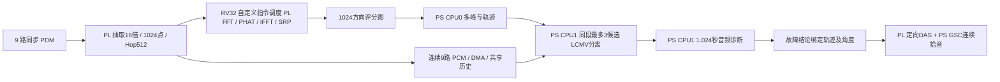

> 当前实现状态以 [2026-10-25 优化完成说明](circular9_optimization_completion_20261025.md) 和最新源码哈希验收为准。本文件保留前阶段架构、C9S2 或旧几何的历史说明；当前分离契约为 C9S3，PL/PS 已实现共享细化延时、实际协方差、多频带辅助搜索和硬件测速。下文历史数值不自动作为新版本证据。

# 9 麦方向定位、候选分离和 PS 诊断实现

2026-10-25 按用户确认的安装方式实现：阵列竖放，正常机器声、故障机器声、干扰音三个音箱均放在阵列正面的 180° 内。只输出方向角，不搜索距离。本文补充原实施方案，不改写原文件。

## 运行链路



候选分离在 PS CPU1 执行，先分离音频，再执行诊断。PL/RV32 保留定位硬件加速及最终所选方向的连续 DAS；PS 原有 GSC 自适应闭环保留。不能将本实现描述成“PL 已并行完成三路完整频域源分离”。当前 FPGA 的 RTL 未变化，61 个 RTL 文件与已完成布线的 bit 对应源码一致，新的方向 LUT 和 RV32 程序由 PS 在启动时加载。

方向坐标为正前方 0°、向右水平角为正、向上俯仰角为正。32×32 个角度格覆盖前半球，两轴步长 5.625°，无距离维度。离散网格的最坏球面量化误差约 3.977°；这不是实物测角精度保证。方向定义、时差符号、前后镜像和近场边界见 [方向扫描说明](circular9_direction_scan_20261025.md)。

## 多声源与分离

`circular9_candidates.c` 从方向图提取最多三个局部峰，按球面夹角去重；当前 25° 去重门限不是物理可分辨角的保证。PS 每约 20 ms 读取一个完整方向图，跨帧指数积累证据，但候选必须仍有本帧的局部峰支持，历史峰不能单独保活。对曲率有效的峰做二维局部拟合，保留粗网格编号及角度不确定度；边界、平坦和鞍点拒绝细化。细化角度用于 PS 分离，PL 连续 DAS 仍选择原网格。

`circular9_tracking.h` 按角度关联而非能量排序保持轨迹 ID。漏检最多保留约 150 ms，期间不授权故障定向；恢复需连续三次有效观测。提交诊断还要求同一锚点的完整采样窗口至少有 90% 方向支持。短时丢峰不必重新积累整个一秒，长期丢失、明显移动或采集换代则重新确认。详细变化见 [本轮优化](circular9_optimization_20261025.md)。

CPU0 保存 3.3554432 秒的九路历史，约 14.68 MB，位于单独 16 MiB 非缓存段。每个槽写入前失效，PCM 与版本原子访问并带 ARM 屏障。CPU1 复制 160256 个原始帧到自身缓存内存，前 256 帧供滤波预热；三个候选使用同一份独立拥有的快照，不从不同时间的三段声音拼凑比较。

每路先用 127 tap 抗混叠滤波并 4:1 抽取到 39062.5 Hz，再做 1024 点、512 点步长的 STFT。C9S2 改为扇区保护的正则化约束波束形成：对目标中心保持单位增益，约束附近角度的增益变化，对其他候选的方向扇区做软抑制，并限制权重范数。噪声模型由单位阵和导向扇区构造，尚未估计实际声场的噪声协方差；不能称为已完成盲源分离或实测自适应 MVDR。第一版 C9S1 的单点最小范数 LCMV 作为历史对照。多约束波束形成的公式参考 [Habets 等 ICASSP 教程第 2 部分](https://www.audiolabs-erlangen.de/content/05_fau/professor/00_habets/06_activities/ICASSP-2013/2013_LPMAP_Part_2.pdf)。

输出为每候选 40000 个采样、1.024 秒，约 305–7973 Hz。约束病态、白噪声增益过大或零陷不满足要求的频点不进入诊断音频；报告保留频点掩码、目标约束误差、扇区增益、泄漏功率比、权重范数和可用位。死通道、削顶、空间条件不足或保留能量不足时不提交有效故障判定。C9F2 的载频工程配置为 2200–4600 Hz，分离还要求此带至少 95% 频点可用、连续缺失不超过三个频点；该频带未经真实 6004 声学验证。训练和推理核对 C9F2/C9S2 契约及滤波掩码，旧特征或未知滤波状态拒识。

多个声源同方向、方向太近、低频空间可分性不足、混响或导向误差会造成串扰。当前只是受约束的空间分离，不能承诺三个任意声源完全独立。尤其不能把“某候选比其他候选响”作为故障标签。

## 调度和结果有效性

CPU0 负责 DMA、连续 GSC、约 100 µs 的定位结果轮询、网络和低速多候选调度。约 20 ms 的候选图读取不改变 RV32 的快速发布步长。方向图按完整发布序号读取，32 格分块，500 µs 协作预算内多次让出给音频/定位服务。序号改变、重复序号、PL 时间戳过期都会拒绝该图；200 ms 无新有效图后清除轨迹。网页和 JSON 格式化也分段让出。`map_copies`、`map_retries`、`map_copy_max_us`、`candidate_service_max_us` 暴露复制饥饿和 CPU0 候选计算耗时。

CPU1 独占分离工作区和特征提取器；共享作业及结果双缓冲使用 acquire/release 所有权。CPU0 持有结果时 CPU1 不重写，HTTP 每次最多复制 512 个音频样本，并要求快照序号一致。计算不能停住采集；CPU1 忙时不排队积压过期诊断。512 ms 只是调度 hop，不等于 2 Hz 诊断更新；不宣称该更新节奏已达成。

每份诊断保存轨迹 ID、角度格、方位角/俯仰角、epoch、历史 session、快照起点和 RPM 配置代次。RPM 必须人工确认，范围 600–1800；确认后要积累新的完整窗口，改速再改回来也不能复活旧结论。采集 session/epoch 改变后转速需重新确认。主峰和诊断的采样时间不能混用。

启动默认“跟踪已诊断故障方向”。未确认目标时 `D3` 保持定位评分计算，但撤销定向音频的目标可信状态。仅有一个当前有效且模型接受的故障候选时，用 `D1+grid` 选择目标；目标过期或多个故障候选冲突时撤销。人工点选和“跟踪最强峰”是独立的测试模式，均不代表已找到故障。

## 诊断窗口及模型

1.024 秒内，600 rpm 对应约 10.24 转，1800 rpm 对应约 30.72 转，保留此观察长度以支持周期冲击和包络特征分析。C9F2 先选带取解析包络、抗混叠降采样为 2500 个包络点，再用一次 4096 点 FFT 分析整个观察段，替代原来的 24 次 8192 点 FFT。补零后的 0.596 Hz 频点间隔不是实际分辨率；Hann 等效噪声带宽约 1.465 Hz，第一零点偏移约 1.954 Hz。首次诊断还包括方向稳定、完整快照、分离与诊断计算；毫秒级定位和秒级故障确认分别验收。以后只有在真实 PS 算力及独立录音准确度通过后，才考虑重叠诊断窗提高更新频率。

当前没有用户目标机器的已验证真实模型，默认 `unknown/no_model`，不会自动把任何音箱标为故障。代码支持正常基线、正常/故障/干扰三类模型、未知拒识及验证状态；正常基线的异常不等于机械故障。模型需要同一分离链路产生的真实正常、故障与干扰录音训练，并用独立录制验收。流程和音频导出命令见 [诊断数据工作流](circular9_diagnosis_data_workflow_20261025.md)。

主要接口：

| 接口 | 用途 |
|---|---|
| `/api/heatmap` | 无距离参数的方向图 |
| `/api/candidates` | 候选轨迹、角度、分离状态、诊断、特征及版本 |
| `/api/rpm?value=1500` | 人工确认实际 RPM，重新开始有效采样区间 |
| `/api/target/fault` | 等待/跟踪诊断接受的故障方向 |
| `/api/target?grid=528` | 人工指定角度格进行拾音测试 |
| `/api/target/auto` | 跟踪定位主峰，不表示跟踪故障 |
| `/api/candidate/audio?sequence=N&index=I&offset=S&count=C` | 同一快照的候选分离 PCM，`C<=512` |

网页采用方向热图，故障红框必须通过模型、轨迹、分离和新鲜度检查；其余热图颜色只表示定位评分。可以导出三个候选的同段音频供对照试听和训练。

## 验证及上板边界

- 方向/LUT 独立检查、32 个连续重叠窗及 D3→D1→D3 仿真通过。首个对齐 PCM 到 RV32 发布为 9.153775–9.155650 ms；PDM 引脚输入仿真为 9.159225–9.162625 ms。Hop 为 3.2768 ms。
- 三个同频带无混响合成源，弱目标比最大干扰低约 18 dB：C9S2 精确导向 SIR 30.69 dB，3° 导向误差时 10.18 dB；历史 C9S1 分别为 43.65/8.37 dB，体现鲁棒性与理想零陷深度的取舍。独立离格夹具中细化前后 SIR 为 12.23/27.23 dB。28° 间隔的边界夹具被拒绝诊断；这些数值不能当成实物指标。
- 共享历史并发覆盖、epoch/session/回绕、死通道/削顶/重复方向，以及诊断未知保护、模型/频带契约、独立录制数据划分均有数字测试。
- PS 程序使用匹配 XSA 的 Cortex-A9 BSP 实际编译链接，定位自定义指令和硬件模块保留。新增 PS 工作负载的最坏运行时间、同时跑网络时的 10 ms 首次收取截止期，以及三音箱实物准确度尚未测量。

新的方向版本包输出到 `build/circular9_direction_release`，旧 `build/circular9_release` 作为原配套构建证据保留。包包含 bit、XSA、PS ELF、PS 初始化脚本、RV32、LUT、测试报告和本文；打包器核对源文件、实际 ELF、固件和测试哈希。接线完成后先用显式路径和 `-check` 核对：

```powershell
& D:/Vivado/Vitis/2020.2/bin/xsct.bat scripts/run_board.tcl -app ui_app -bit build/circular9_direction_release/pl.bit -elf build/circular9_direction_release/ps_ui.elf -init build/circular9_direction_release/ps7_init.tcl -check
```

本次没有连接、复位或烧写实板。实物通道、声孔几何和标定仍未确认，生产程序保持保护状态；尤其要先按 [上板说明](circular9_board_bringup_20261024.md) 核对原理图 H1 重复 DATA_4、第九麦 DATA_5 未引出的问题。完成电气/通道核对后，再按单声源、双声源、三声源逐步测试，保存每次角度真值和分离音频。最终故障方向能力须等真实模型及上述实物验证通过后才能验收。
