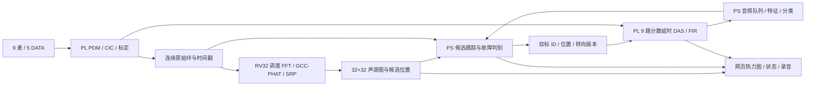

# 9 麦圆阵故障声源定位与定向拾音实施方案

日期：2026-10-22。本文是结合当前源码制定的实施方案，新增能力及指标均为待实现、待验收项。

## 1. 最终目标与方案范围

用户已确认：圆形 PCB 外半径 30 mm，外圈 8 个麦克风，中心 1 个麦克风；最终需要区分故障声源、显示定位热力图，并对故障位置定向拾音。

最终系统以 Zynq-7020 为平台，沿用 PL 内 RV32 自定义指令调度、声学加速器及 ARM 双核应用：

1. 连续采集 9 路真实声音，显示各麦状态并保留可追溯录音。
2. 在已知距离的设备表面扫描平面上显示声源分布，默认 32×32 网格。
3. 结合正常工况基线、候选位置的定向音频和故障特征，标记疑似故障声源。
4. 自动选择可信故障候选，也支持用户点选；持续输出该位置的增强音频。
5. 显示故障类别或“未知异常”、位置、定位可信度、分类得分、频谱和运行状态。

首个完整验收场景定为“一个目标故障声源＋一个空间可分的正常干扰声源”。多个候选可以轮询诊断；同位置、同频段重叠的多个源不承诺分离。阵列定位的是声辐射位置，设备壳体传播可能使其偏离内部实际损伤位置。

设备类型、轴承型号、转速范围尚未给定。硬件与采集架构可以先实施；现有 6205 轴承模型只能作为该设备族的开发起点，不能直接宣称覆盖风机、电机、齿轮、泄漏等所有故障。

## 2. 与当前工程的衔接

| 当前资产 | 源码或记录 | 在新方案中的处理 |
|---|---|---|
| 8 麦矩形生产配置 | `configs/production_array.json`、`docs/planar8_configuration.md` | 改造为外圈 8＋中心 1 的独立配置，重新生成全部几何表 |
| PDM 双相接收、CIC | `rtl/array/rv32_pdm_array_rx.v`、`rv32_pdm_cic.v` | 复用，扩成 5 DATA、10 采集槽，屏蔽空槽 |
| 通道去直流、增益 | `rtl/array/rv32_chan_align.v` | 复用，增加新板的幅度/相位标定配置 |
| 连续定位与搬运 | `rtl/array/rv32_overlap_localizer.v` | 保留重叠窗口和故障恢复；分开存储槽数与有效麦数 |
| FFT/GCC-PHAT/SRP | 当前 PL 声学加速器、`rtl/srp/` | 9 路 FFT、36 对相关、1024 格扫描 |
| 转向、DAS、SIMD FIR | `rtl/beamformer/rv32_das_stream.v`、`rtl/srp/rv32_steer.v` | 支持 9 路平均及新几何，保留分数延时、平滑转向 |
| RV32 生产调度 | `sw/fw/fw_planar8.c` | 建立 9 麦版本，更新通道循环、统计、36 对评分与 ABI |
| 包络谱与分类器 | `sw/ps_features.h`、`ps_classifier.h`、`clf_model.h` | 复用特征/推理框架，用新板真实数据验证或重训 |
| 双核网页与音频队列 | `sw/ps_ui.c`、`ps_ui_page.h`、`ps_pl_live.h` | 作为最终应用入口，接入匹配的 9 麦实时镜像 |
| Live 调试程序 | `sw/ps_live.c` | 保留为链路验收入口，不与网页程序同时运行、争用硬件 |

证据边界：

- [最新双麦改线记录](pdm_both_rewired_20261022.md)已观察到两相更新恢复，但完整独立声学响应与模拟接口裕量尚未全部验收。
- [当前 8 麦生产优化报告](planar8_optimization_20261021.md)给出约 4.91 ms 计算、13.1072 ms 发布间隔，来自 32 窗 RTL 仿真；不能继承为 9 麦真机性能。
- 现有生产报告中自然合成场景仍被质量门限拒绝。必须查清输入、评分和门限口径，不能简单放宽门限制造“定位成功”。
- `ps_ui.c` 默认 `UI_DAS_LIVE=0`，有实时入口，但默认回放不是新阵列实测。
- `ps_diag.h` 等旧注释包含历史接口描述；最终以调用路径和验证结果为准。旧 16×16 网格、旧结果地址也需审计。

## 3. PCB 几何与通道编号

外圈按 45° 等角间隔，中心麦编号 M8。面向声孔正面观察：+x 向右，+y 向上，+z 朝观察者。

```text
                 M2
          M3            M1

      M4         M8         M0       +x →

          M5            M7
                 M6
```

**PCB 外半径 30 mm 为用户约束；声孔圆半径建议 25 mm，尚不是已确认机械尺寸。** 这给封装与板边留下名义 5 mm 空间，最终还要检查声孔相对封装的偏移、连接器、固定孔和加工边界。若用户所说的 30 mm 实际指声孔圆半径，应重新确定板外形，不能把声孔直接放在板边。

| 麦/有效通道 | x / mm | y / mm | z / mm | 接收槽 |
|---|---:|---:|---:|---:|
| M0 / CH0 | 25.000 | 0 | 0 | 0 |
| M1 / CH1 | 17.678 | 17.678 | 0 | 1 |
| M2 / CH2 | 0 | 25.000 | 0 | 2 |
| M3 / CH3 | −17.678 | 17.678 | 0 | 3 |
| M4 / CH4 | −25.000 | 0 | 0 | 4 |
| M5 / CH5 | −17.678 | −17.678 | 0 | 5 |
| M6 / CH6 | 0 | −25.000 | 0 | 6 |
| M7 / CH7 | 17.678 | −17.678 | 0 | 7 |
| M8 / CH8 | 0 | 0 | 0 | 8 |
| 未安装 | — | — | — | 9，无效 |

坐标指声孔中心，算法用米，建议几何实测误差控制到 ±0.5 mm 内。中心麦参加定位、拾音和健康监测；它增加了 8 条中心到外圈的基线，但不增加最大孔径，也不能消除平面阵列前后镜像。

按上述建议布局、声速 343 m/s 计算：相邻外圈间距约 19.134 mm；最大孔径 50 mm；最大几何时差约 145.773 μs，即 39.0625 kHz 下 5.694 个样点。现有 32 点相关环在几何范围上够用，还须给标定修正及插值留余量。

原 8 麦矩形名义最大孔径约 87.09 mm，新板更紧凑；麦数增多不意味着定位分辨率提高。相邻基线半波长尺度约 8.96 kHz，直径基线对应约 3.43 kHz；这些是单基线尺度，不能据前者承诺整个阵列到 8.96 kHz 都没有伪峰。

## 4. 麦克风与电气接口

建议采用同型号、同批次 PDM MEMS，优先直接贴片，避免把尚未确认针序的旧模块接口直接复制到新 PCB。

若采用仓库既定候选 IM73D122V01，其供电范围包含 3.3 V，2.5 MHz 属于支持的时钟区间；LR 接 GND/VDD 分别选择相反输出相位。器件封装、声孔及焊盘必须按原厂图设计。[Infineon 数据手册](https://www.infineon.com/assets/row/public/documents/24/49/infineon-im73d122-datasheet-en.pdf?fileId=8ac78c8c83cd3081018409cafdfb46db)

采用四组双麦共线＋一颗中心麦独占第五条线：

| 工程端口 | 麦克风 | LR 配置 | FPGA 封装脚 | 载板针脚 |
|---|---|---|---|---|
| `pdm_din_i[0]` | M0 / M1 | GND / VDD | T14，沿用现配置 | J3.34 |
| `pdm_din_i[1]` | M2 / M3 | GND / VDD | Y17，沿用现配置 | J3.32 |
| `pdm_din_i[2]` | M4 / M5 | GND / VDD | W16，沿用现配置 | J3.35 |
| `pdm_din_i[3]` | M6 / M7 | GND / VDD | T15，沿用现配置 | J3.33 |
| `pdm_din_i[4]` | M8 / 空槽 | GND / 不安装 | 建议 Y16，新增 | 候选 J3.31 |
| `pdm_clk_o` | 全部 9 麦 | 共用 | V16，沿用 | J3.36 |

前四条线的封装脚以当前 `ps_pl_wrapper.xdc` 为依据；J3 针脚与新增 Y16 参考 `docs/board_io.md` 的载板映射。该文档混有旧 12 麦逻辑编号，不能照搬旧通道顺序。出图前需要与实际载板版本原理图、引脚占用及 VCCO 对照；本表不是新板已实测接线。

PCB 要求：

- 9 个声孔朝同一面，背面布连接器和较高器件；外壳、固定柱不能遮挡声孔。
- 每颗独立去耦，建议预留 1 μF 和 100 nF；最终装配依据所选器件手册。电源入口预留滤波及储能，地回流连续。
- CLK 驱动端、各麦 DATA 输出端预留串联阻尼电阻；初始可用 33 Ω，最终按实际负载、边沿及采样窗口调整。CLK 扇出缓冲是否需要由负载和实测决定。
- LR 固定电平，保留可重配电阻和测试点；每颗 DATA 支路可通过电阻拆开，便于单麦对照。
- 5 根 DATA 预留弱下拉，初始 100 kΩ 可选装；不把该电阻或 `frozen` 当作缺麦可靠判据。
- 提供 CLK、5 DATA、LR、VDD/GND 测试点；排线有明确方向和回流地，尽量短，建议控制在 15 cm 内。
- 先在 FPGA 接收端同屏测 CLK/DATA，依据手册和新板实测稳定区确定采点。现有 125 ns 默认与 175 ns 诊断值均不能不经验证直接定为最终值。

## 5. 最重要的软件/RTL约定：10 槽存储，9 麦计算

建议统一配置字段，避免一个 `channels` 同时表示物理麦数、存储宽度与算法规模：

```text
physical_mics       = 9
pdm_lines           = 5
capture_slots       = 10
active_mask         = 0x01FF
algorithm_channels  = 9
pair_count          = 36
packed_words/frame  = 5
```

接收器使用 `N_CH=10, MICS_PER_LINE=2`，第五线相位 A 对应 M8；相位 B 即槽 9，在接收适配层显式标无效并清零，再进入存储与应用接口。它可能读取到 M8 的电容保持副本，不能按一个正常麦参与算法。

每个 32 位字放两个 16 位样点：第 0～3 字为 CH0～CH7；第 4 字低 16 位为 CH8，高 16 位固定 0。512 帧每 bank 为 10240 字节，双 bank 为 20480 字节；按此格式连续原始数据为 781250 字节/秒，不含协议开销。

必须同时完成：

1. 接收和原始存储按 10 槽/5 字寻址；定位只对 0～8 做 9 次 FFT、36 对相关。
2. 统计、削顶、冻结、音频有效性只检查有效掩码；空槽不能触发静音拒绝，也不能获得增益或几何坐标。
3. SRP 表为 `36×1024=36864` 项；9 麦转向表为 `9×1024=9216` 项，统一通道对顺序与时差符号。
4. DAS 明确对 9 路求和并按 9 归一化，保留对称舍入和饱和；不能沿用当前默认除以 8 的分支。
5. 不仅改数组长度，还要审计 5 字步长、bank 深度、地址宽度、奇数通道尾字、结果字段和 PS 解包。

当前 `rv32_overlap_localizer.v` 的 `CHANNELS/2` 同时用于原始缓存寻址，而 `CHANNELS` 又控制 FFT 与配对。因此要引入独立的存储槽数/有效通道参数或适配接口，不能直接把 `CHANNELS` 设成 9 或让 10 槽生成 45 对。

## 6. 端到端分工与数据流



PL 负责确定节拍的采集、滤波、定位算术、缓存和单束实时拾音。RV32 继续发自定义指令，保留输入质量检查、结果可信度、搬运恢复和转向控制。

PS CPU0 负责数据接收、结果快照、目标选择及网络；CPU1 负责长窗特征、分类、候选音频分析。双核复用当前队列/共享内存思路，明确所有权及缓存维护。PC 用于正常/故障数据采集、离线验证和模型训练；最终运行不依赖 PC 做核心推理。

诊断任务不能阻塞采集、网页或 PL 音频。算力不足时降低候选诊断轮询率并显示结果时间，不静默丢样或把过期结论贴到新目标。

## 7. 定位热力图

基线保留 1024 点 Hann 窗、512 点 Hop、GCC-PHAT＋SRP，启用分数时差表和相关值插值。39.0625 kHz 下窗长 26.2144 ms、Hop 13.1072 ms。

默认扫描前方 `z=0.30 m`、`x/y=±0.20 m` 的 32×32 平面，便于复用现工程。实际使用时安装阵列并测量到设备表面的距离，生成匹配的扫描配置。改变距离、阵列姿态或声孔坐标必须更新几何表。平面阵列的 z 正负镜像通过“设备位于正面”这一安装约束排除；不输出未经测量的三维距离。

网格步距约 12.9 mm 只是显示/搜索间距，不是厘米级精度保证。若叠加设备照片，还需相机标定和声学/图像坐标配准；第一版采用带坐标的平面图即可。

当前定位缓存保存 FFT bin 6～213，约为 229～8125 Hz。先复现这条基线，再增加可配置频带权重：按正常工况谱与异常增量选择有用频段，抑制低信噪比频点，检查不同频段的峰是否一致。不能只保留单个纯音峰，也不能把包络中的低频故障阶次直接当成具备同等定位分辨力的声载频。

输出完整评分图、候选列表、非局部峰对比、有效频点/通道信息与时间戳。UI 建议 10～20 Hz；内部可以保持每 Hop 计算。每帧归一化热图只用于显示；跨时间异常比较应基于固定口径的功率/特征，不能用自动拉满的颜色判故障。

## 8. 故障源判别：从候选位置到设备异常

仅对全图最高峰做分类会追随更响的正常声源。最终必须包含以下关联过程：

1. 在目标设备正常运行的不同转速/负载下采集基线，保存频谱、包络特征、空间区域及配置版本。
2. 从声源图提取局部峰，同时保留用户指定的设备区域；候选按实测主瓣宽度合并，不能把一个主瓣的相邻网格当作多个源。
3. 对可分的 2～3 个候选，在同一段 9 路原始 PCM 上形成候选定向音频，计算异常程度与故障特征。首版可在 PS 顺序处理，基准测试后确定候选上限和更新周期。
4. 用正常基线异常分数、类别得分、定位可信度及连续时间确认选择目标；保留“正常 / 疑似故障 / 未知异常 / 无法判定”状态。
5. 锁定目标后由 PL 持续定向拾音；其他候选低速复核。用户点选可覆盖自动选择，并清楚显示当前模式。

现有分类框架是 100 棵树、18 维特征，类别为 normal / outer / inner / ball。`ps_features.h` 使用 40000 点即 1.024 s 音频，8192 点 FFT、50% 重叠共 8 窗，1400～4600 Hz 包络载频带，特征阶次为 6205 轴承的既定模型参数。它提供可复用实现，不是新设备的准确率证据。

实施要求：

- 如果目标就是对应轴承设备，先用新阵列、真实转速和真实声音评估，再决定重训；如果设备或轴承参数不同，更新特征定义和模型，不能只换类别名。
- 转速从实测传感器或用户明确输入取得并标注来源。当前 `tacho_i` 未形成已验收转速链，25 Hz 默认值不等于实际转速。
- 训练、验证、测试按设备/录音批次拆分，同一段录音的相邻窗口不得跨集合泄漏。正常转速变化、正常负载变化、人声及风噪应作为负样本。
- 分类投票率不直接称为故障概率；使用验证集确定阈值，并允许模型拒绝未知情况。
- 诊断窗必须绑定 `target_id`、方向版本、采样起止序号、标定/模型版本。跨转向、丢样或未锁定的音频窗应拒绝分类或重新收窗。

为了不漏掉比正常源更弱的故障源，应做“正常源更响”的混合声源测试。若两者在当前孔径/频段下无法空间区分，输出无法可靠归属，并允许靠近设备或缩小检查区域。

## 9. 定向拾音、连续录音与传输

优先复用现有分数延时 DAS 和 SIMD FIR，先把稳定单束闭环做完整。新板需要按实际声孔坐标标定增益、相对时延和输出幅频；按故障载频范围检查 CIC/FIR 衰减，不盲目提高高频补偿增益。

9 路相干目标＋互不相关等功率噪声条件下，理想平均增益为 `10log10(9)≈9.54 dB`；真实机械背景往往相关，不能把它写成必达抑噪值。与中心单麦比较时需保持同一频带和目标增益。

保留方向版本、渐变状态、音频样本序号；切换期间的过渡音频可播放，但不作为稳定目标诊断输入。诊断与监听支路分开，监听用的重采样或响度调整不能偷偷改变分类输入口径。

现有生产原始录音协议会暂停定位，不能直接承担最终候选分析所需的连续原始流。需要新增独立连续记录/DDR 路径，或改造现有 DMA 路径并验证与定位并行；保留原快照接口用于调试。

推荐 PS DDR 原始环至少覆盖 4 秒，按 10 槽格式约需 3.125 MB，不含元数据；由 CPU0 持续收取、CPU1复制稳定快照后处理。队列溢出必须显式记录，并使受影响的诊断窗失效。

`pc/pdm_stream_receive.py` 的 MAGIC 文本虽然是 PDM9，但解码器实际硬编码 12 路和旧 GSC 帧格式，不能当成现成 9 麦协议。新协议至少包含有效通道数、存储槽数、采样率有理数、序号、时间戳、目标/方向/几何/标定版本及丢样计数；同步更新发送、接收和录音解析。

39.0625 kHz 原始文件保留精确采样率元数据；浏览器播放或常规 WAV 导出时明确重采样到 48 kHz，不能直接把原样点标成 48 kHz。

## 10. 具体代码改造清单

以下新文件名是实施建议，本轮仅新增方案文档。

| 范围 | 当前入口 | 要做的修改 |
|---|---|---|
| 配置与构建 | `production_array.json`、`scripts/build_planar8.py` | 建议新增 `circular9_array.json`、`build_circular9.py`；统一生成几何、通道、槽数、掩码、麦对、固件头和清单；通过后再切生产入口 |
| 引脚及顶层 | `ps_pl_wrapper.xdc`、`scripts/apply_pdm_constraints.tcl`、Zynq 构建 Tcl | 新增第五线；目前脚本只支持 4/6/8 DATA，需明确支持 5；顶层端口宽度和外部时序检查同步更新 |
| SoC 参数 | `rtl/soc/rv32_soc.v` | 分开 10 槽 PDM、9 麦算法；更新仅对 8/12 开启的加速器、lane 及发布参数分支 |
| 采集打包 | `rv32_pdm_array_rx.v`、`rv32_pdm_capture.v`、通道适配层 | 10 槽接收、slot9 屏蔽、5 字打包、正确 bank 大小及有效掩码 |
| 定位搬运 | `rv32_overlap_localizer.v` | 存储按 10 槽，FFT/统计按 9 麦，配对按 36；检查地址、越界、窗口连续性 |
| SRP/转向 | `rtl/srp/` | 36 对 LUT 与 9 路转向表；检查时差符号、中心麦和表容量 |
| DAS | `rv32_das_stream.v` | 9 路增益归一化、舍入饱和及调度周期；空槽不参与 |
| RV32 固件 | `sw/fw/fw_planar8.c` | 建议新 9 麦入口；45 字统计、36 对评分口径、新标识、目标选择/转向协议 |
| PS 集成 | `ps_pl_live.h`、`ps_live.c`、`ps_ui.c`、电平/定位接口 | 明确 9 麦分支，禁止落入旧默认镜像；统一 32×32 网格、结果 ABI、时间和版本 |
| 诊断关联 | `ps_diag.h`、`ps_features.h`、`ps_classifier.h` | 接真实候选音频；新增长期基线、未知拒绝、目标绑定；校验训练特征契约 |
| 网络与录音 | `pdm_stream.*`、`pc/pdm_stream_receive.py`、UI 相关代码 | 新版 9 麦协议、完整热图、连续原始流、增强音频和显式错误状态 |
| 验证与打包 | 当前 planar8、PDM、PS/UI 检查脚本 | 增加 9 麦配置；配套 bit/XSA/ELF/LUT/模型/标定哈希，拒绝混装 |

新构建配置需记录 `geometry_status=proposed`、`physical_mapping_confirmed=false`、`board_tested=false`，分别在机械确认、实物映射及验收后更新，不能随代码编译成功一并置真。

## 11. 分阶段交付与验收

下表数值为开发目标，尚未由新板证明；失败时应报告条件与实测结果，不能直接降低指标宣称完成。

| 阶段 | 交付物 | 必须满足的退出条件 |
|---|---|---|
| A：设计冻结 | 坐标、原理图、引脚/物料表 | 明确外径与声孔半径，核对实际器件 LR、载板版本、供电及封装；所有声孔位置可制造 |
| B：9 麦数字链 | 9 麦配置、RTL、固件、独立参考 | 独立 PDM 激励逐通道核对；slot9 污染不能影响有效结果；5 字打包无错；36 对/LUT顺序正确；第 9 路 DAS 归一化正确 |
| C：新板采集 | 匹配 bit/XSA/ELF、9 路录音与标定 | 每颗逐一声学激励并核对映射；两相电气窗口合格；增益/相对时延记录；连续 30 分钟无未报告丢样 |
| D：定位与拾音 | 完整热图、人工点选、连续增强音频 | 受控单声源网格测试、分频伪峰检查；定位质量通过后才自动转向；连续音频不间断 |
| E：异常判别 | 正常基线、真实数据集、可拒绝分类器 | 独立测试集混淆矩阵、未知负例、变转速/负载；合成回放与实物数据明确区分 |
| F：完整闭环 | 自动故障目标、热图标记、监听/录音 | 同时存在故障源与更响正常源时，在可分条件下关联正确；换目标后重新收诊断窗；断麦、断网及队列故障不输出虚假成功 |

建议验收口径：

- **实时性**：基线单图每 Hop 计算完成，截止期 <13.1072 ms，内部目标 <10 ms；网页完整热图 ≥10 Hz。候选多频图若超预算，应独立低速调度，不挤占连续音频。给出 P95/P99 和最大值，不能只报平均值。
- **实现资源与时序**：9 麦完整 SoC 重新综合、布局布线，报告 LUT/FF/BRAM/DSP 使用量；40 MHz 内部建立/保持时序满足要求，DRC 无未解决错误。外部 PDM 输入窗口另按器件和板级延迟验收，内部 WNS 为正不能代替外部接口证明。新增原始流路径与诊断负载必须参与最终吞吐测试。
- **定位**：初始标准场景 z=0.30 m、中心 x/y 各 ±0.15 m，目标宽带声在 2～8 kHz 有足够能量，阵列处目标/背景功率比 ≥10 dB；建议至少 25 个实测位置、每点 3 次，目标二维误差 P90≤5 cm，并报告拒识率，目标≤10%。另报外围、纯音、低频及混响下的结果，不将该指标外推到所有机器。
- **定向拾音**：可分的目标与干扰声，用已知干净信号评估；相对中心单麦目标增益归一后，开发目标为目标/干扰比改善 ≥3 dB。测试位置、频段和是否混响必须记录。
- **诊断**：先保留 1.024 s 特征窗，初始发布目标每 2 s 一次稳定目标结果；首次有效结论至少需要完整稳定音频窗及计算时间，不采用定位的毫秒级延时口径。测候选轮询时延并显示结果年龄。
- **分类**：限定设备族与测试工况后，以独立录音批次为测试单元，开发目标为已知类 macro-F1≥0.85、正常窗误报率≤5%；同时报告各类召回率、未知异常表现及每小时误报警事件数。类别样本不足时只交付异常检出，不宣称具体故障分类达标。
- **可靠性**：原始流、定位窗和音频流序号分别验收；临时冻结、缺麦、饱和、方向过期、处理超时均有明确状态。冷启动、连续运行、原始录音和网页同时开启都要覆盖。

## 12. 推荐执行顺序

先完成 A/B，并使用现有双麦平台完善相位与独立响应对照；新板到货后执行 C。C 通过后先做人工点选定位/拾音的 D，再把真实定向录音接到已有特征分类链完成 E，最后实现多候选关联和自动选故障目标的 F。

最先修改的代码应是配置生成、5 DATA 顶层、10 槽/9 麦分离以及 DAS 除以 9；最先补齐的产品数据应是目标设备的正常录音、故障录音和转速/负载标签。最终交付需同时包含可复现构建包、PCB/映射资料、标定参数、模型版本、实际测试报告和操作说明。
