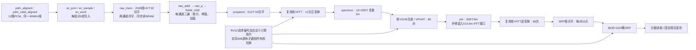

# 12麦连续运行、RAW覆盖与零静默丢窗验收

任务依据：`D:\Users\xyfhhh\Downloads\fengxianyanshou.md`，原文副本在`build/localizer12_safety/taskbook.md`。入口HEAD为`1f5ae420cf914458303df17c2cc47366bf963de0`；原有父目录文档删除保持原样，没有reset、提交、烧板或写Flash。既有已验收产物由`protected_artifacts.json`记录哈希，最终检查必须全部不变。

本报告以数据安全为首要判据。最终统计由`scripts/report_localizer12_safety.py`从实际日志生成；未完成的构建和测试不算PASS。中间版`validated`/`final`目录保留历史结果，最终候选使用`release`及`final_implementation`，不能混用源码哈希。

最终结论：本次规定范围的非周期256/1024窗、相关功能/访存回归、压力故障隔离及匹配当前RTL的40MHz实现已通过。固定节拍停顿边界逐阶段列示，长停顿的CORRECT_LATE/EXPLICIT_LOSS不冒充严格实时成功。完整产物及哈希为`build/localizer12_safety/release_manifest.json`，交付门控输出`LOCALIZER12_SAFETY_PACKAGE_PASS`。

## 信号与所有权



采集、RAW写入、RAW读取和计算均在同一40MHz时钟域；这段通路没有异步CDC。输入24位PCM取`pcm_i[ch*24+8+:16]`，两个16位通道打包一字，地址`(sample_seq mod 2048)*6+(channel>>1)`。八路SIMD音频FIR仍独立连续运行。

`pending`只有一个待启动窗口槽，忙时新窗口到达会显式增加`window_drop`，并不存在能吸收任意CPU停顿的多窗队列。1024点窗口不是一次性复制到完整12通道工作RAM：各通道读取三遍，通道之间穿插FFT，所以RAW最后依赖时刻须包含此前通道FFT输入、计算和读回。

## 覆盖生命周期的精确口径

设窗口最早样点为F，组n输入有效拍为V(n)，连续正常输入满足`V(n+1)-V(n)=1024`。组写入在输入拍锁存后，分别于`V(n)+1 ... V(n)+6`写word0...word5。第c通道对应字在：

`D(n,c)=V(n+2048)+1+(c>>1)`

开始覆盖旧数据。窗口最后样点的有效拍为`Tready=V(F+1023)`，因此最旧word0首次覆盖为：

`D(F,0)-Tready=1025*1024+1=1049601拍=26.240025ms`。

```text
Tready          +6      +7       +8          +9             最后RAW_USE          +1049601
最后样点有效 → 最后一字写完 → 窗口调度 → 第一次BRAM读 → 第一次RAW接受 → 12路三遍RAW释放 → 最旧word0被覆盖
                                        请求拍          返回/消费拍
```

同步读的`raw_q`在上升沿捕获旧RAM内容；监测器按READ_FIRST影子RAM处理同拍读写，先求读返回标签，再更新写标签。每个RAW_USE都比较全局期望样点序号、影子返回序号和非周期PCM值，覆盖三遍全部读取，正常每窗**36864次**。返回与请求只差一拍，RAW端没有ready反压协议，因此不能合法地任意增加RAW BRAM返回拍数；算子侧反压、核访存应答等待分别通过各自已有接口注入。

两个不同的RAW裕量分别报告：

1. **逐读取覆盖余量**：`D(F+n,c)-RAW请求拍`，对每次实际使用的数据取最小值。请求拍同时写入同地址时虽仿真READ_FIRST可返回旧字，本验收仍以正余量作为正常通过口径。
2. **全部RAW释放的保守余量**：`D(F,0)-最后一次RAW_USE拍`。它要求整窗所有RAW访问在最早覆盖之前完成，比逐读取生命期更保守。

若将逐读取余量的终点改为下一拍RAW_USE有效消费，数值比请求拍口径少1拍：正常最小956064拍=23.901600ms。请求拍已经把正确数据捕获到raw_q，不能再把BRAM本体的覆盖时间直接等同于该寄存器数据失效。逐请求CSV同时列出请求、返回/消费及覆盖拍，便于核对边沿。

输入/发布预算另算：Hop是524288拍；`Hop-max_compute`是计算预算，`Hop-max_latency`是发布预算。RAW环容量52.4288ms、上述覆盖余量、约5ms计算预算及约3.28ms发布预算都不能互相替代。23ns BRAM路径和WNS/WHS不能加到毫秒级算法延迟。

## 实测发现与最小修复

| 问题 | 修复前实际证据 | 最小变化及代价 |
|---|---|---|
| HALT丢失WB内容 | PHAT阶段5000拍HALT后互谱退休65次，预期66；组合压力出现分数不符 | `rv32_core`的MEM/WB在HALT时保持，退休和寄存器写入仍单独门控；不增加数据缓存 |
| 报错后仍能发布结果 | 长SRP等待增加window_drop后，继续出现RESULT_AFTER_LOSS | 本地sticky failed状态，错误同拍优先取消窗口、屏蔽搬运和后续结果；复位才清除故障，重新使能不能掩盖计数 |
| 采样计数器回卷静默跳窗 | 调度专测FIRST 512→2048，预期1024，raw_drop/window_drop仍0 | 增加一位window_primed，替代回卷后失效的`>=1024`预热条件；原2048点缓存不扩容 |
| EX接受不等于WB退休 | SRP请求后偏移31拍HALT，硬件可完成，但SRP指令仍未退休 | 定位专用FFT/GCC完成通知改为实际退休；定位专用SRP门铃由退休后寄存发出，通用接口保留 |

回卷专测将已经正常运行的相对计数整体平移2048整数倍，并相反平移`source_first`，保持环地址和全局样点内容不变，跨过32位零点；不是声称在板上运行了30.54小时。正常采样下32位组计数约30.542小时回卷。修复后专测连续FIRST 1024、1536、2048、2560，全部RAW值一致。该专测及reset/disable/reenable专测使用算子握手桩，只证明控制器与RAW行为，不能冒充真实FFT/GCC/SRP算术回归。

故障处理不会降低计算规模，也不通过停采样换PASS。测试输入在首次启用后持续提供；故障后的固件可显式关闭定位，但音频输入仍继续。故障窗口不发布；已显式丢失的场景记EXPLICIT_LOSS，不记实时成功。

错误计数表示故障事件；failed状态下不再声称持续处理窗口，也不能将计数1当作后续总共只损失了一个窗口。恢复须显式reset并重新收满窗口。回卷专测还将tick移到32位时钟计数的零点附近，检查跨回卷的固定发布间隔；40MHz下tick约107.374秒回卷，和PCM组计数约30.542小时回卷是两种不同边界。

## 监测与压力口径

非周期输入由32位全局样点索引、通道及seed散列产生，含正负满幅边界值。主seed为20261015，额外seed及外部sample_id回卷另测。独立host C定点模型计算每个新窗口的统计/准备/12路FFT/66对PHAT及IFFT/1024格分数。没有以硬件RAM内容自身作为golden。影子RAW RAM另外记录每个32位字最近写入的样点序号，避免PCM值偶然相等掩盖覆盖。

注入只存在于build中的RTL副本：算子背压同时门控生产者ready与接收端实际accept；访存等待同时门控CPU和fabric应答；产品综合不包含测试门控、影子标签或监测端口。协议保持断言检查反压期间地址/数据稳定，完成通知必须与实际退休一致。组合突发使用互不整除的周期，避免与1024拍输入锁相。

主矩阵的固件轮询是0xD000无读副作用寄存器；另增**真实DTCM读写自检固件**，每次调度循环执行读/写/读校验，错误值触发非法指令使测试立即失败。该固件在build内生成，使用独立ELF，不替换交付的连续测试ELF。DTCM正常4窗及5000、10000、50000、100000、200000、700000拍应答等待共7场景，前6个数据正确，700000拍显式损失；5000/10000/50000拍保持固定发布相位，100000/200000拍的fixed_phase为false，不称固定节拍成功。实际DTCM等待分别为4998、9998、49998、99998、199998、699998个请求有效周期，正常接受229899次、各压力场景均有正的接受计数，证明实际RAM请求受压而非只有CPU HALT。计数requests表示请求有效拍数，不是去重事务数。

粗测覆盖HALT的准备前/RAW早期/RAW末尾/FFT/GCC/PHAT/IFFT/SRP/发布等待，访存等待的六阶段，以及FFT/GCC/IFFT输入背压。每组测试0、5000、10000、50000、100000、150000、200000、300000、500000、700000拍。共183场景。细化逐阶段单独求相邻拍边界，再复测边界±1拍、注入偏移1/31拍、后续窗口及偏移7拍；不能将一个相位的边界称为全局HALT保证值。

`PASS`表示该场景数据正确且在所测Hop截止内；`CORRECT_LATE`表示所有数据正确、无静默跳窗，但结果截止未通过；`EXPLICIT_LOSS`表示明确报错并隔离结果；`ERROR`为真正失败，脚本返回非零。固定发布相位还单独记录`fixed_phase`，避免将可接受的显式降级误称固定节拍运行。

不丢窗完成边界与固定相位边界分别扫描。前者允许CORRECT_LATE，不是最大严格实时HALT值；后者在已有前序结果的窗口上检查所有间隔。每组都只报告实测相邻拍转折，调度轮询相位和注入偏移可能产生非单调性，不能称为所有输入、所有相位的数学全局极限。`before`在首窗是首次数据到齐前IDLE，而在target=2是上一窗口刚发布后的IDLE，两者含有不同长度的空闲时间，必须分别解释。

## 可复现入口与构建隔离

在WSL仓库根目录：

```sh
python3 scripts/check_localizer12_safety.py --windows 1024 --output build/localizer12_safety/release --report-name long1024
python3 scripts/check_localizer12_safety.py --reuse-model --windows 256 --output build/localizer12_safety/release --report-name baseline256
python3 scripts/check_localizer12_safety.py --reuse-model --matrix --jobs 3 --output build/localizer12_safety/release --report-name matrix
python3 scripts/check_localizer12_safety.py --reuse-model --refine --jobs 3 --output build/localizer12_safety/release --report-name boundaries
python3 scripts/check_localizer12_safety.py --reuse-model --realtime-refine --jobs 3 --output build/localizer12_safety/release --report-name realtime_boundaries
python3 scripts/check_localizer12_safety.py --reuse-model --kind halt --phase srp --duration 5000 --target 2 --offset 31 --windows 6 --output build/localizer12_safety/release --report-name replay
python3 scripts/check_localizer12_safety.py --dtcm-probe --kind mem --phase raw --duration 5000 --windows 4 --output build/localizer12_safety/dtcm_probe --report-name wait5000
python3 scripts/check_localizer12_safety_units.py
python3 scripts/check_localizer12_safety_units.py --before
python3 scripts/check_localizer12.py --windows 256 --output build/localizer12_safety/release_periodic256
python3 scripts/check_rv32_mem_regression.py --output build/localizer12_safety/release_regression
python3 scripts/check_rv32_mem_perf.py --output build/localizer12_safety/release_mem
python3 scripts/check_rv32_mem_perf.py --mmio-unrolled --output build/localizer12_safety/release_mmio
python3 scripts/test_overlap50_strict.py
python3 scripts/report_localizer12_safety.py
python3 scripts/package_localizer12_safety.py
```

`--windows 0`的调度固件持续运行；长跑由监测器达到目标窗数后结束仿真，不是固件256窗自停。单场景可以指定seed、phase、duration、target和offset；输出log/JSON及目标窗口全部RAW访问CSV。模型来源受RTL/ROM/C++/wrapper哈希检查，变更后必须重新编译。

原生XSim用`build_live12.py --transfer --windows 4 --output build/localizer12_safety/release_xsim_fw`生成独立固件，再以`check_live16_xsim.ps1 -Transfer -SnapshotFrames 4 -RunTag safety_release4 -TransferBuild build\localizer12_safety\release_xsim_fw`运行。完整Vivado使用`ZYNQ_PROJ_DIR=.../localizer12_safety/final_zynq`、`ZYNQ_OUTPUT_DIR=.../localizer12_safety/final_implementation`、DAS_ACTIVE_CHANNELS=12、LOCALIZER_FLOORPLAN=1、ZYNQ_RESUME_IMPL=0；先确认无并发Vivado。

## 证据与验收范围

实际场景表、相邻拍边界、RAW逐通道/逐pass生命周期、窗口时间线、manifest及报告在`build/localizer12_safety`；最终汇总为`safety_evidence.json`。中间压力测试确实发现过失败，保留原FAIL日志，不能只交付通过日志。

## 已完成的最终实测与改前对照

| 项目 | 改前证据 | 最终实测 |
|---|---|---|
| 输入规模 | 40MHz、12路、1024点/512Hop、2048点RAW、66对、1024格 | 全部保留，未扩RAW、未复制算子 |
| 非周期逐点检查 | 周期2048点向量不能区分同地址新旧样点 | 1024窗、37748736次三遍RAW读取，标签及数值全部正确 |
| 主长跑音频 | 旧256窗131968/131968/drop0 | 525184/525184/drop0、max101拍 |
| 正常非周期256窗 | 无该输入基线 | 256窗全部正确，255次间隔均524288拍 |
| 正常非周期1024窗 | 未测 | 1024窗全部正确，1023次间隔均524288拍 |
| 最后样点→首次RAW接受 | 未单独记录 | 每窗9拍；BRAM请求在前一拍 |
| 最后样点→全部RAW释放 | 未单独记录 | 95567..95588拍，即2.389175..2.389700ms |
| 最旧word0覆盖时限 | 不能由52.4ms容量直接判断 | Tready+1049601拍，即26.240025ms |
| 正常逐读取最小覆盖余量 | 未测标签生命期 | **956065拍=23.901625ms** |
| 全RAW释放保守余量范围 | 未测 | **954013..954034拍=23.850325..23.850850ms** |
| 第一窗口逐读取余量范围 | 未测 | 956065..2095099拍，即23.901625..52.377475ms；最大值为该窗实测，不冒称任意压力下最大值 |
| 非周期最大计算 | 原报告周期向量323568拍 | 323587拍=8.089675ms；输入/固件不同，不作单一RTL因果A/B |
| 同原周期向量256窗最大计算 | 323568拍 | 323586拍，增加18拍=0.45μs；完整黄金与退休计数通过 |
| 正常发布延迟 | 393217拍 | 仍393217拍=9.830425ms，均值/P99/最大相同 |
| 正常计算预算余量 | 200720拍 | 非周期200701拍=5.017525ms；不是HALT保证值 |
| 发布预算余量 | 131071拍 | 仍131071拍=3.276775ms；不是RAW覆盖裕量 |
| 原始丢失/跳窗 | 原正常场景0/0 | 正常256/1024均0/0；压力显式损失独立列示 |
| 粗测183场景 | 123数据成功/47显式损失/**13错误** | **128按截止正确/2数值正确但超发布间隔/53显式损失/0错误** |
| 回卷/重启/同字读写 | 3个专项均复现失败 | 当前3个专项PASS；控制器范围，算子为桩 |
| CPU/PS/FFT/SIMD/capture/SRP | 9项旧回归 | 当前9项全部PASS |
| 访存及严格统计 | 旧76+8+17项 | 当前76+8+17项全部PASS，CSR/exported均100847 |
| 原生XSim | 旧4窗 | 当前4窗全部黄金与真实指令通过，音频2944/2944/drop0 |
| WNS / WHS | +0.622 / +0.030ns | **+0.869 / +0.033ns**，TNS/THS0、40MHz FLOW_PASS |
| LUT / FF | 29752 / 16824 | 29781 / 16856，增加29 LUT/32 FF（完整实现差值） |
| BRAM / DSP / LUTRAM | 111.5 / 132 / 2884 | 111.5 / 132 / 2884，不增加大数据存储 |
| RAW BRAM输出最差所报路径 | 未细分 | 19.492ns，其中布线11.198ns，余量+4.609ns |

1024窗约覆盖13.445秒输入、超过256个RAW环绕周期；4096窗未执行，不以有限仿真证明无限时长可靠性。32位tick/组计数回卷由单独加速边界试验证明控制行为，不声称物理板卡已运行对应时长。

粗测中的两个CORRECT_LATE是发布等待期300000拍HALT/访存等待：全部四窗数值和序号正确、无丢样，但最大结果间隔547306/547304拍，超过524288。它们必须保留为实时未通过，不能因每窗计算仍小于Hop而写成严格实时PASS。

压力最小RAW余量另有单场景重放CSV：`release/halt_raw_500000_w0_o0_n5_s20261015_b0_raw.csv`。最小点为通道3、第三遍、样点0，请求1638036拍、有效消费1638037拍、同字覆盖2165762拍；请求口径余量527726拍。损失告警在1640455拍，最小点确实发生在告警前，非取消消费或报错后的伪样点。该窗口没有发布。它直接说明：系统先受Hop/单窗所有权约束，RAW尚未覆盖也可能必须退出实时态。

实际RAW RAMB位置及WRITE_MODE_A/B在`final_implementation/localizer_bram_locations.csv`：16个RAW RAMB36为A=READ_FIRST、B=WRITE_FIRST；其他RAM存在不同配置，不能统称READ_FIRST。RAW/准备RAM/频谱/PHAT/SRP各自时序报告单独输出。RTL同字读写专测按非阻塞赋值读取旧字，端口模式属性本身不证明跨端口碰撞返回值，仍不替代真实板上碰撞验证。产品生命周期危险边沿优先隔离消费和结果，不依赖该碰撞返回值。

P0风险（静默跳窗、错误后发布、HALT丢WB、退休前所有权切换）均实施最小修复并保留修复前反例；固定节拍在较长停顿下可能失守，必须按后续实测边界表使用，不承诺任意停顿仍实时。部署前的PDM采集、真实几何和实板持续运行仍未验收。

<!-- SAFETY_GENERATED_BEGIN -->
## 实测各阶段临界点与安全裕量（自动从日志生成）

主seed=20261015；下表是指定注入点的相邻拍转折。完成边界在target=0测量，固定相位边界在target=2测量；包含后续窗口验证。带偏移的结果见stress_results.csv，不将本表解释为所有相位的全局极限。

| 类型/阶段 | 首次注入点相对首窗ready（拍） | 尚依赖RAW | 不丢窗完成临界：成功/显式损失（拍） | 固定相位临界：通过/不通过（拍） |
|---|---:|---|---:|---:|
| halt/before | 1 | 是 | 207380 / 207381 | 207380 / 207381 |
| halt/raw | 43 | 是 | 207330 / 207331 | 76257 / 76258 |
| halt/rawlate | 95542 | 是 | 201280 / 201281 | 70207 / 70208 |
| halt/fft | 6668 | 是 | 200705 / 200706 | 69632 / 69633 |
| halt/gcc | 97992 | 否 | 200705 / 200706 | 69632 / 69633 |
| halt/phat | 98080 | 否 | 200705 / 200706 | 69632 / 69633 |
| halt/ifft | 99000 | 否 | 200705 / 200706 | 69632 / 69633 |
| halt/srp | 253396 | 否 | 200704 / 200705 | 69631 / 69632 |
| halt/publish | 323588 | 否 | 408059 / 408060 | 276995 / 276996 |
| mem/raw | 43 | 是 | 207335 / 207336 | 76259 / 76260 |
| mem/fft | 6668 | 是 | 200709 / 200710 | 69635 / 69636 |
| mem/gcc | 97992 | 否 | 200707 / 200708 | 69635 / 69636 |
| mem/ifft | 99000 | 否 | 200708 / 200709 | 69636 / 69637 |
| mem/srp | 253396 | 否 | 200704 / 200705 | 69632 / 69633 |
| mem/publish | 323588 | 否 | 408061 / 408062 | 276997 / 276998 |
| op/fftin | 6155 | 是 | 200718 / 200719 | 69641 / 69642 |
| op/gccin | 97574 | 否 | 200708 / 200709 | 69633 / 69634 |
| op/ifftin | 98486 | 否 | 200717 / 200718 | 69642 / 69643 |

`before`的固定相位测试从前一结果发布后的IDLE开始，相对目标新窗口ready约提前131070拍；表中首窗注入点不能与它直接混为同一时刻。一次停顿落在RAW三遍、核等待、已退休算子自主运行或发布等待，影响不同。

当前全部已记录压力场景的最小逐读取RAW余量为 **527726拍 = 13.193150ms**（含显式损失前的读取）；未出现标签错误后仍发布。正常1024窗的956065拍与该压力最小值分列。

所测18个基准注入位置中，最小的固定相位通过临界点为69631拍（1.740775ms）；它不是52.4ms缓存容量，也不是23.9ms正常RAW余量。偏移与输入种子改变后须复测。

<!-- SAFETY_GENERATED_END -->

仿真证明的范围是所列输入、seed、窗口数、注入位置和协议模型下的数据正确性、显式损失与隔离行为；STA证明的是匹配综合网表在40MHz约束下的建立/保持时序。真实PDM输入、实际麦克风几何、物理BRAM碰撞/板级长跑及真实声场定位仍须板卡验证，不能由本报告宣布实板PASS。
