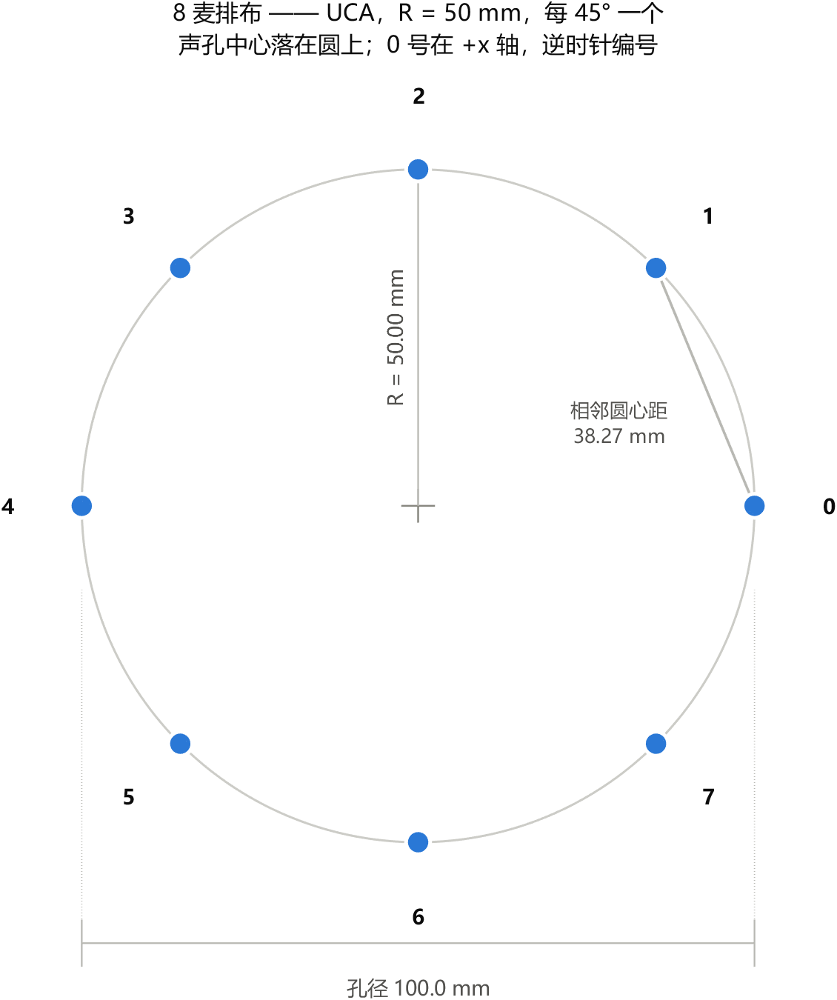
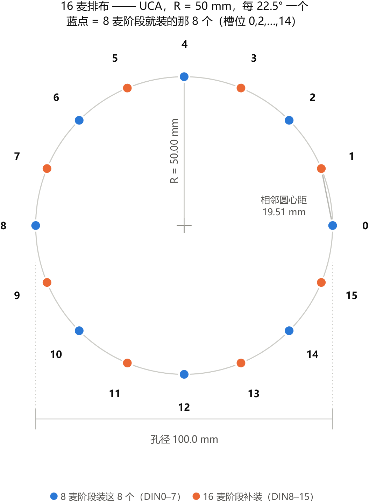

# 麦克风阵列载板排布（8 麦 / 16 麦）

> **2026-10-21 production update:** use the [confirmed planar8 board configuration](planar8_configuration.md). Four shared DINs: T14/Y17/W16/T15; CLK V16; active-low reset N16. The 12-mic three-face board is retired. Circular-array and 12/16-channel specifications below are historical and do not override `configs/production_array.json`.


**这份文档只讲一件事：声孔在载板上的几何排布。**
电气接线见 [`pdm_array_spec.md`](pdm_array_spec.md)（P-xx）与 [`mic_array_spec.md`](mic_array_spec.md)（R-xx），
接主板哪几个脚见 [`board_io.md`](board_io.md) §8。

配图由 `scripts/plot_mic_layout.m` 生成，坐标取自 `scripts/golden/mic_geometry.py`
的 `uca_positions()` —— **那才是权威值**，本文只是把它画出来并配上装配要求。

---

## 0. 三句话

- **8 麦**：半径 50 mm 的均匀圆阵（UCA），每 45° 一个，相邻声孔圆心距 **38.27 mm**。
- **16 麦**：同一个圆、同一半径，每 22.5° 一个，相邻圆心距 **19.51 mm**。
- **8 麦的 8 个位置 = 16 麦位置里的偶数槽位**（下面两张图叠起来看就是这一句）。
  所以 16 槽位的板子先只在偶数位装 8 个，几何与现在的 8 麦阵列**逐点相同** ——
  `mic_geometry`、延时 LUT、已实测的 0.57 cm 定位误差全部照用，一行都不用改；
  以后补装奇数位时再改 `N_MIC` 与接线。





---

## L-01　阵型与半径　【已定，沿用 R-02】

从 **+x 轴起逆时针**，第 k 个声孔的位置是

```
x_k = R·cos(2πk/N)      y_k = R·sin(2πk/N)        R = 50 mm
```

**半径锁 50 mm，不要改。** 改半径不会扩大可用带宽，只会把波束窗口搬到别的频段
（R-02），而且现有全部实测数据都是按 50 mm 做的，改了要全部重测。

**声孔所在平面就是 z = 0**，被测设备在 +z 方向；标称 300 mm 的工作距离从
**声孔平面**量起，不是从载板表面量（R-03）。

## L-02　关键尺寸

| 项 | 8 麦 | 16 麦 | 依据 |
|---|---|---|---|
| 半径（阵列中心 → 声孔中心） | 50.00 mm | 50.00 mm | R-02 |
| 孔径 | 100 mm | 100 mm | — |
| 角度步进 | 45° | 22.5° | — |
| **相邻声孔圆心距** | **38.27 mm** | **19.51 mm** | `2R·sin(π/N)` |
| 声孔位置精度 | ±0.5 mm | ±0.5 mm | R-04 |
| 位置误差占圆心距 | 1.3 % | 2.6 % | 推的 |
| 模块切向净宽上限 | ≤ 32 mm | **≤ 13.5 mm 左右** | R-05（16 麦按同样 6 mm 装配间隙推） |
| 载板尺寸下限 | 130 × 130 mm | 同左 | R-08 |
| 空间混叠上限 | 4482 Hz | 8791 Hz | 半波长判据 `c/(2d)`，见 `mic_geometry.aliasing_limit()` |

**要卡的是「声孔中心」的圆心距，不是模块安装孔距、也不是 PCB 中心**（R-04）。
载板的孔位要按"声孔相对焊盘阵列的偏移"反推 —— 所以 R-23 / P-15 那个模块尺寸清单
（尤其是**声孔中心相对焊盘的 (x, y)**）到货后必须先量。

⚠ **16 麦那一栏的净宽要提前核。** 19.51 mm 的中心距，只有贴片式 PDM 麦（3×4 mm 级）
装得下；I2S 那类 6 脚模块十几毫米宽，当场就装不下。

## L-03　8 麦坐标　【单位 mm，相对阵列中心，声孔中心】

| 通道 | 角度 | x | y |
|:--:|:--:|--:|--:|
| 0 | 0° | +50.00 | 0.00 |
| 1 | 45° | +35.36 | +35.36 |
| 2 | 90° | 0.00 | +50.00 |
| 3 | 135° | −35.36 | +35.36 |
| 4 | 180° | −50.00 | 0.00 |
| 5 | 225° | −35.36 | −35.36 |
| 6 | 270° | 0.00 | −50.00 |
| 7 | 315° | +35.36 | −35.36 |

## L-04　16 麦坐标

| 槽位 | 角度 | x | y | | 槽位 | 角度 | x | y |
|:--:|:--:|--:|--:|---|---|:--:|:--:|--:|--:|
| **0** | 0° | **+50.00** | **0.00** | | 8 | 180° | −50.00 | 0.00 |
| 1 | 22.5° | +46.19 | +19.13 | | 9 | 202.5° | −46.19 | −19.13 |
| **2** | 45° | **+35.36** | **+35.36** | | 10 | 225° | −35.36 | −35.36 |
| 3 | 67.5° | +19.13 | +46.19 | | 11 | 247.5° | −19.13 | −46.19 |
| **4** | 90° | **0.00** | **+50.00** | | 12 | 270° | 0.00 | −50.00 |
| 5 | 112.5° | −19.13 | +46.19 | | 13 | 292.5° | +19.13 | −46.19 |
| **6** | 135° | **−35.36** | **+35.36** | | 14 | 315° | +35.36 | −35.36 |
| 7 | 157.5° | −46.19 | +19.13 | | 15 | 337.5° | +46.19 | −19.13 |

**粗体的 8 行就是 L-03 那张表** —— 这就是"16 槽位先装 8 麦"能成立的依据。

## L-05　⚠ 槽位 → DIN → 通道，**两种配置的映射不同**

这是这份文档里唯一容易接错的地方：**同样一根 `DIN1`，在两种配置下接的是不同的槽位。**

| 配置 | 槽位 → DIN → 通道 |
|---|---|
| **8 麦**（只装偶数槽位，每线一个麦） | 槽位 0,2,4,6,8,10,12,14 → `DIN0..7` → 通道 0..7 |
| **16 麦**（全装，**两麦共线** ← 当前配置） | 槽位 2j 与 2j+1 **共用 `DINj`**；槽位 2j（**LR=GND**，相位 A）→ 通道 **2j**，槽位 2j+1（**LR=VDD**，相位 B）→ 通道 **2j+1** |

> ⚠ **16 麦那行 2026-10-10 改过。** 旧版写的是「槽位 k → `DINk` → 通道 k」，
> 那是 **16 根独立线**（17 根脚）的方案，**已作废** —— 载板从没按它排过线。
> 现在 16 麦走共线：**加装的奇数槽位麦挂到相邻偶数槽位那条线上**，
> 于是 8 麦那 8 根线一根都不用动，**通道号仍然等于槽位号**。
> 见 `pdm_array_spec.md` P-06 与 [issues/090](issues/090-pdm-spec-denied-shared-line-on-an-unmeasured-assumption.md)。

补装的时候如果按"8 麦那根线接哪就还接哪"去接，通道顺序会错成
0,2,4,6,8,10,12,14,1,3,5,7,9,11,13,15 —— **现象是定位结果整体偏，通道级别看不出来**
（和 R-06 的批次问题是同一类"看着都正常、合起来偏"的错法）。

共线之后这条**仍然成立，而且更隐蔽**：同一条线上的两个麦还会因为 **L/R 接反**
而彼此互换通道 —— 而各自单看都完全正常。

**规则一句话：通道号永远跟着 `DIN` 号走，不跟着物理槽位走。** 共线之后完整写出来是：

```
通道号 = 2 × DIN 号 + 相位      （相位 0 = 该线的 L/R 接 GND 的那个麦）
```

接线前先把上表抄在装配图上。

## L-06　画板时跟着排布走的要求

1. **标注**：板上要印出 **+x 方向**（0 号槽位所在的轴）、**阵列中心十字**、以及
   **每一个槽位的编号**。16 槽位的板子还要**分色标出「8 麦配置装哪 8 个 / 16 麦配置装哪 16 个」**
   —— 隔位装这件事只有写下来才不会被装错。
2. **共面**：所有声孔朝 +z，高度差 < 0.5 mm（R-07）。优先**直接焊到载板**；
   要保留可更换性就用带机械限位的座子，不要用普通排母。
3. **刚性**：载板做刚性并给出可靠固定方式 —— 几何一变定位就偏（R-08）。
4. **走线完全不用等长**。板内 100 mm 差异折 0.65 ns，相对 PDM_CLK 的 400 ns 周期可忽略
   （R-13 同一条）。PDM 比 I2S 还宽松：16 根 DIN 各自独立，**通道之间根本没有相对时序要求**。
5. **每根 DIN 配一个 100 kΩ 下拉到地**（P-12）—— 共线之后是 **8 个**，不是 16 个。
   麦不在时它把线钉在 0，断线检测（`frozen_o`）才有个确定的输入可判；悬空 CMOS
   输入会拾噪，`frozen` 永远不置位。
   ⚠ **共线之后这条可能不够**：100 kΩ 对线缆电容的 τ ≈ 5 µs，而半个位周期只有
   200 ns ⇒ 缺一个相位时那半**掉不到 0**，`frozen` 可能根本不置位。待上板量，
   见 `pdm_array_spec.md` P-12 与 [issues/092](issues/092-shared-line-break-detect-may-not-fire.md)。
6. **麦的 L/R 脚不能悬空，而且共线时它是成对的。** 每条数据线上**必须**一个接
   **GND**、一个接 **VDD**（IM73D122 datasheet §3.5 Table 8：LR=GND 的在下降沿
   驱动、LR=VDD 的在上升沿驱动，各自在另半个周期高阻）。
   ⚠ **两个都接成一样 ⇒ 同一半周期两个麦抢同一根线（总线争用）** ——
   轻则数据是乱的，重则长期顶着驱动器。
   **接反的症状**：那条线的两个通道**互换**，而两个各自单看都正常。
   （8 麦配置每线只有一个麦，仍是接 GND。）
7. **8 个（16 个）麦必须同型号同批次**（R-06 / P-08）—— 群延迟不一致会变成 TDOA 里的
   系统偏差，固件和标定都救不了。

## L-07　装配完成后要交的数

**每个声孔的实际 (x, y)**（相对阵列中心，单位 mm，精度到 0.5 mm 量级）。
算法侧按**实际坐标**算时间差，不是按设计值 —— 这个坐标要填进数据里的（R-24）。

坐标表由 `scripts/plot_mic_layout.m` 的画法可复现；实测值回来后，
若与设计值差异超过 0.5 mm，先查装配再查板。

---

## 切换 16 麦时的连带项（还没做，先记着）

- `mic_geometry.py` 的 `N_MIC` 是全局写死 8 的，`aliasing_limit()` 也吃它 —— 改 16 要一起传参。
- 麦克风对数 C(8,2) = 28 → C(16,2) = **120**，延时 LUT 跟着变大。
- xdc 引脚按 `pdm_array_spec.md` P-06 那张表重约束（17 根信号，跨 J3 的 5–14 与 26–36 两段）。
- `rv32_pdm_capture` 与 `sw/ps_pdm.c` 的采集格式：一个样点从 4 个字变 8 个字。
