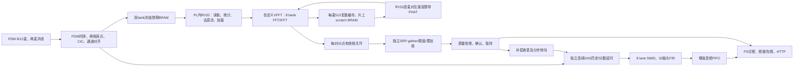

# 8麦平面与12麦立体阵列：系统分析、分阶段优化和验证

日期：2026-10-14。8麦入口为 `F:/RISC-V/pipeline_latest2/zynq_-pl_-simd_-verilog`；12麦入口为 `F:/RISC-V/xyf_workbench_12mic_431e6bf/pipeline_latest3/zynq_-pl_-simd_-verilog`。

第二轮也已完成数字功能与完整40MHz实现验收。**当前结果及交付以§10为准**；§1～9保留首轮基线、当时的分步实验与后续方案依据。没有把未知12麦坐标或真实声场补成合成数据。

这里的8麦是四根共线DIN、两列各四麦的独立矩形版本，不是旧8根独立DIN/4麦对/256格的历史配置。12麦是相邻三个相互垂直面各四麦、六根共线DIN的版本。两套接线、默认参数和固件选择入口保持各自约定。

## 1. 基线、证据和边界

先把12麦源树复制到 `build/system_optimization/reference12`，再建立不可混用的基线和优化实验目录。8麦既有BIT/XSA/实现报告确实存在；12麦原目录未附完整构建产物，其文档中的历史WNS、综合资源不能当作本机可复核的实现报告。本次重新编译、仿真、布局布线和链接PS程序。

数字分四种口径：RTL实际运行的周期；宿主C/浮点模型的算法结果；Vivado独立模块OOC；完整Zynq布局布线。40MHz折算的帧率是数字仿真推算，不是真实阵列上板实测帧率。OOC只约束内部路径，不代表顶层接口时序。没有在本轮下载板子。

12麦 `configs/production_array.json` 的 `channel_positions_m=null`、`geometry_status=awaiting_drawing` 是实质限制。固件默认 `FW_GEOMETRY_CONFIRMED=0`，不扫描SRP、不发布定位、不自动转向。1024是评分容量，尚不是已验证的三维角度网格。因此不能比较“8麦定位帧率”和“12麦电平快照帧率”来声称12麦定位更快。

<!-- MEASURED_RESULTS_BEGIN -->
| 测量 | 8麦基线 | 8麦优化后 | 口径 |
|---|---:|---:|---|
| 定位计算周期（第2～8帧均值） | 2894484.714 | 1904857.000 | 实际RV32+RTL仿真 |
| 采集+计算周期（同上） | 3942441.000 | 2953021.429 | 相同合成PCM、持续DAS/FIR |
| 周期折算更新率 | 10.146Hz | 13.545Hz | 40MHz折算，非板测 |
| 连续音频 / 丢样 | 31056 / 0 | 23327 / 0 | 八帧及收敛后256点逐位 |
| LUT / FF | 27684 / 14017 | 22505 / 13826 | 完整Zynq实现 |
| DSP / BRAM tile | 175 / 57.5 | 111 / 57.5 | 完整Zynq实现 |
| WNS / WHS | +0.514 / +0.030ns | +0.913 / +0.024ns | 40MHz |
| TNS / THS | 0.000 / 0.000 | 0.000 / 0.000 | 无setup/hold失败端点 |

8麦计算加速 1.520 倍，整轮加速 1.335 倍；拍数减少与加速倍数分开报。

| 测量 | 12麦基线 | 12麦优化后 | 口径 |
|---|---:|---:|---|
| 无几何快照总周期（第2帧） | 2411733 | 1668609 | 同编译器、原始统计+DAS链，不是定位 |
| 对应快照周期 / 频率 | 60.293ms / 16.586Hz | 41.715ms / 23.972Hz | 40MHz数字仿真折算 |
| 完整实现LUT / FF / DSP / BRAM | 原目录未带可核对报告 | 26134 / 15588 / 119 / 84.5 | 新做完整实现，不能拿历史综合数作同口径前值 |
| WNS / WHS / TNS | 无本地基线报告 | +0.306 / +0.035ns / 0.000ns | 40MHz，setup/hold失败0 |
| 三维定位 / 真实阵列 | 未启用 / 未验收 | 未启用 / 未验收 | 缺真实XYZ与映射 |

| 声学扩展lane | VCMUL / VPHAT拍数 | LUT / FF / DSP / BRAM | OOC WNS / WHS |
|---|---:|---:|---:|
| 4 | 56 / 160 | 3364 / 174 / 28 / 0.0 | +5.219 / +0.065ns |
| 8 | 30 / 82 | 6445 / 275 / 56 / 0.0 | +4.045 / +0.064ns |
| 16 | 17 / 43 | 10900 / 13820 / 112 / 0.0 | +3.656 / +0.164ns |

源日志和报告SHA256见 `build/system_optimization/summary.json`。上述单元拍数是同一TB握手口径，不是完整固件周期。
<!-- MEASURED_RESULTS_END -->

## 2. 实际模块连接、数据流和时钟域

12麦几何未启用时，从统计进入定位的分支关闭，连续DAS是零补偿等权平均。8麦的定位是固定Z=300mm平面、X/Y±200mm、32×32搜索。两者均为40MHz PL时钟、PDM 2.5MHz、PCM 39.0625kHz、每样点1024拍预算。

内部RV32、AXI寄存器、采集、SRP、DAS与SIMD都在FCLK_CLK0域；PDM时钟由该域计数器产生，接收器在PL时钟上按tick采点，没有把PDM_CLK作为第二个内部处理时钟。外部DIN是需按麦克风三态窗口处理的输入，不能仅凭内部STA通过就声称麦端setup/hold已测量。PS CPU/DDR/网口由PS硬核和AXI接口跨域；多字结果用seqlock保持一致，音频FIFO使用有效读取/消费协议。

`create_zynq_project.tcl`、PDM clkgen/array_rx、AXI slave和TCM模块是时钟与访问证据入口。外部PDM false-path属于当前约束策略，仍欠真实DIN/CLK波形、线长、负载和电压下的窗口验收。12麦使用修正后的纯六线生成XDC，未把8麦矩形J3映射覆盖到12麦。

## 3. 已确认的周期和存储瓶颈

### 3.1 已经有效的数据复用

`fw_live16.c` 逐通道调用 `gcc_spectrum`，把每麦513个复数频点保存在scratch。逐麦对使用 `gcc_cached_pair`。8麦一帧为8次正FFT、28次IFFT，而不是56次正FFT；12麦启用完整定位时应为12次正FFT、66次IFFT。缓存一次FFT的优化已经存在，不能再次计作本轮收益。

FFT和相关工作区在片上DTCM/scratch BRAM，主要问题不是片外DDR带宽或DDR缓存缺失，而是RV32通过load/store和自定义PUSH/POP进行片上搬运。DTCM隔拍应答，MMIO也有登记应答；这些是协议实际开销，不能直接改成组合应答，否则会重现地址/数据错拍。

### 3.2 逐对缓存复制和未使用峰值

旧 `gcc_cached_pair` 每对复制两个1026个int16数组到 `g_xi/g_xj`，然后 `gcc_finish` 扫描1024点求TDOA峰值；返回lag未用于SRP。旧PHAT循环还先计算带外频点互谱，再把其输出清零。

本轮把 `finish_common` 改为读取只读缓存指针；只有限带bin 6..209计算互谱，带外仍清零；SRP路径传空peak指针，不做无消费者的峰值扫描。传统 `gcc_finish/gcc_finish_raw` 保留全相关输出和峰值语义。89组缓存输入、91136个相关样点，以及24组传统API用例逐位一致，并检查输入缓存不被修改。两套工程共用此内核，但12麦当前几何关闭时不会执行逐对分支，不能报它当前已经取得同等定位加速。

### 3.3 采集字重复读取

`channel(ch)` 对低/高半字分别设置INDEX、等待同步RAM、读取DATA。8麦每帧8192次DATA/INDEX访问，实际只有4096个不同采集字；12麦12288次访问对应6144个不同字。该重复由observer按完成的总线事务确认。

暂未把这条改成两通道一遍读取：需要明确第二原始帧的scratch存放、统计寄存器压力、加窗覆盖顺序和同时冻结两bank的所有权。预计总线事务可减半，但总帧周期不能因此直接报“减半”。下一步先在双通道临时帧副本中测周期，再决定是否迁移。

### 3.4 SRP空转推进状态

12麦版已有4拍/格/对的SRP；8麦仍用独立S_NEXT推进。迁移后在S_T3登记写入并推进索引，下一格S_T0提交前一格写；末尾保留一拍排空再发布DONE。保持插值、同步RAM端口及重新启动/禁用语义。跨4/28/66/120对、256/1024格逐位测试和窗口测试通过。8麦扫描143360→114689拍；66对337920→270337拍属于原5拍核对比，不是说12麦入库时仍是5拍核。

### 3.5 12麦未启用几何仍计算FFT

12麦旧固件统计后无条件 `location_prepare/gcc_spectrum`，随后因几何关闭直接continue，没有消费者读取缓存。现在只在 `FW_GEOMETRY_CONFIRMED` 时进行FRAME写入、预处理和FFT，无几何时scratch读写均为0。12路统计、连续DAS/FIR和“定位未启用”状态不变。这里只优化临时无几何通路，图纸到位后的完整66对定位周期仍需重测。

### 3.6 流水线和等待的实际证据

`profile_acoustic_system.py` 只添加仿真observer，不插入固件指令。互斥周期分类按memory→FFT→DIV→VEC→ACOU→load-use→other优先级；SRP和音频活动是可重叠的旁路计数，不与互斥类别相加。函数计数是EX PC驻留，包含停顿和bubble，不冒充精确调用时间。

8麦基线第一帧：3942029个观察周期，memory 492896、FFT 31248、DIV 188826、load-use 221524；VEC和ACOU引起的CPU停顿均0。音频FIR在并行运行，因此“SIMD活动”不是“CPU被SIMD阻塞”。缓存直读等优化后scratch读取124832→61552；IFFT仍完整POP 512字，所以scratch写入44040尚未减少。不能把所有剩余时间归因于FFT算术，FFT核忙拍只是其中一小部分。

## 4. SIMD、自定义指令与硬件资源选择

`rv32_vec_unit` 的8 lane按抽头/样点bank划分，用于32抽头FIR；lane数不是麦克风数量。12麦不需要12 lane。32 MAC/样点、1024拍采样周期，持续FIR工作负载的平均有效MAC为0.03125/PL拍；突发发射期间才是8 MAC/拍。8麦历史最大76拍、12麦复核104拍，均远小于1024拍预算且无丢样；现阶段扩展FIR lane不是首要收益点。

`rv32_acoustic_ext` 是另一条复数向量支路。原LANES参数仅改乘法数量，pass计数器和POP bank寻址写死，4和16 lane实测算错。现已让PW、bank号、word地址和容量随4/8/16 lane变化。8 lane原行为不变；三个配置都通过VCMUL、VSUB、VPHAT、VRED2逐位验证。

这些单元级测试的PUSH=832、POP=416拍包含TB两拍调用节奏，不是核内单条PUSH两拍。完整实际固件的ACOU I/O调用数为0：生产PHAT仍是C实现。选择4 lane备用支路释放资源，不减小连续FIR的8 lane，也不宣称扩大备用核能提升当前定位帧率。通过 `rv32_core.ACOU_LANES` 传参：新矩形8麦和生产12麦选择4，显式兼容配置保留8。

16 lane OOC输入RAM因读口过多退化成大量寄存器，DSP112、FF13820；单元自身能布局通过不代表塞进完整Zynq仍资源可控。修复参数化后先比较数值、存储实现和整机使用情况，再谈最大并行度。

## 5. 时序收敛和无损位宽优化

仅缩备用声学核的8麦完整实现曾得到LUT22559、FF13827、DSP135、BRAM57.5，但WNS仅+0.015ns、WHS+0.049ns。该中间版通过STA，余量明显薄，不直接作为本轮最终结论。

真实最差路径来自FFT `g_pipe[6].twq` 到 `g_bank[*].wr_dat_q`，数据延迟约24.369ns、20级逻辑、3个DSP；不是凭模块名猜测SIMD或SRP为关键路径。FFT蝶形的共轭虚系数由16位扩到32位再取反，乘法宽度过大。改为17位符号扩展后取反，仍能表示 `-(-32768)=32768`，保留32位乘积/和及全部取整规则，不增加运算或排空周期。10万组含有符号最小值的运算、正常/满幅FFT和两种IFFT参考逐位通过；最终整机布局结果见量化表。

12麦完整实现的中间版为LUT26143/FF15590/DSP143/BRAM84.5、WNS+0.430ns/WHS+0.029ns；缩位后的最终版为26134/15588/119/84.5、+0.306/+0.035ns。两轮setup/hold均收敛，12麦布局后的余量没有像8麦一样增加，不能把8麦的WNS收益外推给12麦；采用最终版的依据是同周期同数值、DSP减少24、最终TNS/THS仍为0。

继续保留既有FFT读/算/登记写回及两拍drain，不删除依赖相关的flush。没有把单元OOC正WNS当作整机正WNS，也没有提高FCLK改变采样率。最终门槛是完整40MHz实现TNS/THS为0，setup/hold失败端点为0，BIT/XSA匹配，并通过同一固件持续音频测试。

## 6. 定位精度、校准和多声源增强

### 6.1 几何和空间能力

8麦实际尺寸48.386mm×三段24.138mm，最大基线87.091862mm；任意方向最大时差9.918443样点，32点相关环足够。坐标秩2，阵列前后镜像距离完全相同，单靠这套共面阵列无法消除镜像。当前固定正Z平面相当于采用半空间/距离先验，不能声称输出真实三维距离。

12麦必须拿到真实XYZ、阵列轴和CH/DIN/LR映射后检查坐标秩、最大时差及相关环覆盖；三个面应非共面，但没有尺寸就不能确认32点环够用。新 `analyze_array_geometry.py` 对真实坐标检查这些条件，对空坐标明确报告缺失，不生成假立方体。

12麦角度搜索要采用真正的远场方向时差或按已知距离的近场球面时差；方位角在±180°/360°处的周期邻域、俯仰边界和极点，不能套用当前XY网格的距离/主瓣排除和tracker。1024候选可容纳一个粗网格，但不是已验证的角度精度。

### 6.2 已有亚采样与离线对照

SRP和DAS已经使用1/16样点线性插值，不能建议“首次加入亚采样”。理论时差步长对应约0.549mm声程，但这不是坐标误差或角度精度。下一步优先实测通道固定延时/相位与麦位误差，再考虑更高小数位。

按8麦真实几何随机生成120个连续位置场景：清洁、0dB白噪声、一个-6dB相干镜像反射、较弱独立第二声源各30个。使用固定Z=300mm、floor16 LUT，对比离散峰、局部二次拟合及“四个粗峰+局部细搜”。浮点平均误差14.897→12.959mm；生产定点C宿主模型16.916→15.005mm，P90 39.655→36.866mm。粗细搜索在两种模型各120例中都未漏全搜索最高峰，平均候选约311个。

这些是模型、不是房间录音；反射不是实测RT60。定点C使用现有去直流/缩放/窗/FFT/PHAT，局部插值坐标用宿主浮点计算，未做RV32定点开销验收。这里未运行完整质量拒绝及时间tracker，不能把所有原始峰误差当作GUI有效点误差，也不能只看均值就上线二次拟合。建议先添加边缘、弱曲率、多峰保护，再在真实移动声源上测抖动、P90和响应延迟。

### 6.3 校准、频带和目标身份

测同一已知位置声源的各麦同步原始数据，多个位置/多个频带重复；用相对GCC时差减去几何预测，求固定通道时延偏差，并测通道增益/频响。校准应使用原始多通道，不用已经DAS相加的一路信号倒推。第二轮已增加原始同步快照网络接口、请求/所有权/超时和配置标记，避免PS与RV32同时改变采集INDEX/bank，见[原始导出协议](raw_microphone_capture.md)。音频FIFO的相对起点与PL采集计数尚未统一，不能据此伪称音频与定位完全同步。

定位PHAT当前约200～8000Hz，诊断载频带仍1400～4600Hz，包络显示至605.6Hz；三者用途不同。8麦列间48.386mm和列内24.138mm对水平/垂直分辨力及窄带混叠的影响不同，不能用旧圆阵4～8kHz结论替代这套矩形阵列。当前幅值近似的“系数误差<0.1%”不等于欧氏模误差：本轮半径30000整数角度扫的模误差约-0.016%～+8.235%，需要区分相位、幅值和PHAT权重影响。

噪声掩膜/跨帧相干性权重是值得研究的下一步，但单帧 `|Xi Xj*|²/(|Xi|²|Xj|²)` 恒近1，不能用它充当有效相干性置信度；需多帧平滑或噪声估计并对弱源误拒绝做负控。多源时SRP最高峰通常是最强源，不自动等于指定目标。先做目标点选/ROI和多候选持续关联，保留全局重获，随后再研究带对角加载的MVDR/LCMV。

### 6.4 DAS不是任意源分离

按真实8麦坐标做单位幅度频率响应解析：方向仅差5.45°的干扰，在1400～4600Hz下现有DAS仅改善SIR约0.067dB；差59.67°时约7.225dB。同一较远干扰在4000～8000Hz约20.817dB，是这个特定理想相干场景的解析结果，不是实测声场收益或普遍保证。理想连续分数延时没有明显拯救相邻方向的可分辨性，不能指望只增加插值位数实现近角度源分离。

更复杂的空间滤波先在PS求缓慢更新的权重，由PL保持确定性数据面；频域MVDR需要多帧协方差、阵列校准、加载和目标导向误差保护。12麦非共面几何有望减少平面镜像歧义，但实际孔径未知，不能预报它必然有更窄主瓣或多少dB抑制。

## 7. 后续优化优先级与各项验收

| 优先级/状态 | 修改模块与方案 | 周期/吞吐预期或实测 | 资源与时序 | 算法验证与适用性 |
|---|---|---|---|---|
| P0 已实施 | `fw_gcc.c` 缓存直读、取消无消费者峰值、只算有效band | 见整机实测；不重复计算已缓存FFT | C修改本身不新增DSP/BRAM；需匹配新ELF | 全相关/传统API逐位、缓存不可变；8麦立即有效，12麦完整定位后有效 |
| P0 已实施 | `rv32_srp_scan` 4拍扫描 | 8麦143360→114689；12麦已有此优化 | OOC及整机报告分别记录 | 全评分、分数/符号/回绕、重启/禁用；两规模通用 |
| P0 已实施 | 4/8/16复数核参数化，生产备用核选4 | 主固件无ACOU调用，定位周期不据此加速 | OOC4/8/16均测量；16 RAM退化，不选择最大并行度 | 四指令逐位；连续FIR仍8 lane，两规模适用 |
| P0 已实施 | 12麦几何关闭时停止无用途预处理/FFT | 只比较电平快照通路 | 不据此称FFT硬件被删除；未来定位启用恢复 | 12路电平、连续音频、不发布假几何；仅12麦临时通路 |
| P0 已实施 | FFT共轭系数32→17位 | FFT控制拍数不变 | 最差FFT路径驱动的无损优化；以完整实现为准 | 有符号最小值、正常/满幅正逆变换；两规模通用 |
| P1 下一步 | 双通道共字读取；采集统计搬到专用读/统计器 | DATA/INDEX事务理论减半，总周期收益须实测 | 双临时帧/统计累加器，BRAM端口和RAM延迟需测 | bank所有权、低高半字、负数能量及总电平；两规模 |
| P1 下一步 | 原始多通道校准导出与音频/定位共同时间戳 | 不预报定位周期收益，优先提高可信度 | 少量元数据/缓冲；检查AXI与FIFO背压 | 固定延时、增益、通道交换、丢块、定位年龄；两规模 |
| P1 12麦必须 | 真实XYZ和角度LUT/角度tracker | 66对完整链重新实测；不能从关闭几何路径外推 | 若孔径需更长R环，按新增相关存储实综合 | 全角域、极点、跨±180°、上下/前后镜像、角度P90 |
| P2 已做模型，未上线 | 局部二次拟合、多峰粗细搜索 | 候选平均约311是模型测量；SRP扫描减少约70%不等于全链减少70% | 动态候选RAM/无效评分掩码尚未实现，资源/WNS待测 | 与全搜索对照、多峰/边缘/弱曲率失败率；8麦先测、12麦需角度几何 |
| P2 研究 | IFFT随机POP/seek或环32点输出，减少无用相关搬运 | 当前512 POP字/对，实际32点只需16字；事务上限可省496字/对，真实周期未测 | 扩展指令/端口/指针；需时序与trap/commit检查 | 与完整IFFT环样点逐位；传统1024输出API保留；两规模 |
| P2 研究 | 频谱cache→互谱/PHAT→IFFT融合/DMA | 当前FFT/IFFT函数包含大量PUSH/POP，不拿核忙拍当端到端收益 | 多端口BRAM仲裁、保持FFT/DAS并发；资源/WNS待测 | 固定点幅值/相位、启动排空、阻塞、丢样；两规模 |
| P3 暂不扩大 | 固定FIR lane扩到16、多FFT并行核 | FIR已有样点预算余量；无当前瓶颈证据 | 需重写固定8 bank布局/归约，DSP/BRAM可能增加 | 只有达到吞吐瓶颈才测；不按麦数盲目扩lane |
| P3 研究 | 多帧权重PHAT、MVDR/LCMV目标增强 | 不报未知算法SIR/周期收益 | PS权重更新+PL固定数据面，矩阵/频点缓存需预算 | 两声源角差/功率差扫描、目标失真、SIR/SNR、混响；两规模，12麦先校准 |

每项先留原始波形/周期/资源基线，再跑模型、单元RTL、真实固件SoC、最后完整Zynq布局布线。通过后才替换匹配产物。新增算术/流水不得改变现有取整、提交及同步RAM读取语义；若主动改变算法，单独记录精度/稳定性收益和失败样例。

## 8. 实板算法验收方法

固定声源测试按阵列实际坐标定义真值，覆盖中心、边界、多个距离/方位/俯仰；8麦分别记录投影平面位置误差和角误差，12麦记录方位/俯仰联合角误差，不把未知距离当真值。每点保留至少几十秒原始多通道及增强音频，记录平均/P90/最大误差、无效发布率、静止抖动、跟踪响应和数据年龄。

两声源测试把目标和干扰分开录制，再混合验证；扫角差、相对功率及噪声。SIR应比较同一目标/干扰分量的输入输出能量，不能把DAS后总RMS下降当成抑制收益。记录目标频响损伤、SNR、失锁/错锁及帧率。强窄带、静音、断麦、相位交换、clip、非同步快照、FIFO满和网络慢读作为负控。房间混响条件/背景动作单独标注。

使用阵列原始录音回放做FPGA/PS-only一致对照，保持相同样点、网格、PHAT和窗。波形/固件/位流/坐标/校准参数均存SHA256；算法正确、资源、STA、真实声学分别下结论。

## 9. 复现入口与参考资料

在8麦根目录：`python scripts/check_cached_gcc_optimization.py`、`python scripts/check_system_kernels.py`、`python scripts/check_location_robustness.py --channels 8`、`python scripts/evaluate_localization_options.py`、`python scripts/measure_das_separation.py`。周期observer入口 `profile_acoustic_system.py`；模块实现入口 `measure_acoustic_ooc.tcl`；最终汇总 `report_system_optimization.py`。算法模型输出在 `build/system_optimization`，持续固件验证使用各独立目录的 `check_live16_xsim.ps1`。

本机实际工具为Vivado/Vitis 2020.2、原生Windows Icarus、MinGW GCC和RISC-V GCC；RISC-V现代编译器需要 `rv32im_zicsr`，12麦旧2272字节记录与本机2384字节基线不能视为同工具链对比。优化后的12麦无几何固件964字节。项目路径和BSP参数须按运行机器指定。

分级SRP搜索可参考 [IEEE H-SRP论文](https://ieeexplore.ieee.org/document/6857443/) 和 [SRP-PHAT-HSDA论文](https://arxiv.org/abs/1812.00115)；可靠时频选择可参考 [ETRI的GCC-PHAT扩散度掩膜研究](https://ksp.etri.re.kr/ksp/article/read?id=62818)；校准/导向偏差下的增强可参考 [Microsoft的增强MVDR论文](https://www.microsoft.com/en-us/research/wp-content/uploads/2016/02/MVDR_ICME2007.pdf)。这些论文提供候选方法，不替代本项目的周期、资源和真实声场验收。

## 10. 第二轮最终结果与六阶段实施状态

### 10.1 六阶段与实际完成范围

| 阶段 | 已完成的工作 | 留给下一轮或依赖真实输入的内容 |
|---|---|---|
| 1 架构/瓶颈 | 双工程真实RTL、时钟、bank、等待和搬运调查；真实RV32固件周期/函数驻留计数；识别共字重复读、无用IFFT输出及未接入的复数核 | 实板网络负载/真实声音周期需同镜像复测 |
| 2 通用优化 | 12麦按实际帧宽寻址迁移到共享采集模块；8/12/16共用双通道读取/五项统计；共享SEEK、32点相关环、原始导出协议 | BRAM直接喂复数/FFT的DMA融合、硬件统计器和音频/定位统一时间戳未实施 |
| 3 SIMD | 真实CPU指令桥接、弱频点归一化修复；4/8/16 lane数值与OOC比较；8麦生产固件已使用4-lane VSUB/VPHAT，连续FIR仍8 lane | 12麦共用内核已接入但无几何时不运行，66对完整定位吞吐需坐标及LUT；没有把OOC替代顶层STA |
| 4 算法 | 限带PHAT保留；带边界/弱曲率保护的定点亚格坐标上线；120合成场景精度对照及75稳健性场景；原始同步快照可用于校准；DAS干扰分离响应已量化 | 真实校准、房间混响/多源验收、12麦角域与tracker；粗细搜索、多帧PHAT权重、MVDR/LCMV仅为候选方案 |
| 5 时序/正确性 | FFT延迟控制改为寄存一热；两模拟器幅度全覆盖、真实固件持续DAS/FIR、两套完整40MHz综合/布局布线/BIT/XSA通过 | 不预报更高FCLK能收敛；新关键路径见下表 |
| 6 量化/交付 | 保留原始及首轮证据，分步比较；原仓库已同步；配套BIT/XSA/A9 ELF/RV ELF、源码、配置、报告与SHA256检查 | 上板/声学验收独立记录，不在此轮宣称完成 |

这是按照收益、难度和风险选出的本轮实施范围，六阶段都实际执行了；不是把§7所有研究候选一次性上线，也不是宣称所有项目目标均已完成。

### 10.2 最终整机周期与资源

| 指标 | 初始8麦 | 首轮8麦 | 本轮8麦 |
|---|---:|---:|---:|
| 定位计算均值/拍 | 2894484.714 | 1904857 | 1244786.857 |
| 采集加计算均值/拍 | 3942441 | 2953021.429 | 2292722.429 |
| 40MHz周期/ms | 98.5610 | 73.8255 | 57.3181 |
| 40MHz折算更新/Hz | 10.1460 | 13.5454 | 17.4465 |
| 完整实现LUT / FF | 27684 / 14017 | 22505 / 13826 | 24750 / 13929 |
| 完整实现DSP / BRAM Tile | 175 / 57.5 | 111 / 57.5 | 123 / 57.5 |
| WNS / WHS ns | +0.514 / +0.030 | +0.913 / +0.024 | +0.844 / +0.028 |

本轮比首轮计算少约34.65%，整轮少约22.36%；比初始整轮少约41.84%。定位仍未达到README的20～50Hz目标。采样率保持39062.5Hz，每1024个PL时钟采一个时刻；定位更新率和音频采样率是不同指标。

12麦无几何通路：首轮第二轮快照1668609拍/41.715225ms/23.9721Hz，本轮1425655拍/35.641375ms/28.0573Hz；约减少14.56%。最终LUT28383、FF15684、DSP131、BRAM84.5，WNS+0.615ns、WHS+0.029ns；首轮为26134/15588/119/84.5、+0.306/+0.035ns。两版TNS/THS均0、setup/hold失败端点均0。12麦数值仅为电平快照，不能当成66对三维定位帧率。8麦8帧/18167个音频点，12麦两轮/2780点；全部持续DAS/FIR逐位一致、丢样0。

### 10.3 每项修改、证据和适用性

| 修改/模块 | 原始代码问题与改法 | 测量或分步结果 | 资源/时序与适用性 |
|---|---|---|---|
| `fw_capture_pair.h`、`fw_live16.c` | 原单路逐次读同一CAP打包字；一次读处理两路，64位能量及另一个临时帧，noinline减少栈溢出 | 8麦DATA/INDEX各8192→4096；12麦各12288→6144；零/正负满幅/随机的五项统计一致 | 临时帧用既有scratch；BRAM不增加。8/12/16通用，12无几何不写帧 |
| `rv32_pdm_capture.v` | 12麦6字帧不能用bank/pos/word拼接；迁移原12麦WORDS乘法寻址并加越界保护 | 修复INDEX6读X；12麦整机全部五项统计及12288个PS原始样点一致 | 8麦常量乘法化为移位；12麦完整STA已测，不假设乘6无成本 |
| `rv32_fft_bfly.v`、`fw_fft.c`、`fw_gcc.c` | 每对IFFT全部1024点回读，SRP只用32点；增加提交门控的指针SEEK，仅回读16字 | 每对512 POP→16 POP+1 SEEK；8麦FFT IO总数36900→23040，100对环样点与全IFFT一致 | 两规模通用；传统完整IFFT API保留。芯片存储容量不变，新增控制以整机STA验收 |
| `rv32_core.v`、`rv32_acoustic_ext.v`、`fw_gcc.c` | 复数核IO bank译码错误、16位倒数溢出；修复真实桥接、尾数/指数白化、17位共轭与双模拟器最高位差异 | SIMD每帧17472次IO、5936拍核忙；原scalar+环+细化候选约174.4万计算拍，最终约124.5万拍 | 最终比首轮DSP+12、LUT+2245、FF+103、BRAM不变；新增成本以最终完整实现为准。12几何关闭时不执行，不外推加速 |
| FFT延迟一热控制 | 布线关键路径曾由state_d译码穿过FFT写数据选择；提前寄存run/split/reverse选择 | 同周期、FFT/IFFT/SEEK参考一致；8麦分步实现WNS+0.099→+0.388ns，最终其他修改后+0.844ns | 控制寄存器小增量；不删除flush/drain。12最终STA单独测量 |
| `fw_location_quality.h`、`ps_mic_levels.h`、GUI | 仅整数格中心导致显示量化；局部二次拟合输出Q16坐标，边缘/非峰/弱曲率回退 | 120个合成场景的SIMD模型平均16.809→14.999mm、P90 39.655→36.868mm；完整8帧坐标逐位一致 | 改固件/PS，未给DAS增加细化方向LUT，DAS仍整数网格转向。12角域不能直接照搬XY拟合 |
| 原始快照、PS与PC分析工具 | PS/RV32共享CAP索引，缺少原始多路校准入口；FROMHOST请求、冻结元数据、限量读、归还/取消/超时 | 8麦8192/12麦12288样点逐位一致，连续2072/2084音频点、0drop；宿主8/12/16拷贝36864点一致 | PS独立缓冲，FIFO/RTL BRAM容量不增加；音频继续、定位暂缓。见协议文档 |
| GUI轮询 | 页面5Hz低于新定位更新；提高到100ms并保留fetching单请求保护和5秒轨迹 | HTML/JSON/拒绝/重获/轨迹及8/12通道显示测试通过，ARM实际链接通过 | 10Hz是请求设定上限，实际网络显示率尚未上板测量，不冒充10Hz实测 |

周期 observer 的第一帧计数为2292239，与固件范围计时2292208相差31拍，是观察起点/发布范围不同；比较周期用固件同范围均值。互斥计数：memory289715、FFT busy31248、div330、ACOU busy5936、load-use196821、other1768189，合计2292239；SRP114689、audio35824为重叠计数。other包含采集等待、正常取指执行及部分控制，不能称作纯空转。函数EX-PC驻留包括停顿/泡，不等于该函数实际退休指令数。

### 10.4 Lane选择与新的关键路径

| 复数lane | 含真实CPU搬运的两核周期 | 独立模块LUT / FF / DSP | 独立模块WNS / WHS ns |
|---:|---:|---:|---:|
| 4 | 4866 | 3359 / 187 / 28 | +5.197 / +0.074 |
| 8 | 4762 | 6439 / 307 / 56 | +4.245 / +0.017 |
| 16 | 4710 | 10843 / 13786 / 112 | +3.567 / +0.136 |

这些是OOC内部布线指标，输入输出延迟没有顶层接口约束，不能拿余量推算完整工程最高工作频率。16 lane输入RAM退化，FF显著增加；4→16含搬运只快约3.2%。真实整机ACOU忙时间仅约占全轮0.26%，而搬运/预处理/等待远大于它；进一步扩lane收益很小，选择4。连续FIR的8-lane bank结构与复数核独立，不按麦数盲目增到16。

最终8麦和12麦最差路径均在未被当前生产固件调用的旧 `u_xsp/u_xsp` 互谱外设，来源`im1_q0` BRAM，终点`midx2_q`，35级逻辑。8麦数据延迟23.757ns（逻辑8.795、布线14.962），12麦24.038ns（逻辑8.760、布线15.278）。FFT控制一热之后瓶颈转移，因此不能继续把所有最差路径说成FFT。后续可测量对旧手动外设加流水或在专用生产profile裁剪的收益；这会涉及调试外设兼容性，本轮未贸然删除。

### 10.5 定位稳定性、声音增强和边界

120场景是固定点C/RTL算术对应的合成模型，不是房间录音。二次拟合在SIMD模型的最大误差反而74.302→79.941mm，所以只改善平均/P90并不保证每一例更准；发布前仍使用原质量拒绝和3帧方向确认，DAS补偿继续采用整数格。75个稳健性场景中16个源场景通过、59个噪声/无效场景误发布0，不能当作真实环境误报率。8帧持续测试验证完整tracker、自动DAS转向及相关/坐标数值，不能代替固定声源抖动和移动跟踪声学实验。

SIMD的4位LUT主动改变了旧scalar除法权重，不能声称两者逐位相同：首场景峰格均805，分值99169→96093。实际硬件逐位比较的是独立对应LUT定点参考。采集、FFT、相关环和传统除法API仍有各自无损对照。弱频点归一化修复是恢复正确计算，不是额外的可靠频点掩膜；仍未加入跨帧协方差/相干度权重。

DAS对近角度干扰不能保证分离；§6.4的解析SIR结果和§8的分量分开测试方法仍有效。原始导出现在能支持实际通道/增益/延时校准，但没有真实录音就不自动拟合或应用参数。12麦没有XYZ时关闭定位是功能边界，硬件的66对/1024格容量不等于完成三维DOA。

### 10.6 配套交付、复现和下一步

压缩包：`build/system_optimization/optimized_8mic_20261014_stage2.zip`、`optimized_12mic_20261014_stage2.zip`。包内包含匹配BIT/XSA、A9 `ui.elf`、RV32固件、PS初始化、源码/配置、实现报告、机器可读测量和SHA256检查；ACS3能力标记阻止旧位流启动新固件。12麦原仓库已同步实现并构建匹配固件/PS，原接线/独立默认和`channel_positions_m=null`保持。首轮包保留为历史配套，不互换BIT和ELF。本轮未上板、未制作BOOT.bin。

复现入口：`check_dual_array_stage2.py`（传输/统计/环）、`check_simd_numerics.py`（双模拟器弱频点/全部幅度）、`check_acoustic_instructions.py`（CPU指令/4/8/16 lane）、`check_live16_xsim.ps1 -Live8 -Natural -SimdPhat`（8帧定位）、12工程`-Twelve`（无几何）、两工程`-RawCapture`（原始导出）、`check_ps_apps.py`、`check_ui_page.js`、`report_dual_array_stage2.py`、`package_system_optimization.py --stage-two`。首次使用XSim需创建`build/xilinx_temp`；本机PowerShell入口通过`-ExecutionPolicy Bypass -File`调用；12工具路径通过参数指定。

后续优先拿真实8麦同步快照校准和固定/移动/多源声学验收；12麦拿到XYZ后生成角度LUT、检查R环范围与tracker，再测66对链。要达到20Hz，仅缩SRP或扩lane还不够：本轮SRP约占整轮5%，候选从1024降到约311的模型收益不能按70%外推整链。下一项应测量BRAM缓存直接喂互谱/PHAT/IFFT的搬运融合；音频/定位统一源时间戳也尚未实施。复杂MVDR/LCMV和多帧权重先离线对照，确认真实校准/弱源误拒绝与目标失真，再决定是否上线。
