# 作品名称

**多通道声学定位引导故障诊断系统**

基于Zynq异构架构与自研RISC-V声学处理器的九麦空间诊断原型

编制日期：2026年10月28日。版本：技术文档初稿。源码基线：0087a8f75b91f39db92eb0966436beb43b14aac7。本文依据当前源码描述实现，历史测量按版本列示；本次完成当前九麦标量／加速定位、FFT/FIR/SRP的RTL计时，以及搜索、分离、GSC和包络的宿主计时；原始证据独立归档，历史实板数据仍按版本列示，未重新综合或上板。模板未附专项评分细则，本文不设定未经核实的评分权重。实物照片及缺失指标在第三部分列出，供后续补齐。

# 摘要

针对多台旋转机械同时运行时故障声弱、声源混叠、诊断结果难以对应具体空间对象的问题，设计九麦声学定位引导故障诊断系统。系统在Zynq-7020上组织PL实时数据通路与PS复杂分析：PL持续完成双相PDM同步采集、重叠分帧、快速方向搜索和定向DAS/FIR；PS CPU0接收数据、维护历史、控制及交互，CPU1进行多频带候选发现、同窗分离和长窗机械特征诊断。

PL内自研五级流水RISC-V软核，通过声学专用指令调度八lane双形态SIMD-MAC、复数频谱运算、FFT/IFFT与分bank并行SRP。处理器发射计算指令，RTL状态机承担地址推进和数据搬运，并以指令退休约束结果所有权。PS分离器从真实混合快照估计协方差，保护目标方向子空间，以载频完整性、目标响应和干扰泄漏共同判断音频是否可供诊断。连续目标支路采用残差反馈GSC/NLMS，并在疑似目标泄漏时回退至匹配DAS/FIR。

系统配置九个有效通道、36麦对，原始PCM为156250 Hz，诊断输入为39062.5 Hz，保留1.024 s真实观察窗。完整九路延迟向量通过版本化原子事务提交，诊断与采样窗口、轨迹、标定、模型和转速代际绑定。现有记录包含数字仿真、实现时序及历史实板流水线运行；当前源码全量回归、物理幅相标定、真实多电机故障归因和独立录音泛化仍待验收。本文分别给出实现、证据及边界，避免将示范链路运行等同于故障准确率通过。

**关键词：** 麦克风阵列；空间故障诊断；RISC-V；SIMD-MAC；保真分离；异构计算

# 第一部分  作品概述

## 1.1 功能与特性

本作品是一套基于Zynq-7020的九麦声学定位引导故障诊断系统，面向多台旋转机械同时运行时声音混叠、异常声难以归属的问题，将声源方向与机械故障特征结合，辅助判断“异常来自哪个方向、具有何种故障特征”。

系统由九麦阵列、PL声学处理器、PS双核分析程序和浏览器界面组成。九路声音同步采集后，PL持续计算声源方向并输出定向音频；PS从历史音频中选取同一时段的九路数据，发现候选声源、分离目标声音，再提取与转速关联的机械特征。诊断结果与声源轨迹绑定，满足可信条件后更新拾音方向；条件不足时显示未知。

主要功能包括多声源方向显示与跟踪、目标声音分离、轴承阶次特征分析、定向拾音，以及音频谱、包络谱和事件记录。连续拾音支路可启用GSC自适应干扰抵消，并在疑似目标泄漏时回退至匹配的DAS/FIR输出。

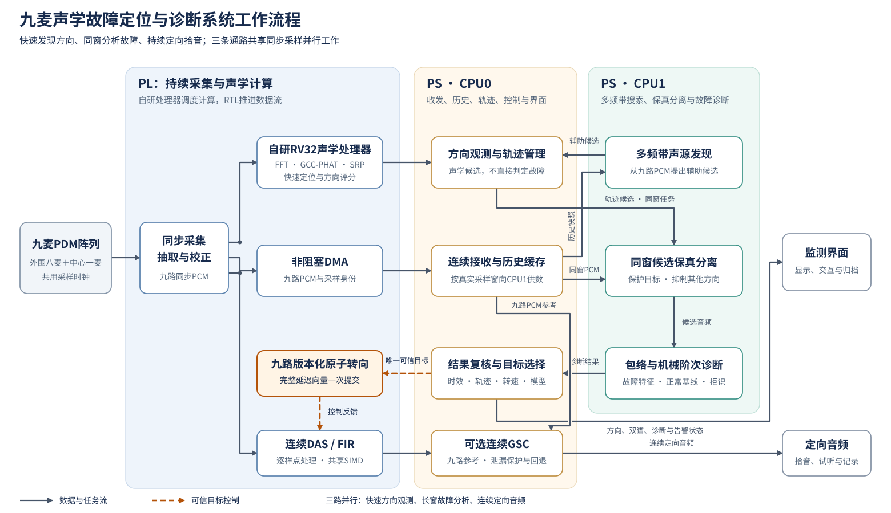

*图1-1 系统工作流程。实线表示数据与任务流，虚线表示可信目标转向控制；定位、历史采集和连续拾音并行运行。*

## 1.2 应用领域

作品面向电机、风机、水泵及轴承试验台的非接触声学状态监测，适合在多个设备同时发声时，先按方向区分观察对象，再分析各对象的异常特征。在实验室中，可用于对比不同转速和故障状态下的声音变化；在设备巡检中，可辅助操作人员寻找异常声方向，并保存目标音频及频谱用于复核。

当前诊断实现以轴承故障阶次特征为重点。应用到具体设备时，需要配置轴承参数、确认转速并建立对应的正常基线和故障模型。系统目前输出阵列前方的声源方向，不测量声源距离；真实场景中的定位精度、可分辨角度与识别率需结合安装位置、混响和背景噪声实测确定。

## 1.3 主要技术特点

系统按采集、定位、分析和控制划分模块，以PL处理连续数据，以PS双核执行窗口分析和交互。

| 模块 | 核心实现 | 设计作用 |
|---|---|---|
| 同步采集 | 双相PDM接收、抽取、去直流与通道增益校正 | 为时差计算提供同步PCM |
| PL声学处理器 | 自研五级RISC-V发射FFT、互谱、PHAT及SRP指令；RTL推进地址和搬运数据 | 将计算与重复访存组织分工 |
| 并行运算 | 八lane SIMD支持乘加归约与逐元素更新；FFT/IFFT共用变换核，SRP四麦对并行 | 适配时域滤波和频域定位 |
| PS双核分析 | CPU0接收、缓存和控制；CPU1搜索、分离并提取包络及阶次特征 | 使长窗诊断与连续采集并行 |
| 目标控制 | 分离保真检查、残差反馈GSC、九路延迟原子提交 | 保护故障特征并协调定向拾音 |

## 1.4 主要性能指标

本次以当前九麦实现补做了定位评分、FFT、FIR、SRP、PS搜索、完整分离、GSC和包络分析的计时。**在同一九麦输入窗口上，PL标量与加速方案完成1024个定位评分分别需要276.234300 ms和2.058850 ms，评分阶段加速134.17倍；FFT、FIR和SRP局部分别获得27.12倍、18.28倍和15.84倍加速。** 以上PL时间来自RTL周期按40 MHz换算；PS算法另作Windows宿主计时。各项指标采用自己的输入、基线和计时边界，不相乘推导整机收益。

### 1.4.1 三种架构的对照与当前测量结果

三种方案使用相同的九路PCM定位任务：1024点窗、36麦对、相同有效频带、64点相关环及32×32方向网格。当前已完成两种PL执行方式的同任务评分对照，PS-ONLY的Cortex-A9时间待实板补测。

| 方案 | 计算任务放置 | 本次同一首窗的评分阶段时间 | 相对PL标量方案 |
|---|---|---:|---:|
| PL-PS标量：PS+PL Scalar | PL自研RISC-V运行标量C定位内核；PS负责的传输与控制不在本次RTL计时内 | 11049372拍；**276.234300 ms** | 1.00× |
| PS-ONLY | Cortex-A9运行相同定位内核，统一采集前端提供输入 | **待A9实板测量** | 待测 |
| PS-PL向量：PS+PL Accelerated | RISC-V发射声学指令，FFT/IFFT、互谱/PHAT、SRP及自主搬运协同执行 | 82354拍；**2.058850 ms** | **134.17×** |

来源：[九麦标量RTL结果](performance_comparison/circular9_scalar/rv_plain_Os/results.json)、[九麦加速RTL结果](performance_comparison/pl_rtl/results.json)。两组采用40 MHz、`-Os`编译及同一首窗，从原始窗口已驻留到全部1024个评分可用为边界，排除输入预装、峰值及质量后处理、结果发布和PS往返。标量端收窗后计算统计，加速端在采集过程中滚动累积统计；134.17倍因此体现计算、存储、搬运和统计前移的综合作用，不能解释为单一SIMD指令的加速比。

逐级检查覆盖首窗45个统计词、576个复频谱词、2304个相关值和1024个评分，全部一致；宿主标量参考另核对加速方案连续32窗的1440个统计词和32768个评分。当前对照输入是固定种子的合成九路平面波，不是真实故障录音。计时主行只比较同一首窗，没有用加速方案32窗中的最小值替代该窗结果。

另外保留`-O2`标量构建作为编译敏感性检查：9806381拍，即245.159525 ms，与同一82354拍加速路径相比为119.08倍。主表使用与生产固件匹配的`-Os`，辅助行说明编译优化对标量成本的影响。[编译敏感性结果](performance_comparison/circular9_scalar/rv_plain_O2_corrected/results.json)

最终三架构实板主表还须统一测量“PS发起任务到取得有效结果”的全过程，包含传输、计算、轮询与校验。跨PL和A9比较使用实际时间，不直接相除不同频率的周期数；本次电脑上的标量C运行也不作为A9数据填入上表。

### 1.4.2 九麦SRP扫描的同输入对照

测试采用36麦对、1024方向格、64点相关环。串行、单麦对流水和四麦对分bank流水使用相同的时差表、相关数据及黄金评分，周期从START断言计到观察到DONE，不包含装载与读回。

| SRP实现 | 扫描周期 | 按40 MHz折算 | 相对串行加速比 | 耗时降低 |
|---|---:|---:|---:|---:|
| 串行RTL | 147458拍 | 3.686450 ms | 1.00× | — |
| 单麦对流水 | 37153拍 | 0.928825 ms | 3.97× | 74.80% |
| 四麦对分bank流水 | 9307拍 | 0.232675 ms | **15.84×** | **93.69%** |

来源：[SRP原始结果](performance_comparison/rtl_primitives/measured_20261028/srp/results.json)。三种实现两轮周期一致；全部九种配置共18432个方向评分与黄金结果相同，并检查部分组、单格、重启和中止。该模块TB周期为10 ns，表中毫秒统一按产品40 MHz解析换算。这里的串行RTL基准与1.4.1的完整RISC-V标量定位内核是不同基准。SoC日志中的9306拍从BUSY首拍计数，与本表START锚点相差一拍，不混作性能变化。

### 1.4.3 当前源FFT与FIR的标量／扩展对照

| 算子与工作量 | PL标量周期 | PL加速周期 | 按40 MHz折算：标量→加速 | 加速比 |
|---|---:|---:|---:|---:|
| 1024点实数FFT | 179036 | 6602 | 4.475900→0.165050 ms | **27.12×** |
| 512点、32抽头Q15 FIR | 276774 | 15138 | 6.919350→0.378450 ms | **18.28×** |

来源：[当前源RV32算子结果](performance_comparison/pl_rtl/results.json)。两路径在同一RISC-V核、40 MHz TB和`-Os`条件下运行，输入与系数一致。FFT核对全部1026个int16输出；FIR在不改动被计时函数的条件下，通过指令退休观察取得标量和SIMD各512个输出，逐项与独立整数参考核对。两项均通过。

FFT的6602拍包括装载3088拍、RUN指令及握手919拍、取回2577拍和18拍函数／时间戳开销；917拍仅为FFT引擎内部运行，不能代替完整调用耗时。FIR计时包含历史初始化、输入生成、归一化、饱和和校验，排除系数预装；系数取当前算子测试使用的32抽头集合，不将该结果冒充九麦连续音频整支路的时延。

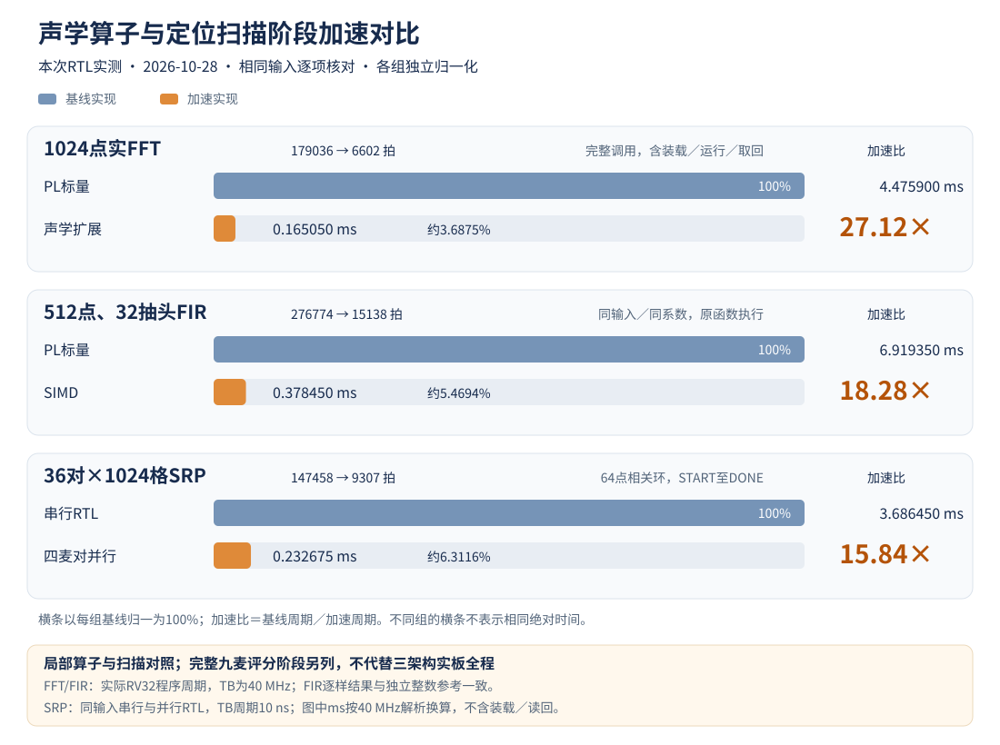

*图1-2 本次RTL算子与扫描阶段对照，各组以自身基线归一为100%；毫秒按40 MHz换算。完整九麦评分任务另见1.4.1。*

### 1.4.4 当前九麦连续定位的延时分解

在加速生产路径中连续运行32个重叠窗口，定位窗／Hop为1024／512点，输入为156250 Hz的九路同步PCM。观测结果如下。

| 计时项目 | 本次范围 | 计时含义 |
|---|---:|---|
| 窗口首个PCM→RV32稳定结果发布 | **9.172325—9.176225 ms** | 每窗使用自己的首样本锚点，包含该窗1023个采样间隔 |
| 原始窗口就绪→1024评分完成 | 2.056600—2.058850 ms | 包含定位计算，止于SRP评分完成；不含后续读图及CPU后处理 |
| 固件记录的窗后处理 | 2.622975—2.626775 ms | 定位搬运／计算及CPU后处理的固件计时 |
| 末个PCM→RV32稳定结果发布 | 2.625125—2.629025 ms | 由同窗外部锚点直接相减，包含发布与观测开销 |
| 稳定结果发布间隔 | 3.273675—3.277075 ms | 31个间隔，均值3.276690 ms，与512点Hop节奏相符 |

来源：[32窗SoC计时及阶段记录](performance_comparison/pl_rtl/results.json)、[逐阶段周期表](performance_comparison/pl_rtl/stage_cycles.csv)。首末样本的采样跨度为1023/156250＝6.5472 ms，与1024点窗预算6.5536 ms相差一个采样周期。窗后计算及搬运为2.107800—2.110050 ms，CPU后处理为0.515175—0.516725 ms；各项最大值不必来自同一窗口，不能任意相加重建最坏单次时延。

每窗实际退休9次FFT、36次互谱、36次PHAT、36次IFFT及1次SRP调用；32窗采集和连续音频丢失计数均为0。该试验在对齐PCM处注入，连续音频夹具采用单位脉冲系数，不包含真实麦克风/PDM模拟转换、PS首次接收、网络与页面显示，也不作为长期运行或实际音质证明。

### 1.4.5 PS算法的宿主时间与有效路径核验

宿主为Intel Core Ultra 5 338H、Windows 11、GCC 16.2.0，C采用`-O2`。使用C内部高精度墙钟，排除Python入口、编译、文件读写及输入生成；每变体先验证、再预热5次，测量轮内打乱变体顺序。以下时间单位均为ms，是当前C算法在该电脑上的成本，不替代A9计时，也不与PL时间相除。

| 搜索场景／实现 | 次数 | 平均 | P50 | P95 | 最大 | 相对参考均值 |
|---|---:|---:|---:|---:|---:|---:|
| 单宽带／完整参考 | 41 | 8.0546 | 8.2887 | 9.0905 | 10.6421 | 1.00× |
| 单宽带／仅预计算 | 41 | 7.3270 | 7.2885 | 8.2074 | 8.4095 | 1.10× |
| 单宽带／仅成对IFFT及公共项复用 | 41 | 7.1921 | 7.1314 | 8.5132 | 10.8761 | 1.12× |
| 单宽带／两项组合 | 41 | **6.1932** | 6.1764 | 7.2996 | 8.5765 | **1.30×** |
| 三源分频混合／完整参考 | 41 | 8.2452 | 7.8109 | 9.1545 | 29.8846 | 1.00× |
| 三源分频混合／仅预计算 | 41 | 6.8764 | 6.9528 | 7.8826 | 8.5787 | 1.20× |
| 三源分频混合／仅成对IFFT及公共项复用 | 41 | 7.0267 | 6.7928 | 8.2627 | 16.3340 | 1.17× |
| 三源分频混合／两项组合 | 41 | **5.9606** | 6.0048 | 6.9277 | 7.7612 | **1.38×** |

来源：[搜索及算术正式结果](performance_comparison/ps_software/measured_20261028_host_quiet/results.json)、[逐次时间样本](performance_comparison/ps_software/measured_20261028_host_quiet/raw_timings.csv)。每场景使用16640×9原始PCM、三个频带、36麦对和1024方向格，计时覆盖完整候选搜索。四模式的61词公开反馈及3072个整数评分相同；成对IFFT的末频带相关浮点误差不超过1.11×10⁻¹⁶。单宽带输出1个候选，三源夹具输出2个候选，因此本实验验证计算成本和变体一致性，不宣称三个声源全部检出。

| 其他完整处理／专项 | 次数 | 平均 | P50 | P95 | 最大 | 测试范围 |
|---|---:|---:|---:|---:|---:|---|
| 双候选完整快照分离 | 31 | **56.866** | 56.774 | 60.682 | 67.097 | 160256×9输入→两路各40000点输出；含协方差、保护、求解、重构及质量检查 |
| GSC禁用抵消、匹配主支路 | 31 | 18.168 | 18.182 | 23.546 | 34.749 | 32768个原始点，0.2097152 s音频 |
| GSC启用真实在线适应 | 31 | **23.696** | 23.273 | 32.738 | 42.742 | 同一输入，包含干扰估计、残差及权值更新 |
| 当前长窗包络前端 | 31 | **2.0698** | 2.0553 | 3.0238 | 3.4675 | 40000点、1.024 s输入；特征提取，不含分离及分类 |
| 历史短窗包络前端 | 31 | 8.2765 | 8.4284 | 11.4834 | 12.3579 | 同一输入，但滤波与特征契约不同 |
| 原生64位整数除法 | 101 | 0.3520 | 0.3460 | 0.4379 | 0.7499 | 每轮131072个商 |
| GSC共享倒数及精确修正 | 101 | 1.5140 | 1.4035 | 2.0928 | 4.4608 | 相同分子／分母，每32个商共享一次倒数 |

完整模块来源：[GSC与双源分离正式结果](performance_comparison/ps_software/full_modules/measured_20261028_full_quiet/results.json)、[逐次时间样本](performance_comparison/ps_software/full_modules/measured_20261028_full_quiet/raw_timings.csv)。分离采用已知两个候选的合成宽带快照，两个结果均通过保真门控，8个统计观察帧、202个频点实际参与协方差处理，载频检查63/63且无输出削顶；它不包含候选自动发现、分类或外部会话可信性判断。GSC的512点预热不计入时间，32768点计时体全部进入适应路径，权值实际变化，输出与独立整数参考逐样一致。启用和禁用GSC完成的工作不同，两行用于说明功能成本，不称作等价加速。

包络前端的平均成本比约4.00倍，但历史1400—4600 Hz短窗平均与当前2200—4600 Hz完整长窗前端不等价，不能写成同算法加速；当前包络与独立解析信号DFT的目标频点幅度误差约1.05×10⁻⁶。除法两路径131072个商逐项精确一致，但共享倒数在本机更慢，均值比为0.2325倍；ARM32上的实际收益仍需A9验证。以上原始离群值均保留，Windows调度尾延迟不能当作实时最坏执行时间上界。

### 1.4.6 历史结果的定位与剩余补测

2026年10月11日旧固定FIR版本的FFT／FIR记录为26.10／18.59倍，旧八麦产品形态整轮为1.4669倍；2026年10月21日旧八麦定位计算和结果更新分别改善约7.36倍、4.76倍。这些历史任务、窗口或计时边界与本次不同，只作演进背景，不填入当前九麦主表。历史A9搜索约106→92→71 ms对应更早的短证据窗，也不作为当前16640点搜索耗时。

本次测试脚本、输入、固件、逐级数值、原始日志、失败调试记录及哈希集中保存在工作区独立的`performance_comparison`目录；[统一结果表](performance_comparison/results_summary.csv)区分RTL周期、宿主时间及适用边界。

仍需补测：三种架构的A9实板同任务及PS往返时间、NEON独立开关、双核满负载、至少1000个有效稳态窗口的P99与丢样、CPU占用、资源功耗，以及真实声场定位精度、分离保真和故障归因。当前32窗RTL及单机宿主结果提供可复现的阶段证据，不能替代上述实物指标。

## 1.5 主要创新点

本作品围绕“多源声场中怎样找到异常设备、怎样保留可用于诊断的声音、怎样在嵌入式平台上持续运行”展开设计。核心贡献体现在空间诊断链路、保真分离、自研声学处理器、计算与搬运协同、快慢任务并行、自适应拾音及跨端控制；采集、数值计算和取证机制共同支撑这条链路。

### 1.5.1 核心创新

**（1）面向空间对象的定位—分离—诊断—定向拾音链路。**

多台设备同时工作时，声音最强的设备不一定发生故障，直接对混合音频分类也难以说明异常来自哪里。本作品先通过阵列观测建立声源方向及轨迹，再从同一采样窗口的九路信号中提取各候选音频，分别进行机械特征分析。结果携带轨迹、方向、窗口起点和工况信息，使“某段声音异常”能够进一步对应到“该时段内某一方向的声源”。当且仅当当前证据支持唯一可信故障目标时，系统才自动更新拾音方向，将诊断结果反馈到观察对象的选择。

这一设计把声源发现、故障分析和后续拾音连接起来，形成可追溯的空间诊断流程。其输出是声源方向及关联证据；设备的永久身份和声源距离需由其他信息补充。

**（2）独立多频带发现与真实观测支持的多声源跟踪。**

针对宽带最强峰掩盖弱源的问题，PS直接从九路PCM的多个频带提出候选，不以PL最强峰作为唯一搜索入口。各频带候选进入统一仲裁，并在同一方向复核支持，减少频带遍历顺序造成的偏置。对已有弱次峰，还可在有界次数内投影去除强同伴，再检查其是否获得真实观测支持。

轨迹管理区分新观测、暂失、恢复和过期，并计算重叠观测窗实际覆盖的时间区间。暂时保留轨迹ID不会补造新的方向证据；只有诊断窗口获得足够真实支持，才进入后续分析。有效峰通过局部拟合获得细角度，再由统一标定表生成连续导向参数。这样既保留弱源的发现机会，也限制历史峰在声源消失后持续影响当前诊断。

**（3）以故障特征保留为目标的实际协方差分离。**

普通声音增强往往以输出能量或听感改善为目标，而机械诊断还依赖故障载频、调制和谐波结构。抑制干扰的同时若削弱这些成分，音频可能更“干净”，诊断依据却已经改变。

本作品从混合快照估计实际声场协方差，利用目标中心及邻近方向建立受保护子空间，先从统计量中投影去除目标贡献，再用残差协方差和正则化抑制其他方向。中心方向保持单位响应，目标与干扰扇区采用软约束，降低角度误差及病态矩阵对权值的影响。分离结果还需通过目标响应、干扰泄漏、权重范数、保留能量和故障载频完整性检查，才能成为诊断输入。

其关键价值是把“可用于诊断”落实为分离器的输出条件。快照重构采用重叠相加及边界归一化，避免窗口首尾的幅度凹陷；未达到保真要求的候选不产生确定性故障结论。

**（4）面向声学算子的自研RISC-V与双形态SIMD计算架构。**

作品在PL中实现五级流水RISC-V处理器，具备前递、冒险处理、多拍执行握手、分支预测和指令退休观察，并在此基础上扩展声学指令。向量操作、共轭互谱、PHAT、FFT/IFFT及SRP调度均具有明确的指令入口，构成从固件、译码到执行单元的完整实现。

八lane实数SIMD-MAC通过接通或旁路归约树，分别支持跨lane乘加归约和逐元素系数更新。时域抽头运算与复数频谱运算采用不同的数据布局和执行结构；复数单元可配置4、8或16 lane，当前九麦配置采用4 lane。正逆变换共享512点复数核心，以承载1024点实数变换。

设计贡献在于根据声学负载组织可编程处理器、指令和专用计算资源，而非仅将算法放入通用CPU执行。逐元素更新是执行单元已具备的能力，当前连续音频FIR使用乘加归约，在线GSC权值更新在PS端完成。

**（5）计算指令、自主数据搬运与共享存储的协同设计。**

向量化计算的收益容易被地址计算、逐字装载和结果回读抵消。本作品由RISC-V实际发射计算指令，RTL状态机负责窗口组织、地址推进、预取和中间数据搬运；计算结果的交接受指令退休与所有权协议约束，避免仅凭算子完成信号提前释放数据。

定位时，各通道频谱只计算一次并供多个麦对共享，仅搬运需要的频点和相关时延区间。SRP将不规则查表访问分到四组独立存储bank，每组并行读出相邻相关点、插值并归约，匹配存储端口与计算吞吐。连续音频则由独立状态机使用同一实数SIMD完成FIR，通过仲裁及历史、系数区域划分与CPU协调。

因此，优化同时覆盖算术、搬运和持续音频服务，能够解释系统为什么既需要指令扩展，也需要同步BRAM、分bank布局和流水预取。

**（6）分采样率、多时间尺度与PS双核的并行处理架构。**

快速定位需要及时获得方向，机械阶次诊断则需要足够长的观察时间。系统将156250 Hz采集与PL快速定位、连续DAS/FIR放在持续数据通路上；PS经过抗混叠抽取，以39062.5 Hz处理长窗分析，并保留1.024 s真实观察信息。

PS端CPU0承担DMA接收、历史缓存、方向与轨迹更新、任务提交和交互，CPU1承担多频带搜索、同窗分离及诊断。共享历史、任务和结果缓冲采用明确的所有权及缓存一致性处理，避免大规模计算占据接收循环。调度按真实样点编号选取窗口，记录执行耗时，并检查排队年龄、排队至完成总耗时和结果年龄，积压时优先处理有效的新窗口。

这种分工让快任务及时服务、慢任务保留观察长度；0.512 s诊断步长是调度配置，实际有效输出间隔还取决于计算负载和证据是否满足条件。

**（7）具有目标保护与匹配回退的GSC/NLMS自适应闭环。**

连续拾音不仅需要对准目标，还需要适应干扰的变化。系统以匹配DAS/FIR作为主支路，从多通道参考估计干扰，将干扰估计与主支路相减得到输出残差，再用残差反馈更新权值，形成真实的在线自适应环路。

针对阻塞参考中可能含有目标声音的问题，系统设置目标泄漏、版本不匹配、转向过渡和发散保护。需要回退时暂停抵消并返回匹配主支路，满足恢复条件后再适应；一般更新冻结与输出回退分别控制。实现上，同一次更新共享归一化倒数，并以余数修正恢复精确整数商，减少重复除法而不改变约定算术结果。

该设计兼顾干扰抵消与目标保护。连续GSC属于可选处理支路，与CPU1的多候选快照分离分别工作。

**（8）九路原子转向与贯穿全链路的有效性约束。**

九路延迟若逐项直接生效，可能在短时间内混用新旧方向；PS若按另一组参数处理同一音频，也会破坏主支路与参考支路的对应关系。作品先写入完整影子向量，再通过一次提交使九路延迟成为同一版本，并校验完整性、采集时代、时效及读回结果。

转向依次经历控制接受、样点边界生效、分数延时平滑变化及稳定预热。音频携带版本和有效样点，PS仅选用匹配参数进行GSC处理。定位、分离和转向共享坐标、通道映射、增益及传感器时延标定；诊断还检查轨迹覆盖、模型、特征、分离版本和转速代次。

系统同时区分“候选可以继续分析”与“足以将故障归属于某一方向”：合格候选可形成诊断结果，但已收集的候选中存在未解析方向时不授予可信故障定向资格。这样把空间控制的一致性和结论的有效性落实到数据与控制流程中。

### 1.5.2 支撑核心创新的实现贡献

| 实现贡献 | 具体设计与作用 |
|---|---|
| 九麦奇数通道适配 | 五根双相DATA形成十个采集槽，仅九路进入统计、36麦对计算和波束归一化；双相启动、CIC过渡与有效PCM发布分层处理，避免空槽和启动瞬态影响算法。 |
| 重叠采集与滚动统计 | 1024点窗、512点Hop在采集过程中累积统计，减少收窗后的重复扫描；预热状态独立于回卷样点计数，避免长时间运行时因计数回卷重新进入错误状态。 |
| 定位缩放与诊断幅度分流 | 定位分支按通道、按窗口去均值并选择二次幂缩放，提高弱信号的定点利用率；该临时缩放不写回诊断历史和录音。诊断使用已完成前端去直流及通道增益校正的同步PCM。 |
| 硬件友好的PHAT与分数SRP | PHAT采用幅值近似和倒数查表；SRP通过分数时差与相邻相关值插值获得方向评分，以明确的定点规则连接计算和查表流水。 |
| 宽累加与同步存储配合 | 实数SIMD采用宽累加器、受控舍入及饱和，样点与系数分bank存储；将同步BRAM读延时纳入预取和排空逻辑，兼顾精度、资源和吞吐。 |
| PS成对实相关IFFT | 将两组Hermitian互谱打包，一次复数IFFT得到两组实相关；九麦36对在每个频带由36次变换降为18次，并共享通道功率归一化公共项，保留搜索范围。 |
| 标定量化驱动的预计算 | 利用Q4原始延迟与四倍抽取后的1/64样点关系，预计算方向—麦对地址及三次插值权重；标定变化时重新生成，使内循环减少重复地址和系数运算。 |
| 保留长窗信息的包络分析 | 解析选带、包络提取及多级抗混叠抽取后，使用一次4096点FFT分析2500个真实包络点，保留1.024 s观察信息；补零用于频谱采样，不增加物理分辨力。 |
| 转速关联的18维机械特征 | 提取四组轴承特征阶次及各自谐波，再加入1X、2X；硬件测速处理毛刺、稳定性与超时，转速变化后重新积累有效观察窗。 |
| 正常基线与未知拒识 | 将异常检测、类别判定和空间归因分开；模型、特征、分离和滤波状态不满足约定时保留未知，防止把任意异常直接解释成确定机械故障。 |
| 带自检的NEON抽取 | 八个外围通道并行、中心通道单独处理，结合累加范围证明与启动输入对照自检；检测失败时回退标量实现，使加速具有可检查的数值边界。 |

### 1.5.3 工程特色与验证闭合

**实时服务与通信负载隔离。** DMA和网络拥塞不会反向停止PL的PCM与DAS处理；下游丢失通过计数、CRC、序号和采集时代暴露。故障恢复后更换时代并重新预热，旧窗口及旧结果不会继续作为当前证据。

**同快照展示与事件追溯。** 音频谱、包络谱、轨迹和诊断绑定同一采样窗口，配套疑似、报警与恢复状态；未知和断流不视为正常恢复，历史可由PC端归档。

**原始录音取证与真实处理链回放。** 九路PCM长窗通过采样身份和哈希组织导出，离线回放调用实际C搜索、分离和特征实现。训练端使用同一生产特征提取逻辑，并保留弱源、近角和多源失败场景，便于验证改动是否破坏既有能力。长窗导出为可选功能，其实际传输负载需在实板上验收。

**构建与交付一致性。** 将源码、位流、XSA、BSP、PS镜像及模型纳入匹配检查，防止分别验证过的模块在交付时混成不一致的系统；哈希用于版本和内容一致性核验。

### 1.5.4 研究内容与应用边界

全网格投影残差找峰目前属于研究方案；已进入主流程的是对既有候选的有界残差复核。六类故障细分属于实验适配，独立录音泛化证据尚不完整，实验结果不直接触发可信故障定向。任意变速下的阶次重采样、声源距离测量以及永久设备身份识别也未作为当前完成能力列入。

上述贡献强调本作品对声学计算、空间诊断和运行约束的具体组织方式；FFT、SRP、GSC、NLMS等基础方法本身沿用已有原理。实际多机场景下的精度、分离保真和诊断有效性由对应测试结果支撑。

## 1.6 设计流程

设计从多机声源区分需求出发，依次完成阵列与采样方案、定位及诊断算法、声学指令与RTL数据通路、PS双核任务和交互界面。以参考计算核对关键算子，逐级开展模块仿真、系统联调和实现时序检查，再通过实板采集与故障录音验证整条链路。当前实物幅相标定及真实多机故障归因验收仍需补齐。

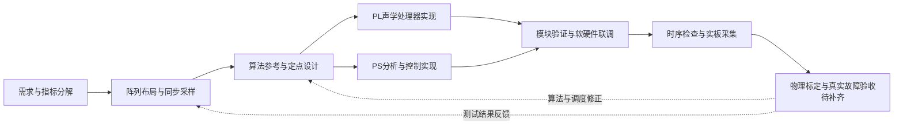

*图1-3 设计与验证流程。*

# 第二部分  系统组成及功能说明

## 2.1 整体介绍

### 2.1.1 设计目标与方案取舍

本作品关注“哪个方向上的声音值得进一步诊断，以及该结论是否仍可绑定到当前目标”。单麦频谱缺少空间区分，多麦最强峰也只能说明声学能量集中方向，不能直接说明机械故障。设计因此分开方向证据、分离质量、机械特征和可信归因，并在同一采样时间轴上重新关联。

采用Zynq-7020是为了在同一器件内组织可编程逻辑的连续数据通路与双核处理系统，平台结构依据[AMD UG585](https://docs.amd.com/r/en-US/ug585-zynq-7000-SoC-TRM)〔参考文献1〕。划分依据是任务节奏、数据并行性和状态复杂度：PL承担逐样点采集、定向音频与有界窗口定位；PS承担较长观察窗的候选分析、协方差求解、包络特征和交互。这里不以“PS必然算不动”作为论据，也不预设PL在墙钟时间上始终更快；比较必须同时测量CPU占用、持续吞吐、时延、丢失与资源。

本设计的当前输入是空气声，不是接触式加速度。机械包络与阶次方法借鉴已有旋转机械诊断理论〔参考文献9〕，但空气传播、房间和传感器响应会改变实际证据，不能从参考方法直接推导当前系统的实物准确率。

### 2.1.2 系统整体框图与数据流

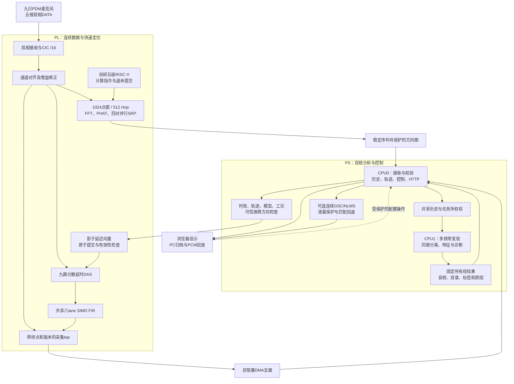

图2-1 系统逻辑框图。实线表示数据或控制依赖，虚线表示用户配置入口；图中路径表示已实现的组织方式，不代表所有可选支路同时满负载已通过实板验收。

信号从九路同步采集处分流。快速路径在PL生成方向评分和连续DAS/FIR输出；DMA将带样点身份的原始数据交给CPU0。CPU0同时推进历史和控制，不等待CPU1完成诊断。CPU1从历史复制一个精确时间区间，所有候选共用这一快照进行分离、特征提取与诊断，避免分别抽取不同时刻的声音再作横向比较。

连续GSC和同窗多候选分离是两条支路：前者针对一个匹配目标在线处理，后者在CPU1对最多三个候选提供诊断音频。默认关闭连续全速录音时，连续输出处理旁路，独立快照分析仍可工作。网络显示刷新率不能替代定位更新率或有效诊断输出率。

### 2.1.3 控制流、结果身份与失效传播

一次诊断的身份至少包括采集session、epoch、原始样点区间、轨迹ID、方向、几何/标定版本、分离契约、特征契约及转速generation。分类结论使用快照中的方向信息，不在计算完成后读取最新最强峰替换它。

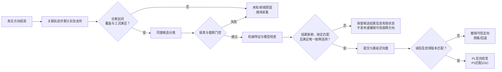

图2-2 从观测到控制的条件链。没有唯一故障目标时仍可保留正常、干扰或各候选诊断结果，只不授权故障定向。GSC目标泄漏保护停止抵消并回退；断流、采集换代、转速失效、模型不匹配或过期则撤销相应结论或方向资格。“仍有方向图”“仍有音频”与“仍有可信故障结论”分别判断。

该组织解决两个不同问题：数据面保持连续服务，结论层拒绝使用已失效的证据。拒绝输出会降低有效结果覆盖率，应在测试中统计拒绝率及原因，不能只统计成功输出的准确率。

### 2.1.4 关键参数、时基与统一符号

表2-1为当前配置/源码值或由其直接计算的解析值，不是本次实物测量。来源P01—P04见2.1.7。

| 符号/项目 | 当前值 | 说明与来源 |
|---|---:|---|
| M，有效麦克风数 | 9 | 8外围＋1中心；10个采集槽，索引9（第10槽、CH9）无效，P01 |
| P，麦对数 | 36 | 9×8/2，解析 |
| f_PL | 40 MHz | 生产PL配置，P01 |
| f_PDM / D_CIC | 2.5 MHz / 16 | 原始PDM及CIC抽取，P01 |
| f_raw | 156250 Hz | f_PDM/D_CIC，P01、P02 |
| T_raw | 6.4 μs | 1/f_raw；每点256个PL周期，解析 |
| N_loc / H_loc | 1024 / 512点 | 50%重叠；完整窗6.5536 ms、步长3.2768 ms，解析 |
| G | 32×32＝1024 | 前半球方位角/俯仰角格点，无距离维，P01 |
| 原始相关环 | 64点 | 不等于只使用64点原始窗，P01 |
| f_diag | 39062.5 Hz | 原始PCM抗混叠后4:1抽取，P02 |
| T_diag / N_diag | 1.024 s / 40000点 | 真实诊断信息长度，P03、P04 |
| N_snapshot | 160256原始点 | 160000有效观察＋256前端预热，P03 |
| H_diag | 80000原始点＝512 ms | 调度步长，不是承诺的完成周期，P04 |
| 历史容量 | 1048576帧 | 6.7108864 s；预留32 MiB共享段，P03 |
| 辅助搜索输入 | 16640原始点 | 总106.496 ms，含104.8576 ms真实证据，P03 |
| 辅助搜索步长/最大年龄 | 8192点 / 31250点 | 52.4288 / 200 ms；算力不足可跳步，P03 |
| 搜索频带 | 600—2200、2200—4600、4600—8000 Hz | 实际使用离散频点，P03 |
| PS分离STFT窗/步长 | 1024 / 512点 | 该处属于f_diag时基，不能与PL定位窗混淆 |
| 诊断载频 | 2200—4600 Hz | 工程配置，尚非已实测最优频带，P04 |
| 包络点数/FFT长度 | 2500 / 4096 | 包络率2441.40625 Hz，P04 |
| 候选音频上限 | 3 | 容量上限不等于任意三源都可分离，P03 |
| 实数/复数计算lane | 8 / 默认4 | 实数固定8；复数支持4/8/16配置 |
| SRP并行麦对数 | 4 | 独立查表流水，不等同复数lane数 |
| 特征/分离契约 | C9F2 / C9S3 | 辅助反馈ABI为C9B2，P03、P04 |

本文“原始PCM”指PL去直流和既定增益校正后的对齐PCM高16位，区别于定位专用缩放数据及PDM原始位流。

统一以n表示原始PCM样点编号，t=n/f_raw表示采样时间；通道采用i、j或带通道下标的m表示，k表示频点，g表示方向网格，q表示分析帧。包络公式局部使用m、l作为其抽取后时间下标，并另行说明。转速f_r单位为Hz，rpm＝60f_r。复数上标H表示共轭转置，星号表示共轭，I表示单位阵。

同一个“1024点”在两个采样率下代表不同观察长度。PL定位窗的离散频率间隔为152.587890625 Hz，200—8000 Hz配置映射到有效频点约305.176—7934.570 Hz；PS的1024点STFT间隔为38.14697265625 Hz。诊断包络4096点补零FFT间隔约0.596046 Hz，而1.024 s信息长度对应1/T＝0.9765625 Hz量级，Hann等效噪声带宽约1.465 Hz；不能把补零后的频点间距称为新增物理分辨率。

### 2.1.5 核心创新、实现贡献、工程特色与研究边界

| 层次 | 本作品的贡献 | 主要实现位置 | 解决的矛盾与对照方式 |
|---|---|---|---|
| 核心I1 | 定位—分离—诊断—轨迹—定向的空间链路 | 2.1.2、2.3.2中的轨迹/任务/控制 | 对照最强峰跟随与故障目标选择，检查同窗归因和失效撤销 |
| 核心I2 | 目标保护的实际协方差分离及可诊断性门控 | 2.3.2分离模块 | 同一混合快照冻结权重，比较目标保留、干扰泄漏和载频完整性 |
| 核心I3 | 自研RISC-V与实数/复数声学执行架构 | 2.2.3处理器、SIMD、FFT/SRP | 以标量/串行参考核对数值、周期、资源和指令实际执行 |
| 核心I4 | 指令计算、退休提交、自主搬运与共享音频SIMD | 2.2.3数据通路 | 对照标量搬运及停顿场景，检查访问次数、音频连续性与所有权 |
| 核心I5 | 多速率PS–PL及PS双核快慢任务并行 | 2.3.1、2.3.2调度模块 | 以实际任务负载测队列、覆盖、结果年龄、丢失与CPU占用 |
| 核心I6 | 输出残差反馈GSC与目标泄漏回退 | 2.3.2连续音频模块 | 同条件DAS/FIR与GSC对照，检查抑噪、故障载频和回退行为 |
| 核心I7 | 完整九路向量原子转向与跨端匹配 | 2.2.3控制接口、2.3.2控制模块 | 注入部分写、旧版本/时代、TTL及读回错误，观察拒绝与撤销 |
| 核心I8 | 采样、轨迹、工况、模型与交付的有效性约束 | 2.1.3及第三部分 | 对照过期、断流、错模型、未决方向及产物混配，不以旧结果保活 |
| 实现贡献 | 四麦对SRP、双实相关IFFT、量化延迟预计算、NEON自检与精确更新 | 2.2.3、2.3.2 | 维持原数值/搜索判据的对照与失败回退 |
| 工程特色 | 同快照双谱、独立监测与归档、PCM取证回放、一致性交付 | 2.3.2、3.3 | 核对身份、哈希、回放结果及异常数据拒绝 |
| 未部署研究 | 全网格投影残差找峰 | 研究脚本与issue137 | 单源也出现额外峰，尚未稳定解决近角和三源，不计生产能力 |

上述“核心”是作品内的贡献分组，不代表FFT、GSC、SRP、SIMD等常规方法本身是原创。原34条和补充A—G的逐项实现/证据映射见3.3。I1—I8的实际收益须按各自对照方案验证，不能用一个成功案例为其他全部机制背书。

### 2.1.6 版本与证据使用原则

当前九麦配置优先于旧README、旧八/十二/十六麦记录。几何使用非均匀声孔坐标；旧“30 mm理想声孔圆”不再作为当前坐标。当前双核CPU-only历史/任务内存为两核一致的Normal WB共享映射，DMA槽采用独立失效和所有权协议；旧资料中的“共享段全部非缓存”属于历史配置。

本稿区分五种状态：源码机制存在；有记录的宿主/RTL验证；有记录的布局布线；指定历史版本实板运行；当前版本真实故障验收。只读哈希对照发现现存历史测试记录与部分当前源码不同，且最新发布目录缺失，因而不能把其passed字段当作当前版本全链通过。本次另完成当前源的RTL及宿主计时，结果与边界见1.4；历史性能及其缺口在3.3分别列示。

### 2.1.7 本节源码定位

下列路径均相对于本技术文档所在工作区根目录，便于直接打开源码。外部理论和器件资料在第五部分列出，内部源码不计入外部参考文献篇数。

| 编号 | 文件 | 用途 |
|---|---|---|
| P01 | [circular9_array.json](../zynq_-pl_-simd_-verilog/configs/circular9_array.json) | 采集、方向、坐标及接口配置 |
| P02 | [circular9_profile.h](../zynq_-pl_-simd_-verilog/sw/circular9_profile.h) | 原始/诊断采样率契约 |
| P03 | [circular9_candidates.h](../zynq_-pl_-simd_-verilog/sw/circular9_candidates.h) | 历史、快照、候选、STFT与反馈ABI |
| P04 | [circular9_schedule.h](../zynq_-pl_-simd_-verilog/sw/circular9_schedule.h)、[circular9_envelope.h](../zynq_-pl_-simd_-verilog/sw/circular9_envelope.h)、[circular9_diagnosis.h](../zynq_-pl_-simd_-verilog/sw/circular9_diagnosis.h) | 调度、包络与模型契约 |
| P05 | [ps_circular9_tasks.h](../zynq_-pl_-simd_-verilog/sw/ps_circular9_tasks.h) | 双核共享、快照、资格及控制 |
| P06 | [rv32_soc.v](../zynq_-pl_-simd_-verilog/rtl/soc/rv32_soc.v) | PL模块和计算/搬运连接 |
| P07 | [bearing_6004_2zr.json](../zynq_-pl_-simd_-verilog/configs/bearing_6004_2zr.json) | 轴承几何、阶次、窗口与模型状态 |
| P08 | [acoustic_circular9_image.h](../zynq_-pl_-simd_-verilog/sw/acoustic_circular9_image.h) | RV32镜像、LUT及实际保护标志 |

## 2.2 硬件系统介绍

### 2.2.1 硬件整体介绍

本系统以Zynq-7020为主控平台，由九通道数字麦克风阵列、可编程逻辑声学处理系统、双核Cortex-A9处理系统以及转速和网络接口构成。九只麦克风按外围八只、中心一只布置，通过五根双相PDM数据线输入PL；PL在统一40 MHz时钟下完成采集、抽取、预处理、快速方向搜索和连续定向音频处理。PS接收带采样编号和状态信息的数据，执行长窗候选分析、故障诊断及控制交互。当前九麦构建入口显式启用九通道配置和独立流式DMA，系统控制面采用AXI4-Lite，连续数据面通过64位AXI接口进入PS的HP0端口。[H01][H02]

硬件的设计重点是使持续音频处理、空间搜索和软件控制拥有明确的资源边界。PL内自研五级流水RISC-V处理器负责计算指令发射、方向质量判断和结果发布；RTL状态机负责采样缓存、地址推进、算子预取及中间结果搬运；连续音频状态机独立调度共享SIMD单元。PS的计算或网络负载发生变化时，PL仍按采样节拍运行，传输副本的丢失通过计数和状态报告。[H03][H04][H05]

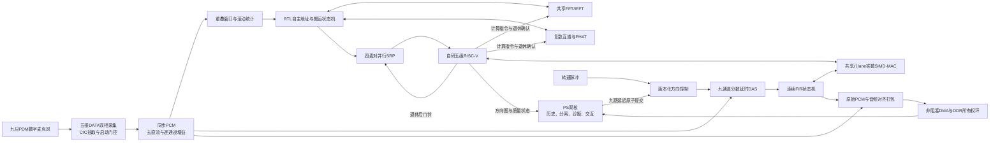

图2-3 硬件模块、计算发射与数据搬运关系。

表2-2给出当前九麦主线的硬件参数。原始PCM与诊断PCM采用不同采样率，定位窗和诊断窗分别服务快速空间观测与机械特征积累。

| 参数 | 当前配置及含义 |
|---|---|
| 主平台 | Zynq-7020，PL业务时钟40 MHz |
| 麦克风与接口 | [IM73D122系列](https://www.infineon.com/assets/row/public/documents/30/49/infineon-im73d122-datasheet-en.pdf)，9只有效麦，5根双相DATA，1根共用PDM_CLK |
| 采集槽与有效掩码 | 10个存储槽，9个算法通道，`active_mask=0x1ff` |
| PDM时钟与抽取 | 2.5 MHz，三阶CIC，抽取比16，24位内部PCM |
| 原始PCM速率 | 156250 Hz；采样间隔6.4 μs，对应256个PL周期 |
| 定位窗口与Hop | 1024点、512点，窗口时长6.5536 ms，名义更新间隔3.2768 ms |
| 空间搜索 | 36个麦对，32×32方向网格，前半球方位角/俯仰角搜索 |
| 相关缓存 | 每麦对64点相关环，延迟插值小数精度1/16样点 |
| 实数计算单元 | 固定8 lane，16位乘法、40位累加，归约树可旁路 |
| 复数声学单元 | 支持4/8/16 lane，当前九麦SoC默认4 lane |
| 连续音频 | 九通道DAS、32 tap固定FIR；PS可接续匹配GSC |
| 诊断输入 | PS抗混叠后4:1抽取至39062.5 Hz，40000点对应1.024 s |

这些参数来自当前配置、SoC实例及生成脚本，不能用模块默认值或早期八麦、十二麦、十六麦文档替代。[H01][H03] 当前方向模型不含距离维，阵列平面前后歧义通过只搜索前半球约束；方向网格数量也不等于物理角度分辨力。实物几何、幅相标定、PS最坏处理时限和真实故障声场性能仍需按匹配版本完成验收。

### 2.2.2 机械设计介绍

#### 2.2.2.1 阵列结构与当前坐标

阵列采用外围八个声孔与中心一个声孔的平面布置，实际使用为竖放，声源位于阵列正面。当前配置不再将外圈视为严格等半径圆：水平声孔半径22 mm，垂直25.5 mm，斜向23 mm；斜向孔暂按45°投影。30 mm仅保留为先前名义PCB半径，不能作为当前声孔半径、板边净距或加工验收尺寸。

坐标系采用正面观察：+x向右、+y向上、+z朝向阵列正面声源，中心CH8坐标取原点。原始采集通道保持既定顺序；仅以配置中的通道—麦克风映射解释空间位置，不为使几何看起来规整而重排PCM。表2-3给出当前输入坐标，单位mm；小数是配置换算显示值，不代表相同精度的实测结果。

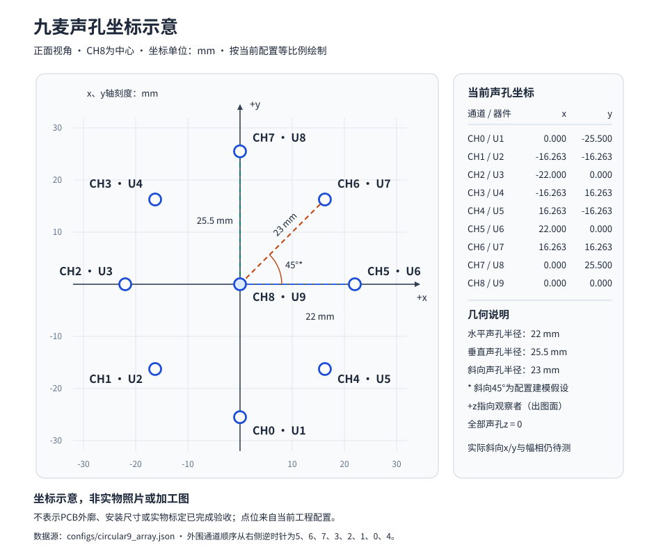

图2-4依据当前配置生成，属于坐标示意，不是实物照片、PCB加工图或几何标定证明。斜向坐标仍有45°假设，后续须用实测x/y替换。

| 采集通道 | 实物标签约定 | x / mm | y / mm | z / mm | 正视位置 |
|---|---|---:|---:|---:|---|
| CH0 | U1 | 0 | -25.500 | 0 | 下 |
| CH1 | U2 | -16.263456 | -16.263456 | 0 | 左下 |
| CH2 | U3 | -22.000 | 0 | 0 | 左 |
| CH3 | U4 | -16.263456 | 16.263456 | 0 | 左上 |
| CH4 | U5 | 16.263456 | -16.263456 | 0 | 右下 |
| CH5 | U6 | 22.000 | 0 | 0 | 右 |
| CH6 | U7 | 16.263456 | 16.263456 | 0 | 右上 |
| CH7 | U8 | 0 | 25.500 | 0 | 上 |
| CH8 | U9 | 0 | 0 | 0 | 中心 |

当前空间顺序从右侧起逆时针为CH5、CH6、CH7、CH3、CH2、CH1、CH0、CH4。上述尺寸与顺序来自当前配置的用户报告输入，独立量测和幅相标定尚未完成。

#### 2.2.2.2 机械坐标与声学延迟模型

以方位角α和俯仰角β定义方向向量：

$$
\boldsymbol u(\alpha,\beta)=
[\cos\beta\sin\alpha,\ \sin\beta,\ \cos\beta\cos\alpha]^T .
$$

原始采样域到达延迟为

$$
d_m(\boldsymbol u)=-\frac{f_{\rm raw}}{c}\boldsymbol r_m^T\boldsymbol u+\delta_m ,
$$

其中r_m采用米，c当前配置为343 m/s，δ_m是剔除几何传播后的传感器相对时延，单位为原始PCM样点。坐标原点位于中心不表示传感器时延参考也必须选中心；标定记录约定δ_0＝0。

生成器按同一模型输出两种表：

$$
L_{ij}(g)=\lfloor16(d_i-d_j)\rfloor,\qquad
S_m(g)=\lfloor16(d_0-d_m)\rfloor .
$$

前者服务SRP，后者服务DAS与PS分离。实际读表符号与互谱约定须一同验证，不能单独交换某一模块的麦对顺序。细角延迟从同一LUT插值，再减去公共最小补偿量形成非负因果延迟，不建立另一套未经标定的几何。

当前搜索前半球的方位角与俯仰角，不估计距离。共面阵列存在前后镜像歧义，安装范围约束不能表述为算法已解决前后判别。远场模型与真实近距离传播的差异会进入方向和分离误差，应通过已知声源方位、不同距离和房间条件测量，而不是仅由坐标表推断性能。

#### 2.2.2.3 结构装配与标定交付要求

系统的机械设计需服务声孔无遮挡、安装方向可重复、线束不改变阵列姿态和坐标基准可重建。当前工作区未提供可确认属于最终九麦整机的CAD、外壳、固定架图和装配公差记录；本稿不将推荐结构写成已制造成果。需要补交阵列正背面、整机正面及45°照片，标明声孔标签、板卡、线束和方位零点。

后续几何与幅相验收应使用同一实物编号，记录逐孔坐标、通道激励结果、安装朝向、已知源方向和原始录音，并将文件摘要绑定标定配置。增益与传感器时延应在另一段数据上复核拟合残差。当前生成镜像仍为未确认几何、标定版本0；用户报告坐标进入程序只代表模型已更新，不自动解除可信故障方向保护。

本节依据：[当前阵列配置](../zynq_-pl_-simd_-verilog/configs/circular9_array.json)、[几何与LUT构建](../zynq_-pl_-simd_-verilog/scripts/build_circular9.py)、[标定输入工具](../zynq_-pl_-simd_-verilog/scripts/circular9_calibration.py)。旧标定说明中的30 mm理想圆叙述仅作历史背景，实际数值以当前配置和待补测量为准。

### 2.2.3 电路各模块介绍

#### 2.2.3.1 九通道PDM采集、同步与启动有效性

阵列采用两只麦克风共用一根DATA的连接方式，L/R配置决定各麦在PDM时钟的不同半周期驱动数据。第0～3根DATA各承载两路有效麦，第4根DATA承载中心麦CH8及一个空槽CH9。硬件以十槽接收和打包，算法仅统计九路有效数据；空槽输出置零，麦对枚举为$\binom{9}{2}=36$，DAS归一化分母为9。这样既保持双相接口的规整布局，也避免奇数麦数导致空槽参与定位和能量统计。[H01][H03][H06]

PDM时钟由40 MHz业务时钟整数分频产生：

$$
f_{\mathrm{PDM}}=\frac{40\times10^6}{16}=2.5\times10^6\ \mathrm{Hz},\qquad
f_s=\frac{f_{\mathrm{PDM}}}{16}=156250\ \mathrm{Hz}。
$$

接收逻辑在同一40 MHz时钟域使用使能脉冲，不以PDM_CLK重新建立内部业务时钟域。`HOLD_TICK=4`锁存A相，`CONSUME_TICK=12`消费B相并推进两路CIC；两相分别在对应驱动边沿后125 ns取值，锁存后的A相与B相使用同一个抽取节拍。数字输出同拍便于后续处理，但麦克风内部延迟和传感器相对偏差仍需通过标定建模。[H06]

CIC采用三级积分、16倍抽取和三级梳状差分，其传递函数为

$$
H(z)=\left(\frac{1-z^{-16}}{1-z^{-1}}\right)^3。
$$

当前积分/梳状通路使用24位模运算；输出根据实际抽取比计算直流增益、居中偏置和位移，再饱和至24位。CIC内部允许补码回卷，梳状级与积分级保持一致的模算术语义。早期64倍抽取的频响数字不直接适用于当前16倍配置。[H06]

启动有效性由独立状态维护。使能后先忽略第一对未完整经历驱动边沿的PDM位；默认等待2000000个PL周期，即50 ms，再排除4个CIC输出帧，随后才发布`sample_valid_o`。重新使能会重建启动状态。九通道输出有效由各槽CIC有效信号共同限定，某一路节拍失配将直接影响整组有效性，避免静默通道错位。冻结检测只报告样值长期不变，不能作为缺麦已被可靠检出的证明。[H06]

PDM引脚窗口采用输入5 ns、时钟输出10 ns的最大数据路径预算作为实现护栏，并另做驱动/释放窗口分析。外部检查需要组合时钟往返传播、麦克风数据有效延迟、进入高阻时刻及FPGA采样建立保持要求。当前预算中的PCB延迟、负载与偏斜属于条件假设；内部静态时序收敛不能替代实际阵列波形测量。[H07]

#### 2.2.3.2 通道预处理与统一标定入口

采集后的24位PCM先经过逐通道去直流和增益校正。去直流采用

$$
y_i[n]=x_i[n]-x_i[n-1]+y_i[n-1]-\left(y_i[n-1]\mathbin{\mathrm{>>>}}9\right)，
$$

以移位和加减实现反馈系数$1-2^{-9}$。其截止频率随采样率变化，按当前156250 Hz计算约为48.62 Hz，该数值为一阶滤波模型解析结果。当前输出再乘以Q2.14增益，单位增益为16384；选择Q2.14可在有符号16位字段中表示1.0。增益计算使用宽乘积并在输出饱和，预处理结果带一拍对齐有效信号。[H08]

统一标定记录包含物理麦位、采集通道映射、正增益系数及去除几何传播后的传感器相对到达偏差。构建脚本把几何延迟与传感器偏差相加后生成麦对TDOA表和转向表，并输出相同的增益、延迟契约供PS使用。标定记录还绑定配置哈希、来源文件和拟合残差，防止只更新定位表而遗漏拾音或分离参数。当前生成镜像仍为`ACOUSTIC_GEOMETRY_CONFIRMED=0`、`ACOUSTIC_CALIBRATION_VERSION=0`，说明可信方向保护尚未由实测标定解除；配置中已有通道映射信息不能自动替代该确认过程。[H09]

定位输入另做逐窗、逐通道去均值和二次幂动态范围调整。设去均值后峰值界为$B_i$，硬件逐通道选择左右移位，使弱信号尽量使用16位FFT有效位，并使强信号不超过定点范围。$B_i$由窗口最小值、最大值与均值直接得到，无需额外扫描全部样点。该缩放只作用于定位工作数据，不写回原始PCM流。DMA中的九路原始数据指经过既定去直流/增益校正、再取高16位的对齐PCM，不能称作未经处理的PDM原始位流。[H03][H10]

#### 2.2.3.3 自研五级流水RISC-V与声学指令接口

RISC-V基础指令架构参考[官方非特权规范](https://docs.riscv.org/reference/isa/v20260120/unpriv/unpriv-index.html)〔参考文献3〕，实际支持范围以当前译码与测试为准。PL内RISC-V处理器由IF、ID、EX、MEM、WB五级构成，配置寄存器堆、译码、立即数生成、前递、数据冒险控制、单拍整数乘法、多拍除法及声学执行握手和异常路径。分支预测包含BTB、gshare方向预测及返回地址栈；退休观察接口导出有效标志、PC、原始指令和故障类型，便于检查实际执行的计算工作。处理器以本地指令/数据存储和MMIO连接声学模块，形成可编程计算调度基础。[H04]

声学扩展采用两块自定义编码空间。`custom-0`的opcode为`0x0b`，包含实数向量、复数声学及FFT相关操作；`custom-1`的opcode为`0x2b`，用于定位与转向门铃。主要指令及当前用途如下。

| 指令/操作 | 运算语义 | 当前九麦主线用途 |
|---|---|---|
| VPUSH | 写入一个样点并推进历史 | 连续FIR状态机使用同一执行体推进历史 |
| VRED | 实数乘累加与跨lane归约 | 连续32 tap FIR |
| VUPD | 绕过归约树，逐元素更新系数 | 保留的通用扩展能力，当前PL固定FIR不执行自适应更新 |
| VMUL | 绝对值归约/归一化辅助 | 通用向量能力 |
| VCMUL | 逐频点复数乘 | 频域通用运算能力 |
| VSUB | $X_i\operatorname{conj}(X_j)$ | 麦对共轭互谱 |
| VPHAT | 幅值近似、倒数归一化及频带门控 | PHAT白化 |
| VRED2 | 复数双分量归约 | 通用声学归约能力 |
| VFFT正/逆RUN | 共享变换执行单元运行 | 各通道FFT及逐麦对逆变换 |
| SRP门铃 | 发起独立查表扫描 | 当前36对、1024格方向评分 |

表中“支持”与“生产路径实际使用”分开记录。当前固件的定位服务循环实际发出正变换`funct7=0x50`、逆变换`funct7=0x70`、VSUB、VPHAT，以及opcode为`0x2b`的SRP指令；RTL状态机完成这些计算前后的输入装载和结果转移。由此减少逐频点标量load/store循环，同时保留处理器对算法阶段的明确调度。[H11]

多拍单元以`start/keep/commit/stall/done`完成接受、保持、冲刷与完成握手。更进一步，定位搬运方改变结果所有权时检查架构退休：FFT/GCC通知来自实际`retire_valid_o`和对应指令译码，SRP门铃在退休后寄存发出。CPU被HALT或访存等待阻塞时，算子局部完成不提前触发下一阶段，防止未退休指令产生可见窗口结果。MEM/WB在HALT期间保持，退休和副作用另行门控。[H04]

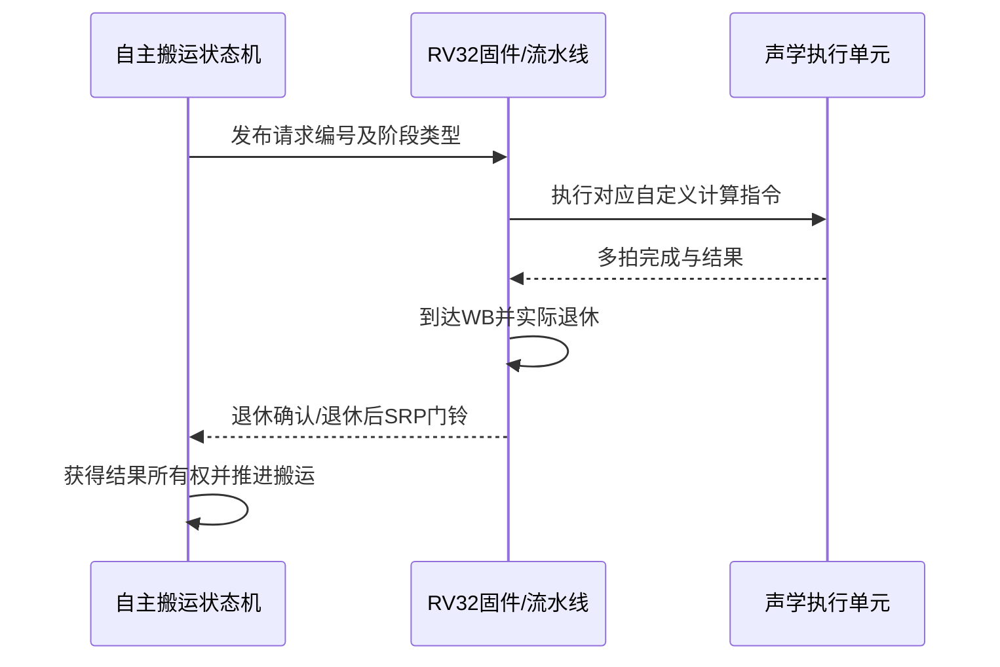

图2-5 计算完成、指令退休与搬运所有权交接。

#### 2.2.3.4 八lane实数SIMD-MAC与连续音频共享

实数SIMD固定为八个lane。逻辑抽头$t=8j+b$由第$b$个lane在第$j$趟处理。系数按抽头号分bank，历史样点按样本号分bank，二者分别存储，保证一次取数可并行提供八组乘法操作数。系数为24位内部格式、乘法操作数为16位、乘积为32位，每lane使用40位累加器；归约树分三级，在最后乘积完成累加并排空流水后工作。[H12]

两种计算形态共用乘法和存储路径。VRED得到

$$
s=\sum_{b=0}^{7}\sum_j w[8j+b]x[n-8j-b]；
$$

VUPD则旁路跨lane加法树，对各系数独立执行与标量步长相关的更新。这里的lane对应抽头并行度，与九支麦克风的通道编号没有一一关系。当前连续FIR为32 tap，八lane执行四趟，音频状态机使用`len=3`表达“趟数减一”。[H12][H04]

连续音频状态机通过`audio_own`选择同一个向量单元，依次执行PUSH、等待、VRED和等待完成。它占用独立历史区与相应系数区；CPU请求与音频请求通过仲裁互斥使用实数向量执行体，其他独立运算资源可继续执行。`audio_ready_o`同时检查向量忙状态和系数访问，避免在系数预装时接受音频。CPU HALT本身不足以表示连续音频状态机已空闲，外部维护必须依据实际占用状态。[H04]

该设计通过共享执行体控制资源数量，并用bank布局、有效历史长度和流水有效位维护确定性。BRAM同步读与端口行为依据[AMD UG473](https://docs.amd.com/v/u/en-US/ug473_7Series_Memory_Resources)〔参考文献4〕组织。BRAM内容不做大范围复位，复位后以有效历史长度把尚未写入的历史视为零，保留同步RAM推断条件。逐位验证应覆盖多趟归约、最后一趟排空、负数乘积、饱和和音频/CPU仲裁，单趟MAC正确不足以证明完整FIR正确。[H12]

#### 2.2.3.5 实复数分工、FFT/IFFT复用与PHAT

复数单元面向整段频谱组织操作数，与实数抽头阵列采用不同的数据布局。每个复数按`{imag[15:0], real[15:0]}`打包为32位字，输入X、Y和结果Z分别存储，结果存储按lane分bank。单元支持4、8、16 lane配置，当前九麦SoC选择4 lane，以匹配资源和吞吐要求；不能将此参数化能力套用于固定八lane实数阵列。[H03][H13]

正逆变换共享512点复数核心、蝶形、旋转因子与存储。正变换把1024个实样点两两打包为512个复数，执行九级复数FFT和实数拆分，形成513个非负频率点；逆路径执行反拆分、共轭因子蝶形和对应输出。Nyquist点单独保存，防止第513项回卷覆盖第0项。蝶形乘法、中间和、逐级缩放与舍入按标量C参考保持定点契约。[H14]

通道频谱只计算一次，后续36个麦对复用相应频谱。当前定位实际PHAT有效频点为$k=2\ldots52$，由

$$
f_k=k\frac{156250}{1024}
$$

得到约305.18～7934.57 Hz。配置的200～8000 Hz表示选带意图；64个搬运缓存频点包含填充项，不能全部称作有效算法频点。稀疏逆变换对未装载带外点显式置零，避免残留的上一次频点进入相关计算。[H03][H10][H14]

PHAT先计算共轭互谱$G_{ij}[k]=X_i[k]X_j^*[k]$，再以移位加减近似模长。设$a=\max(|\Re G|,|\Im G|)$、$b=\min(|\Re G|,|\Im G|)$，当前近似为

$$
\widehat{|G|}=a+(b\!\gg\!1)-(b\!\gg\!3)+(b\!\gg\!5)+(b\!\gg\!7)。
$$

随后把幅值规格化，使用4位索引的16项倒数表，再把尾数乘积按指数缩放。将尾数与指数分别维护可避免弱频点倒数先移位导致溢出。该实现减少开方和通用除法需求，属于有限精度近似归一化，其误差应通过独立模型和定位场景验证。[H13]

#### 2.2.3.6 重叠定位、滚动统计与四麦对并行SRP

定位以1024点窗口、512点Hop运行。采集时对每个512点块累计和、平方和、峰值、削顶数及极值，合并相邻两个块得到完整窗口统计。正好相同的输入样本区间才能用于优化前后逐位对照；观察窗时长、相邻发布间隔及窗后计算时长分别记录。[H10]

自主搬运状态机维护原始缓存、通道与麦对索引、FFT缓存、相关环和SRP结果读取。每麦对只保留所需64点相关环，空间网格仍为1024格；相关行长与搜索格数独立定义，负延迟按相关环自身宽度回绕。对于方向单位向量$\boldsymbol u$，标定到达延迟为

$$
d_i(\boldsymbol u)=-\frac{f_s}{c}\boldsymbol r_i^T\boldsymbol u+\delta_i，\qquad
\tau_{ij}=d_i-d_j，
$$

其中$\delta_i$为传感器相对延迟。SRP根据Q4时差查表，执行

$$
P(\boldsymbol u)=\sum_{i<j}\left[R_{ij}[q]+\frac{f}{16}\big(R_{ij}[q+1]-R_{ij}[q]\big)\right]，
\quad q=\lfloor\tau_{ij}\rfloor。
$$

该访问模式需要不同麦对、不同延迟地址的分散读取，因此采用独立SRP内核。当前九麦设置`FAST_SCAN=4`，连续四个麦对分到四组LUT和相关bank，各组使用双端口读取相邻相关点。先按每对完成插值与定点截断，再归约四对贡献，保持与串行参考的数值关系；组切换前排空写回，避免相同空间格的读写冲突。历史九麦记录中，该SRP子阶段为9306个40 MHz周期，即0.23265 ms，不能据此替代完整定位时延。[H15]

窗口控制器区分首次预热与累计样点计数，使用独立`window_primed`状态保持连续Hop调度，避免32位样点计数回卷后重新预热。源序号间断、原始缓存覆盖或上一窗口未及时释放均进入显式故障路径；恢复切换采集时代并重新预热，旧时代结果失去有效性。该机制限定异常时的输出行为，持续实时性能仍取决于实际阶段耗时与缓存余量。[H10]

#### 2.2.3.7 九通道DAS、原子转向与硬件测速

连续DAS为各通道维护64点历史，根据补偿延迟读取相邻样点，支持线性插值和Q4相位的四点三次Lagrange插值。九路补偿量先减公共最小值，使至少一路延迟为零；输出对九路有效信号求和并按9进行对称最近舍入归一化。DAS后接共享SIMD完成32 tap FIR，其系数按当前156250 Hz重新生成；PS GSC使用相同延迟与FIR契约重建匹配主支路。[H16]

细化转向通过扩展窗口`0x3f0～0x3fc`提交，签名为`C9X1`。一次事务包括方向格、序号、采集时代、时间戳及九个延迟字段，使用13位写入掩码检查完整性。硬件要求延迟低12位为零、值小于$61\ll16$、至少一路为零、时代匹配、序号有效且时间未过期；默认TTL为8000000周期，即按提交时间戳起算200 ms。同版本同向量允许刷新；拒绝新事务时保留旧活动向量，其仍受原TTL约束。完整检查通过后，九路影子向量一次复制为活动向量，PS再读回确认；PS检测失败会主动撤销可信定向。[H17]

DAS在样点边界接纳新版本，音频包携带应用版本和生效样点号。平滑转向开启时，每个原始样点的延迟变化最多4096个Q16单位，即1/16样点；包中另标记过渡状态。故障或超时撤销可信方向，PS据包内版本选择匹配GSC参数，防止某些通道已更新、其他通道仍沿用旧方向的混合配置。[H16][H17]

测速输入经过两级同步和双极性稳定过滤，仅用上升沿测周期。默认过滤64周期即1.6 μs，最小周期128周期，超时12000000周期即300 ms；相邻周期差需满足5%一致性判据，并积累稳定周期后发布有效状态。PS显式给定每转脉冲数PPR，按

$$
\mathrm{RPM}=\frac{60\times40\times10^6}{\mathrm{period\_ticks}\times\mathrm{PPR}}
$$

换算转速，当前诊断接受范围为600～1800 rpm。转速超时或工况改变后，软件撤销旧窗口授权并重新积累数据。硬件测速接口已经连接当前控制单元；源文件中“暂无消费者”的旧注释不代表当前连线事实。[H03][H17]

#### 2.2.3.8 非阻塞DMA与关键硬件接口

音频tap把同一采样编号的九路16位PCM、DAS/FIR输出、方向版本、生效样点、群延迟、定位窗号、时代及状态组成512位内部记录，并附64位采样时间戳。独立小队列吸收传输波动，溢出和原始/波束对齐错误分别计数。[H05]

DMA在DDR所有权环中按128字节槽写入，一个槽对应16拍64位AXI写数据。记录包含序号、校准版本、时间戳和CRC尾部；只有AXI写响应成功且该事务未超时、未故障，生产者指针才推进。环满或队列满时丢弃传输副本并累加计数，`stream_ready_o`不把DDR压力反向传递到PCM/DAS。超时会锁存故障，并等待既有总线事务完成，避免把超时写当作正常发布。[H18]

| 接口/信号 | 方向、宽度或位置 | 硬件作用 |
|---|---|---|
| `pdm_clk_o` | PL输出，V16 | 2.5 MHz共用采集时钟 |
| `pdm_din_i[4:0]` | PL输入，T14、Y17、W16、T15、Y16 | 依次承载CH0/1、CH2/3、CH4/5、CH6/7、CH8/空槽 |
| `rst_n` | 低有效输入，N16 | 顶层复位 |
| `tacho_i` | 异步输入，R18，LVCMOS33 | 同步、滤波、周期测速；约束带上拉 |
| `sample_valid_o`、`audio_vec_o` | 1位、十槽×24位 | 采集输出组有效及PCM向量 |
| `retire_valid_o`、`retire_instr_o` | 1位、32位 | 指令退休观察及搬运阶段授权 |
| `audio_valid/ready/done` | 握手信号 | DAS与共享SIMD FIR的数据交换 |
| `fine_comp_o`、`fine_version_o` | 288位、32位 | 九通道完整延迟向量与版本 |
| `gsc_valid_o/data_o/timestamp_o` | 1位、512位、64位 | 同采样记录送DMA |
| AXI4-Lite主控制窗 | PS地址`0x43c00000`，4 KiB | RV32、采集、SRP、转向和扩展寄存器 |
| DMA控制窗 | PS地址`0x43c10000`，4 KiB | 环地址、生产/消费指针、错误及丢失计数 |
| PS `S_AXI_HP0` | 64位数据面 | DMA将采样记录写入DDR |

引脚表依据当前配置和XDC；接插件位置、实际供电、电平及物理通道映射仍需与实物检查记录对应。尤其第五DATA约束保留物理引脚/VCCO待验说明，不能由封装约束存在推导出板级接口已验收。[H01][H07][H02]

#### 2.2.3.9 硬件贡献的验证设计与现有证据

硬件验证分为独立算子、真实指令、完整SoC、布局布线和实物声场五个层次。每项结果需绑定相应源码与构建产物，模块仿真正确不能代替整机时限，时序收敛也不能代替声学精度。表2-4列出核心设计贡献的可复核方法；本稿仅核对源码及仓库记录，没有重新执行测试。

| 硬件贡献 | 对照与负例方法 | 仓库记录及结论边界 |
|---|---|---|
| 双相采集与启动有效性 | 独立三态麦源，正常/换相/缺相/冲突/迟到；完整启动参数及不同停启相位 | `check_pdm_shared.py`含50 ms与16相位停启；真实载板电气窗口待测 |
| 双形态八lane MAC及共享音频 | 标量定点逐点对照，多趟/排空/更新/饱和；CPU与音频仲裁 | `tb_vec_unit.v`、`tb_vec_core.v`、`tb_das_stream.v`及九麦SoC检查；旧模块加速比不作当前整机指标 |
| 自定义指令与退休所有权 | 实际固件发射计数；HALT、访存等待下检查退休前禁止阶段推进 | 核源码保留退休门控；历史问题125保留修复前反例，旧12麦压力矩阵不直接升级为当前九麦板测 |
| FFT/IFFT复用与稀疏搬运 | 标量C逐位对照，正逆/满幅/Nyquist；故意关闭稀疏掩码 | 九麦延迟报告记录12例、6148词一致；属于数字算术验证 |
| 四麦对并行SRP | 串行、单对流水、四对并行评分对照；负时差回绕、部分组、重启、中止 | `check_srp_lag_ring.py`独立产生期望值；9306拍只描述对应SRP子阶段 |
| 滚动统计与逐通道缩放 | 相同采样区间的统计与地图对照，静音/削顶/断流/计数回卷 | `check_circular9.py`逐窗重算九通道统计；长期实物运行仍需补证 |
| 非阻塞DMA与故障隔离 | AXI背压、环满、错误响应、超时及计数守恒 | `check_stream_dma.py --channels 9`提供九麦配置；真实HP0/DDR/网络并发时限待测 |
| 九路原子转向与测速 | 部分写、别名、错版本/时代、过期/未来提交；脉冲毛刺、转速变化和超时 | `check_circular9_control.py`、`check_circular9_ps_control.py`；2026-10-27记录控制RTL经XSim通过，属于仿真证据 |

2026-10-25完成说明记录：匹配版本的32窗连续生产固件仿真中，首个对齐PCM至RV32完整发布为9.153300～9.155925 ms，最后PCM后最大2.608725 ms，采集和音频丢帧计数为0；该指标不含PS实际接收和网络显示。相同说明记录40 MHz完整实现Setup最差裕量+0.495 ns、Hold+0.031 ns，违例端点均为0，并建立bit/XSA与布线源码绑定。当前工作区缺少最新烧录入口指向的完整发布目录，本稿将以上数字标为仓库历史记录，不把它们写成重新测得的当前交付验收值。[H19]

本系统硬件已经形成采集、专用计算、持续拾音、控制和传输的可执行结构。进一步验收应围绕实际九通道幅相一致性、PDM建立保持、声源角度误差、持续音频完整性、CPU并发截止期及真实故障特征保留进行，并记录同一版本的原始采样和测量条件。

**本节源码与证据索引**

- [H01] [当前九麦配置](../zynq_-pl_-simd_-verilog/configs/circular9_array.json)。
- [H02] [九麦硬件构建入口](../zynq_-pl_-simd_-verilog/scripts/run_circular9_optimized_flow.tcl)、[PS/PL互联](../zynq_-pl_-simd_-verilog/scripts/create_zynq_project.tcl)、[DMA/HP0连接与地址](../zynq_-pl_-simd_-verilog/scripts/connect_stream_dma.tcl)。
- [H03] [九麦SoC实例及数据通路](../zynq_-pl_-simd_-verilog/rtl/soc/rv32_soc.v)。
- [H04] [RISC-V核心、退休与共享音频控制](../zynq_-pl_-simd_-verilog/rtl/core/rv32_core.v)、[分支预测](../zynq_-pl_-simd_-verilog/rtl/predictor/rv32_branch_predictor.v)。
- [H05] [原始PCM/波束音频同步打包](../zynq_-pl_-simd_-verilog/rtl/array/rv32_gsc_tap.v)。
- [H06] [双相PDM接收](../zynq_-pl_-simd_-verilog/rtl/array/rv32_pdm_array_rx.v)、[时钟节拍](../zynq_-pl_-simd_-verilog/rtl/array/rv32_pdm_clkgen.v)、[CIC抽取](../zynq_-pl_-simd_-verilog/rtl/array/rv32_pdm_cic.v)、[采集验证脚本](../zynq_-pl_-simd_-verilog/scripts/check_pdm_shared.py)。
- [H07] [主引脚与PDM约束](../zynq_-pl_-simd_-verilog/constrs/ps_pl_wrapper.xdc)、[第五DATA约束](../zynq_-pl_-simd_-verilog/constrs/circular9_extra.xdc)、[外部窗口分析及范围](../zynq_-pl_-simd_-verilog/docs/pdm_external_window.md)。
- [H08] [去直流和Q2.14增益](../zynq_-pl_-simd_-verilog/rtl/array/rv32_chan_align.v)。
- [H09] [标定记录校验](../zynq_-pl_-simd_-verilog/scripts/circular9_calibration.py)、[同源LUT和契约生成](../zynq_-pl_-simd_-verilog/scripts/build_circular9.py)、[当前生成镜像与确认状态](../zynq_-pl_-simd_-verilog/sw/acoustic_circular9_image.h)。
- [H10] [重叠定位与滚动统计](../zynq_-pl_-simd_-verilog/rtl/array/rv32_overlap_localizer.v)、[九麦完整数字检查](../zynq_-pl_-simd_-verilog/scripts/check_circular9.py)。
- [H11] [扩展编码定义](../zynq_-pl_-simd_-verilog/rtl/rv32_defines.vh)、[真实生产固件调度](../zynq_-pl_-simd_-verilog/sw/fw/fw_planar8.c)。
- [H12] [八lane向量单元](../zynq_-pl_-simd_-verilog/rtl/vec/rv32_vec_unit.v)、[同步bank存储](../zynq_-pl_-simd_-verilog/rtl/vec/rv32_vec_bank.v)。
- [H13] [复数运算与PHAT执行体](../zynq_-pl_-simd_-verilog/rtl/acoustic/rv32_acoustic_ext.v)。
- [H14] [共享正逆变换](../zynq_-pl_-simd_-verilog/rtl/acoustic/rv32_fft_bfly.v)、[FFT设计资料](../zynq_-pl_-simd_-verilog/docs/vfft_design.md)。
- [H15] [并行SRP流水](../zynq_-pl_-simd_-verilog/rtl/srp/rv32_srp_scan.v)、[独立相关环与并行检查](../zynq_-pl_-simd_-verilog/scripts/check_srp_lag_ring.py)、[九麦时延口径及阶段记录](../zynq_-pl_-simd_-verilog/docs/circular9_latency_contract_20261023.md)。
- [H16] [DAS分数延时、平滑与版本应用](../zynq_-pl_-simd_-verilog/rtl/beamformer/rv32_das_stream.v)。
- [H17] [九路原子控制与测速](../zynq_-pl_-simd_-verilog/rtl/array/rv32_circular9_control.v)、[PS提交、读回及转速换算](../zynq_-pl_-simd_-verilog/sw/ps_circular9_control.h)。
- [H18] [流式DMA](../zynq_-pl_-simd_-verilog/rtl/transport/rv32_stream_dma.v)、[DMA验证入口](../zynq_-pl_-simd_-verilog/scripts/check_stream_dma.py)。
- [H19] [2026-10-25完成说明](../zynq_-pl_-simd_-verilog/docs/circular9_optimization_completion_20261025.md)、[2026-10-27离线收口记录](../zynq_-pl_-simd_-verilog/docs/issues/137-offline-closure-and-board-readiness.md)、[本次创新点核对及发布目录缺失说明](../zynq_-pl_-simd_-verilog/docs/作品创新点完整梳理_2026-10-28.md)。

## 2.3 软件系统介绍

### 2.3.1 软件整体介绍（含PC端）

本系统的软件围绕“找到方向、取得该方向的可诊断声音、判断异常、将结论绑定回空间对象”组织。软件包括PL中RISC-V固件、PS双核裸机程序、浏览器监测界面，以及PC端采集、训练、归档与回放工具。运行时的搜索、分离和诊断由板端完成；PC承担数据管理和人机交互，也可在研发阶段回放同一套C处理链路。

系统采用两种互补的处理节奏。RISC-V固件持续调度PL快速定位，保留完整方向评分和输入质量状态；PS CPU0持续接收九路原始PCM、维护历史和轨迹、执行控制与网络服务；CPU1从历史中复制明确时间区间，进行多频带辅助搜索，以及较长窗口的候选分离和机械特征分析。连续GSC是CPU0上可选的单目标支路，与CPU1同窗多候选分离各有独立数据流。当前默认关闭全速UDP录音时，CPU0旁路无人消费的连续GSC输出计算，CPU1仍独立运行搜索和诊断。

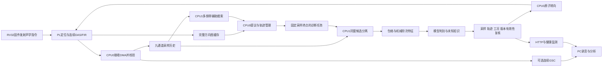

图2-6 软件运行数据流与板端、PC分工。

软件使用的主要数据契约如下。时间参数来自当前源码配置，描述设计节奏；任务能否在该节奏持续产生合格结果，需要结合CPU实际耗时和观测覆盖验收。

| 对象 | 当前格式或参数 | 软件中的含义 |
|---|---|---|
| 原始PCM | PL去直流/增益校正后取高16位的九路对齐PCM，156250 Hz | 历史、采样编号、轨迹和调度的统一时间基准；不是PDM原始位流 |
| PL方向图 | 32×32，共1024个方向评分 | 水平角和俯仰角搜索，不含距离维度 |
| 辅助搜索 | 16640个原始帧，其中256帧预热 | 16384帧真实证据，即104.8576 ms；七个重叠STFT观察 |
| 辅助搜索Hop | 8192个原始帧 | 52.4288 ms的发起节奏，结果接受还受200 ms年龄限制 |
| 诊断输入 | 160256×9个原始样本 | 含256帧预热，抽取与裁剪后得到40000点单候选音频 |
| 单候选音频 | 40000点，78125/2 Hz | 真实观察时间1.024 s，每窗最多三个候选共用输入 |
| 诊断Hop | 80000个原始帧 | 512 ms；排队输入年龄也限制在该尺度内 |
| 计算与结果年龄 | 3000000 μs、468750个原始样点 | 独立于Hop的3 s预算，并非2 Hz有效诊断保证 |
| 特征与分离版本 | C9F2、C9S3 | 训练、运行与发布必须匹配的前端契约 |

主要软件接口按数据所有权划分如下，表中数组维度与当前源码对应。

| 函数及执行位置 | 主要输入 | 主要输出/副作用 |
|---|---|---|
| `c9_live_poll()`，CPU0 | 已发布DMA槽、`out、drops`指针 | 返回音频块状态，推进消费及历史 |
| `c9_history_push()`，CPU0 | `history、words[16]` | 发布带保护号的九路原始帧 |
| `c9_history_copy()`，CPU1/调试复制 | 历史、`frames、requested_end` | `pcm[][9]、first、epoch、session`；失败返回0 |
| `c9_candidates_search()`，CPU1 | 原始帧、LUT、工作区、采样上下文 | `c9_search_feedback`候选与真实支持 |
| `c9_tracks_update_intervals()`，CPU0 | 候选及各自`firsts、ends` | 更新轨迹身份、状态与缺口 |
| `c9_tasks_cpu1()`，CPU1 | 已认领任务、独占PCM快照 | 发布分离报告、诊断、音频及耗时 |
| `c9_candidates_separate()`，CPU1 | `raw[160256][9]、cand、count、lut` | `out[3][40000]、ready_mask`及质量报告 |
| `c9_diagnose()`，CPU1 | `audio[40000]、shaft_hz、binding` | `c9_diag_report`及拒识原因 |
| `c9_apply_target()`，CPU0 | 总线、候选、采集时代 | 九路原子事务；失败撤销目标 |
| `gsc9_process()`，CPU0可选 | 状态、`words[16]、enabled、freeze` | 同序号`int16_t`输出及统计 |
| `c9h_observe()`，CPU0 | 监测器、已复核诊断记录 | 趋势、状态与事件 |

本章以2026年10月28日工作区源码为依据。历史实板记录、宿主测试、RTL仿真和正式应用验收分开引用；本次RTL定位／算子与PS算法宿主计时见第一部分；PS实板运行及真实声学场景试验未重跑。较早文档中的非缓存历史、三观察帧辅助搜索、512 ms计算期限等表述已被后续实现调整，不作为当前软件事实。

### 2.3.2 软件各模块介绍

#### 2.3.2.1 PS双核AMP、缓存策略与任务所有权

双核程序采用AMP方式分工。CPU0执行DMA消费、历史写入、定位结果接收、控制和HTTP服务；CPU1在独立入口初始化自身MMU、一级缓存和浮点环境，然后循环调用`c9_tasks_cpu1()`。CPU1设置ACTLR的SMP位加入SCU一致性，不重复初始化CPU0正在使用的共享二级缓存。两核执行同一ELF中的不同入口，大数组放在DDR工作区，避免将频域矩阵和整段音频压入CPU1的OCM栈。

当前程序将CPU专用共享历史和任务段映射为两核一致的Normal Write-Back共享内存：`.c9_history`位于`0x0A000000`、预留32 MiB；`.c9_tasks`位于`0x09000000`、预留1 MiB。`c9_tasks_init()`先清理既有缓存，再设置相同段属性。任务状态转换使用`__atomic_compare_exchange_n()`及acquire/release语义，依靠一致性系统完成原子读改写。不能把旧版本“全部设为非缓存”的策略照搬到这里，非缓存DDR上的独占事务曾造成任务停留在认领状态。

PL写入的DMA槽区采用另一种协议：`.c9_dma`位于`0x08000000`、预留1 MiB，实际环形槽区为512 KiB、每槽128字节。CPU读取已经发布的槽前显式执行缓存失效，配合屏障、所有权和完整性校验；CPU不改写槽内负载。CPU间共享的一致性与PL到CPU的DMA缓存维护分别处理，前者不能替代后者。

`c9_diagnostic_job`包含`sequence、end_sample、session、epoch、shaft_generation、tracks[3]`等输入。任务状态为0空闲、1待执行、2由CPU1持有、3由CPU0修改。CPU0仅能替换尚未执行的任务；CPU1成功认领后复制任务内容，再处理独占快照。`c9_diagnostic_result`具有两个结果槽：CPU1占有空槽进行写入，发布为状态2；CPU0接收后设为状态3并固定持有，采用更新结果时才释放前一槽。因此HTTP分块读取音频期间，CPU1不能复用该结果缓冲。

这一设计解决“后台计算与前台取数相互覆盖”的问题。收益是采集、诊断和交互可以并行，并且结果有清晰的生产者、消费者和释放时机。`circular9_async_schedule_test.c`已有真实C任务交错记录，但其确定性回调不能覆盖ARM缓存硬件的全部行为；历史板级运行只为对应ELF版本提供证据。

源码：[双核任务与共享区](../zynq_-pl_-simd_-verilog/sw/ps_circular9_tasks.h)、[CPU1启动](../zynq_-pl_-simd_-verilog/sw/ps_ui.c)、[DMA消费](../zynq_-pl_-simd_-verilog/sw/ps_circular9_live.h)。

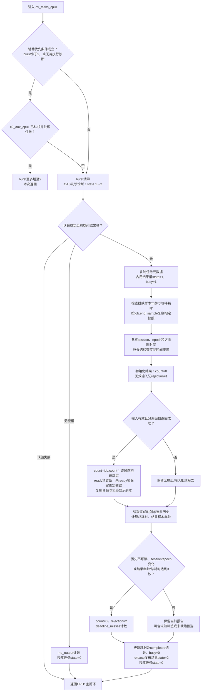

图2-7 `c9_tasks_cpu1()`函数级任务流程。存在待执行诊断时，最多连续优先处理两次辅助任务；没有待诊断任务时不以两次限制辅助服务。辅助任务当前合并到最新请求窗口，不追算三个旧窗。诊断输入检查包括排队样本年龄小于80000原始点、排队计时小于3 s、指定终点快照完整、时代/会话与图时间匹配，以及每候选至少90%的实际方向覆盖。无论有效输出还是拒绝报告，都以结果槽状态2发布供CPU0接收；该状态仅表示报告已完成，不表示故障分类可信。最终3 s检查采用“结果样本年龄或排队至完成总耗时”，不是另加一个3 s计算预算。

源码：[任务工作函数](../zynq_-pl_-simd_-verilog/sw/ps_circular9_tasks.h)、[辅助工作函数](../zynq_-pl_-simd_-verilog/sw/ps_circular9_aux.h)。

#### 2.3.2.2 RISC-V固件与“指令计算、自主搬运”协同

九麦固件由`fw_planar8.c`在`FW_ARRAY_CHANNELS=9`条件下构建。文件名保留历史命名，九麦编译分支使用10个采集槽、9个有效通道和36个麦对。固件启动时核对定位器、采集器和九麦ABI标识，再启动512点Hop的连续定位调度。

主循环读取定位器的任务票号`LOC(2)`和计算类型。票号变化后复读确认，按类型实际发射FFT、IFFT、互谱、PHAT或SRP自定义指令。硬件状态机负责样本地址推进、频谱预取、打包及中间数据搬运；固件保留计算发射权、质量判断和发布责任。这里的处理器贡献体现在“可编程的算子控制与专用数据流协作”，并非将一条普通MMIO启动写入冒称为所有计算都由RISC-V指令完成。

每窗完成后，固件读取每通道五项统计，遍历1024格评分并执行峰值质量、输入幅度、几何和截止期检查。九麦评分使用两块DTCM缓冲：当前窗写入非活动块，仅在短提交阶段切换评分指针和元数据序列。CPU0分片复制已提交块，并在复制前后检查序列，HTTP复用CPU0完整缓存，避免每次页面请求占用1024次MMIO读取。

固件也区分自动跟随最强峰与诊断接受的目标。`D1`选择候选方向，`D2`进入最强峰跟随测试模式，`D3`撤销诊断目标可信状态。撤销可信目标不要求擦除最后一组内部延迟，故障方向有效性必须根据发布状态判断。该机制连接自研声学处理器、指令与搬运协同及空间诊断链路；相关指令级与整机RTL记录可验证算子控制路径，真实机械归因还依赖PS模型和实物标定。

源码：[RV32生产固件](../zynq_-pl_-simd_-verilog/sw/fw/fw_planar8.c)、[质量判据](../zynq_-pl_-simd_-verilog/sw/fw/fw_location_quality.h)。

#### 2.3.2.3 连续接收、无阻塞历史与采样时间调度

`c9_live_poll()`将一次CPU0服务限制在至多16个样点，并在每四点检查75 μs协作预算，及时返回定位服务。`pdm_ring_next()`提供完成槽，CPU0解析`words[16]`，将九路PCM送入`c9_history_push()`。断序、采集时代变化或环恢复将重置历史会话，避免旧数据和新数据进入同一观察段。网络发送另走固定容量队列，音频服务只排队，不直接调用lwIP分配或发送；队列满时计入软件丢失，PL的PCM/DAS节奏继续。

历史容量`C9_HISTORY_FRAMES=1048576`，对应6.7108864 s。每槽保存九路PCM、完整样本序号和写入保护号。写者先置奇数保护号并执行屏障，写入数据后发布偶数号；读者检查序号、保护号和复制后的保护号。`c9_history_copy(history, pcm, frames, requested_end, ...)`复制指定终点的区间，结束时再复核会话、时代与环覆盖范围。读取遇到并发改写或历史被覆盖即失败，CPU0生产者无需等待CPU1。初始化只发布有效计数等元数据，不在实时路径清零整块历史。

诊断作业使用采样时钟。设已捕获终点为`end`、上次已发起终点为`E`、Hop为`H=80000`，到期时选择：

$$
E_{new}=E+\left\lfloor\frac{end-E}{H}\right\rfloor H.
$$

当中跨过的Hop记为跳步，不将旧任务排成无界队列。CPU1认领后检查输入排队年龄`end_before-job.end_sample<80000`，并按`job.end_sample`复制160256帧，禁止改用另一个“当时最新”的窗口。处理后检查`result_age_samples<468750`和从排队到完成的总时间小于3 s，同时检查`session、epoch`仍一致。CPU计时器用于测量排队与计算成本，不能替代实际采样序号。

原始快照首256帧供滤波预热；最终40000点音频覆盖1.024 s。绑定保留原始快照起点及分离/抽取契约，不能直接将原始起点与裁剪后的第一个音频点视为相同时间位置。系统分别记录最大排队、处理、总耗时、结果年龄、替换及超期计数，使“结果已完成”和“结果仍有效”能够区分。该模块体现快慢任务并行和全链路有效性约束；历史678 ms量级的计算完成记录不构成每512 ms持续产出的证明。

源码：[历史实现](../zynq_-pl_-simd_-verilog/sw/circular9_candidates.c)、[调度契约](../zynq_-pl_-simd_-verilog/sw/circular9_schedule.h)。

#### 2.3.2.4 多频带发现、联合仲裁与有限残差复核

CPU1的`c9_candidates_search(raw, raw_frames, lut, workspace, context, feedback)`直接接收九路PCM和其采样上下文，不要求已有轨迹或PL最强峰。前端检查每通道能量和削顶，使用127抽头Q15抗混叠低通进行4倍抽取。当前16640帧输入在去除预热后形成104.8576 ms证据，使用1024点、512点Hop的七个STFT。短窗辅助发现与长窗分离都复用`c9_separation_workspace`，由CPU1串行调用，不能在没有独立工作区时中断重入。

GCC相位归一化的理论背景见[Knapp与Carter](https://doi.org/10.1109/TASSP.1976.1162830)〔参考文献5〕；本工程PS采用带相干度权重的具体实现。搜索在600—2200、2200—4600、4600—8000 Hz三个频带中计算36对麦克风的相干归一化互谱、相关及SRP方向评分。互谱来自真实观察：

$$
\widehat R_{ij}(k)=\frac1F\sum_{f=1}^{F}X_i(f,k)X_j^*(f,k),\qquad
\Gamma_{ij}(k)=\frac{\widehat R_{ij}(k)}{\sqrt{\widehat R_{ii}(k)\widehat R_{jj}(k)}}.
$$

这种复相干形式保留相位并降低不相干频点的作用。频带内至少保留四个合格频点，各带先提取最多三个候选，再进入统一的九项候选池。突出度由峰与方向肩部评分差构成，排序使用`score×quality/1000`，原始分数同时保留。统一仲裁在同一代表角度复查不同频带的支持，不能把附近另一峰的分数直接记在该候选名下；输出最多三个方向，减少频带遍历顺序造成的占位偏置。

混合能量可能掩盖真实次峰的时间支持。因此，对于已经通过SRP和突出度门控的次峰，程序可选择一个同带、至少三次直接观测、与其相隔25°以上的同伴，先投影消去该同伴，再计算残差支持。投影范数必须不小于0.125，沿用最大权重范数8的约束；仍要求原0.25相干统计门槛及三次真实观测，最多附加九次检查。该机制只复核已有次峰，不能凭空创建在原方向图中缺失的弱源。

收益是增加宽带主峰之外的发现路径，且保持有限计算量。历史离线双源场景有改善，也保留弱源、近角、三源失败记录。全网格投影残差找峰仍在研究脚本中，未进入生产。验证宜分别统计“真方向附近有峰、通过质量、入选、形成稳定轨迹、进入有效诊断”，防止用最终分类结果掩盖前级漏检。

源码：[候选搜索与仲裁](../zynq_-pl_-simd_-verilog/sw/circular9_candidates.c)、[辅助任务收发](../zynq_-pl_-simd_-verilog/sw/ps_circular9_aux.h)。

#### 2.3.2.5 真实支持并集、方向轨迹与候选资格分级

支持不是简单的连续命中次数。1024点STFT窗在512点Hop下，帧0与帧2的时间区间仍相接。`c9_support_component(mask, frames, first, last)`在支持位图上求真实窗并集的连通分量，至少保留三次真实观察，既不把隔一帧命中误判为时间断裂，也不填补真实空洞。C9B2反馈同时携带`support_mask、support_frames、support_first_sample、support_end_sample`，接收端重新核算并检查采样边界、频带、版本和200 ms年龄。重复或乱序反馈不能增加支持。

CPU0以方向夹角关联轨迹，而非按能量名次继承身份。每个跟踪器最多三个轨迹，PL提议和CPU1辅助轨迹再按当前状态、完整覆盖、真实观测次数和年龄统一竞争、去重，来源命名空间仅作平局判据。关联范围约12°，相对稳定锚点移动超过7.5°重新积累；合并时无法唯一关联的观测保持不确定，不将一个峰同时刷新两个身份。

轨迹具有`OBSERVED、COASTING、RECOVERING、EXPIRED`四态。漏检可保留约150 ms身份，但不产生新证据，也不授权故障定向；恢复要求三次新鲜观测。长期丢失、时代改变、序号回卷会清理旧区间。`c9_track_coverage_reason()`根据缺口列表与末尾缺失计算实际区间覆盖，要求诊断原始快照至少90%有方向支持，并满足锚点、状态、观测次数等条件。主方向图读取还检查过大的图间隔，防止慢轮询自动冒充连续观测。

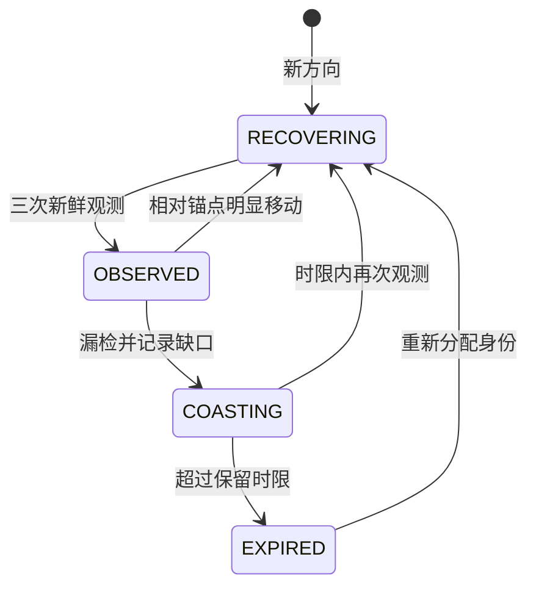

图2-8 声源方向轨迹的观测、暂失、恢复与过期状态。

调度进一步区分处理资格与可信归因资格。某个暂失、覆盖不足或与已选候选相隔不足25°的方向，不再否决其他合格候选的分离；被排除数记入`unresolved_tracks`。只要还有未解析方向，该作业就不获得`C9_DIAG_BIND_DIRECTION`，避免“局部已有输出”被误解为“全场故障已归因”。轨迹ID表示角度历史，不能保证声源交叉后的物理电机身份。

验证记录包括轨迹62项、支持位图2560组独立参考比较、峰竞争排列及生命周期场景。这些证明对应输入下的证据管理，不保证任意声场可观察、可分辨。

源码：[支持数据契约](../zynq_-pl_-simd_-verilog/sw/circular9_candidates.h)、[轨迹](../zynq_-pl_-simd_-verilog/sw/circular9_tracking.h)、[提议](../zynq_-pl_-simd_-verilog/sw/circular9_proposals.h)。

#### 2.3.2.6 目标子空间保护的协方差分离

`c9_candidates_separate()`接收同一份`raw[160256][9]`、最多三个候选、统一转向LUT和CPU1工作区，输出`out[3][40000]`及`c9_separation_report`。候选两两夹角小于25°直接拒绝，该阈值是计算/拒绝契约，不能解释为阵列已经保证25°分辨率。长窗中选取至多八个实际STFT观察估计九通道互谱协方差，其余重构帧使用该窗学得的权值。

线性约束阵列处理的基础可参见[Frost](https://doi.org/10.1109/PROC.1972.8817)〔参考文献7〕；下述目标子空间保护和有界软约束组合以本工程源码为准。直接最小化混合协方差中的输出能量，可能把目标自身或其角度误差一起压低。本实现先保护目标子空间。`steering_sector()`以中心及水平/俯仰正负偏移构成五个导向样本，扇区半宽限制在3°—6°。由中心向量、成对一阶差和二阶差生成基，经两遍正交化得到正交基`U`，构造：

$$
P=I-UU^H,\qquad R_r=P\widehat R_xP^H.
$$

只有残差迹至少达到原混合迹的0.001，才将其作为有效声场信息，避免把近似纯目标的小量标定残差归一化成强干扰。保留残差作Hermitian对称化、迹归一化与25%单位阵收缩：

$$
\widetilde R_r=0.75\frac{9R_r}{\operatorname{tr}(R_r)}+0.25I.
$$

对每个候选和频点，程序建立包含目标扇区偏差惩罚、竞争扇区抑制及残差统计的正则化矩阵。用列向量权值表示，其形式可写为：

$$
R_e=I+\lambda_t\sum_s(a_{t,s}-a_{t,0})(a_{t,s}-a_{t,0})^H
+\lambda_i\sum_{j\ne t,s}a_{j,s}a_{j,s}^H+\beta\widetilde R_r,
\qquad
w=\frac{R_e^{-1}a_{t,0}}{a_{t,0}^HR_e^{-1}a_{t,0}},\quad y=w^HX.
$$

源码存储直接与频谱相乘的共轭行权，数学上与上式对应。实现属于带单位目标响应、软零陷和扇区约束的正则化波束形成，不是将所有扇区同时作为严格零响应的标准硬约束LCMV。目标惩罚为`1000/5`，三次有界尝试的竞争惩罚为`10000/5、300/5、30/5`，残差混合系数为`8、2、0`；只有显式保真门控仍通过才接受。单候选时无已知竞争方向，使用由同源导向矢量补相的频域等权DAS，仍经过带限与WOLA，不等同于PL三次插值加32 tap FIR的逐样输出。

该模块体现“为诊断保留目标”而非单纯追求更低输出能量。验证应从同一混合快照学习一次权值，再冻结权值分别渲染已知源贡献，统计目标保留、干扰泄漏与混合线性一致性；对每个源重新拟合会改变实验条件。相关合成测试已有记录，真实房间、真实相位增益误差及多电机分离仍需独立实物证据。

源码：[协方差、子空间与逐频点求解](../zynq_-pl_-simd_-verilog/sw/circular9_candidates.c)、[分离回归](../zynq_-pl_-simd_-verilog/sw/circular9_candidates_test.c)。

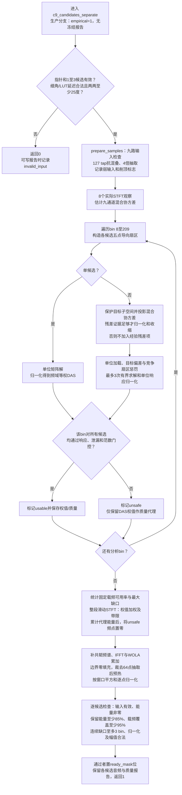

图2-9 `c9_candidates_separate()`生产分离流程。函数处理固定160256×9原始输入并输出最多三段40000点音频；自身不检查外部session、epoch、排队年龄或轨迹覆盖，这些由任务层完成。输入能量/削顶异常会记录并最终撤销就绪，不在抽取后立即退出；多源的任一候选无法通过某个频点门控时，该频点对整组候选标为unsafe。单候选仍执行后续频点质量检查、带限和WOLA，不能视作绕过保真验证。返回1表示分离处理完成，是否可送诊断分别由`ready_mask`各位决定。

源码：[分离入口、逐频点权值与重构](../zynq_-pl_-simd_-verilog/sw/circular9_candidates.c)、[输入输出及报告契约](../zynq_-pl_-simd_-verilog/sw/circular9_candidates.h)。

#### 2.3.2.7 分离保真门控与整窗WOLA重构

求得权值并不等于可以诊断。逐频点接受条件包括权重能量`sum(|w|²)≤8`、目标五点扇区幅度位于0.85—1.15、竞争中心功率响应不大于0.01、竞争扇区采样功率响应不大于0.03，并检查有限数和单位响应。它们是当前导向模型上的响应条件，不是实测声场隔离度承诺。

未通过的频点仅以匹配DAS计算保守质量代理，重构诊断音频时将该频点置零，避免将空间混合声冒充已分离声。整段还要求可用频点保留至少85%的代理能量；固定2200—4600 Hz故障载频的可用频点比例至少95%，且连续缺口不超过三个频点。保留能量与载频完整性共同判断，防止总能量主要在别处时，故障边带已经丢失却仍给出“正常”。每个候选通过全部条件后才设置`ready_mask`。

重构使用1024点正弦分析/合成窗、512点Hop的加权重叠相加。处理从快照前半帧开始，边界采用零填充，逐点累计窗口平方并归一化：

$$
y[n]=\frac{\sum_f\widehat y_f[n-fH]v[n-fH]}{\sum_fv^2[n-fH]}.
$$

随后裁去64个抽取后预热样点，输出恰为40000点。归一化分母过小、非有限值或输出超出归一化范围均撤销就绪。该方式减少快照首尾幅度凹陷，不借用另一快照的样本补边。分离报告保留可用掩码、载频缺口、目标误差、扇区增益、权重范数和协方差使用量，为拒绝原因和后续模型一致性提供依据。

验证覆盖载频孔洞反例、能量充足但载频不足、离格误差、噪声与反射等场景。文档中的数值阈值应与模型前端版本一并解释，不能仅凭“听起来更安静”判断分离成功。

源码：[重构与就绪判定](../zynq_-pl_-simd_-verilog/sw/circular9_candidates.c)、[质量报告字段](../zynq_-pl_-simd_-verilog/sw/circular9_candidates.h)。

#### 2.3.2.8 细角估计、统一LUT与九路原子转向

`c9_candidate_at_peak()`在局部峰上利用相邻评分估计梯度和二维Hessian，只有负曲率、正行列式、有效幅度及不超过半格的拟合偏移才接受细化。边界、平坦峰或鞍点不产生虚假的细角。结果同时保留`grid、azimuth_mdeg、elevation_mdeg、uncertainty_mdeg`，粗格身份、细角和不确定度共同传递，拟合小数位不作为实物精度声明。

`c9_candidate_delays_q16()`从同一标定Q4转向LUT以整数有理数双线性插值取得九路延迟，向下量化、减去九路最小值，转换为Q16表示。它不重新建立第二套理想圆阵几何；原始PCM通道顺序、传感器时延和生成的方向表保持统一来源。非法细化标志、越界角度或过大的延迟跨度直接失败，不静默退回另一个粗方向。

转向LUT记录的是补偿延迟q_i＝floor(16(d_0−d_i))，不同于到达延迟d_i；归一化提交值为D_i＝(floor(interp(q_i))−min_j floor(interp(q_j)))×4096，采用156250 Hz原始样点的Q16单位，实际量化步长为1/16原始样点。PS抽取后的相位按q_i/64换算，不能直接当作诊断采样率下的Q4。

CPU0的`c9_apply_target()`先将完整延迟向量登记到`circular9_audio_store_direction()`的64项版本缓存，再发`BEG1`，写入方向、版本、采集时代、时间戳和九路延迟，最后发`COM1`。提交后读回活动版本、方向、时代、状态及全部延迟，任一不符就撤销目标。细角版本使用高位标识；音频包携带相同版本和生效采样标识，PS GSC据此取得精确匹配向量，避免PL已转向而PS仍使用上一方向。

COM与读回确认的是活动控制向量；DAS随后在样点边界记录effective_sample。开启平滑时每个原始样点最多移动1/16样点，transition期间GSC旁路，稳定后重新预热超过512点并通过逐样匹配才恢复适应。因此提交成功、样点应用、平滑完成和自适应恢复是四个不同阶段。

可信故障目标选择要求当前结果有效、转速匹配，并且恰有一个合格故障候选。零个、多个或过期均撤销可信方向。稳定方向会按周期刷新事务时效，硬件继续执行写入完整性、时代与TTL检查。其收益是把“九个独立寄存器值”转变为“可核验的一次方向事务”；对应RTL事务仿真有部分写、时代及TTL拒绝记录，真实故障驱动的连续定向闭环尚需系统级应用验收。

源码：[细角与延迟生成](../zynq_-pl_-simd_-verilog/sw/circular9_candidates.c)、[事务控制](../zynq_-pl_-simd_-verilog/sw/ps_circular9_control.h)、[音频版本匹配](../zynq_-pl_-simd_-verilog/sw/circular9_audio.c)。

#### 2.3.2.9 PS端GSC/NLMS残差反馈闭环与目标保护

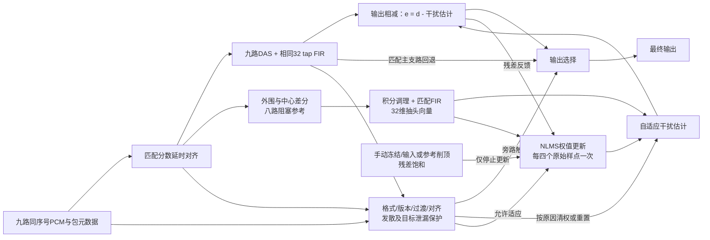

图2-10 GSC残差反馈、权值更新使能与输出回退。手动冻结或削顶等条件可以只暂停权值更新，仍保留残差输出；版本、过渡、对齐、发散及目标保护等条件按原因触发匹配FIR回退。反馈不经过扬声器和物理声场。

`gsc9_process(state, words[16], enabled, freeze_updates)`每次输入一个原始采样包，返回同一样本序号对应的连续输出。包中同时包含九路PCM、PL DAS/FIR、方向版本、时代、延迟和过渡状态。程序先验证格式与连续性，再按九路分数延迟重建对齐信号，并复算DAS及32抽头FIR。预热超过512个原始样点后，复算结果必须与包中对应值逐样匹配，否则清理历史并返回原始匹配FIR，防止不一致的主参考进入自适应环。

GSC的结构基础可参见[Griffiths与Jim](https://doi.org/10.1109/TAP.1982.1142739)〔参考文献6〕；本工程增加定点匹配、版本核验与目标保护。九路对齐后，八个外围麦各与中心麦作半幅差分，形成八路阻塞参考r_i；经过有泄漏的积分调理和匹配FIR，再保存参考历史。每路取间隔四个原始点的四个抽头，形成32维参考向量ξ：

$$
\xi_{4i+t}[n]=r_i[n-4t],\quad i=0,\ldots,7,\ t=0,\ldots,3.
$$

干扰预测和输出残差为：

$$
\widehat d[n]=\sum_{q=0}^{31}w_q[n]\xi_q[n],\qquad e[n]=d[n]-\widehat d[n].
$$

残差反馈驱动NLMS更新（仅在允许更新的采样时刻执行）：

$$
w_q[n+1]=w_q[n]+\frac{\mu e[n]\xi_q[n]}{\epsilon+\sum_p\xi_p^2[n]}.
$$

实际实现使用Q15权重、明确移位与饱和；每个原始样点计算输出，仅当序号低两位为3时更新32个权值。冻结、参考削顶、输入削顶或残差饱和时暂停更新；权值非法或总能量过大时清权回退。此闭环的反馈量是输出残差，不包含扬声器和声场中的物理主动降噪反馈。

目标可能因标定误差泄漏到阻塞支路。保护器以64原始点累计九路共同分量与残差能量，在主束能量足够、共同成分占优且存在小量泄漏时，清除自适应权值并暂停抵消；连续四个合格监测块后才恢复。当前CPU0初始化请求启用该保护，但GSC单元接口默认值仍服务于独立精确参考测试。同方向相干干扰无法仅靠此统计与目标区分，保护采取保守回退。

一次更新的32个权值共享分母。`divide_shared()`先计算`R=floor(2^63/D)`，用四个32×32乘积实现高位乘法；近似商最多低一，再以余数比较修正，恢复有符号向零截断的精确商。九路三次插值系数在配置时预计算。收益是减少重复除法和多项式运算，同时保持既有整数更新结果。记录包含精确商、冻结权重源贡献、泄漏保护和版本失配测试；最新整链A9吞吐与真实目标泄漏保护效果仍需板测。

源码：[GSC状态与接口](../zynq_-pl_-simd_-verilog/sw/gsc9.h)、[残差反馈与目标监测](../zynq_-pl_-simd_-verilog/sw/gsc9.c)。

#### 2.3.2.10 完整长窗包络、机械阶次与工况换代

故障特征提取不将多个短FFT的谱平均冒充完整一秒观察。`c9_env_analyze()`接收39062.5 Hz、40000点归一化音频，按257抽头复解析带通选取2200—4600 Hz载频并4倍抽取，对复幅度求模得到10000点包络，再通过129抽头、900 Hz抗混叠低通4倍抽取，形成2500个真实包络点，采样率2441.40625 Hz。整段加Hann窗后补零至4096点，仅计算一次FFT。

$$
z[m]=\sum_k(h_I[k]+jh_Q[k])x[4m-k],\qquad
a[m]=|z[m]|,\qquad
b[l]=\sum_kh_{AA}[k]a[4l-k].
$$

上述m、l分别为两个抽取级的时间下标。

同相滤波器对称、正交滤波器反对称，成对合并输入减少乘法；边界采用对称延拓，并由整段Hann降权。解析选带设置精确直流零点，包络去加权均值后分析，避免DC偏置被当成载频或低频故障。元数据报告载频RMS、调制RMS、FFT次数、观察时间与有效分辨参数。

观察长度始终为1.024 s，其倒数为0.9765625 Hz；补零频点间隔约0.596046 Hz，Hann等效噪声带宽约1.46543 Hz，不能把补零间隔解释为两音分辨率。当前载频是工程选择，并非已实测所有6004轴承的最优共振带。

`c9_env_extract()`使用6004-2ZR四个机械特征阶次，各取一至四次谐波，再加轴频1X、2X，共18维。当前阶次依次约为FTF 0.39758、BSF 2.33853、BPFO 3.57823、BPFI 5.42177；其几何与内圈旋转、零接触角假设必须与目标轴承匹配。各阶次取峰半宽为`max(0.9765625 Hz, 目标频率×1%)`且排除DC，再以18维中位数和载频相关底数作对数归一化。1%是待实测检验的容差，不等于变速阶次重采样或轴承滑移估计。

四组阶次以滚动体数Z、滚动体直径d、节圆直径D和接触角θ计算：

$$
q_{\rm FTF}=\tfrac12(1-\tfrac dD\cos\theta),\qquad
q_{\rm BSF}=\tfrac D{2d}\left[1-(\tfrac dD\cos\theta)^2\right],
$$
$$
q_{\rm BPFO}=\tfrac Z2(1-\tfrac dD\cos\theta),\qquad
q_{\rm BPFI}=\tfrac Z2(1+\tfrac dD\cos\theta),\qquad f_q=qf_r .
$$

当前配置采用Z＝9、d＝6.35 mm、D＝31 mm、θ＝0，内圈旋转；接触角及旋转圈属于模型假设，原始轴承尺寸资料仍需随最终验收材料归档。阶次公式是已有机械运动学关系〔参考文献9〕，本作品的贡献在于与同窗声学分离、工况换代和证据约束结合。上述理论频率不保证真实设备恰无滑移或频率偏差。

转速由操作员确认或硬件测速提供。`c9_rpm_poll()`复读测速序列并读取周期、年龄和有效位，以40 MHz周期和每转脉冲数求轴频；有效范围10—30 Hz。变化超过0.5%、断流或时代不一致时增加`shaft_generation`，撤销旧目标并从新样点重新积累完整窗口，禁止给旧音频改贴新转速。未确认转速可显示真实Hz包络谱，但阶次诊断保持未知。

独立解析AM与直接DFT的历史测试覆盖600/1800 rpm、FTF与1X区分、载频边缘、边界脉冲及抗混叠；宿主特征提取约三倍提速仅属于对应本机测试，不等于A9整链提速。

源码：[包络](../zynq_-pl_-simd_-verilog/sw/circular9_envelope.h)、[轴承参数](../zynq_-pl_-simd_-verilog/sw/bearing_6004_2zr.h)、[测速换代](../zynq_-pl_-simd_-verilog/sw/ps_circular9_control.h)。

#### 2.3.2.11 正常基线、未知拒识与模型前端绑定

`c9_diagnose()`将分离音频、轴频和`c9_diag_binding`送入统一特征及判别流程。绑定包含轨迹、粗格、细角、时代、原始窗口起点、40000点计数、四类有效标志、C9S3分离版本及202个分析频点的掩码。缺少可靠快照、稳定方向、已分离或可信方向任一条件，就不发布可信机械判断。

正式模型支持正常基线和正常/故障/干扰三类。18维特征采用带共享逆方差的平均平方距离：

$$
D_c=\frac1{18}\sum_{i=1}^{18}(v_i-\mu_{c,i})^2\sigma_i^{-2}.
$$

三类模型仅在最近类距离位于该类半径内，且次近/最近距离比达到门槛时接受。正常基线只区分正常、异常和灰区，异常不能直接升格为确定轴承故障。距离与距离比不是概率，不标称为未经校准的置信概率。

`model_valid()`检查模型ABI2、C9F2特征、C9S3分离、有限参数、版本、允许转速和滤波掩码。运行中实际掩码必须与训练时允许掩码逐字匹配，防止空间分离删频改变特征分布后仍套用原模型。无模型、未验证、超转速域、低能量、载频不足、过度削顶、绑定失败和拒识均保留原因码。默认未显式接入模型时使用空模型，不回退旧6205模型。

FSTF六类实验单独写入`fstf_available、fstf_class、fstf_distance、fstf_margin`，限制在匹配特征、分离就绪和1800 rpm条件下。函数明确不写`label、provisional_label、reason、fault_direction_valid`，界面标注实验未验证。研发显示与可信控制权在数据路径中隔离，不能用实验标签触发正式方向选择或可信报警。现有离线六类及多源失败记录不能转化为统一可靠识别率，外圈独立留出录音等证据仍不足。

源码：[判别器](../zynq_-pl_-simd_-verilog/sw/circular9_diagnosis.c)、[模型与绑定契约](../zynq_-pl_-simd_-verilog/sw/circular9_diagnosis.h)。

#### 2.3.2.12 保持算法域的PS运算优化与自检

PS优化优先消除重复工作，保留九通道、36麦对、三频带和1024方向格。第一，实相关的Hermitian频谱可以两两打包：

$$
\operatorname{IFFT}(X+jY)=x+jy.
$$

`c9_candidates_search()`将两麦对互谱组合进一次1024点复数IFFT，分别读取实部和虚部的64个相关时延值，使每频带36次IFFT降为18次；通道自功率根先计算后复用，减少36对中的重复开根。该PS优化不同于PL中512点复数核心实现1024点实变换的资源复用，二者应分别说明。

第二，统一Q4标定延迟经过4倍降采样，其麦对延迟恰位于分析样点的1/64格点。程序预计算`search_delay_codes[1024][36]`及`search_cubic_weights[64][4]`，保留双精度三次插值，LUT改变时重新生成；方向扫描内循环仅进行地址解码和四项加权。当前代码没有跨窗绝对帧号STFT缓存，不能将预计算表混称为该能力。

第三，抽取器利用对称整数系数，外围八路用NEON并行、中心一路单独计算。Q15系数绝对值和55056，满幅输入累加上界`32768×55056=1804075008<2^31-1`，因此可用32位整数并保持标量64位参考结果。稳态去掉逐抽头边界分支，启动时以随机、正满幅、负满幅、交替满幅、脉冲和系数符号相关输入六类模式逐项比较。`decimator_vector_status=7`才表示自检通过并启用，失败回退标量。

这些优化同时服务多源发现和快慢并行。历史记录中，固定地址/权重预计算与双实IFFT曾把对应版本搜索最大耗时由约106 ms降至92 ms、再至71 ms；该数字不能外推最新多候选整链。宿主记录有64000次插值比较、32组双实IFFT及缓存失效检查，ARM NEON另有启动自检记录，浮点代数重组不宣称所有中间量逐位一致。

源码：[预计算、打包与NEON](../zynq_-pl_-simd_-verilog/sw/circular9_candidates.c)、[数值等价专项](../zynq_-pl_-simd_-verilog/sw/circular9_search_cache_test.c)。

#### 2.3.2.13 HTTP同快照双谱、健康状态机与PC归档

HTTP主要提供已完成结果和控制入口。CPU0分片取得完整方向图后提交本地缓存；分离、特征和FFT重任务不在HTTP回调中执行。`/api/candidates`返回候选、诊断及性能状态，`/api/gui/snapshot?sequence=...&index=...`一次返回同一结果的4096点音频与128点包络显示谱，并携带轨迹、序号、时代、会话、采样率和状态。序号不匹配返回冲突，不能将新音频与旧包络拼在一起。

浏览器对该快照4096点音频去均值、加Hann并计算音频谱；包络谱由CPU1现成C9F2 FFT分组导出，不重复另一套包络算法。两谱分别峰值归一，界面用于观察峰的位置与结构，不能直接据显示高度比较绝对能量。暂停网页只暂停显示，CPU0健康监测仍工作；保留历史曲线时明确标注旧快照，不能将平滑热图当作新定位证据。

`c9_gui_poll()`对每个新结果复查模型、采样新鲜度、轨迹、转速、截止期及绑定，再调用`c9h_observe()`。默认连续三次异常进入疑似、五次进入报警，十次有效正常关闭事件；报警后的正常先进入恢复观察，恢复中再次异常返回报警。未知、干扰、断流不算正常恢复。监测器含8轨迹槽、256趋势和32事件，满容量可覆盖已关闭事件，不静默覆盖未关闭报警，并报告溢出。

PC可选运行`health9_archive.py`，以SQLite保存跨重启记录，按会话和游标去重，保留板端运行毫秒及PC接收UTC。板上无RTC时，接收UTC不能冒充声源发生时间。PC写盘、查询与浏览器均不进入PS实时数据路径；归档断线只影响历史完整性。默认服务监听`127.0.0.1:8769`，核心推理不依赖该服务。

健康状态、API、浏览器模拟DOM和SQLite去重已有宿主回归；真实浏览器长期运行、多客户端负载和实物报警恢复仍需单独验收。

源码：[同窗显示与健康接入](../zynq_-pl_-simd_-verilog/sw/ps_circular9_gui.h)、[报警状态机](../zynq_-pl_-simd_-verilog/sw/circular9_health.h)、[PC归档](../zynq_-pl_-simd_-verilog/profiles/full_gui9/health9_archive.py)。

#### 2.3.2.14 取证、训练部署同源与离线复现

短调试接口`/api/debug/raw`提供同一原始时间的1024×9点，适合检查通道映射、极性和相关；其时长仅6.5536 ms，不能拼接成1.024 s连续录音。长窗导出使用独立CPU0缓存，启动默认关闭，可编译移除；人工启用后按`frames`冻结最多160256帧，每64点调用实时检查点，不暂停PL或修改DMA确认。

导出返回C9W2令牌、首样本、总帧数、时代和会话，分块请求带`token、offset、count`。新捕获、关闭、失败复制或采集换代使旧访问失效。PC的`capture_c9_window.py`检验分块头和长度，保存`audio.pcm、metadata.json`及SHA256，结束后尝试关闭导出。取证还应保留对应发布清单与加载日志，协议本身不能证明正在运行的ELF身份。历史宿主检查已有160256×9样本、157块逐样一致及非法参数测试；真实网口吞吐和导出开启时的采集影响尚待测量。

`replay_c9_pcm.py`严格核对九路s16le交错、156250 Hz、帧长及哈希，再执行真实C搜索、分离、特征和API路径。默认不确认几何、标定、转速或实验模型，结果保持未知；它复现算法输入与行为，不把宿主时间换算A9耗时。保留失败PCM、逐窗峰值/支持/轨迹记录和版本哈希，才能分清模型问题、弱源不可见与调度覆盖不足。

正式训练工具`pc/circular9_dataset.py`从板端接收已经按C9F2提取的18维特征，带显式标签、原始录制ID、转速、绑定和分离掩码。FSTF研发工具也调用同一C提取器生成特征，避免Python训练时另做一套滤波。训练与验证按原始录制ID隔离，禁止把同一录音的重叠窗分到两侧冒充独立验证；试听48 kHz文件仅供试听，不能替换原有78125/2 Hz特征输入。

模型导出C头和JSON，默认未验证。发布检查重读原训练/验证文件、核对哈希与录制ID、复算判别、由已知导出器逐字重建头文件；满足规定独立录制和分类门槛、具有审核编号后才允许正式三类模型验证标志。通过`C9_DIAG_MODEL_HEADER`显式编译接入，运行API再核对模型版本。软件门槛不证明人工标签或所有工况泛化，当前无真实验证模型时仍保持未知。

源码：[原始长窗导出](../zynq_-pl_-simd_-verilog/sw/circular9_window_export.h)、[本地PCM回放](../zynq_-pl_-simd_-verilog/scripts/replay_c9_pcm.py)、[数据与模型工具](../zynq_-pl_-simd_-verilog/pc/circular9_dataset.py)、[发布校验](../zynq_-pl_-simd_-verilog/scripts/circular9_model_release.py)。

#### 2.3.2.15 核心创新的软件落点与验证判据

下表将八条核心创新落实为软件需要解决的问题、实际机制、收益和验证状态。算法名称和处理器常规机制本身不作为学术首创声明。

| 核心创新 | 具体问题与机制 | 系统收益 | 当前证据及仍需完成的验证 |
|---|---|---|---|
| 空间诊断链路 | 同窗原始输入经发现、分离、诊断、轨迹复核，再允许方向反馈 | 故障结论有明确方向和采样对象 | 有历史链路运行、合成多源回归；真实多电机故障归因待验收 |
| 保真分离 | 保护目标子空间，以扇区、权重、能量和载频完整性共同门控 | 降低降噪损害故障载频后误判正常的风险 | 有冻结权值贡献分析及负例；真实房间和设备独立对照待完成 |
| 自研声学处理器 | RV32固件实际发射声学指令并执行质量/提交控制 | 可编程算法调度与专用算术形成完整路径 | 指令/RTL记录支持实现；性能引用必须匹配最新配置产物 |
| 指令与搬运协同 | RTL管理地址和预取，固件管理指令发射与可信发布 | 减少标量访存循环，保持所有权边界 | 有生产固件及RTL测试路径；不等于全部声学处理都由同一SIMD完成 |
| 快慢任务并行 | CPU0接收和控制、CPU1长窗处理，采样域调度与年龄门控 | 前台交互与较长诊断计算协作运行 | 有历史实板与异步交错回归；A9最坏负载、UDP开启负载待测 |
| GSC自适应闭环 | 32权值以输出残差更新，泄漏清权、暂停和匹配FIR回退 | 在线追随干扰，目标风险时可退回确定支路 | 有定点等价和保护测试；当前默认可旁路，实物收益待核验 |
| 原子转向 | 九路向量、版本、时代与时间一次提交，读回并匹配GSC配置 | 避免半更新和PL/PS方向版本错配 | 有事务RTL及PS控制回归；可信故障驱动整闭环待应用验收 |
| 全链路有效性约束 | 串联会话、采样年龄、覆盖、工况、前端和模型资格 | 失配与过期时保留未知，避免错误继承旧结论 | 有多层拒绝与失败场景；不能由机制存在推导现实误报率 |

正式实验应分层保存原始PCM、场景与转速、几何/标定证据、版本清单及结果。功能回归检验“是否按契约拒绝或输出”，吞吐实验记录实际处理与证据终点间隔，应用实验采用独立录制和真实多源标签；三者各自回答不同问题。本章所列历史验证记录主要见`docs/issues/130、135、136、137`及对应专项脚本，后续填写技术报告的实测指标时应逐项绑定精确版本和试验条件。

# 第三部分  完成情况及性能参数

## 3.1 整体介绍

截至2026年10月28日，作品已形成以Zynq-7020为计算平台、外围八麦与中心一麦为声学输入的软硬件工程。当前代码包含九路同步采集、快速方向扫描、连续定向音频、PS双核候选搜索、同窗分离诊断、方向控制、双谱展示和历史归档。仓库保存了数字仿真、实现时序、宿主软件及部分历史实板运行记录；当前最完整的实板记录证明九路历史到诊断快照结构和HTTP的流水线已运行，真实机械故障归因与多电机应用仍待实物验收。

本部分以当前源码说明“实现了什么”，以带日期的记录说明“在哪个版本、什么条件下验证过”，再列出仍需补齐的测量。2026年10月26日的实板结果不能自动覆盖10月27日以后的软件修改；早期八麦、十二麦、十六麦及ANC结果仅用于工程历史，不纳入当前九麦成品指标。

> **图3-1 系统正面实物照——待补。** 应拍摄当前九麦阵列、Zynq-7020主板、供电和数据连接的整机正面，标明阵列朝向、中心麦及板卡型号，并提供拍摄日期和对应发布版本。工作区现有图像为历史八/十六麦布局图及仿真图，未发现可确认来源的当前九麦整机照片。

> **图3-2 系统斜45°实物照——待补。** 应展示阵列固定方式、与主板相对位置、线束、接口和实际尺寸。该照片需与图3-1为同一套实物；结构示意图可辅助说明，不能替代模板要求的实物照片。

> **图3-3 实验现场与同步结果——待补。** 建议同时记录声源位置、阵列参考坐标、转速测量方式、实际机械对象和GUI。截图附采集session、epoch、采样窗、轨迹及发布版本，便于核对图像与结果是否来自同一次试验。

当前阵列采用前视坐标：向右为+x、向上为+y、朝观察者为+z。系统在前半球搜索水平角和俯仰角；32×32方向格覆盖1024个方向，格间隔5.625°。搜索目标是方向，尚未实现距离估计。平面阵列存在前后镜像歧义，当前通过声源位于板前的安装条件约束使用范围。当前配置的声孔水平半径22 mm、垂直半径25.5 mm、斜向半径23 mm；斜向45°仍为假设。30 mm保留为名义PCB尺寸参考。上述事实以[当前配置][e_config]为准。

## 3.2 工程成果

### 3.2.1 机械成果

> **图3-4 阵列及固定结构实物照——待补。** 展示九个声孔标签、基准面、量具和固定方式，配合当前坐标表；如有CAD或装配图，在此并列附上，不用坐标示意图替代实物。

作品已确定“外围八麦＋中心一麦”的实际阵列对象和竖放使用方式，当前配置包含九个通道的坐标及声孔顺序。正视阵列，从最右侧起逆时针的通道顺序为CH5、CH6、CH7、CH3、CH2、CH1、CH0、CH4，CH8位于中心。坐标进入定位、转向和分离的共同几何输入，使后续标定具有统一入口。

目前可确认的是阵列布局和用户报告尺寸已进入工程配置，机械加工精度、固定架、外壳、线束防拉和阵列安装角度还缺少可复核材料。旧[确认输入记录][e_inputs]采用30 mm等半径坐标，后续源码已改为非均匀声孔半径；正式验收应按当前实物逐孔测量并提交坐标记录，不能直接沿用旧坐标表。

| 机械/结构成果 | 当前完成内容 | 交付材料及剩余工作 |
|---|---|---|
| 九麦空间布局 | 外圈八麦、中心一麦；配置保存通道顺序及当前声孔坐标 | 补当前阵列正面、背面和45°照片，确认实物与配置对应 |
| 阵列安装坐标 | 定义前视坐标、竖放和板前使用范围 | 补阵列基准面、固定角度、水平/俯仰零位及声源真值测法 |
| 实物尺寸 | 用户报告X方向22 mm、Y方向25.5 mm、斜向23 mm | 补带比例尺或量具的逐孔记录；测量斜向实际x/y，替换45°假设 |
| 整机固定与连接 | 软件已围绕现有板卡和阵列组织接口 | 未见当前结构CAD、装配图或可靠性试验，相关成果待补 |

### 3.2.2 电路成果

> **图3-5 主板、阵列及接口电路实物照——待补。** 标明五根DATA、共用CLK、供电/地、复位、测速及网口连接，并与当前引脚表对应；另附有来源的原理图或PCB局部图。

当前工程以Zynq-7020为主平台，配置记录麦克风型号IM73D122、供电3.3 V、PDM时钟2.5 MHz。五根双相DATA对应十个采集槽，算法有效掩码为0x1ff，使用九个真实通道及36个麦对。第十槽的存在用于容纳奇数通道，不参与空间统计和波束归一化。供电和型号属于用户确认信息；完整板级波形、通道响应和幅相标定仍需测量。

PL侧已实现时钟、双相接收、CIC抽取、通道对齐、重叠定位、RISC-V与声学运算扩展、连续DAS/FIR、DMA旁路、恢复控制及版本化转向。RTL和约束是可检查的工程成果。硬件测速输入已具备同步、过滤、周期检查和超时状态逻辑，真实传感器的电平、每转脉冲数和机械安装仍需验证。

| 电路/逻辑模块 | 当前实现参数 | 完成和验证范围 |
|---|---|---|
| 同步PDM前端 | 40 MHz逻辑时钟；2.5 MHz PDM；16倍抽取；PCM 156250 Hz | 有RTL及历史针脚级数字仿真；真实麦克风转换延迟和板级时序待测 |
| 快速定位 | 1024点窗、512点Hop、九路频谱、36麦对、64点相关环、1024方向 | 历史连续数字仿真完成；当前实物方向误差待验收 |
| 自研处理器 | 五级流水RV32、预测、冒险处理、多拍执行与退休观察 | 有源代码、单元及固件验证入口；不同算子需按当前构建复核 |
| 声学执行资源 | 八lane实数SIMD-MAC、可配置复数单元、FFT/IFFT和SRP | 九麦默认复数4 lane、SRP四麦对并行；各单元性能不能互相代用 |
| 连续音频 | 九路分数延时DAS、平滑转向、32 tap FIR，与CPU共享SIMD | 有数字对照和历史音频链路记录；实际音质与目标保留待测 |
| 控制与传输 | 九路完整向量原子提交、版本/时代/TTL检查、DMA CRC和序号 | 有RTL/宿主负例；真实拥塞和异常恢复需并发压力测试 |

历史实现报告给出了40 MHz布线通过记录。2026年10月24日HOP512/P9D2构建记录WNS +0.925 ns、WHS +0.019 ns，资源42757 LUT、94.5 BRAM、141 DSP；后续方向控制硬件记录WNS +0.495 ns、WHS +0.031 ns，Setup/Hold违例端点均为0。两组数字对应不同硬件阶段，正式提交应选定最终bit/XSA和源码证明后引用匹配报告。当前工作区缺少这些完整实现产物，本文将其列为历史记录，未重新验证最新硬件资源或时序。[历史延迟契约][e_latency]、[优化完成记录][e_optimization]

### 3.2.3 软件成果

> **图3-6 当前版本监测界面——待补。** 保存真实板端产生的方向图、候选、同快照双谱、运行指标与事件界面，标明发布版本和采样标识；宿主DOM模拟页面仅作软件测试，不充当现场运行截图。

软件已形成三个互相配合的层次。RV32固件发射FFT、互谱、PHAT、IFFT及定位调度指令，RTL自主推进地址和数据搬运；PS CPU0服务DMA接收、历史缓存、方向控制和HTTP；CPU1执行辅助搜索、候选分离与诊断。GUI展示方向提议、轨迹状态、同快照音频谱与包络谱，并由PS状态机维护疑似、报警和恢复事件，可选PC端SQLite归档。

当前历史环为1048576个原始采样点，约6.7108864 s，独占32 MiB；任务区1 MiB，DMA区1 MiB。当前[c9_tasks_init实现][e_tasks]把历史和任务段设置为Normal WB缓存属性，两核在SMP/SCU一致性机制下使用共享内存和原子所有权协议。DMA环通过独立失效/刷新接口维护数据可见性。[旧就绪文档][e_readiness]及部分10月27日记录提到“非缓存”，属于历史阶段；当前报告采用现源码的缓存方案，其真实双核一致性和负载表现仍需用匹配程序复验。

诊断输入由原始PCM低通并4:1抽取为39062.5 Hz，每窗40000点，真实观察时长1.024 s。快照复制160256个原始点，其中包含前端预热。CPU1对同一九路快照分析最多三个候选；可选连续GSC在CPU0侧运行，逐原始样点输出、每四点更新权值。两条路径的工作区、用途及验证指标分别管理。

| 软件成果 | 已形成的交付内容 | 当前状态 |
|---|---|---|
| 搜索与分离 | 多频带候选、轨迹、实际协方差C9S3、目标保护与安全频点 | 当前源代码完整；强弱源、近角及三源存在已保留失败场景 |
| 特征与诊断 | C9F2长窗包络、18维机械阶次、正常基线、拒识和版本约束 | 需要对应录音与验证模型；默认可信输出保持未知 |
| PS GSC | NLMS残差反馈、共享倒数精确商修正、目标泄漏回退 | 有算术及机制回归；真实目标保真、全负载收益待测 |
| 交互与事件 | 双谱、实时提议、状态历史、独立PC归档 | 有C API/JS DOM/SQLite回归记录；最新实板视觉和压力测试待补 |
| 数据与验证工具 | 连续PCM导出、哈希、实际C链路回放、场景及任务交错测试 | 导出启动关闭；实物网口长窗导出和负载尚未测量 |
| 一致性交付 | 源码、bit、XSA、BSP、RV32、LUT、ELF及测试清单绑定 | 工具有实现；当前缺失最终发布包，需恢复后做完整只读校验 |

2026年10月27日记录了CPU1固定数组转入私有工作区：新增20592 B字段，搜索静态栈从15960 B降至2432 B，分离函数含内联约4104 B；两路浮点分离音频逐字节相同。该结果说明栈占用优化具有等价性证据，尚无对应A9提速实测。[多源离线记录][e135]

最新离线收口记录的ARM链接结果为：移除原始PCM导出支持时text 500284 B、data 3398 B、BSS 48601168 B；保留支持且启动关闭时text 501952 B、data 3398 B、BSS 51746896 B。导出缓存对象2884636 B，受对齐影响BSS增量3 MiB；应用_end=0x01159850，低于0x04000000应用区上界。DMA、任务、历史段分别位于0x08000000、0x09000000、0x0A000000。这些是记录中的构建结果，当前目录未保存相应ARM ELF供二次解析。[离线收口记录][e137]

## 3.3 特性成果

### 3.3.1 证据口径及当前可复核材料

本项目把实现、数值正确、数字实时性、物理运行和应用效果分别取证。源代码能证明机制存在，不能直接证明板卡精度；宿主程序能验证逻辑和数值，不能代替A9耗时；静态时序闭合证明选定网表满足工具约束，不能证明机械诊断准确率。

| 证据类别 | 本文可引用的内容 | 需要同时保存的条件 |
|---|---|---|
| 当前静态实现 | 源码、配置、协议、边界和状态机 | 文件路径、版本或提交、配置、审查日期 |
| 宿主/模型验证 | 整数对照、C链路、JS/数据库、离线音频和负例 | 输入来源、模拟替身、源码哈希、真实或虚拟时钟 |
| RTL数字仿真 | PDM针脚模型、SoC连续窗、算子与控制验证 | 固件/LUT、RTL哈希、时钟、起止时间锚点 |
| FPGA实现 | 布线完成、WNS/WHS、资源和bit/XSA绑定 | 完整日志、约束、源集合、bit/XSA及BSP |
| 实板运行 | 实际DMA、任务、HTTP和故障计数 | 真实加载镜像、板卡、声源条件、原始日志、时间戳 |
| 应用验收 | 实际故障方向、分类、拒识、保真和长期运行 | 独立真实录音、设备标签、转速、几何校准、评价方案 |

2026年10月28日初次整理时，build目录保存circular9_pipeline_checks下的七个宿主产物。本轮另完成当前九麦完整标量／加速评分、32窗SoC、FFT/FIR和SRP的RTL计时，并完成PS搜索、完整分离、GSC和包络的宿主计时；原始输入、日志、脚本、失败轮与哈希独立保存在performance_comparison目录。具体结果及计时边界见1.4。`circular9_pipeline_checks/results.json`（历史构建产物，未包含在当前仓库）仍属于原有宿主验证，不能与本次新增结果混用；当前没有最新bit/XSA/ARM ELF及完整发布清单，未重新综合或上板。程序入口[program_latest.ps1][e_latest]指向build/gui_offline_ready_20261027，该目录在本工作区不存在。

现存results.json标记passed=true，同时明确hardware_tested=false、ps_runtime_measured=false、classifier_validated=false。记录的23项源码哈希中，10项与当前文件相符，13项已变化，包括任务、API、跟踪、候选、诊断、内嵌镜像、页面、包络、辅助与调度文件。因此该报告是历史宿主验证证据，不能据此宣布当前整个工作区已经回归通过。compile.log为空只表明该留存文件没有输出，也不构成当前编译成功证明。

### 3.3.2 配置指标、历史性能及其测量边界

以下先列当前配置和解析换算，再列各阶段记录。配置参数表示设计运行方式；它与实板测量、识别准确率是不同类型的指标。

| 当前配置指标 | 数值 | 说明 |
|---|---:|---|
| 有效麦克风/采集槽/麦对 | 9 / 10 / 36 | 外围8＋中心1；空槽不参与算法 |
| PL/PDM/原始PCM | 40 MHz / 2.5 MHz / 156250 Hz | PDM抽取16倍；来自当前配置 |
| 定位窗/步长 | 1024 / 512点 | 窗预算6.5536 ms，理想更新间隔3.2768 ms |
| 首末PCM采样跨度 | 6.5472 ms | 1023/Fs，与窗预算相差一个采样周期 |
| 定位网格/相关环 | 32×32 / 64点 | 前半球方向，不搜索距离 |
| PS辅助搜索输入/步长 | 16640 / 8192原始点 | 256预热＋16384真实证据；证据104.8576 ms，步长52.4288 ms |
| 诊断采样/真实窗/调度步长 | 39062.5 Hz / 1.024 s / 512 ms | 步长不等于一次有效诊断完成时间 |
| 历史采样容量 | 1048576点 | 6.7108864 s；独占32 MiB |
| 排队/计算及结果年龄预算 | 512 ms / 3000 ms | 超限拒绝；不是保证每512 ms输出有效诊断 |
| 分离/特征契约 | C9S3 / C9F2 | 旧契约的模型、音频与结果需要重新验证 |

**评价指标的统一口径。** 方位角和俯仰角可能在极区出现坐标尺度差异，方向误差使用两个单位向量的球面夹角：

$$
e_{\rm angle}=\arccos\!\left(\operatorname{clip}
(\boldsymbol u_{\rm true}^{T}\boldsymbol u_{\rm est},-1,1)\right).
$$

多源评价先做一对一匹配，再统计匹配数和误差，一个输出不能同时计为两个真源。漏检、未知和拒绝单列，并在端到端检出/归因统计中保留其惩罚，不能只报成功输出中的条件准确率。

分离SIR在相同混合快照学得并冻结权重后，分别渲染目标与干扰贡献：

$$
{\rm SIR}_{\rm out}=10\log_{10}
\frac{\sum_n|y_{\rm target}[n]|^2}
{\sum_n|y_{\rm interference}[n]|^2}.
$$

同时报告目标幅度/载频保留、输入强弱比、噪声、反射、导向误差及分离拒绝率；SIR提升不能替代故障特征保真。方向支持覆盖率以真实观测区间并集与诊断区间的交集长度除以诊断区间长度计算，重复观测不重复增加时长。

数字定位延时按同一窗的t_PS首次有效接收−t_PCM首点统计，另列t_RV发布−t_PCM首点、整图接收和页面显示。若宣称声压变化到结果，则还要实测麦克风/PDM前端及事件起点。上述是评价定义；本稿没有据此填入缺失的实测指标。

本次当前源测量的主张、源码与证据对应如下；所有毫秒及加速比的详细条件见1.4，宿主时间不代表A9。

| 技术主张 | 被测源码／入口 | 验证证据 | 测试条件 | 剩余限制 |
|---|---|---|---|---|
| 完整九麦评分路径134.17倍加速 | `c9_scalar.c`、生产`fw_fft.c`、`rv32_overlap_localizer.v`及`rv32_srp_scan.v` | [同任务逐级对照](performance_comparison/circular9_scalar/comparison_summary.json) | 同首窗、`-Os`、40 MHz；统计／谱／相关／评分全等 | 不含PS传输和峰值／质量后处理；统计前移明确计入架构贡献 |
| FFT 27.12倍、FIR 18.28倍 | 生产`fw_fft.c`、`fw_fir.c`及RV32声学执行单元 | [算子周期与逐项检查](performance_comparison/pl_rtl/results.json) | 相同输入及系数；FFT1026个int16、FIR各512点全等 | 算子局部，不代替连续音频支路或板测 |
| SRP串行／单流水／四对并行 | `rv32_srp_scan.v` | [SRP九种配置](performance_comparison/rtl_primitives/measured_20261028/srp/results.json) | 36对、1024格、同输入／LUT，18432评分一致 | START→DONE，不含装载回读；非RV32标量基线 |
| 九麦32窗连续发布约9.17 ms | 当前九麦固件及SoC RTL | [SoC窗口、指令与丢失计数](performance_comparison/pl_rtl/results.json) | 1024／512点、PCM注入、40 MHz、每窗独立首样锚点 | 不含实际PDM转换与PS接收，不代表长期稳定性 |
| 搜索预计算与成对IFFT组合收益 | 生产`c9_candidates_search()`四个现有开关组合 | [宿主正式轮](performance_comparison/ps_software/measured_20261028_host_quiet/results.json) | 16640×9、三频带、每组41次；3072评分与反馈一致 | x86成本，三源夹具输出2候选，不是三源检出率 |
| 完整GSC与目标保护分离成本 | 生产`gsc9_process()`、`c9_candidates_separate()` | [完整模块正式轮](performance_comparison/ps_software/full_modules/measured_20261028_full_quiet/results.json) | 各31次；适应体全部active，双源分离两输出有效 | 合成夹具；A9、实际目标保真及全负载另测 |
| 长窗包络成本与精确商算术 | 当前／历史特征前端及生产共享倒数函数 | [包络、独立DFT与整数真值](performance_comparison/ps_software/measured_20261028_host_quiet/results.json) | 包络31次、除法101次；保留负收益 | 前端不等价；共享倒数在本机更慢，不能外推ARM收益 |

历史数字与物理结果如下。表中的“历史”表示本次未恢复其完整产物重验。

| 日期与版本范围 | 记录结果 | 测试条件和结论边界 |
|---|---|---|
| 10月23—25日，方向LUT/D3固件、32窗SoC仿真 | 首对齐PCM到RV32稳定发布9.153775—9.155650 ms；采集/音频丢失0 | [延迟契约][e_latency]记录；不含PS真机首次接收 |
| 10月25日后续优化记录，32窗 | 同锚点9.153300—9.155925 ms；末PCM后最大2.608725 ms | [优化完成记录][e_optimization]的另一轮结果，与上一行分别引用，不能择小拼接 |
| 方向版完整PDM针脚数字夹具，8窗 | 同锚点9.159225—9.162625 ms；启动至首对齐PCM 50.166125 ms，首候选59.328750 ms | 实际接收/CIC RTL＋数字输入，不是真实麦克风转换时间 |
| 九麦SRP四对并行子阶段 | 9306个40 MHz周期，即0.23265 ms | SRP子模块数字值，不代表完整定位或诊断时延 |
| 10月24日HOP512/P9D2实现 | WNS +0.925 ns、WHS +0.019 ns；42757 LUT、94.5 BRAM、141 DSP | 历史bit/XSA阶段；需匹配原报告和源证明 |
| 10月25日方向控制硬件实现 | WNS +0.495 ns、WHS +0.031 ns；Setup/Hold违例端点0 | 后续硬件阶段；当前未留存完整包供复核 |
| 10月26日stage2/stage4辅助搜索 | 阶段最大约106→92→71 ms | 预计算、IFFT打包及公共项复用等组合优化；不把全部收益归于单一改动 |
| 10月26日stage7实板流水线 | started/completed 56/56，deadline_misses 0，snapshot_rejected 0，coverage_rejected 0 | 一候选、separation_ready=1；当时转速0、模型0、几何/标定保护仍生效 |
| 同一stage7实板记录 | processing_us_max 678562，queue_wait_us_max 100137，total_elapsed_us_max 778645 | 最值分别统计，不能按相减重建某一单次任务时间；不是最新三候选最坏耗时 |
| 同一stage7实板DMA | 成功66923033帧，corrupt/drops/discontinuities均0 | 只覆盖该记录期间；不能外推所有版本/负载永久不丢样 |

最后三行来自[快照恢复记录][e130]，当时PS ELF的SHA-256为11705c5ef4d796569400c72de9de38f612bd1b8807509ba996db36fcbb511caa，PL bit为f3ed316a9ea04e05de7d8d0ca211a22fc6f4f6ab368a15b997e82a22f06a2e72。随后GUI双谱版本ELF又发生变化，后续多峰、实验模型、栈和导出修改亦不能由上述56/56记录背书。该次实板诊断为bad_input，shaft_hz=0、model_version=0，证明数据与任务通路运行，真实故障分类仍无验收结论。

### 3.3.3 分离、模型及多源应用结果

目标保护协方差分离有合成数学记录：弱于最响源18.06 dB的三源夹具中，目标输出SIR约32.21 dB、目标幅度约0.99986；非均匀噪声与20%/8 ms反射夹具中，相同输入冻结权重比较，先验SNR 4.70 dB、实际协方差SNR 8.83 dB、目标幅度约1.00605。另一夹具中，全带图缺少低22.50 dB弱源的局部峰，多频带搜索从真实PCM/STFT中找到该弱源。这些结果限定于记录中的合成场景，支持设计机制，不能直接写成真实房间或多电机保证。[优化完成记录][e_optimization]

FSTF离线训练直接使用当前C9F2生产C提取器，采用40000点真实观察窗和18维特征，导出C后核对推理一致性。六类共82窗，训练57、验证7、测试18；验证和测试使用同一录音内的时间留出，间隔至少1.024 s。最近中心和64树森林均为验证5/7、测试15/18；外圈仅有2秒原文件，没有独立验证/测试窗。83.33%只能表述为五个有测试样本类别的录音内留出结果，无法代表六类总体、独立录制或实板回采准确率。[离线训练记录][e_training]

自动多源评价经历了以下阶段，保留失败作为回归输入。

| 场景/阶段 | 结果 | 技术含义 |
|---|---|---|
| 10月27日六个单源FSTF模拟 | 4/6实验细类正确；外圈误为正常、松动误为滚动体 | 类别模型存在误判；可信标签仍unknown |
| 初始三个自动双源模拟 | 0/3完整诊断两个方向 | 已知方向下游对照3/3可分离，未计为自动定位成功 |
| 支持连通分量、候选排序及调度修复后 | 双源2/3；正常/内圈±50°交换方位两组通过 | 强正常＋弱滚动体仍漏检；未针对这些测试重训 |
| 19组压力及后续传播模拟 | 近角、弱故障6/12 dB、三源、相干同录音仍有失败；部分等强、加噪、反射、近场场景成功 | 评价依赖声源频带、角度、信号和几何，不能统一报成功率 |
| 10秒与20秒生命周期回放 | 有越过历史环容量后的恢复、消失后新ID及交叉轨迹记录 | 角度轨迹ID不等于设备永久身份；全运动过程漏检率未证明 |

上述结果分别来自[实验接入][e134]、[多源修复][e135]、[鲁棒性补充][e136]与[离线收口][e137]。传播为人为设定的平面波/球面路径、分数延时、噪声和反射；宿主虚拟时间不是实机性能。实验模型只写独立实验字段，不触发可信故障方向和报警。

失败已按链路分层：强正常＋弱滚动体47窗中故障方向附近频带峰0次，单纯候选重排无法补出缺失峰；±70°场景正常方向附近峰46/47，但符合突出程度门控仅4/47，最终入选2/47；±30°场景已有46/47候选入选、42/47真实观测，最终快照仍丢失故障方向。它们分别提示搜索可见性、支持质量竞争、时间窗/轨迹保持等不同问题。正式优化需针对证据定位层级，不能统一归因于分类器。[鲁棒性补充及更正][e136]、[收口更正][e137]

### 3.3.4 技术主张与证据对应矩阵

编号1—34与用户原清单一致；A—G为补充设计贡献。下表的证据名称指向仓库记录或测试入口，当前源码与历史证据需要在最终冻结版本后重新绑定。表中每行均保留适用条件和剩余限制，避免把设计能力写成已验收指标。

| 编号及技术主张 | 源码/实现位置 | 验证证据 | 测试条件 | 剩余限制 |
|---|---|---|---|---|
| 1 空间诊断链路 | [任务][e_tasks]、[控制][e_control] | [130][e130]、[优化][e_optimization] | 实板通路已运行 | 真实故障方向闭环待验 |
| 2 快速定位与长窗协同 | [配置][e_config]、[调度][e_schedule] | [延迟契约][e_latency] | 数字定位与1.024 s诊断分别计时 | PS全负载待测 |
| 3 PS双核及所有权 | [任务][e_tasks]、[双核启动][e_dualcore] | [130][e130]、[137][e137] | 当前WB缓存＋SMP/SCU | 真实一致性/最坏负载待复验 |
| 4 自研五级RV32 | [处理器核][e_core]、[预测器][e_predictor] | [处理器验证入口][e_verify] | 单元/固件历史回归 | 常规微架构不称首创 |
| 5 八lane双形态SIMD-MAC | [向量单元][e_vec] | [向量测试台][e_tb_vec] | 归约与逐元素更新存在 | 当前PL FIR主要用PUSH/VRED |
| 6 实/复数计算分工 | [向量单元][e_vec]、[复数单元][e_acoustic] | [声学测试台][e_tb_acoustic] | 实数固定8 | 复数可配4/8/16，九麦默认4 |
| 7 声学专用指令 | [译码][e_decoder]、[固件][e_fw] | [指令测试台][e_tb_instruction] | 指令发射到提交路径 | SRP为独立算子 |
| 8 FFT/IFFT共享资源 | [蝶形][e_fft]、[地址][e_fftaddr] | [VFFT设计][e_vfft]、[延迟契约][e_latency] | 512复数承载1024实数 | 历史核性能不等整机 |
| 9 指令与自主搬运分工 | [固件][e_fw]、[定位器][e_localizer] | [延迟契约][e_latency] | RV32真实发指令 | 搬运状态机须遵守提交所有权 |
| 10 音频/CPU共享SIMD | [处理器核][e_core] | [延迟契约][e_latency] | 独立音频FSM仲裁 | HALT不代表单元空闲 |
| 11 存储和数值流水 | [向量bank][e_vecbank]、[蝶形][e_fft] | [VFFT设计][e_vfft]、[优化][e_optimization] | BRAM、预取和宽累加 | 当前全量时序包待恢复 |
| 12 双相PDM/奇数通道 | [接收器][e_pdm]、[配置][e_config] | [延迟契约][e_latency] | 九通道/十槽数字验证 | 板级映射/时序待测 |
| 13 重叠窗/滚动统计 | [定位器][e_localizer] | [延迟契约][e_latency] | 1024/512精确样本区间 | 长期实板无丢窗待验 |
| 14 频谱/相关区间复用 | [定位器][e_localizer]、[候选][e_candidates] | [延迟契约][e_latency]、[130][e130] | 保留36对 | 各路径搬运/数值分别对照 |
| 15 硬件PHAT/SRP | [复数单元][e_acoustic]、[SRP][e_srp] | [SRP检查][e_srpcheck] | 幅值近似、查表和插值 | 非精确欧氏白化 |
| 16 独立多频带发现 | [候选][e_candidates]、[辅助][e_aux] | [优化][e_optimization]、[135][e135] | 从真实九路PCM提出峰 | 弱源仍可能不可见 |
| 17 联合候选仲裁 | [候选][e_candidates]、[辅助][e_aux] | [133][e133]、[135][e135] | 240排列/同角支持 | 现场竞争待验 |
| 18 真实支持轨迹 | [轨迹][e_tracking]、[提议][e_proposals] | [135][e135]、[136][e136] | 至少90%覆盖 | 保留ID不自动授予定向 |
| 19 细角与连续导向 | [候选][e_candidates]、[控制][e_control]、[DAS][e_das] | [优化][e_optimization] | 峰拟合/LUT插值/平滑 | 实物细角精度待测 |
| 20 目标保护协方差分离 | [候选][e_candidates] | [协方差设计][e_covariance]、[优化][e_optimization] | 同输入学习声场 | 真实混响和近角边界待验 |
| 21 诊断保真判据 | [候选][e_candidates]、[诊断][e_diagnosis] | [优化][e_optimization]、[135][e135] | 响应/泄漏/范数/能量/载频门控 | 真实故障保留待测 |
| 22 GSC/NLMS反馈 | [GSC][e_gsc] | [GSC优化记录][e_gscdoc] | 算法残差闭环 | 连续录音关闭时旁路 |
| 23 泄漏保护与回退 | [GSC][e_gsc] | [GSC优化记录][e_gscdoc] | 清权值、暂停、匹配DAS/FIR | 不保证发现全部泄漏 |
| 24 精确商更新优化 | [GSC][e_gsc] | [GSC优化记录][e_gscdoc] | 共享倒数及余数修正算术对照 | 最新整链提速待测 |
| 25 长窗高效包络 | [包络][e_envelope] | [诊断工作流][e_workflow]、[包络专项][e_envcheck] | 2500真实点＋4096 FFT | 补零不增加物理分辨力 |
| 26 阶次/测速/工况代际 | [包络][e_envelope]、[PL控制][e_plcontrol] | [优化][e_optimization]、[137][e137] | 18维、600—1800 rpm设计范围 | 真实传感器/变速待验 |
| 27 基线/未知拒识 | [诊断][e_diagnosis]、[实验适配测试][e_fstftest] | [训练][e_training]、[134][e134] | C9F2/C9S3/模型门控 | 实验六类不等可信标签 |
| 28 九路原子转向 | [PL控制][e_plcontrol]、[PS控制][e_control] | [优化][e_optimization]、[137][e137] | 完整向量/版本/时代/TTL/读回 | 真实跨端转向待验 |
| 29 采样时间调度 | [调度][e_schedule]、[任务][e_tasks] | [130][e130]、[134][e134]、[137][e137] | 队列/计算/结果分别检查 | 512 ms不保证吞吐 |
| 30 压力及故障隔离 | [DMA][e_dma]、[恢复][e_recovery]、[接收][e_live] | [优化][e_optimization]、[137][e137] | 旁路/CRC/序号/时代 | 下游可显式丢失 |
| 31 全链标定 | [校准工具][e_calibration]、[生成器][e_builder] | [标定输入][e_caldoc] | 坐标/增益/时延和证据绑定 | 当前测量未完成 |
| 32 NEON自检抽取 | [候选][e_candidates] | [GUI运行记录][e_guireadme]、[抽取专项][e_decimtest] | 范围证明及六类启动对照 | 当前全负载提速待测 |
| 33 同窗双谱/事件 | [GUI][e_gui]、[健康状态][e_health]、[归档][e_archive] | [131][e131]、[132][e132]、[137][e137] | C/JS/SQLite合成回归 | 最新双谱实板视觉待验 |
| 34 原始取证/真实C回放 | [导出][e_export]、[回放][e_replay] | [137][e137] | token/session/epoch/哈希 | 实际长窗网口负载待测 |
| A 四麦对分bank SRP | [SRP][e_srp]、[SoC][e_soc] | [SRP检查][e_srpcheck]、[延迟契约][e_latency] | FAST_SCAN=4 | 9306拍为历史子阶段，不是整机 |
| B 双实相关IFFT/公共项 | [候选][e_candidates]、[数值对照][e_searchtest] | [130][e130] | 36对每带18次IFFT | 数值等效不等整体加速两倍 |
| C 标定量化预计算 | [候选][e_candidates]、[数值对照][e_searchtest] | [130][e130] | Q4→分析域1/64相位、LUT变化失效 | 未实现跨窗STFT缓存 |
| D 定位缩放/诊断保真分流 | [定位器][e_localizer]、[候选][e_candidates] | [补充核查][e_supplement]、[延迟契约][e_latency] | 定位去均值/二次幂缩放 | 原始诊断证据不随之重写 |
| E 有界弱次峰残差复核 | [候选][e_candidates] | [135][e135]、[136][e136] | 只复核既有峰、最多9次 | 全网格残差仍研究脚本 |
| F 分析与可信归因分级 | [任务][e_tasks]、[诊断][e_diagnosis] | [130][e130]、[135][e135] | 合格候选可分析 | 存在未决方向时不给可信故障归因 |
| G 交付产物一致性 | [发布工具][e_release]、[打包器][e_package]、[启动校验][e_program] | [就绪检查][e_readiness]、[优化][e_optimization] | 源/bit/XSA/BSP/ELF绑定 | 当前最终包缺失待恢复 |

### 3.3.5 调度压力、失效处理及复现成果

最新离线工作不仅检查理想输入，还使用真实CPU0/CPU1任务函数模拟计算占用期间的持续采集。确定性交错测试覆盖9组声明成本；例如辅助20 ms、诊断100 ms时约8秒内14次启动/完成，辅助100 ms、诊断678 ms时3/3，辅助140 ms、诊断0时没有正式诊断启动；诊断声明3100 ms时即使完成也被3秒门控拒绝。这些是负载假设下的机制结果，未测实际ARM成本。它们说明“每次搜索小于200 ms”仍可能因搜索间隔、诊断占用与150 ms轨迹保留预算失去完整覆盖。[137][e137]

支持位图的独立参考核对覆盖2560种帧数/掩码，生命周期试验覆盖静音、恢复、反复启停、交叉和噪声，场景评价使用球面夹角与一对一匹配，避免一个输出重复匹配两个真源。公开保留失败场景、原始参数、音频和追踪日志，使搜索、跟踪、分离与分类可以分别回归。[136][e136]、[137][e137]

连续取证接口启动关闭，显式开启后复制同session/epoch的CPU0历史到独立缓存，每64点服务实时检查点；捕获失败、时代变化、关闭或新捕获均撤销旧token。宿主API记录验证160256×9样本、157块逐样一致及越界/旧token/生产推进等负例。冻结的是导出副本，实际网口下载是否增加DMA/HTTP延迟仍需测量；正式取证还需一起保存固件manifest及加载日志，因为原始数据协议自身不证明固件身份。[137][e137]

#### 3.3.5.1 复现入口与执行顺序

复现以工程根目录FPGA/xyf_workbench/zynq_-pl_-simd_-verilog为工作目录，先记录提交号、未提交差异和配置摘要，再执行对应层次检查。需要Python、脚本指定的C/ARM编译器、RTL仿真器及匹配Vivado/Vitis环境；部分脚本保留历史机器工具路径，当前工作区也缺最终发布物，不能将下列入口存在理解为本机已具备完整复现环境。

| 顺序/层次 | 当前入口 | 应核对的产物与结论 |
|---|---|---|
| 1 配置与标定 | [build_circular9.py](../zynq_-pl_-simd_-verilog/scripts/build_circular9.py)的validate-only；[标定工具][e_calibration] | 采样、九路/十槽、几何/标定、证据文件及配置身份；缺测时保持保护 |
| 2 算子与RTL控制 | [SRP相关环检查][e_srpcheck]、[控制RTL检查](../zynq_-pl_-simd_-verilog/scripts/check_circular9_control.py) | 串行/并行数值、完整与非法事务；RTL结果不代替布局布线 |
| 3 PS算法与特征 | [候选检查](../zynq_-pl_-simd_-verilog/scripts/check_circular9_candidates.py)、[轨迹检查](../zynq_-pl_-simd_-verilog/scripts/check_circular9_tracking.py)、[包络专项][e_envcheck] | 输入来源、阈值、失败场景、输出掩码和当前源码摘要 |
| 4 真实任务与界面 | [管线检查](../zynq_-pl_-simd_-verilog/scripts/check_circular9_pipeline.py)、[快照检查](../zynq_-pl_-simd_-verilog/scripts/check_circular9_snapshot_repair.py)、[GUI检查](../zynq_-pl_-simd_-verilog/profiles/full_gui9/check.py) | 任务状态、窗口身份、拒绝原因、API/DOM/归档；标明宿主替身与虚拟时间 |
| 5 匹配构建与发布 | [硬件入口](../zynq_-pl_-simd_-verilog/scripts/run_circular9_optimized_flow.tcl)、[打包器][e_package]、[就绪检查脚本](../zynq_-pl_-simd_-verilog/scripts/check_circular9_readiness.py) | 同一源码集的bit/XSA/BSP/ELF/LUT、时序、测试和manifest，任一旧证据均重建 |
| 6 实物采集与离线回放 | [长窗采集](../zynq_-pl_-simd_-verilog/scripts/capture_c9_window.py)、[回放][e_replay] | 当前实物录音、元数据和哈希；回放重用C链路，实测耗时另记 |

所有测试保存命令、工具版本、输入和结果哈希以及错误输出。构建、校准、模型选择或工具适配变化后重新生成对应证明；历史passed字段不自动继承。板测应同时留存实际加载清单和原始API/PCM，以便从特定事件回到同一采样区间及固件版本。

### 3.3.6 待补证据与最小验收计划

后续验收应先冻结匹配源码、配置和镜像，再逐层补齐证据；测试结果同时报告失败、拒绝和缺测，避免只展示成功画面。下表是计划和交付要求，未预填尚无依据的合格数值。

| 验收对象 | 测试内容与条件 | 应保存的结果 | 当前缺口 |
|---|---|---|---|
| 版本与回归 | 恢复最终包，校验源码依赖、bit/XSA/BSP/ELF/LUT和测试清单 | manifest、完整哈希、构建/下载日志、当前全量回归 | 当前包缺失、现存证明13项源已变 |
| 电气/通道 | 实际CLK/DATA波形、供电、逐麦激励、九路有效通道/十槽映射 | 示波器/逻辑分析仪原始文件、波形图、逐路表 | 型号/供电用户确认尚未替代波形测量 |
| 几何/标定 | 逐声孔x/y、朝向、增益、相对时延及残差 | 测量记录、原始九路PCM、校准JSON和证据哈希 | 斜向坐标、幅相及残差审核未完 |
| 定位与延迟 | 固定/移动单源，多角度、水平及俯仰；统一PCM/PS时间锚点 | 方向球面误差分布、首次接收P95/P99/最大及超10 ms次数 | 最新实板角误差和完整PS终点未测 |
| 并发与缓存 | DMA、搜索、最多三候选诊断、可选GSC、HTTP/UDP并行 | 最坏耗时、证据间隔、覆盖、期限、cache/错误/丢样计数 | 当前WB共享方案及最新负载待实测 |
| 分离保真 | 单至三源、±50°起步，交换方向，逐步加入6/12 dB强弱差 | 原始/分离音频、目标响应、泄漏、载频与机械特征变化 | 真实房间/设备尚无完整对照 |
| 诊断模型 | 正常、故障、干扰，多次独立录制与转速记录 | 会话隔离的混淆矩阵、召回、误报、拒识及样本数 | 外圈等独立数据不足，六类泛化未通过 |
| 转向/GSC | 方向阶跃、版本冲突、TTL/断流/恢复、泄漏触发和回退 | 提交到DAS应用/GSC适应时间、目标保留与抑噪 | 最坏物理转向和目标保真待测 |
| 取证/长时 | 默认关闭及手动开启导出两模式，网络拥塞、重启、长时间运行 | 连续PCM/哈希、token失效、事件库、CPU负载和丢失计数 | 网口吞吐、复制干扰、长期稳定尚待验证 |

机械故障测试的“正常”必须来自有依据的标签和实际运行条件；未知、断流、过期和拒识要单独统计。故障方向正确、类别正确、声音更干净和特征保留分别评价，最终再给出端到端故障归因结果。若测试使用手机/扬声器播放故障录音，应明确其属于回放验证，并保存播放文件及房间条件，另与真实设备运行分开。

### 3.3.7 模板、术语、数字及待补材料核校

本部分按模板保留整体介绍、机械/电路/软件成果和特性成果。照片以明确图位列待补；未使用旧布局图或仿真图片冒充现有实物。没有评分类别权重和未提供的评测标准，正式定稿按用户提交的官方规则补充对应关系。

| 模板条目 | 本稿对应位置 | 校核与待补状态 |
|---|---|---|
| 作品名称、匿名要求、摘要≤800字 | 文首及摘要 | 无学校、队员或指导教师身份；摘要在限额内 |
| 功能/应用/技术特点各≤400字 | 1.1—1.3 | 逐节控制篇幅；实现和验证边界在正文展开 |
| 指标/创新点/流程各≤200字 | 1.4—1.6 | 指标表、逐点创新和流程均在限额内 |
| 系统整体框图及模块关系 | 2.1 | 数据与控制路径、关键参数、贡献分层 |
| 硬件整体/机械/电路模块 | 2.2.1—2.2.3 | 坐标示意、硬件图、时序、公式与接口；实物材料待补 |
| 软件整体及函数流程与I/O | 2.3.1—2.3.2 | 总流图、任务/分离流程、轨迹/GSC图和函数表 |
| 整机正面及45°照片 | 3.1 | 图3-1、3-2待补，另列现场图3-3 |
| 机械、电路、软件成果图 | 3.2.1—3.2.3 | 图3-4—3-6待补，不以历史或模拟图替代 |
| 量化特性与可信证据 | 3.3 | 配置、历史分版本结果、41项矩阵和验收计划 |
| 可扩展≤300字、心得≤1000字 | 4.1、4.2 | 均在限额内，未部署研究独立说明 |
| 标准格式、参考文献≤20篇 | 第五部分 | 10条外部/模板资料；内部源码单列索引 |
| 专项评分细则 | 尚无用户提供的正式文件 | 不虚构分值，仅按模板和已确认技术要求组织 |

数字和术语统一如下：定位窗时长6.5536 ms、首末样本跨度6.5472 ms、理想Hop 3.2768 ms分别使用；诊断真实观察1.024 s、调度步长512 ms、计算/结果年龄3 s分别说明。1024方向格是搜索网格密度，细角插值分辨率也不是实物测角精度。包络4096点补零FFT频点间距约0.596 Hz，真实观察长度及Hann等效噪声带宽约1.465 Hz决定其物理分辨尺度。GSC指输出残差驱动的算法自适应环路，当前系统没有扬声器参与的主动降噪物理闭环。方向跟踪ID表示角度观测关联，不承诺永久识别某台电机。

正式交付仍需提供：当前整机正面与45°照片、结构/接线材料；冻结提交号、最终匹配发布包和时序资源报告；最新实板原始日志和连续PCM；当前声孔/幅相校准与测速资料；独立机械故障数据及标签依据；实际评分细则、篇幅和图表要求。原始记录不足时保留“待测/待补”，后续以完整证据替换本节历史阶段数据。

### 3.3.8 源文件与记录索引

下列链接均相对于本Markdown最终保存的工作区根目录，定位到本次审查的工程文件。开发记录描述的build子目录代表当时证据位置；当前缺失的目录应从原发布/归档中恢复后再用于最终验收。

[e_config]: ../zynq_-pl_-simd_-verilog/configs/circular9_array.json
[e_inputs]: ../zynq_-pl_-simd_-verilog/docs/circular9_user_confirmed_inputs_20261026.md
[e_latency]: ../zynq_-pl_-simd_-verilog/docs/circular9_latency_contract_20261023.md
[e_optimization]: ../zynq_-pl_-simd_-verilog/docs/circular9_optimization_completion_20261025.md
[e_readiness]: ../zynq_-pl_-simd_-verilog/docs/circular9_readiness_20261025.md
[e130]: ../zynq_-pl_-simd_-verilog/docs/issues/130-circular9-snapshot-evidence-and-scheduling.md
[e131]: ../zynq_-pl_-simd_-verilog/docs/issues/131-gui-dual-spectrum-atomic-snapshot.md
[e132]: ../zynq_-pl_-simd_-verilog/docs/issues/132-heatmap-display-and-8khz-spectrum.md
[e133]: ../zynq_-pl_-simd_-verilog/docs/issues/133-multipeak-arbitration-offline.md
[e134]: ../zynq_-pl_-simd_-verilog/docs/issues/134-fstf-experiment-and-real-audio-simulation.md
[e135]: ../zynq_-pl_-simd_-verilog/docs/issues/135-offline-multisource-evidence-and-limits.md
[e136]: ../zynq_-pl_-simd_-verilog/docs/issues/136-offline-timing-and-robustness-followup.md
[e137]: ../zynq_-pl_-simd_-verilog/docs/issues/137-offline-closure-and-board-readiness.md
[e_training]: ../zynq_-pl_-simd_-verilog/docs/fstf_offline_training_20261027.md
[e_supplement]: ../zynq_-pl_-simd_-verilog/docs/创新点补充核查与文档输入建议_2026-10-28.md
[e_latest]: ../zynq_-pl_-simd_-verilog/profiles/full_gui9/program_latest.ps1
[e_tasks]: ../zynq_-pl_-simd_-verilog/sw/ps_circular9_tasks.h
[e_control]: ../zynq_-pl_-simd_-verilog/sw/ps_circular9_control.h
[e_schedule]: ../zynq_-pl_-simd_-verilog/sw/circular9_schedule.h
[e_dualcore]: ../zynq_-pl_-simd_-verilog/sw/ps_ui.c
[e_core]: ../zynq_-pl_-simd_-verilog/rtl/core/rv32_core.v
[e_predictor]: ../zynq_-pl_-simd_-verilog/rtl/predictor/rv32_branch_predictor.v
[e_verify]: ../zynq_-pl_-simd_-verilog/scripts/verify.ps1
[e_vec]: ../zynq_-pl_-simd_-verilog/rtl/vec/rv32_vec_unit.v
[e_tb_vec]: ../zynq_-pl_-simd_-verilog/tb/tb_vec_unit.v
[e_acoustic]: ../zynq_-pl_-simd_-verilog/rtl/acoustic/rv32_acoustic_ext.v
[e_tb_acoustic]: ../zynq_-pl_-simd_-verilog/tb/tb_acoustic_ext.v
[e_decoder]: ../zynq_-pl_-simd_-verilog/rtl/decode/rv32_decoder.v
[e_fw]: ../zynq_-pl_-simd_-verilog/sw/fw/fw_planar8.c
[e_tb_instruction]: ../zynq_-pl_-simd_-verilog/tb/tb_acoustic_instruction_core.v
[e_fft]: ../zynq_-pl_-simd_-verilog/rtl/acoustic/rv32_fft_bfly.v
[e_fftaddr]: ../zynq_-pl_-simd_-verilog/rtl/acoustic/rv32_fft_addr.v
[e_vfft]: ../zynq_-pl_-simd_-verilog/docs/vfft_design.md
[e_localizer]: ../zynq_-pl_-simd_-verilog/rtl/array/rv32_overlap_localizer.v
[e_vecbank]: ../zynq_-pl_-simd_-verilog/rtl/vec/rv32_vec_bank.v
[e_pdm]: ../zynq_-pl_-simd_-verilog/rtl/array/rv32_pdm_array_rx.v
[e_candidates]: ../zynq_-pl_-simd_-verilog/sw/circular9_candidates.c
[e_srp]: ../zynq_-pl_-simd_-verilog/rtl/srp/rv32_srp_scan.v
[e_srpcheck]: ../zynq_-pl_-simd_-verilog/scripts/check_srp_lag_ring.py
[e_aux]: ../zynq_-pl_-simd_-verilog/sw/ps_circular9_aux.h
[e_tracking]: ../zynq_-pl_-simd_-verilog/sw/circular9_tracking.h
[e_proposals]: ../zynq_-pl_-simd_-verilog/sw/circular9_proposals.h
[e_das]: ../zynq_-pl_-simd_-verilog/rtl/beamformer/rv32_das_stream.v
[e_covariance]: ../zynq_-pl_-simd_-verilog/docs/circular9_spectral_covariance_20261025.md
[e_diagnosis]: ../zynq_-pl_-simd_-verilog/sw/circular9_diagnosis.c
[e_gsc]: ../zynq_-pl_-simd_-verilog/sw/gsc9.c
[e_gscdoc]: ../zynq_-pl_-simd_-verilog/docs/gsc9_hotpath_guard_20261025.md
[e_envelope]: ../zynq_-pl_-simd_-verilog/sw/circular9_envelope.h
[e_plcontrol]: ../zynq_-pl_-simd_-verilog/rtl/array/rv32_circular9_control.v
[e_fstftest]: ../zynq_-pl_-simd_-verilog/sw/circular9_fstf_adapter_test.c
[e_dma]: ../zynq_-pl_-simd_-verilog/rtl/transport/rv32_stream_dma.v
[e_recovery]: ../zynq_-pl_-simd_-verilog/rtl/array/rv32_localizer_recovery.v
[e_live]: ../zynq_-pl_-simd_-verilog/sw/ps_circular9_live.h
[e_calibration]: ../zynq_-pl_-simd_-verilog/scripts/circular9_calibration.py
[e_builder]: ../zynq_-pl_-simd_-verilog/scripts/build_circular9.py
[e_caldoc]: ../zynq_-pl_-simd_-verilog/docs/circular9_calibration_input_20261025.md
[e_gui]: ../zynq_-pl_-simd_-verilog/sw/ps_circular9_gui.h
[e_health]: ../zynq_-pl_-simd_-verilog/sw/circular9_health.h
[e_archive]: ../zynq_-pl_-simd_-verilog/profiles/full_gui9/health9_archive.py
[e_export]: ../zynq_-pl_-simd_-verilog/sw/circular9_window_export.h
[e_replay]: ../zynq_-pl_-simd_-verilog/scripts/replay_c9_pcm.py
[e_soc]: ../zynq_-pl_-simd_-verilog/rtl/soc/rv32_soc.v
[e_searchtest]: ../zynq_-pl_-simd_-verilog/sw/circular9_search_cache_test.c
[e_release]: ../zynq_-pl_-simd_-verilog/profiles/full_gui9/release.py
[e_package]: ../zynq_-pl_-simd_-verilog/scripts/package_circular9.py
[e_program]: ../zynq_-pl_-simd_-verilog/profiles/full_gui9/program.ps1

[e_workflow]: ../zynq_-pl_-simd_-verilog/docs/circular9_diagnosis_data_workflow_20261025.md
[e_envcheck]: ../zynq_-pl_-simd_-verilog/scripts/check_circular9_envelope.py
[e_guireadme]: ../zynq_-pl_-simd_-verilog/profiles/full_gui9/README.md
[e_decimtest]: ../zynq_-pl_-simd_-verilog/profiles/full_gui9/tests/decimator_exact_test.c

# 第四部分  总结

## 4.1 可扩展之处

在保持采样、标定和模型契约一致的基础上，可扩展阵列布局、故障对象及独立录音数据。复数声学单元可按资源选择并行度；固定八lane实数单元和四麦对SRP则需分别评估。后续优先补真实幅相标定、全负载耗时和多机独立故障样本，再决定弱源搜索、变速阶次和分离策略的改进。全网格残差研究、设备永久身份及距离估计尚未部署，不能作为现有功能。新增传感器、协议或模型后，应重新验证原子控制、频带保真及持续采集。

## 4.2 心得体会

本项目最重要的工程认识是，声学诊断需要同时管理声音、空间和时间。一个方向峰不能直接代表故障，一次分类完成也不能说明它仍属于当前目标。将采样区间、真实方向支持、分离质量、工况和模型版本共同绑定，才能解释结论从哪里来、什么时候失效。

软硬件协同需要围绕具体数据访问组织。规则乘加适合SIMD，不规则相关查表则需要独立bank和流水；处理器发出算子指令后，搬运状态机还必须等待正确的提交和所有权交接。BRAM读延迟、最后一拍排空、定点位宽和舍入次序会影响整体正确性，不能只根据理想运算次数判断实现收益。

调试记录也表明，故障原因应逐级定位。弱源可能在搜索阶段就没有形成峰，也可能在支持核验、轨迹关联或诊断窗口选择时丢失；这些问题不能都用更复杂分类器解决。双核处理还涉及缓存属性、原子操作和实时服务节奏，宿主计算耗时不能换算成A9实测时间。

优化必须保存对照和失败案例。成对IFFT、插值预计算、共享倒数和NEON并行都有明确的原实现或标量参考，收益仍需放回实际负载检验。实验模型可以帮助检查链路，但不应通过修改验证标志取得可信控制权。允许系统报告未知和拒绝，是暴露证据不足的必要方式；同时还要统计有效覆盖率，避免保护条件过严使系统失去使用价值。

当前工作形成了从RTL、固件到PS和PC工具的可检查实现，也暴露了真实标定、独立故障数据和并发时限上的缺口。后续应以匹配发布物和连续九路录音完成实物验证，补齐“机制存在—数值正确—实际运行—应用有效”的证据链，再给出最终性能结论。

# 第五部分  参考文献

以下外部资料用于器件、体系结构和算法理论定位；其结论不替代本作品的实验结果。项目源码与开发证据已在第二、三部分逐项链接，不重复计作论文参考文献。联机资料访问日期为2026-10-28；器件手册版本不代表工程工具链升级到该年份版本。

[1] AMD. Zynq 7000 SoC Technical Reference Manual: UG585, v1.15[EB/OL]. 2026-02-06[2026-10-28]. [官方手册](https://docs.amd.com/r/en-US/ug585-zynq-7000-SoC-TRM).

[2] INFINEON TECHNOLOGIES. IM73D122V01: Ultra-low Noise High Sensitivity Digital XENSIV MEMS Microphone, Datasheet, v1.00[EB/OL]. 2022-08-12[2026-10-28]. [官方数据手册](https://www.infineon.com/assets/row/public/documents/30/49/infineon-im73d122-datasheet-en.pdf).

[3] RISC-V INTERNATIONAL. The RISC-V Instruction Set Manual, Volume I: Unprivileged Architecture, Version 20260120[EB/OL]. 2026[2026-10-28]. [官方规范](https://docs.riscv.org/reference/isa/v20260120/unpriv/unpriv-index.html). 本作品的实现范围以译码与测试为准，不据此声称支持该规范的全部可选扩展。

[4] AMD. 7 Series FPGAs Memory Resources User Guide: UG473, v1.14[EB/OL]. 2019-07-03[2026-10-28]. [官方手册](https://docs.amd.com/v/u/en-US/ug473_7Series_Memory_Resources).

[5] KNAPP C H, CARTER G C. The generalized correlation method for estimation of time delay[J]. IEEE Transactions on Acoustics, Speech, and Signal Processing, 1976, 24(4): 320-327. DOI: [10.1109/TASSP.1976.1162830](https://doi.org/10.1109/TASSP.1976.1162830).

[6] GRIFFITHS L J, JIM C W. An alternative approach to linearly constrained adaptive beamforming[J]. IEEE Transactions on Antennas and Propagation, 1982, 30(1): 27-34. DOI: [10.1109/TAP.1982.1142739](https://doi.org/10.1109/TAP.1982.1142739).

[7] FROST O L III. An algorithm for linearly constrained adaptive array processing[J]. Proceedings of the IEEE, 1972, 60(8): 926-935. DOI: [10.1109/PROC.1972.8817](https://doi.org/10.1109/PROC.1972.8817).

[8] 全国大学生嵌入式芯片与系统设计竞赛组织委员会. 常见问题[EB/OL]. [2026-10-28]. [官方网站](https://www.fpgachina.cn/question). 本次仅获取到公开检索中的通用评价维度，正文访问超时；未据其推定本队2026年专项评分权重。

[9] RANDALL R B, ANTONI J. Rolling element bearing diagnostics—A tutorial[J]. Mechanical Systems and Signal Processing, 2011, 25(2): 485-520. DOI: [10.1016/j.ymssp.2010.07.017](https://doi.org/10.1016/j.ymssp.2010.07.017). 该文主要讨论振动诊断，本文借鉴包络和阶次背景，空气声效果仍须单独验证。

[10] 技术文档模板[Z]. 用户提供的“技术文档模板 (1).docx”，2026-10-28读取. 文件SHA-256：ab9fea4b6db13c0adc550b4b404820293039fb6cd7c4c8f952bb41db1bb1319b.
