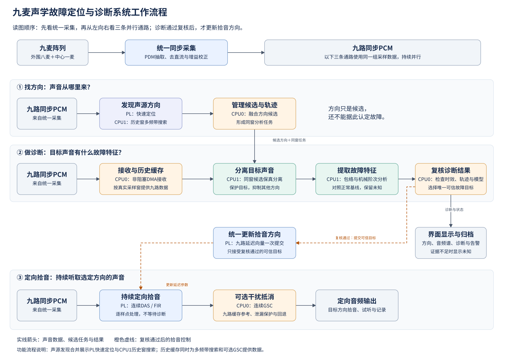
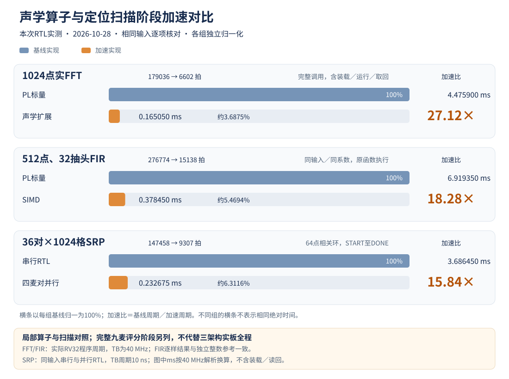
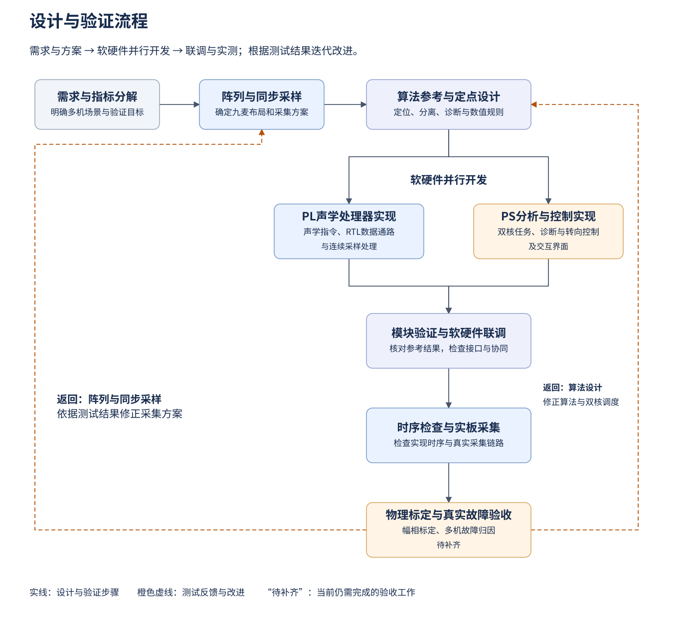

# 第一部分  作品概述

## 1.1 功能与特性

本作品是一套基于Zynq-7020的九麦声学定位引导故障诊断系统，面向多台旋转机械同时运行时声音混叠、异常声难以归属的问题，将声源方向与机械故障特征结合，辅助判断“异常来自哪个方向、具有何种故障特征”。

系统由九麦阵列、PL声学处理器、PS双核分析程序和浏览器界面组成。九路声音同步采集后，PL持续计算声源方向并输出定向音频；PS从历史音频中选取同一时段的九路数据，发现候选声源、分离目标声音，再提取与转速关联的机械特征。诊断结果与声源轨迹绑定，满足可信条件后更新拾音方向；条件不足时显示未知。

主要功能包括多声源方向显示与跟踪、目标声音分离、轴承阶次特征分析、定向拾音，以及音频谱、包络谱和事件记录。连续拾音支路可启用GSC自适应干扰抵消，并在疑似目标泄漏时回退至匹配的DAS/FIR输出。

*图1-1 系统工作流程。九路声音同步采集后，分为找方向、做诊断和持续定向拾音三条并行通路。方向候选用于引导同窗目标声音分离，分离后提取故障特征并复核；只有复核通过的可信目标才用于更新拾音方向。实线表示数据、任务与结果，橙色虚线表示拾音控制。图中将PL快速定位与CPU1多频带搜索合并为声源发现功能，历史缓存同时向多频带搜索和可选GSC提供数据。*

[编辑图1-1的 draw.io 源文件](技术文档配图/第一部分_系统工作流程.drawio)

## 1.2 应用领域

作品面向电机、风机、水泵及轴承试验台的非接触声学状态监测，适合在多个设备同时发声时，先按方向区分观察对象，再分析各对象的异常特征。在实验室中，可用于对比不同转速和故障状态下的声音变化；在设备巡检中，可辅助操作人员寻找异常声方向，并保存目标音频及频谱用于复核。

当前诊断实现以轴承故障阶次特征为重点。应用到具体设备时，需要配置轴承参数、确认转速并建立对应的正常基线和故障模型。系统目前输出阵列前方的声源方向，不测量声源距离；真实场景中的定位精度、可分辨角度与识别率需结合安装位置、混响和背景噪声实测确定。

## 1.3 主要技术特点

系统按采集、定位、分析和控制划分模块，以PL处理连续数据，以PS双核执行窗口分析和交互。

| 模块 | 核心实现 | 设计作用 |
|---|---|---|
| 同步采集 | 双相PDM接收、抽取、去直流与通道增益校正 | 为时差计算提供同步PCM |
| PL声学处理器 | 自研五级RISC-V发射FFT、互谱、PHAT及SRP指令；RTL推进地址和搬运数据 | 将计算与重复访存组织分工 |
| 并行运算 | 八lane SIMD支持乘加归约与逐元素更新；FFT/IFFT共用变换核，SRP四麦对并行 | 适配时域滤波和频域定位 |
| PS双核分析 | CPU0接收、缓存和控制；CPU1搜索、分离并提取包络及阶次特征 | 使长窗诊断与连续采集并行 |
| 目标控制 | 分离保真检查、残差反馈GSC、九路延迟原子提交 | 保护故障特征并协调定向拾音 |

## 1.4 主要性能指标

本次九麦实验记录覆盖定位评分、FFT、FIR、SRP、PS搜索、完整分离、GSC和包络分析。**在同一九麦输入窗口上，PL标量方案与完整声学加速架构完成1024个定位评分分别需要276.234300 ms和2.058850 ms，对应窗就绪后评分阶段耗时比134.17倍。该结果体现专用计算、数据搬运、存储组织及采集期统计前移的组合架构收益。** FFT、FIR和SRP各自对照的耗时比分别为27.12、18.28和15.84倍。以上PL时间来自RTL周期按40 MHz换算；PS算法另作Windows宿主计时。各项指标分别对应明确的输入、基线和计时范围，整机性能按端到端测试单独评价。

### 1.4.1 三种架构的对照与当前测量结果

三种方案使用相同的九路PCM定位任务：1024点窗、36麦对、相同有效频带、64点相关环及32×32方向网格。当前已完成两种PL执行方式的同任务评分对照，PS-ONLY的Cortex-A9时间待实板补测。

| 方案 | 计算任务放置 | 本次同一首窗的评分阶段时间 | 相对PL标量方案 |
|---|---|---:|---:|
| PL-PS标量：PS+PL Scalar | PL自研RISC-V运行标量C定位内核；PS负责的传输与控制不在本次RTL计时内 | 11049372拍；**276.234300 ms** | 1.00× |
| PS-ONLY | Cortex-A9运行相同定位内核，统一采集前端提供输入 | **待A9实板测量** | 待测 |
| PL声学加速：PS+PL Accelerated | RISC-V发射声学指令，FFT/IFFT、互谱/PHAT、SRP及自主搬运协同执行；统计前移至采集阶段 | 82354拍；**2.058850 ms** | **134.17×（组合架构收益）** |

来源：[九麦标量RTL结果](performance_comparison/circular9_scalar/rv_plain_Os/results.json)、[九麦加速RTL结果](performance_comparison/pl_rtl/results.json)。两组采用40 MHz、`-Os`编译及同一首窗，从原始窗口已驻留到全部1024个评分可用为边界，排除输入预装、峰值及质量后处理、结果发布和PS往返。标量端收窗后计算统计，加速端在采集过程中滚动累积统计；134.17倍因此体现计算、存储、搬运和统计前移的综合作用，对应完整声学加速路径的阶段性能提升。

逐级检查覆盖首窗45个统计词、576个复频谱词、2304个相关值和1024个评分，全部一致；宿主标量参考另核对加速方案连续32窗的1440个统计词和32768个评分。当前架构对照采用固定种子的合成九路平面波，以保证输入可复现；主表统一比较同一首窗，连续32窗结果用于检查稳定性。真实故障录音另按声学场景验证。

另外保留`-O2`标量构建作为编译敏感性检查：9806381拍，即245.159525 ms，与同一82354拍加速路径相比为119.08倍。主表使用与生产固件匹配的`-Os`，辅助行说明编译优化对标量成本的影响。[编译敏感性结果](performance_comparison/circular9_scalar/rv_plain_O2_corrected/results.json)

最终三架构实板主表还须统一测量“PS发起任务到取得有效结果”的全过程，包含传输、计算、轮询与校验。跨PL和A9比较统一使用实际时间；Windows宿主结果与Cortex-A9实板结果分别记录。

**性能测试方法。** 测试分为架构对比与单项优化对比。架构对比采用相同输入、定位任务和数值精度，评价完整实现的处理效率；单项优化采用控制变量法，在相同运行环境下仅切换待测实现，并校验输出一致性。各项测试条件及结果如下。

| 测试条件 | 测试项目 | 测试时间（ms） | 对比方案 | 测试时间（ms） | 加速比 |
|---|---|---:|---|---:|---:|
| 同一1024×9输入窗、36麦对、1024方向格，40 MHz；窗口就绪至评分完成 | 九麦定位：RISC-V标量 | 276.234300 | PL声学加速 | 2.058850 | **134.17×** |
| 同一RISC-V核、40 MHz，512点输入、32抽头；相同系数、定点规则及编译选项 | FIR：标量计算 | 6.919350 | 八lane SIMD FIR | 0.378450 | **18.28×** |
| 40 MHz，1024点实数输入，相同数值规则；包含装载、计算及结果取回 | FFT：标量计算 | 4.475900 | 声学扩展FFT | 0.165050 | **27.12×** |
| 40 MHz，36麦对、1024方向格；相同相关数据、时差表及插值规则；START至DONE | SRP：串行扫描 | 3.686450 | 单麦对流水 | 0.928825 | **3.97×** |
| 40 MHz，36麦对、1024方向格；相同相关数据、时差表及插值规则；START至DONE | SRP：单麦对流水 | 0.928825 | 四麦对分bank流水 | 0.232675 | **3.99×** |
| Windows宿主，单宽带输入；相同搜索范围及编译选项，41次测量均值 | PS搜索：参考实现 | 8.0546 | 预计算优化 | 7.3270 | **1.10×** |
| Windows宿主，单宽带输入；相同搜索范围及编译选项，41次测量均值 | PS搜索：参考实现 | 8.0546 | 成对IFFT及公共项复用 | 7.1921 | **1.12×** |
| Windows宿主，单宽带输入；相同搜索范围及编译选项，41次测量均值 | PS搜索：参考实现 | 8.0546 | 预计算与成对IFFT组合优化 | 6.1932 | **1.30×** |
| 同一A9平台、输入、滤波器、内存配置及运行负载 | 多通道抽取：标量实现 | 待实测 | NEON实现 | 待实测 | 待测 |
| 同一定位任务、输入及数据精度；任务发起至有效结果返回 | 异构部署：PS-ONLY | 待实测 | PL标量 | 待实测 | 待测 |
| 同一定位任务、输入及数据精度；任务发起至有效结果返回 | 异构部署：PS-ONLY | 待实测 | PL声学加速 | 待实测 | 待测 |

表中加速比为测试项目耗时与对比方案耗时之比。PL时间由RTL周期按40 MHz换算，PS搜索时间为Windows宿主测量均值。

九麦定位评分的134.17×为专用计算、数据搬运及采集期滚动统计共同作用下的阶段加速比；采集期统计不计入窗后耗时。FIR、FFT及SRP的单项结果分别对应各自测试任务。PS-ONLY及三方案端到端性能将在统一实板条件下测量。

### 1.4.2 九麦SRP扫描的同输入对照

测试采用36麦对、1024方向格、64点相关环。串行、单麦对流水和四麦对分bank流水使用相同的时差表、相关数据及黄金评分，周期从START断言计到观察到DONE，不包含装载与读回。

| SRP实现 | 扫描周期 | 按40 MHz折算 | 相对串行加速比 | 耗时降低 |
|---|---:|---:|---:|---:|
| 串行RTL | 147458拍 | 3.686450 ms | 1.00× | — |
| 单麦对流水 | 37153拍 | 0.928825 ms | 3.97× | 74.80% |
| 四麦对分bank流水 | 9307拍 | 0.232675 ms | **15.84×** | **93.69%** |

来源：[SRP原始结果](performance_comparison/rtl_primitives/measured_20261028/srp/results.json)。三种实现两轮周期一致；全部九种配置共18432个方向评分与黄金结果相同，并检查部分组、单格、重启和中止。该模块TB周期为10 ns，表中毫秒统一按产品40 MHz解析换算。这里的串行RTL基准与1.4.1的完整RISC-V标量定位内核是不同基准。SoC日志中的9306拍从BUSY首拍计数，与本表START锚点相差一拍，不混作性能变化。

### 1.4.3 当前源FFT与FIR的标量／扩展对照

| 算子与工作量 | PL标量周期 | PL加速周期 | 按40 MHz折算：标量→加速 | 加速比 |
|---|---:|---:|---:|---:|
| 1024点实数FFT | 179036 | 6602 | 4.475900→0.165050 ms | **27.12×** |
| 512点、32抽头Q15 FIR | 276774 | 15138 | 6.919350→0.378450 ms | **18.28×** |

来源：[当前源RV32算子结果](performance_comparison/pl_rtl/results.json)。两路径在同一RISC-V核、40 MHz TB和`-Os`条件下运行，输入与系数一致。FFT核对全部1026个int16输出；FIR在不改动被计时函数的条件下，通过指令退休观察取得标量和SIMD各512个输出，逐项与独立整数参考核对。两项均通过。

FFT的6602拍包括装载3088拍、RUN指令及握手919拍、取回2577拍和18拍函数／时间戳开销；917拍仅为FFT引擎内部运行，完整调用耗时按装载、运行及结果取回全过程统计。FIR计时包含历史初始化、输入生成、归一化、饱和和校验，排除系数预装；系数取当前算子测试使用的32抽头集合，该结果对应FIR算子测试范围，九麦连续音频支路的时延按完整链路单独测量。

*图1-2 本次RTL算子与扫描阶段对照，各组以自身基线归一为100%；毫秒按40 MHz换算。完整九麦评分任务另见1.4.1。*

### 1.4.4 当前九麦连续定位的延时分解

在加速生产路径中连续运行32个重叠窗口，定位窗／Hop为1024／512点，输入为156250 Hz的九路同步PCM。观测结果如下。

| 计时项目 | 本次范围 | 计时含义 |
|---|---:|---|
| 窗口首个PCM→RV32稳定结果发布 | **9.172325—9.176225 ms** | 每窗使用自己的首样本锚点，包含该窗1023个采样间隔 |
| 原始窗口就绪→1024评分完成 | 2.056600—2.058850 ms | 包含定位计算，止于SRP评分完成；不含后续读图及CPU后处理 |
| 固件记录的窗后处理 | 2.622975—2.626775 ms | 定位搬运／计算及CPU后处理的固件计时 |
| 末个PCM→RV32稳定结果发布 | 2.625125—2.629025 ms | 由同窗外部锚点直接相减，包含发布与观测开销 |
| 稳定结果发布间隔 | 3.273675—3.277075 ms | 31个间隔，均值3.276690 ms，与512点Hop节奏相符 |

来源：[32窗SoC计时及阶段记录](performance_comparison/pl_rtl/results.json)、[逐阶段周期表](performance_comparison/pl_rtl/stage_cycles.csv)。首末样本的采样跨度为1023/156250＝6.5472 ms，与1024点窗预算6.5536 ms相差一个采样周期。窗后计算及搬运为2.107800—2.110050 ms，CPU后处理为0.515175—0.516725 ms；各项范围分别统计，单次链路时延按同一窗口的完整记录计算。

每窗实际退休9次FFT、36次互谱、36次PHAT、36次IFFT及1次SRP调用；32窗采集和连续音频丢失计数均为0。该试验在对齐PCM处注入，连续音频夹具采用单位脉冲系数，不包含真实麦克风/PDM模拟转换、PS首次接收、网络与页面显示，长期运行稳定性与实际音质按相应实板场景单独评价。

### 1.4.5 PS算法的宿主时间与有效路径核验

宿主为Intel Core Ultra 5 338H、Windows 11、GCC 16.2.0，C采用`-O2`。使用C内部高精度墙钟，排除Python入口、编译、文件读写及输入生成；每变体先验证、再预热5次，测量轮内打乱变体顺序。以下时间单位均为ms，是当前C算法在该电脑上的成本，不替代A9计时，也不与PL时间相除。

| 搜索场景／实现 | 次数 | 平均 | P50 | P95 | 最大 | 相对参考均值 |
|---|---:|---:|---:|---:|---:|---:|
| 单宽带／完整参考 | 41 | 8.0546 | 8.2887 | 9.0905 | 10.6421 | 1.00× |
| 单宽带／仅预计算 | 41 | 7.3270 | 7.2885 | 8.2074 | 8.4095 | 1.10× |
| 单宽带／仅成对IFFT及公共项复用 | 41 | 7.1921 | 7.1314 | 8.5132 | 10.8761 | 1.12× |
| 单宽带／两项组合 | 41 | **6.1932** | 6.1764 | 7.2996 | 8.5765 | **1.30×** |
| 三源分频混合／完整参考 | 41 | 8.2452 | 7.8109 | 9.1545 | 29.8846 | 1.00× |
| 三源分频混合／仅预计算 | 41 | 6.8764 | 6.9528 | 7.8826 | 8.5787 | 1.20× |
| 三源分频混合／仅成对IFFT及公共项复用 | 41 | 7.0267 | 6.7928 | 8.2627 | 16.3340 | 1.17× |
| 三源分频混合／两项组合 | 41 | **5.9606** | 6.0048 | 6.9277 | 7.7612 | **1.38×** |

来源：[搜索及算术正式结果](performance_comparison/ps_software/measured_20261028_host_quiet/results.json)、[逐次时间样本](performance_comparison/ps_software/measured_20261028_host_quiet/raw_timings.csv)。每场景使用16640×9原始PCM、三个频带、36麦对和1024方向格，计时覆盖完整候选搜索。四模式的61词公开反馈及3072个整数评分相同；成对IFFT的末频带相关浮点误差不超过1.11×10⁻¹⁶。单宽带输出1个候选，三源夹具输出2个候选，因此本实验验证计算成本和变体一致性，该三源输入场景的候选检出结果为2个，声源发现能力按实际输出记录。

| 其他完整处理／专项 | 次数 | 平均 | P50 | P95 | 最大 | 测试范围 |
|---|---:|---:|---:|---:|---:|---|
| 双候选完整快照分离 | 31 | **56.866** | 56.774 | 60.682 | 67.097 | 160256×9输入→两路各40000点输出；含协方差、保护、求解、重构及质量检查 |
| GSC禁用抵消、匹配主支路 | 31 | 18.168 | 18.182 | 23.546 | 34.749 | 32768个原始点，0.2097152 s音频 |
| GSC启用真实在线适应 | 31 | **23.696** | 23.273 | 32.738 | 42.742 | 同一输入，包含干扰估计、残差及权值更新 |
| 当前长窗包络前端 | 31 | **2.0698** | 2.0553 | 3.0238 | 3.4675 | 40000点、1.024 s输入；特征提取，不含分离及分类 |
| 历史短窗包络前端 | 31 | 8.2765 | 8.4284 | 11.4834 | 12.3579 | 同一输入，但滤波与特征契约不同 |
| 原生64位整数除法 | 101 | 0.3520 | 0.3460 | 0.4379 | 0.7499 | 每轮131072个商 |
| GSC共享倒数及精确修正 | 101 | 1.5140 | 1.4035 | 2.0928 | 4.4608 | 相同分子／分母，每32个商共享一次倒数 |

完整模块来源：[GSC与双源分离正式结果](performance_comparison/ps_software/full_modules/measured_20261028_full_quiet/results.json)、[逐次时间样本](performance_comparison/ps_software/full_modules/measured_20261028_full_quiet/raw_timings.csv)。分离采用已知两个候选的合成宽带快照，两个结果均通过保真门控，8个统计观察帧、202个频点实际参与协方差处理，载频检查63/63且无输出削顶；它不包含候选自动发现、分类或外部会话可信性判断。GSC的512点预热不计入时间，32768点计时体全部进入适应路径，权值实际变化，输出与独立整数参考逐样一致。启用和禁用GSC完成的工作不同，两行用于说明功能成本，分别记录匹配主支路与在线适应两种功能状态的处理成本。

包络前端的平均成本比约4.00倍，但历史1400—4600 Hz短窗平均与当前2200—4600 Hz完整长窗前端不等价，两者按各自滤波频带和观察窗配置报告处理成本；当前包络与独立解析信号DFT的目标频点幅度误差约1.05×10⁻⁶。除法两路径131072个商逐项精确一致，本机原生64位除法与共享倒数方案的实测均值分别为0.3520 ms、1.5140 ms，原生除法均值与共享倒数均值之比为0.2325；ARM32平台按A9实板结果评价。以上原始离群值均保留，Windows结果用于报告宿主调度环境下的时间分布；实时最坏执行时间另按目标平台验证。

### 1.4.6 版本演进与实板验证安排

2026年10月11日旧固定FIR版本的FFT／FIR记录为26.10／18.59倍，旧八麦产品形态整轮为1.4669倍；2026年10月21日旧八麦定位计算和结果更新分别改善约7.36倍、4.76倍。这些历史任务、窗口或计时边界与本次不同，作为版本演进记录，与当前九麦主表分别报告。历史A9搜索约106→92→71 ms对应更早的短证据窗，与当前16640点搜索任务分别记录。

本次测试脚本、输入、固件、逐级数值、原始日志、调试与异常场景记录及哈希集中保存在工作区独立的`performance_comparison`目录；[统一结果表](performance_comparison/results_summary.csv)区分RTL周期、宿主时间及适用边界。

后续实板验证项目包括：三种架构的A9实板同任务及PS往返时间、NEON独立开关、双核满负载、至少1000个有效稳态窗口的P99与丢样、CPU占用、资源功耗，以及真实声场定位精度、分离保真和故障归因。当前32窗RTL及单机宿主结果提供可复现的阶段证据，上述实物指标按对应的实板测试方案进一步评价。

## 1.5 主要创新点

本作品以面向九麦声学负载的自研RISC-V处理器和PL/PS协同架构为创新主线，重点突出四项贡献：声学指令与双形态SIMD计算架构，计算指令、自主搬运与共享存储协同，分采样率及多时间尺度的双核并行处理，以及PL连续拾音与PS自适应抵消协同闭环。定位、分离和故障诊断构成这些架构设计的应用场景与验证任务；多声源发现、保真分离和有效性控制作为应用与算法创新另行说明。

### 1.5.1 核心创新：声学处理器与协同架构

本节按处理器计算架构、计算与存储协同、PL/PS任务协同、连续拾音闭环四个层次展开。前两项回答声学处理器如何执行及供数，后两项回答异构平台如何持续服务定位、诊断与拾音。

**（1）面向声学算子的自研RISC-V与双形态SIMD计算架构。**

① **五级流水处理器与声学指令接口。** 在PL中实现五级流水RISC-V处理器，具备前递、冒险处理、多拍执行握手、分支预测和指令退休观察；为向量操作、共轭互谱、PHAT、FFT/IFFT及SRP调度设置明确的指令入口，连接固件、译码和执行单元。

② **实数SIMD的归约与逐元素更新两种形态。** 八lane实数SIMD-MAC通过接通或旁路归约树，分别支持跨lane乘加归约和逐元素系数更新，使同一执行资源能够适配抽头计算与向量更新两类操作。

③ **时域与频域负载分别组织。** 时域抽头运算与复数频谱运算采用不同的数据布局和执行结构。复数单元支持4、8或16 lane配置，当前九麦配置采用4 lane。

④ **正逆变换共享计算核心。** FFT/IFFT共用512点复数核心，承载1024点实数变换，将正逆变换所需计算组织在共享结构中。

⑤ **创新落点与当前使用范围。** 贡献在于面向声学负载共同设计可编程处理器、指令和专用执行资源。逐元素更新已由执行单元支持；当前连续音频FIR使用乘加归约，在线GSC权值更新仍在PS端完成。

**（2）计算指令、自主数据搬运与共享存储的协同设计。**

① **指令发射与重复搬运分工。** 向量化收益容易被地址计算、逐字装载和结果回读抵消。本作品由RISC-V实际发射计算指令，RTL状态机承担窗口组织、地址推进、预取和中间数据搬运，减少处理器对重复访存的逐项干预。

② **以指令退休约束结果交接。** 计算结果的交接受指令退休和所有权协议约束，避免仅凭算子完成信号提前释放数据，使执行完成与后续数据使用保持一致。

③ **跨麦对复用频谱与有效数据。** 定位时各通道频谱只计算一次，供多个麦对共享；仅搬运需要的频点和相关时延区间，减少重复计算和无效传输。

④ **SRP计算与分bank存储匹配。** 将不规则查表访问分到四组独立存储bank，每组并行读出相邻相关点、插值并归约，配合同步BRAM读延时与流水预取，使存储供数与计算吞吐匹配。

⑤ **持续音频与共享SIMD协调。** 连续音频由独立状态机使用同一实数SIMD完成FIR，通过仲裁以及历史、系数区域划分与CPU协调。创新覆盖计算、搬运和持续服务的共同组织，完整架构收益由SIMD、存储组织及数据搬运共同形成。

**（3）分采样率、多时间尺度与PS双核的并行处理架构。**

① **PL承担持续采集与快速服务。** 将156250 Hz采集、快速定位和连续DAS/FIR置于持续数据通路，服务方向观测与逐样点音频处理。

② **PS通过分采样率保留长窗信息。** 机械阶次诊断需要较长观察时间，PS经过抗混叠抽取，以39062.5 Hz处理长窗分析，保留1.024 s真实观察信息，协调快速方向更新与长窗诊断需求。

③ **CPU0与CPU1按服务职责分工。** CPU0承担DMA接收、历史缓存、方向与轨迹更新、任务提交和交互；CPU1承担多频带搜索、同窗分离及诊断，避免长时间分析直接占据接收循环。

④ **共享缓冲与任务时效共同约束。** 历史、任务和结果缓冲采用明确的所有权及缓存一致性处理。按真实样点编号选窗，记录执行耗时，检查排队年龄、排队至完成总耗时和结果年龄，积压时优先处理有效的新窗口。

⑤ **区分调度配置与实际吞吐。** 0.512 s诊断步长表示任务调度配置，实际有效输出间隔仍取决于计算负载和证据条件；A9双核满负载及持续运行表现需由实板测量确认。

**（4）PL连续拾音与PS自适应抵消协同的目标保护闭环。**

① **PL主支路与PS自适应支路配合。** PL持续产生DAS/FIR主支路音频，PS从多通道参考估计干扰，将干扰估计与匹配主支路相减，兼顾连续拾音与变化干扰下的自适应处理。

② **输出残差驱动在线权值更新。** 将抵消后的输出残差反馈给权值更新过程，形成GSC/NLMS在线闭环。权值更新在PS端完成，连续GSC作为可选支路，与CPU1的多候选快照分离分别工作。

③ **目标保护与匹配回退。** 对目标泄漏、版本不匹配、转向过渡和发散设置保护。需要回退时暂停抵消并返回匹配DAS/FIR主支路，满足恢复条件后再适应；一般更新冻结与输出回退分别控制。

④ **保持整数规则的更新优化。** 同一次更新共享归一化倒数，并以余数修正恢复精确整数商，减少重复除法，保持约定算术结果。

⑤ **协同创新与验证边界。** 重点是PL主支路与PS自适应支路之间的匹配、保护和回退协同；GSC、NLMS沿用已有原理。真实干扰抑制、音质及ARM端算术优化收益仍需实测，PS负责在线权值更新，PL负责连续主支路处理。

### 1.5.2 面向故障诊断的应用与算法创新

以下设计说明核心处理器及协同架构如何服务多机故障诊断，作为应用价值与算法改进展开。

**（1）面向空间对象的定位—分离—诊断—定向拾音链路。**

① **从方向候选到目标音频。** 多机运行时，最强声音不一定来自故障设备。系统先建立声源方向与轨迹，再从同一采样窗口的九路信号提取各候选音频，分别开展机械特征分析。

② **诊断结果绑定空间与时间证据。** 结果携带轨迹、方向、窗口起点和工况信息，将声音异常对应到特定时段内某一方向的声源，形成可追溯的空间诊断流程。

③ **可信诊断反馈拾音方向。** 仅当当前证据支持唯一可信故障目标时，才自动更新拾音方向。输出为声源方向及关联证据，设备永久身份和声源距离仍需其他信息补充。

**（2）独立多频带发现与真实观测支持的多声源跟踪。**

① **独立多频带发现与统一仲裁。** PS直接从九路PCM的多个频带提出候选，不以PL最强峰作为唯一入口；统一仲裁并在同一方向复核支持，减少频带遍历顺序造成的偏置。

② **对已有弱次峰进行有界复核。** 在有界次数内投影去除强同伴，再检查弱次峰是否获得真实观测支持，为被强源掩盖的候选保留分析机会。

③ **以真实覆盖时间管理轨迹。** 区分新观测、暂失、恢复和过期，计算重叠观测窗实际覆盖的时间区间。轨迹ID保留与方向观测证据分别管理，诊断窗口获得足够真实支持后才进入分析。

④ **细角度估计与导向参数衔接。** 有效峰通过局部拟合获得细角度，再由统一标定表生成连续导向参数，同时限制历史峰在声源消失后继续影响当前诊断。

**（3）以故障特征保留为目标的实际协方差分离。**

① **以诊断特征保留作为分离目标。** 机械诊断依赖故障载频、调制和谐波结构，分离结果同时依据诊断特征完整性、输出能量及听感进行评价，干扰抑制过程中保持诊断依据。

② **目标保护与残差协方差抑制。** 从混合快照估计实际声场协方差，以目标中心及邻近方向建立受保护子空间，投影去除统计量中的目标贡献，再用残差协方差和正则化抑制其他方向。

③ **方向约束与保真检查。** 中心方向保持单位响应，目标与干扰扇区使用软约束，降低角度误差和病态矩阵的影响。分离结果通过目标响应、干扰泄漏、权重范数、保留能量及故障载频完整性检查后，才成为诊断输入。

④ **重构边界与结论有效性控制。** 快照重构采用重叠相加及边界归一化，避免窗口首尾幅度凹陷；未达到保真要求的候选不产生确定性故障结论。

**（4）九路原子转向与贯穿全链路的有效性约束。**

① **完整延迟向量原子提交。** 先写入完整影子向量，再一次提交使九路延迟成为同一版本，避免逐项生效时混用新旧方向；同时校验完整性、采集时代、时效及读回结果。

② **转向过程与音频版本匹配。** 转向依次经历控制接受、样点边界生效、分数延时平滑变化和稳定预热。音频携带版本及有效样点，PS仅用匹配参数执行GSC，保持主支路与参考支路对应。

③ **标定与诊断有效性贯穿全链路。** 定位、分离和转向共享坐标、通道映射、增益及传感器时延标定；诊断检查轨迹覆盖、模型、特征、分离版本和转速代次，限制跨端参数混用。

④ **区分候选分析与可信故障定向。** 合格候选可以形成诊断结果，但已收集的候选中仍有未解析方向时，不授予可信故障定向资格，使分析结论与自动空间控制采用各自的有效性条件。

### 1.5.3 支撑处理器与协同架构的实现细节

本节按“处理器执行与存储—异构处理与持续服务—诊断数据有效性”的顺序展开，说明前述创新如何落实到数值规则、存储布局和数据处理。各项属于对应创新的实现支撑，验证结果及适用边界见1.4节和1.5.5节。

**（1）处理器数值与存储实现：支撑核心创新（1）（2）。**

| 实现细节 | 具体设计与作用 |
|---|---|
| SIMD宽累加与定点输出 | 实数SIMD采用宽累加器、受控舍入及饱和，明确乘加中间结果与输出的数值规则，使并行运算具有可核对的精度边界。 |
| 分bank布局与同步BRAM预取 | 样点与系数分bank存储，将同步BRAM读延时纳入预取和排空逻辑，使执行单元的数据读取与流水推进配合。 |
| PHAT查表与分数SRP | PHAT采用幅值近似和倒数查表；SRP通过分数时差及相邻相关值插值生成方向评分，以明确的定点规则衔接计算与查表流水。 |

**（2）采集与PS计算优化：支撑核心创新（2）（3）（4）。**

| 实现细节 | 具体设计与作用 |
|---|---|
| 重叠采集与滚动统计 | 面向核心（2）（3），在1024点窗、512点Hop的采集过程中累积统计，减少收窗后的重复扫描；预热状态独立于回卷样点计数，避免计数回卷破坏持续处理状态。 |
| 九麦有效通道组织 | 面向核心（2）（3），五根双相DATA形成十个采集槽，仅九路进入统计、36麦对计算和波束归一化；分层处理双相启动、CIC过渡和有效PCM发布，避免空槽及启动瞬态进入后续计算。 |
| 带自检的NEON抽取 | 面向核心（3），八个外围通道并行、中心通道单独处理，结合累加范围证明与启动输入对照自检；检测失败时回退标量实现，为PS长窗分析提供具有数值检查的抽取路径。 |
| PS成对实相关IFFT | 面向核心（3），将两组Hermitian互谱打包，一次复数IFFT得到两组实相关；九麦36对在每个频带由36次变换降为18次，并复用通道功率归一化公共项，减少多频带搜索的重复计算。 |
| 标定量化驱动的预计算 | 面向核心（3），利用Q4原始延迟与四倍抽取后的1/64样点关系，预计算方向—麦对地址及三次插值权重；标定变化时重新生成，减少PS搜索内循环的地址和系数运算。 |
| GSC归一化计算复用 | 面向核心（4），同一次权值更新共享归一化倒数，并通过余数修正恢复精确整数商，减少重复除法且保持约定算术结果；ARM端实际耗时收益仍需测量。 |

**（3）诊断数据与结论有效性：支撑1.5.2节的应用与算法创新。**

| 实现细节 | 具体设计与作用 |
|---|---|
| 定位缩放与诊断幅度分流 | 定位分支按通道、按窗口去均值并选择二次幂缩放，提高弱信号的定点利用率；该临时缩放不写回诊断历史和录音。诊断使用已完成前端去直流及通道增益校正的同步PCM。 |
| 保留长窗信息的包络分析 | 解析选带、包络提取及多级抗混叠抽取后，使用一次4096点FFT分析2500个真实包络点，保留1.024 s观察信息；补零用于频谱采样，不增加物理分辨力。 |
| 转速关联的18维机械特征 | 提取四组轴承特征阶次及各自谐波，再加入1X、2X；硬件测速处理毛刺、稳定性与超时，转速变化后重新积累有效观察窗。 |
| 正常基线与未知拒识 | 将异常检测、类别判定和空间归因分开；模型、特征、分离和滤波状态不满足约定时保留未知，避免把任意异常直接解释为确定机械故障。 |

### 1.5.4 工程特色与验证闭合

**实时服务与通信负载隔离。** DMA和网络拥塞不会反向停止PL的PCM与DAS处理；下游丢失通过计数、CRC、序号和采集时代暴露。故障恢复后更换时代并重新预热，旧窗口及旧结果不会继续作为当前证据。

**同快照展示与事件追溯。** 音频谱、包络谱、轨迹和诊断绑定同一采样窗口，配套疑似、报警与恢复状态；未知和断流不视为正常恢复，历史可由PC端归档。

**原始录音取证与真实处理链回放。** 九路PCM长窗通过采样身份和哈希组织导出，离线回放调用实际C搜索、分离和特征实现。训练端使用同一生产特征提取逻辑，并覆盖弱源、近角及多源等挑战场景，用于检查各版本的功能一致性与适用条件。长窗导出为可选功能，其实际传输负载需在实板上验收。

**构建与交付一致性。** 将源码、位流、XSA、BSP、PS镜像及模型纳入匹配检查，保证已验证模块在最终交付中的版本一致性；哈希用于版本和内容一致性核验。

**定位失效隔离与受控恢复。** 定位窗口发生覆盖或丢失时，硬件锁存失败状态，取消活动窗口并禁止继续发布；恢复控制等待计算引擎空闲，累计丢失记录、更新时代并重新预热。相应实现见`rv32_overlap_localizer.v`和`rv32_localizer_recovery.v`。这使恢复后的窗口具有新的有效性起点，异常前后的数据不会混成连续观测；实际恢复耗时和持续负载表现待实板测量。

### 1.5.5 创新点与工程证据对应

下表将创新论证与可查材料对应。基于FFT、SRP、GSC及NLMS等已有算法原理，本作品的贡献集中于计算架构、异构协同、算法改进和系统集成。性能证据统一采用1.4节的边界，分别报告功能回归与真实场景验证结果。

| 创新层次与类型 | 实际问题及常规处理的不足 | 本系统机制与实现依据 | 已有验证及适用边界 |
|---|---|---|---|
| 核心（1）：声学RISC-V及双形态SIMD；架构创新 | 标量抽头、频谱与定位运算成本高 | 五级核、专用指令、实数归约／更新、复数变换；`rtl/core/`、`rtl/vec/`、`rtl/acoustic/` | `performance_comparison/pl_rtl/results.json`提供FFT/FIR数值与周期；完整架构收益由执行单元、存储及搬运共同形成 |
| 核心（2）：指令与搬运协同及退休交接；架构创新 | 标量搬运抵消计算收益，接受指令不等于架构执行完成 | 自主地址推进、频谱复用、bank流水、退休约束下交接；`rtl/array/rv32_overlap_localizer.v`及相关SoC连接 | `docs/issues/125-localizer-retirement-ownership.md`记录HALT场景的退休交接约束与验证；134.17×为组合收益 |
| 核心（3）：多时间尺度双核调度；架构与工程优化 | 长窗计算占用接收循环，旧结果可能绑定当前对象 | CPU0接收控制、CPU1计算、共享区所有权及样点年龄约束；`sw/ps_ipc.h`、`sw/ps_circular9_tasks.h` | `docs/issues/137-offline-closure-and-board-readiness.md`的交错测试使用假设计算成本；A9满负载与缓存行为待测 |
| 核心（4）：GSC目标保护闭环；算法与工程优化 | 参考支路含目标时可能误抵消 | 输出残差驱动NLMS，泄漏保护与匹配回退；`sw/gsc9.h` | 完整模块记录验证适应有效和独立整数参考一致；真实干扰抑制、音质及ARM算术收益待测 |
| 支撑：空间诊断链路；系统集成 | 混合音频分类难以归属空间对象 | 搜索、轨迹、同窗分离、诊断和拾音反馈；`sw/ps_circular9_tasks.h`、`sw/circular9_tracking.h`、`sw/circular9_diagnosis.h` | `docs/issues/137-offline-closure-and-board-readiness.md`记录真实C任务交错与生命周期回归；真实多机故障归因待验收 |
| 支撑：多频带候选及真实时间支持；算法改进 | 最强宽带峰可能漏掉弱源，重叠窗需要按实际覆盖时间统计观测支持 | 联合仲裁、有界投影复核、支持窗口并集；`sw/circular9_candidates.c/.h` | `docs/issues/135-offline-multisource-evidence-and-limits.md`、`136-offline-timing-and-robustness-followup.md`覆盖多源挑战场景；近角、强弱差及三源条件下的检出情况按实测记录 |
| 支撑：目标保护协方差分离；算法改进 | 强抑制可能破坏故障载频及调制 | 保护子空间、残差协方差、正则化和保真门控；`sw/circular9_candidates.c` | `performance_comparison/ps_software/full_modules/measured_20261028_full_quiet/results.json`验证已知双候选的有效分离路径；不包含自动发现和真实房间验收 |
| 支撑：原子转向与有效性约束；系统集成与工程优化 | 通道参数分批生效、跨端版本混用会破坏一致性 | 影子向量提交、版本／时代／时效／读回校验；`rtl/array/rv32_circular9_control.v`、`sw/ps_circular9_control.h` | 控制RTL仿真与PS回归见`docs/issues/137-offline-closure-and-board-readiness.md`；实物平滑转向待测 |
| 支撑：失效隔离、恢复与发布一致性；工程优化 | 错误计数不阻止坏结果发布，构建成功不保证交付匹配 | 失败锁存、空闲后重启、时代推进及产物核查 | `docs/issues/123-localizer-fail-closed.md`、`docs/circular9_readiness_20261025.md`；数字一致性检查与电气、声学及模型实物验收分层开展 |

### 1.5.6 研究拓展与应用条件

全网格投影残差找峰目前属于研究方案；已进入主流程的是对既有候选的有界残差复核。六类故障细分属于实验适配，独立录音泛化验证作为后续研究项目，可信故障定向仍采用既定证据条件。任意变速下的阶次重采样、声源距离测量以及永久设备身份识别列为后续拓展方向，当前系统以方向定位及对应机械特征分析为应用范围。

上述贡献强调本作品对声学计算、空间诊断和运行约束的具体组织方式；FFT、SRP、GSC、NLMS等基础方法本身沿用已有原理。实际多机场景下的精度、分离保真和诊断有效性由对应测试结果支撑。

## 1.6 设计流程

图1-3按“方案设计—并行实现—汇合验证”的顺序展示本作品的设计过程，正文中的步骤名称与图中方框一致。

1. **需求与指标分解 → 阵列与同步采样 → 算法参考与定点设计。** 对应图中最上方从左向右的三个方框：先明确多机场景与验证目标，再确定九麦布局及同步采集方案，最后建立定位、分离和诊断的参考算法及定点数值规则。
2. **PL声学处理器实现、PS分析与控制实现。** 对应中间并列的两个方框，两者从“算法参考与定点设计”分支并行开展。PL侧实现声学指令、RTL数据通路和连续采样处理；PS侧实现双核分析任务、诊断与转向控制以及交互界面。
3. **模块验证与软硬件联调 → 时序检查与实板采集。** 对应两条开发支路汇合后的两个方框：先以参考结果核对算子及模块输出，检查接口和软硬件协同，再检查实现时序并通过实板采集验证真实数据链路。
4. **物理标定与真实故障验收。** 对应最下方标有“待补齐”的方框：完成实物幅相标定，并使用真实多机故障场景验证定位、分离和故障归因。该方框表示后续实板验证环节，其状态与图中标注保持一致。

*图1-3 设计与验证流程。实线箭头表示步骤之间的先后或并行关系；橙色虚线表示从最终验收环节返回前期设计的改进路径。*

图中两条反馈路径分别为：**左侧虚线**从“物理标定与真实故障验收”返回“阵列与同步采样”，用于依据测试结果修正阵列与采集方案；**右侧虚线**从同一验收环节返回“算法参考与定点设计”，用于修正算法与双核调度。两条虚线用于说明设计迭代关系；声音数据通路见图1-1，验收进度以图中状态标注为准。

[编辑图1-3的 draw.io 源文件](技术文档配图/第一部分_设计与验证流程.drawio)

## 1.7 实板验证与应用拓展计划

围绕处理器性能、异构协同和多机场景应用，后续按照统一输入、统一计时范围和匹配版本开展下列实板验证。当前性能结论以1.4节已记录的RTL及宿主测试结果为依据，新增结果按相同方法归档。

| 验证方向 | 测试内容 | 评价目标 |
|---|---|---|
| 三架构性能对照 | 在相同录音、标定及任务下测量PS-ONLY、PL标量和PL声学加速方案，分别记录计算阶段及PS往返全过程 | 建立同任务、同精度的目标平台性能对照 |
| 优化贡献分解 | 分别切换SIMD、FFT扩展、SRP流水与并行、数据搬运、统计前移及NEON实现，其余条件保持一致 | 量化各项机制及组合架构的性能贡献 |
| 阵列与声学标定 | 核对九路通道映射、实际坐标、增益与时延，保存原始录音及标定参数 | 建立定位与分离使用的实物声学基准 |
| 多机应用验证 | 覆盖不同角度、距离、强弱差及混响，记录定位误差、检出率、误检率、分离保真及未知比例 | 评价多机场景下的空间诊断效果与适用条件 |
| 模型泛化验证 | 按原始录音ID划分训练与验证数据，绑定实际转速及模型版本 | 检查独立录音上的识别表现与证据可追溯性 |
| 双核持续运行 | 在A9双核满负载下记录至少1000个有效稳态窗口的P95、P99、观测最大值、丢样、覆盖、结果年龄及超时 | 评价实际吞吐、输出频率及持续服务稳定性；观测最大值与严格最坏执行时间分别报告 |
| 资源与工程指标 | 使用匹配发布版本统计布局布线资源、Setup/Hold时序、板级功耗及恢复时间 | 评价资源效率、时序表现和运行可靠性 |

后续技术章节将进一步说明寄存器、IPC状态转换、内存布局、定点位宽及舍入饱和规则，并与最终发布版本对应。本部分集中展示作品功能、处理器与协同架构创新，以及已有性能验证结果。
